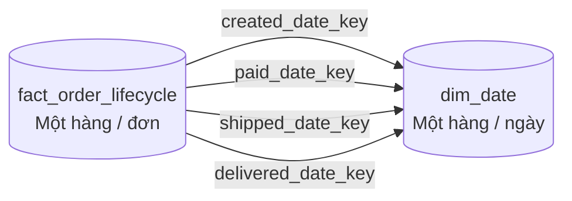

# Chiều ngày, chiều thời gian và một chiều đóng nhiều vai trò

## Mục tiêu học tập

Sau bài học, bạn có thể:

- Giải thích **bảng chiều ngày (date dimension)**, **bảng chiều giờ trong ngày (time-of-day dimension)** và **chiều đóng nhiều vai trò (role-playing dimension)** trong mô hình phân tích dạng hình sao.
- Phân biệt một **ngày lịch**, một **giờ địa phương**, một **thời điểm tuyệt đối (instant)** và một **khoảng thời gian**; biết khi nào nên giữ timestamp UTC trong fact.
- Thiết kế độ hạt, khóa, thuộc tính lịch, phạm vi ngày và các thành viên đặc biệt của chiều ngày để đáp ứng báo cáo theo tuần, tháng, quý và năm tài chính.
- Tạo quan hệ từ nhiều **mốc nghiệp vụ** của một fact tới **cùng một chiều ngày** mà vẫn tránh nhầm vai trò trong SQL, semantic layer và dashboard.
- Sử dụng cùng một chiều ngày cho **ngày tạo đơn, ngày thanh toán, ngày giao và ngày hoàn tất**; tính thời gian xử lý theo đúng instant thay vì trừ khóa ngày.
- Xử lý dữ liệu chưa xảy ra, không áp dụng, không biết; chuyển đổi múi giờ, sự kiện đến muộn, daylight saving time (DST) và lịch đặc thù theo tổ chức.
- Đánh giá khi nào cần bảng chiều giờ ở độ hạt phút/giây, khi nào chỉ cần timestamp, và khi nào cần lịch kinh doanh phụ thuộc vùng.
- Kiểm chứng mô hình bằng khóa ngoại, số lượng hàng, mốc ranh giới, chống nhân bản khi join, test lịch và tính đúng của KPI.

Trong module **DATABASE_DATA_MODELING**, việc chuyển yêu cầu nghiệp vụ thành thực thể, quan hệ, ràng buộc, khóa, chỉ mục và lược đồ vật lý phải phục vụ các câu hỏi thực tế. Với chương **Bảng chiều**, chiều ngày và chiều thời gian là những cấu trúc xuất hiện trong hầu hết mô hình báo cáo; tuy nhiên, việc một fact có nhiều trường ngày không có nghĩa phải sao chép cùng một bảng lịch thành nhiều bảng vật lý. Ta có thể cho một chiều **đóng nhiều vai trò**, mỗi vai trò là một quan hệ nghiệp vụ rõ ràng.

---

## 1. Bốn khái niệm thời gian không được đánh đồng

Giả sử đơn hàng `ord_908` được tạo vào:

```text
UTC instant:       2026-11-22T18:30:00Z
Tại Việt Nam:      2026-11-23 01:30:00 +07:00
Tại Los Angeles:   2026-11-22 10:30:00 -08:00
```

**Cùng một thời điểm**, nhưng ngày lịch phụ thuộc múi giờ. Nếu dashboard của shop Việt Nam tổng hợp theo ngày kinh doanh địa phương, đơn này thuộc **23/11**. Nếu dashboard tổng hợp theo ngày UTC, nó thuộc **22/11**.

Cần tách:

| Khái niệm | Ý nghĩa | Ví dụ | Hệ quả cho mô hình |
| --- | --- | --- | --- |
| **Instant** | Một thời điểm trên trục thời gian tuyệt đối | `2026-11-22T18:30:00Z` | Lưu UTC/kiểu timestamp thích hợp để tính thứ tự, độ trễ |
| **Ngày lịch (LocalDate)** | Ngày theo một lịch và một vùng/ngữ cảnh | `2026-11-23` tại Việt Nam | Join chiều ngày; tổng hợp theo ngày/tuần/tháng |
| **Giờ trong ngày (LocalTime)** | Vị trí trên đồng hồ trong một ngày, chưa có timezone | `01:30:00` | Join chiều giờ để phân tích theo ca, khung giờ |
| **Múi giờ (ZoneId)** | Bộ quy tắc ánh xạ instant sang ngày/giờ địa phương, gồm chuyển giờ nếu có | `Asia/Ho_Chi_Minh` | Cần khi suy ngày/giờ kinh doanh từ instant |
| **Khoảng thời gian (duration)** | Số thời gian giữa hai instant | 90 phút | Dùng timestamp/instant, không trừ số date_key |

Một ngày lịch không chứa đủ thông tin để biết **chính xác thời điểm**. Một giờ địa phương cũng không xác định instant nếu không có ngày, múi giờ và trong một số trường hợp thông tin offset/chọn lần lặp DST.

**Quy tắc:** khi nguồn có timestamp đáng tin, giữ timestamp/instant có thẩm quyền trong fact hoặc lớp chuẩn hóa; date/time dimension là **cách diễn giải và nhóm thời gian để phân tích**, không nên thay thế mọi timestamp gốc.

## 2. Chiều ngày là gì và phục vụ vấn đề nào?

**Chiều ngày (date dimension)** là bảng mô tả những **ngày lịch** trong một khoảng đã chọn, với **một hàng cho mỗi ngày** trong một hệ lịch/ngữ cảnh xác định.

Ví dụ:

| date_key | full_date | calendar_year | calendar_month | day_of_month | iso_week_year | iso_week_no | weekday_iso | is_weekend |
| ---: | --- | ---: | ---: | ---: | ---: | ---: | ---: | --- |
| 20261122 | 2026-11-22 | 2026 | 11 | 22 | 2026 | 47 | 7 | true |
| 20261123 | 2026-11-23 | 2026 | 11 | 23 | 2026 | 48 | 1 | false |
| 20261124 | 2026-11-24 | 2026 | 11 | 24 | 2026 | 48 | 2 | false |

Một hàng cho ngày 23/11 có thể được dùng để nhóm dữ liệu theo **thứ Hai**, **tuần ISO 48**, **tháng 11** hoặc **năm 2026** mà từng analyst không phải tự viết và duy trì những biểu thức lịch riêng.

### 2.1. Vì sao không chỉ dùng hàm DATE trong mọi câu truy vấn?

Nếu chỉ cần đếm sự kiện theo một ngày UTC, một biểu thức trích ngày từ timestamp có thể đủ. Nhưng bảng chiều ngày có giá trị khi:

- Cần một **định nghĩa lịch thống nhất** cho nhiều fact và nhiều dashboard.
- Phải báo cáo theo **tuần ISO, năm tài chính, kỳ 4-4-5 hoặc tuần kinh doanh**.
- Cần **hiển thị ngày không có giao dịch** thành hàng với số 0.
- Cần phân biệt **ngày làm việc, ngày cuối tuần, ngày nghỉ theo địa phương**.
- Muốn dùng filter năm/quý/tháng có thứ tự đúng, nhất quán giữa công cụ BI.
- Cần nối nhiều mốc ngày của fact với những tên vai trò có nghĩa.
- Muốn gắn các nhãn và cấu trúc thời gian không phụ thuộc cú pháp date function của từng công cụ.

Lợi ích nằm ở **hợp đồng lịch** và khả năng tái sử dụng, không phải ở việc bảng có bao nhiêu cột.

### 2.2. Grain của chiều ngày

Grain cơ bản:

> **Một hàng của `dim_date` = một ngày cụ thể trong lịch Gregory được chọn.**

Điều này khác với:

- Một ngày **theo shop và múi giờ**: có thể có cùng `full_date` nhưng nội dung ngày lễ/ca làm việc thay đổi theo shop.
- Một **ngày tài chính theo phiên bản lịch** nếu doanh nghiệp có nhiều lịch khác nhau.
- Một **giờ** hoặc một **instant**: đều không phải grain của `dim_date`.

Nếu hệ thống chỉ có một lịch dùng chung, `dim_date` có thể là **conformed dimension** dùng cho tất cả fact. Nếu có nhiều lịch tài chính hoặc nhiều vùng, cần phân tách thuộc tính phụ thuộc vùng/lịch thay vì lặng lẽ để chúng như thuộc tính chung của mọi ngày.

## 3. Các thuộc tính nên có trong chiều ngày

Một chiều ngày hữu ích thường gồm những nhóm thuộc tính:

| Nhóm | Ví dụ trường | Mục đích |
| --- | --- | --- |
| Danh tính | `date_key`, `full_date` | Join fact và kiểm tra một hàng/ngày |
| Lịch thường | `calendar_year`, `calendar_quarter`, `calendar_month`, `day_of_month` | Báo cáo theo đơn vị lịch |
| Tuần | `iso_week_year`, `iso_week_no`, `weekday_iso` | Báo cáo theo tuần ISO, thứ |
| Đầu/cuối kỳ | `month_start_date`, `month_end_date`, `is_month_end` | Lọc/thứ tự kỳ, snapshot |
| Đặc tính ngày | `is_weekend` theo quy tắc thống nhất | Báo cáo giờ/ngày làm việc |
| Nhãn | `month_name_vi`, `weekday_name_vi` | Hiển thị, không dùng nhãn để sort |
| Lịch tài chính | `fiscal_year`, `fiscal_period`, `fiscal_week` | Báo cáo tài chính khi có **một lịch được xác định** |
| Lịch kinh doanh riêng | `is_business_day`, `holiday_name` theo vùng | Nên tách nếu phụ thuộc vùng và lịch |

Nên lưu **mã số để sắp xếp** thay vì dựa vào chuỗi nhãn: các tháng theo thứ tự 1–12, thứ trong tuần 1–7, năm–tuần theo khóa kết hợp. Nhãn “Thứ hai” hoặc “Monday” phụ thuộc locale nhưng thứ tự không nên phụ thuộc alphabet.

### 3.1. Tuần ISO không phải tuần cộng vào năm dương lịch

Hệ tuần ISO thường bắt đầu vào **thứ Hai**. Tuần ISO đầu năm là tuần chứa **ngày thứ Năm đầu tiên** của năm. Vì thế **ISO week-year** có thể khác calendar year tại ranh giới năm.

Ví dụ:

```text
Ngày:            2021-01-01 (thứ Sáu)
calendar_year:   2021
iso_week_year:   2020
iso_week_no:     53
```

Nếu dashboard nhóm theo `calendar_year, iso_week_no` thay vì `iso_week_year, iso_week_no`, đầu và cuối năm có thể bị xếp sai tuần hoặc gộp những tuần không tương ứng.

Để dùng tuần, nên có khóa hoặc tổ hợp rõ:

```text
iso_year_week = "2020-W53"
sort_key      = 202053
```

Số `202053` chỉ là khóa sắp/nhãn của **tuần ISO**, không phải một ngày.

### 3.2. Lịch tài chính có thể không khớp lịch Gregory

Doanh nghiệp có thể bắt đầu năm tài chính vào tháng 4 hoặc dùng lịch **4-4-5** (4 tuần, 4 tuần, 5 tuần cho ba kỳ liên tiếp). Với cấu trúc 4-4-5:

- Kỳ tài chính không trùng tháng dương lịch.
- Một số năm cần **tuần thứ 53** theo quy tắc được công ty phê duyệt.
- Ngày bắt đầu và kết thúc kỳ phụ thuộc lịch cụ thể và phiên bản áp dụng.
- Nhiều đơn vị thuộc tập đoàn có thể dùng các lịch khác nhau.

Không tạo `fiscal_period = calendar_month` bằng giả định khi chưa có định nghĩa của Finance. Cần một bảng mapping ngày → kỳ tài chính từ nguồn có thẩm quyền, được kiểm tra không có lỗ hổng hoặc giao nhau.

### 3.3. Ngày nghỉ phụ thuộc vùng, không phải thuộc tính tuyệt đối

Ngày 02/09 có thể là ngày nghỉ theo chính sách Việt Nam, nhưng không có nghĩa là ngày nghỉ của mọi shop toàn cầu. Ngay trong một nước, ngày làm việc có thể thay đổi theo vùng, tổ chức và ca làm việc.

Nếu cần lịch địa phương, có thể dùng bảng cầu nối:

```text
bridge_date_business_calendar:
  (date_key, calendar_id, calendar_version)
  -> is_business_day, holiday_code, holiday_name, working_hours
```

Bảng này có grain **một ngày trên một calendar/version**. Nhờ đó `dim_date` không chứa các cột `holiday_vietnam`, `holiday_us`, `holiday_shop_17` mở rộng vô hạn và không làm các thuộc tính đặc thù bị hiểu sai thành chung cho mọi dữ liệu.

## 4. Khóa của chiều ngày: surrogate key hay mã ngày có ý nghĩa?

Có hai lựa chọn phổ biến.

### 4.1. Khóa số dạng YYYYMMDD

Ví dụ:

```text
date_key   = 20261123
full_date  = DATE '2026-11-23'
```

Ưu điểm:

- Dễ đọc khi debug.
- Có thể sinh từ ngày đã chuẩn hóa khi ETL/ELT.
- Thứ tự số của các **khóa ngày hợp lệ** cùng hệ lịch tương ứng thứ tự ngày.
- Dễ phân vùng một số fact theo ngày trong công cụ thích hợp.

Nhược điểm:

- Không phải dãy số liên tục; `20261130 + 1` không phải ngày 01/12.
- Không đại diện được những trạng thái **chưa có ngày**, **không áp dụng** hoặc **không biết** nếu không dành khóa đặc biệt.
- Dùng khóa thông minh không thay thế kiểm tra FK vào bảng chiều ngày.
- Khóa có ý nghĩa ngày sẽ khó tương thích nếu grain của dimension đổi thành ngày–lịch hoặc ngày–vùng.

### 4.2. Surrogate key vô nghĩa nghiệp vụ

Ví dụ `date_sk = 10123` cho `full_date=2026-11-23`. Đây là khóa thay thế không diễn đạt ngày. Ưu điểm là tách định danh vật lý khỏi cách mã hóa. Nhược điểm là pipeline cần lookup key, khó đọc bằng mắt.

**Khuyến nghị thiết kế:** cả hai đều có thể đúng. Với chiều ngày dùng chung một hàng/ngày ổn định, khóa dạng YYYYMMDD thường tiện; với kiến trúc có nhiều phiên bản lịch hoặc tiêu chuẩn surrogate key toàn warehouse, khóa vô nghĩa có thể phù hợp. Quan trọng hơn lựa chọn mã hóa là **grain, tính duy nhất, phạm vi lịch và FK**.

### 4.3. Không tính toán số học trực tiếp trên date_key

Sai:

```sql
-- Sai: tăng 1 không có nghĩa là sang ngày tiếp theo.
SELECT date_key + 1 AS next_day_key
FROM dim_date;
```

Đúng theo logic:

```sql
-- Minh họa SQL khái niệm: cộng ngày bằng kiểu DATE.
SELECT
    d.date_key,
    d.full_date,
    next_day.date_key AS next_day_key
FROM dim_date AS d
LEFT JOIN dim_date AS next_day
  ON next_day.full_date = d.full_date + INTERVAL '1' DAY;
```

Cú pháp cộng interval khác nhau giữa các DBMS, nhưng nguyên tắc là sử dụng **date arithmetic**, không cộng số vào biểu diễn khóa.

## 5. Lược đồ tham khảo cho chiều ngày

Ví dụ DDL dùng kiểu SQL phổ thông; một số ràng buộc và kiểu cần chỉnh theo warehouse hoặc công cụ BI đang dùng.

```sql
CREATE TABLE dim_date (
    date_key            INTEGER PRIMARY KEY,
    full_date           DATE NOT NULL UNIQUE,

    calendar_year       INTEGER NOT NULL,
    calendar_quarter    SMALLINT NOT NULL,
    calendar_month      SMALLINT NOT NULL,
    day_of_month        SMALLINT NOT NULL,

    weekday_iso         SMALLINT NOT NULL,
    iso_week_year       INTEGER NOT NULL,
    iso_week_no         SMALLINT NOT NULL,

    month_start_date    DATE NOT NULL,
    month_end_date      DATE NOT NULL,
    is_month_end        BOOLEAN NOT NULL,
    is_weekend          BOOLEAN NOT NULL,

    month_name_vi       VARCHAR(30) NOT NULL,
    weekday_name_vi     VARCHAR(30) NOT NULL
);
```

Với hệ dùng khóa đặc biệt âm, ràng buộc `full_date NOT NULL` làm hàng “Unknown date” không hợp lệ. Có hai cách thiết kế:

1. Cho phép `full_date NULL` đối với các thành viên đặc biệt và các thuộc tính không áp dụng khác; giữ `date_key` duy nhất.
2. Dùng cấu trúc/hợp đồng khác cho trạng thái chưa biết và dùng FK nullable trong fact nếu công cụ downstream xử lý được.

Cần chọn **một quy ước duy nhất** trước khi triển khai. Bài sẽ dùng phương án 1 ở các ví dụ về unknown/pending; DDL phía trên minh họa riêng **phần ngày lịch hợp lệ**, chưa bao gồm hàng đặc biệt. Khi triển khai cùng hàng đặc biệt, phải nới `NOT NULL` phù hợp hoặc tách chúng bằng cơ chế đã thống nhất.

### 5.1. Sinh dữ liệu chiều ngày

`dim_date` thường được **tạo trước** cho một dải đủ dài, chẳng hạn 2020–2040, thay vì chỉ có ngày đã phát sinh giao dịch.

Quy trình:

```text
for each calendar day d in [2020-01-01, 2040-12-31]:
    date_key = YYYYMMDD(d)
    calendar_year = year(d)
    calendar_month = month(d)
    day_of_month = day(d)
    weekday_iso = weekday(d)  # Monday=1 ... Sunday=7
    iso_week_year, iso_week_no = isoWeek(d)
    month_start_date = firstDayOfMonth(d)
    month_end_date = lastDayOfMonth(d)
    is_weekend = weekday_iso in {6, 7}  # theo quy ước minh họa
    writeOneRowFor(d)
```

Nên tính từ **thư viện lịch đáng tin**, không viết bằng công thức lấy `day_of_year / 7` để suy tuần. Tạo ngày cho cả các ngày không có giao dịch giúp báo cáo hiển thị “ngày 0” và phân tích chuỗi thời gian không bị mất khoảng trống.

### 5.2. Những ràng buộc cần kiểm chứng

- `date_key` là duy nhất.
- `full_date` là duy nhất đối với các hàng ngày thực.
- Có **đúng một hàng cho mỗi ngày** trong dải hỗ trợ, gồm ngày nhuận.
- `calendar_quarter = 1..4`, `calendar_month = 1..12`.
- `weekday_iso = 1..7` và `iso_week_no` hợp lệ cho ISO week-year tương ứng.
- `month_start_date <= full_date <= month_end_date`.
- Tất cả fact dùng `date_key` thực phải tìm thấy hàng tương ứng.
- Không có hàng 2026-02-29 vì 2026 không nhuận; có 2024-02-29.

Không chỉ kiểm tra số lượng hàng: một tập ngày có thể thiếu một ngày và lặp một ngày khác nhưng vẫn có cùng tổng số hàng.

## 6. Bảng chiều thời gian: giờ trong ngày khác với ngày lịch

**Time dimension** trong mô hình hình sao thường có nghĩa là **time-of-day dimension**: một hàng cho mỗi phút hoặc giây trên đồng hồ, không phải một hàng cho mỗi instant trong lịch sử.

Ví dụ grain **một giây của một ngày**:

| time_key | hour_24 | minute_no | second_no | time_text | quarter_hour | day_part |
| ---: | ---: | ---: | ---: | --- | ---: | --- |
| 0 | 0 | 0 | 0 | 00:00:00 | 1 | NIGHT |
| 5400 | 1 | 30 | 0 | 01:30:00 | 7 | NIGHT |
| 45296 | 12 | 34 | 56 | 12:34:56 | 51 | AFTERNOON |
| 86399 | 23 | 59 | 59 | 23:59:59 | 96 | NIGHT |

Ở đây:

\[
time\_key = hour \times 3600 + minute \times 60 + second
\]

Một ngày chuẩn có `24 × 60 × 60 = 86.400` **giá trị thời gian đồng hồ ở độ hạt giây**, nên khóa hợp lệ là `0..86399`. Đây là số **giây từ 00:00:00 theo đồng hồ địa phương**, không phải số giây từ UTC epoch.

Lưu ý các cột phân loại như `day_part` không có một định nghĩa phổ quát. Khung NIGHT/MORNING/AFTERNOON/EVENING cần được xác nhận theo nghiệp vụ; ca làm việc có thể phụ thuộc cửa hàng và thay đổi theo ngày.

### 6.1. Dùng giờ, phút hay giây?

| Grain chiều giờ | Số hàng đồng hồ/ngày | Dùng khi | Đánh đổi |
| --- | ---: | --- | --- |
| Mỗi giờ | 24 | Báo cáo số đơn theo giờ | Không phân biệt phút và giây |
| Mỗi phút | 1.440 | Biểu đồ theo phút, khoảng giờ hoạt động | Mất giây nếu không giữ trong fact |
| Mỗi giây | 86.400 | Phân tích chính xác tới giây | Nhiều hàng hơn nhưng vẫn nhỏ so với fact lớn |
| Mili giây | 86.400.000 | Rất hiếm khi cần một dimension theo từng mili giây | Bảng lớn; thường nên giữ timestamp/epoch trong fact |

Nếu fact có timestamp chính xác tới mili giây, vẫn có thể join dim_time theo **phút/giây** cho group, trong khi giữ timestamp gốc để tính thời lượng chính xác. **Không ép mọi độ chính xác của instant thành số hàng của dimension.**

### 6.2. DDL tham khảo cho chiều giờ

```sql
CREATE TABLE dim_time_of_day (
    time_key       INTEGER PRIMARY KEY,
    hour_24        SMALLINT NOT NULL,
    minute_no      SMALLINT NOT NULL,
    second_no      SMALLINT NOT NULL,
    time_text      VARCHAR(8) NOT NULL,
    quarter_hour   SMALLINT NOT NULL,

    CHECK (hour_24 BETWEEN 0 AND 23),
    CHECK (minute_no BETWEEN 0 AND 59),
    CHECK (second_no BETWEEN 0 AND 59),
    CHECK (time_key BETWEEN 0 AND 86399)
);
```

Thêm một ràng buộc hoặc test:

```text
time_key == hour_24*3600 + minute_no*60 + second_no
```

`time_key=0` là **nửa đêm hợp lệ**, nên nếu muốn biểu diễn “giờ không biết”, không được dùng `0` làm sentinel. Có thể dành `-1` cho unknown, `-2` cho not applicable theo hợp đồng, và nới CHECK cần thiết cho các hàng đặc biệt.

### 6.3. Khi nào không cần bảng chiều giờ?

Nếu báo cáo chỉ hỏi “doanh số theo ngày”, chưa có phân tích theo ca/khung giờ, có thể chỉ cần `order_completed_at_utc` và `completed_date_key`. Thêm dim_time mà không có access pattern cụ thể sẽ tăng FK, logic chuyển đổi và kiểm thử mà chưa tạo lợi ích.

Nếu cần phân tích theo **giờ trong ngày của địa điểm**, dim_time lại hữu ích: BI nhóm các sự kiện từ nhiều ngày theo một giờ, với phân loại `hour_24` hoặc `day_part` dùng chung.

## 7. Múi giờ và daylight saving time: chiều ngày/giờ chưa đủ

Một lỗi rất thường gặp là lấy `DATE(timestamp_utc)`, join `dim_date` và gọi đó là “ngày kinh doanh” của shop. Nó chỉ đúng khi hợp đồng sử dụng ngày **UTC** hoặc khi kho đã đổi timestamp sang đúng múi giờ.

### 7.1. Quy tắc ánh xạ được đề xuất

Giả sử hợp đồng yêu cầu phân tích theo **múi giờ có hiệu lực của shop tại thời điểm sự kiện**.

```text
source:
  orderId = ord_908
  completedAtUtc = 2026-11-22T18:30:00Z
  shopTimeZoneId = Asia/Ho_Chi_Minh

transformation:
  completedLocal = 2026-11-23T01:30:00+07:00
  completed_date_key = 20261123
  completed_time_key = 5400
```

Nếu một shop chuyển múi giờ kinh doanh hoặc thay địa điểm, nên dùng **mapping shop → timezone có thời gian hiệu lực**, chứ không lấy timezone hiện tại để tính lại mọi sự kiện lịch sử ngoài ý định.

Ví dụ mã Java thể hiện tư duy chuyển đổi:

```java
import java.time.Instant;
import java.time.LocalDate;
import java.time.LocalTime;
import java.time.ZoneId;
import java.time.ZonedDateTime;

Instant completedAt = Instant.parse("2026-11-22T18:30:00Z");
ZoneId businessZone = ZoneId.of("Asia/Ho_Chi_Minh");

ZonedDateTime local = completedAt.atZone(businessZone);
LocalDate localDate = local.toLocalDate();
LocalTime localTime = local.toLocalTime();

int completedDateKey =
        localDate.getYear() * 10000
        + localDate.getMonthValue() * 100
        + localDate.getDayOfMonth();

int completedTimeKey = localTime.toSecondOfDay();

// completedDateKey = 20261123
// completedTimeKey = 5400
```

Mã xử lý instant UTC đã biết; đó là trường hợp có ánh xạ xác định. Nếu nguồn chỉ đưa **local timestamp không kèm offset/zone** vào thời điểm DST chuyển, bài toán khó hơn và cần hợp đồng giải mơ hồ.

### 7.2. DST làm giờ địa phương có thể lặp hoặc không tồn tại

Tại các vùng áp dụng DST:

- Khi **đẩy đồng hồ lên**, một số local time có thể **không tồn tại** trong ngày chuyển.
- Khi **lùi đồng hồ**, một số local time xuất hiện **hai lần**, ứng với hai instant/offset khác nhau.

Vì thế:

```text
(date_key, time_key)  # ngày địa phương + giờ địa phương
```

**không luôn là định danh duy nhất của một sự kiện**. Ở giờ lặp DST, hai giao dịch xảy ra tại hai instant khác nhau có thể có cùng date_key và time_key.

Để phân biệt, fact nên giữ:

- Timestamp/instant UTC gốc.
- IANA timezone ID dùng cho diễn giải, hoặc reference tới cấu hình timezone có hiệu lực.
- Offset thực tế nếu cần kiểm toán thời điểm.
- ID sự kiện/giao dịch ổn định.

Không lấy `LocalDateTime` không kèm zone làm nguồn duy nhất cho sự kiện toàn cầu. Với data mart tính theo local business day, cần kiểm thử ngày chuyển DST thay vì giả định mỗi ngày địa phương luôn có 24 giờ thực.

### 7.3. Lịch nghỉ và ca làm việc có thể theo shop

Chuyển sang múi giờ chỉ xác định `local_date` và `local_time`. Nó chưa biết shop có mở cửa, hôm đó có lễ hay ca sáng kéo dài bao lâu. Các yếu tố này có thể cần:

```text
shop_calendar_mapping:
  (shop_id, valid_from, valid_to, calendar_id, timezone_id)

bridge_date_calendar:
  (calendar_id, date_key, calendar_version)
  -> holiday_flag, business_day_flag, opening_rule
```

Nếu ca tối đi qua nửa đêm, báo cáo “ca bán hàng” có thể gắn giao dịch 00:30 vào **ngày vận hành hôm trước** theo quy tắc cửa hàng; ngày vận hành này có thể khác ngày lịch địa phương. Khi đó cần **business_date_key** được tính từ quy tắc ca, không chỉ từ `LocalDate`.

## 8. Một chiều đóng nhiều vai trò là gì?

**Role-playing dimension** là **một bảng chiều vật lý hoặc một định nghĩa dimension dùng chung**, nhưng được tham chiếu từ fact dưới **nhiều vai trò có ngữ nghĩa khác nhau**.

Ví dụ một đơn hàng có bốn mốc:

- Ngày **tạo đơn** (*order date*).
- Ngày **thanh toán** (*payment date*).
- Ngày **gửi hàng** (*ship date*).
- Ngày **giao thành công** (*delivery date*).

Tất cả là **ngày lịch**, nên có thể dùng một `dim_date`. Nhưng không thể gọi chung `date_key` vì mỗi cột trả lời một câu hỏi khác nhau.



Trong SQL, bốn quan hệ này thường được diễn đạt bằng **bốn alias** của cùng bảng. Trong BI/semantic layer, có thể tạo **bốn vai trò logic**, ví dụ “Ngày tạo”, “Ngày thanh toán”, “Ngày gửi”, “Ngày giao”.

### 8.1. Không cần bốn bản sao vật lý của chiều ngày

Một phương án dễ nhầm:

```text
dim_order_date
dim_payment_date
dim_ship_date
dim_delivery_date
```

Nếu cả bốn đều có đúng cùng logic Gregory/ISO và cùng khoảng ngày, bốn bảng vật lý riêng chỉ làm tăng khả năng lệch:

- `dim_ship_date` thiếu ngày 2028-02-29 trong khi bảng khác có.
- Tuần ISO được tính khác nhau giữa các bảng.
- Tên tháng hoặc lịch tài chính cập nhật không đồng bộ.

Có thể tạo **view hoặc alias logic** cho từng vai trò trong semantic layer, trong khi dữ liệu nền vẫn từ **một dim_date conformed**. Nếu yêu cầu lịch khác nhau theo role (ví dụ ngày giao phụ thuộc lịch vận chuyển quốc gia), phần khác biệt nên được mô hình hóa ở **calendar mapping/bridge hoặc business rule**, không âm thầm sao chép ngày thành bốn bảng độc lập.

### 8.2. Cùng một ngày có thể giữ nhiều vai trò

Một đơn được tạo và thanh toán cùng ngày:

```text
created_date_key = 20261123
paid_date_key    = 20261123
```

Hai khóa giống nhau không có nghĩa hai sự kiện nghiệp vụ giống nhau. Chúng vẫn là **hai vai trò**, cần tên cột và các metric riêng.

Ngược lại, một đơn tạo ngày 23/11, thanh toán ngày 24/11, giao ngày 27/11 có ba date_key khác nhau. Không nên chọn một “date_key chung của đơn” để thay cho mọi mốc.

## 9. Thiết kế fact vòng đời đơn hàng với nhiều ngày

Hãy xác định grain trước:

> **`fact_order_lifecycle` có một hàng cho mỗi đơn hàng trong một shop.**

Đây là kiểu **accumulating snapshot fact**: một hàng được tạo khi đơn xuất hiện rồi được cập nhật khi các mốc trong quy trình hoàn tất. Nó khác với fact sự kiện **một hàng trên mỗi lần đổi trạng thái**.

### 9.1. DDL minh họa

Các bảng bên dưới sử dụng quy ước khóa ngày hợp lệ YYYYMMDD và các khóa đặc biệt đã được thiết lập ở `dim_date`. Để FK tới thành viên đặc biệt hoạt động, `dim_date` phải dùng schema tương thích với hàng đặc biệt (không dùng nguyên DDL phần 5 nếu `full_date NOT NULL`).

```sql
CREATE TABLE fact_order_lifecycle (
    shop_id             VARCHAR(40) NOT NULL,
    order_id            VARCHAR(40) NOT NULL,

    created_date_key    INTEGER NOT NULL,
    paid_date_key       INTEGER NOT NULL,
    shipped_date_key    INTEGER NOT NULL,
    delivered_date_key  INTEGER NOT NULL,

    created_at_utc      TIMESTAMP,
    paid_at_utc         TIMESTAMP,
    shipped_at_utc      TIMESTAMP,
    delivered_at_utc    TIMESTAMP,

    currency_code       CHAR(3) NOT NULL,
    gross_minor         BIGINT NOT NULL,
    status_code         VARCHAR(24) NOT NULL,

    PRIMARY KEY (shop_id, order_id),

    FOREIGN KEY (created_date_key) REFERENCES dim_date(date_key),
    FOREIGN KEY (paid_date_key) REFERENCES dim_date(date_key),
    FOREIGN KEY (shipped_date_key) REFERENCES dim_date(date_key),
    FOREIGN KEY (delivered_date_key) REFERENCES dim_date(date_key)
);
```

**Lưu ý:** `TIMESTAMP` có/không có timezone và cách lưu UTC khác nhau giữa DBMS. Trong hệ hỗ trợ, dùng kiểu instant/timestamptz phù hợp và quy ước UTC rõ; đừng trông đợi từ khóa SQL trên có cùng hành vi mọi hệ.

Nếu cần phân tích theo giờ địa phương của từng mốc, có thể thêm:

```text
created_time_key
paid_time_key
shipped_time_key
delivered_time_key
```

cùng các FK tới `dim_time_of_day`, hoặc chỉ lưu giờ cho mốc thực sự được dashboard dùng. Không phải mọi fact đều cần nhân đôi số cột FK thời gian.

### 9.2. Bốn alias trong một truy vấn

Ví dụ đếm đơn theo **tháng tạo** và **tháng giao**, bỏ qua đơn chưa giao:

```sql
SELECT
    created.calendar_year  AS created_year,
    created.calendar_month AS created_month,
    delivered.calendar_year  AS delivered_year,
    delivered.calendar_month AS delivered_month,
    COUNT(*) AS order_count
FROM fact_order_lifecycle AS f
JOIN dim_date AS created
  ON created.date_key = f.created_date_key
JOIN dim_date AS delivered
  ON delivered.date_key = f.delivered_date_key
WHERE f.delivered_date_key > 0
GROUP BY
    created.calendar_year,
    created.calendar_month,
    delivered.calendar_year,
    delivered.calendar_month;
```

`created` và `delivered` là **hai tên của cùng bảng** trong câu SQL, không phải hai bảng dữ liệu có nội dung độc lập.

Nếu cần chỉ “đơn tạo trong tháng 11”, filter ở **created date alias**. Nếu cần chỉ “đơn giao trong tháng 11”, filter ở **delivered date alias**. Đổi alias là đổi **nghĩa KPI**, dù query vẫn chạy đúng cú pháp.

### 9.3. Fact này có giữ được lịch sử trạng thái không?

Không đầy đủ. Khi accumulating snapshot được update `status_code`, nó thường chỉ phản ánh trạng thái và các mốc đã chốt hiện nay. Nếu cần “đơn ở trạng thái nào lúc 10:00 hôm qua?” hoặc “có bao nhiêu lần giao hàng thất bại?”, cần **transaction/event fact** hoặc nguồn lịch sử có grain riêng.

Một mô hình có thể dùng đồng thời:

```text
fact_order_lifecycle
    grain = một hàng/đơn, các mốc đầu/cuối quan trọng

fact_order_status_event
    grain = một lần chuyển trạng thái của một đơn
    keys  = (shop_id, order_id, event_id)
    attrs = from_status, to_status, occurred_at_utc,
            event_date_key, event_time_key
```

Không nối trực tiếp event fact 1:n vào lifecycle fact rồi `COUNT(*)` nếu muốn đếm số đơn: mỗi đơn có nhiều event sẽ bị nhân dòng. Cần xác định grain và dùng `COUNT(DISTINCT shop_id, order_id)` theo cú pháp phù hợp hoặc một fact đúng grain.

## 10. Các thành viên đặc biệt: chưa biết, chưa xảy ra, không áp dụng

Trong vận hành, một đơn mới tạo **chưa có ngày giao**. Đây không giống việc hệ thống bị lỗi và mất trường ngày giao.

Các trạng thái phổ biến:

| Ý nghĩa | Ví dụ | Cách mô hình hóa |
| --- | --- | --- |
| **Ngày thực đã biết** | Tạo 23/11/2026 | `created_date_key=20261123` |
| **Unknown** | Biết đã giao nhưng nguồn thiếu timestamp | `delivered_date_key=-1` theo quy ước |
| **Not applicable** | Đơn hàng số không vận chuyển vật lý | `shipped_date_key=-2` |
| **Not yet occurred / pending** | Đơn mới chưa giao | `delivered_date_key=-3` |
| **Ngày dự kiến** | Hẹn giao 28/11 | Một vai trò **expected_delivered_date_key**, không ghi nhầm vào ngày thực |

Các con số âm chỉ là **ví dụ mã sentinel**, không phải chuẩn bắt buộc. Điều quan trọng là **ý nghĩa khác nhau** được giữ rõ, không dùng ngày giả như `1900-01-01` mà dashboard có thể hiểu thành ngày thật.

### 10.1. Hai cách biểu diễn special members

**Cách A: hàng đặc biệt trong dim_date**

```text
date_key=-1 -> label="Không biết"
date_key=-2 -> label="Không áp dụng"
date_key=-3 -> label="Chưa xảy ra"
```

Ưu điểm: FK `NOT NULL` và nhiều công cụ BI có thể group/filter các trạng thái này như những thành viên chiều. Nhược điểm: `full_date` và các thuộc tính lịch phải cho phép null/giá trị đặc biệt, các query cần loại khỏi phân tích ngày thật.

**Cách B: FK NULL + cột trạng thái**

```text
delivered_date_key = NULL
delivery_date_state = "PENDING"
```

Ưu điểm: `dim_date` chỉ chứa ngày thật, ràng buộc kiểu rõ. Nhược điểm: inner join sẽ bỏ hàng không có date; semantic layer phải xử lý NULL/state minh bạch.

Không trộn hai phương án tùy tiện giữa các fact vì sẽ làm dữ liệu so sánh khó hiểu.

### 10.2. Chuyển trạng thái từ pending sang ngày thật

Khi đơn được giao:

```text
Trước:
  delivered_date_key = -3
  delivered_at_utc = NULL

Sau:
  delivered_date_key = 20261127
  delivered_at_utc = 2026-11-27T05:22:15Z
```

Cập nhật phải có quy tắc khi event đến trễ/trùng, và không để event trạng thái cũ đưa khóa ngày quay về PENDING. Nếu một đơn có nhiều lần “giao lại” hoặc giao nhiều kiện, grain một hàng/đơn có thể không còn đủ; cần một fact cấp **shipment/attempt**.

### 10.3. Khóa cho ngày tương lai

Ngày dự kiến giao thường ở **tương lai**, nhưng vẫn là một ngày thực. Chiều ngày nên được tạo đủ xa về tương lai theo nhu cầu dự báo, lịch giao hàng và planning. Nếu một date_key thực không tồn tại trong bảng chiều, lỗi là **thiếu coverage** hoặc ETL mapping, không nên tự gán Unknown nếu ngày đã biết.

## 11. Một chiều ngày có thể đóng nhiều vai trò trong semantic layer

Một số công cụ BI chỉ cho phép một quan hệ “active” giữa fact và một bảng dimension trong mô hình có nhiều đường join, hoặc cần thiết lập rõ role/measure. Vì vậy chỉ có nhiều FK trong DDL vẫn chưa bảo đảm mọi dashboard hiểu đúng.

Có thể thiết lập các vai trò logic:

```text
Order Created Date   -> dim_date qua created_date_key
Order Paid Date      -> dim_date qua paid_date_key
Order Shipped Date   -> dim_date qua shipped_date_key
Order Delivered Date -> dim_date qua delivered_date_key
```

Mỗi vai trò dùng cùng danh sách thuộc tính `calendar_year, month, iso_week_year, ...` nhưng được đặt tên **gắn với sự kiện**:

- “Năm tạo đơn”.
- “Tháng thanh toán”.
- “Tuần giao hàng”.
- “Ngày giao thành công”.

Trong SQL thường dùng alias; trong semantic layer có thể tạo các logical views hoặc dimension roles. Nếu công cụ buộc phải tạo bảng view riêng, chúng có thể là **view trên cùng một dim_date**, không nhất thiết là bốn bảng vật lý đồng bộ thủ công.

### 11.1. Metric phải nêu rõ vai trò thời gian

| KPI | Vai trò ngày đúng theo định nghĩa | Những vai trò dễ nhầm |
| --- | --- | --- |
| Số đơn mới | Created Date | Paid Date, Delivered Date |
| Số đơn đã thanh toán theo ngày | Paid Date | Created Date |
| Số kiện giao đi | Shipped Date ở grain shipment | Order Created Date |
| Số đơn giao thành công | Delivered Date | Paid Date |
| Thời gian tạo → thanh toán | Instant `paidAt - createdAt` | Trừ `paid_date_key - created_date_key` |
| Tỷ lệ giao đúng hẹn | Expected Delivery Date và Actual Delivery Date + quy tắc deadline | Một date_key chung |

Một báo cáo “đơn tháng 11” không đủ rõ: đó là **đơn tạo trong tháng 11**, **thanh toán trong tháng 11** hay **giao trong tháng 11**?

### 11.2. Nhiều bộ lọc ngày cùng lúc

Truy vấn:

> “Những đơn **tạo trong tháng 10** nhưng **giao trong tháng 11** là bao nhiêu?”

đòi hai alias với hai điều kiện độc lập:

```sql
SELECT COUNT(*) AS orders_created_oct_delivered_nov
FROM fact_order_lifecycle AS f
JOIN dim_date AS d_created
  ON f.created_date_key = d_created.date_key
JOIN dim_date AS d_delivered
  ON f.delivered_date_key = d_delivered.date_key
WHERE d_created.calendar_year = 2026
  AND d_created.calendar_month = 10
  AND d_delivered.calendar_year = 2026
  AND d_delivered.calendar_month = 11;
```

Một biểu đồ có một bộ lọc “Tháng” không thể mặc định áp cho cả ngày tạo lẫn ngày giao. Nếu người dùng muốn so sánh hai mốc, phải đặt nhãn, quan hệ và filter rõ.

## 12. Phân biệt ngày sự kiện, ngày snapshot và ngày hiệu lực dimension

Trong mô hình phân tích, các loại ngày có vai trò khác nhau:

1. **Ngày sự kiện (event date):** một lần thanh toán hoặc giao vận xảy ra.
2. **Ngày snapshot:** trạng thái tồn kho, tài khoản hoặc pipeline tại cuối ngày.
3. **Ngày hiệu lực (effective date):** một phiên bản chiều khách hàng/sản phẩm có hiệu lực.
4. **Ngày tiếp nhận (ingestion date):** hệ thống nhận dữ liệu, dùng giám sát pipeline.
5. **Ngày báo cáo (business/reporting date):** ngày theo lịch và quy tắc báo cáo.

Ví dụ doanh thu theo ngày hoàn tất cần `completed_date_key`, còn dashboard chất lượng dữ liệu có thể nhóm theo `ingested_date_key`. Nếu event đến muộn qua nửa đêm, hai ngày khác nhau là hợp lệ.

### 12.1. Role-playing date khác với SCD Type 2

**Role-playing:** nhiều FK trong fact trỏ tới **cùng dim_date** với ngữ nghĩa khác nhau.

**Slowly Changing Dimension Type 2 (SCD2):** nhiều hàng lịch sử của **cùng một thực thể** (như khách hàng) có `valid_from` và `valid_to` để phân tích theo thời gian hiệu lực.

Ví dụ:

```text
fact_order.completed_date_key -> dim_date
fact_order.customer_sk        -> dim_customer_scd2
```

Để chọn phiên bản khách có hiệu lực tại ngày hoàn tất, ETL phải join theo **business time** và khoảng hiệu lực của SCD2, không chỉ vì `dim_date` có thông tin năm/tháng.

Một bảng chiều ngày cơ bản thường chứa các thuộc tính lịch cố định; không nên áp SCD2 cho từng ngày chỉ vì muốn có thêm alias “Ngày tạo” và “Ngày giao”. Nếu một lịch tài chính được sửa hồi tố, đó là câu chuyện **quản lý phiên bản lịch** có chủ sở hữu và tác động KPI riêng, không phải vai trò của chiều.

## 13. Thiết kế thời gian cho KPI độ trễ và SLA

Ví dụ đo thời gian từ tạo đơn đến thanh toán:

```text
createdAtUtc = 2026-11-22T18:30:00Z
paidAtUtc    = 2026-11-22T19:05:30Z

elapsed      = 35 phút 30 giây
```

Không tính:

```text
paid_date_key - created_date_key
```

vì:

- Ngày tạo và ngày thanh toán có thể trùng, dù cách nhau nhiều giờ.
- Hai ngày liên tiếp có thể chênh chỉ vài giây quanh nửa đêm.
- Key YYYYMMDD không phải số ngày từ epoch.
- DST có thể làm hai local timestamps chênh một giờ đồng hồ nhưng duration thực khác.

Cách định nghĩa đúng:

\[
\text{time\_to\_pay\_seconds}
=
\text{Instant(paidAtUTC)}-\text{Instant(createdAtUTC)}
\]

Sau đó gắn cột measure này vào fact (hoặc tính bằng hàm timestamp difference của engine).

Nếu tính **ngày làm việc** thay vì giây thực:

- Dùng mapping business calendar theo shop/vùng.
- Chỉ tính những ngày/giờ làm việc theo quy tắc có hiệu lực.
- Nếu ca làm việc qua nửa đêm, cần business-day boundary.
- Định nghĩa rõ trường hợp nghỉ lễ hoặc ngày đóng cửa.

**Chiều ngày giúp phân loại ngày; nó không tự tính đủ SLA theo giờ làm việc của từng doanh nghiệp.**

## 14. Một ví dụ ETL hoàn chỉnh cho nhiều vai trò ngày

Input từ nguồn giao dịch:

```json
{
  "shopId": "shop_17",
  "orderId": "ord_908",
  "shopTimeZoneId": "Asia/Ho_Chi_Minh",
  "createdAtUtc": "2026-11-22T18:30:00Z",
  "paidAtUtc": "2026-11-22T19:05:30Z",
  "shippedAtUtc": null,
  "deliveredAtUtc": null,
  "status": "PAID"
}
```

Hợp đồng:

- Grain: một hàng/đơn.
- Các instant được giữ UTC.
- Tất cả ngày/giờ nghiệp vụ theo **múi giờ shop có hiệu lực tại thời điểm sự kiện**.
- Pending là khóa `-3`; không có ngày thực thì không tạo date_key giả.
- Ngày dự kiến (nếu có) là vai trò riêng.

### 14.1. Biến đổi các mốc

```text
createdAtUtc:  2026-11-22 18:30:00Z
  -> Asia/Ho_Chi_Minh: 2026-11-23 01:30:00
  -> created_date_key = 20261123
  -> created_time_key = 5400

paidAtUtc:     2026-11-22 19:05:30Z
  -> Asia/Ho_Chi_Minh: 2026-11-23 02:05:30
  -> paid_date_key = 20261123
  -> paid_time_key = 7530

shippedAtUtc:  NULL
  -> shipped_date_key = -3 (PENDING)

deliveredAtUtc: NULL
  -> delivered_date_key = -3 (PENDING)
```

`02:05:30` đổi thành số giây từ nửa đêm: `2×3600 + 5×60 + 30 = 7530`.

### 14.2. Hàm ánh xạ logic

```text
mapInstantToDateTimeKeys(instant, businessZone):
    if instant is null:
        return (PENDING_DATE_KEY, PENDING_TIME_KEY)

    local = toZonedDateTime(instant, businessZone)
    localDate = local.date
    localTime = local.time

    dateKey = YYYYMMDD(localDate)
    timeKey = localTime.hour * 3600
              + localTime.minute * 60
              + localTime.second

    assert exists dim_date[dateKey]
    assert exists dim_time_of_day[timeKey]

    return (dateKey, timeKey)
```

Đây là giả mã cho các mốc **có ý nghĩa pending**; nếu trường không áp dụng hoặc thực tế đã xảy ra nhưng timestamp bị thiếu, phải trả sentinel **NOT_APPLICABLE** hoặc **UNKNOWN** tương ứng, không dùng chung `PENDING`.

### 14.3. SQL cập nhật fact

Sau khi ETL xác định các khóa:

```sql
-- Dữ liệu nguồn đã được chuẩn hóa và kiểm tra quyền, định danh,
-- kiểu timestamp, timezone và trạng thái.
INSERT INTO fact_order_lifecycle (
    shop_id, order_id,
    created_date_key, paid_date_key,
    shipped_date_key, delivered_date_key,
    created_at_utc, paid_at_utc,
    shipped_at_utc, delivered_at_utc,
    currency_code, gross_minor, status_code
) VALUES (
    'shop_17', 'ord_908',
    20261123, 20261123,
    -3, -3,
    '2026-11-22 18:30:00',
    '2026-11-22 19:05:30',
    NULL, NULL,
    'VND', 219000, 'PAID'
);
```

Khi có sự kiện `SHIPPED`, pipeline cập nhật `shipped_at_utc` và `shipped_date_key` theo phiên bản nguồn. Trong mô hình incremental, cần idempotency và điều kiện chống event cũ ghi đè event mới. Câu `INSERT` trên chỉ minh họa một lần tạo fact, **không phải cơ chế upsert/CDC hoàn chỉnh**.

### 14.4. Tính lại khi dữ liệu thay đổi

Nếu shop đổi múi giờ hoạt động hoặc một đơn bị sửa timestamp nguồn:

1. Xác định xem KPI báo cáo theo timezone **ở thời điểm sự kiện** hay timezone **hiện hành**.
2. Lấy phiên bản mapping timezone có hiệu lực.
3. Tính lại các date/time keys bị ảnh hưởng theo chính sách.
4. Đối soát fact và mart dùng các keys đó.
5. Công bố thay đổi số liệu nếu một kỳ đã chốt phải restate.

Không sửa `date_key` trực tiếp bằng phép cộng/trừ theo offset. Cần chuyển lại từ instant và timezone rule có thẩm quyền.

## 15. Khi nào dùng một chiều ngày và khi nào cần nhiều lịch?

Một `dim_date` dùng chung là lựa chọn tốt cho **lịch Gregory/ISO cơ bản**. Nhưng có nhiều yêu cầu cần phần mở rộng:

| Tình huống | Mô hình gợi ý | Vì sao |
| --- | --- | --- |
| Nhiều fact cần tháng, quý, tuần ISO | Một `dim_date` conformed | Chung định nghĩa lịch |
| Order có created, paid, delivered date | Một `dim_date` với nhiều FK/alias | Role-playing, tránh sao chép lịch |
| Hai công ty con có năm tài chính khác | `dim_date` + bridge/calendar mapping theo công ty và version | Cùng ngày, kỳ tài chính khác |
| Ngày lễ và giờ mở cửa theo từng shop | `dim_date` + business calendar dimension/bridge | Phụ thuộc địa điểm, không phải ngày toàn cục |
| Nhiều vùng có DST | UTC instant + IANA zone + ngày/giờ local phát sinh | Ngày/giờ local không đủ định danh instant |
| Báo cáo theo ca có điểm cắt lúc 04:00 | Business-date logic + shift dimension | Ngày vận hành khác local calendar date |
| Nhiều sản phẩm dùng lịch 4-4-5 | Mapping tài chính có owner, version, leap-week rule | Tránh suy đoán lịch từ ngày Gregorian |
| Phân tích từng phút/giây | `dim_time_of_day` theo grain cần thiết | Cho phép nhóm theo hour/daypart |
| Đo duration chính xác | UTC instants + duration measure | Tránh sai số qua nửa đêm/DST |

### 15.1. Một chiều có thể đóng vai trò độc lập trong từng fact

Không chỉ fact đơn hàng; cùng `dim_date` còn có thể được dùng bởi:

```text
fact_payment:
    initiated_date_key
    settled_date_key

fact_shipment:
    dispatched_date_key
    delivered_date_key

fact_inventory_daily:
    snapshot_date_key

fact_customer_signup:
    registered_date_key
    verified_date_key
```

Nếu các dimension roles sử dụng cùng hệ lịch, báo cáo liên phòng ban có thể so sánh tháng, tuần và năm nhất quán. Nhưng **nghĩa KPI** vẫn phải ghi rõ: “đăng ký”, “xác minh”, “gửi”, “giao” không thể thay thế nhau.

## 16. Thiết kế truy vấn và hiệu năng

Một bảng chiều ngày vài nghìn hoặc vài chục nghìn hàng thường nhỏ so với fact hàng tỷ hàng. Tuy nhiên, **khóa join và điều kiện lọc** vẫn cần phù hợp với warehouse.

### 16.1. Date key trong fact và phân vùng vật lý

Nếu fact được partition theo `business_date`, filter ở chiều ngày qua join có thể được optimizer đẩy xuống fact hay không tùy engine và cách thống kê. Đôi khi cần filter trực tiếp trên `fact_date_key` hoặc cột ngày để tận dụng partition pruning.

Ví dụ nhu cầu:

> “Đếm đơn được tạo trong tháng 11/2026 của shop 17”.

Có thể viết:

```sql
SELECT COUNT(*) AS created_orders
FROM fact_order_lifecycle AS f
JOIN dim_date AS d_created
  ON f.created_date_key = d_created.date_key
WHERE f.shop_id = 'shop_17'
  AND d_created.full_date >= DATE '2026-11-01'
  AND d_created.full_date <  DATE '2026-12-01';
```

Nếu warehouse phân vùng fact theo `created_date_key`, bộ lọc trực tiếp trên khóa hoặc ngày vật lý có thể có lợi tùy execution plan. **Không thêm bản sao dim_date vật lý chỉ để tối ưu câu query** mà chưa đo plan và bytes scanned.

### 16.2. Filter thời gian và tính bao gồm của khoảng

Quy ước hữu ích cho timestamp:

\[
[from,\ to)
\]

Tức bao gồm `from`, không bao gồm `to`. Khi lọc tháng 11 theo giờ shop, cần xác định **instant UTC tương ứng với đầu ngày địa phương 01/11 và đầu ngày 01/12** của shop. Nếu vùng có DST, không lấy một số giờ cố định `24×days` để tính end boundary.

Với ngày đã được chuẩn hóa trong fact, filter các date_key/ngày thực theo khoảng ngày tương ứng đơn giản hơn; nhưng vẫn cần hiểu các ngày đó được suy ra từ timezone nào.

### 16.3. Bẫy fan-out khi dùng bảng lịch phụ

Nếu `bridge_date_business_calendar` có nhiều hàng trên mỗi `date_key` (mỗi vùng một hàng), join chỉ theo `date_key` sẽ nhân fact theo số calendar. Phải join theo **đúng calendar_id/version** của shop hoặc tiêu chí đã xác định.

Sai:

```sql
-- Có thể nhân dòng fact nếu một ngày có nhiều calendar.
SELECT SUM(f.gross_minor)
FROM fact_order_lifecycle AS f
JOIN bridge_date_business_calendar AS c
  ON c.date_key = f.created_date_key;
```

Đúng về ý tưởng:

```sql
SELECT SUM(f.gross_minor)
FROM fact_order_lifecycle AS f
JOIN shop_calendar_at_event AS sc
  ON sc.shop_id = f.shop_id
 AND sc.event_version_id = f.calendar_mapping_version_id
JOIN bridge_date_business_calendar AS c
  ON c.date_key = f.created_date_key
 AND c.calendar_id = sc.calendar_id
 AND c.calendar_version = sc.calendar_version;
```

SQL này minh họa yêu cầu khóa join, không áp dụng nguyên xi nếu schema thực tế không có `event_version_id`. **Grain của bridge và phạm vi hiệu lực** phải được khớp trước khi tổng hợp tiền.

## 17. Kiểm thử bắt buộc cho chiều ngày, chiều giờ và role-playing

Một mô hình có thể chạy query nhưng vẫn trả sai KPI vì sai lịch, sai timezone hoặc áp nhầm vai trò ngày. Nên kiểm thử từng lớp.

### 17.1. Bộ kiểm thử chiều ngày

| Kiểm thử | Kết quả mong đợi |
| --- | --- |
| Dải ngày đã công bố | Mỗi ngày thật có đúng một hàng, không có lỗ hổng |
| 2024-02-29 | Tồn tại vì 2024 nhuận |
| 2026-02-29 | Không tồn tại |
| 2021-01-01 | `calendar_year=2021` nhưng `iso_week_year=2020, iso_week_no=53` |
| Ranh giới tháng | `month_start_date` và `month_end_date` đúng |
| Thứ trong tuần | `weekday_iso` đúng quy ước 1=Monday |
| Date key YYYYMMDD | Join ra đúng `full_date`, không dùng số học key |
| Tháng tiếng Việt | Nhãn đúng, sort theo số tháng |
| Ngày nghỉ theo vùng | Không lấy flag ngày nghỉ của shop A cho shop B |
| Lịch tài chính | Mỗi ngày map đúng một kỳ cho từng calendar/version theo hợp đồng |

### 17.2. Bộ kiểm thử chiều giờ

| Kiểm thử | Kết quả mong đợi |
| --- | --- |
| `00:00:00` | `time_key=0` là giờ thật, không phải Unknown |
| `01:30:00` | `time_key=5400` |
| `02:05:30` | `time_key=7530` |
| `23:59:59` | `time_key=86399` |
| Số hàng độ hạt giây | 86.400 hàng giờ thật, cộng thành viên đặc biệt nếu có |
| Độ hạt phút | Còn 1.440 hàng, có chính sách xử lý giây |
| DST giờ lặp | Hai instant UTC có thể map cùng local time key, vẫn khác instant |
| DST giờ không tồn tại | Không tự tạo instant từ local time thiếu ngữ cảnh |

### 17.3. Bộ kiểm thử role-playing và fact

| Kiểm thử | Kết quả mong đợi |
| --- | --- |
| Đơn tạo và thanh toán cùng ngày | Hai vai trò có thể cùng date_key mà vẫn có nghĩa khác |
| Đơn chưa giao | PENDING khác UNKNOWN và NOT_APPLICABLE |
| Đơn giao sau tháng tạo | Query lọc theo created/delivered trả đúng các tháng khác nhau |
| Nhiều mốc trong fact | Các FK đều tìm được member hợp lệ |
| Join bốn alias dim_date | Mỗi order vẫn một hàng nếu mỗi alias có khóa duy nhất |
| Đổi trạng thái ở nguồn | Fact không bị event cũ ghi đè mốc mới |
| Giao nhiều kiện | Không ép mọi shipment vào một order lifecycle row nếu cần grain khác |
| Tính duration | Dùng hai instant UTC, không trừ date_key/local clock |
| Shop đổi timezone | Mapping theo mốc hiệu lực, không âm thầm đổi lịch sử |
| Dashboard có một filter “Date” | Role áp dụng phải rõ: tạo, thanh toán hay giao |
| Backfill ngày tài chính | KPI phiên bản cũ/mới được đối soát và công bố |

### 17.4. Các chỉ số chất lượng có thể theo dõi

- **Unmatched date keys:** số fact có FK ngày không tồn tại trong dim_date.
- **Unknown/pending/not-applicable rate theo role:** bất thường khi tỷ lệ Unknown tăng ở một nguồn.
- **Timezone mapping coverage:** số fact chưa xác định được zone đúng hiệu lực.
- **Date key derivation mismatch:** instant + zone tính lại không bằng date_key đã ghi.
- **Duplicate dimension rows:** có hơn một row cho cùng `full_date` trong phạm vi lịch.
- **Calendar mapping overlaps/gaps:** hai lịch hiệu lực cùng lúc hoặc thiếu kỳ tài chính.
- **Fact grain duplication:** số hàng tăng sau join role-playing hoặc bridge.
- **Stale milestone lag:** khoảng thời gian giữa event nguồn và fact lifecycle phản ánh mốc mới.
- **KPI reconciliation:** số đơn tạo, thanh toán, giao theo đúng vai trò so với sự kiện nguồn.

## 18. Những lỗi thiết kế thường gặp

| Sai lầm | Hệ quả | Cách sửa |
| --- | --- | --- |
| Coi `DATE(timestamp_utc)` là ngày địa phương của mọi shop | Sai ngày khi khác múi giờ | Chọn zone nghiệp vụ có hiệu lực, lưu instant |
| Chỉ giữ ngày/giờ địa phương mà bỏ instant | Không tính chính xác thứ tự/duration qua DST | Giữ UTC instant, timezone và offset khi cần |
| Dùng một `date_key` cho mọi mốc của đơn | Không phân biệt đơn tạo, trả tiền, giao | Đặt FK theo từng vai trò |
| Sao chép bốn dim_date vật lý giống hệt | Lệch cách tính ISO week/fiscal | Dùng một conformed date dimension với alias/view |
| Nhầm role-playing với SCD2 | Thiết kế dimension phức tạp vô ích | Tách khái niệm role và history |
| `paid_date_key - created_date_key` để tính SLA | Số học YYYYMMDD sai và thiếu thời gian | Lấy hiệu hai instant |
| Dùng `0` cho giờ Unknown | `00:00:00` bị hiểu là thiếu | Dành sentinel khác hợp lệ |
| Gán ngày `1900-01-01` cho đơn chưa giao | Dashboard ghi nhận sự kiện giả | PENDING/UNKNOWN/NULL có nghĩa riêng |
| JOIN dim_date bằng ngày nhưng bỏ calendar_id ở bridge | Nhân bản dòng fact và tổng tiền | Join theo đủ grain, calendar/version |
| Dùng calendar_year với iso_week_no | Sai grouping tuần ở ranh giới năm | Dùng iso_week_year |
| Hardcode 4-4-5 bằng công thức tháng dương lịch | Sai kỳ tài chính và tuần thứ 53 | Mapping từ lịch được phê duyệt |
| Gắn một cờ `is_holiday` chung cho mọi vùng | Sai ngày làm việc theo shop | Calendar bridge theo vùng |
| Mỗi lần có event cập nhật ghi đè snapshot không version | Event cũ xóa mốc mới | Idempotency/version/conditional update |
| Không sinh đủ dim_date cho ngày tương lai | Ngày dự kiến bị map thành Unknown | Sinh dải ngày theo nhu cầu planning |
| Chỉ kiểm tra count của dim_date | Có thể thiếu/nhân một ngày nhưng tổng bằng nhau | Test uniqueness + coverage |
| Tất cả BI filter “Date” mặc định theo ngày tạo | KPI ngày giao bị hiểu sai | Semantic roles, metric contract |

## 19. Quy trình thiết kế từ yêu cầu đến lược đồ

1. **Liệt kê mốc thời gian nghiệp vụ.** Tạo, thanh toán, gửi, giao, hủy, hoàn tiền, snapshot, dự kiến.
2. **Phân loại từng mốc.** Event date, reporting date, business date, planned date, ingestion date hay hiệu lực dimension.
3. **Xác định grain fact.** Một order, một shipment, một payment hay một event; không dùng một hàng để che mọi quan hệ 1:n.
4. **Định nghĩa timezone.** UTC instant nguồn, zone có hiệu lực, lịch địa phương, ngày hoạt động nếu khác local date.
5. **Thiết kế dim_date.** Grain một ngày, dải hỗ trợ, khóa, ISO/calendar và tài chính.
6. **Xác định lịch phụ thuộc vùng/công ty.** Thêm calendar mapping/bridge nếu một ngày có nhiều cách phân kỳ.
7. **Quyết định cần dim_time hay không.** Hour/minute/second theo truy vấn; giữ instant để tính độ dài.
8. **Đặt từng vai trò ngày ở fact.** `created_date_key`, `paid_date_key`, `delivered_date_key` ... cùng FK/alias rõ nghĩa.
9. **Chọn mô hình null/special members.** Unknown, Not applicable, Pending, expected date, và quy tắc xử lý thiếu.
10. **Thiết lập semantic roles.** Tên người dùng, filter, metric contract, quan hệ active/inactive nếu công cụ yêu cầu.
11. **Viết kiểm thử dữ liệu.** Leap day, ISO year, DST, timezone mapping, FK coverage, join grain và trạng thái.
12. **Đo với workload thực.** Latency, bytes scanned, partition pruning, cardinality và KPI reconciliation.
13. **Chuẩn bị thay đổi.** Nếu lịch tài chính, timezone hoặc mốc sự kiện đổi, có kế hoạch backfill, phiên bản và đối soát.

## 20. Bài tập vận dụng

### Bài tập A — Một đơn, ba tháng khác nhau

Đơn `ord_908` có:

```text
createdAtUtc   = 2026-10-31T20:30:00Z
paidAtUtc      = 2026-11-01T00:10:00Z
deliveredAtUtc = 2026-12-02T02:00:00Z
shop zone      = Asia/Ho_Chi_Minh
```

**Câu hỏi:** tính `created_date_key`, `paid_date_key` và `delivered_date_key` theo ngày địa phương; chỉ ra KPI nào thuộc mỗi tháng.

**Gợi ý:** giờ Việt Nam nhanh hơn UTC 7 giờ: ngày tạo là **01/11**, ngày thanh toán cũng là **01/11**, ngày giao là **02/12**. Vì vậy một đơn có thể được đếm ở tháng 11 cho KPI tạo/thanh toán và tháng 12 cho KPI giao. Không suy ra ngày từ tháng UTC.

### Bài tập B — Ngày chưa có và ngày không áp dụng

Một đơn hàng vật lý chưa được giao; một đơn hàng số không cần vận chuyển; một đơn khác đã giao nhưng dữ liệu nguồn mất timestamp.

**Câu hỏi:** có nên dùng cùng `delivered_date_key = NULL` hoặc `19000101` cho cả ba? Hãy định nghĩa cách biểu diễn.

**Gợi ý:** phân biệt PENDING, NOT_APPLICABLE và UNKNOWN qua special members hoặc trạng thái đi cùng nullable FK. Mọi metric cần loại/hiển thị các nhóm này đúng nghĩa.

### Bài tập C — Tuần ISO ở ranh giới năm

Nhà phân tích nhóm đơn theo `calendar_year=2021, iso_week_no=53`. Một số đơn diễn ra ngày 01/01/2021.

**Câu hỏi:** vì sao grouping có thể sai? Cần dùng trường nào?

**Gợi ý:** 01/01/2021 thuộc tuần ISO **2020-W53**. Dùng `iso_week_year` với `iso_week_no` thay vì calendar year.

### Bài tập D — Giờ lặp DST

Hai giao dịch của một shop vùng áp dụng DST được ghi cùng `local_date=2026-11-01` và `local_time=01:30:00`, nhưng `UTC instant` khác nhau.

**Câu hỏi:** có phải một giao dịch bị trùng không? Bảng `dim_time_of_day` có giúp phân biệt hai giao dịch không?

**Gợi ý:** không. Giờ lặp có thể tương ứng hai instant với offset khác nhau. Date/time dimensions để nhóm theo lịch/đồng hồ; fact vẫn cần event ID, instant UTC và timezone/offset khi cần.

### Bài tập E — KPI ngày thanh toán và ngày tạo

Một dashboard dùng `fact_order_lifecycle` và `dim_date`, nhưng người dùng kéo một bộ lọc “Tháng” không biết nó áp vào khóa nào.

**Câu hỏi:** thiết kế role và metric thế nào để tránh báo cáo “số đơn thanh toán tháng 11” thực tế đếm theo tháng tạo?

**Gợi ý:** tạo vai trò “Ngày tạo” và “Ngày thanh toán” trong semantic layer với FK tương ứng, đặt tên measure và filter rõ. Test đơn tạo tháng 10, thanh toán tháng 11.

### Bài tập F — Lịch nghỉ theo hai quốc gia

Cùng ngày 02/09, shop Việt Nam nghỉ còn shop quốc gia khác hoạt động bình thường. Một bảng `dim_date` có `is_holiday=true` cho ngày đó.

**Câu hỏi:** vì sao flag này không thể dùng chung cho cả hai shop? Đề xuất cách mô hình hóa.

**Gợi ý:** giữ `dim_date` cho ngày/tuần/tháng chung; thêm calendar theo vùng/shop và bridge `(calendar_id, date_key, calendar_version)` cho ngày nghỉ/ngày làm việc. Join đủ khóa, tránh fan-out.

### Bài tập G — SLA theo giờ làm việc

Khách tạo đơn thứ Sáu lúc 17:30, shop chỉ làm việc thứ Hai–thứ Sáu 09:00–18:00. Đơn được giao thứ Hai lúc 10:00.

**Câu hỏi:** lấy `delivered_date_key - created_date_key` có cho biết thời gian xử lý đúng không? Dùng gì để tính SLA “giờ làm việc”?

**Gợi ý:** cần instant hai mốc và quy tắc ngày/ca làm việc của shop; tính giao của khoảng [createdAt, deliveredAt) với các khoảng làm việc có hiệu lực. Chiều ngày/giờ cung cấp calendar context chứ không tự trừ ra working duration.

### Bài tập H — Chọn grain cho nhiều kiện hàng

Một đơn có ba kiện gửi ở ba thời điểm và hai kiện được giao thành công vào hai ngày khác nhau.

**Câu hỏi:** có nên nhét cả ba `shippedAt` vào một cột ngày gửi của `fact_order_lifecycle`? Nên có fact gì?

**Gợi ý:** nếu cần phân tích theo kiện, dùng `fact_shipment` hoặc `fact_delivery_attempt` với grain một kiện/lần giao, các role ngày tương ứng. Fact cấp đơn có thể lưu mốc tổng hợp được định nghĩa rõ (gửi kiện đầu tiên, giao hoàn tất cuối cùng) nhưng không thay thế chi tiết shipment.

## Tổng kết kiến thức

**Chiều ngày** cung cấp một cấu trúc lịch thống nhất với grain **một hàng/ngày**, đủ cho báo cáo theo tuần, tháng, quý và các kỳ kinh doanh đã được định nghĩa. **Chiều thời gian** thường diễn đạt **giờ trong ngày** ở độ hạt giờ/phút/giây, giúp nhóm theo khung giờ nhưng không thay thế instant UTC để tính duration hoặc phân biệt những giờ lặp do DST.

**Chiều đóng nhiều vai trò** cho phép một `dim_date` được fact tham chiếu nhiều lần qua các khóa như `created_date_key`, `paid_date_key` và `delivered_date_key`. Điểm quan trọng không phải có nhiều bảng chiều, mà là có **nhiều quan hệ nghiệp vụ được đặt tên và kiểm chứng rõ ràng**. Các trường ngày chưa biết, không áp dụng và chưa xảy ra cũng phải được mô hình hóa tường minh.

Trước khi chốt lược đồ, hãy hỏi: **“Ngày này được xác định theo instant và múi giờ nào? Fact đang nói về mốc tạo, thanh toán, giao hay snapshot? Chiều lịch có đúng grain và phiên bản kinh doanh không? Nếu một ngày được dùng cho nhiều vai trò, tôi đã khiến SQL, KPI và dashboard phân biệt được từng vai trò chưa?”**
