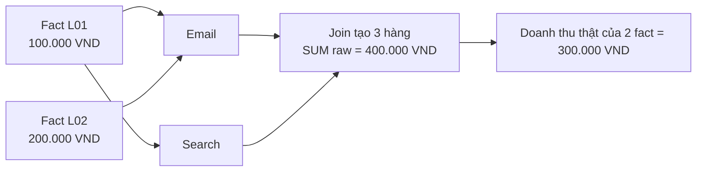

# Chiều nhiều giá trị và bảng cầu để giữ đúng độ hạt

## 1. Một dữ kiện có thể gắn với nhiều thành viên chiều

Trong module `DATABASE_DATA_MODELING`, người học chuyển yêu cầu nghiệp vụ thành mô hình dữ liệu có thể kiểm chứng: nhận diện thực thể, quan hệ, ràng buộc, chuẩn hóa, khóa, chỉ mục rồi chọn cấu trúc quan hệ, document, graph hoặc phân tích phù hợp. Đối với chương **Bảng chiều**, thách thức không chỉ là mô tả một thuộc tính, mà còn là duy trì ý nghĩa của **một hàng bảng dữ kiện (fact)** khi nó liên quan đến **nhiều thành viên của cùng một chiều (dimension)**.

Ví dụ một dòng bán hàng trị giá **100.000 VND** được ghi nhận nhờ hai chiến dịch quảng bá: “Email” và “Tìm kiếm”. Nếu thiết kế một cột `campaign_sk` trên `fact_sales_line`, dòng bán chỉ tham chiếu được một chiến dịch; nếu nối fact tới hai chiến dịch qua bảng nhiều–nhiều rồi cộng doanh thu không kiểm soát, doanh thu của **một dòng** sẽ xuất hiện **hai lần**.

Đây chính là bài toán **multi-valued dimension**: một fact ở grain xác định có thể mang nhiều giá trị chiều, nhưng phép nối không được làm thay đổi bản chất của grain hoặc tạo ra measure giả.

Sau bài học, người học có thể:

1. Phân biệt chiều nhiều giá trị với dimension có nhiều thuộc tính, với role-playing dimension và với grain một quan hệ nhiều–nhiều thực sự.
2. Định nghĩa grain của fact và bridge, chọn khóa chính, khóa ngoại, độ duy nhất và chính sách thành viên.
3. Nhận biết *fanout* khi join, từ đó tránh nhân hàng, double counting và sai tỷ lệ.
4. So sánh **full credit**, **fractional allocation** và **primary attribution**, quyết định quy tắc dựa trên nghiệp vụ chứ không tùy ý chọn phép chia.
5. Thiết kế **fact-to-dimension bridge** và **dimension group bridge**, hiểu ảnh hưởng của SCD Type 2 và quan hệ có hiệu lực theo thời gian.
6. Dùng DDL và truy vấn PostgreSQL 16 để thử dữ liệu, kiểm tra tổng trọng số, kiểm tra bản ghi thiếu thành viên và đối soát tổng số liệu.
7. Đánh giá tác động đến truy vấn phân tích, thời gian cập nhật, indexing, pipeline dữ liệu và mô hình lưu trữ khác.

## 2. Bắt đầu bằng grain, không bắt đầu bằng `CREATE TABLE bridge`

**Grain** là câu trả lời cho câu hỏi: *một hàng trong bảng này đại diện cho một điều gì duy nhất?*

Giả sử bảng `fact_sales_line` có grain:

> Một hàng là **một dòng đơn bán đã được chấp nhận** trong một tenant và một hệ nguồn, duy nhất theo mã đơn nguồn và mã dòng nguồn.

Đơn `SO-18` có hai dòng:

| Dòng bán | Giá trị | Chiến dịch tác động |
|---|---:|---|
| `L01` | 100.000 VND | Email, Tìm kiếm |
| `L02` | 200.000 VND | Email |
| **Tổng hai dòng** | **300.000 VND** | Không phụ thuộc số chiến dịch |

**Grain của fact vẫn là một dòng bán**, bất kể dòng đó gắn với 0, 1 hay 20 chiến dịch. Việc thêm các thành viên chiều không tạo thêm giao dịch và không tự làm phát sinh tiền bán.

Nếu chọn thêm một bảng `bridge_sales_campaign`, grain của nó là:

> Một hàng bridge là **mối liên kết giữa một dòng bán cụ thể và một chiến dịch cụ thể**, tại phạm vi tenant tương ứng, theo chính sách phân bổ đã được chốt.

Do đó, hai bảng có grain khác nhau:

| Bảng | Một hàng đại diện | Khóa duy nhất theo ý nghĩa |
|---|---|---|
| `fact_sales_line` | Một dòng bán | (`tenant_id`, `source_system`, `source_order_ref`, `source_line_ref`) |
| `dim_campaign` | Một thành viên chiều chiến dịch | Khóa surrogate `campaign_sk`, mã chiến dịch có namespace |
| `bridge_sales_campaign` | Một cặp dòng bán–chiến dịch | (`tenant_id`, `fact_line_sk`, `campaign_sk`) |

**Không chuyển grain của fact thành dòng bán–chiến dịch** nếu mục đích của fact vẫn là ghi nhận doanh thu **một lần cho mỗi dòng bán**. Ngược lại, nếu nghiệp vụ thực sự ghi nhận một **sự kiện tương tác chiến dịch** riêng biệt, mỗi tương tác có thể là một fact ở grain khác, chứ không phải chỉ là một hàng bridge.

## 3. Khi nào một dimension thực sự là nhiều giá trị?

Một dimension được gọi là **multi-valued đối với một fact** khi **một hàng fact có quan hệ với nhiều thành viên của cùng dimension** theo quy tắc được định nghĩa.

| Ví dụ | Grain của fact | Dimension nhiều giá trị |
|---|---|---|
| Dòng bán chịu tác động nhiều chiến dịch | Một dòng bán | Campaign |
| Yêu cầu bồi thường có nhiều chẩn đoán | Một claim | Diagnosis |
| Vé hỗ trợ do nhiều nhân viên cùng xử lý | Một ticket | Agent |
| Sự kiện có nhiều người tham gia | Một event | Participant |
| Sản phẩm có nhiều nhóm dị ứng áp dụng tại lúc giao dịch | Một dòng bán hoặc sản phẩm tại phiên bản | Allergy class / label |

Không nhầm với các trường hợp khác:

- **Nhiều dimension khác nhau:** một dòng bán có một khách hàng, một sản phẩm và một cửa hàng. Đó là nhiều khóa ngoại một–một/theo-ngữ-nghĩa, **không** phải nhiều giá trị của cùng một chiều.
- **Role-playing dimension:** một đơn có `billing_customer_sk` và `shipping_customer_sk`, hoặc `ordered_date_key` và `paid_date_key`. Vai trò cố định khác nhau; không nhất thiết cần bảng cầu.
- **Outrigger dimension:** một dimension tham chiếu dimension khác (ví dụ phòng ban thuộc vùng), không tự đồng nghĩa một fact có nhiều thành viên chiều.
- **Quan hệ nhiều–nhiều vận hành:** bảng `student_course` có thể là bảng liên kết OLTP. Khi dùng cho phân tích, phải xác định fact grain và measure trước khi gọi nó là bridge dimension.
- **Danh sách văn bản đơn thuần:** mảng nhãn ngắn chỉ để hiển thị có thể không cần dimension; nhưng khi cần lọc, chuẩn hóa và tổng hợp theo tag, thiết kế liên kết riêng trở nên quan trọng.

Điều kiện cốt lõi không phải “có nhiều cột” hay “trong JSON có array”, mà là **mối quan hệ một fact → nhiều thành viên của một chiều và ý nghĩa của measure sau join**.

## 4. Fanout: vì sao phép join đúng khóa vẫn làm tổng sai?

Với hai dòng bán ở mục 2, nếu nối tới bảng bridge:

```text
fact_sales_line                bridge_sales_campaign           dim_campaign
fact_sk | amount               fact_sk | campaign_sk            campaign_sk | name
--------+-------               --------+------------            ------------+-------
101     | 100000              101     | 201                    201         | Email
102     | 200000              101     | 202                    202         | Search
                               102     | 201
```

Kết quả join:

| `fact_line_sk` | `gross_amount` | `campaign` |
|---:|---:|---|
| 101 | 100.000 | Email |
| 101 | 100.000 | Search |
| 102 | 200.000 | Email |

Nếu chạy `SUM(gross_amount)` trên kết quả join, ta được **400.000 VND**, dù thực tế chỉ có **300.000 VND**. Đây là *fanout*: số hàng sau join lớn hơn số hàng fact vì quan hệ một–nhiều.



**Đừng sửa bằng `SUM(DISTINCT gross_amount)`.** Nếu hai dòng bán khác nhau cùng có giá trị 100.000, `SUM(DISTINCT ...)` sẽ loại mất một dòng hợp lệ. `COUNT(DISTINCT fact_line_sk)` có thể sửa **phép đếm số dòng duy nhất** trong một nhóm; nó không thay thế một quy tắc phân bổ đúng cho measure tiền.

Nhiều hệ BI tự sinh join khi kéo dimension vào báo cáo, vì vậy lỗi fanout có thể xảy ra ngay cả khi người dùng không viết SQL. Mô hình dữ liệu phải thể hiện được cardinality và **hướng dẫn measure nào có thể cộng qua bridge**.

## 5. Ba quy tắc gán đóng góp: không có một đáp án mặc định

Đối với một dòng bán chịu tác động bởi nhiều chiến dịch, ba chính sách phân tích thường gặp:

### 5.1. Full credit: mỗi thành viên nhận toàn bộ giá trị

Với L01 = 100.000 và hai chiến dịch, mỗi chiến dịch được tính là **đã tác động tới 100.000 VND doanh thu**.

| Chiến dịch | L01 | L02 | Doanh thu *được chạm tới* |
|---|---:|---:|---:|
| Email | 100.000 | 200.000 | 300.000 |
| Search | 100.000 | 0 | 100.000 |
| **Tổng qua chiến dịch** | | | **400.000** |

400.000 **không** phải doanh thu tổng công ty; đây là số **revenue touched** theo quan hệ nhiều–nhiều. Full credit phù hợp khi hỏi “chiến dịch này có tham gia vào những giao dịch trị giá bao nhiêu?” nhưng không phù hợp khi muốn tổng phân bổ cộng lại bằng doanh thu thực.

### 5.2. Fractional allocation: chia phần đóng góp

Doanh nghiệp định nghĩa trọng số trên mỗi cặp dòng–chiến dịch:

| Dòng | Chiến dịch | Trọng số | Doanh thu phân bổ |
|---|---|---:|---:|
| L01 | Email | 0,60 | 60.000 |
| L01 | Search | 0,40 | 40.000 |
| L02 | Email | 1,00 | 200.000 |
| **Tổng** | | | **300.000** |

Với mỗi dòng bán \(f\), nếu **mọi khoản tiền phải được phân bổ hết**:

\[
\sum_{c\in C(f)} w(f,c)=1,\quad 0<w(f,c)\leq1
\]

Doanh thu quy về chiến dịch \(c\):

\[
A(c)=\sum_{f:\,c\in C(f)} \operatorname{amount}(f)\times w(f,c)
\]

Nếu các nhóm chiến dịch không bị lọc bỏ và mọi fact đều có phân bổ đầy đủ, ta có:

\[
\sum_c A(c)=\sum_f \operatorname{amount}(f)
\]

Đây là **bất biến đối soát**, không phải ngẫu nhiên số liệu ví dụ khớp. Trong nghiệp vụ thực, trọng số có thể được tính theo last-touch, linear attribution, mô hình thống kê hay quyết định thủ công. Việc có bảng `allocation_weight` **không** chứng minh phương pháp gán đóng góp là đúng; cần ghi nguồn, phiên bản thuật toán và chính sách.

### 5.3. Primary attribution: chỉ một thành viên chính

Có hệ thống chỉ cần **một chiến dịch chủ đạo** để cộng doanh thu và giữ các chiến dịch khác cho phân tích tương tác. Khi đó:

- `primary_campaign_sk` có thể nằm ngay trên fact nếu đúng nghiệp vụ và chỉ có một chiến dịch chính.
- Bridge vẫn chứa các chiến dịch hỗ trợ nếu cần báo cáo “có tham gia”.
- Đếm tiền theo **primary campaign** không nên kết hợp với cùng phép tính full credit của bridge, trừ khi báo cáo tách hai chỉ số và giải thích rõ.

Nếu dùng trường `is_primary` trong bridge, một **partial unique index** có thể bảo vệ “tối đa một primary trên mỗi fact”, nhưng “bắt buộc có đúng một” là ràng buộc khác cần kiểm tra bằng quy trình ghi/test.

## 6. Hai dạng bridge thường dùng

### 6.1. Direct fact-to-dimension bridge

Mỗi liên kết đặt trực tiếp theo fact:

```text
fact_sales_line (fact_line_sk) --< bridge_sales_campaign >-- dim_campaign
                                      |
                                 allocation_weight
```

**Ưu điểm:** thể hiện rõ nhóm thành viên và trọng số **riêng của từng fact**, dễ truy vết nguồn, có thể liên kết nhiều chiến dịch mà không đổi grain.

**Nhược điểm:** với hàng tỷ fact và trung bình nhiều thành viên, bảng bridge có thể có nhiều hàng hơn fact; cần index và pipeline có kiểm soát, đặc biệt khi các liên kết đến muộn hoặc bị sửa.

### 6.2. Group bridge: fact → nhóm thành viên → bridge → dimension

Khi nhiều fact cùng dùng **một tập thành viên giống nhau**, có thể tạo một dimension về **nhóm**:

```text
fact_claim -- diagnosis_group_sk --> dim_diagnosis_group
                                           |
                                           v
                                    bridge_group_diagnosis
                                           |
                                           v
                                      dim_diagnosis
```

Mỗi nhóm định nghĩa tập diagnosis và có `group_sk`; nhiều fact cùng trỏ tới một nhóm bất biến. Bridge chứa các thành viên của nhóm. Điều này có thể giảm lặp lại tập thành viên nếu dữ liệu có nhiều tập trùng nhau, nhưng cần quản lý vòng đời nhóm và bảo đảm định danh tập.

| Tiêu chí | Direct bridge | Group bridge |
|---|---|---|
| Trọng số/quan hệ riêng theo fact | Rất tự nhiên | Có thể sinh nhiều group nếu trọng số khác nhau |
| Nhiều fact dùng cùng tập thành viên | Lặp lại nhiều hàng bridge | Tái sử dụng một group |
| Tăng/giảm một thành viên của một fact | Thay quan hệ của fact đó theo chính sách | Thường tạo group mới và đổi FK fact |
| Khả năng giữ lịch sử | Chốt bridge theo fact đã ghi | Group phải bất biến hoặc được version rõ |
| Đường join | Fact → bridge → dimension | Fact → group → bridge → dimension |
| Rủi ro fanout | Có | Vẫn có; group không tự bảo vệ measure |

**Không xem hai mẫu là hoán đổi vô điều kiện.** Một nhóm không thể đại diện cùng lúc cho hai tập có trọng số khác nhau nếu trọng số là thành phần của hợp đồng phân tích.

## 7. Ví dụ PostgreSQL 16: direct bridge giữ nguyên grain dòng bán

Ví dụ độc lập dưới đây tạo fact bán hàng và dimension chiến dịch. Các khóa số được nhập tường minh **để kịch bản thử nghiệm có thể lặp lại trên một schema sạch**; trong triển khai thực, khóa surrogate thường do kho dữ liệu/DBMS cấp và phải ổn định theo hợp đồng ETL.

Để đơn giản, ví dụ:

- Chỉ lưu dòng bán **không âm**, chưa mô hình hóa refund/tax/discount.
- Mỗi campaign có một hàng dimension hiện trạng; yêu cầu SCD Type 2 sẽ được phân tích sau.
- Không có một bảng tenant riêng trong đoạn SQL; `tenant_id` đã có trên mọi khóa liên kết.
- Một cặp fact–campaign có **một trọng số dương**; **tổng trọng số bằng 1** được kiểm tra ở pipeline và lúc chốt nhóm, chưa có trigger đa hàng trong DDL.

```sql
CREATE TABLE dim_campaign (
    campaign_sk BIGINT PRIMARY KEY,
    tenant_id BIGINT NOT NULL,
    campaign_code VARCHAR(40) NOT NULL,
    campaign_name TEXT NOT NULL,
    CONSTRAINT uq_campaign_tenant_code
        UNIQUE (tenant_id, campaign_code),
    CONSTRAINT uq_campaign_tenant_sk
        UNIQUE (tenant_id, campaign_sk)
);

CREATE TABLE fact_sales_line (
    fact_line_sk BIGINT PRIMARY KEY,
    tenant_id BIGINT NOT NULL,
    source_system VARCHAR(40) NOT NULL,
    source_order_ref VARCHAR(80) NOT NULL,
    source_line_ref VARCHAR(80) NOT NULL,
    sold_at TIMESTAMPTZ NOT NULL,
    gross_amount NUMERIC(14, 2) NOT NULL,
    currency_code VARCHAR(3) NOT NULL,
    CONSTRAINT uq_fact_source_line
        UNIQUE (
            tenant_id, source_system, source_order_ref, source_line_ref
        ),
    CONSTRAINT uq_fact_tenant_sk
        UNIQUE (tenant_id, fact_line_sk),
    CONSTRAINT ck_fact_gross_nonnegative
        CHECK (gross_amount >= 0 AND gross_amount <> 'NaN'::numeric),
    CONSTRAINT ck_fact_currency_format
        CHECK (currency_code ~ '^[A-Z]{3}$')
);

CREATE TABLE bridge_sales_campaign (
    tenant_id BIGINT NOT NULL,
    fact_line_sk BIGINT NOT NULL,
    campaign_sk BIGINT NOT NULL,
    allocation_weight NUMERIC(12, 8) NOT NULL,
    CONSTRAINT pk_bridge_sales_campaign
        PRIMARY KEY (tenant_id, fact_line_sk, campaign_sk),
    CONSTRAINT fk_bridge_fact_same_tenant
        FOREIGN KEY (tenant_id, fact_line_sk)
        REFERENCES fact_sales_line (tenant_id, fact_line_sk),
    CONSTRAINT fk_bridge_campaign_same_tenant
        FOREIGN KEY (tenant_id, campaign_sk)
        REFERENCES dim_campaign (tenant_id, campaign_sk),
    CONSTRAINT ck_bridge_positive_weight
        CHECK (allocation_weight > 0 AND allocation_weight <= 1)
);

-- Hỗ trợ truy vấn bắt đầu từ campaign tìm các fact liên quan.
CREATE INDEX idx_bridge_campaign_to_fact
    ON bridge_sales_campaign (tenant_id, campaign_sk, fact_line_sk);
```

**Điều quan trọng từ DDL:**

1. `pk_bridge_sales_campaign` ngăn **cùng campaign** được liên kết hai lần với **cùng fact** trong một tenant. Nó không ngăn **hai campaign khác nhau** cùng gắn với fact, vì đó là mục đích của bridge.
2. FK ghép giữ liên kết thuộc **đúng tenant**; FK đơn theo `campaign_sk` và FK đơn theo `fact_line_sk` không tự chứng minh toàn bộ bối cảnh tenant khi ứng dụng kết hợp dữ liệu.
3. `UNIQUE(tenant_id, fact_line_sk)` và `UNIQUE(tenant_id, campaign_sk)` làm đích cho FK ghép. Vì SK đã là PK toàn cục, chúng dư thừa về mặt uniqueness thuần túy nhưng cần thiết cho thiết kế tham chiếu ghép minh họa; phải tính chi phí index bổ sung.
4. `allocation_weight` là dữ liệu nghiệp vụ, **không** làm thay đổi `gross_amount` trong fact. Fact giữ số tiền gốc đã chốt.
5. `CHECK` chỉ giới hạn **mỗi trọng số** trong (0,1]. Nó **không** thể tự chứng minh tổng trọng số **qua nhiều hàng bridge** bằng 1.
6. Chỉ mục PK bridge có tiền tố (`tenant_id`, `fact_line_sk`), hữu ích cho đường fact → campaigns; chỉ mục đảo theo `campaign_sk` phục vụ campaign → facts. Không tạo thêm index nếu workload chưa chứng minh cần.

### 7.1. Nạp dữ liệu mẫu

Các ID minh họa `101/102` và `201/202` không được trùng với dữ liệu hiện có; chạy trên một schema thử mới.

```sql
INSERT INTO dim_campaign (
    campaign_sk, tenant_id, campaign_code, campaign_name
)
VALUES
    (201, 42, 'EMAIL', 'Email'),
    (202, 42, 'SEARCH', 'Tìm kiếm');

INSERT INTO fact_sales_line (
    fact_line_sk, tenant_id, source_system,
    source_order_ref, source_line_ref,
    sold_at, gross_amount, currency_code
)
VALUES
    (101, 42, 'WEB', 'SO-18', 'L01',
     '2027-03-15 10:00:00+00', 100000.00, 'VND'),
    (102, 42, 'WEB', 'SO-18', 'L02',
     '2027-03-15 10:00:00+00', 200000.00, 'VND');

INSERT INTO bridge_sales_campaign (
    tenant_id, fact_line_sk, campaign_sk, allocation_weight
)
VALUES
    (42, 101, 201, 0.60),
    (42, 101, 202, 0.40),
    (42, 102, 201, 1.00);
```

Từ đây trở đi, mọi ví dụ truy vấn theo tenant `42`, currency `VND` và hai dòng mẫu nói trên. Dữ liệu giả định chưa có refund, correction hoặc chiến dịch có phiên bản SCD2.

## 8. Ba truy vấn cùng dữ liệu: một truy vấn sai, hai cách tính hợp lệ

### 8.1. Truy vấn sai: cộng measure sau join mà không phân bổ

```sql
SELECT
    SUM(f.gross_amount) AS wrong_sum
FROM fact_sales_line AS f
JOIN bridge_sales_campaign AS b
  ON b.tenant_id = f.tenant_id
 AND b.fact_line_sk = f.fact_line_sk
WHERE f.tenant_id = 42;
```

Kết quả mẫu: **400.000**, cao hơn tổng thực 300.000. Câu SQL không sai cú pháp; nó sai **ngữ nghĩa tổng hợp**.

### 8.2. Full credit: doanh thu được mỗi chiến dịch chạm tới

```sql
SELECT
    c.campaign_code,
    COUNT(DISTINCT f.fact_line_sk) AS distinct_sales_lines,
    SUM(f.gross_amount) AS revenue_touched
FROM fact_sales_line AS f
JOIN bridge_sales_campaign AS b
  ON b.tenant_id = f.tenant_id
 AND b.fact_line_sk = f.fact_line_sk
JOIN dim_campaign AS c
  ON c.tenant_id = b.tenant_id
 AND c.campaign_sk = b.campaign_sk
WHERE f.tenant_id = 42
  AND f.currency_code = 'VND'
GROUP BY c.campaign_code
ORDER BY c.campaign_code;
```

Kết quả:

| Campaign | Số dòng bán có chiến dịch | `revenue_touched` |
|---|---:|---:|
| EMAIL | 2 | 300.000 |
| SEARCH | 1 | 100.000 |

Đây là một KPI có chủ đích. Nếu cộng hai dòng kết quả để gọi “doanh thu công ty”, ta lại cộng trùng. Các tiêu đề báo cáo phải phân biệt rõ **full credit / revenue touched** với **doanh thu phân bổ**.

### 8.3. Fractional allocation: tổng qua campaign khớp tổng fact

```sql
SELECT
    c.campaign_code,
    SUM(f.gross_amount * b.allocation_weight) AS allocated_revenue
FROM fact_sales_line AS f
JOIN bridge_sales_campaign AS b
  ON b.tenant_id = f.tenant_id
 AND b.fact_line_sk = f.fact_line_sk
JOIN dim_campaign AS c
  ON c.tenant_id = b.tenant_id
 AND c.campaign_sk = b.campaign_sk
WHERE f.tenant_id = 42
  AND f.currency_code = 'VND'
GROUP BY c.campaign_code
ORDER BY c.campaign_code;
```

Kết quả:

| Campaign | Doanh thu phân bổ |
|---|---:|
| EMAIL | 260.000 |
| SEARCH | 40.000 |
| **Tổng** | **300.000** |

**Kết quả chỉ đúng nếu trọng số gắn với đúng grain và tổng trọng số của mọi fact được phân bổ bằng 1.** Nếu một fact không có campaign, `INNER JOIN` sẽ loại mất fact. Nếu tổng trọng số là 0,80, báo cáo phân bổ sẽ thiếu 20% của fact đó; nếu là 1,20, nó sẽ tính thừa 20%.

## 9. Kiểm soát bất biến trọng số và thành viên thiếu

### 9.1. Kiểm tra đúng tổng trên từng fact

```sql
SELECT
    f.tenant_id,
    f.fact_line_sk,
    COUNT(b.campaign_sk) AS assigned_campaigns,
    COALESCE(SUM(b.allocation_weight), 0) AS weight_sum
FROM fact_sales_line AS f
LEFT JOIN bridge_sales_campaign AS b
  ON b.tenant_id = f.tenant_id
 AND b.fact_line_sk = f.fact_line_sk
GROUP BY f.tenant_id, f.fact_line_sk
HAVING COUNT(b.campaign_sk) = 0
    OR ABS(COALESCE(SUM(b.allocation_weight), 0) - 1) > 0.00000001;
```

Với dữ liệu mẫu, truy vấn không trả hàng. Trên hệ thực, mức dung sai phải được chốt phù hợp với độ chính xác `NUMERIC(12,8)`, số thành viên tối đa và chính sách làm tròn. Nếu ba thành viên chia đều, lưu `0.33333333` cho cả ba sẽ cho tổng `0.99999999`; một lựa chọn là dùng **trọng số số thập phân chính xác và gán phần dư có chủ đích cho thành viên cuối**, hoặc quy định dung sai khi đối soát. Không chuẩn hóa ngầm mọi trọng số theo tổng hiện tại nếu điều đó làm thay đổi chính sách attribution mà không được phê duyệt.

**Không thể bảo vệ tổng bằng một `CHECK` thông thường ở từng hàng bridge.** Quy tắc tổng liên quan nhiều hàng và có thể cần:

- Nạp toàn bộ các member của một fact trong một giao dịch.
- Khóa **cùng hàng fact** hoặc nhóm làm điểm điều phối để tránh hai writer đồng thời thay đổi trọng số mà không kiểm tra cùng một trạng thái.
- Kiểm tra tổng sau khi đã ghi đủ member, hoặc dùng cơ chế stored procedure/trigger có tính chất và thời điểm kiểm tra phù hợp.
- Chỉ công bố/truy vấn các fact có trạng thái attribution **đã hoàn tất**; staging có thể tạm thời thiếu tổng khi batch chưa nạp đủ.
- Duy trì test hàng loạt để phát hiện sai sau các quy trình nhập lại, migration và điều chỉnh hồi tố.

Giải pháp trigger “sau mỗi `INSERT` bridge phải có tổng bằng 1” có thể **không thực tế** khi một fact cần thêm hai hàng theo thứ tự; sau hàng thứ nhất tổng mới 0,60. Phải thiết kế rõ **thời điểm chốt nhóm** hoặc dùng cơ chế trì hoãn/transaction thích hợp.

### 9.2. Dòng bán không gắn với chiến dịch

Có hai chính sách hợp lệ nhưng khác nghĩa:

1. **Chưa biết/chưa xử lý:** giữ ở staging, không tính vào báo cáo phân bổ đã chốt; theo dõi SLA và hàng cần bổ sung.
2. **Không có chiến dịch thực sự:** cho vào nhóm `UNATTRIBUTED` với trọng số 1, hoặc cho phép thiếu bridge và xử lý như 100% unattributed trong truy vấn được phê duyệt.

Ví dụ truy vấn thứ hai, chỉ áp dụng khi **mọi fact có bridge đã được kiểm tra tổng bằng 1**:

```sql
SELECT
    COALESCE(c.campaign_code, 'UNATTRIBUTED') AS allocation_bucket,
    SUM(
        f.gross_amount *
        COALESCE(b.allocation_weight, 1::numeric)
    ) AS allocated_revenue
FROM fact_sales_line AS f
LEFT JOIN bridge_sales_campaign AS b
  ON b.tenant_id = f.tenant_id
 AND b.fact_line_sk = f.fact_line_sk
LEFT JOIN dim_campaign AS c
  ON c.tenant_id = b.tenant_id
 AND c.campaign_sk = b.campaign_sk
WHERE f.tenant_id = 42
  AND f.currency_code = 'VND'
GROUP BY COALESCE(c.campaign_code, 'UNATTRIBUTED')
ORDER BY allocation_bucket;
```

Lưu ý: `COALESCE(...,1)` chỉ dùng khi **không có hàng bridge**; nếu có hàng bridge với trọng số sai như 0,70, truy vấn **không** tự tạo 0,30 cho nhóm chưa phân bổ. Cũng không nên dùng chuỗi `'UNATTRIBUTED'` làm khóa nghiệp vụ nếu campaign thật có thể dùng chính mã đó; cần namespace riêng hoặc một member đặc biệt được quản trị.

### 9.3. Kiểm tra tổng doanh thu giữa fact và bridge

```sql
WITH base AS (
    SELECT
        tenant_id, currency_code,
        SUM(gross_amount) AS fact_revenue
    FROM fact_sales_line
    GROUP BY tenant_id, currency_code
),
allocated AS (
    SELECT
        f.tenant_id, f.currency_code,
        SUM(f.gross_amount * b.allocation_weight) AS allocated_revenue
    FROM fact_sales_line AS f
    JOIN bridge_sales_campaign AS b
      ON b.tenant_id = f.tenant_id
     AND b.fact_line_sk = f.fact_line_sk
    GROUP BY f.tenant_id, f.currency_code
)
SELECT
    b.tenant_id,
    b.currency_code,
    b.fact_revenue,
    COALESCE(a.allocated_revenue, 0) AS allocated_revenue,
    b.fact_revenue - COALESCE(a.allocated_revenue, 0) AS difference
FROM base AS b
LEFT JOIN allocated AS a
  ON a.tenant_id = b.tenant_id
 AND a.currency_code = b.currency_code;
```

Đoạn trên giúp thấy chênh lệch tổng, nhưng **chưa đủ**: một fact được phân bổ 1,20 và một fact khác 0,80 có thể vô tình làm tổng hai sai lệch triệt tiêu nhau. Vì vậy luôn kết hợp **kiểm tra từng fact** ở mục 9.1 với đối soát tổng.

## 10. Những measure nào có thể đi qua bridge?

Không phải mọi measure đều có thể chia theo cùng một trọng số.

| Measure | Tính chất | Cách xử lý thường gặp |
|---|---|---|
| Doanh thu tiền theo dòng bán | Có thể cộng ở grain dòng khi currency thống nhất | Phân bổ bằng trọng số nếu nghiệp vụ chấp nhận mô hình attribution |
| Số lượng sản phẩm bán | Additive theo dòng và sản phẩm | Chỉ chia nếu “số lượng quy thuộc chiến dịch” là một KPI có định nghĩa |
| Số dòng bán | Phép đếm sự kiện | `COUNT(DISTINCT fact_line_sk)` trong từng nhóm là số dòng được chạm tới; tổng nhóm không nhất thiết cộng được |
| Số khách hàng duy nhất | Distinct count trên tập fact | `COUNT(DISTINCT customer_sk)` theo phạm vi; **không** cộng distinct counts giữa campaign |
| Giá trung bình | Tỷ số, non-additive | Tính từ tổng tử số và mẫu số đúng grain/attribution, không cộng giá trung bình |
| Tỷ lệ chuyển đổi | Tỷ số | Định nghĩa tập exposure/conversion và cách phân bổ trước khi tính |
| Số dư tồn kho cuối ngày | Semi-additive theo thời gian | Không cộng qua các ngày; trọng số campaign thường không có ý nghĩa |
| Mức độ ảnh hưởng dạng điểm | Có thể là đo lường riêng | Giữ đơn vị và cách diễn giải riêng, không coi mặc định là phần của tiền |

Một **allocation weight** có thể hợp lý với **gross revenue** nhưng không nhất thiết hợp lý với mọi KPI của dòng bán. Ví dụ một đơn 1 khách chịu ảnh hưởng của ba chiến dịch: áp trọng số 1/3 vào **số khách duy nhất** rồi gọi kết quả là “0,333 khách hàng” có thể sai ý nghĩa mà bên sử dụng mong đợi.

Nếu doanh nghiệp yêu cầu **đếm số khách không trùng trên toàn bộ các chiến dịch**, phải định nghĩa cách cộng tập hợp/dedup; tổng các distinct counts theo từng campaign nói chung **khác** distinct count toàn hệ thống.

## 11. Cẩn thận với grain của trọng số

Trọng số phải áp vào **đúng thực thể được phân bổ**.

Ví dụ một đơn có hai dòng:

- L01 trị giá 100.000, phân bổ Email 60%, Search 40%.
- L02 trị giá 200.000, phân bổ Email 100%.

Trọng số của **đơn hàng** (ví dụ Email 70%, Search 30%) không tự bằng trọng số của từng **dòng đơn**. Nếu lấy attribution cấp đơn rồi join vào mọi dòng để tính doanh thu cấp sản phẩm, cần giải thích vì sao tỷ trọng cấp đơn được áp đồng nhất cho mỗi dòng. Đó có thể là **một chính sách hợp lệ**, nhưng không thể suy ra từ sự hiện diện của bridge.

Các câu hỏi cần chốt:

1. Attribution được xác định ở grain **đơn**, **dòng đơn**, **payment**, hay **event conversion**?
2. Với đơn nhiều currency hoặc nhiều loại hàng, trọng số có giống nhau giữa các dòng không?
3. Chiến dịch không liên quan tới sản phẩm trong một dòng có được nhận phần doanh thu của dòng đó không?
4. Các khoản hoàn tiền được phân bổ theo trọng số gốc, theo trạng thái campaign lúc hoàn hay có quy tắc riêng?
5. Khi một đơn bị sửa/xóa dòng, có sửa bảng cầu hay phát hành fact điều chỉnh?

Nếu attribution chỉ tồn tại ở cấp **đơn**, có thể tạo một **order-level fact** và bridge ở grain đơn cho báo cáo tương ứng, rồi giữ fact dòng bán riêng cho báo cáo sản phẩm. Tránh ép bridge ở grain sai chỉ để một câu join trông ngắn hơn.

## 12. Group bridge: tái sử dụng một tập thành viên bất biến

Một hệ thống bảo hiểm có thể gắn nhiều mã chẩn đoán cho mỗi claim; nhiều claim dùng cùng tập mã. Một thiết kế group bridge có ba lớp:

- `fact_claim`: một hàng cho một claim.
- `dim_diagnosis_group`: một danh tính của **tập chẩn đoán được chốt**.
- `bridge_diagnosis_group_member`: các mã chẩn đoán thuộc nhóm đó.

### 12.1. DDL minh họa độc lập

```sql
CREATE TABLE dim_diagnosis (
    diagnosis_sk BIGINT PRIMARY KEY,
    diagnosis_code VARCHAR(40) NOT NULL UNIQUE,
    diagnosis_name TEXT NOT NULL
);

CREATE TABLE dim_diagnosis_group (
    diagnosis_group_sk BIGINT PRIMARY KEY,
    group_hash VARCHAR(128),
    created_at TIMESTAMPTZ NOT NULL DEFAULT CURRENT_TIMESTAMP
);

CREATE TABLE bridge_diagnosis_group_member (
    diagnosis_group_sk BIGINT NOT NULL
        REFERENCES dim_diagnosis_group(diagnosis_group_sk),
    diagnosis_sk BIGINT NOT NULL
        REFERENCES dim_diagnosis(diagnosis_sk),
    allocation_weight NUMERIC(12,8),
    CONSTRAINT pk_diagnosis_group_member
        PRIMARY KEY (diagnosis_group_sk, diagnosis_sk),
    CONSTRAINT ck_diagnosis_weight_range
        CHECK (
            allocation_weight IS NULL
            OR (allocation_weight > 0 AND allocation_weight <= 1)
        )
);

CREATE TABLE fact_claim (
    claim_sk BIGINT PRIMARY KEY,
    source_claim_ref VARCHAR(80) NOT NULL UNIQUE,
    diagnosis_group_sk BIGINT NOT NULL
        REFERENCES dim_diagnosis_group(diagnosis_group_sk),
    claim_amount NUMERIC(14,2) NOT NULL,
    CONSTRAINT ck_claim_amount_nonnegative
        CHECK (claim_amount >= 0 AND claim_amount <> 'NaN'::numeric)
);
```

`group_hash` chỉ là một **gợi ý nhận diện**: nếu dùng hash của tập thành viên, phải chuẩn hóa thứ tự, namespace, phiên bản và **nội dung trọng số** trước khi băm; cũng cần kiểm tra nội dung gốc để tránh coi hash trùng là bằng chứng tuyệt đối hai tập bằng nhau. Ví dụ không đặt unique trên `group_hash` và không tuyên bố hash tự bảo vệ tập thành viên.

### 12.2. Group phải được hiểu là bất biến hay có phiên bản

Nếu một claim đang tham chiếu `diagnosis_group_sk = 50` mà sau này ai đó **thêm một diagnosis** vào bridge của group 50, mọi claim cũ trỏ tới group này cũng thay đổi tập chẩn đoán khi báo cáo. Điều đó có thể là lỗi diễn giải lịch sử.

Hai phương án:

1. **Immutable group:** khi tập thành viên hoặc trọng số thay đổi, tạo **group mới**, trỏ fact mới tới group mới; fact cũ giữ group cũ. Phải kiểm soát quyền sửa bridge của group đã được sử dụng.
2. **Versioned group:** group và membership có phiên bản/hiệu lực, truy vấn phải xác định thời điểm và phiên bản đúng; phức tạp hơn nhưng có thể cần nếu thực sự muốn lịch sử của quan hệ.

**Một FK từ fact tới `group_sk` chỉ đảm bảo group tồn tại; nó không chứng minh membership chưa bị sửa.** Muốn báo cáo lịch sử ổn định, phải có chính sách dữ liệu bất biến và kiểm thử.

### 12.3. Trọng số có thể không thích hợp cho group diagnosis

Claim có ba chẩn đoán không tự có nghĩa số tiền claim nên chia đều ba phần. Các diagnosis có thể chỉ là nhãn mô tả cùng một sự kiện hoặc có vai trò **principal/secondary**. Nếu nghiệp vụ không định nghĩa phân bổ chi phí theo diagnosis, nên báo cáo “claim amount touched by diagnosis” với nhãn KPI rõ hoặc đếm claim distinct; không tự chia 1/3 để buộc tổng khớp.

## 13. Chiều SCD Type 2 và bảng cầu theo thời gian

Dimension có thể thay đổi qua thời gian. Ví dụ chiến dịch “Spring Sale” đổi nhóm marketing, tên hoặc trạng thái vào ngày 01/07. Nếu báo cáo cần nhóm **có hiệu lực lúc bán**, bridge không thể trỏ mơ hồ tới chỉ một mã campaign hiện tại.

### 13.1. Hai chiến lược khác nhau

**A. Bridge trỏ thẳng tới version dimension đã chốt**

- `dim_campaign` có `campaign_sk` riêng cho mỗi phiên bản SCD2, kèm natural key và `valid_from/valid_to`.
- Khi nạp fact bán ngày 15/03, pipeline tra `campaign_sk` có hiệu lực đúng `sold_at` và ghi SK đó vào bridge.
- Khi campaign sang phiên bản mới, fact/bridge cũ tiếp tục trỏ tới version cũ theo chính sách *as booked*.

**B. Bridge lưu business key + thời điểm rồi join as-of khi báo cáo**

- Quan hệ tới campaign được ghi bằng danh tính nghiệp vụ ổn định.
- Lúc báo cáo, join `valid_from <= sold_at < valid_to` để tìm version.
- Khi dữ liệu có sửa hồi tố, kết quả báo cáo quá khứ có thể thay đổi theo bản version mới; phù hợp mô hình *restated* khi được định nghĩa rõ.

| Câu hỏi | Trỏ version SK ở thời điểm nạp | As-of join khi truy vấn |
|---|---|---|
| Báo cáo snapshot đã chốt | Dễ tái lập hơn khi version row bất biến | Có thể đổi khi version lịch sử được sửa |
| Sửa hồi tố phân loại | Cần quyết định có remap bridge/fact không | Có thể phản ánh lịch sử hiệu lực mới nhất |
| Chi phí truy vấn | FK đến một version row, ít điều kiện thời gian hơn | Join khoảng và kiểm soát overlap/gap |
| Yêu cầu đúng thời gian | ETL phải kiểm tra lúc nạp | Query/pipeline phải kiểm tra lúc đọc |
| Lỗi dimension đến muộn | Có thể phải chờ hoặc dùng inferred member | Có thể chưa tìm được version khi truy vấn |

Không nên bỏ cả hai nguyên tắc rồi **join sang phiên bản campaign hiện tại** nếu báo cáo lịch sử đòi phân loại tại thời điểm bán.

### 13.2. Membership cũng có thể có hiệu lực riêng

Một khách hàng có thể thuộc các nhóm sở thích khác nhau theo thời gian; một nhân viên tham gia một nhóm dự án từ 01/03 đến 30/06 rồi chuyển nhóm. Nếu bridge mô tả **membership theo thời gian**, cần lưu:

```text
bridge_customer_interest
  tenant_id
  customer_id           -- danh tính khách hàng ổn định
  interest_sk
  valid_from
  valid_to
  relationship_source
```

Quy tắc là **một cặp customer–interest có tối đa một membership đang hiệu lực tại một thời điểm** nếu nghiệp vụ yêu cầu; nhiều interest khác nhau **được phép cùng hiệu lực**. Chỉ kiểm tra trùng cặp ở cùng ngày bắt đầu chưa đủ ngăn hai khoảng chồng lấn.

Trong PostgreSQL, có thể dùng `TSTZRANGE` và GiST exclusion constraint theo (`tenant_id`, `customer_id`, `interest_sk`, khoảng) nếu cần và có operator class phù hợp. Nhưng nó không tự bảo đảm một khách hàng có ít nhất một interest tại mọi thời điểm; ràng buộc đó phải được xử lý riêng.

### 13.3. Khóa ngoại không xác nhận thời gian

`FOREIGN KEY (campaign_sk) REFERENCES dim_campaign(campaign_sk)` chỉ xác nhận version row tồn tại. Nó **không xác nhận** `fact.sold_at` nằm trong khoảng hiệu lực của version được chọn; điều kiện đó cần được kiểm tra trong ETL hoặc bằng cơ chế phù hợp. Khi dimension version bị chỉnh sửa hồi tố, fact/bridge có thể trở thành không nhất quán theo hiệu lực mới. Phải lựa chọn chốt version hay restatement có kiểm soát.

## 14. Sửa membership sau khi fact được chốt: nguyên trạng hay tái phân bổ?

Một chiến dịch được gán vào một giao dịch sau ba ngày do dữ liệu clickstream đến muộn. Nếu nghiệp vụ cho phép sửa attribution, có hai yêu cầu tiềm ẩn:

- **As booked:** báo cáo doanh thu chiến dịch đã chốt ngày 31/03 phải tái lập đúng tỷ trọng lúc công bố.
- **Restated:** báo cáo tháng 03 chạy lại hôm nay phải phản ánh sự kiện marketing vừa được đối soát.

Nếu chỉ `DELETE` các bridge rows cũ và `INSERT` bridge rows mới, **as booked** có thể không còn tái lập được. Nên cân nhắc:

1. **Phiên bản attribution group**: mỗi lần tái phân bổ tạo một phiên bản có `allocation_version` và tập trọng số mới.
2. **Snapshot báo cáo/cutoff**: lưu phiên bản mô hình/điểm cắt của báo cáo đã phát hành.
3. **Bảng audit/lineage**: ai thay đổi, từ nguồn nào, tại sao, hiệu lực lúc nào và thay đổi nào được phép.
4. **Bitemporal** nếu cần phân biệt thời gian sự kiện với thời gian hệ thống biết quy tắc gán đóng góp.
5. **Transaction nguyên tử** khi thay toàn bộ tập thành viên: tránh một khoảng giữa hai lệnh khiến fact chỉ còn 40% hoặc tạm thời không có campaign được công bố cho người đọc.

Một bridge versioned có thể có khóa như:

```text
(fact_line_sk, allocation_version, campaign_sk)
```

và một bảng `fact_allocation_state` ghi phiên bản được duyệt cho từng fact. Bất biến **tổng trọng số = 1** áp dụng **theo từng (fact, allocation_version)**, không gộp tất cả phiên bản. Cần chốt cách dùng “phiên bản hiện hành” và “phiên bản đã chốt” trong báo cáo.

## 15. Ghi đồng thời và kiểm tra tính nguyên tử

Hai worker cùng bổ sung attribution của một fact có thể tạo ra dữ liệu hợp lệ ở cấp từng hàng (`CHECK 0 < weight <= 1`) nhưng sai tổng:

```text
Ban đầu: fact 101 chưa có attribution.

Worker A: định ghi Email=0.6, Search=0.4.
Worker B: định ghi Email=0.5, Social=0.5.

Nếu không điều phối, một số giao dịch có thể va khóa cặp
Email, hoặc có tập cuối cùng không phản ánh bất kỳ
phương án nào được duyệt.
```

Quy trình an toàn cần xác định một **chủ sở hữu cập nhật** hoặc điểm khóa. Một cách tiếp cận trên PostgreSQL:

1. Mở transaction.
2. Khóa hàng fact đích (ví dụ `SELECT ... FOR UPDATE`) hoặc hàng version-attribution làm điểm điều phối.
3. Kiểm tra version hiện tại và quyền thay đổi.
4. Thay thế **toàn bộ tập member của một version mới** hoặc thực hiện các thay đổi có kiểm soát.
5. Kiểm tra tổng trọng số và dữ liệu tham chiếu sau khi đủ member.
6. Chỉ đánh dấu version `APPROVED` và commit khi mọi điều kiện được thỏa.
7. Xử lý lỗi unique/FK/serialization bằng retry có giới hạn, idempotency và audit.

**Không có một câu `SELECT SUM(weight)` ngoài giao dịch rồi `INSERT` trong giao dịch khác là đủ**. Hai người viết có thể cùng đọc trạng thái cũ rồi ghi ra kết quả sai. Đồng thời, chỉ khóa các hàng bridge đã tồn tại cũng không giải quyết được trường hợp bridge **chưa có hàng nào để khóa**.

DBMS khác nhau về isolation, lock và cách kiểm tra constraint; test concurrency phải chạy trên đúng engine và workload.

## 16. Index và chi phí vận hành của bảng cầu

Với \(F\) dòng fact và trung bình \(k\) member, direct bridge có thể chứa xấp xỉ \(F \times k\) hàng. Đây chỉ là ước lượng số hàng, không phải công thức chính xác của dung lượng đĩa.

Ví dụ 100 triệu dòng fact, trung bình 3 campaign → khoảng 300 triệu hàng bridge. Nhiều hàng bridge còn có index, FK, thông tin version và log thay đổi. Cần tính:

| Đường truy cập | Index thường hữu ích | Điểm cần đánh đổi |
|---|---|---|
| Từ một fact tìm các member | PK `(tenant_id, fact_line_sk, campaign_sk)` | Tốt cho lookup và kiểm tra đủ weight theo fact |
| Từ một campaign tìm các fact | `(tenant_id, campaign_sk, fact_line_sk)` | Bổ sung index tăng chi phí ghi |
| Đọc theo ngày/tháng bán | Index/partition của fact theo thời gian, sau đó join bridge | Bridge không tự biết ngày nếu không có khóa/ngữ cảnh thời gian |
| Truy vấn version as-of | Index trên business key và khoảng hiệu lực | Có thể cần GiST/expression index; phụ thuộc DBMS |
| Nhóm triệu fact vào report | Columnar aggregation/summary hoặc cấu trúc fact phụ | Không phải mọi truy vấn được cứu bằng B-tree mới |

**Giới hạn liên hệ partitioning:** nếu phân vùng fact theo `sold_at` ở PostgreSQL 16, các unique constraint cấp bảng partitioned phải bao gồm khóa phân vùng theo giới hạn của DBMS. Khi bridge FK tới fact, phải thiết kế khóa tham chiếu và phạm vi uniqueness phù hợp; không được đơn giản thêm `sold_at` vào unique source identity rồi để một dòng nguồn bị nạp trùng ở hai ngày khác nhau.

### Kế hoạch truy vấn

```sql
EXPLAIN (ANALYZE, BUFFERS)
SELECT
    c.campaign_code,
    SUM(f.gross_amount * b.allocation_weight) AS allocated_revenue
FROM fact_sales_line AS f
JOIN bridge_sales_campaign AS b
  ON b.tenant_id = f.tenant_id
 AND b.fact_line_sk = f.fact_line_sk
JOIN dim_campaign AS c
  ON c.tenant_id = b.tenant_id
 AND c.campaign_sk = b.campaign_sk
WHERE f.tenant_id = 42
  AND f.currency_code = 'VND'
  AND f.sold_at >= '2027-03-01 00:00:00+00'::timestamptz
  AND f.sold_at <  '2027-04-01 00:00:00+00'::timestamptz
GROUP BY c.campaign_code;
```

`EXPLAIN (ANALYZE, BUFFERS)` **thực sự chạy truy vấn**; khi chuyển sang truy vấn ghi phải dùng môi trường/transaction phù hợp. Đo số hàng trước/sau từng join, loại scan, buffer, thời gian, memory/sort, thống kê và số member trung bình/tối đa. Một plan “Index Scan” không chứng minh kết quả đúng grain nếu phép tính measure đang bị nhân hàng.

Đối với kho phân tích columnar, cluster/sort/partition, join strategy và materialized aggregate có thể quan trọng hơn việc tạo B-tree cho mọi FK. Nhiều sản phẩm phân tích không cưỡng chế PK/FK theo cùng cách PostgreSQL; pipeline phải tự chứng minh uniqueness, completeness và sum-of-weights.

## 17. Khi nào không nên dùng bridge?

Bridge không phải lời giải mặc định mỗi khi thấy danh sách nhiều giá trị.

### Có thể dùng fact ở grain liên kết

Một sự kiện “học viên A tham dự buổi học X” có thể có grain là **một lượt tham gia**, với `student_sk` và `session_sk`. Khi đó `fact_attendance` với một hàng mỗi cặp tham gia là **factless fact hoặc event fact**, không cần một fact “buổi học” có member array rồi bridge chỉ để đếm lượt.

### Có thể dùng nhiều FK theo vai trò

Nếu mỗi hợp đồng có **một nhân viên bán**, **một người phê duyệt** và **một người hỗ trợ**, ba role `sales_rep_sk`, `approver_sk` và `support_sk` có thể rõ hơn bridge. Trái lại, “có bất kỳ số lượng người cùng hỗ trợ” là một tập nhiều giá trị thật.

### Có thể dùng một primary member và metadata phụ

Khi chỉ một campaign được phép **nhận doanh thu** nhưng danh sách các campaign đã tương tác vẫn cần hiển thị, có thể lưu `primary_campaign_sk` trên fact và lưu interaction events riêng. Không nhất thiết tạo trọng số tùy ý cho những interaction đó.

### JSON/array chỉ hợp khi không cần tính toán quan hệ phức tạp

Một tài liệu có `campaign_ids: [201, 202]` có thể gọn để lưu payload nguồn, nhưng không tự tạo FK cho từng phần tử, không tự ngăn trùng, không gắn trọng số an toàn với từng campaign và có thể làm truy vấn phân tích khó kiểm soát. Nếu đó là **nguồn dữ liệu thô**, có thể lưu JSON/array trong staging rồi chuẩn hóa vào bridge khi tạo mart.

### Graph phù hợp truy vấn traversal, nhưng vẫn phải chốt grain

Một graph có cạnh `SaleLine — influencedBy → Campaign` biểu diễn quan hệ nhiều–nhiều tự nhiên. Nhưng khi tổng hợp doanh thu trên cạnh, **một sale line nối nhiều campaign vẫn có thể bị đếm lặp**. Đổi công nghệ sang graph không xóa quy tắc allocation hoặc tính cộng được.

## 18. Kiểm thử các ca biên và lỗi dữ liệu

| Ca | Dữ liệu/thao tác | Kỳ vọng |
|---|---|---|
| T1 | Fact 101 có hai campaign, fact 102 có một campaign | Bridge có 3 hàng; fact vẫn đúng 2 hàng |
| T2 | Join rồi `SUM(gross_amount)` không weight | Phát hiện 400.000 so với 300.000 |
| T3 | Tính `gross_amount * weight` | EMAIL 260.000, SEARCH 40.000, tổng 300.000 |
| T4 | Chèn lại cặp (tenant, fact, campaign) | PK bridge từ chối duplicate |
| T5 | Gắn fact tenant A với campaign tenant B | FK ghép từ chối |
| T6 | Trọng số bằng 0, âm hoặc lớn hơn 1 | `CHECK` từ chối |
| T7 | Một fact có hai trọng số 0,6 + 0,3 | Test tổng từng fact phát hiện 0,9 |
| T8 | Một fact có 0,7 + 0,5 | Test tổng từng fact phát hiện 1,2 |
| T9 | Fact không có campaign | Có chính sách staging hoặc Unattributed; không âm thầm mất khi inner join |
| T10 | Hai fact cùng số tiền bằng nhau | `SUM(DISTINCT amount)` cho kết quả sai; không dùng để “sửa” fanout |
| T11 | Hai campaign có cùng tên hiển thị | Nhóm theo SK/mã ổn định, không chỉ theo tên |
| T12 | Hai worker cùng cập nhật attribution một fact | Chỉ một version được chốt hợp lệ, có idempotency/retry |
| T13 | SCD2 campaign đổi nhóm sau ngày bán | Báo cáo as-booked giữ version cũ; restated theo chính sách riêng |
| T14 | Quan hệ customer–interest chồng hiệu lực cùng cặp | Bị chặn nếu yêu cầu không overlap |
| T15 | Group bridge bị sửa member trong khi fact cũ còn dùng | Bị ngăn hoặc tạo group/version mới |
| T16 | Báo cáo nhiều currency | Group theo currency hoặc quy đổi có quy tắc, không cộng trực tiếp |
| T17 | Refund/correction sau giao dịch gốc | Phân bổ theo hợp đồng refund, không ép tiền âm vào fact đã cấm |
| T18 | Migrating từ JSON array có mã trùng hoặc unknown | Dedup có chính sách, mapping SK đúng và lỗi được cách ly |

### Một truy vấn kiểm tra fanout theo grain

```sql
SELECT
    f.tenant_id,
    f.fact_line_sk,
    COUNT(*) AS rows_after_join,
    COUNT(b.campaign_sk) AS matched_campaigns
FROM fact_sales_line AS f
LEFT JOIN bridge_sales_campaign AS b
  ON b.tenant_id = f.tenant_id
 AND b.fact_line_sk = f.fact_line_sk
GROUP BY f.tenant_id, f.fact_line_sk
HAVING COUNT(*) > 1;
```

Truy vấn trả ra những fact mà join có hơn một hàng. **Đây không nhất thiết là dữ liệu sai**: nó xác nhận một quan hệ nhiều–giá-trị đang được dùng và measure phải tuân thủ chính sách tương ứng.

### Một truy vấn kiểm tra duplicate source fact

```sql
SELECT
    tenant_id, source_system, source_order_ref, source_line_ref,
    COUNT(*) AS copies
FROM fact_sales_line
GROUP BY tenant_id, source_system, source_order_ref, source_line_ref
HAVING COUNT(*) > 1;
```

Trên schema mẫu đang bật `UNIQUE`, truy vấn này phải rỗng. Trước migration hoặc khi kho phân tích không cưỡng chế unique, nó là một kiểm tra chất lượng dữ liệu quan trọng. Nếu nguồn có nhiều **event hợp lệ** cho một order line, cần thay grain/định danh hoặc mô hình fact event riêng, không cố xóa các bản ghi chỉ vì cùng order/line.

## 19. Migration từ array/JSON hoặc một campaign đơn sang bridge

Giả sử hệ thống cũ chỉ lưu một `campaign_code` trên fact, rồi thêm `campaigns_json` là mảng mã campaign. Để tạo bridge:

1. **Chốt grain và namespace:** xác định một phần tử JSON mô tả campaign có ý nghĩa gì đối với đúng fact; tránh mã trùng giữa tenant.
2. **Làm sạch danh sách:** phân biệt không có campaign, mảng rỗng, phần tử `NULL`, mã không tồn tại và phần tử lặp. Không tự gán một campaign không có dữ liệu nguồn.
3. **Ánh xạ mã nghiệp vụ sang SK:** theo tenant, nguồn và version hiệu lực nếu dimension SCD2.
4. **Chọn chính sách attribution:** dữ liệu cũ chỉ có danh sách campaign chưa đủ để suy ra trọng số; cần quyết định full credit, equal split có phê duyệt, primary hoặc đánh dấu chưa phân bổ.
5. **Tạo bridge trong một batch có idempotency:** chống ghi trùng khi chạy lại, bảo vệ FK, có transaction và xử lý ghi đồng thời.
6. **Kiểm tra sum-of-weights:** với fractional allocation, mỗi fact phải có tập weight hoàn chỉnh theo phiên bản chốt.
7. **Đối soát đo đếm và doanh thu:** fact count không đổi; số membership giải thích được; tổng allocated bằng tổng fact đủ điều kiện cùng currency.
8. **Chuyển đường đọc:** phân biệt BI metric full credit với allocated; không dùng `SUM(f.gross_amount)` qua join nếu định nghĩa KPI không cho phép.
9. **Ngừng biểu diễn song song:** nếu tiếp tục giữ JSON và bridge, phải xác định một nguồn sự thật, cơ chế đồng bộ và cách kiểm tra lệch.

Ví dụ chuyển đổi từ JSON chỉ nên bắt đầu bằng **kiểm tra dữ liệu**, không viết thẳng `INSERT` bridge với trọng số 1 cho mọi phần tử:

```sql
-- Ví dụ minh họa cho staging_sales_campaign_json:
--   tenant_id, fact_line_sk, campaigns_json JSONB
-- Đây là bảng GIẢ ĐỊNH, không thuộc DDL mục 7.
SELECT
    s.tenant_id,
    s.fact_line_sk,
    e.campaign_code,
    COUNT(*) AS occurrences
FROM staging_sales_campaign_json AS s
CROSS JOIN LATERAL
     jsonb_array_elements_text(s.campaigns_json) AS e(campaign_code)
GROUP BY s.tenant_id, s.fact_line_sk, e.campaign_code
HAVING COUNT(*) > 1;
```

Trong pipeline thực, trước khi chạy ví dụ phải xác nhận `campaigns_json` là **JSON array**, không chứa JSON null hoặc object không mong đợi; `jsonb_array_elements_text` có thể lỗi nếu đầu vào không phải array. Kết quả cho biết mã lặp, chưa xác định tỷ trọng và chưa chứng minh mọi campaign có dimension row hợp lệ.

**Không tự chia đều để “cho ra tổng đẹp”** nếu doanh nghiệp không xác nhận quy tắc. Nếu được duyệt equal split, hãy ghi version thuật toán, quy tắc làm tròn, phần dư và dữ liệu đầu vào đủ truy vết.

## 20. Bài thực hành: nhiều người xử lý một hồ sơ bồi thường

**Bối cảnh:** công ty bảo hiểm có 10 triệu claim; mỗi claim có 1–6 chẩn đoán và 1–4 người xử lý. Một claim có tổng số tiền chi trả, có thể bị điều chỉnh hồi tố. Hệ phân tích cần báo cáo:

- Số claim duy nhất theo chẩn đoán.
- Số tiền claim được **liên quan tới** từng chẩn đoán (full credit).
- Số tiền chi trả **phân bổ** theo người xử lý, với trọng số được duyệt.
- Số claim của từng tháng theo phân loại chẩn đoán **có hiệu lực lúc claim được chấp nhận**.
- Báo cáo đã phát hành phải tái lập được dù danh mục chẩn đoán hoặc phân công xử lý thay đổi.

### Yêu cầu thực hành

1. **Viết grain:** một hàng `fact_claim` là gì, có tách correction event thành fact riêng không, và định danh nguồn nào bảo đảm không trùng?
2. **Chọn bridge:** diagnosis dùng group bridge hay direct bridge? Người xử lý có trọng số riêng theo claim nên chọn kiểu nào? Nêu một tiêu chí vận hành cho mỗi lựa chọn.
3. **Thiết kế DDL:** lập các khóa dimension, bridge, FK, PK ghép, `UNIQUE` và giới hạn trọng số; giữ đúng tenant, không cho một cặp fact–member trùng.
4. **Viết hai báo cáo:** claim count theo diagnosis dùng `COUNT(DISTINCT claim_sk)`; claim amount touched dùng full credit có nhãn KPI rõ.
5. **Viết báo cáo phân bổ:** `SUM(claim_amount * allocation_weight)` theo nhân viên, đồng thời đối soát tổng phân bổ với tổng fact cùng currency/kỳ.
6. **Kiểm tra dữ liệu thiếu:** phân biệt claim chưa biết diagnosis, claim thực sự không có diagnosis và claim không có nhân viên được phân công.
7. **Thêm lịch sử:** chẩn đoán đổi nhóm báo cáo từ 01/07; các claim tháng 03 phải giữ nhóm theo phiên bản nào? So sánh cách chốt SCD2 SK và as-of join.
8. **Test concurrency:** hai worker cùng thay trọng số cho claim, một worker thử thêm lại cặp đã tồn tại; viết bất biến và kế hoạch giao dịch xử lý.
9. **Đối soát backfill:** khi chuyển từ mảng diagnosis trong JSON, làm sao phát hiện phần tử lặp, mã không hợp lệ, dữ liệu missing và version sai thời điểm?
10. **Benchmark:** dự báo bridge chứa bao nhiêu hàng khi trung bình 3 diagnosis/claim; đo query plan, kích thước index và tải cập nhật sau khi tăng dữ liệu gấp đôi.

### Checklist bàn giao

- [ ] Grain của fact và bridge được diễn đạt bằng một câu rõ ràng, không lẫn giữa giao dịch và liên kết.
- [ ] Đã chọn direct bridge hay group bridge theo vòng đời thành viên và khả năng tái sử dụng.
- [ ] Unique/FK bảo vệ đúng tenant, danh tính thành viên và chống trùng một cặp liên kết.
- [ ] Mọi measure đi qua bridge có **chính sách full credit, fractional hoặc primary** được ghi rõ.
- [ ] Với fractional allocation, tổng trọng số theo mỗi fact/version được kiểm tra khi chốt và bằng phép đối soát.
- [ ] Fact không có thành viên, thành viên đến muộn và mã không hợp lệ có trạng thái xử lý minh bạch.
- [ ] SCD2, thời điểm hiệu lực và khả năng tái lập báo cáo đã chốt được định nghĩa.
- [ ] Các đường đọc tránh double counting; `COUNT(DISTINCT)` không bị dùng để thay thế chính sách phân bổ.
- [ ] Truy vấn, chỉ mục, tải ghi và chi phí storage được đo theo dữ liệu và DBMS thực tế.
- [ ] Có ca kiểm thử cạnh tranh, dữ liệu biên, nhập lại và migration.

**Bảng cầu giải quyết bài toán biểu diễn một quan hệ nhiều giá trị, nhưng không tự giải quyết bài toán tổng hợp measure.** Grain của fact phải được giữ nguyên; bridge phải có grain, khóa và vòng đời riêng; còn full credit, phân bổ có trọng số hay thành viên chính là **quyết định nghiệp vụ**. Khi ba tầng này được tách rõ và kiểm chứng bằng số liệu, báo cáo nhiều chiều mới tránh được nhân doanh thu và vẫn có khả năng tái lập lịch sử.
