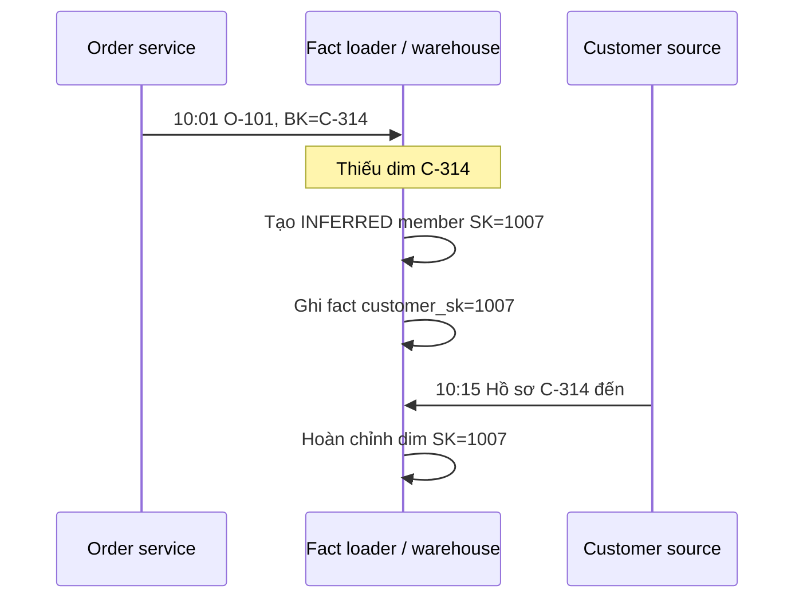
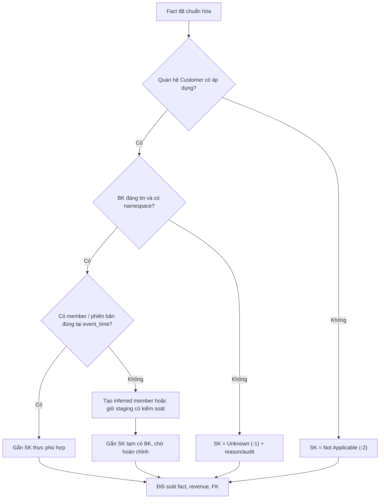

# Thành viên chưa biết, không áp dụng và chiều đến trễ

Hãy tưởng tượng một kho dữ liệu bán lẻ nhận ba dòng bán hàng:

1. Đơn trực tuyến có `customer_bk = C-314`, nhưng dữ liệu khách hàng từ CRM **chưa được đồng bộ**.
2. Đơn từ hệ thống cũ **thiếu hẳn mã khách hàng**, dù theo quy trình vốn phải có mã.
3. Một giao dịch máy bán hàng tự động **không có khái niệm khách hàng đăng ký**, nên phân tích theo khách hàng không áp dụng.

Nếu cả ba cùng được gán `customer_sk = -1` với nhãn “Unknown”, báo cáo sẽ không phân biệt lỗi chất lượng dữ liệu, hàng đợi đồng bộ và tình huống nghiệp vụ hợp lệ. Nếu để `customer_sk = NULL`, các truy vấn inner join có thể làm **biến mất doanh thu**. Nếu dựng bản ghi khách hàng giả rồi tự suy vùng miền, báo cáo có thể ghi sai doanh thu của một khu vực.

Trong mô hình chiều (*dimensional modeling*), ta cần bảo toàn cả **dòng dữ kiện (fact)** và **ý nghĩa của việc chưa có một thành viên chiều hoàn chỉnh**. Bài này thuộc chương **Bảng chiều** của module **DATABASE_DATA_MODELING**: từ yêu cầu nghiệp vụ xác định thực thể, quan hệ, khóa, ràng buộc, lược đồ vật lý và các phương án quan hệ, document, đồ thị, phân tích. Trọng tâm ở đây là phân biệt **unknown**, **not applicable**, **inferred member** và các trường hợp **late-arriving dimension/fact**, rồi thiết kế ETL/ELT và kiểm chứng để dữ liệu vẫn giải thích được.

## 1. Bắt đầu từ grain của fact và vai trò của chiều

Trong mô hình hình sao (*star schema*):

- **Fact table** chứa sự kiện hoặc trạng thái đo được ở một **grain** đã định nghĩa, cùng khóa tham chiếu đến các chiều và các measure.
- **Dimension table** cung cấp ngữ cảnh để nhóm, lọc và mô tả fact: khách hàng, sản phẩm, kênh, địa điểm, thời gian, nhân viên...
- **Surrogate key (SK)** thường là khóa kỹ thuật dùng trong warehouse để fact tham chiếu một dòng chiều cụ thể.
- **Business/natural key (BK)** là định danh do hệ thống nguồn hoặc miền nghiệp vụ cung cấp; cùng một BK có thể có nhiều phiên bản lịch sử trong chiều SCD Type 2.

Ví dụ:

```text
fact_sales_line
    grain: một dòng hàng đã ghi nhận của một đơn từ hệ nguồn
    key: (source_system, order_id, line_no)
    measures: net_amount, quantity
    foreign keys: customer_sk, product_sk, date_sk, channel_sk...

dim_customer
    grain Type 1: một khách hàng được nhận diện theo (source, customer_bk)
    grain Type 2: một phiên bản thuộc tính có hiệu lực của một khách hàng
    columns: customer_sk, source_system, customer_bk, region, segment...
```

Khi một dòng bán hàng xảy ra, **doanh thu đã phát sinh** không được biến mất chỉ vì hồ sơ khách hàng chưa tới. Nhưng warehouse vẫn phải ghi lại một cách có kiểm soát **đã biết gì, chưa biết gì và vì sao** để các báo cáo về khách hàng không diễn giải sai.

## 2. Bốn trạng thái khác nhau, không nên nhập làm một

| Trạng thái | BK có biết không? | Quan hệ với chiều có ý nghĩa? | Ví dụ | Cách xử lý điển hình |
| --- | --- | --- | --- | --- |
| **Known member** | Có | Có | CRM đã có khách C-314 cùng thuộc tính hợp lệ | Tra SK thực; SCD2 chọn đúng phiên bản thời gian |
| **Inferred member / early-arriving fact** | **Có** | Có | Fact mang C-314, nhưng dim chưa có C-314 | Tạo thành viên tạm với SK thực, BK ổn định; bổ sung thuộc tính sau |
| **Unknown member** | Chưa có định danh đáng tin | **Có hoặc được kỳ vọng có** | Bản ghi bán hàng lẽ ra có khách nhưng thiếu ID | Dùng thành viên “Chưa xác định” có chủ đích, theo dõi lý do và tiến độ xử lý |
| **Not applicable member** | Không cần | **Không** | Bán qua thiết bị vô danh, sản phẩm số không có kho vật lý | Dùng thành viên “Không áp dụng” tách khỏi Unknown |

Ngoài ra còn các trường hợp **invalid BK**, **withheld/redacted vì quyền riêng tư**, **không được nạp**, **chưa phân loại**. Chúng có thể cần mã trạng thái riêng nếu quy trình, quyền truy cập hoặc thống kê đòi hỏi. Không ép mọi trường hợp vào `UNKNOWN` chỉ vì không tra được một dòng dimension.

> **Chốt nghĩa trước khi đặt mã:** “Không biết khách là ai” khác “giao dịch này không gắn khách hàng”; “biết mã C-314 nhưng thiếu hồ sơ” lại là một tình huống thứ ba có thể giải quyết bằng bản ghi chiều tạm.

### 2.1. Ví dụ tác động lên báo cáo

| Dòng bán | BK từ nguồn | Ngữ nghĩa khách hàng | Doanh thu |
| --- | --- | --- | ---: |
| O-101 | `C-314` | Chờ CRM, có định danh | 120 |
| O-102 | *trống* | Lẽ ra có khách, nhưng thiếu ID | 40 |
| O-103 | *trống* | Giao dịch không cần khách đăng ký | 10 |

Tổng doanh thu phải vẫn bằng **170**. Sau khi hồ sơ C-314 xuất hiện, 120 có thể được phân nhóm theo vùng/segment nếu dữ liệu đủ tin cậy. Còn 40 không được tự gán vào C-314, và 10 không nên góp vào KPI “tỷ lệ bản ghi thiếu khách” như một lỗi chất lượng dữ liệu.

## 3. Thành viên đặc biệt và khóa thay thế

Một cách thực tế là tạo **các dòng chiều đặc biệt** có surrogate key dành riêng, thay vì dùng một `NULL` không rõ lý do.

| `customer_sk` minh họa | Nhãn | Nghĩa |
| ---: | --- | --- |
| `-1` | `UNKNOWN` | Quan hệ được kỳ vọng nhưng chưa xác định được thành viên |
| `-2` | `NOT_APPLICABLE` | Không có thành viên theo định nghĩa nghiệp vụ |
| `> 0` | `KNOWN` hoặc `INFERRED` | Một danh tính cụ thể có BK từ nguồn |

Các giá trị `-1`/`-2` chỉ là **quy ước trong một dimension**. Không bắt buộc mọi dự án phải dùng số âm, và “customer -1” không đồng nghĩa “product -1” về ngữ nghĩa. Nếu dùng identity key tăng từ 1, nên dành trước vùng giá trị đặc biệt và bảo vệ bằng constraint hoặc quy trình tạo dimension.

Lợi ích:

- Fact có khóa ngoại `NOT NULL` vẫn tham chiếu đến **một dòng dim có thật**, giúp kiểm tra toàn vẹn tham chiếu.
- Có thể nhóm doanh thu “Chưa xác định” và “Không áp dụng” riêng biệt.
- Không bỏ mất fact khi join để báo cáo, không cần `COALESCE` tùy tiện ở mọi báo cáo.
- ETL có thể đếm tỷ lệ thiếu thông tin thay vì lặng lẽ bỏ dòng hoặc điền tên khách giả.

**Rủi ro:** Nếu mặc định `customer_sk = -1` cho **mọi** lỗi lookup mà không lưu lý do, dòng fact có thể nằm ở Unknown mãi mãi dù BK vốn đã có, và không có cơ chế truy vết. Thành viên đặc biệt không thay thế **luật phân loại, staging, kiểm soát chất lượng và xử lý dữ liệu đến trễ**.

## 4. Inferred member: biết BK nhưng bản ghi chiều chưa tới

Giả sử sự kiện đơn O-101 tới trước dữ liệu CRM:

```text
10:00  Order service -> order O-101, customer_bk = C-314
10:01  Fact loader   -> C-314 chưa có trong dim_customer
10:02  Tạo dim_customer(C-314, state=INFERRED, customer_sk=1007)
10:02  fact O-101    -> customer_sk=1007, net_amount=120
10:15  CRM sync      -> tên, khu vực, phân khúc cho C-314
10:16  Hoàn chỉnh dòng dim_customer SK=1007, state=KNOWN
```

Fact **không cần đổi khóa ngoại** nếu đã gắn vào SK của bản ghi tạm và cách quản lý chiều cho phép hoàn chỉnh dòng đó. Các báo cáo trước 10:15 có thể nhóm SK=1007 vào “Chưa có thông tin phân loại”, còn sau đồng bộ nhóm nó theo vùng thực; ý nghĩa này chính là **điều chỉnh hồi tố theo dữ liệu mới nhất**. Nếu phải tái lập báo cáo đúng “như đã biết lúc 10:05”, cần lưu version/ảnh chụp tri thức ở thời điểm báo cáo, không chỉ cập nhật đè.

### 4.1. Vì sao không luôn dùng UNKNOWN?

Khi `customer_bk = C-314` đã có và đáng tin:

1. Đây là một danh tính cụ thể, không phải “không biết người nào”.
2. Nhiều fact của C-314 có thể cùng tham chiếu **một** SK tạm, tránh gom mọi khách đến trễ vào bucket -1.
3. Khi bản ghi CRM tới, cập nhật đúng chiều bằng BK mà không phải dò và viết lại hàng triệu dòng fact.
4. Nếu dùng -1, về sau phải giữ BK gốc và cơ chế rekey để liên kết được fact với dòng dim thật; nếu BK bị mất, không có cách đáng tin để xác định lại.

**Điều kiện tiên quyết:** BK cần được chuẩn hóa, đặt namespace nguồn và có quy tắc xác định duy nhất. Chuỗi `C-314` từ CRM và `C-314` từ hệ POS không chắc là cùng khách; không tạo mapping bằng cách chỉ so chuỗi khi hệ nguồn có miền khóa khác nhau.

### 4.2. Hoàn chỉnh thuộc tính không nhất thiết tạo SK mới

Với chiều **Type 1** (ghi đè thuộc tính hiện tại), có thể cập nhật dòng `INFERRED` thành `KNOWN`, giữ nguyên SK. Nhưng nếu warehouse dùng **SCD Type 2** để lưu các phiên bản lịch sử, phải xác định:

- Bản tạm có hiệu lực từ khi nào?
- Khi hồ sơ đến, nó đang **bổ sung thông tin vốn đúng tại thời điểm fact**, hay báo thay đổi thuộc tính sau đó?
- Có cần tạo dòng phiên bản mới và cập nhật khóa fact theo **thời điểm sự kiện** không?

Không mặc định rằng mọi bản ghi chiều đến trễ đều là thay đổi Type 1.

## 5. Ba trục “đến trễ” thường bị gọi lẫn nhau

| Tình huống | Đến trước | Đến sau | Vấn đề cần giải quyết |
| --- | --- | --- | --- |
| **Early-arriving fact / late-arriving dimension** | Fact có BK | Dòng dimension | Tra SK cho fact trước khi dim có đầy đủ thuộc tính |
| **Late-arriving dimension change** | Fact và dim theo phiên bản đã biết | Thông báo đổi vùng/segment có hiệu lực **trong quá khứ** | Chèn/sửa lịch sử SCD2 và đánh giá rekey các fact liên quan |
| **Late-arriving fact** | Các phiên bản dimension có thể đã đổi | Fact có `event_time` cũ đến kho trễ | Chọn dòng dim **có hiệu lực tại event_time**, không chọn dòng current bừa |

Ví dụ timeline:



Trường hợp thứ hai và thứ ba đòi hỏi quan tâm **ngày có hiệu lực (valid time)** chứ không chỉ thứ tự gói tin tới warehouse. Thời điểm hệ thống nhận dữ liệu và thời điểm thuộc tính đúng trong kinh doanh là hai trục khác nhau.

## 6. Schema PostgreSQL tự chứa cho thành viên đặc biệt và inferred

Ví dụ sau sử dụng chiều khách hàng theo **Type 1** để làm rõ xử lý fact tới sớm. Với Type 2 sẽ có schema và quy tắc bổ sung ở mục sau.

### 6.1. Tạo chiều và các dòng đặc biệt

```sql
CREATE TABLE dim_customer (
    customer_sk BIGINT GENERATED BY DEFAULT AS IDENTITY PRIMARY KEY,
    source_system TEXT NOT NULL,
    customer_bk TEXT NOT NULL,
    customer_name TEXT,
    region_code TEXT,
    member_state VARCHAR(20) NOT NULL,
    first_seen_at TIMESTAMPTZ,
    completed_at TIMESTAMPTZ,

    CONSTRAINT uq_customer_source_bk
        UNIQUE (source_system, customer_bk),

    CONSTRAINT ck_customer_state CHECK (
        member_state IN (
            'KNOWN', 'INFERRED', 'UNKNOWN', 'NOT_APPLICABLE'
        )
    ),
    CONSTRAINT ck_customer_key_state CHECK (
        (
            customer_sk = -1
            AND source_system = '__SYSTEM__'
            AND customer_bk = '__UNKNOWN__'
            AND member_state = 'UNKNOWN'
        )
        OR
        (
            customer_sk = -2
            AND source_system = '__SYSTEM__'
            AND customer_bk = '__NOT_APPLICABLE__'
            AND member_state = 'NOT_APPLICABLE'
        )
        OR
        (
            customer_sk > 0
            AND source_system <> '__SYSTEM__'
            AND length(btrim(source_system)) > 0
            AND length(btrim(customer_bk)) > 0
            AND member_state IN ('KNOWN', 'INFERRED')
        )
    )
);

INSERT INTO dim_customer (
    customer_sk,
    source_system,
    customer_bk,
    customer_name,
    member_state
) VALUES
    (-1, '__SYSTEM__', '__UNKNOWN__',
     'Chưa xác định', 'UNKNOWN'),
    (-2, '__SYSTEM__', '__NOT_APPLICABLE__',
     'Không áp dụng', 'NOT_APPLICABLE');
```

Ý nghĩa của thiết kế:

- `customer_sk` là SK; các bản bình thường được cấp số dương qua identity, còn hai dòng đặc biệt dùng `-1` và `-2` tường minh.
- `UNIQUE(source_system, customer_bk)` bảo đảm cùng một BK theo namespace nguồn có tối đa một dòng ở **mô hình Type 1** này.
- `member_state = 'INFERRED'` cho phép thiếu `customer_name`/`region_code`, nhưng **phải có** định danh BK.
- `member_state = 'UNKNOWN'` và `NOT_APPLICABLE` chỉ dành cho hai dòng hệ thống, không cho một khách thật mang “Unknown” như trạng thái của identity đó.
- Một record `KNOWN` vẫn có thể thiếu một thuộc tính tùy chọn nếu nghiệp vụ cho phép; không tự suy mọi cột null nghĩa là cả thành viên chưa biết. Nếu `region_code` bắt buộc để coi là “hoàn chỉnh”, cần quy tắc data quality và constraint phù hợp hơn.

**Không nhầm tính hợp lệ của constraint với chính sách kinh doanh:** Schema chỉ kiểm tra định dạng và sự tồn tại, không chứng minh hai hệ thống có cùng khách thực hay vùng địa lý của khách là đúng. Việc chuẩn hóa BK và đối soát nguồn là trách nhiệm của pipeline và data governance.

### 6.2. Fact giữ SK hợp lệ và khóa grain

```sql
CREATE TABLE fact_sales_line (
    source_system TEXT NOT NULL,
    source_order_id TEXT NOT NULL,
    line_no INTEGER NOT NULL CHECK (line_no > 0),
    sold_at TIMESTAMPTZ NOT NULL,
    customer_sk BIGINT NOT NULL
        REFERENCES dim_customer(customer_sk),
    customer_source_system TEXT,
    customer_bk_seen TEXT,
    net_amount NUMERIC(18, 2) NOT NULL,
    currency_code CHAR(3) NOT NULL,
    ingested_at TIMESTAMPTZ NOT NULL DEFAULT now(),

    PRIMARY KEY (source_system, source_order_id, line_no),
    CONSTRAINT ck_customer_bk_pair CHECK (
        (customer_source_system IS NULL AND customer_bk_seen IS NULL)
        OR
        (customer_source_system IS NOT NULL
         AND customer_bk_seen IS NOT NULL)
    )
);
```

Grain là **một dòng hàng của một đơn ở hệ nguồn**, không phải “một khách”. Một khách có thể xuất hiện trên hàng nghìn fact. `net_amount` lưu ở đây để nhấn mạnh **measure cần được giữ** dù chiều đến trễ. Trong ứng dụng thực tế, sẽ còn `product_sk`, `date_sk`, `channel_sk` và các dimension khác theo phạm vi.

Hai cột `customer_source_system` và `customer_bk_seen` giữ lại **định danh quan sát từ nguồn** để hỗ trợ kiểm toán và rekey khi cần; chúng có thể được đặt trong staging/audit thay vì fact nếu chính sách lưu trữ yêu cầu. Việc lưu bản gốc không có nghĩa cho phép bất kỳ báo cáo nào join fact trực tiếp sang mọi phiên bản chiều mà bỏ qua SK.

## 7. ETL/ELT: fact biết BK nhưng dimension chưa có

Giả sử OMS gửi dòng `O-101` tham chiếu khách `CRM/C-314`, nhưng CRM chưa đồng bộ. Ta tạo dòng chiều tạm **trước khi ghi fact**, trong cùng một transaction PostgreSQL.

```sql
BEGIN;

-- Tạo inferred member nếu chưa tồn tại.
INSERT INTO dim_customer (
    source_system,
    customer_bk,
    member_state,
    first_seen_at
)
VALUES (
    'CRM',
    'C-314',
    'INFERRED',
    TIMESTAMPTZ '2026-11-20 10:02:00+00'
)
ON CONFLICT (source_system, customer_bk) DO NOTHING;

-- Fact lấy SK của member (đã có hoặc vừa tạo).
INSERT INTO fact_sales_line (
    source_system,
    source_order_id,
    line_no,
    sold_at,
    customer_sk,
    customer_source_system,
    customer_bk_seen,
    net_amount,
    currency_code
)
SELECT
    'OMS',
    'O-101',
    1,
    TIMESTAMPTZ '2026-11-20 10:00:00+00',
    d.customer_sk,
    'CRM',
    'C-314',
    120.00,
    'VND'
FROM dim_customer AS d
WHERE d.source_system = 'CRM'
  AND d.customer_bk = 'C-314'
ON CONFLICT (source_system, source_order_id, line_no)
    DO NOTHING;

COMMIT;
```

Với cùng BK, `UNIQUE(source_system,customer_bk)` và `ON CONFLICT DO NOTHING` giúp tránh tạo nhiều inferred row khi các worker ghi song song. Nếu dim đã hoàn chỉnh thành `KNOWN`, câu lệnh này không ghi đè nó về `INFERRED`.

**Hai điểm không được bỏ qua:**

1. `ON CONFLICT DO NOTHING` ở fact chỉ phù hợp để minh họa retry không tạo duplicate. Nếu cùng `(source_system, source_order_id, line_no)` nhưng **payload khác** (ví dụ số tiền đổi), hệ thống cần nhận diện correction/version và xử lý có chủ đích, không âm thầm bỏ khác biệt.
2. Nếu truy vấn lấy SK không trả dòng hoặc insert không đạt điều kiện, pipeline phải kiểm tra số dòng được ghi và xử lý lỗi. Không để một fact mất đi vì lookup hoặc transaction không thành công mà không giám sát.

### 7.1. Hoàn chỉnh inferred member khi CRM tới

```sql
UPDATE dim_customer
SET customer_name = 'Khach C-314',
    region_code = 'NORTH',
    member_state = 'KNOWN',
    completed_at = TIMESTAMPTZ '2026-11-20 10:15:00+00'
WHERE source_system = 'CRM'
  AND customer_bk = 'C-314'
  AND member_state = 'INFERRED'
RETURNING customer_sk, customer_bk, member_state;
```

Nếu `customer_sk` vẫn là 1007, mọi fact đã gắn 1007 nay join được với tên và vùng thật. Đây là cách **hoàn chỉnh tại chỗ** phù hợp khi yêu cầu là trạng thái khách mới nhất (Type 1).

Khi CRM gửi dữ liệu trùng hoặc thay đổi sau lần hoàn chỉnh, cần cơ chế update/version riêng; điều kiện `member_state='INFERRED'` ở đây cố ý chỉ xử lý bước **tạm → hoàn chỉnh** chứ không phải mọi loại cập nhật hồ sơ.

### 7.2. Nếu không có BK thì không thể suy member

Một đơn nguồn thiếu hẳn customer ID nhưng quy trình yêu cầu phải có → gán `customer_sk = -1`, ghi `source_event_id`/nguồn/vấn đề vào lớp audit nếu cần. Không tạo một khách hàng giả với BK sinh từ `order_id` chỉ để hợp thức hóa join; làm vậy biến một khách thật (chưa biết) thành nhiều khách giả.

Một giao dịch vốn không có quan hệ khách hàng → `customer_sk = -2`. Không gộp hai nhóm này chỉ vì cả hai có `customer_bk_seen IS NULL`.

## 8. Phân loại trước khi lookup: quyết định minh bạch

Một pipeline có thể chọn thành viên qua cây quyết định:



Với các nguồn có customer ID nhưng không đáng tin (ví dụ xung đột mapping, định dạng vô hiệu, BK tái sử dụng), việc tạo inferred member **có thể nguy hiểm**. Tùy dữ liệu, cần đưa vào quarantine để phân giải hơn là biến dữ liệu lỗi thành một danh tính dường như hợp lệ.

### Phân biệt “inferred” và “giá trị mặc định”

Inferred member **không** có nghĩa tự điền `region_code='NORTH'` hoặc `segment='STANDARD'` cho mọi người. Dùng nhãn “Chưa phân loại” ở báo cáo khi thuộc tính thiếu; giữ NULL/mã chất lượng riêng khi nhập. Đưa thuộc tính giả vào dim có thể làm KPI theo vùng/segment sai mà không thể biết đâu là dữ liệu thật.

## 9. Dòng Unknown đã ghi rồi: khi nào rekey?

Giả sử pipeline cũ đẩy một số fact vào `customer_sk=-1` dù `customer_bk_seen` thực sự đã có. Sau khi sửa mapping nguồn và tạo dim khách thật, có thể **rekey** những fact đã xác minh:

```sql
-- Chỉ dùng cho fact có BK đáng tin đã lưu lại và hiện vẫn trỏ UNKNOWN.
-- Chạy trong quy trình backfill có kiểm toán và bảo vệ đồng thời.
UPDATE fact_sales_line AS f
SET customer_sk = d.customer_sk
FROM dim_customer AS d
WHERE f.customer_sk = -1
  AND f.customer_source_system IS NOT NULL
  AND f.customer_bk_seen IS NOT NULL
  AND d.source_system = f.customer_source_system
  AND d.customer_bk = f.customer_bk_seen
  AND d.customer_sk > 0;
```

Đây là ví dụ cho chiều Type 1, chỉ khi mapping là **duy nhất và được đối soát**. Trong kho lớn, thao tác UPDATE hàng loạt có thể tốn tài nguyên, gây thay đổi dữ liệu lịch sử và invalidate aggregate/cube. Có thể chọn batch theo khóa, tạo bảng remap/rebuild partition hoặc tái tạo fact từ nguồn đáng tin.

**Không được rekey** một fact `-1` chỉ vì đoán từ địa chỉ IP, tên gần giống hoặc đơn khác của cùng thiết bị. Nếu ban đầu không có BK và không có bằng chứng liên kết, nó vẫn là Unknown. Nếu trước đây fact được gắn `-2` đúng nghĩa Not Applicable, không chuyển nó thành một khách hàng sau này chỉ vì tìm thấy người mua tiềm năng; cần sự kiện/chính sách nghiệp vụ mới.

### 9.1. Tác động tới báo cáo đã xuất bản

Sau rekey, doanh thu có thể chuyển từ nhóm Unknown sang khu vực NORTH mà **tổng doanh thu vẫn giữ 170**. Báo cáo phân nhóm lịch sử có thể đổi khi chạy lại:

| Trạng thái đọc | NORTH | UNKNOWN | NOT_APPLICABLE | Tổng |
| --- | ---: | ---: | ---: | ---: |
| Trước khi hoàn chỉnh C-314 | 0 | 160 *(120 inferred chưa có region + 40 unknown)* | 10 | 170 |
| Sau khi có region của C-314 | 120 | 40 | 10 | 170 |

Ở bảng minh họa, “UNKNOWN” trong báo cáo vùng là **nhãn chung cho vùng chưa xác định**, không nhất thiết đồng nghĩa `customer_sk=-1`. Một **inferred customer có SK dương** cũng có `region_code IS NULL`. Nên phân biệt hai thứ trong dashboard: *độ đầy đủ danh tính khách hàng* và *độ đầy đủ thuộc tính vùng*.

Nếu người dùng cần so sánh “số đã công bố tuần trước” với “số mới nhất”, lưu `data_as_of`, snapshot/version metric và provenance, hoặc xây báo cáo bitemporal khi nhu cầu thực sự yêu cầu. Không giả định dữ liệu được bổ sung muộn sẽ không thay đổi báo cáo lịch sử.

## 10. SCD Type 2: một khách hàng có nhiều phiên bản theo thời gian

SCD Type 1 ghi đè thuộc tính; SCD Type 2 giữ **các phiên bản có khoảng hiệu lực**. Với Type 2, mỗi phiên bản có **SK riêng**, dù dùng cùng BK của khách.

Ví dụ khách C-314 chuyển vùng:

| `customer_sk` | BK | Region | `valid_from` | `valid_to` |
| ---: | --- | --- | --- | --- |
| 1007 | C-314 | NORTH | 01/01 00:00 | 10/02 00:00 |
| 1088 | C-314 | SOUTH | 10/02 00:00 | ∞ |

Một đơn xảy ra ngày **05/02** phải gắn vào SK **1007** nếu báo cáo cần vùng **tại thời điểm mua** (*as-was*), kể cả khi fact chỉ được tải vào ngày 20/02. Dùng `is_current = true` để gắn SK 1088 sẽ làm phân loại sai quá khứ.

### 10.1. Schema minh họa cho chiều lịch sử

```sql
CREATE TABLE dim_customer_scd2 (
    customer_sk BIGINT GENERATED ALWAYS AS IDENTITY PRIMARY KEY,
    source_system TEXT NOT NULL,
    customer_bk TEXT NOT NULL,
    region_code TEXT,
    valid_from TIMESTAMPTZ NOT NULL,
    valid_to TIMESTAMPTZ NOT NULL,
    is_current BOOLEAN NOT NULL,

    CONSTRAINT ck_customer_scd2_time
        CHECK (valid_from < valid_to)
);

CREATE INDEX ix_customer_scd2_asof
    ON dim_customer_scd2 (
        source_system, customer_bk, valid_from, valid_to
    );
```

Đây là **lược đồ riêng để minh họa Type 2**, không tự kết hợp với `dim_customer` Type 1 ở mục 6. Nó vẫn còn cần quy tắc **không chồng lấn khoảng hiệu lực** cho cùng `(source_system,customer_bk)`. Một index thông thường và `CHECK (valid_from < valid_to)` không đủ bảo đảm điều đó. Trong PostgreSQL có thể cân nhắc exclusion constraint với range type và extension phù hợp, hoặc transaction/validation đáng tin cậy.

Trong hệ có SCD2, `UNIQUE(source_system,customer_bk)` **không đúng** vì một BK có nhiều phiên bản. Có thể kiểm tra “tối đa một dòng current” qua partial unique index nếu khái niệm current được quản lý, nhưng bản đó vẫn không thay thế kiểm tra không chồng lấn mọi khoảng lịch sử.

### 10.2. Tra chiều theo thời điểm xảy ra fact

```sql
-- stage_sales là bảng staging đã có nguồn, BK và event_time.
-- Mỗi event chỉ được khớp tối đa một phiên bản chiều.
SELECT
    s.source_event_id,
    s.sold_at,
    d.customer_sk
FROM stage_sales AS s
LEFT JOIN dim_customer_scd2 AS d
    ON d.source_system = s.customer_source_system
   AND d.customer_bk = s.customer_bk
   AND s.sold_at >= d.valid_from
   AND s.sold_at < d.valid_to;
```

**Cần kiểm soát ba trường hợp:**

1. Khớp **một** phiên bản → dùng SK tương ứng.
2. Khớp **không** phiên bản → xác định BK lỗi, dimension đến trễ, thiếu khoảng lịch sử hay fact không áp dụng; không mặc định là current member.
3. Khớp **nhiều** phiên bản → dữ liệu chiều có khoảng chồng lấn, join đã **nhân số dòng fact**; phải sửa trước khi tính `SUM(revenue)`.

Nếu có một fact từ tháng 1 nhưng dim hiện chỉ có phiên bản tháng 2, phải tìm kiếm/khôi phục phiên bản có hiệu lực tháng 1 (hoặc giữ fact ở trạng thái chưa phân giải) theo chính sách, không giả mạo rằng vùng tháng 2 đúng cho tháng 1.

### 10.3. Thay đổi chiều có hiệu lực trong quá khứ đến muộn

Giả sử hệ thống đã tạo một phiên bản NORTH có hiệu lực từ 01/01 đến vô hạn. Ngày 20/02 mới nhận thông báo khách **đổi sang SOUTH từ 10/02**:

- Điều chỉnh khoảng hiệu lực phiên bản NORTH kết thúc 10/02.
- Tạo phiên bản SOUTH bắt đầu 10/02 với SK mới.
- Xác định lại fact từ 10/02 trở về sau đã gắn nhầm SK NORTH trước đó; nếu báo cáo yêu cầu *as-was theo event time*, cần **restatement/rekey** cho phạm vi liên quan hoặc rebuild projection.
- Fact từ 01/01 đến trước 10/02 tiếp tục tham chiếu NORTH.
- Đảm bảo cập nhật dim và fact liên quan có tính nhất quán, hoặc công bố trạng thái đang tái xử lý để tránh báo cáo tạm sai.

**Không chỉ chèn phiên bản mới rồi kết thúc công việc.** Nếu fact cũ vẫn trỏ tới SK NORTH sau thời điểm 10/02, báo cáo theo vùng sẽ không phản ánh đúng đổi vùng. Nhưng nếu sản phẩm có yêu cầu “đóng băng phân loại đã công bố”, việc không rekey có thể là chính sách hợp lệ; phải ghi rõ *as-was*, *as-is* và *as-known-at-publication*, không chọn ngầm.

## 11. Dimension đến trễ khác fact đến trễ

### 11.1. Late-arriving fact

Một giao dịch phát sinh ngày 05/02 được tải ngày 20/02, khi dim C-314 đã chuyển vùng SOUTH. Nếu yêu cầu là vùng lúc bán, truy vấn lookup phải dùng:

```text
customer BK = CRM/C-314
fact event_time = 05/02
choose dimension version valid on 05/02 -> NORTH
not current version on 20/02 -> SOUTH
```

Do đó nên lưu ít nhất thời điểm sự kiện và thời điểm ingestion riêng. Nếu một đơn có `effective_date` kế toán khác ngày phát sinh, phải xác định rõ dùng trục thời gian nào để gắn thuộc tính dimension.

### 11.2. Late-arriving dimension với thiếu khoảng hiệu lực

Fact C-314 tới sớm nhưng chưa có dòng chiều đúng khoảng event time:

- Với Type 1 và chỉ cần thuộc tính hiện tại, inferred member đơn giản thường đủ.
- Với Type 2, phải xác định liệu bản tạm là placeholder cho **một khoảng thời gian cụ thể**, hay chờ dữ liệu nguồn để xác định phiên bản. Đặt `valid_from = ingestion_time` cho mọi trường hợp có thể làm các fact có event time trước đó không khớp; đặt `-infinity` bừa bãi có thể gán sai lịch sử.
- Có thể giữ fact trong staging/quarantine có kiểm soát, hoặc liên kết với một placeholder có BK và đánh dấu **chưa phân giải phiên bản**, rồi rekey khi lịch sử đến. Lựa chọn phụ thuộc SLA, khả năng tái xử lý và yêu cầu không để fact vắng khỏi dashboard.

Không có “một” quy tắc inferred member dùng được cho mọi SCD2; khác biệt nằm ở **độ tin cậy của effective time và yêu cầu tái lập lịch sử**.

## 12. Chất lượng dữ liệu: Unknown và Not Applicable không phải cùng mẫu số

Giả sử một ngày có:

- 1.000 giao dịch mà **bắt buộc** phải có thông tin khách.
- 50 giao dịch chủ động không có khái niệm khách hàng.
- Trong 1.000 giao dịch bắt buộc, 60 giao dịch thiếu định danh, 40 có BK nhưng chỉ là inferred member.

Các chỉ số khác nhau:

| Chỉ số | Công thức minh họa | Kết quả |
| --- | --- | ---: |
| **Missing identity rate** | 60 / 1.000 | 6% |
| **Pending dimension enrichment rate** | 40 / 1.000 | 4% |
| **Not applicable share** | 50 / 1.050 | ≈ 4,76% |
| **Known identity or BK share** | (900 + 40) / 1.000 | 94% |
| **Completed member coverage** | 900 / 1.000 | 90% |

Nếu cộng 50 Not Applicable vào mẫu số lỗi thiếu khách, bộ phận vận hành bị chấm lỗi vì một lựa chọn nghiệp vụ hợp lệ. Nếu xem 40 inferred như Unknown không có BK, không thể đo riêng chất lượng ingestion CRM.

### 12.1. SQL mẫu theo trạng thái chiều

```sql
SELECT
    d.member_state,
    COUNT(*) AS fact_lines,
    SUM(f.net_amount) AS amount_by_state
FROM fact_sales_line AS f
JOIN dim_customer AS d
  ON d.customer_sk = f.customer_sk
GROUP BY d.member_state
ORDER BY d.member_state;
```

`KNOWN` không đồng nghĩa mọi thuộc tính khách đều hoàn chỉnh; thêm metric cho tỷ lệ `region_code IS NULL` nếu cần. Đồng thời đo **tuổi inferred member**, số lượng fact vẫn ở Unknown, tỷ lệ lookup thất bại, lỗi BK, số fact đang chờ sửa và thời gian trễ giữa `first_seen_at` và `completed_at`.

Trên bảng loại Type 1, sau khi một inferred member thành KNOWN, những fact trước đây nối tới nó cũng được tính là KNOWN **ở thời điểm báo cáo hiện tại**. Nếu muốn đo lịch sử “tại lúc fact được nạp, trạng thái dim là gì”, phải lưu **resolution state at ingest** hoặc event/audit riêng, không suy ngược từ dim hiện tại.

### 12.2. Không để Unknown che khuất chất lượng dữ liệu

Một dashboard chỉ hiện doanh thu theo vùng có thể nhóm tất cả `region_code IS NULL` vào một vùng “Unknown”. Nhưng:

- Unknown region của **khách thật đã có BK** có thể được bổ sung.
- Customer identity Unknown (SK -1) là vấn đề khác.
- Customer Not Applicable (SK -2) có thể cần loại khỏi phân tích nhân khẩu học, nhưng vẫn được tính vào doanh thu toàn bộ.
- Redacted/withheld vì quyền riêng tư không nên tự bị xem là “dữ liệu chưa đầy đủ” trong KPI sửa lỗi nguồn.

Định nghĩa **mẫu số** của từng KPI và lý do unknown phải công bố cùng báo cáo để không tạo mục tiêu cải thiện dữ liệu sai lệch.

## 13. Join và aggregate: giữ doanh thu khi chiều chưa biết

### 13.1. Vì sao `INNER JOIN` có thể làm mất fact?

Nếu fact có khóa ngoại nullable hoặc ghi BK mà chưa có row dim, một `INNER JOIN` sẽ bỏ mọi dòng không khớp. Kết quả `SUM(net_amount)` thấp hơn tổng fact gốc, có thể rất khó phát hiện nếu tỷ lệ missing nhỏ.

Khi dùng schema có **special members + NOT NULL FK** ở mục 6, mọi fact hợp lệ sẽ tham chiếu đến một dòng dim, giúp báo cáo dùng join theo SK mà không mất dòng. Tuy vậy, ETL cần bảo đảm các dòng đặc biệt tồn tại và FK được thực thi thực sự (không tắt constraint trong bulk load rồi quên kiểm tra).

So sánh tổng:

```sql
-- Tổng fact gốc, trước mọi chiều.
SELECT COUNT(*) AS fact_rows,
       SUM(net_amount) AS total_amount
FROM fact_sales_line;

-- Tổng sau join tới chiều bằng SK.
SELECT COUNT(*) AS joined_rows,
       SUM(f.net_amount) AS total_amount_after_join
FROM fact_sales_line AS f
JOIN dim_customer AS d
  ON d.customer_sk = f.customer_sk;
```

Trong schema mẫu, khi FK được bảo đảm và không có lỗi nhập liệu, số dòng và tổng amount phải khớp. Nếu không khớp, cần kiểm tra dữ liệu lỗi, FK bị tắt, filter trên chiều hoặc join sai khóa. Với SCD2, join bằng BK không kèm thời gian có thể **nhân dòng**, khiến tổng cao lên thay vì thấp xuống.

### 13.2. Đừng dùng `COALESCE` để giấu mọi trường hợp

`COALESCE(d.region_code, 'UNKNOWN')` có thể là cách hiển thị hợp lý cho vùng chưa xác định, nhưng **không phân biệt nguyên nhân**. Đừng từ giá trị hiển thị suy ngược sang trạng thái fact/dim; lưu `member_state`/reason và xử lý trong metric contract.

### 13.3. Phân tích cohort và số liệu lịch sử

Một khách C-314 được biết region sau khi fact đã xuất hiện: báo cáo theo vùng có thể thay đổi theo ngày chạy report. Nếu product manager yêu cầu “doanh thu theo vùng khách **lúc mua**”, cần Type 2 và as-of mapping. Nếu yêu cầu “doanh thu lịch sử theo **vùng hiện tại** của khách”, lookup thuộc tính hiện tại Type 1/as-is là chủ đích. Không có “kết quả đúng” duy nhất trước khi định nghĩa câu hỏi.

## 14. Đồng thời, idempotency và sửa dữ liệu

Khi nhiều worker ingest cùng một BK chưa có dim, nguy cơ là tạo hai SK và gắn các fact vào hai bản khác nhau. Giải pháp cần bảo vệ **tại database**:

- Unique constraint cho `(source_system,customer_bk)` trong Type 1 hoặc quy tắc không chồng lấn phiên bản trong Type 2.
- Upsert/lookup trong transaction hoặc quy trình tương đương theo engine.
- Retry có kiểm soát khi gặp xung đột; không cấp SK mới sau mỗi lần thử.
- Idempotency theo **grain fact** và `source_event_id` để không ghi trùng measure.
- Khi hoàn chỉnh inferred member, không để bản cập nhật đến muộn ghi đè thông tin mới hơn mà không có quy tắc version/effective time.

Trong hệ distributed warehouse, thao tác ghi dimension và fact có thể nằm ở các pipeline khác nhau, không có transaction xuyên hệ. Phải chọn **staging, event log đáng tin, outbox/CDC, reconciliation và cơ chế reprocessing** phù hợp, thay vì giả định `BEGIN/COMMIT` SQL của ví dụ áp dụng xuyên tất cả storage.

### Rekey và đối soát không nhất thiết là cập nhật tại chỗ

Ở warehouse dạng cột hoặc data lake, sửa hàng triệu FK thường thực hiện bằng **MERGE, rewrite partition, build snapshot mới hoặc view mapping**, không phải một lệnh UPDATE như hệ OLTP. Cần bảo đảm:

1. Có danh sách fact được ảnh hưởng theo BK, nguồn và khoảng hiệu lực.
2. Có một phiên bản mapping đáng tin trước khi áp.
3. Không tính đồng thời bản fact cũ và mới thành hai sự kiện.
4. Rebuild/cập nhật materialized aggregates và dashboard cache khi cần.
5. Ghi audit version, người/quy trình thay đổi và có khả năng rollback.

## 15. Thử nghiệm với một bộ dữ liệu nhỏ

Giả sử ba fact từ mục 2 được gắn:

```text
O-101: C-314  -> inferred SK=1007 -> amount 120
O-102: no BK  -> UNKNOWN SK=-1     -> amount  40
O-103: N/A    -> NOT_APPLICABLE -2 -> amount  10
                                          total 170
```

Trước khi CRM tới:

```text
dim_customer:
  -1    | UNKNOWN        | region NULL
  -2    | NOT_APPLICABLE | region NULL
  1007  | INFERRED       | region NULL
```

Sau khi CRM tới và biết `region=NORTH`:

```text
dim_customer:
  -1    | UNKNOWN        | region NULL
  -2    | NOT_APPLICABLE | region NULL
  1007  | KNOWN          | region NORTH
```

Các invariant cần giữ:

- Số dòng fact vẫn là **3**; tổng doanh thu vẫn là **170**.
- `O-101` vẫn trỏ SK 1007; không cần tạo fact mới khi hoàn chỉnh Type 1.
- 120 chuyển sang nhóm `region=NORTH` nếu báo cáo dùng thuộc tính hiện hành.
- 40 vẫn ở identity Unknown; 10 vẫn Not Applicable.
- Không “sửa” `O-102` thành C-314 do cùng ngày/địa điểm khi chưa có bằng chứng xác định danh tính.

Một bản SQL kiểm tra tổng hợp:

```sql
SELECT
    CASE
        WHEN d.member_state = 'NOT_APPLICABLE'
            THEN 'NOT_APPLICABLE'
        WHEN d.region_code IS NULL
            THEN 'REGION_UNKNOWN'
        ELSE d.region_code
    END AS customer_region_bucket,
    COUNT(*) AS fact_lines,
    SUM(f.net_amount) AS net_amount
FROM fact_sales_line AS f
JOIN dim_customer AS d
  ON d.customer_sk = f.customer_sk
GROUP BY 1
ORDER BY 1;
```

**Lưu ý:** Query này nhóm theo vùng để hiển thị; `REGION_UNKNOWN` chứa **cả inferred có region thiếu lẫn identity Unknown**. Nếu cần phân tích dữ liệu lỗi, nhóm thêm `member_state` để biết lý do. `NOT_APPLICABLE` được giữ riêng, không đưa vào phép đánh giá “tỷ lệ hồ sơ khách chưa đủ vùng” nếu đối tượng ấy không cần khách.

## 16. Quan hệ, document, đồ thị và phân tích: bảo toàn ý nghĩa

| Mô hình lưu trữ | Cách biểu diễn | Điều cần kiểm soát |
| --- | --- | --- |
| **Quan hệ/warehouse star** | Dimension SK, fact FK, special rows và inferred members; Type 2 có khoảng hiệu lực | FK, uniqueness, as-of lookup, restatement và chất lượng |
| **Document** | Fact event có BK nguồn, trạng thái resolution hoặc tham chiếu document khách | Field omitted khác null, bản khách đến trễ, cập nhật projection và version |
| **Đồ thị** | Sự kiện/đơn có hoặc không có cạnh `BELONGS_TO_CUSTOMER`; vertex placeholder nếu chính sách yêu cầu | Không có cạnh chưa chắc là “not applicable”; phải lưu lý do thiếu quan hệ và thời điểm hiệu lực |
| **Phân tích theo cột** | Fact/dimension phân vùng, columnar scan, join với SK và snapshot/version của chiều | Rekey, rebuild aggregate, dữ liệu lịch sử và freshness khi bổ sung chiều |

Trong document hoặc graph, việc “không có quan hệ” có thể do **chưa nạp** hoặc **không có thật**; đừng suy thẳng thành Not Applicable. Cần phân biệt **trạng thái nghiệp vụ** với **trạng thái dữ liệu chưa đồng bộ**.

Với các chiều được dùng chung giữa nhiều fact mart (*conformed dimensions*), nên nhất quán BK namespace, danh sách special member, Type 1/Type 2 và chính sách as-of. Nếu hai mart cùng hiển thị “UNKNOWN” nhưng một bên gồm inferred, bên kia không gồm, việc so sánh KPI có thể sai dù các nhãn trùng nhau.

## 17. Kiểm thử và kiểm soát chất lượng

| Ca kiểm thử | Kỳ vọng |
| --- | --- |
| Fact có BK C-314, dim chưa có | Có inferred row hoặc staging theo policy; không mất fact |
| Hai fact cùng BK tới đồng thời | Chỉ có một inferred identity trong Type 1, dùng cùng SK |
| CRM hoàn chỉnh inferred row | SK Type 1 giữ nguyên, fact không bị nhân đôi |
| Fact thiếu BK dù bắt buộc có | UNKNOWN, có reason/audit; không tự dùng N/A |
| Giao dịch không có khái niệm khách | NOT_APPLICABLE, không tính là lỗi “thiếu identity” |
| Fact trỏ đến SK không tồn tại | Bị FK hoặc data quality gate từ chối |
| BK trùng chuỗi giữa hai source khác nhau | Không bị nhập làm một nếu namespace khác |
| CRM gửi bản hoàn chỉnh hai lần | Idempotent; không hạ KNOWN về INFERRED |
| Tài khoản đổi vùng có hiệu lực trong quá khứ | SCD2 không chồng lấn; fact bị ảnh hưởng được remap theo policy |
| Late fact xảy ra trước khi đổi vùng | Chọn phiên bản có hiệu lực tại event time, không dùng current |
| SCD2 có hai version cùng khớp một fact | Chặn/reconcile; không nhân đôi doanh thu |
| Rekey fact Unknown đã có BK đáng tin | Fact count và tổng measure không đổi, có audit |
| Fact Unknown không có BK | Không tự đoán identity để rekey |
| Report theo vùng trước/sau hoàn chỉnh dim | Tổng measure bảo toàn; phân bố có thể đổi theo chính sách |
| Source correction cùng grain | Không ghi một fact thứ hai rồi cộng cả hai |
| Dashboard “Unknown rate” | Tử/mẫu phân biệt missing identity, inferred và N/A |
| Chạy lại pipeline sau lỗi một bước | Reprocess idempotent; không tạo thêm SK hoặc trùng fact |

### Một số truy vấn phát hiện vấn đề

```sql
-- Chiều tạm quá lâu chưa được hoàn chỉnh.
SELECT source_system, customer_bk, first_seen_at
FROM dim_customer
WHERE member_state = 'INFERRED'
  AND first_seen_at < now() - INTERVAL '1 day'
ORDER BY first_seen_at;

-- Phân bố trạng thái thành viên trên số dòng fact.
SELECT d.member_state, COUNT(*) AS fact_count
FROM fact_sales_line AS f
JOIN dim_customer AS d ON d.customer_sk = f.customer_sk
GROUP BY d.member_state;

-- Phát hiện SK tạm/đặc biệt xuất hiện theo tỷ lệ lớn.
SELECT
    COUNT(*) FILTER (WHERE customer_sk = -1)
        AS unknown_lines,
    COUNT(*) FILTER (WHERE customer_sk = -2)
        AS not_applicable_lines,
    COUNT(*) AS total_lines
FROM fact_sales_line;
```

Một ngưỡng cảnh báo như “inferred quá 24 giờ” phải đến từ SLA dữ liệu thực tế; nó không phải quy tắc chung cho mọi warehouse. Với dữ liệu nhạy cảm, hãy kiểm soát quyền truy cập BK thô, log và kết quả đối soát; không dùng thông tin không được phép để suy identity cho fact Unknown.

## 18. Bài tập thực hành

### Bài tập A — Ba đơn hàng và hai special member

Một fact có `customer_bk = CRM/C-314` chưa thấy trong dim; một fact không có customer BK dù bắt buộc; một fact bán hàng nặc danh theo quy trình không cần khách. Tổng doanh thu lần lượt là 120, 40, 10.

Hãy thiết kế lookup SK, phân loại trạng thái, rồi mô tả điều gì xảy ra khi CRM cung cấp khách C-314 vùng NORTH sau 15 phút. Chỉ ra báo cáo nào thay đổi và báo cáo nào **bắt buộc không đổi**.

**Gợi ý:** C-314 → inferred member có BK/SK thật; fact thiếu BK → Unknown; giao dịch không áp dụng → N/A. Doanh thu toàn hệ thống luôn 170; phân nhóm theo region có thể thay đổi khi inferred được hoàn chỉnh.

### Bài tập B — Phân biệt “không biết” và “bị ẩn”

Hệ thống có một trường hợp customer BK không được cung cấp do chính sách bảo mật. Có nên gắn vào Unknown rồi đưa vào KPI “dữ liệu nguồn bị thiếu” không? Đề xuất member state, quyền truy cập, quy tắc thống kê và kiểm thử để không vô tình tái nhận diện người dùng.

**Gợi ý:** Nếu withheld/redacted có ý nghĩa vận hành riêng, tách lý do; giới hạn thông tin lưu và truy xuất, không cố suy danh tính từ các trường lân cận.

### Bài tập C — Late fact và SCD2

Khách C-314 thuộc vùng NORTH từ 01/01 tới trước 10/02, chuyển sang SOUTH từ 10/02. Ngày 20/02, warehouse nhận giao dịch thực tế diễn ra ngày 05/02 và một giao dịch diễn ra ngày 15/02.

Hãy viết điều kiện join theo BK + `valid_from <= sold_at < valid_to`, chọn SK cho từng fact, rồi giải thích vì sao lookup `is_current=TRUE` không đúng cho giao dịch ngày 05/02.

**Gợi ý:** 05/02 → NORTH; 15/02 → SOUTH nếu hai khoảng hiệu lực không chồng lấn và các nguồn đã được đối soát.

### Bài tập D — Dimension change tới muộn và backfill

Ban đầu hệ thống tin C-314 thuộc NORTH cả tháng 2. Ngày 20/02 mới phát hiện việc đổi vùng có hiệu lực từ 10/02. Hãy đề xuất quy trình cập nhật SCD2, xác định các fact cần remap, xử lý aggregate đã materialize, và cơ chế bảo đảm tổng doanh thu không đổi trong khi phân nhóm theo vùng được sửa.

**Gợi ý:** đóng phiên bản NORTH tại 10/02, thêm SOUTH, tìm fact theo BK/event time từ 10/02, rekey hoặc rebuild theo version. Đối soát tổng và theo dõi job restatement.

### Bài tập E — Thiết kế SLA chất lượng chiều

Kho tiếp nhận 1 triệu fact/ngày. Trong đó có 1% unknown identity, 3% inferred đang chờ, 4% not applicable. Đội vận hành muốn “Unknown rate dưới 2%”.

Hãy định nghĩa **tử số và mẫu số** của KPI, cách không phạt các fact N/A, cách đo thời gian hoàn chỉnh inferred, và cảnh báo sự gia tăng unknown theo source system.

**Gợi ý:** phân biệt thiếu BK, chờ dim và không áp dụng; mẫu số lỗi identity nên là fact có quan hệ Customer **được yêu cầu**, không nhất thiết là toàn bộ fact.

## 19. Checklist chốt thiết kế chiều

- [ ] Đã phát biểu **grain** của fact và chiều, định nghĩa BK/SK và namespace hệ nguồn.
- [ ] Đã phân biệt **UNKNOWN**, **NOT_APPLICABLE**, **INFERRED** và **KNOWN**; không biến mọi null thành một bucket.
- [ ] Đã xác định các trạng thái bổ sung như invalid, withheld, not-loaded nếu thực sự ảnh hưởng quy trình hoặc metric.
- [ ] Thành viên đặc biệt là **dòng chiều có thật** nếu dùng `NOT NULL FK`; key dành riêng và constraint được kiểm soát.
- [ ] BK đáng tin đến trước dim được xử lý bằng inferred member hoặc staging, không bị mất khỏi fact.
- [ ] Pipeline có uniqueness, idempotency và xử lý đồng thời khi cùng BK đến từ nhiều worker.
- [ ] Dòng inferred khi hoàn chỉnh không bị hạ ngược về chưa biết; có provenance/version và quy tắc Type 1/Type 2.
- [ ] Với Type 2, các khoảng hiệu lực không chồng lấn; late fact lookup **theo event time**, không tự dùng current.
- [ ] Với dimension change đến muộn, có chính sách restatement/rekey, đối soát và xử lý aggregate đã công bố.
- [ ] Fact lưu được dữ liệu nguồn cần thiết để giải quyết missing nếu được phép; không đoán identity không có bằng chứng.
- [ ] Báo cáo toàn bộ không mất doanh thu do thiếu dim hoặc nhân doanh thu vì join nhiều phiên bản.
- [ ] KPI chất lượng tách missing identity, pending enrichment, thiếu thuộc tính và N/A theo mẫu số đúng.
- [ ] Có giám sát tuổi inferred, tỷ lệ unknown, BK collision, FK invalid, job backfill và data freshness.
- [ ] Có chính sách bảo mật, xóa dữ liệu và kiểm soát quyền truy cập đối với BK và thuộc tính có thể nhận diện.
- [ ] Đã kiểm thử dòng đến sớm/đến muộn, Type 2 thay đổi hồi tố, duplicate, correction và so sánh tổng measure.

**Ghi nhớ:** **Unknown** nghĩa là quan hệ được kỳ vọng nhưng chưa xác định được thành viên; **Not Applicable** nghĩa là quan hệ ấy không tồn tại theo nghiệp vụ; **Inferred member** nghĩa là **đã có danh tính/BK nhưng thiếu bản ghi hoặc thuộc tính chiều**. Khi dữ liệu đến không đúng thứ tự, hãy giữ SK/FK nhất quán, tra phiên bản theo thời điểm nghiệp vụ, lưu provenance và định nghĩa cách sửa lại báo cáo. Mục tiêu không chỉ là làm cho phép join chạy được, mà là **bảo toàn fact, không làm sai tổng và không đánh mất ý nghĩa lịch sử**.
