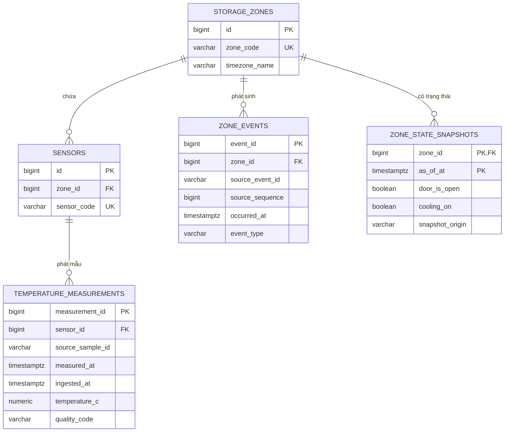
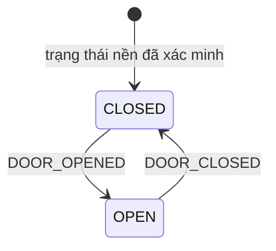
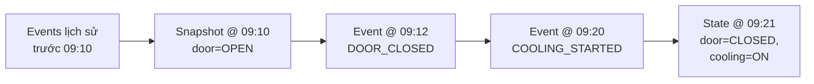
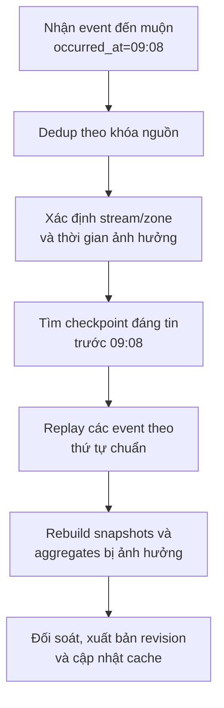

# Phân biệt dữ liệu đo theo thời gian, sự kiện và ảnh chụp trạng thái

Một kho lạnh có cảm biến đo nhiệt độ mỗi phút, bộ điều khiển phát thông báo khi cửa mở hoặc đóng, và hệ thống lưu trạng thái thiết bị sau mỗi giờ. Cả ba loại bản ghi đều mang thời gian, nhưng chúng trả lời **ba câu hỏi khác nhau**:

- **Dữ liệu đo theo thời gian** (*time-series measurement*): “Nhiệt độ cảm biến đo được tại thời điểm 09:09 là bao nhiêu?”
- **Dữ liệu sự kiện** (*event*): “Điều gì đã xảy ra lúc 09:08 và nó có ý nghĩa gì với nghiệp vụ?”
- **Ảnh chụp trạng thái** (*state snapshot*): “Tại mốc 09:10, cửa đang mở hay đóng và thiết bị làm lạnh đang chạy không?”

Nếu trộn các loại này vào cùng một bảng mà không định nghĩa **grain**, ngữ nghĩa thời gian và cách cập nhật, hệ thống dễ đưa ra những câu trả lời sai: đếm mỗi lần đo nhiệt độ thành một lần báo động; dùng ảnh chụp cuối ngày để suy ra số lần cửa mở; hoặc cộng các số tồn kho ở nhiều thời điểm như thể chúng là các giao dịch phát sinh.

Bài này thuộc chương **Dữ liệu chuỗi thời gian** của module **DATABASE_DATA_MODELING**. Mục tiêu là chuyển yêu cầu nghiệp vụ thành mô hình có thực thể, khóa, quan hệ, ràng buộc, chỉ mục và cách lưu trữ phù hợp; đồng thời phân biệt giá trị đo, sự kiện và trạng thái, chọn cấu trúc dữ liệu dễ tiến hóa, và kiểm chứng câu trả lời bằng SQL lẫn các tình huống thực tế như bản tin đến muộn, thiếu dữ liệu, thời gian không đồng bộ hoặc cập nhật lại số liệu.

## 1. Ba loại dữ liệu: giống nhau ở timestamp, khác nhau ở ý nghĩa

| Đặc tính | Dữ liệu đo (*measurement*) | Sự kiện (*event*) | Ảnh chụp trạng thái (*snapshot*) |
|---|---|---|---|
| Một hàng biểu diễn | Một giá trị được đo/quan sát tại một mốc | Một sự việc hoặc chuyển trạng thái xảy ra | Trạng thái của thực thể tại một mốc *as-of* |
| Câu hỏi chính | “Giá trị lúc đó là bao nhiêu?” | “Điều gì đã xảy ra?” | “Lúc đó hệ thống ở trạng thái nào?” |
| Ví dụ | 5,1 °C lúc 09:09 | Cửa mở lúc 09:08 | Cửa mở, máy làm lạnh chạy lúc 09:10 |
| Tần suất | Thường theo chu kỳ hoặc khi có mẫu mới | Khi có điều kiện/sự việc | Định kỳ, theo yêu cầu hoặc lúc checkpoint |
| Khóa thường gặp | Cảm biến + mã mẫu nguồn | Mã sự kiện nguồn duy nhất | Thực thể + thời điểm ảnh chụp |
| Kiểu thay đổi | Thường thêm mẫu; có thể sửa mẫu lỗi | Thường append, sửa bằng sự kiện bù hoặc correction có kiểm soát | Có thể tái dựng khi nguồn đến muộn |
| Phép tổng hợp thường gặp | Min, max, average, percentile, độ phủ | Count, tần suất, thời gian giữa các sự kiện | Trạng thái cuối kỳ, thời gian ở trạng thái nếu có đủ lịch sử |
| Nguy cơ lớn | Lấy mẫu không đều, mất mẫu, sai đơn vị | Đến trùng/ngoài thứ tự, thiếu chuyển trạng thái | Cũ, thiếu mốc, không phản ánh sự kiện đã đến muộn |

**Timestamp không quyết định loại dữ liệu.** Một sự kiện cũng có thời gian và có thể được lưu trong hệ thống time-series; một snapshot cũng có thể được ghi theo chu kỳ cố định. Ta phân loại theo **ý nghĩa của một hàng và câu hỏi nghiệp vụ**, không theo tên database hay việc bảng có cột `timestamp`.

### Một dòng thời gian chung

Giả sử cùng một khu kho lạnh:

| Giờ địa phương | Loại | Bản ghi | Cách hiểu |
|---|---|---|---|
| 09:00 | Event | `DOOR_CLOSED` | Có một sự kiện đóng cửa |
| 09:05 | Measurement | Nhiệt độ `3,2 °C` | Cảm biến đọc được giá trị tại 09:05 |
| 09:08 | Event | `DOOR_OPENED` | Trạng thái cửa chuyển sang mở |
| 09:09 | Measurement | Nhiệt độ `5,1 °C` | Mẫu nhiệt độ mới |
| 09:10 | Snapshot | `door_open = true`, `cooling_on = true` | Trạng thái tại 09:10 |
| 09:12 | Event | `DOOR_CLOSED` | Cửa đóng lại |

Không thể suy ra rằng “nhiệt độ luôn là 5,1 °C từ 09:09 đến 09:12” nếu chỉ có một phép đo, trừ khi mô hình phân tích **quy định** cách giữ giá trị giữa hai lần đo. Ngược lại, nếu các sự kiện cửa mở/đóng là đầy đủ, có thứ tự và có trạng thái khởi đầu đáng tin cậy, ta có thể suy ra khoảng cửa mở từ 09:08 đến 09:12, tức **4 phút**.

## 2. Grain: mỗi hàng là gì và khi nào hai hàng là trùng nhau?

**Grain** là định nghĩa chính xác mức chi tiết của một bản ghi. Một mô hình có grain rõ sẽ trả lời được: “Hai hàng này là hai sự kiện/mẫu khác nhau, hay một thông tin được gửi lặp?”.

### 2.1. Grain của phép đo

Ví dụ:

> Một hàng trong `temperature_measurements` = một mẫu nhiệt độ từ **một cảm biến**, do nguồn phát ra với **mã mẫu** cụ thể, tại một thời điểm đo.

Cảm biến A và B có thể cùng đo lúc 09:09 mà không trùng nhau. Cảm biến A cũng có thể phát hai mẫu khác nhau mang cùng `measured_at` nếu phần cứng cho phép; vì vậy `(sensor_id, measured_at)` chỉ là khóa duy nhất khi nguồn **bảo đảm** không có hai mẫu khác nhau tại một timestamp. Nếu không có bảo đảm đó, sử dụng `source_sample_id`/sequence do nguồn cung cấp để nhận diện chính xác.

### 2.2. Grain của sự kiện

Ví dụ:

> Một hàng trong `zone_events` = một thông báo sự kiện cụ thể được phát bởi bộ điều khiển, có mã sự kiện duy nhất trong phạm vi nguồn.

`DOOR_OPENED` lúc 09:08 và `DOOR_OPENED` lúc 10:03 là hai sự kiện khác nhau. Một message `DOOR_OPENED` lúc 09:08 bị gửi lại ba lần vì retry vẫn là **một** sự kiện nếu cùng mã nguồn. Event ID hỗ trợ dedup và truy vết; không được gán mã mới mỗi lần pipeline nhận lại cùng message rồi coi đó là sự kiện mới.

### 2.3. Grain của snapshot

Ví dụ:

> Một hàng trong `zone_state_snapshots` = trạng thái toàn bộ khu kho lạnh tại một mốc `as_of_at`, theo một phương pháp tạo snapshot đã định.

Hai snapshot lúc 09:10 và 09:20 có thể chứa cùng giá trị `door_open = true` nhưng vẫn là hai ảnh chụp khác nhau vì **thời điểm** khác nhau. Ngược lại, hai snapshot cho cùng `zone_id` và cùng `as_of_at` cần có quy tắc: chọn bản hiệu lực cuối, lưu revision, hay từ chối ghi trùng. Không nên dựa vào timestamp nhập kho để phân biệt các trạng thái vốn được chụp ở cùng một mốc nghiệp vụ.

### 2.4. Grain không nhất thiết là một dòng trên mỗi giây

Một phép đo mỗi 30 giây, event chỉ xuất hiện khi trạng thái đổi và snapshot chụp mỗi 15 phút đều là chuỗi dữ liệu theo thời gian. Thêm một cột `time_bucket` cho phép tổng hợp nhưng **không biến** dữ liệu gốc thành dữ liệu có grain giống nhau.

Khi chuyển từ phút sang giờ, cần nêu rõ kết quả là:

- Trung bình/giá trị cực trị **của các mẫu đo** trong giờ.
- Số **sự kiện** xảy ra trong giờ.
- **Trạng thái tại cuối giờ** hoặc thời lượng ở từng trạng thái.

Ba đại lượng này không thể cộng hoặc thay thế lẫn nhau một cách tùy tiện.

## 3. Các loại thời gian phải được đặt tên chính xác

Trong hệ thống phân tán, một bản ghi có thể có nhiều mốc thời gian; đặt tất cả thành `created_at` làm mất ý nghĩa.

| Mốc | Ý nghĩa | Cột ví dụ |
|---|---|---|
| **Event time** | Khi sự việc thực tế xảy ra theo nguồn | `occurred_at` |
| **Measurement time** | Khi cảm biến đo/ghi nhận một giá trị | `measured_at` |
| **As-of time** | Mốc mà snapshot tuyên bố phản ánh trạng thái | `as_of_at` |
| **Ingestion/received time** | Khi hệ thống nhận bản ghi | `ingested_at` / `received_at` |
| **Processing/computed time** | Khi pipeline tính một kết quả hoặc snapshot | `computed_at` |
| **Valid time** | Khoảng thời gian một trạng thái/quy tắc có hiệu lực trong nghiệp vụ | `valid_from` / `valid_to` khi mô hình cần |

### 3.1. Một event có thể đến sau khi đã xảy ra

```text
09:08:00   Cửa mở, bộ điều khiển ghi occurred_at
09:08:01   Thiết bị mất mạng
09:15:20   Kết nối lại, server nhận event

occurred_at = 09:08:00
received_at = 09:15:20
```

Nếu dashboard hỏi “cửa mở lúc nào?”, phải dùng `occurred_at`. Nếu vận hành hỏi “pipeline nhận event trễ bao nhiêu?”, dùng chênh lệch `received_at - occurred_at`; nhưng cần nhận biết đồng hồ thiết bị có thể lệch. Không được cho rằng hai timestamp luôn đáng tin tương đương.

### 3.2. Dùng UTC để lưu instant, timezone cho hiển thị/ngày nghiệp vụ

Với PostgreSQL, `TIMESTAMPTZ` biểu diễn một instant có nhận biết múi giờ; database có thể hiển thị theo timezone của session, không có nghĩa nó giữ nguyên tên timezone của thiết bị. Với hệ thống đa quốc gia, lưu instant và giữ riêng `zone_timezone`/vùng thời gian nghiệp vụ khi cần chia ngày theo địa phương.

Ví dụ hai chuỗi:

```text
2026-11-22T09:08:00+07:00
2026-11-22T02:08:00Z
```

biểu diễn **cùng một instant**. Nhóm theo “ngày địa phương” phải chỉ rõ timezone; với vùng có quy tắc DST, một ngày có thể không có đúng 24 giờ.

### 3.3. Sắp xếp khi timestamp bằng nhau

Hai event có cùng `occurred_at` không có thứ tự nghiệp vụ chỉ nhờ timestamp. Nên lấy `source_sequence` hoặc một thứ tự có bảo đảm từ nguồn. `event_id` tự tăng ở database chỉ biểu diễn thứ tự nhận/chèn, **không chứng minh** thứ tự xảy ra. Nếu không có thông tin phân giải, đánh dấu thứ tự **chưa xác định** thay vì bịa thứ tự bằng `ORDER BY event_id` và coi kết quả là chân lý.

## 4. Mô hình dữ liệu mẫu cho kho lạnh

Một mô hình quan hệ có thể dùng bốn nhóm chính: khu kho, cảm biến, phép đo, event điều khiển và snapshot trạng thái. Các mối liên hệ khác nhau được bảo vệ bằng FK.



### 4.1. DDL PostgreSQL minh họa

```sql
CREATE TABLE storage_zones (
    id BIGINT GENERATED ALWAYS AS IDENTITY PRIMARY KEY,
    zone_code VARCHAR(40) NOT NULL UNIQUE,
    timezone_name VARCHAR(80) NOT NULL
);

CREATE TABLE sensors (
    id BIGINT GENERATED ALWAYS AS IDENTITY PRIMARY KEY,
    zone_id BIGINT NOT NULL REFERENCES storage_zones(id),
    sensor_code VARCHAR(80) NOT NULL UNIQUE
);

CREATE TABLE temperature_measurements (
    measurement_id BIGINT GENERATED ALWAYS AS IDENTITY PRIMARY KEY,
    sensor_id BIGINT NOT NULL REFERENCES sensors(id),
    source_system VARCHAR(40) NOT NULL,
    source_sample_id VARCHAR(100) NOT NULL,
    measured_at TIMESTAMPTZ NOT NULL,
    ingested_at TIMESTAMPTZ NOT NULL DEFAULT CURRENT_TIMESTAMP,
    temperature_c NUMERIC(7, 3),
    quality_code VARCHAR(12) NOT NULL
        CHECK (quality_code IN ('OK', 'SUSPECT', 'MISSING')),
    CONSTRAINT uq_temperature_source_sample
        UNIQUE (source_system, source_sample_id),
    CONSTRAINT ck_temperature_quality_value
        CHECK (
            (quality_code = 'MISSING' AND temperature_c IS NULL)
            OR
            (quality_code IN ('OK', 'SUSPECT')
             AND temperature_c IS NOT NULL)
        )
);

CREATE TABLE zone_events (
    event_id BIGINT GENERATED ALWAYS AS IDENTITY PRIMARY KEY,
    zone_id BIGINT NOT NULL REFERENCES storage_zones(id),
    source_system VARCHAR(40) NOT NULL,
    source_event_id VARCHAR(100) NOT NULL,
    source_sequence BIGINT NOT NULL,
    event_type VARCHAR(30) NOT NULL CHECK (
        event_type IN (
            'DOOR_OPENED', 'DOOR_CLOSED',
            'COOLING_STARTED', 'COOLING_STOPPED'
        )
    ),
    occurred_at TIMESTAMPTZ NOT NULL,
    received_at TIMESTAMPTZ NOT NULL DEFAULT CURRENT_TIMESTAMP,
    CONSTRAINT uq_event_source_id UNIQUE (source_system, source_event_id),
    CONSTRAINT uq_event_source_sequence
        UNIQUE (zone_id, source_system, source_sequence)
);

CREATE TABLE zone_state_snapshots (
    zone_id BIGINT NOT NULL REFERENCES storage_zones(id),
    as_of_at TIMESTAMPTZ NOT NULL,
    door_is_open BOOLEAN NOT NULL,
    cooling_on BOOLEAN NOT NULL,
    snapshot_origin VARCHAR(12) NOT NULL
        CHECK (snapshot_origin IN ('OBSERVED', 'REPLAYED')),
    source_watermark_at TIMESTAMPTZ,
    computed_at TIMESTAMPTZ NOT NULL DEFAULT CURRENT_TIMESTAMP,
    PRIMARY KEY (zone_id, as_of_at)
);

CREATE INDEX idx_measurements_sensor_time
    ON temperature_measurements(sensor_id, measured_at DESC);

CREATE INDEX idx_zone_events_type_time
    ON zone_events(zone_id, event_type, occurred_at DESC);
```

Những giả định quan trọng:

1. `source_sample_id` duy nhất **trong một source_system**. Nếu nguồn chỉ cấp ID duy nhất theo sensor, cần đưa `sensor_id` vào khóa duy nhất hoặc chuẩn hóa khóa nguồn trước.
2. `source_sequence` được nguồn phát cấp đơn điệu và duy nhất trong mỗi cặp `(zone_id, source_system)` của ví dụ. Nếu bộ điều khiển reset sequence khi khởi động lại, phải bổ sung `epoch`/`session_id` vào định danh và quy tắc thứ tự thay vì dùng constraint này.
3. Khi cần tái dựng trạng thái cửa một cách chuẩn xác, dữ liệu cửa trong ví dụ đến từ **một nguồn điều khiển có thẩm quyền**, chẳng hạn `source_system = 'ZONE_CTRL'`. Nếu nhiều nguồn cùng gửi sự kiện, phải có quy tắc hòa giải và thứ tự thống nhất.
4. `snapshot_origin = 'OBSERVED'` nghĩa là ảnh chụp độc lập từ trạng thái thực tế; `'REPLAYED'` nghĩa là tính lại từ event stream. Hai loại có thể lệch nhau và cần đối soát, không được tự coi luôn bằng nhau.
5. `source_watermark_at` chỉ có nghĩa khi pipeline định nghĩa được mốc hoàn tất tương ứng. Lưu một timestamp không tự bảo đảm đã nhận đủ mọi sự kiện trước đó.

DDL nhằm minh họa khái niệm; khi chuyển sang database chuỗi thời gian hoặc warehouse khác, cần đối chiếu khả năng cưỡng chế PK/FK/UNIQUE, phân vùng và cách lưu timestamp của nền tảng đó.

### 4.2. Vì sao không gộp tất cả vào một bảng `zone_log`?

Một bảng gồm `time`, `type`, `value` có thể ghi được cả “temperature = 5,1” và “door open”. Nhưng các hệ quả là:

- `value` phải chứa cả số, boolean, mã trạng thái hoặc JSON.
- Không có ràng buộc đơn vị/loại dữ liệu rõ cho từng đo lường.
- Khó đặt khóa và quy tắc dedup đúng cho cả mẫu đo lẫn event.
- `AVG(value)` có thể vô tình tính cả dữ liệu không phải phép đo.
- Trạng thái hiện tại phải được diễn giải lại từ các hàng có ý nghĩa khác nhau.

Một luồng thô chung kiểu event envelope có thể hợp lý ở **tầng ingestion**, nhưng mô hình phân tích/truy vấn nên phân biệt các *record semantics* và ràng buộc theo loại. Đừng lấy sự tiện lợi của JSON log làm thay thế cho grain và hợp đồng dữ liệu.

## 5. Dữ liệu đo: giá trị, đơn vị, chất lượng và tần suất lấy mẫu

### 5.1. Measurement là quan sát, không phải thay đổi trạng thái

Một cảm biến ghi:

```text
Sensor T-A-01:
09:05  3,2 °C
09:09  5,1 °C
09:13  4,0 °C
```

Ba hàng biểu diễn **ba phép đo**. Chúng không có nghĩa đã xảy ra “ba lần tăng nhiệt độ”, cũng không chứng minh có ba báo động. Chuyển số đo thành cảnh báo cần **quy tắc phát hiện**: ngưỡng, thời lượng, hysteresis, chất lượng mẫu và chính sách xử lý thiếu dữ liệu.

Đơn vị phải được cố định ở hợp đồng: `temperature_c` luôn là độ C; nếu một thiết bị gửi °F, phải chuyển đổi có kiểm soát hoặc lưu loại đơn vị và chuẩn hóa, không trộn `32 °F` với `32 °C` trong cùng cột rồi tính trung bình.

### 5.2. `NULL` không phải số 0

Nếu cảm biến ngắt kết nối:

```text
09:05 = 3,2 °C  (OK)
09:06 = không có mẫu
09:07 = không có mẫu
09:08 = 4,1 °C  (OK)
```

Việc **không có hàng** hoặc hàng `quality_code = 'MISSING'` mang ý nghĩa dữ liệu thiếu. Ghi nhiệt độ **0 °C** để thay cho missing làm thay đổi kết quả trung bình và có thể gây cảnh báo sai. SQL `AVG` bỏ qua `NULL`, nhưng kết quả ấy chỉ là trung bình trên **các mẫu có giá trị**, không tự mang ý nghĩa liên tục trong thời gian.

Mã `SUSPECT` có thể dùng khi mẫu tồn tại nhưng bị nghi lỗi. Không xóa hàng suspect khỏi dữ liệu thô nếu cần kiểm tra; quyết định bỏ hay giữ trong chỉ số phụ thuộc semantic contract.

### 5.3. Gauge và counter không dùng cùng phép tính

Nhiệt độ, áp suất, mức nước tức thời là **gauge**: quan sát giá trị tại một thời điểm. Trong khi đồng hồ điện tổng tích lũy `total_kwh` là **counter**: một giá trị lũy kế thường tăng, có thể reset khi thiết bị thay mới hoặc khởi động lại.

| Loại | Ví dụ | Truy vấn hợp lý | Sai lầm điển hình |
|---|---|---|---|
| Gauge | `temperature_c` | Min/max, trung bình mẫu hoặc theo thời gian, mức vượt ngưỡng | `SUM(temperature_c)` gọi là “tổng nhiệt độ” |
| Counter lũy kế | `total_kwh` | Hiệu giữa các mốc hợp lệ, tốc độ tiêu thụ, xét reset | Cộng mọi giá trị counter qua ngày |
| Delta/event count | `items_moved = +3` | Tổng delta theo phạm vi thích hợp | Coi delta là số dư hiện tại |
| Snapshot balance | `stock_on_hand = 50` | Số dư tại mốc, cuối kỳ | Cộng mọi snapshot ngày thành số dư tháng |

Nếu counter từ 1200 tăng lên 1212 kWh, tiêu thụ giữa hai mốc là **12 kWh**, **nếu** không có reset, rollover, sửa số hoặc đổi nguồn. Khi counter từ 1212 xuống 8, không được kết luận tiêu thụ âm −1204 kWh; phải xét reset hoặc thiết bị thay thế.

### 5.4. Trung bình mẫu và trung bình theo thời gian

Giả sử nhiệt độ là:

```text
09:00:  2 °C
09:01: 10 °C
09:10:  2 °C
```

Trung bình số học ba mẫu = `(2 + 10 + 2) / 3 = 4,67 °C`. Nhưng nếu chọn **mô hình giữ giá trị gần nhất cho tới mẫu kế tiếp**, từ 09:00 đến 09:01 là 2 °C (1 phút) và từ 09:01 đến 09:10 là 10 °C (9 phút). Khi đó trung bình theo thời gian trên khoảng **09:00–09:10** là `(2×1 + 10×9)/10 = 9,2 °C`.

Hai kết quả đều đúng về mặt phép tính **cho hai định nghĩa khác nhau**. Không áp dụng giữ giá trị vô hạn khi mất cảm biến; cần quy định **maximum gap**, phương pháp nội suy/giữ mẫu và ranh giới khoảng. Nếu thiết bị lấy mẫu đều, trung bình mẫu có thể là phép xấp xỉ phù hợp, nhưng cần kiểm chứng giả định.

## 6. Sự kiện: thay đổi, nguyên nhân và bản ghi có thể replay

### 6.1. Event lưu “đã xảy ra”, không nhất thiết lưu trạng thái đầy đủ

`DOOR_OPENED` nói rằng **cửa đã mở** vào lúc `occurred_at`; nó không nhất thiết chứa mọi thuộc tính hiện tại của khu kho. Trong nhiều thiết kế, event có:

- Mã sự kiện nguồn và mã thực thể.
- Loại sự kiện và thời gian xảy ra.
- Payload dữ liệu cần thiết để giải thích hoặc áp dụng thay đổi.
- Source sequence hoặc thông tin thứ tự.
- Schema/version, causation ID, correlation ID nếu cần kiểm toán/chuỗi nghiệp vụ.

Một event nghiệp vụ như `ORDER_CONFIRMED` không giống một log kỹ thuật “HTTP 200”. Cũng không nhất thiết là bản ghi CDC `UPDATE table SET ...`: CDC mô tả thay đổi lưu trữ, còn domain event diễn đạt ý nghĩa nghiệp vụ.

### 6.2. Event có thể là chuyển trạng thái

Với cửa kho:



Nếu nguồn bảo đảm các event cửa đầy đủ, có thứ tự và có baseline ban đầu, trạng thái cửa được suy ra bằng cách áp dụng lần lượt các chuyển trạng thái.

Điều gì xảy ra khi nhận hai `DOOR_OPENED` liên tiếp? Có thể do:

- Nguồn gửi lại event cũ.
- Thiết bị phát chuyển trạng thái không chuẩn.
- Một event `DOOR_CLOSED` bị mất.
- Ngữ nghĩa `DOOR_OPENED` thật ra là “cảm biến thấy cửa đang mở”, không phải “chuyển từ đóng sang mở”.

Vì vậy, không được hard-code “mọi event OPENED luôn tăng một lần mở” nếu hợp đồng nguồn chưa nói rõ. Cần dùng mã event, chuỗi và state machine phù hợp.

### 6.3. Đếm sự kiện và đếm lần thay đổi không luôn giống nhau

```sql
SELECT date_trunc('hour', occurred_at) AS hour_utc_session,
       COUNT(*) AS open_events
FROM zone_events
WHERE zone_id = :zone_id
  AND source_system = 'ZONE_CTRL'
  AND event_type = 'DOOR_OPENED'
GROUP BY date_trunc('hour', occurred_at)
ORDER BY hour_utc_session;
```

Query đếm **event `DOOR_OPENED` đã được lưu**, không chứng minh số lần chuyển trạng thái thực sự nếu nguồn trùng, mất hoặc phát event với định nghĩa khác. Tên alias `hour_utc_session` ở đây chỉ chính xác khi session PostgreSQL dùng timezone UTC; cách an toàn là xác định timezone trong truy vấn hoặc cấu hình báo cáo rõ ràng.

Đối với báo cáo theo ngày địa phương, dùng timezone nghiệp vụ chứ không mặc định cắt ngày theo timezone của server.

### 6.4. Tính thời lượng mở cửa từ chuyển trạng thái

Với hai event liên tiếp `OPENED` lúc 09:08 và `CLOSED` lúc 09:12, cửa mở 4 phút. Khi cần tính tổng trong một khoảng thời gian, phải **cắt giao với ranh giới khoảng** và xử lý trạng thái đã mở từ trước lúc bắt đầu.

Một query PostgreSQL minh họa cho stream cửa **đã khử trùng, đầy đủ và có thứ tự**:

```sql
WITH transitions AS (
    SELECT
        event_type,
        occurred_at AS start_at,
        LEAD(occurred_at) OVER (
            ORDER BY occurred_at, source_sequence
        ) AS next_at
    FROM zone_events
    WHERE zone_id = :zone_id
      AND source_system = 'ZONE_CTRL'
      AND event_type IN ('DOOR_OPENED', 'DOOR_CLOSED')
)
SELECT
    SUM(
        EXTRACT(EPOCH FROM (
            LEAST(COALESCE(next_at, :to_time), :to_time)
            - GREATEST(start_at, :from_time)
        ))
    ) AS open_seconds
FROM transitions
WHERE event_type = 'DOOR_OPENED'
  AND start_at < :to_time
  AND COALESCE(next_at, :to_time) > :from_time;
```

Ở đây `:from_time` và `:to_time` là `TIMESTAMPTZ`, xác định khoảng nửa mở `[from, to)`. Query chỉ đúng khi một `DOOR_OPENED` bắt đầu khoảng mở kéo dài tới event chuyển trạng thái tiếp theo và các event đã được chuẩn hóa. Cần kiểm tra trường hợp chuỗi bắt đầu bằng trạng thái đã mở, event bị thiếu, trạng thái không xen kẽ, thứ tự trùng timestamp và khoảng cuối chưa có event đóng. Nếu không có khoảng mở nào, `SUM` trả `NULL`; dashboard có thể chuyển thành 0 theo hợp đồng sau khi xác minh lịch sử đủ.

**Không dùng số hàng snapshot có `door_is_open = true` làm “số lần cửa mở”**: nhiều ảnh chụp có thể thuộc cùng một lần mở.

## 7. Snapshot: trạng thái ở một mốc, không phải một sự kiện mới

### 7.1. Snapshot được quan sát trực tiếp hay dựng lại?

Có hai cách tạo snapshot:

1. **Observed snapshot:** bộ điều khiển báo “cửa đang mở, máy đang chạy lúc 09:10”. Đây là một quan sát độc lập tại mốc ấy.
2. **Replayed snapshot:** pipeline áp dụng các event từ trạng thái nền rồi lưu kết quả “cửa mở, máy đang chạy tại 09:10”.

Hai loại cùng có grain “một trạng thái ở một thời điểm”, nhưng độ tin cậy phụ thuộc khác nhau: snapshot quan sát có thể phát hiện event bị mất; snapshot replay có thể giảm công replay nhưng kế thừa mọi lỗi/thiếu sót trong event stream.

### 7.2. Snapshot không cho biết mọi chuyển động giữa hai mốc

```text
09:00 snapshot: door=CLOSED
09:05 event: DOOR_OPENED
09:07 event: DOOR_CLOSED
09:10 snapshot: door=CLOSED
```

Nếu chỉ giữ hai snapshot, ta có thể tưởng cửa đóng suốt khoảng 09:00–09:10. **Không thể suy ra điều đó.** Snapshot mô tả trạng thái tại mốc chụp; nó không chứng minh không có chuyển trạng thái giữa các mốc.

Do đó:

- Cần số **lần mở cửa**: dùng event (hoặc nguồn đếm được định nghĩa tương đương).
- Cần **cửa có mở ở 09:10 không**: snapshot hoặc replay hợp lệ.
- Cần **tổng thời gian cửa mở**: event transitions đủ hoặc dữ liệu quan sát có độ phân giải và cách tính được chấp thuận; snapshot thưa không cung cấp kết quả chính xác.

### 7.3. Snapshot làm checkpoint để tái dựng nhanh

Nếu có hàng triệu event, replay từ lúc thiết bị được lắp đặt mỗi lần hỏi trạng thái hiện tại rất tốn kém. Một **snapshot checkpoint** lưu trạng thái đã tính đến mốc `as_of_at`. Để trả trạng thái sau mốc ấy, chỉ cần áp dụng các event phát sinh **sau** snapshot.



Để kết quả đúng, snapshot phải được tính theo **cùng quy tắc reducer**, có vị trí sự kiện xử lý rõ (mốc thời gian/sequence/watermark), và được invalidated/rebuilt nếu một sự kiện quá khứ làm thay đổi trạng thái đã lưu.

### 7.4. Khác snapshot lưu trạng thái hiện tại

Một bảng `zone_current_state(zone_id PK, door_is_open, cooling_on, updated_at)` có thể phục vụ truy vấn realtime, nhưng chỉ giữ **phiên bản hiện tại**, không cho phép trả lời chính xác “trạng thái lúc 09:10 hôm qua” nếu không có history khác. Nó là một *materialized current state*, khác chuỗi snapshot lịch sử có PK `(zone_id, as_of_at)`.

Không nên coi cột `updated_at` của bảng current state tự biến nó thành một fact lịch sử đầy đủ.

## 8. Truy vấn “as-of”: tái dựng trạng thái tại một thời điểm

### 8.1. Chỉ lấy event cuối cùng có thể đủ cho một trạng thái đơn giản

Nếu trạng thái cửa chỉ được xác định bằng sự kiện `DOOR_OPENED` và `DOOR_CLOSED`, và nguồn `ZONE_CTRL` đáng tin cậy:

```sql
SELECT
    CASE event_type
        WHEN 'DOOR_OPENED' THEN TRUE
        WHEN 'DOOR_CLOSED' THEN FALSE
    END AS door_is_open,
    occurred_at
FROM zone_events
WHERE zone_id = :zone_id
  AND source_system = 'ZONE_CTRL'
  AND event_type IN ('DOOR_OPENED', 'DOOR_CLOSED')
  AND occurred_at <= :as_of_time
ORDER BY occurred_at DESC, source_sequence DESC
LIMIT 1;
```

Kết quả trả về trạng thái **suy ra từ event cửa cuối cùng**, không phải nhiệt độ đo gần nhất. Nếu không có event nào trước mốc hỏi, trạng thái là **chưa biết**, trừ khi có baseline đáng tin cậy.

Query chỉ dùng được nếu `source_sequence` có ngữ nghĩa sắp xếp khi timestamp bằng nhau trong nguồn được chọn. Khi luồng có nhiều nguồn cạnh tranh, phải hòa giải trước.

### 8.2. Kết hợp snapshot replay và event sau mốc chụp

Khi có snapshot checkpoint đáng tin và luồng event tương ứng, lấy snapshot gần nhất không sau mốc hỏi, rồi tìm event cửa mới nhất **sau** snapshot:

```sql
WITH latest_snapshot AS (
    SELECT as_of_at, door_is_open
    FROM zone_state_snapshots
    WHERE zone_id = :zone_id
      AND snapshot_origin = 'REPLAYED'
      AND as_of_at <= :target_time
    ORDER BY as_of_at DESC
    LIMIT 1
),
last_door_event AS (
    SELECT event_type
    FROM zone_events
    WHERE zone_id = :zone_id
      AND source_system = 'ZONE_CTRL'
      AND event_type IN ('DOOR_OPENED', 'DOOR_CLOSED')
      AND occurred_at <= :target_time
      AND occurred_at > COALESCE(
          (SELECT as_of_at FROM latest_snapshot),
          '-infinity'::timestamptz
      )
    ORDER BY occurred_at DESC, source_sequence DESC
    LIMIT 1
)
SELECT CASE
    WHEN (SELECT event_type FROM last_door_event) = 'DOOR_OPENED'
        THEN TRUE
    WHEN (SELECT event_type FROM last_door_event) = 'DOOR_CLOSED'
        THEN FALSE
    ELSE (SELECT door_is_open FROM latest_snapshot)
END AS door_is_open;
```

Đoạn này minh họa **một thuộc tính cửa**. Để tái dựng `cooling_on`, phải xét riêng `COOLING_STARTED/STOPPED` và snapshot tương ứng. Với reducer phức tạp (ví dụ event chứa phép tăng/giảm, nhiều thực thể phối hợp), không thể chỉ lấy event cuối mà phải **áp dụng tuần tự tất cả event** từ checkpoint.

Các điều kiện đúng:

1. Snapshot `REPLAYED` phản ánh đầy đủ event đã biết tính tới `as_of_at` theo cùng quy tắc.
2. Event mới sau snapshot được khử trùng, sắp đúng thứ tự và không bị thiếu trong phạm vi yêu cầu.
3. Event có `occurred_at = as_of_at` đã được tính vào snapshot theo quy tắc nửa mở đã nêu; truy vấn chỉ replay event có thời điểm lớn hơn.
4. Nếu sự kiện đến muộn nằm **trước** snapshot và ảnh hưởng state, checkpoint và các snapshot sau phải được tính lại. Chỉ replay sự kiện sau snapshot **sẽ không tự sửa lỗi đó**.

Đối với nguồn snapshot quan sát trực tiếp `OBSERVED`, không thể mặc định ghép nó vào luồng replay theo công thức trên nếu không có hợp đồng làm baseline, độ tin cậy và quy tắc hòa giải.

### 8.3. As-of có nhiều nghĩa thời gian

“Trạng thái lúc 09:10” có thể nghĩa là:

- Trạng thái **thực sự có hiệu lực** tại 09:10 theo toàn bộ event nguồn mà sau này đã biết.
- Trạng thái mà **hệ thống đã biết vào 09:10**, khi một event 09:08 chưa được nhận tới 09:15.

Hai câu hỏi khác nhau. Nếu cần tái hiện “hệ thống lúc đó đã biết gì”, phải xét **received/recorded time** hoặc mô hình thời gian hai chiều (*bitemporal*), không chỉ `occurred_at`.

## 9. Truy vấn theo cửa sổ thời gian và khoảng nửa mở

Time-series thường sử dụng cửa sổ:

```text
[from_time, to_time)
```

tức bao gồm `from_time` nhưng không bao gồm `to_time`. Nhờ vậy, hai cửa sổ liên tiếp `[09:00, 09:05)` và `[09:05, 09:10)` không đếm trùng mẫu/sự kiện đúng 09:05.

### 9.1. Trung bình phép đo theo bucket 5 phút

Ví dụ PostgreSQL phiên bản hỗ trợ `date_bin`:

```sql
SELECT
    sensor_id,
    date_bin(
        INTERVAL '5 minutes',
        measured_at,
        TIMESTAMPTZ '1970-01-01 00:00:00+00'
    ) AS bucket_start,
    COUNT(*) FILTER (WHERE quality_code = 'OK') AS valid_samples,
    AVG(temperature_c) FILTER (WHERE quality_code = 'OK') AS avg_temp_c,
    MIN(temperature_c) FILTER (WHERE quality_code = 'OK') AS min_temp_c,
    MAX(temperature_c) FILTER (WHERE quality_code = 'OK') AS max_temp_c
FROM temperature_measurements
WHERE sensor_id = :sensor_id
  AND measured_at >= :from_time
  AND measured_at < :to_time
GROUP BY sensor_id, bucket_start
ORDER BY bucket_start;
```

`AVG` ở đây là **trung bình trên các mẫu đạt chất lượng OK**, không phải trung bình theo thời lượng nếu cảm biến lấy mẫu không đều. Nếu một bucket không có hàng nào, query sẽ **không trả hàng** cho bucket ấy. Muốn vẽ biểu đồ có khoảng trống, sinh các bucket mong đợi và left join với kết quả, không tự tạo số đo 0.

### 9.2. Đếm event theo bucket

```sql
SELECT
    zone_id,
    date_bin(
        INTERVAL '5 minutes',
        occurred_at,
        TIMESTAMPTZ '1970-01-01 00:00:00+00'
    ) AS bucket_start,
    COUNT(*) AS opened_events
FROM zone_events
WHERE zone_id = :zone_id
  AND source_system = 'ZONE_CTRL'
  AND event_type = 'DOOR_OPENED'
  AND occurred_at >= :from_time
  AND occurred_at < :to_time
GROUP BY zone_id, bucket_start
ORDER BY bucket_start;
```

Hai câu SQL nhìn khá giống nhau ở phần `date_bin`, nhưng **một cái tổng hợp giá trị đo, một cái đếm sự kiện**. Sự giống nhau về kỹ thuật bucket không làm hai chỉ số tương đương.

### 9.3. Ảnh chụp cuối kỳ thay vì SUM snapshot

Giả sử bảng snapshot chứa mỗi 15 phút một trạng thái cửa. Muốn trạng thái cuối một khung giờ, lấy snapshot cuối cùng **không sau mốc kết thúc**, hoặc tốt hơn là tái dựng state đến mốc đó bằng event. Không dùng:

```sql
-- Sai về ý nghĩa nếu gọi đó là số lần mở cửa:
SELECT SUM(door_is_open::int)
FROM zone_state_snapshots
WHERE zone_id = :zone_id;
```

`SUM(boolean)` trên snapshot, nếu được phép ép kiểu, chỉ đếm **bao nhiêu mốc chụp cửa đang mở**. Chỉ số này phụ thuộc tần suất chụp; không phải số lần mở hay tổng số phút cửa mở. Với snapshot thưa, không có cách suy ra chính xác thời lượng giữa các mốc nếu không có thêm dữ liệu hoặc giả định.

## 10. Dữ liệu thiếu, không đều, sai chất lượng và đồng hồ lệch

### 10.1. Phân biệt các trạng thái “không thấy dữ liệu”

| Tình huống | Ý nghĩa | Hướng xử lý |
|---|---|---|
| Không có hàng đo | Chưa nhận mẫu hoặc thiết bị không phát | Giữ gap, phát hiện thiếu dữ liệu |
| Hàng có `quality_code = MISSING` | Nguồn báo có mốc nhưng không có giá trị hợp lệ | Không thay thành 0 |
| Hàng có `SUSPECT` | Có giá trị nhưng không đáng tin hoàn toàn | Truy vấn cần bộ lọc chất lượng |
| Giá trị thật `0 °C` | Phép đo hợp lệ bằng 0 | Giữ 0 |
| Không có event cửa | Có thể không thay đổi **hoặc** nguồn bị mất event | Kiểm tra baseline, heartbeat, độ hoàn chỉnh |
| Không có snapshot tại mốc hỏi | Snapshot thưa hoặc pipeline chưa tạo | Replay từ snapshot gần nhất/nguồn gốc nếu đủ dữ liệu |

**Thiếu thông tin không đồng nghĩa trạng thái không thay đổi.** Với thiết bị offline, một trạng thái cửa được suy ra từ event trước đó chỉ là “trạng thái cuối cùng đã biết”, không chắc là “trạng thái vật lý hiện tại”.

### 10.2. Heartbeat khác measurement và event nghiệp vụ

Một thiết bị có thể gửi heartbeat `DEVICE_ONLINE` mỗi phút để báo kết nối. Heartbeat là dữ liệu vận hành về tính sẵn sàng của thiết bị; không tự biến thành event `DOOR_OPENED` hay phép đo nhiệt độ. Nếu không có heartbeat trong 10 phút, hệ thống có thể tạo event phát hiện `DEVICE_OFFLINE` theo quy tắc giám sát, nhưng cần phân biệt **sự kiện được suy ra** với **trạng thái đo trực tiếp từ thiết bị**.

### 10.3. Không nội suy tùy tiện các khoảng trống dài

Giả sử cảm biến có 3 °C lúc 10:00 và 8 °C lúc 11:00. Nối đường thẳng giữa hai điểm cho ra 5,5 °C lúc 10:30, nhưng đó là **ước lượng dựa trên giả định**, không phải giá trị đã được quan sát. Với hệ thống an toàn thực phẩm, một giờ mất dữ liệu có thể là lý do phát cảnh báo “không đủ chứng cứ kiểm soát”, không được lấp gap rồi kết luận mọi lúc đều trong ngưỡng.

Nếu nội suy, nêu rõ:

- Phương pháp (linear, forward-fill, mô hình dự đoán).
- Ngưỡng độ dài khoảng trống tối đa.
- Cột phân biệt observed/interpolated.
- Mức tin cậy và mục đích cho phép sử dụng.

### 10.4. Thiết bị có thể báo thời gian trong tương lai

`measured_at > ingested_at` không nhất thiết là “du hành thời gian”: đồng hồ thiết bị có thể chạy nhanh hoặc hệ thống gửi timestamp sai múi giờ. Đặt kiểm tra độ lệch cho từng nguồn; đánh dấu bất thường và sửa có lineage, không tùy tiện đổi `measured_at` thành `ingested_at` để dữ liệu đi vào chart.

## 11. Đến muộn, ngoài thứ tự và gửi trùng

Trong mạng không ổn định, ba hiện tượng thường gặp:

- **Late arrival:** event lúc 09:08 đến kho lúc 09:15.
- **Out of order:** event `DOOR_CLOSED` lúc 09:12 tới trước `DOOR_OPENED` lúc 09:08.
- **Duplicate delivery:** cùng `source_event_id` được gửi lại nhiều lần.

### 11.1. Một sự kiện đến hai lần chỉ được tính một lần

Ví dụ:

```sql
INSERT INTO zone_events (
    zone_id, source_system, source_event_id,
    source_sequence, event_type, occurred_at
)
VALUES (
    :zone_id, 'ZONE_CTRL', :source_event_id,
    :source_sequence, 'DOOR_OPENED', :occurred_at
)
ON CONFLICT (source_system, source_event_id) DO NOTHING;
```

`ON CONFLICT DO NOTHING` là một chính sách mẫu khi cùng ID/cùng nội dung thật sự là retry. Nếu cùng ID nhưng payload khác, không nên âm thầm bỏ qua: cần phát hiện mâu thuẫn và đưa vào quy trình correction/điều tra. Ràng buộc unique là lớp bảo vệ khi có nhiều worker ingest cạnh tranh.

### 11.2. Không dùng thứ tự nhận để replay

`received_at` chỉ phản ánh thời điểm server nhận. Để tái dựng trạng thái vật lý, cần sắp theo `occurred_at` cùng quy tắc tie-break của nguồn, chứ không phải `received_at`. Nếu thông điệp đến ngoài thứ tự, reducer phải reorder trong phạm vi cho phép hoặc tính lại đoạn trạng thái bị ảnh hưởng.

Nếu thiết bị phát số sequence đơn điệu, một khoảng nhảy như 41 → 43 có thể cho thấy thiếu message 42. Tuy nhiên, sequence có thể bị reset hoặc phân luồng; cần định nghĩa scope của nó trước khi kết luận mất event.

### 11.3. Khi nào được đóng một cửa sổ kết quả?

Một dashboard có thể chấp nhận kết quả sơ bộ rồi cập nhật khi event muộn đến. Một báo cáo kiểm định có thể đòi đợi tới khi nguồn xác nhận completeness trước khi công bố.

**Watermark** là một thông tin vận hành về mức độ tiến triển/hoàn chỉnh của luồng theo quy tắc nguồn và pipeline. Nó không đồng nghĩa `MAX(occurred_at)` đã thấy: thấy event lúc 10:00 không chứng minh sẽ không còn event lúc 09:50 đến muộn.

Nếu cần giữ độ tin cậy, kết quả mỗi cửa sổ nên có trạng thái **provisional/final** hoặc metadata freshness, và quy tắc cập nhật khi vượt giới hạn độ trễ.

## 12. Snapshot cũ và tái dựng lại sau event đến muộn

Giả sử pipeline dựng snapshot lúc 09:10 bằng các event đã nhận. Vào lúc dựng, nó **chưa nhận** event `DOOR_OPENED` xảy ra 09:08. Snapshot có thể nói `door_is_open = false`. Đến 09:15, event 09:08 đến kho.

Nếu replay sau snapshot 09:10, query ở mục 8 sẽ không xem event 09:08 do `occurred_at <= as_of_at`. Vì vậy snapshot đã sai phải được **invalidate/rebuild**, hoặc có cơ chế lưu revision/giá trị authoritative đã cập nhật.

### 12.1. Chuỗi xử lý correction hợp lý



Nếu hệ thống lưu snapshots append-only phục vụ audit, thay vì update cùng PK cần lưu **revision** (ví dụ thêm `snapshot_revision` hoặc bảng lịch sử) và đánh dấu bản nào đang hiệu lực. Ví dụ DDL đầu bài chọn **một snapshot hiệu lực trên mỗi mốc**, không tự giữ lịch sử mọi lần recompute.

### 12.2. Snapshot có thể là dữ liệu nguồn có thẩm quyền

Trong một số hệ thống, thiết bị gửi trạng thái hiện tại với độ tin cậy cao hơn event đã mất. Một snapshot `OBSERVED` lúc 09:10 có thể được dùng như **baseline mới**, nhưng phải có quy tắc xử lý xung đột với event khác và phân biệt “đã quan sát” với “tái dựng”. Không tự sửa sự kiện lịch sử cho khớp snapshot mà không có dấu vết; sự lệch nhau còn có thể là tín hiệu mất dữ liệu quan trọng.

### 12.3. Khái niệm bitemporal khi cần trả lời “đã biết gì lúc đó?”

Nếu báo cáo sau này hỏi “Tại thời điểm 09:11, hệ thống giám sát tin cửa mở hay đóng?” thì chỉ lưu event sau khi backfill chưa đủ. Cần biết **bản ghi đã được nhận/hiệu lực trong hệ thống vào thời điểm nào**, cùng những revision của state nếu có. Mô hình bitemporal tách:

- **Valid time:** mốc hoặc khoảng trạng thái được cho là đúng trong thế giới nghiệp vụ.
- **System/recorded time:** thời gian hệ thống ghi nhận phiên bản thông tin đó.

Không phải mọi hệ thống cảm biến cần bitemporal đầy đủ. Chỉ áp dụng khi yêu cầu kiểm toán “as known at time T”, giải thích cảnh báo đã phát hoặc tái dựng quyết định trước đó thật sự tồn tại.

## 13. Chọn mô hình lưu trữ và chỉ mục từ workload

### 13.1. Các kiểu truy vấn thường gặp

| Use case | Dữ liệu ưu tiên | Đường truy vấn |
|---|---|---|
| Biểu đồ nhiệt độ 24 giờ | Measurement | Lọc sensor/time, bucket hoặc sample |
| Đếm số lần cửa mở | Event | Lọc zone, type, occurred_at |
| Trạng thái cửa ngay bây giờ | Current-state read model hoặc event mới nhất | As-of với freshness rõ |
| Trạng thái lúc 09:10 hôm qua | Snapshot/checkpoint + event | Replay/as-of |
| Tổng phút cửa mở trong ca | Event transitions | Duration với ranh giới khoảng |
| Kiểm tra cảnh báo nhiệt độ | Measurement + quy tắc phát hiện | Khoảng vượt ngưỡng/quality |
| Truy vấn audit hệ thống đã biết lúc T | Event/recorded history + revision | Bitemporal khi cần |

Không nên buộc mọi query đi qua cùng một bảng “tổng hợp”. Mỗi dạng có khóa, chỉ mục và thao tác cập nhật khác nhau.

### 13.2. Chỉ mục và thứ tự khóa

Trong DDL, `temperature_measurements(sensor_id, measured_at DESC)` hỗ trợ truy vấn một sensor trong một khoảng; `zone_events(zone_id, event_type, occurred_at DESC)` hỗ trợ lấy event một loại trong zone. PK `(zone_id, as_of_at)` giúp tìm snapshot gần nhất của zone trước mốc hỏi.

Tuy nhiên, lựa chọn chỉ mục là giả thuyết từ workload:

- Nếu thường lọc **theo thời gian toàn hệ thống** hơn là theo sensor, chỉ mục hoặc phân vùng theo thời gian có thể quan trọng hơn.
- Nếu thường truy vấn event **theo source sequence**, có thể cần index phục vụ replay, không chỉ event_type.
- Nếu dữ liệu lớn, các chỉ mục gây chi phí ghi, storage và bảo trì; không tạo mỗi biến thể chỉ vì thấy một điều kiện `WHERE`.
- Khi có hàng tỷ phép đo, partitioning/time-series engine/columnar storage có thể phù hợp hơn một bảng row-store không phân vùng.

Kiểm chứng bằng `EXPLAIN (ANALYZE, BUFFERS)` trên PostgreSQL hoặc công cụ tương đương, với dữ liệu đại diện cả sensor nhiều mẫu và sensor ít mẫu.

### 13.3. Phân vùng theo thời gian có ảnh hưởng tới uniqueness

Một thiết kế `PARTITION BY RANGE(measured_at)` giúp loại partition không liên quan khi truy vấn theo khoảng. Nhưng trong PostgreSQL, ràng buộc unique/primary key trên bảng phân vùng có những điều kiện liên quan đến **partition key**. Không thể luôn chuyển nguyên `UNIQUE(source_system, source_sample_id)` sang bảng phân vùng theo thời gian mà vẫn có cùng bảo đảm toàn cục.

Các lựa chọn gồm:

- Thêm partition key vào khóa unique **nếu** nó thực sự là thành phần định danh đúng theo nguồn.
- Dùng bảng/ledger dedup riêng với unique toàn cục của mã nguồn.
- Đảm bảo idempotency trong pipeline cùng cơ chế kiểm chứng và xử lý xung đột.

Không sửa grain hay định nghĩa sự kiện chỉ để làm DDL phân vùng chạy được mà không đánh giá hậu quả.

### 13.4. Cơ sở dữ liệu nào phù hợp?

- **Relational row-store:** tốt khi cần FK, transaction, trạng thái và truy vấn liên kết với entity nghiệp vụ; có thể hỗ trợ partitioning/time-series extensions.
- **Time-series database:** thường mạnh ở ingest nhiều mẫu theo thời gian, retention, downsampling, nén và truy vấn khoảng; kiểm tra khả năng constraint, join và mô hình event.
- **Columnar analytical warehouse:** phù hợp tổng hợp lịch sử lớn, nhiều chiều và báo cáo; không nên giả định cập nhật từng snapshot realtime rẻ như OLTP.
- **Event log/stream:** phù hợp lưu thứ tự/offset và phát lại thông điệp; cần read model cho query as-of, analytics, dedup và retention theo nhu cầu.

Không có yêu cầu “dữ liệu có timestamp” thì phải dùng một sản phẩm cơ sở dữ liệu đặc biệt. Chọn dựa trên **ingest rate, retention, latency, dạng truy vấn, tính nhất quán và nhu cầu tham chiếu dữ liệu**.

## 14. Retention, downsampling và tính đúng khi rút gọn lịch sử

Dữ liệu đo mỗi 30 giây từ 1.000 cảm biến tạo khoảng **2,88 triệu mẫu/ngày** nếu mọi cảm biến chạy đủ 24 giờ: `1.000 × 24 × 60 × 2`. Sau một năm, số mẫu đã rất lớn trước cả khi xét nhân bản, index và metadata.

Một thiết kế vận hành có thể quy định:

| Cấp dữ liệu | Grain | Ví dụ retention | Cần giữ để làm gì |
|---|---|---|---|
| Raw measurement | Một mẫu | 90 ngày (giả định) | Điều tra chi tiết, đối chiếu thiết bị |
| 5-minute aggregate | Một sensor × 5 phút | 2 năm (giả định) | Biểu đồ xu hướng và báo cáo |
| Daily summary | Một sensor × ngày | 5 năm (giả định) | Xu hướng dài hạn |
| Domain events | Một sự kiện | Theo chính sách audit/vận hành | Tái dựng chuyển trạng thái, giải thích cảnh báo |
| State snapshots | Một zone × mốc | Theo khả năng replay và audit | Query as-of, checkpoint nhanh |

Các thời hạn trên là **ví dụ để thảo luận**, không phải đề xuất bắt buộc hay quy định lưu giữ. Retention cần dựa trên yêu cầu nghiệp vụ, pháp lý, kiểm định và quyền riêng tư; không nên xóa raw trước khi các chỉ số cần tính lại đã có cách tái dựng.

### 14.1. Downsampling làm mất thông tin gì?

Nếu lưu chỉ `avg_temp_c` mỗi 5 phút, sẽ mất cực trị nhiệt độ và phân bố mẫu bên trong bucket. Để bảo vệ mục tiêu giám sát, một aggregate hữu ích có thể giữ:

```text
bucket_start
sensor_id
sample_count
valid_sample_count
min_temp_c
max_temp_c
sum_temp_c
time_coverage_seconds
rule_version
computed_at
```

`sum_temp_c` và `valid_sample_count` cho phép tính lại **trung bình mẫu** trên các bucket có cùng cách lọc; không có nghĩa tính được **trung bình theo thời gian** nếu chưa lưu các thành phần trọng số phù hợp. Còn percentile chính xác của nhiều bucket không thể khôi phục chỉ từ percentile từng bucket; cần raw hoặc cấu trúc phân bố/sketch có ngữ nghĩa rõ.

### 14.2. Không downsample event thành snapshot nếu cần đếm event

Giữ một snapshot cửa cuối mỗi giờ không cho phép khôi phục chính xác số lần mở/đóng trong giờ. Nếu chính sách cần báo cáo sự kiện trong 7 năm, không thể xóa event sau 90 ngày chỉ vì đã có snapshot.

Có thể lưu **aggregate event count** theo giờ, nhưng nó không thay thế event chi tiết khi cần giải thích từng lần mở, thời lượng hay thứ tự. Retention của measurement, event và snapshot **có thể khác nhau**.

## 15. Tính toàn vẹn, consistency và giao dịch

### 15.1. Data quality phải đi cùng semantic contract

Một hệ thống có thể cần các quy tắc:

- Sensor phải tồn tại và thuộc một zone hợp lệ tại thời điểm đo.
- Mã nguồn/số thứ tự event không trùng trong phạm vi quy định.
- `measured_at`, `occurred_at` và `as_of_at` có kiểu instant và timezone được xử lý đúng.
- Giá trị thiếu được biểu diễn tường minh, không thay bằng 0.
- Event chuyển trạng thái phải được kiểm tra tính hợp lệ với state machine.
- Snapshot replay phải có phiên bản reducer và mốc sự kiện đã áp dụng.

Nếu sensor có thể được **chuyển từ zone A sang B**, FK `sensors.zone_id` ở hiện tại không đủ để suy ra zone đúng cho mẫu đo quá khứ. Cần lưu lịch sử assignment hiệu lực theo thời gian hoặc snapshot khóa zone tại lúc đo. Đây là vấn đề mô hình dữ liệu thời gian: **mối quan hệ cũng có lịch sử**.

### 15.2. Một transaction không tự giải quyết mọi nguồn dữ liệu

Đưa một event vào bảng `zone_events` và cập nhật bảng current-state trong cùng transaction database có thể bảo đảm hai thao tác cùng commit/rollback. Nhưng nếu event đến từ message broker và ứng dụng còn phải gửi cảnh báo ra ngoài, cần chiến lược xử lý trùng và side effect như idempotent consumer/outbox/inbox theo kiến trúc cụ thể.

Không nên gọi `exactly-once` là mặc định chỉ vì queue xác nhận đã nhận. Cần xác định hiệu ứng **đúng một lần ở trạng thái nghiệp vụ** thông qua khóa và transaction phù hợp, cùng khả năng xử lý retry.

### 15.3. Watermark và trạng thái cuối cùng đã biết

Một state read model có thể hiển thị:

```text
door_is_open = true
as_of_at = 09:10
computed_at = 09:11
source_watermark_at = 09:09
freshness_status = PROVISIONAL
```

Ở đây, `source_watermark_at < as_of_at` là một dấu hiệu cần điều tra theo định nghĩa watermark của pipeline; không thể gọi trạng thái đã hoàn tất chỉ bằng timestamp snapshot. Các trường hiển thị là **mẫu metadata khái niệm**, không phải mọi cột đều đã có trong DDL ở mục 4. Muốn lưu `freshness_status` cần mở rộng lược đồ/read model rõ ràng.

## 16. Các kiểm thử SQL và dữ liệu cần làm

### 16.1. Phát hiện trùng định danh nguồn

```sql
SELECT source_system, source_sample_id, COUNT(*) AS copies
FROM temperature_measurements
GROUP BY source_system, source_sample_id
HAVING COUNT(*) > 1;
```

Trong PostgreSQL với `UNIQUE` đã khai báo, kết quả phải rỗng. Trong warehouse không enforce uniqueness, query tương tự là một test chất lượng cần chạy sau ingestion.

### 16.2. Phát hiện thứ tự sequence bất thường

```sql
WITH sequenced AS (
    SELECT
        zone_id, source_system, source_sequence, occurred_at,
        LAG(source_sequence) OVER (
            PARTITION BY zone_id, source_system
            ORDER BY source_sequence
        ) AS previous_sequence
    FROM zone_events
)
SELECT *
FROM sequenced
WHERE previous_sequence IS NOT NULL
  AND source_sequence > previous_sequence + 1;
```

Kết quả cho thấy **khoảng nhảy sequence**, nhưng chỉ là lỗi khi nguồn thật sự phát số liên tiếp không bỏ qua và chưa có reset/epoch. Không nên chạy kiểm tra này rồi tuyên bố mất event trong mọi hệ thống.

### 16.3. Phát hiện chuyển trạng thái cửa không hợp lệ

```sql
WITH door_events AS (
    SELECT
        zone_id, occurred_at, source_sequence, event_type,
        LAG(event_type) OVER (
            PARTITION BY zone_id, source_system
            ORDER BY occurred_at, source_sequence
        ) AS previous_type
    FROM zone_events
    WHERE source_system = 'ZONE_CTRL'
      AND event_type IN ('DOOR_OPENED', 'DOOR_CLOSED')
)
SELECT *
FROM door_events
WHERE previous_type = event_type;
```

Hai sự kiện cùng loại liên tiếp có thể là trùng về ý nghĩa, nguồn phát status report thay vì transition, hoặc thiếu event đối ứng. Query **phát hiện nghi vấn**, không tự chứng minh hàng nào sai. Cần kiểm tra hợp đồng nguồn và quy tắc replay trước khi sửa/xóa.

### 16.4. Độ trễ nhận bản tin

```sql
SELECT
    source_system,
    COUNT(*) AS events_received,
    AVG(EXTRACT(EPOCH FROM (received_at - occurred_at)))
        AS avg_delay_seconds,
    MAX(EXTRACT(EPOCH FROM (received_at - occurred_at)))
        AS max_delay_seconds
FROM zone_events
WHERE received_at >= :from_received_time
  AND received_at < :to_received_time
GROUP BY source_system;
```

Nếu thiết bị có clock skew, giá trị delay có thể âm hoặc quá lớn mà không phải chỉ vì network. Hãy phân biệt độ trễ mạng và sai lệch đồng hồ; percentile về latency có thể hữu ích hơn average khi có vài outlier.

### 16.5. Đối chiếu snapshot với event

Cho một bộ test có baseline và event đầy đủ:

```text
09:00 DOOR_CLOSED
09:08 DOOR_OPENED
09:10 snapshot REPLAYED door=true
09:12 DOOR_CLOSED

Expected:
as-of 09:07 -> false
as-of 09:09 -> true
as-of 09:10 -> true
as-of 09:13 -> false
```

Nếu sau đó nạp event muộn `DOOR_CLOSED @ 09:09` theo thứ tự source có thẩm quyền, snapshot `@09:10` trước đó phải được xét lại. Bài test không chỉ kiểm tra truy vấn as-of, mà kiểm tra cả **khả năng sửa kết quả đã tính**.

## 17. Những sai lầm thường gặp

**“Mọi bảng có timestamp đều là một bảng đo time-series.”** Sự kiện nghiệp vụ và snapshot cũng có timestamp nhưng khác grain và ý nghĩa.

**“Một mẫu nhiệt độ mới nghĩa là nhiệt độ đã thay đổi.”** Hai mẫu có thể bằng nhau, còn một thay đổi thực tế có thể xảy ra giữa hai mốc đo mà không quan sát được.

**“Không có event mới nghĩa là trạng thái chắc chắn không đổi.”** Chỉ đúng khi nguồn đầy đủ và kết nối/tình trạng thiết bị được kiểm chứng.

**“Snapshot mỗi phút cho biết số lần cửa mở.”** Snapshot chỉ cho biết trạng thái ở từng phút, không ghi đầy đủ các chuyển trạng thái ở giữa.

**“Có snapshot lúc 09:10 thì không cần event trước đó.”** Nếu cần audit, số lần thay đổi hoặc tái dựng khi snapshot sai, event lịch sử vẫn có vai trò.

**“Lấy `AVG(value)` là trung bình theo thời gian.”** Với lấy mẫu không đều, trung bình mẫu và trung bình có trọng số thời gian khác nhau.

**“Thiếu mẫu đo thì ghi 0.”** `0 °C` là một giá trị hợp lệ, không phải ký hiệu thiếu dữ liệu.

**“Counter giảm là sản lượng âm.”** Có thể là reset/rollover; hiệu số cần quy tắc đặc thù counter.

**“Sắp event theo `received_at` là đúng thứ tự xảy ra.”** Mạng có thể làm event đến ngoài thứ tự; cần event time và sequence được bảo đảm.

**“Event có ID mới khi retry là một event mới.”** Phải dùng khóa nguồn ổn định để deduplicate, nếu không báo cáo count và replay sẽ sai.

**“Một snapshot checkpoint luôn đúng sau khi event muộn tới.”** Event lịch sử có thể buộc rebuild snapshot và aggregate.

**“Current-state table trả được lịch sử as-of.”** Chỉ giữ trạng thái mới nhất không đủ để tái dựng quá khứ.

**“Lưu as-of theo timezone server là đủ.”** Ngày nghiệp vụ và instant cần có quy ước múi giờ rõ ràng, đặc biệt ở nhiều khu vực.

**“Downsample 5 phút rồi xóa raw vẫn tính được mọi chỉ số.”** Extremes, percentile, duration và event count có thể không khôi phục được tùy aggregate đã giữ.

**“Bảng phân vùng thời gian có unique source ID toàn cục giống bảng thường.”** Constraint của partitioned table phụ thuộc DB; cần thiết kế dedup đúng.

**“Giữ dữ liệu vĩnh viễn là an toàn nhất.”** Retention cần căn cứ từ nghiệp vụ, quy định áp dụng, dữ liệu nhạy cảm và chi phí lưu trữ; không tự chọn vô hạn.

## 18. Quy trình thiết kế từ yêu cầu đến mô hình dữ liệu

**Bước 1 — Viết câu hỏi nghiệp vụ.** Ví dụ “nhiệt độ tối đa”, “số lần cửa mở”, “cửa đang mở không”, “thời gian mở”, “trạng thái mà hệ thống biết lúc sự cố”.

**Bước 2 — Phân loại measurement, event, snapshot.** Dựa trên ngữ nghĩa một hàng, không dựa trên định dạng JSON hoặc tên hệ thống nguồn.

**Bước 3 — Định nghĩa grain và nguồn định danh.** Sensor/sample ID, event ID/sequence, zone/as-of; xác định scope uniqueness và chiến lược retry.

**Bước 4 — Xác định mọi timestamp.** Measured/occurred/as-of/received/computed; quy tắc timezone và thứ tự cùng timestamp.

**Bước 5 — Định nghĩa trạng thái và phép suy ra.** Gauge, counter, delta, state machine, baseline, reducer, phương pháp nội suy và thời lượng.

**Bước 6 — Thiết kế bảng và ràng buộc.** PK/FK/UNIQUE/CHECK, chất lượng mẫu, đơn vị đo, revision, index theo truy vấn và nhu cầu lịch sử.

**Bước 7 — Thiết kế ingest.** Khử trùng, xử lý out-of-order, clock skew, watermark và cơ chế sửa dữ liệu đến muộn.

**Bước 8 — Thiết kế read model/query.** Raw measurement cho chart, event cho count/duration, snapshot + replay cho as-of và current-state khi cần latency thấp.

**Bước 9 — Chọn retention/downsampling.** Xác định chỉ số nào còn phải tính lại, độ phân giải tối thiểu và thời hạn cần giữ history.

**Bước 10 — Kiểm chứng thực tế.** Test khi mất mẫu, retry, đảo thứ tự event, thiếu chuyển trạng thái, snapshot cũ, timezone khác, bulk history và tải cao.

### Checklist mô hình

| Câu hỏi | Nếu chưa có câu trả lời |
|---|---|
| Mỗi hàng diễn đạt giá trị, sự kiện hay trạng thái? | Có nguy cơ chọn sai phép tổng hợp |
| Một sample/event được nhận diện duy nhất bằng gì? | Retry có thể tạo bản ghi trùng |
| Timestamp nào là event time và timestamp nào là ingestion time? | Dữ liệu đến muộn bị xếp nhầm ngày |
| Nếu cùng timestamp thì thứ tự được xác định thế nào? | Replay trạng thái có thể không xác định |
| Mẫu thiếu khác mẫu bằng 0 ra sao? | Trung bình và cảnh báo sai |
| Gauge/counter/delta có quy tắc tính riêng không? | Tổng số không có ý nghĩa |
| Snapshot observed hay replayed? | Không biết kết quả có thể chứng thực từ event hay không |
| Có baseline và event đầy đủ để tính duration/as-of? | Có thể tạo kết luận sai từ chuỗi thiếu |
| Khi event đến muộn, snapshot/aggregate nào bị ảnh hưởng? | Dashboard quá khứ bị cũ |
| Có retention và cách tái dựng chỉ số sau downsampling không? | Không thể kiểm toán hoặc tính lại |
| Chỉ mục/partition có đúng với time range và entity key không? | Query chậm và uniqueness lệch kỳ vọng |
| Đã thử đồng thời, dedup, clock skew và timezone chưa? | Hệ thống có thể đúng ở test tuần tự nhưng sai thực tế |

## 19. Bài tập thực hành: giám sát kho lạnh và kiểm soát hàng tồn

**Bối cảnh:** một doanh nghiệp có 200 kho lạnh. Mỗi kho có hai cảm biến nhiệt độ phát mẫu mỗi 60 giây, một bộ điều khiển cửa phát `DOOR_OPENED`/`DOOR_CLOSED`, một hệ thống vận hành chụp trạng thái cuối mỗi 15 phút. Kho còn có dữ liệu xuất/nhập hàng và chốt tồn cuối ngày.

Yêu cầu của sản phẩm:

1. Vẽ biểu đồ nhiệt độ theo giờ cho từng sensor, có gap khi mất dữ liệu.
2. Đếm số lần cửa mở theo ca và thời lượng cửa mở.
3. Trả lời “lúc 15:30 cửa đang mở hay đóng?” ngay cả khi event đến trễ.
4. Tính tồn cuối ngày của mỗi mã hàng trong kho.
5. Ghi nhận các cảnh báo vượt nhiệt độ trong 5 phút liên tục.
6. Giữ được lý do cảnh báo để nhân viên điều tra sau sự cố.
7. Cho phép dashboard 5 phút gần realtime nhưng báo cáo kiểm định cuối ngày cần độ hoàn chỉnh cao hơn.

### Câu hỏi

1. Phân loại nhiệt độ, cửa mở/đóng, trạng thái cửa 15 phút, nhập/xuất kho và tồn cuối ngày vào measurement/event/snapshot. Những loại nào có thể tạo ra từ nhau nếu có đủ dữ liệu?
2. Viết grain và khóa duy nhất cho từng bảng; cần mã nguồn nào để tránh ingest trùng khi broker retry?
3. Trong phép đo, `temperature_c = NULL` có được hiểu là 0 °C không? Query trung bình nên làm gì với `quality_code`?
4. Tại sao `COUNT(*)` trên bảng snapshot cửa mở không cho số lần mở cửa?
5. Nếu event mở lúc 15:20 đến server lúc 15:40, báo cáo mở cửa theo ca sử dụng timestamp nào? Snapshot `@15:30` phải xử lý ra sao?
6. Tính thời lượng cửa mở khi có `OPENED @15:20` và `CLOSED @15:26`, trong cửa sổ `[15:22, 15:30)`. Điều gì thay đổi nếu `CLOSED` bị thiếu?
7. Một cảm biến gửi mẫu không đều: 2 °C lúc 10:00, 10 °C lúc 10:01, 2 °C lúc 10:10. Tính trung bình mẫu và trung bình theo thời gian trên `[10:00,10:10)` khi dùng mô hình giữ giá trị đến mẫu sau.
8. `stock_on_hand` cuối ngày có được cộng qua 30 ngày để ra tồn tháng không? Nên chọn giá trị nào?
9. Nếu cần tính số lần báo động, có nên đếm mọi mẫu vượt 8 °C là một lần cảnh báo không? Hãy thiết kế trạng thái cảnh báo và event bắt đầu/kết thúc.
10. Đề xuất retention raw measurement và aggregate 5 phút, nhưng nêu điều kiện nào khiến không được xóa raw/event.

### Hướng giải

**1.** Nhiệt độ là measurement. Cửa mở/đóng là event chuyển trạng thái. Trạng thái cửa ở mốc 15 phút là snapshot observed hoặc replayed. Nhập/xuất hàng có thể là các **inventory movement events** mang delta số lượng, còn tồn cuối ngày là **inventory snapshot**. Nếu movement đầy đủ, có số dư ban đầu và quy tắc xử lý correction, có thể dựng tồn từ event; nếu dữ liệu thiếu, snapshot quan sát giúp đối soát nhưng không phục hồi lịch sử mọi movement.

**2.** Phép đo: một sample/sensor/source ID; event: một source event ID/stream sequence; snapshot: một thực thể/mốc as-of và phiên bản nếu giữ lịch sử revision. Cần idempotency key ổn định từ nguồn và hợp đồng về scope uniqueness.

**3.** Không. `NULL` là thiếu/không có giá trị theo quy tắc đo, còn 0 °C có nghĩa vật lý. Trung bình cần lọc mẫu hợp lệ và báo số lượng/độ phủ; nếu lấy mẫu không đều, phải xác định có cần trung bình theo thời gian không.

**4.** Mỗi snapshot cửa mở chỉ cho biết cửa ở trạng thái mở **tại mốc chụp**, có thể nhiều snapshot thuộc một lần mở hoặc một lần mở hoàn toàn nằm giữa hai snapshot.

**5.** Dùng `occurred_at = 15:20` cho báo cáo thời điểm thực tế. Khi event tới lúc 15:40, snapshot replay `@15:30` có thể bị sai và phải rebuild; nếu báo cáo hỏi hệ thống đã biết gì ở 15:30, cần thêm thời gian ghi nhận/revision.

**6.** Giao giữa `[15:20,15:26)` và `[15:22,15:30)` là `[15:22,15:26)`, tức **4 phút**. Nếu thiếu CLOSED, không thể tự kết luận cửa mở mãi; có thể hiển thị thời lượng chưa hoàn chỉnh/giới hạn theo cửa sổ và đánh dấu chất lượng.

**7.** Trung bình mẫu = `(2+10+2)/3 = 4,67 °C`. Trung bình có trọng số thời gian theo mô hình giữ mẫu = `(2×1 + 10×9)/10 = 9,2 °C`.

**8.** Không. Tồn cuối tháng là snapshot phù hợp tại cuối kỳ hoặc số dư tính từ các movement được đối soát, không phải tổng các số dư ngày.

**9.** Nhiều mẫu liên tục vượt 8 °C có thể thuộc **một đợt cảnh báo**. Dùng state machine có điều kiện “vượt ngưỡng đủ 5 phút”, event `ALERT_STARTED`, và event `ALERT_ENDED` theo quy tắc trở về ngưỡng/hysteresis. Cần xử lý gap và chất lượng mẫu để không phát cảnh báo giả.

**10.** Có thể giữ raw 90 ngày, aggregate 5 phút lâu hơn theo ví dụ, nhưng nếu cần chứng minh nhiệt độ từng thời điểm/biên độ vượt ngưỡng hoặc tính lại metric khác, downsampling chưa đủ; phải có retention và kho history đáp ứng yêu cầu thực tế.

### Tự kiểm tra bằng dữ liệu nhỏ

Tạo bộ event cửa: `CLOSED @09:00`, `OPENED @09:08`, `CLOSED @09:12`; tạo snapshot `REPLAYED @09:10 = OPEN`, và ba phép đo riêng. Kiểm thử query as-of lần lượt ở `09:07`, `09:09`, `09:13`. Sau đó:

- Gửi lại event `OPENED @09:08` với **cùng** `source_event_id`; số lần mở không được tăng.
- Đảo thứ tự nhận `CLOSED @09:12` và `OPENED @09:08`; trạng thái sau replay theo event time không được đổi.
- Thêm một event đến muộn **trước snapshot**; kiểm tra snapshot bị đánh dấu stale hoặc rebuild.
- Bỏ mẫu nhiệt độ 09:09 rồi đánh dấu khoảng thiếu; đường biểu đồ không được tự vẽ 0 °C.
- Đổi timezone hiển thị mà giữ cùng instant nguồn; kết quả nhóm theo ngày nghiệp vụ phải theo quy tắc đã chọn.

## 20. Ghi nhớ

**Dữ liệu đo theo thời gian** trả lời “giá trị được quan sát là gì”; **sự kiện** trả lời “điều gì đã xảy ra”; **ảnh chụp trạng thái** trả lời “thực thể ở trạng thái nào tại một mốc”. Chúng cùng có timestamp nhưng khác **grain, khóa định danh, cách tổng hợp, khả năng tái dựng và chính sách sửa dữ liệu**.

Thiết kế đúng phải xác định rõ **measurement/event/as-of time**, thời gian nhận, đơn vị, chất lượng, thứ tự nguồn, baseline và ngữ nghĩa trạng thái. Không dùng snapshot để đếm sự kiện, không dùng trung bình mẫu để mặc định thay trung bình theo thời gian, không dùng 0 thay dữ liệu thiếu, và không cho rằng checkpoint còn đúng khi sự kiện lịch sử đến muộn.

Cuối cùng, lựa chọn bảng, chỉ mục, partition, retention và read model phải xuất phát từ **câu hỏi nghiệp vụ và độ hoàn chỉnh cần thiết**. Một mô hình chuỗi thời gian tốt không chỉ vẽ được biểu đồ nhanh mà còn giải thích được vì sao kết quả đúng, dữ liệu nào đang thiếu, trạng thái nào được suy ra, và phải sửa những gì khi nguồn thay đổi.
