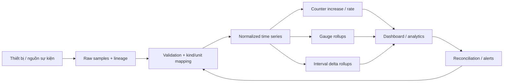

# Giá trị đo tức thời, bộ đếm tích lũy và giá trị biến thiên

Dữ liệu chuỗi thời gian (*time-series data*) thường được biểu diễn bằng các cặp “thời điểm — giá trị”. Nhưng nhìn thấy hai dòng `(10:00, 120)` và `(10:05, 127)` chưa đủ để biết phải cộng, lấy trung bình hay trừ chúng. Giá trị 120 có thể là **nhiệt độ tức thời**, **tổng điện năng đã tiêu thụ kể từ lần khởi động thiết bị**, hoặc **số lượt yêu cầu phát sinh trong một khoảng đo**. Cùng một phép tính SQL có thể đúng với loại này và sai hoàn toàn với loại khác.

Ba ngữ nghĩa nền tảng là:

- **Giá trị đo tức thời** (*gauge*): phản ánh mức/trạng thái của một đại lượng tại thời điểm quan sát, chẳng hạn nhiệt độ, mức nước, dung lượng bộ nhớ đang dùng hoặc số sản phẩm hiện có.
- **Bộ đếm tích lũy** (*cumulative counter*): phản ánh lượng đã tích lũy **kể từ một mốc khởi tạo/reset**, chẳng hạn tổng request, tổng byte truyền hoặc chỉ số điện năng trên công tơ.
- **Giá trị biến thiên** (*delta / interval change*): phản ánh lượng **tăng, giảm hoặc chênh lệch trong một khoảng thời gian xác định**, chẳng hạn 7 kWh trong 5 phút, +5 đơn vị nhập kho hay −2 đơn vị xuất kho.

Bài thuộc chương **Dữ liệu chuỗi thời gian** trong module **DATABASE_DATA_MODELING**. Mục tiêu là học cách chuyển yêu cầu đo lường thành mô hình dữ liệu rõ **danh tính chuỗi, thời gian, đơn vị, ý nghĩa số đo, ràng buộc, chỉ mục và khả năng kiểm chứng**. Các ví dụ SQL dùng PostgreSQL 15+ để minh họa, đồng thời phân tích cách biểu diễn tương tự trong hệ quan hệ, document, graph và mô hình phân tích. **Chọn đúng loại số đo trước khi viết truy vấn tổng hợp** là yêu cầu quan trọng nhất.

## 1. Ba loại số đo nhìn giống nhau nhưng không tương đương

| Khía cạnh | Gauge — giá trị tức thời | Counter — tích lũy | Delta — biến thiên |
|---|---|---|---|
| Một dòng biểu thị | Mức được quan sát ở thời điểm \(t\) | Tổng kể từ mốc khởi tạo của **chu kỳ đếm** | Lượng thay đổi trên **khoảng** \((t_0,t_1]\) hoặc quy ước tương đương |
| Ví dụ | Nhiệt độ 27 °C lúc 10:00 | 127 kWh kể từ lần reset | Tiêu thụ 7 kWh từ 10:00 tới 10:05 |
| Có thể giảm? | Có, bình thường | Không trong **cùng chu kỳ đếm monotonic**; có thể giảm do reset/wrap/lỗi | Có thể âm nếu là thay đổi ròng, ví dụ −2 sản phẩm |
| `SUM` trực tiếp qua thời gian? | Thường **sai nghĩa** | **Sai** vì mỗi mẫu đã chứa quá khứ | **Có điều kiện**: các khoảng tương thích, không trùng và đã đủ |
| Cách xem trạng thái mới nhất | Mẫu hợp lệ gần nhất, có kiểm tra độ tươi | Mẫu gần nhất trong chu kỳ, cùng reset metadata | Delta **không phải** trạng thái; muốn biết mức phải có giá trị đầu kỳ và cộng thay đổi |
| Cách tính tốc độ | Tùy đạo hàm/độ thay đổi của gauge | Chênh counter chia thời gian, xử lý reset | Delta chia độ dài khoảng |
| Khi có lỗ hổng mẫu | Không biết giá trị trong khoảng chưa quan sát | Có thể tính tổng chênh giữa hai mẫu cùng chu kỳ nhưng **không biết phân bố theo thời gian** | Có thể **mất** những khoảng biến thiên chưa được ghi |
| Trục cần quản lý | Thời điểm quan sát + chính sách nội suy | Thời điểm + **chu kỳ/reset** | **Cả hai biên khoảng**, hoặc một bucket có định nghĩa |

Một bộ đếm tích lũy thường cũng là số được đo “tại thời điểm”, nhưng **ngữ nghĩa tích lũy** của nó khác một gauge. Không phân loại theo hình dạng dữ liệu `TIMESTAMP + NUMERIC`; phải phân loại theo **ý nghĩa nghiệp vụ và cách tạo số đo**.

### Ví dụ nhận biết nhanh

- `temperature_celsius = 28.3`: gauge — có thể tăng hoặc giảm.
- `http_requests_total = 120348`: counter — tổng số yêu cầu từ khi process khởi động; restart có thể reset.
- `requests_in_5m = 89`: delta — lượng yêu cầu trong cửa sổ năm phút đã định nghĩa.
- `inventory_on_hand = 350`: gauge — trạng thái tồn tại một thời điểm, không nên cộng 350 của ngày hôm qua với 360 hôm nay.
- `stock_movement = −15`: delta **có dấu** — bán/xuất kho làm lượng tồn giảm.
- `month_to_date_revenue = 750000`: số tích lũy theo **tháng kế toán**, có reset khi sang tháng; không nên trừ hai mẫu qua ranh giới tháng.

Từ “counter” không tự khẳng định rằng số đo là một số nguyên: tổng điện năng có thể là số thập phân kWh. Từ “delta” cũng không tự khẳng định số đo phải dương: thay đổi ròng của tồn kho, số dư và nhiệt độ có thể âm.

## 2. Đặt câu hỏi nghiệp vụ trước khi chọn mô hình

Khi nhận một trường `value`, hãy hỏi:

1. **Một giá trị đại diện cho mức tại thời điểm hay cho cả một khoảng?** Nếu là khoảng, biên bắt đầu và kết thúc là gì?
2. **Đơn vị đo là gì?** °C, kWh, byte, request, sản phẩm, USD, VND...? Đơn vị có thể đổi theo thời gian không?
3. **Mỗi chuỗi thuộc đối tượng nào?** Tenant, thiết bị, cảm biến, vùng đo, metric name, nhãn chiều?
4. **Nguồn có reset không?** Khi restart, thay pin, thay công tơ, hết tháng hay counter wrap?
5. **Một lần tăng có luôn mang cùng nghĩa?** Counter đo thành công hay tất cả yêu cầu? Delta kho là nhập ròng hay chỉ nhập?
6. **Tần suất lấy mẫu có đều không?** Có thể thiếu mẫu, gửi muộn, sửa dữ liệu hay gửi lặp?
7. **Người dùng muốn kết quả nào?** Mức hiện tại, mức trung bình theo thời gian, tổng thay đổi trong kỳ, tốc độ mỗi giây, đỉnh cao nhất hay mức cuối kỳ?
8. **Độ mới và độ chính xác bắt buộc đến đâu?** Cần báo “không đủ dữ liệu” khi thiếu khoảng đo không?

Một mô hình tốt cần đi từ các câu trả lời ấy đến **data contract**, rồi mới chọn bảng, kiểu dữ liệu, index và SQL.

## 3. Thời điểm quan sát khác thời điểm nhận và khác khoảng hiệu lực

Một hệ thống đo lường thường có ít nhất hai mốc:

- **`event_time` / `observed_at`:** thời điểm hiện tượng được đo hoặc trạng thái được ghi nhận tại nguồn.
- **`received_at` / `ingested_at`:** thời điểm hệ thống lưu trữ nhận được mẫu.

Nếu thiết bị đo lúc 10:00 nhưng mất mạng và gửi vào 10:17, bản ghi thuộc **10:00** khi báo cáo theo thời điểm diễn ra, không thuộc 10:17. `received_at` hữu ích để đo độ trễ pipeline, nhưng không thay được `event_time`.

Với **delta**, phải có cả khoảng:

\[
(t_{\text{start}},\ t_{\text{end}}]
\]

theo quy ước của hệ thống; ví dụ “7 kWh trong khoảng sau 10:00 tới hết 10:05”. Việc chỉ lưu `timestamp=10:05, value=7` mà không định nghĩa timestamp là **đầu hay cuối khoảng** sẽ làm báo cáo theo giờ/ngày mơ hồ.

### Ranh giới cửa sổ tổng hợp

Để tránh một sự kiện thuộc hai bucket liền kề, thường dùng khoảng **nửa mở**:

\[
[t_0,t_1),\quad[t_1,t_2).
\]

Ví dụ dữ liệu lúc chính xác 11:00 thuộc bucket 11:00–12:00, **không** thuộc bucket 10:00–11:00. Với delta được ghi theo khoảng \((a,b]\), phải xác định một quy tắc gán theo cuối khoảng, phân bổ theo phần giao hoặc giữ nguyên các interval gốc; không tự trộn hai quy ước biên.

**Múi giờ:** nên lưu thời điểm tuyệt đối bằng kiểu như `TIMESTAMPTZ`, đồng thời xác định timezone **kinh doanh** để nhóm ngày/tháng. Ngày 01/10 ở Việt Nam không hoàn toàn trùng một ngày UTC; dùng `DATE(event_time)` theo session timezone không được quản lý có thể chuyển số liệu sang sai kỳ.

## 4. Công thức và bản chất của ba phép đo

Đặt \(x(t)\) là đại lượng quan sát tại thời điểm \(t\).

### 4.1. Gauge

Một mẫu gauge có dạng:

\[
g_i = x(t_i).
\]

Nếu có các mẫu \(25,30,20\) °C, ta có thể nói **giá trị đo ở những thời điểm ấy** lần lượt là 25, 30, 20. Không thể nói tổng nhiệt độ là 75 °C theo nghĩa đại lượng tích lũy. **Trung bình số học trên các mẫu** chỉ có nghĩa là trung bình trên **tập thời điểm được lấy mẫu**; nếu các khoảng cách thời gian không đều, nó không nhất thiết là trung bình theo thời gian.

Nếu giả định giá trị được giữ tới mẫu kế tiếp (*last observation carried forward*, LOCF) và đã xác định chính sách giới hạn tuổi mẫu, trung bình theo thời gian được tính:

\[
\overline{g}_{\text{time}}
=
\frac{\sum_i g_i\,\Delta t_i}
{\sum_i \Delta t_i},
\]

trong đó \(\Delta t_i\) là thời gian **được mẫu \(g_i\) đại diện** trong cửa sổ. Đây là một **ước lượng theo giả định nội suy**, không phải phép đo liên tục chính xác.

### 4.2. Counter tích lũy

Với hai mẫu liên tiếp **trong cùng chu kỳ không reset**:

\[
\Delta C_i = C(t_i)-C(t_{i-1}).
\]

Nếu counter monotonic và nguồn được tin cậy, \(\Delta C_i\geq0\). Chênh lệch ấy chính là **lượng tích lũy thêm giữa hai lần đọc**, chứ không phải tổng của hai counter.

Khi khoảng \(\Delta t_i\) khác nhau, tốc độ trung bình:

\[
r_i=\frac{\Delta C_i}{t_i-t_{i-1}}.
\]

Đơn vị của \(r_i\) là **đơn vị counter/đơn vị thời gian**, ví dụ request/giây hoặc kWh/giờ. Với điện năng, kWh/giờ tương đương kW cho tốc độ tiêu thụ trung bình của khoảng.

### 4.3. Delta

Một nguồn có thể phát trực tiếp:

\[
D_i = \text{amount changed during }(t_{i-1},t_i].
\]

Nếu các khoảng **không chồng nhau**, đúng phạm vi, dùng cùng đơn vị và đã được ghi đầy đủ, thì tổng biến thiên trên hợp các khoảng là:

\[
D_{\text{total}}=\sum_i D_i.
\]

Đối với delta có dấu, `+5` đơn vị nhập và `−2` đơn vị xuất cho biến thiên ròng **+3**, không phải 7. Nếu cần **tổng nhập** và **tổng xuất** riêng, phải giữ loại nghiệp vụ hoặc tách positive/negative; tổng ròng làm mất thông tin hai chiều.

**Quan hệ giữa counter và delta:** có thể *suy ra* delta bằng chênh counter khi đủ điều kiện. Nhưng một delta nguồn gửi trực tiếp có thể có ý nghĩa mạnh hơn/khác hơn một phép trừ mẫu, nhất là khi counter reset hoặc một khoảng đo bị thiếu.

## 5. Tính bằng tay: gauge lấy mẫu không đều

Giả sử cảm biến nhiệt độ gửi:

| Giờ đo | Giá trị |
|---|---:|
| 10:00 | 25 °C |
| 10:05 | 30 °C |
| 10:20 | 20 °C |

Muốn tính nhiệt độ trung bình từ **10:00 đến 10:25**.

**Trung bình các mẫu**:

\[
(25+30+20)/3=25\,^\circ C.
\]

Nhưng khoảng cách mẫu không đều. Nếu hợp đồng dữ liệu cho phép giả định mỗi giá trị được giữ tới mẫu kế tiếp và giá trị cuối được giữ tới 10:25:

| Khoảng được đại diện | Giá trị | Số phút |
|---|---:|---:|
| [10:00, 10:05) | 25 °C | 5 |
| [10:05, 10:20) | 30 °C | 15 |
| [10:20, 10:25) | 20 °C | 5 |

Trung bình **theo thời gian**:

\[
\frac{25\times5+30\times15+20\times5}{5+15+5}
=\frac{675}{25}=27\,^\circ C.
\]

Hai số 25 và 27 đều có thể được tính “đúng” theo hai công thức, nhưng chúng trả lời **hai câu hỏi khác nhau**. Số 27 chỉ được xem là ước lượng hợp lệ nếu giả định giữ giá trị cũ trong 15 phút phù hợp với cảm biến và use case.

Nếu chính sách tối đa **10 phút không có mẫu mới**, mẫu lúc 10:05 không được đại diện tới 10:20. Khi ấy chỉ có 20/25 phút được bao phủ:

\[
\text{coverage}=20/25=80\%.
\]

Nếu chỉ tính trên phần thời gian được bao phủ, trung bình là:

\[
\frac{25\times5+30\times10+20\times5}{20}
=26.25\,^\circ C.
\]

Đây không phải trung bình **toàn bộ** 25 phút vì còn 5 phút không xác định; báo cáo nên kèm **coverage** hoặc từ chối công bố khi thiếu quá ngưỡng. Không dùng `COALESCE(missing,0)` để biến nhiệt độ không đo được thành 0 °C.

## 6. Tính bằng tay: counter, reset và khoảng biến thiên không biết

Một công tơ công nghiệp gửi chỉ số điện năng tích lũy, đơn vị kWh:

| Giờ đo | Counter | Chu kỳ counter | Chênh hợp lệ từ mẫu trước |
|---|---:|---:|---:|
| 10:00 | 120 | 7 | Chưa biết — mẫu đầu |
| 10:05 | 127 | 7 | 7 kWh |
| 10:10 | 134 | 7 | 7 kWh |
| 10:15 | 3 | 8 | **Không biết — đã reset** |
| 10:20 | 9 | 8 | 6 kWh |

Trong chu kỳ 7, số tăng là `7 + 7 = 14` kWh từ 10:00 đến 10:10. Trong chu kỳ 8, số tăng đo được từ 10:15 đến 10:20 là `6` kWh.

**Không được kết luận tổng tiêu thụ chắc chắn từ 10:00 đến 10:20 là 20 kWh.** Số 20 chỉ là **tổng chênh quan sát được ở những khoảng hợp lệ**. Giai đoạn 10:10–10:15 bị ngắt bởi reset; counter `3` sau reset không cho biết tổng đã tích lũy *trước* reset trong khoảng ấy. Nếu có event reset đáng tin cậy và một mẫu trước/sau reset hoặc nguồn ghi delta riêng, ta có thể khôi phục thêm phần nào. Nếu không, phải đánh dấu **khoảng thiếu/không xác định**.

### Vì sao không lấy trị tuyệt đối?

Ở ranh giới reset:

\[
3-134=-131.
\]

`ABS(3-134)=131` **không phải** lượng điện tiêu thụ. Cũng không nên viết `GREATEST(3-134,0)=0` rồi âm thầm coi đó là khoảng tiêu thụ bằng 0: một khoảng **không biết** khác với một khoảng **biết chắc không tiêu thụ**.

Tương tự, `MAX(counter)-MIN(counter)` qua hai chu kỳ reset cho `134-3=131` là sai. `LAST(counter)-FIRST(counter) = 9-120=-111` cũng sai. Phải hiểu chu kỳ counter trước khi tính chênh.

### Một delta nguồn có thể bổ sung dữ liệu mất

Nếu công tơ gửi riêng event “tiêu thụ 4 kWh trong khoảng 10:10–10:15”, ta có **một số đo delta độc lập** có thể bổ sung khoảng bị mất, miễn là định nghĩa nguồn và ranh giới chính xác. Không được tự tạo event đó từ `counter=3` sau reset.

## 7. Reset, wraparound và hiệu chỉnh không phải cùng một hiện tượng

Giá trị counter giảm có thể do nhiều nguyên nhân:

| Nguyên nhân | Dấu hiệu có thể thấy | Hướng xử lý |
|---|---|---|
| **Restart/reset thật** | Process/thiết bị khởi động lại; có `boot_id` hoặc `counter_epoch` mới | Bắt đầu chu kỳ mới, không trừ xuyên ranh giới |
| **Wraparound** | Bộ đếm hữu hạn từ giá trị gần cực đại quay về thấp | Chỉ tính theo mô-đun nếu **biết độ rộng và chính sách wrap** |
| **Sửa số liệu nguồn** | Dòng cũ bị sửa vì đo sai | Ghi phiên bản hiệu chỉnh, tính lại vùng ảnh hưởng |
| **Mẫu đến sai thứ tự** | Received time đảo so với event time | Sắp theo event time và xử lý late data |
| **Thay thiết bị** | Sensor ID tái sử dụng cho máy mới | Đổi identity/epoch, không coi như một counter liên tục |
| **Lỗi đo/truyền** | Một giá trị rơi đột ngột rồi tăng lại, không có reset event | Đưa vào kiểm tra chất lượng, không tự đoán reset |
| **Counter vốn cho phép giảm** | Mô tả nguồn nói đây là số dư tích lũy có thể hiệu chỉnh | Có thể đang phân loại **sai metric kind**; cần contract khác |

Với bộ đếm \(b\) bit đã biết rõ wrap sau \(2^b-1\), một phép tính tăng xuyên wrap có thể là:

\[
\Delta=(C_{\text{new}}-C_{\text{old}})\bmod 2^b.
\]

Tuy nhiên công thức này chỉ đúng khi số lần wrap trong khoảng đo được kiểm soát (ví dụ không quá một wrap theo giả định tốc độ cực đại) và không có reset làm nhầm. **Không áp dụng mô-đun cho mọi counter giảm**.

### Reset metadata là một phần dữ liệu, không chỉ một thuật toán suy đoán

Nên dùng `counter_epoch`, `boot_id` hoặc `reset_event_id` do nguồn/ingestion đáng tin cậy quản lý. Một epoch là **một miền liên tục của counter monotonic**. Nếu thiết bị reset nhưng không báo, hệ thống chỉ có thể đánh dấu giảm bất thường và yêu cầu đối soát. Tự coi mọi giá trị giảm là “reset hợp lệ” có thể che lỗi cảm biến.

Nếu nguồn có thể sửa lại một mẫu, cần quyết định: lưu phiên bản mới, cập nhật bản mới nhất hay giữ audit log; sau đó rebuild delta của **cả mẫu đó và mẫu kế tiếp** vì phép `LAG` phụ thuộc hàng xóm trước.

## 8. Thiết kế khóa, đơn vị và ranh giới loại metric

Một mô hình quan hệ có thể dùng một bảng định nghĩa chuỗi (**metric series**) và một bảng mẫu (**samples**). Mỗi series có một danh tính độc lập gồm tenant, thiết bị/ngữ cảnh đo và mã metric. Trong bài, `series_id` đã đại diện cho **một cặp thiết bị–metric cụ thể** trong tenant; hệ thống nhiều thiết bị có thể thêm `device_id`, nhãn địa điểm và một bảng dimension thiết bị.

**Hợp đồng series** tối thiểu:

| Trường | Ví dụ | Ý nghĩa |
|---|---|---|
| `tenant_id`, `series_id` | 42, 2 | Không trộn dữ liệu của các chuỗi khác nhau |
| `metric_code` | `energy_used_total` | Tên có nghĩa nghiệp vụ ổn định |
| `metric_kind` | `COUNTER` | Quyết định phép tính hợp lệ |
| `unit_code` | `KWH` | Không cộng số đo khác đơn vị |
| `event_time` | 10:05 +07 | Thời điểm quan sát hoặc kết thúc khoảng |
| `sample_value` | 127 | Số đã được diễn giải theo unit và kind |
| `counter_epoch` | 7 | Mốc chu kỳ cho counter |
| `period_start` | 10:00 +07 | Biên đầu bắt buộc đối với delta interval |
| `source_event_id` | `c-1005` | Chống ghi lặp khi retry |
| `received_at` | 10:18 +07 | Đo latency, không dùng làm thời điểm nghiệp vụ |

Để giữ ví dụ ngắn mà vẫn có ràng buộc hữu ích, DDL bên dưới dùng **một bảng samples nhiều loại** với `metric_kind` được lặp có chủ đích. FK ghép từ samples về series bảo đảm **loại khai báo ở mẫu trùng loại của series**. Đây là một lựa chọn vật lý; với tải lớn và yêu cầu riêng từng loại, có thể tách bảng gauge/counter/delta hoặc dùng time-series database chuyên dụng.

### 8.1. PostgreSQL DDL minh họa

```sql
CREATE TABLE metric_series (
    tenant_id BIGINT NOT NULL,
    series_id BIGINT NOT NULL,
    metric_code TEXT NOT NULL,
    metric_kind TEXT NOT NULL,
    unit_code TEXT NOT NULL,

    CONSTRAINT pk_metric_series
        PRIMARY KEY (tenant_id, series_id),
    CONSTRAINT uq_series_code
        UNIQUE (tenant_id, metric_code),
    CONSTRAINT uq_series_id_kind
        UNIQUE (tenant_id, series_id, metric_kind),
    CONSTRAINT ck_series_kind
        CHECK (metric_kind IN ('GAUGE', 'COUNTER', 'DELTA')),
    CONSTRAINT ck_series_code
        CHECK (btrim(metric_code) <> ''),
    CONSTRAINT ck_series_unit
        CHECK (btrim(unit_code) <> '')
);

CREATE TABLE metric_samples (
    tenant_id BIGINT NOT NULL,
    series_id BIGINT NOT NULL,
    event_time TIMESTAMPTZ NOT NULL,
    metric_kind TEXT NOT NULL,
    sample_value NUMERIC(24, 6) NOT NULL,
    counter_epoch BIGINT,
    period_start TIMESTAMPTZ,
    source_event_id TEXT NOT NULL,
    received_at TIMESTAMPTZ NOT NULL DEFAULT CURRENT_TIMESTAMP,

    CONSTRAINT pk_metric_samples
        PRIMARY KEY (tenant_id, series_id, event_time),
    CONSTRAINT uq_sample_source_event
        UNIQUE (tenant_id, series_id, source_event_id),

    CONSTRAINT fk_sample_series_kind
        FOREIGN KEY (tenant_id, series_id, metric_kind)
        REFERENCES metric_series (tenant_id, series_id, metric_kind)
        ON DELETE RESTRICT,

    CONSTRAINT ck_source_event_id
        CHECK (btrim(source_event_id) <> ''),

    CONSTRAINT ck_sample_semantics
        CHECK (
            (
                metric_kind = 'GAUGE'
                AND counter_epoch IS NULL
                AND period_start IS NULL
            )
            OR
            (
                metric_kind = 'COUNTER'
                AND counter_epoch IS NOT NULL
                AND counter_epoch >= 0
                AND period_start IS NULL
                AND sample_value >= 0
            )
            OR
            (
                metric_kind = 'DELTA'
                AND counter_epoch IS NULL
                AND period_start IS NOT NULL
                AND period_start < event_time
            )
        )
);
```

**Vì sao schema như vậy?**

- `(tenant_id,series_id,event_time)` là PK vì giả định **mỗi chuỗi chỉ có một mẫu hợp lệ tại một thời điểm**. Nếu thiết bị phát hai sự kiện hợp lệ cùng timestamp với nghĩa khác nhau, phải đổi grain/khóa, không âm thầm bỏ một sự kiện.
- `source_event_id` là khóa idempotency riêng, giúp chống nạp lại **cùng một sự kiện nguồn** sau retry.
- `metric_kind` trong `metric_samples` là một giá trị lặp để FK tới bộ khóa `(tenant_id,series_id,metric_kind)`; nó bảo vệ một series `GAUGE` không bị chèn mẫu `COUNTER`.
- `counter_epoch` bắt buộc với COUNTER, còn `period_start` bắt buộc với DELTA. Khoảng delta có `event_time` là **biên kết thúc**.
- Chỉ COUNTER bị ràng buộc không âm. **DELTA có thể âm** vì kho, số dư hoặc biến thiên ròng có thể giảm; nếu một delta metric cụ thể như điện năng tiêu thụ **bắt buộc không âm**, cần quy tắc theo metric cụ thể.
- Gauge được phép âm, ví dụ nhiệt độ °C. Không dùng một `CHECK(value >= 0)` chung cho tất cả metric.

### Những điều constraint trên **chưa** bảo vệ

1. COUNTER monotonic trong cùng epoch: cần so với mẫu khác, không diễn đạt được bằng `CHECK` trên một dòng.
2. Không có khoảng DELTA **chồng lắp** hoặc **hở khoảng**: cần ràng buộc khoảng, xử lý late events, exclusion constraint khi phù hợp, hoặc cổng ghi.
3. Một series đúng một đơn vị đo **qua thời gian**: DDL giữ `unit_code` ở series, nhưng nếu cập nhật đơn vị trên series đã có mẫu mà không chuyển đổi dữ liệu, lịch sử sẽ sai. Cần quy tắc bất biến/phiên bản cho unit.
4. Số đo có thật, hợp lý và không sai vật lý: giới hạn miền riêng từng metric phải được kiểm soát.
5. Epoch tăng đúng khi reset, nguồn event không giả mạo và timestamp hợp lệ theo đồng hồ thiết bị.
6. Sự đầy đủ của chuỗi: PK/FK không chứng minh không mất mẫu hoặc không có “lỗ hổng” trong interval.

**Lưu ý kỹ thuật:** `NUMERIC(24,6)` là lựa chọn minh họa cho phép đo thập phân; không có nghĩa mọi thiết bị đều cần chính xác sáu chữ số sau dấu phẩy. Một số bộ đếm lớn hoặc dữ liệu telemetry tốc độ cao thích hợp với kiểu số nguyên/decimal khác; chọn kiểu bằng cách xét phạm vi, precision, phép trừ và giới hạn tràn số. Với ingest lớn, bảng có thể được partition theo thời gian và tổ chức index phù hợp.

## 9. Nạp dữ liệu kiểm chứng được và liên hệ ba series

Dùng ba chuỗi chính:

- `series_id=1`: nhiệt độ phòng theo gauge, đơn vị °C.
- `series_id=2`: điện năng tích lũy kể từ reset, counter kWh.
- `series_id=3`: điện năng thay đổi trong khoảng, delta kWh.

Thêm `series_id=4` để chứng minh delta **có dấu** của biến động tồn kho.

```sql
INSERT INTO metric_series
    (tenant_id, series_id, metric_code, metric_kind, unit_code)
VALUES
    (42, 1, 'room_temperature', 'GAUGE', 'DEG_C'),
    (42, 2, 'energy_used_total', 'COUNTER', 'KWH'),
    (42, 3, 'energy_interval_change', 'DELTA', 'KWH'),
    (42, 4, 'inventory_movement', 'DELTA', 'UNIT');

-- Gauge: ba mẫu cách nhau không đều.
INSERT INTO metric_samples
    (tenant_id, series_id, event_time, metric_kind,
     sample_value, source_event_id)
VALUES
    (42, 1, '2026-10-01 10:00:00+07', 'GAUGE', 25, 'g-1000'),
    (42, 1, '2026-10-01 10:05:00+07', 'GAUGE', 30, 'g-1005'),
    (42, 1, '2026-10-01 10:20:00+07', 'GAUGE', 20, 'g-1020');

-- Counter: epoch 8 bắt đầu giữa hai mẫu.
INSERT INTO metric_samples
    (tenant_id, series_id, event_time, metric_kind,
     sample_value, counter_epoch, source_event_id)
VALUES
    (42, 2, '2026-10-01 10:00:00+07', 'COUNTER', 120, 7, 'c-1000'),
    (42, 2, '2026-10-01 10:05:00+07', 'COUNTER', 127, 7, 'c-1005'),
    (42, 2, '2026-10-01 10:10:00+07', 'COUNTER', 134, 7, 'c-1010'),
    (42, 2, '2026-10-01 10:15:00+07', 'COUNTER',   3, 8, 'c-1015'),
    (42, 2, '2026-10-01 10:20:00+07', 'COUNTER',   9, 8, 'c-1020');

-- Các delta có căn cứ; KHÔNG tự tạo khoảng 10:10–10:15 qua reset.
INSERT INTO metric_samples
    (tenant_id, series_id, period_start, event_time, metric_kind,
     sample_value, source_event_id)
VALUES
    (42, 3, '2026-10-01 10:00:00+07',
            '2026-10-01 10:05:00+07', 'DELTA', 7, 'd-1005'),
    (42, 3, '2026-10-01 10:05:00+07',
            '2026-10-01 10:10:00+07', 'DELTA', 7, 'd-1010'),
    (42, 3, '2026-10-01 10:15:00+07',
            '2026-10-01 10:20:00+07', 'DELTA', 6, 'd-1020');

-- Delta tồn kho có thể âm.
INSERT INTO metric_samples
    (tenant_id, series_id, period_start, event_time, metric_kind,
     sample_value, source_event_id)
VALUES
    (42, 4, '2026-10-01 10:00:00+07',
            '2026-10-01 10:05:00+07', 'DELTA',  5, 'inv-1005'),
    (42, 4, '2026-10-01 10:05:00+07',
            '2026-10-01 10:10:00+07', 'DELTA', -2, 'inv-1010');
```

Ví dụ dùng giờ Việt Nam `+07:00` để người học dễ đối chiếu bằng tay; `TIMESTAMPTZ` lưu **thời điểm tuyệt đối**, không lưu nguyên chuỗi offset như một thuộc tính văn bản. Các phép nhóm ngày cần chọn timezone nghiệp vụ cụ thể, chẳng hạn `Asia/Ho_Chi_Minh`.

Bộ data mẫu cố ý tạo **lỗ hổng giữa 10:10 và 10:15** cho counter-derived delta. Việc không có dòng delta ở khoảng ấy không đồng nghĩa tiêu thụ bằng 0.

## 10. Truy vấn gauge: mới nhất, cực trị và trung bình

### 10.1. Giá trị mới nhất tại thời điểm truy vấn

```sql
SELECT
    event_time,
    sample_value
FROM metric_samples
WHERE tenant_id = 42
  AND series_id = 1
  AND metric_kind = 'GAUGE'
  AND event_time <= TIMESTAMPTZ '2026-10-01 10:25:00+07'
ORDER BY event_time DESC
LIMIT 1;
```

Kết quả là **20 °C lúc 10:20**, không phải `MAX(sample_value)=30`. `MAX` cho **đỉnh trong một tập mẫu**, còn `LAST` cho **mẫu cuối theo thời gian**. Không dùng `MAX` thay cho “mới nhất” chỉ vì dữ liệu có timestamp.

Một dashboard “nhiệt độ hiện tại” còn cần kiểm tra **độ tươi**:

\[
age = query\_time-last\_sample\_time.
\]

Nếu ngưỡng chấp nhận là 2 phút mà mẫu mới nhất đã 5 phút, phải hiển thị “stale/chưa có dữ liệu mới” hoặc xử lý theo quy tắc được duyệt. Không để giá trị 20 °C trên màn hình như thể vừa được đo.

### 10.2. Trung bình các mẫu khác trung bình theo thời gian

```sql
SELECT
    AVG(sample_value) AS sample_mean,
    MIN(sample_value) AS sample_min,
    MAX(sample_value) AS sample_max,
    COUNT(*) AS observed_samples
FROM metric_samples
WHERE tenant_id = 42
  AND series_id = 1
  AND metric_kind = 'GAUGE'
  AND event_time >= TIMESTAMPTZ '2026-10-01 10:00:00+07'
  AND event_time <  TIMESTAMPTZ '2026-10-01 10:25:00+07';
```

Trả `sample_mean = 25`, `sample_min = 20` và `sample_max = 30`. Query này **không** tính trung bình thời gian 27 °C ở phần 5; nó tính trung bình trên ba quan sát.

### 10.3. SQL trung bình có trọng số thời gian với chính sách stale

Dùng giả định **giữ giá trị đến mẫu kế tiếp**, nhưng tối đa 30 phút kể từ mẫu hiện hành. Mỗi mẫu tạo một đoạn thời gian được đại diện, được **cắt** theo cửa sổ truy vấn:

```sql
WITH bounds AS (
    SELECT
        TIMESTAMPTZ '2026-10-01 10:00:00+07' AS from_time,
        TIMESTAMPTZ '2026-10-01 10:25:00+07' AS to_time
),
ordered AS (
    SELECT
        event_time,
        sample_value,
        LEAD(event_time) OVER (ORDER BY event_time) AS next_time
    FROM metric_samples
    WHERE tenant_id = 42
      AND series_id = 1
      AND metric_kind = 'GAUGE'
),
segments AS (
    SELECT
        o.sample_value,
        GREATEST(o.event_time, b.from_time) AS segment_start,
        LEAST(
            COALESCE(o.next_time, b.to_time),
            b.to_time,
            o.event_time + INTERVAL '30 minutes'
        ) AS segment_end
    FROM ordered AS o
    CROSS JOIN bounds AS b
    WHERE o.event_time < b.to_time
      AND COALESCE(o.next_time, b.to_time) > b.from_time
),
durations AS (
    SELECT
        sample_value,
        EXTRACT(EPOCH FROM segment_end - segment_start)
            AS represented_seconds
    FROM segments
    WHERE segment_end > segment_start
)
SELECT
    SUM(sample_value * represented_seconds)
        / NULLIF(SUM(represented_seconds), 0)
        AS time_weighted_mean,
    SUM(represented_seconds) AS covered_seconds
FROM durations;
```

Với dữ liệu mẫu, `covered_seconds = 1500` và `time_weighted_mean = 27`. Câu SQL tính khoảng thời gian bao phủ bởi giả định, **không chứng minh cảm biến có giá trị không đổi giữa hai mẫu**.

Nếu đổi giới hạn từ `30 minutes` thành `10 minutes`, khoảng 10:15–10:20 bị xem là chưa có mẫu hợp lệ: tổng thời gian bao phủ là 1200 giây và mean trên phần được bao phủ là 26,25 °C. Trong sản phẩm thật cần trả **coverage ratio** so với toàn cửa sổ và từ chối hoặc gắn nhãn kết quả không đủ dữ liệu.

**Lưu ý khi cửa sổ không bắt đầu đúng lúc có mẫu:** phải tìm cả mẫu gần nhất **trước `from_time`** nếu muốn cho phép LOCF từ trước ranh giới. Truy vấn trên cố ý giữ toàn bộ lịch sử của series trước khi áp cắt cửa sổ, thay vì lọc `event_time >= from_time` ngay từ CTE `ordered`. Với dữ liệu lớn, có thể tối ưu bằng một truy vấn tìm mẫu predecessor riêng để không quét toàn bộ lịch sử.

## 11. Truy vấn counter bằng `LAG` và chu kỳ reset

Để lấy mẫu trước của mỗi dòng, dùng `LAG` **theo từng chuỗi** và sắp bằng `event_time`. Khóa chính của ví dụ bảo đảm không có hai mẫu cùng thời điểm trong một series.

```sql
WITH ordered AS (
    SELECT
        tenant_id,
        series_id,
        event_time,
        sample_value,
        counter_epoch,
        LAG(event_time) OVER (
            PARTITION BY tenant_id, series_id
            ORDER BY event_time
        ) AS prev_time,
        LAG(sample_value) OVER (
            PARTITION BY tenant_id, series_id
            ORDER BY event_time
        ) AS prev_value,
        LAG(counter_epoch) OVER (
            PARTITION BY tenant_id, series_id
            ORDER BY event_time
        ) AS prev_epoch
    FROM metric_samples
    WHERE tenant_id = 42
      AND series_id = 2
      AND metric_kind = 'COUNTER'
),
classified AS (
    SELECT
        *,
        CASE
            WHEN prev_time IS NULL THEN 'FIRST_SAMPLE'
            WHEN counter_epoch IS DISTINCT FROM prev_epoch
                THEN 'RESET_BOUNDARY'
            WHEN sample_value < prev_value
                THEN 'UNEXPECTED_DECREASE'
            ELSE 'VALID_INTERVAL'
        END AS quality_status,
        CASE
            WHEN prev_time IS NOT NULL
             AND counter_epoch = prev_epoch
             AND sample_value >= prev_value
                THEN sample_value - prev_value
            ELSE NULL
        END AS delta_kwh
    FROM ordered
)
SELECT
    event_time,
    sample_value,
    counter_epoch,
    quality_status,
    delta_kwh,
    CASE
        WHEN delta_kwh IS NOT NULL THEN
            delta_kwh
            / NULLIF(
                EXTRACT(EPOCH FROM event_time - prev_time) / 3600,
                0
            )
        ELSE NULL
    END AS average_kw
FROM classified
ORDER BY event_time;
```

Kết quả cần quan sát:

| Giờ | `counter_epoch` | `quality_status` | `delta_kwh` | Trung bình trong khoảng |
|---|---:|---|---:|---:|
| 10:00 | 7 | FIRST_SAMPLE | NULL | Không biết |
| 10:05 | 7 | VALID_INTERVAL | 7 | 84 kW |
| 10:10 | 7 | VALID_INTERVAL | 7 | 84 kW |
| 10:15 | 8 | RESET_BOUNDARY | NULL | Không biết |
| 10:20 | 8 | VALID_INTERVAL | 6 | 72 kW |

Giả định khoảng giữa hai mẫu đại diện cho mức **tăng tích lũy tổng** trên khoảng đó. Tốc độ 84 kW là **tốc độ trung bình** từ việc tiêu thụ 7 kWh trong 5 phút, không phải công suất tức thời được thiết bị đo liên tục.

**Ba điều quan trọng khi dùng `LAG`:**

1. `PARTITION BY tenant_id,series_id`: không lấy mẫu trước từ **một thiết bị hoặc tenant khác**.
2. `ORDER BY event_time`: không dùng `received_at`, vì late data có thể đến sai thứ tự.
3. Khi truy vấn khoảng ngày/tháng, thường phải lấy **mẫu predecessor trước ranh giới cửa sổ** trước khi lọc kết quả. Nếu lọc mẫu nguồn vào đúng cửa sổ rồi mới `LAG`, phần biến thiên từ mẫu cuối kỳ trước tới mẫu đầu kỳ mới có thể bị mất hoặc phân loại sai.

### Có thể `SUM(delta_kwh)` không?

Có thể cộng các **delta hợp lệ** để có “tổng tăng đã quan sát được trên những khoảng liên tục hợp lệ”. Nhưng khi có `RESET_BOUNDARY` hoặc lỗ hổng không thể giải thích, kết quả **không phải tổng đầy đủ của toàn cửa sổ**.

Hãy lưu hoặc trả kèm `unknown_interval_count`, `covered_seconds` và chính sách xử lý thiếu. Không báo cáo 20 kWh như tổng tiêu thụ chắc chắn khi giai đoạn 10:10–10:15 chưa biết.

## 12. Truy vấn DELTA: cộng được khi biết chính xác các khoảng

Với một metric delta được định nghĩa là lượng **biến thiên trong \((period_start,event_time]\)**, có thể xem dữ liệu thô:

```sql
SELECT
    period_start,
    event_time AS period_end,
    sample_value AS change_in_interval
FROM metric_samples
WHERE tenant_id = 42
  AND series_id = 3
  AND metric_kind = 'DELTA'
ORDER BY period_start, event_time;
```

Kết quả là các khoảng:

| Khoảng | Delta kWh |
|---|---:|
| 10:00–10:05 | 7 |
| 10:05–10:10 | 7 |
| 10:15–10:20 | 6 |

Tổng **20 kWh trên ba khoảng đã quan sát**, với khoảng 10:10–10:15 còn thiếu. Nếu một dashboard muốn tổng từ 10:00 đến 10:20, phải công bố mức độ bao phủ và cảnh báo có khoảng trống.

### Vì sao không chỉ `SUM` theo ngày?

Một delta “7 kWh từ 23:58 đến 00:03” trải qua **ranh giới ngày**. Nếu chỉ nhóm theo ngày của `event_time`, cả 7 kWh được gán vào ngày sau, mặc dù có một phần xảy ra ngày trước. Điều đó **có thể là policy hợp lệ** (ghi nhận theo cuối khoảng), nhưng không phải số tiêu thụ vật lý đúng cho từng ngày.

Nếu yêu cầu chính xác theo ranh giới, hãy:

- Yêu cầu nguồn phát khoảng đúng với bucket (nếu khả thi), hoặc
- Phân bổ theo độ dài phần giao **chỉ khi chấp nhận giả định tốc độ đều trong khoảng**, hoặc
- Giữ nguyên khoảng và báo cáo “không đủ độ phân giải” cho phép chia theo ngày.

Không tự chia 7 kWh theo thời gian nếu trong thực tế tải điện có thể thay đổi mạnh và nghiệp vụ đòi chính xác.

### Interval overlap và thiếu khoảng

Hai delta `[10:00,10:05) = 7` và `[10:03,10:08) = 9` có **khoảng giao nhau**. Cộng thành 16 có thể đếm trùng tiêu thụ trong phần giao. Ngược lại, nếu không có bất kỳ delta nào giữa 10:05 và 10:10, kết quả `SUM` không tự báo rằng khoảng bị thiếu.

Để kiểm tra sơ bộ:

```sql
WITH d AS (
    SELECT
        tenant_id,
        series_id,
        period_start,
        event_time AS period_end,
        LAG(event_time) OVER (
            PARTITION BY tenant_id, series_id
            ORDER BY period_start, event_time
        ) AS prev_end
    FROM metric_samples
    WHERE metric_kind = 'DELTA'
      AND tenant_id = 42
)
SELECT
    series_id, period_start, period_end, prev_end,
    CASE
        WHEN prev_end IS NULL THEN 'FIRST_INTERVAL'
        WHEN period_start < prev_end THEN 'OVERLAP'
        WHEN period_start > prev_end THEN 'GAP'
        ELSE 'CONTIGUOUS'
    END AS interval_quality
FROM d
ORDER BY series_id, period_start, period_end;
```

Đây là **kiểm tra sơ bộ theo khoảng kết thúc ngay trước**, phù hợp khi đầu vào đã được thiết kế theo các khoảng liên tiếp không lồng nhau. Nếu có khoảng lồng sâu, `LAG(prev_end)` không đủ phát hiện mọi chồng lắp; cần so với **giá trị kết thúc lớn nhất của các khoảng trước**, hoặc dùng ràng buộc khoảng/thủ tục đối soát thích hợp.

Đối với biến động tồn kho, hai event riêng có thể cùng thời điểm nhưng không nhất thiết là các “bucket interval” độc quyền. Khi đó nên dùng **fact sự kiện** với event ID riêng, không ép chúng vào giả định một interval delta duy nhất trên mỗi timestamp.

## 13. Tốc độ (rate) không giống delta và không giống gauge

Từ counter hoặc delta, có thể tính tốc độ trung bình:

\[
rate = \frac{\text{change}}{\text{elapsed time}}.
\]

Ví dụ 7 kWh trong 5 phút:

\[
\frac{7}{5/60}=84\ \text{kWh/h}=84\ \text{kW}.
\]

Nếu đo request, 120 request trong 60 giây tương đương trung bình **2 request/giây**, không phải 120 request/giây.

### Trung bình các rate phải xét độ dài khoảng

Giả sử:

- 5 phút đầu: 100 request trong 5 phút = 20 request/phút.
- 15 phút tiếp: 150 request trong 15 phút = 10 request/phút.

Trung bình số học của hai rate là `(20+10)/2 = 15` request/phút. Nhưng tốc độ trung bình trên **20 phút** là:

\[
\frac{100+150}{5+15}=12.5\ \text{request/phút}.
\]

Khi các khoảng không đều, dùng **tổng biến thiên / tổng thời gian được bao phủ**, hoặc trung bình rate theo trọng số thời gian. Không `AVG(rate)` tùy ý trên mỗi mẫu rồi gọi đó là tốc độ toàn kỳ.

### Không đánh đồng một rate với một gauge thiết bị đo trực tiếp

Một cảm biến có thể phát `power_kw` tức thời ở 10:05 (gauge); counter điện năng cho ta `kWh` tích lũy và phép chia delta/time cho **công suất trung bình trong khoảng**. Hai giá trị có thể khác nhau vì tải biến động. Nếu báo cáo muốn “đỉnh công suất”, `MAX(power_kw)` trên gauge mẫu hoặc kết quả từ nguồn đo liên tục là câu hỏi khác với `MAX(average_kw)` suy ra giữa các mẫu.

### Tốc độ âm và không xác định

- Counter monotonic trong cùng epoch: delta và rate kỳ vọng không âm.
- Delta ròng tồn kho: rate có thể âm, ví dụ −2 sản phẩm/5 phút.
- Gauge nhiệt độ thay đổi: đạo hàm gần đúng có thể âm, nhưng cần ghi “°C/phút”, không dùng như một “counter rate”.
- Reset counter: rate xuyên reset phải là **không xác định** nếu thiếu thông tin, không báo âm hoặc 0 mặc định.
- Hai mẫu có cùng thời điểm: không chia cho 0; thiết kế phải chặn trùng timestamp hoặc định nghĩa cách gộp.

## 14. Chọn phép tổng hợp theo ngữ nghĩa, không theo SQL tiện nhất

| Câu hỏi | Gauge | Counter | Delta |
|---|---|---|---|
| Giá trị **mới nhất** | Mẫu gần nhất, kèm tuổi mẫu | Mẫu gần nhất **và epoch** | Không đại diện trạng thái hiện tại |
| Giá trị **lớn nhất** trong kỳ | `MAX` các mẫu, kèm giới hạn lấy mẫu | `MAX` chỉ trong một epoch, không phải tổng kỳ | `MAX` của biến thiên interval nếu cần “đỉnh biến thiên” |
| **Tổng** trong kỳ | Thường không có nghĩa; một số gauge được tích phân theo thời gian tạo đại lượng khác | Tính **increase** theo epoch/reset, không cộng sample values | `SUM` các delta không trùng và đủ độ bao phủ |
| **Trung bình** | Trung bình mẫu hoặc time-weighted với policy rõ | Có thể tính trung bình counter level nhưng hiếm khi có nghĩa nghiệp vụ | Trung bình delta trên mỗi interval; rate cần xét độ dài interval |
| **Tốc độ** | Đạo hàm gần đúng của gauge nếu phù hợp | Delta counter / thời gian, bảo vệ reset | Delta / độ dài interval |
| **Cuối ngày/cuối tháng** | Mẫu cuối hợp lệ với freshness policy | Counter cuối kỳ **không phải** lượng tiêu thụ kỳ | Delta của khoảng cuối, không phải trạng thái |
| **Theo nhiều đối tượng** | Chỉ cộng nếu gauge đại diện số lượng cộng được và không trùng đối tượng | Chỉ cộng counter/delta sau khi đồng nhất epoch, phạm vi và unit | Có thể cộng các delta độc lập cùng unit, tránh đếm trùng |

Ví dụ **tồn kho hiện tại** là gauge có thể cộng qua **các kho không trùng hàng** tại **cùng mốc snapshot**. Nhưng không cộng tồn cuối ngày 01/10 và tồn cuối ngày 02/10 rồi gọi đó là tồn cuối kỳ. Trong phân tích, đây là số đo **semi-additive theo thời gian**.

Một gauge như mức nhiệt độ **không cộng qua cảm biến** để tính nhiệt độ của cả tòa nhà; muốn trung bình theo vùng cần trọng số, diện tích, độ tin cậy cảm biến hoặc mô hình vật lý phù hợp.

## 15. Rollup và downsampling: đừng làm mất khả năng suy ra đúng

Hệ thống time-series thường giữ mẫu chi tiết trong vài ngày, rồi lưu rollup mỗi 5 phút, giờ hoặc ngày để tiết kiệm dung lượng. Cần thiết kế **cấu trúc rollup khác nhau cho từng kind**.

### 15.1. Rollup gauge

Có thể lưu:

- `sample_count`, `sample_sum` để tính trung bình **theo mẫu** (kèm chú thích).
- `min_value`, `max_value`.
- `first_value`, `last_value` cùng **timestamp tương ứng**.
- `weighted_value_seconds` và `covered_seconds` để tính mean **theo thời gian**.
- `expected_coverage_seconds` hoặc `coverage_ratio` theo chính sách staleness.

Hai bucket liền kề có thể kết hợp các tổng có trọng số nếu cùng quy tắc nội suy và phần biên không bị bỏ/đếm trùng. Chỉ lưu `AVG` của mỗi bucket rồi `AVG` các bucket **không đúng** khi bucket có số mẫu hoặc thời lượng khác nhau. Dùng weighted sums/tổng thời lượng để tổng hợp lên cấp lớn hơn.

### 15.2. Rollup counter

Đừng lưu `SUM(counter_samples)` làm “tổng request/ngày”. Nên lưu:

- Chênh lệch **đã xác minh** trong các epoch.
- `first/last counter` và epoch/timestamp tương ứng nếu cần nối bucket.
- Số lần reset, số khoảng thiếu, số giây bao phủ.
- Số delta bất thường/giảm không giải thích được.
- Metadata nguồn và version của thuật toán tính.

**Vấn đề biên bucket:** một cặp mẫu nằm ở hai bên 11:00 vẫn có chênh lệch. Nếu mỗi job rollup chỉ đọc dữ liệu trong đúng bucket rồi mới `LAG`, có thể mất đoạn tăng giữa hai bucket. Cần mẫu predecessor hoặc trạng thái carry-forward có epoch đúng và chính sách gán delta vào bucket.

### 15.3. Rollup delta

Nếu interval **không chồng**, cùng đơn vị và cùng policy phân bổ, có thể lưu:

- `sum_delta`, `event_count`.
- `covered_seconds` và tình trạng khoảng thiếu/chồng.
- Tổng delta dương/âm riêng khi cần quan sát nhập/xuất.
- `min/max interval_delta` nếu câu hỏi là thay đổi lớn nhất mỗi khoảng.

Một delta có khoảng kéo qua ranh giới bucket không thể được phân đôi chính xác chỉ dựa vào tổng của khoảng nếu không có thông tin bên trong. Chọn chính sách “theo cuối interval”, phân bổ gần đúng hay từ chối granular reporting trước khi xây rollup.

### Bảng thiết kế rollup gợi ý

| Metric kind | Cột tối thiểu nên giữ | Sai lầm nguy hiểm |
|---|---|---|
| Gauge | min/max, first/last+time, count, weighted sum+coverage | Chỉ giữ average rồi average lại |
| Counter | verified increase, epochs, reset/gap flags, boundary samples | Sum trực tiếp các giá trị cumulative |
| Delta | sum, interval bounds/coverage, sign breakdown nếu cần | Sum những interval chồng nhau |
| Rate dẫn xuất | numerator, denominator thời gian, quality | AVG các rate không cùng độ dài khoảng |

**Một rollup tốt phải giữ đủ thông tin để kết hợp đúng**, không chỉ giữ một số “trung bình” hoặc “tổng” có tên chung.

## 16. Dữ liệu đến muộn, mất mẫu, trùng và sửa lại

Chuỗi thời gian thật có thể được ghi nhận **không theo thứ tự sự kiện**. Nguồn gửi 10:10 trước 10:05, rồi phát lại 10:05 vì timeout. Nếu pipeline tính delta **ngay theo thứ tự nhận**, hệ thống có thể báo một chênh lệch giả.

### 16.1. Idempotency và deduplication

`source_event_id` giúp nhận biết cùng sự kiện gửi lại. Một lệnh nạp idempotent có thể dùng unique constraint và xử lý xung đột có chủ đích:

```sql
-- Ví dụ minh họa: nguồn đã xác thực và cùng một mẫu được retry.
INSERT INTO metric_samples
    (tenant_id, series_id, event_time, metric_kind,
     sample_value, counter_epoch, source_event_id)
VALUES
    (42, 2, '2026-10-01 10:10:00+07',
     'COUNTER', 134, 7, 'c-1010')
ON CONFLICT (tenant_id, series_id, source_event_id)
DO NOTHING;
```

Nếu cùng `source_event_id` bị gửi lại với **giá trị khác**, `DO NOTHING` sẽ che xung đột; pipeline cần đối chiếu payload hoặc hash/phiên bản để phân biệt **retry giống hệt** với **nguồn sửa số liệu**. Nếu hai event khác ID dùng cùng timestamp, PK thời gian cũng từ chối; phải có chính sách phân giải, không tùy tiện ghi đè “last write wins”.

### 16.2. Late event ảnh hưởng những gì?

Nếu counter đã có các mẫu 10:00 và 10:10, hệ thống suy ra delta tổng 14 kWh trong 10 phút. Khi mẫu 10:05=127 đến muộn, khoảng này phải tách thành 7 và 7 kWh. **Tổng cả 10 phút** giữ nguyên nếu counter liên tục, nhưng **tốc độ theo bucket 5 phút** thay đổi và cần rebuild.

Nếu bản ghi 10:05 là **reset event**, việc thêm nó có thể làm mất tính hợp lệ của một delta đã được tính qua ranh giới. Khi sửa/nhận thêm một mẫu, cần tính lại **các khoảng có hàng xóm bị ảnh hưởng**, không chỉ bucket chứa đúng timestamp mẫu mới.

Với gauge, một mẫu đến muộn có thể đổi phần thời gian mà mẫu trước đang đại diện trong phép LOCF; cần rebuild đoạn từ mẫu trước tới mẫu sau và những bucket liên quan.

### 16.3. Watermark và chính sách đóng kỳ

Một pipeline có thể công bố cửa sổ 10:00–11:00 là **provisional** cho tới khi đã qua watermark (ví dụ đợi tối đa 15 phút cho dữ liệu muộn), rồi đánh dấu **final**. Nhưng late event quá hạn vẫn có thể xuất hiện; phải có chính sách sửa lại kết quả (*restatement*) hoặc loại ngoại lệ kèm audit.

**Watermark không phải bảo đảm không bao giờ có late event.** Nó là hợp đồng vận hành về mức trễ mà pipeline xử lý bình thường. Số liệu quan trọng cần log các lần hiệu chỉnh sau chốt.

### 16.4. Missing khác zero

- Không có mẫu gauge: không biết mức, **không phải** 0.
- Counter reset làm mất một khoảng: increase không biết, **không phải** 0.
- Không có delta interval: khoảng thiếu, **không phải** delta=0.
- Một delta interval được nguồn xác nhận bằng 0: **biết chắc không đổi** trong khoảng theo hợp đồng nguồn.

Phải phân biệt **sample missing**, **stale**, **invalid** và **observed zero** bằng trạng thái chất lượng dữ liệu, không chỉ bằng một trường số mặc định 0.

## 17. Kiểm thử bất biến và chất lượng chuỗi thời gian

Một thiết kế chỉ ghi dữ liệu vào DB chưa đủ; cần xác nhận các giá trị suy ra đúng theo semantic kind.

| Ca thử | Kết quả kỳ vọng |
|---|---|
| Gauge lần lượt 25, 30, 20, khoảng mẫu 5 và 15 phút | Trung bình mẫu 25; trung bình thời gian 27 nếu đủ 25 phút và LOCF được cho phép |
| Gauge quá ngưỡng stale | Không hiển thị như số đo hiện tại; báo age/coverage |
| Counter cùng epoch: 120 → 127 → 134 | Delta 7 và 7; không `SUM(120+127+134)` |
| Counter đổi epoch: 134/7 → 3/8 | Delta xuyên reset = **NULL/unknown** |
| Counter giảm trong cùng epoch | Cảnh báo bất thường, không tự lấy `ABS` |
| Counter đổi thiết bị nhưng giữ series ID | Bị kiểm tra identity/epoch phát hiện; không nối như một chuỗi liên tục |
| Counter có khoảng 15 phút rồi khoảng 5 phút | Rate dùng giây thực, không giả định mọi mẫu cách 5 phút |
| Delta +5 và −2 ở tồn kho | Tổng ròng = +3; không cấm delta âm toàn cục |
| Hai delta interval chồng nhau | Báo overlap hoặc dùng cơ chế xử lý đúng policy trước khi cộng |
| Mất một interval delta | Không báo “tổng kỳ đầy đủ” khi coverage thiếu |
| Mẫu tới muộn | Rebuild delta/rate và rollup liên quan |
| Retry cùng `source_event_id` và payload giống hệt | Không tạo hai mẫu |
| Retry cùng ID nhưng payload khác | Phát hiện xung đột, không âm thầm bỏ |
| Hai event đúng nghĩa khác nhau cùng timestamp | Không mất một event do giả định khóa không phù hợp |
| Tính trung bình rate 5 phút và 15 phút | Dùng tổng lượng/tổng thời gian, không trung bình ngang bằng |
| Gauge mức tồn kho cuối tháng | Lấy snapshot cuối hợp lệ; không cộng giá trị tồn của các ngày |
| Report theo ngày local | Dùng timezone kinh doanh được chỉ định |
| Rollup theo bucket có mẫu trước ranh giới | Không làm mất chênh counter do lọc trước `LAG` |
| Tổng delta theo hai currency/UOM khác nhau | Không cộng khi chưa chuẩn hóa đơn vị |
| Dữ liệu thiếu toàn bộ ngày | Báo thiếu, không điền 0 để “làm đẹp” biểu đồ |

### Kiểm tra chất lượng counter liên tục

Một truy vấn trên `metric_samples` có thể tìm **counter giảm trong cùng epoch** (mẫu trước được tính theo thời gian sự kiện):

```sql
WITH c AS (
    SELECT
        tenant_id,
        series_id,
        event_time,
        sample_value,
        counter_epoch,
        LAG(sample_value) OVER (
            PARTITION BY tenant_id, series_id
            ORDER BY event_time
        ) AS prev_value,
        LAG(counter_epoch) OVER (
            PARTITION BY tenant_id, series_id
            ORDER BY event_time
        ) AS prev_epoch
    FROM metric_samples
    WHERE metric_kind = 'COUNTER'
)
SELECT *
FROM c
WHERE counter_epoch = prev_epoch
  AND sample_value < prev_value;
```

Truy vấn này chỉ tìm **dấu hiệu bất thường** theo hợp đồng monotonic; nó không tự xác định thiết bị reset bị quên, đo lỗi hay có correction được chấp thuận. Cần kết hợp log reset, lineage và metadata nguồn trước khi sửa dữ liệu.

## 18. Thiết kế chỉ mục, partition và lưu giữ dữ liệu

Một hệ thống time-series có thể sinh hàng triệu mẫu mỗi giờ. Cần quyết định index theo truy vấn thực tế:

- Đọc một chuỗi trong một khoảng: `(tenant_id, series_id, event_time)`.
- Đọc mẫu mới nhất của một chuỗi: chỉ mục PK theo thứ tự thời gian có thể được dùng quét ngược trong PostgreSQL cho truy vấn `ORDER BY event_time DESC LIMIT 1`.
- Ghi/đọc theo time bucket trên nhiều series: cân nhắc tổ chức partition thời gian, BRIN hoặc index theo thời điểm tùy phân bố và workload.
- Truy vấn hàng loạt theo metric/thiết bị: cần dimension series/metadata và index theo bộ lọc phổ biến.
- Phân tích theo nhiều tenant: luôn bảo đảm phạm vi tenant và quyền truy cập; query planner không thay thế authorization.

### Partitioning không thay đổi nghĩa dữ liệu

Partition theo ngày/tháng giúp quản lý retention, quét theo thời gian và vận hành, nhưng **không biến counter thành delta**. PostgreSQL có những giới hạn về unique/PK trên partitioned table (đặc biệt khi dùng partition key thời gian); phải thiết kế uniqueness và idempotency phù hợp lược đồ partition thực tế, không giả định toàn bộ unique của bảng đơn giản sẽ chuyển nguyên xi.

Khi xóa dữ liệu chi tiết cũ, phép tính tăng counter tại **biên đầu kỳ còn giữ** vẫn cần mẫu predecessor hoặc rollup boundary được lưu. Nếu xóa mẫu trước mà không giữ metadata, tăng đầu ngày có thể thành unknown dù thiết bị không reset.

### Lưu raw, normalized và derived với vai trò rõ ràng

Một pipeline có thể gồm:



**Nguồn chân lý** phải được xác định: raw packet là bằng chứng đo ban đầu; normalized samples là dữ liệu chuẩn hóa từ raw; counter-derived deltas và rollups là dữ liệu có thể **tính lại** khi công thức/reset metadata hoặc late events thay đổi. Đừng sửa bảng aggregate rồi bỏ qua nguyên nhân sai ở raw/normalized.

Cần version hóa thuật toán tạo delta, timezone, reset policy và quy tắc giữ mẫu stale. Nếu thay logic nhưng không rebuild history, cùng chỉ số có thể mang hai định nghĩa qua các tháng.

## 19. Biểu diễn tương đương trong quan hệ, document, graph và phân tích

### 19.1. Quan hệ

Một schema như `metric_series`/`metric_samples` thuận lợi để đặt PK/FK theo tenant, kiểm tra kiểu metric, chống trùng timestamp hoặc source event, và truy vấn cửa sổ với `LAG`/`LEAD`. Nhưng **monotonic counter**, reset semantics và hoàn chỉnh interval không thể hoàn toàn bảo vệ bằng check đơn dòng; cần cổng ghi và đối soát.

### 19.2. Document/time-series collection

Có thể lưu một document cho mỗi mẫu với `seriesId`, `eventTime`, `kind`, `value`, `epoch` và `intervalStart`. Engine time-series có thể tổ chức lưu/columnar compression hiệu quả. Nhưng nếu document thiếu `kind` hoặc đơn vị, query vẫn có thể cộng sai. Đối với delta, lưu interval bounds thay vì chỉ một timestamp “tùy hiểu”. Cần cơ chế uniqueness/dedup của engine hoặc pipeline nếu không có FK giống PostgreSQL.

Không nhúng vô hạn toàn bộ lịch sử cảm biến vào **một document duy nhất**: cập nhật cạnh tranh, giới hạn document và truy vấn theo thời gian có thể trở nên khó quản lý. Tổ chức bucket/document phù hợp workload và giới hạn engine là quyết định vật lý.

### 19.3. Graph

Graph có thể hữu ích để diễn đạt **thiết bị–cảm biến–phòng–nhà máy** và quan hệ nguồn gốc metric: thiết bị nào cấp series nào, một đồng hồ cấp điện cho những khu vực nào. Các sample theo thời gian vẫn cần model chuyên biệt hoặc reference tới time-series storage khi số lượng lớn.

Nếu có nhiều sensor cùng liên kết một phòng, không tự cộng gauge nhiệt độ qua các cạnh như cộng lượng điện: quan hệ graph không thay đổi quy tắc tổng hợp. Các cạnh có hiệu lực theo thời gian cũng cần version để xác định sensor từng thuộc khu vực nào.

### 19.4. Kho phân tích

Mô hình phân tích có thể có:

- `DimTime`, `DimDevice`, `DimMetric` với loại/đơn vị.
- `FactGaugeSample` có grain **một lần đo mức của series**.
- `FactCounterSample` có grain **một lần đọc bộ đếm trong epoch**.
- `FactIntervalDelta` có grain **một interval được nguồn xác nhận hoặc dẫn xuất**.
- `FactHourlyRollup` có grain **một series × một giờ**, lưu measure theo kind và coverage.

Khi drill-across giữa “nhiệt độ trung bình”, “năng lượng tiêu thụ” và “tồn cuối giờ”, phải dùng **các measure khác phép cộng**. Một rollup hourly có thể cần lưu sum/weight/coverage cho gauge, increase/reset flags cho counter, và sum/coverage cho delta. Không dùng một cột `value` cùng một hàm `SUM` cho tất cả.

Đặc biệt, ảnh chụp tồn kho là **semi-additive** qua thời gian: sum theo các kho độc lập tại **cùng thời điểm** có thể có nghĩa, sum theo các ngày liên tiếp thì không.

## 20. Các anti-pattern thường gặp

| Anti-pattern | Tại sao sai | Cách thay thế |
|---|---|---|
| `SUM(counter_value)` theo ngày | Counter đã chứa lượng quá khứ | Tính increase trên các epoch hợp lệ |
| `MAX(counter)-MIN(counter)` qua reset | Mốc cực trị có thể thuộc hai epoch | Tính chênh từng đoạn liên tục, ghi gap |
| `ABS(counter_new-counter_old)` khi giảm | Biến reset/lỗi thành lượng tiêu thụ giả | Xác định reset/wrap và mark unknown |
| Gán delta=0 cho khoảng không có mẫu | Che dữ liệu thiếu | NULL/quality flag/coverage |
| `AVG(gauge)` với sample không đều rồi gọi average thời gian | Mẫu dày được trọng số quá mức | Time-weighted mean với chính sách nội suy |
| `AVG(rate)` của những khoảng dài ngắn khác nhau | Sai trọng số | Tổng change / tổng elapsed time hợp lệ |
| Chỉ lưu timestamp cuối cho interval | Không biết độ dài và biên | Lưu start/end hoặc bucket policy |
| Cộng delta interval chồng nhau | Đếm trùng phần giao | Ngăn overlap hoặc phân giải theo nguồn |
| Group theo `received_at` | Late event vào sai kỳ nghiệp vụ | Group theo event time và timezone được định nghĩa |
| Counter reset nhưng giữ epoch cũ | Tạo chênh âm hoặc tăng sai | Quản lý reset metadata đáng tin cậy |
| Lọc cửa sổ trước khi tính `LAG` | Mất predecessor/counter boundary | Tính với mẫu lân cận rồi cắt kết quả |
| Dùng nhãn `TOTAL` cho mọi metric | Người đọc suy ra khả năng cộng sai | Metadata `metric_kind` và unit |
| Cộng hai series cùng thiết bị nhưng khác đơn vị | Kết quả không có nghĩa | Chuẩn hóa unit và phạm vi đo |
| Rollup chỉ lưu average đã làm tròn | Không tổng hợp chính xác lên cấp lớn hơn | Lưu numerator/denominator/coverage |
| Không phân biệt raw với derived | Không biết sửa bên nào khi lệch | Source-of-truth, rule version và rebuild |

**Đặc biệt với dữ liệu vận hành và tài chính:** dashboard có thể báo số rất “đẹp” sau khi dùng `COALESCE` hoặc nội suy quá tay. Giá trị thiếu được thể hiện trung thực thường hữu ích hơn một số 0 giả hoặc một tốc độ âm do reset.

## 21. Bài tập thực hành: thiết bị, request và biến động kho

Một nền tảng quản lý nhà máy có:

- `SensorTemperature` gửi nhiệt độ khi có thay đổi lớn, không theo chu kỳ đều.
- `HttpGateway` ghi `requests_total`, có thể reset khi service restart và đôi khi reboot không gửi event ngay.
- `ElectricMeter` gửi counter kWh mỗi 10 phút và một số interval delta xác nhận từ thiết bị.
- `WarehouseMovement` ghi nhập/xuất hàng dưới dạng sự kiện có dấu theo SKU, kho và tenant.
- Pipeline có thể nhận mẫu muộn tối đa 20 phút, đôi khi quá hạn, và consumer xử lý lại event khi retry.

Doanh nghiệp muốn báo cáo **nhiệt độ trung bình theo giờ**, **request/giây theo 5 phút**, **điện năng tiêu thụ theo ngày**, **biến động tồn kho ròng** và **tồn cuối ngày**.

Hãy thực hiện:

1. Phân loại từng metric thành gauge, cumulative counter, signed/unsigned delta hoặc giá trị dẫn xuất. Nêu **đơn vị và grain** của một dòng.
2. Định nghĩa metadata series, phạm vi tenant/thiết bị, identity reset epoch, event time, received time và ranh giới interval.
3. Viết công thức tính time-weighted mean cho nhiệt độ với **max staleness 10 phút**; nêu cách xử lý khi một giờ chỉ được bao phủ 35 phút.
4. Từ counter request `100, 160, 210` tại 10:00/10:05/10:10 cùng epoch, tính increase và rate từng khoảng. Sau đó đổi epoch và đọc `5` lúc 10:15; giải thích vì sao không được lấy `210−5` hay `ABS`.
5. Thiết kế SQL/pseudocode tính rate bằng `LAG` có phân vùng theo series và thứ tự `event_time`, đồng thời giữ mẫu predecessor trước biên giờ.
6. Nếu delta điện năng có interval 23:55–00:05, chọn chính sách gán theo cuối khoảng hoặc ước lượng phân bổ; giải thích giới hạn chính xác.
7. Lập mô hình `InventoryMovement` có `movement_id` và số lượng có dấu; suy ra tồn cuối ngày từ **số dư đầu kỳ + tổng biến động**, lưu lịch sử/đối soát. Giải thích vì sao không `SUM` các snapshot tồn mỗi ngày.
8. Thiết kế khóa chính và khóa idempotency; cho ví dụ một event đến hai lần với payload giống nhau và một event cùng ID nhưng payload khác.
9. Lập kế hoạch rebuild rollup khi mẫu 10:05 đến sau mẫu 10:10, hoặc khi reset event đến muộn.
10. Đề xuất các chỉ số chất lượng: missing intervals, coverage ratio, reset count, unexpected decreases, late event count, stale gauges và tổng chênh raw–rollup.
11. Nêu cách giữ raw, normalized và derived trong hệ quan hệ hoặc time-series DB và cách công bố báo cáo đã chốt theo watermark.

**Tiêu chí đạt:** không cộng counter thô; không nhầm mẫu gauge với time average; không giả định rate trên khoảng không đều; phân biệt **unknown** với **zero**; bảo vệ đúng reset/epoch, overlap, unit, late data và giữ khả năng rebuild.

## 22. Tổng kết

- Một số đo chuỗi thời gian phải có **metric kind**, **đơn vị**, **danh tính series**, **event time** và **hợp đồng reset/khoảng đo**; riêng một cột số không đủ nghĩa.
- **Gauge** trả lời “mức tại thời điểm”; `LAST`, min/max và time-weighted mean có nghĩa khi quy tắc độ tươi/nội suy được xác định. Không `SUM` mẫu gauge tùy tiện.
- **Counter** trả lời “đã tích lũy bao nhiêu kể từ mốc”; chỉ lấy chênh và tốc độ **trong chu kỳ hợp lệ**, không trừ xuyên reset hoặc dùng `ABS` cho giá trị giảm.
- **Delta** trả lời “thay đổi bao nhiêu trong khoảng”; có thể cộng nếu các khoảng không chồng, đầy đủ và cùng unit/policy. Delta có thể âm.
- **Rate** là change chia thời gian thực của khoảng; không lấy trung bình ngang nhau các rate có độ dài khoảng khác nhau.
- Reset, wrap, correction, event muộn và thiếu mẫu là những nguyên nhân khác nhau, cần metadata/chất lượng dữ liệu riêng.
- Rollup phải giữ **đủ thông tin để kết hợp đúng**: weighted sum/coverage của gauge, verified increase/epoch của counter và interval coverage của delta.
- **Unknown không phải zero.** Báo cáo chính xác phải biểu diễn lỗ hổng, độ tươi và chất lượng dữ liệu, ngay cả khi UI mong có một con số duy nhất.
- Chỉ sau khi chốt bất biến nghiệp vụ mới chọn schema, index, partition, pipeline và cách lưu trên quan hệ, document, graph hay kho phân tích.
