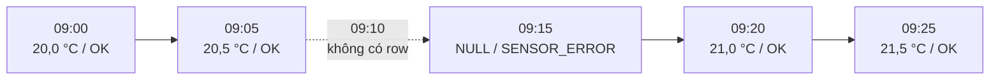
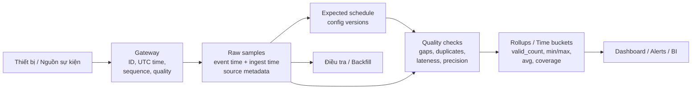

# Tần suất lấy mẫu, độ chính xác và giá trị bị thiếu

Một cảm biến nhiệt độ gửi số đo mỗi **5 phút**. Trong một giờ, hệ thống nhận 10 bản ghi và tính trung bình **20,8°C**. Liệu kết quả có đại diện cho cả giờ không? Chưa thể kết luận. Có thể cảm biến không gửi ở những thời điểm nhiệt độ tăng cao, một bản ghi mang giá trị lỗi, thời gian trên thiết bị bị lệch, hoặc nhiều mẫu trùng nhau được tính thành nhiều quan sát. Cùng một bảng dữ liệu, các lựa chọn về **tần suất lấy mẫu, độ chính xác và cách hiểu giá trị thiếu** có thể dẫn đến những kết luận khác nhau.

Bài học thuộc chương **Dữ liệu chuỗi thời gian** trong học phần **DATABASE_DATA_MODELING**. Học phần rèn kỹ năng chuyển yêu cầu nghiệp vụ thành mô hình dữ liệu rõ ràng, từ thực thể, quan hệ, ràng buộc, khóa, chỉ mục đến lược đồ vật lý; so sánh mô hình quan hệ, document, đồ thị và phân tích để chọn cấu trúc dễ tiến hóa và kiểm chứng. Vì vậy, trọng tâm ở đây **không chỉ là câu lệnh tính trung bình**, mà là xây dựng một **hợp đồng dữ liệu chuỗi thời gian**: mỗi bản ghi đo cái gì, khi nào, với độ tin cậy nào, và một khoảng không có bản ghi mang ý nghĩa gì.

Sau bài học, bạn có thể:

- Phân biệt **tần suất lấy mẫu**, **độ phân giải thời gian**, **độ chính xác đồng hồ**, **độ chính xác phép đo** và **độ chính xác biểu diễn số**.
- Chọn chu kỳ quan sát theo tốc độ biến thiên của hiện tượng, yêu cầu cảnh báo, ngân sách lưu trữ và độ trễ.
- Mô hình hóa **event time**, **ingestion time**, lịch lấy mẫu và chất lượng từng quan sát.
- Phân biệt **mẫu không được nhận**, **giá trị NULL**, **số 0 hợp lệ**, **dữ liệu lỗi**, **mẫu đến muộn** và **không áp dụng**.
- Dùng SQL để phát hiện khoảng trống, tính tỷ lệ phủ hợp lệ và tạo bucket thời gian mà không che mất dữ liệu thiếu.
- Chọn chính sách **giữ nguyên khoảng trống, điền giá trị, nội suy, lấy trung bình, cộng dồn** đúng với loại chỉ số.
- Thiết kế kiểm tra dữ liệu và đường nạp có thể xử lý bản ghi trùng, sai thứ tự, thay đổi chu kỳ và lưu trữ nhiều mức độ chi tiết.

## 1. Chuỗi thời gian là dữ liệu có thời điểm và ngữ nghĩa đo lường

**Time-series data** là những quan sát hoặc sự kiện được gắn với thời gian, thường thuộc một **đối tượng/nguồn dữ liệu** và một **loại đại lượng** xác định.

Hai ví dụ nhìn giống nhau nhưng khác bản chất:

```text
Cảm biến TEMP-01:
  09:00 → 20.0 °C
  09:05 → 20.5 °C
  09:10 → ?
  09:15 → lỗi cảm biến

Sự kiện đặt hàng:
  09:01:13 → Order O-101
  09:07:42 → Order O-102
  09:43:11 → Order O-103
```

Cảm biến được cấu hình **lấy mẫu theo lịch**: ta có thể mong đợi một quan sát mỗi 5 phút. Đơn hàng là **sự kiện phát sinh khi có hành động**, không có quy tắc “phải tạo một đơn cứ mỗi 5 phút”. Vì vậy:

- **Không có bản ghi cảm biến ở 09:10** có thể là một **mẫu bị thiếu**.
- **Không có đơn hàng trong phút 09:10** có thể hoàn toàn bình thường.
- Nếu hệ thống ghi sự kiện đơn hàng **bị gián đoạn**, số đếm 0 trong phút đó lại **không đáng tin**, dù không có bản ghi.

Muốn gọi một khoảng là “thiếu dữ liệu”, trước hết phải biết **dữ liệu nào được kỳ vọng xuất hiện**.

### 1.1. Những trường thông tin không nên nhập nhằng

| Khái niệm | Câu hỏi trả lời | Ví dụ |
| --- | --- | --- |
| **Series identity** | Dòng đo này thuộc thiết bị/nguồn/chỉ số nào? | `(tenantId, deviceId, metricCode)` |
| **Observed/event time** | Hiện tượng được quan sát hoặc sự kiện xảy ra khi nào? | `2026-10-01 09:00:00+07` |
| **Received/ingest time** | Hệ thống nhận hoặc lưu bản ghi khi nào? | `2026-10-01 09:00:06+07` |
| **Value** | Quan sát có giá trị bao nhiêu? | `20.0` |
| **Unit** | Giá trị thuộc đại lượng và đơn vị gì? | `°C` |
| **Quality/status** | Giá trị có đủ điều kiện dùng cho chỉ tiêu không? | `OK`, `SENSOR_ERROR` |
| **Expected cadence** | Dự kiến bao lâu có một mẫu? | `5 minutes` |
| **Source identity** | Bản ghi cụ thể nào cần chống gửi lặp? | `sampleId = S-001` |
| **Configuration version** | Lịch, hiệu chuẩn và đơn vị lúc đo là phiên bản nào? | `sensorConfigVersion = 7` |

Đừng chỉ lưu `device_id, timestamp, value` nếu bài toán cần điều tra sai lệch hoặc đảm bảo báo cáo đúng khi đồng hồ, cảm biến hay lịch lấy mẫu thay đổi.

## 2. Tần suất lấy mẫu khác tần suất sự kiện và tần suất báo cáo

### 2.1. Chu kỳ lấy mẫu và tốc độ lấy mẫu

Nếu một cảm biến cố gắng đo mỗi `Δt = 5 phút`, **tần suất danh nghĩa** là:

\[
f_s = \frac{1}{\Delta t}
\]

Đây là **tần suất cấu hình**, không tự chứng minh thực tế có đủ mẫu hoặc thời gian giữa các mẫu đúng chính xác 5 phút.

| Chu kỳ danh nghĩa | Số mẫu kỳ vọng mỗi thiết bị/ngày 24 giờ |
| --- | ---: |
| 5 phút | 288 |
| 1 phút | 1.440 |
| 10 giây | 8.640 |
| 1 giây | 86.400 |

Nếu có **1.000 thiết bị** gửi mỗi giây, hệ thống có thể nhận khoảng **86,4 triệu mẫu/ngày**, hoặc **2,592 tỷ mẫu trong 30 ngày** nếu không mất mẫu và không thay đổi cadence. Đây là phép tính công suất đầu vào, **không phải dự báo kích thước lưu trữ**, vì còn phụ thuộc encoding, metadata, chỉ mục, nén và thời gian giữ.

### 2.2. Ba khái niệm “tần suất” không giống nhau

- **Sampling cadence:** cảm biến thực hiện phép đo bao lâu một lần.
- **Transmission/ingestion cadence:** dữ liệu được gửi và nạp vào hệ thống bao lâu một lần; có thể **gửi theo lô** sau mỗi 15 phút dù đo mỗi phút.
- **Reporting cadence:** dashboard cập nhật mỗi 10 giây, mỗi phút hoặc mỗi ngày; có thể nhanh hơn hoặc chậm hơn thời điểm gửi dữ liệu.

Ví dụ đo mỗi 10 giây, gửi một gói 30 mẫu sau 5 phút, dashboard làm mới mỗi phút. Thời điểm đo có độ chi tiết 10 giây nhưng độ trễ hiển thị có thể lớn hơn 5 phút. **Làm mới dashboard thường xuyên không bù được nguồn dữ liệu đến muộn**.

### 2.3. Mẫu đều, mẫu gần đều và sự kiện không đều

**Lấy mẫu đều theo lịch** mong đợi các mốc `09:00, 09:05, 09:10, ...`; trong thực tế đồng hồ có thể lệch ± vài giây (*jitter*).

**Lấy mẫu thích nghi** có thể đo 1 phút khi ổn định và 5 giây khi biến động mạnh. Khi đó số mẫu trong mỗi giai đoạn khác nhau **theo một chính sách hợp lệ**, không phải cứ thấy thiếu mốc trên lưới 1 phút là lỗi.

**Sự kiện không đều** như đăng nhập, thanh toán, giao dịch hoặc cảnh báo vốn không có lịch cố định. Nếu cần đo số lượng sự kiện theo phút, ta tạo **bucket tổng hợp**, nhưng không được suy rằng có một bản ghi sự kiện trong mỗi bucket.

### 2.4. Sự kiện điểm và phép đo đại diện cho một khoảng

Một giá trị `20°C lúc 09:00` có thể là:

1. **Giá trị tức thời:** cảm biến đọc gần thời điểm 09:00.
2. **Trung bình 5 phút trước:** số đã được thiết bị tổng hợp trên `[08:55, 09:00)`.
3. **Giá trị cuối kỳ:** lần đọc cuối trong cửa sổ kết thúc ở 09:00.
4. **Độ lệch/tổng tích lũy trong 5 phút:** số đo đại diện cho lượng tăng trên cả khoảng.

Bốn trường hợp có cùng một `timestamp` và `value` nhưng **cách tổng hợp tiếp theo khác nhau**. Nếu nguồn gửi số đo theo khoảng, nên lưu `interval_start`, `interval_end` hoặc một `measurement_kind` xác định thay vì tự coi timestamp là một điểm tức thời.

## 3. Chọn tần suất: đủ nhanh để thấy hiện tượng, đủ hợp lý để vận hành

### 3.1. Lấy mẫu quá thưa có thể bỏ lỡ sự kiện

Giả sử nhiệt độ tăng vọt trong **20 giây** rồi trở về bình thường, trong khi cảm biến đo đúng mốc mỗi **5 phút**. Có thể không có mẫu nào rơi vào 20 giây ấy. Báo cáo sẽ thấy giá trị “bình thường”, nhưng đó là **không quan sát được đỉnh ngắn**, không phải bằng chứng đỉnh chưa từng tồn tại.

Khi người dùng hỏi “nhiệt độ có bao giờ vượt 40°C không?”, độ tin cậy của câu trả lời phụ thuộc vào:

- Tần suất và cách cảm biến đo.
- Sự tồn tại của đo **min/max nội bộ** trong từng cửa sổ.
- Phạm vi thời gian cảm biến thực sự hoạt động.
- Độ trễ, độ chính xác và giới hạn vật lý của thiết bị.

Nếu yêu cầu cảnh báo bắt buộc phát hiện biến động ngắn, có thể cần **lấy mẫu dày hơn, cảm biến xử lý ngưỡng ngay tại thiết bị, bộ ghi min/max trong mỗi khoảng** hoặc thiết kế giám sát khác. Chỉ tăng tần suất truy vấn trên dữ liệu đã thưa không thể phục hồi đỉnh bị bỏ lỡ.

### 3.2. Aliasing: tín hiệu nhanh biến thành hình dạng sai

Trong lý thuyết lấy mẫu, với **tín hiệu liên tục có giới hạn băng thông**, điều kiện lý tưởng để tránh aliasing là tốc độ lấy mẫu lớn hơn **hai lần tần số cao nhất có ý nghĩa**:

\[
f_s > 2 f_{\max}
\]

Ví dụ một dao động chu kỳ 20 giây có tần số `0,05 Hz`. Nếu chỉ đo một mẫu mỗi 60 giây, `f_s ≈ 0,0167 Hz`, thấp hơn nhiều so với yêu cầu tối thiểu theo giả định lý tưởng đó. Các mẫu có thể tạo hình dạng dao động **thấp hơn, sai pha hoặc thậm chí có vẻ không đổi**, tùy thời điểm lấy mẫu.

Tuy nhiên, điều kiện Nyquist **không phải bảo đảm mọi đỉnh sự kiện được phát hiện**. Nó dựa trên các giả định của tín hiệu band-limited và thường đi cùng **bộ lọc chống aliasing** (*anti-alias filter*). Spike không tuần hoàn, sự kiện ngắn và tín hiệu rời rạc cần được đánh giá theo SLA phát hiện riêng.

### 3.3. Cách chọn cadence từ yêu cầu nghiệp vụ

| Yêu cầu | Câu hỏi quyết định cadence |
| --- | --- |
| Cảnh báo an toàn | Biến động ngắn nhất phải phát hiện là bao lâu? Độ trễ từ lúc xảy ra đến lúc cảnh báo tối đa bao nhiêu? |
| Thống kê năng lượng | Có cần năng lượng tích phân theo phút hay chỉ tổng theo giờ? Có dữ liệu min/max và độ bao phủ không? |
| Giám sát hiệu năng ứng dụng | P95/p99 có cần dữ liệu sự kiện hoặc histogram thay vì chỉ trung bình mỗi phút không? |
| Quan sát môi trường | Hiện tượng thay đổi nhanh thế nào, sai số cảm biến và độ trễ truyền bao nhiêu? |
| Chi phí hạ tầng | Số thiết bị, retention, tốc độ ghi, nén, bandwidth và khả năng xử lý backfill là bao nhiêu? |
| Phân tích dài hạn | Có cần giữ raw để điều tra sau này hay chỉ cần tổng hợp có chất lượng và min/max? |

Một cách làm tốt là xác định **độ phân giải nhỏ nhất có giá trị nghiệp vụ**, đo thử trên tập raw đủ chi tiết, đánh giá sai số khi giảm tần suất rồi mới chốt cấu hình. Không giả định mọi chuỗi cần cùng cadence.

## 4. “Độ chính xác” có nhiều tầng độc lập

### 4.1. Accuracy, precision và resolution của giá trị đo

Ví dụ thiết bị hiển thị `21,37°C`:

- **Resolution — độ phân giải:** bước nhỏ nhất thiết bị biểu diễn hoặc phân biệt được; hiển thị hai chữ số thập phân có thể cho bước 0,01°C, nhưng không tự bảo đảm cảm biến phân biệt được 0,01°C trong thực tế.
- **Accuracy — độ đúng/độ chính xác so với giá trị thật:** cảm biến có thể được công bố sai số ±0,5°C trong điều kiện nhất định; hiển thị `21,37°C` không có nghĩa nhiệt độ thật chính xác tới ±0,01°C.
- **Precision/repeatability — độ chụm/lặp lại:** đọc nhiều lần cùng điều kiện có thể cho kết quả rất gần nhau nhưng vẫn bị **lệch hệ thống** (bias) so với giá trị thật.
- **Storage precision:** cơ sở dữ liệu dùng `NUMERIC(6,2)` hoặc `DOUBLE PRECISION` chỉ mô tả **khả năng biểu diễn số** và tính toán, không nâng cấp độ đúng của thiết bị.

Một giá trị có **nhiều chữ số** không tự đáng tin hơn một giá trị ít chữ số. Muốn diễn giải đúng, cần biết **đơn vị, dải đo, độ phân giải, hồ sơ hiệu chuẩn và sai số của nguồn**.

### 4.2. Độ phân giải timestamp khác độ đúng của đồng hồ

Một timestamp như:

```text
2026-10-01T09:00:00.123+07:00
```

có **ba chữ số mili-giây**, nhưng đồng hồ thiết bị có thể lệch **±2 giây** so với thời gian chuẩn. Việc lưu timestamp chính xác đến microsecond trong database **không biến thời điểm sự kiện thành chính xác đến microsecond**.

Nên phân biệt:

| Thuộc tính | Ví dụ | Ý nghĩa |
| --- | --- | --- |
| `observed_at` | `09:00:00.123+07` | Dấu thời gian thiết bị báo cho phép đo |
| `received_at` | `09:00:02.900+07` | Hệ thống nhận được mẫu |
| `clock_offset_estimate_ms` | `+1800` | Ước tính sai lệch đồng hồ nếu có cơ chế đồng bộ |
| `clock_sync_status` | `SYNCED / UNKNOWN / DRIFTED` | Chất lượng nguồn thời gian |
| `timestamp_resolution_ms` | `1` | Bước biểu diễn thời gian của nguồn |
| `sample_period_seconds` | `300` | Chu kỳ danh nghĩa, không phải độ chính xác đồng hồ |

Độ lệch `received_at − observed_at` có thể phản ánh truyền mạng, xử lý theo lô, đồng hồ sai hoặc nhiều nguyên nhân kết hợp; **không tự coi toàn bộ chênh lệch là network latency**. Nếu `observed_at` lớn hơn `received_at`, dữ liệu có thể bị lệch đồng hồ hoặc sai định dạng thời gian; cần điều tra thay vì âm thầm sửa.

### 4.3. Chọn một hệ thời gian để lưu và một hệ để trình bày

Dữ liệu từ nhiều vùng nên lưu **thời điểm tuyệt đối** theo UTC hoặc kiểu timestamp-with-time-zone có ngữ nghĩa rõ. Trong PostgreSQL, `TIMESTAMPTZ` biểu diễn một **thời điểm tuyệt đối** và được hiển thị theo timezone của phiên truy vấn; nó không nhất thiết bảo toàn tên múi giờ gốc người gửi.

Nếu báo cáo theo **ngày kinh doanh của địa điểm**, lưu metadata như `site_timezone = 'Asia/Ho_Chi_Minh'` rồi đổi thời điểm sang múi giờ ấy khi tạo các bucket ngày. Không tự cắt chuỗi timestamp theo vị trí ký tự hoặc bỏ offset. Với các vùng có chuyển giờ mùa hè, **một ngày lịch địa phương không phải lúc nào cũng đúng 24 giờ**.

### 4.4. Độ chính xác cần được kết hợp với ngưỡng cảnh báo

Nếu cảm biến có sai số ±0,5°C và ngưỡng cảnh báo là 30,0°C, phép đọc 30,1°C không chứng minh tuyệt đối rằng nhiệt độ thật cao hơn 30,0°C. Chính sách có thể yêu cầu **hysteresis, nhiều mẫu liên tiếp, biên an toàn hoặc xác minh chéo** tùy mức rủi ro.

Tương tự, dùng 100 mẫu cực kỳ dày từ **một cảm biến chưa hiệu chuẩn** không khắc phục được sai số hệ thống. Tăng cadence giúp quan sát thời gian tốt hơn, không tự cải thiện **accuracy của đại lượng**.

## 5. Ví dụ xuyên suốt: cảm biến 5 phút có hai loại thiếu dữ liệu

Giả sử `TEMP-01` được cấu hình đo nhiệt độ **mỗi 5 phút** trong khoảng nửa mở `[09:00, 09:30)` ngày 01/10/2026 theo `+07:00`. Vì vậy kỳ vọng sáu mốc:

```text
09:00, 09:05, 09:10, 09:15, 09:20, 09:25
```

Dữ liệu thực nhận trước 09:30 là:

| Mốc kỳ vọng | Có bản ghi? | Giá trị °C | Mã chất lượng | Diễn giải |
| --- | --- | ---: | --- | --- |
| 09:00 | Có | 20,0 | `OK` | Mẫu hợp lệ |
| 09:05 | Có | 20,5 | `OK` | Mẫu hợp lệ |
| 09:10 | **Không** | — | — | Không có bản ghi; nguyên nhân chưa biết |
| 09:15 | Có | `NULL` | `SENSOR_ERROR` | Đã nhận mẫu nhưng phép đo thất bại |
| 09:20 | Có | 21,0 | `OK` | Mẫu hợp lệ |
| 09:25 | Có | 21,5 | `OK` | Mẫu hợp lệ |

Ở thời điểm chốt phân tích này:

- **Số mốc kỳ vọng:** 6.
- **Số mốc có nhận bản ghi:** 5.
- **Số mốc có giá trị hợp lệ:** 4.
- **Số mốc hoàn toàn vắng bản ghi:** 1.
- **Số mốc có bản ghi nhưng phép đo không hợp lệ:** 1.
- **Received-slot coverage:** `5/6 = 83,3%`.
- **Valid-slot coverage:** `4/6 = 66,7%`.
- **Trung bình của bốn mẫu hợp lệ:** `(20,0 + 20,5 + 21,0 + 21,5) / 4 = 20,75°C`.

**20,75°C là trung bình trên các quan sát hợp lệ**, không tự được gọi là nhiệt độ trung bình **của toàn khoảng 30 phút**. Khoảng không đo được có thể có giá trị rất khác, nên cần công bố độ bao phủ hoặc một chính sách suy tính rõ ràng.

### 5.1. Sơ đồ khác nhau giữa “không có hàng” và “hàng có NULL”



Không tự gán nguyên nhân “mất mạng” cho 09:10 chỉ vì không thấy bản ghi. Có thể cảm biến không đo, gửi chậm, dữ liệu bị lọc ở gateway, lịch thay đổi, hoặc mất gói trong đường truyền. Muốn xác định nguyên nhân cần kết hợp log thiết bị, heartbeat, lịch cấu hình và ingestion metrics.

### 5.2. Số 0 có thể là phép đo hoàn toàn hợp lệ

Với cảm biến **lưu lượng nước** hoặc công suất thiết bị, `0.0` có thể nghĩa là **không có lưu lượng/không tiêu thụ công suất** — một thông tin quan trọng.

```text
flow_liters_per_minute = 0.0   // có mẫu và phép đo bằng 0
flow_liters_per_minute = NULL  // không có giá trị đo hợp lệ
không có bản ghi            // không biết có quan sát tại mốc ấy không
```

**Không được** dùng `COALESCE(value, 0)` trước khi hiểu loại chỉ số. Thay `NULL` bằng 0 có thể làm giảm giả tạo trung bình lưu lượng hoặc tạo ra số liệu tài chính/kỹ thuật không có chứng cứ.

## 6. Thiết kế bảng chuỗi thời gian để bảo toàn thời gian và chất lượng

### 6.1. Bảng dữ liệu gốc

Ví dụ dưới đây dùng **PostgreSQL** để minh họa. Bảng lưu **một observation event**, không phải bắt buộc đúng một hàng cho mỗi ô thời gian. Hai bản tin khác nhau có thể có timestamp gần nhau, nên định danh nguồn cần được tách khỏi timestamp.

```sql
CREATE TABLE sensor_sample (
    tenant_id VARCHAR(32) NOT NULL,
    device_id VARCHAR(64) NOT NULL,
    sample_id VARCHAR(80) NOT NULL,
    observed_at TIMESTAMPTZ NOT NULL,
    received_at TIMESTAMPTZ NOT NULL,
    temperature_c NUMERIC(6,2),
    quality_code VARCHAR(32) NOT NULL,
    sensor_config_version INTEGER,
    PRIMARY KEY (tenant_id, device_id, sample_id),
    CHECK (
        quality_code IN ('OK', 'SENSOR_ERROR', 'OUT_OF_RANGE')
    ),
    CHECK (
        quality_code <> 'OK' OR temperature_c IS NOT NULL
    )
);

CREATE INDEX sensor_sample_device_time_idx
    ON sensor_sample (tenant_id, device_id, observed_at DESC);
```

Giải thích:

- `(tenant_id, device_id, sample_id)` là **khóa sự kiện** được nguồn hoặc gateway quản lý để chống nhận lặp. Nó cần thực sự ổn định trên các lần retry.
- `observed_at` là thời điểm quan sát; `received_at` là thời điểm nạp.
- `quality_code` giúp phân biệt giá trị hợp lệ với lỗi; bản ghi lỗi có thể giữ giá trị thô nếu yêu cầu điều tra, nên ràng buộc chỉ bắt `OK` phải có giá trị.
- `sensor_config_version` hỗ trợ truy ngược lịch lấy mẫu, độ phân giải và cấu hình cảm biến.
- Chỉ mục theo `device_id, observed_at` hỗ trợ truy vấn khoảng thời gian của một series.

Không dùng `(device_id, observed_at)` làm khóa duy nhất **nếu nghiệp vụ thực sự cho phép nhiều quan sát ở cùng một timestamp** (ví dụ nhiều channel, bản ghi sửa đổi hoặc nguồn có độ phân giải giây). Ngược lại, nếu hợp đồng nguồn bảo đảm **một observation đúng mỗi timestamp** và đó là danh tính sự kiện, có thể chọn khóa ấy một cách có chủ đích.

### 6.2. Dữ liệu mẫu có thể chạy thử

```sql
INSERT INTO sensor_sample (
    tenant_id, device_id, sample_id,
    observed_at, received_at,
    temperature_c, quality_code, sensor_config_version
) VALUES
('T-01', 'TEMP-01', 'S-001',
 TIMESTAMPTZ '2026-10-01 09:00:00+07',
 TIMESTAMPTZ '2026-10-01 09:00:05+07',
 20.0, 'OK', 7),
('T-01', 'TEMP-01', 'S-002',
 TIMESTAMPTZ '2026-10-01 09:05:00+07',
 TIMESTAMPTZ '2026-10-01 09:05:08+07',
 20.5, 'OK', 7),
('T-01', 'TEMP-01', 'S-003',
 TIMESTAMPTZ '2026-10-01 09:15:00+07',
 TIMESTAMPTZ '2026-10-01 09:15:04+07',
 NULL, 'SENSOR_ERROR', 7),
('T-01', 'TEMP-01', 'S-004',
 TIMESTAMPTZ '2026-10-01 09:20:00+07',
 TIMESTAMPTZ '2026-10-01 09:20:06+07',
 21.0, 'OK', 7),
('T-01', 'TEMP-01', 'S-005',
 TIMESTAMPTZ '2026-10-01 09:25:00+07',
 TIMESTAMPTZ '2026-10-01 09:25:05+07',
 21.5, 'OK', 7);
```

Bộ dữ liệu không có bản ghi `09:10`. Để thử gửi lại một mẫu không gây trùng, có thể dùng cơ chế upsert/ignore theo khóa sự kiện với chính sách xử lý dữ liệu mâu thuẫn. Ví dụ `ON CONFLICT DO NOTHING` chỉ phù hợp khi **bản tin trùng phải có nội dung bất biến**; nếu cùng `sample_id` nhưng giá trị khác, cần báo xung đột hoặc quy tắc phiên bản thay vì âm thầm bỏ một bản.

### 6.3. Một bảng cấu hình cadence có hiệu lực theo thời gian

Nếu TEMP-01 đổi từ 5 phút sang 1 phút vào ngày 02/10, ta **không thể dùng lịch 5 phút cho mọi thời điểm**. Nên quản lý cấu hình theo khoảng:

| device_id | config_version | valid_from | valid_to | expected_period |
| --- | ---: | --- | --- | --- |
| TEMP-01 | 7 | 2026-10-01 00:00+07 | 2026-10-02 00:00+07 | 5 phút |
| TEMP-01 | 8 | 2026-10-02 00:00+07 | Không có | 1 phút |

Các khoảng được định nghĩa dạng **[valid_from, valid_to)** và không được chồng lấn cho cùng device, trừ khi nghiệp vụ hỗ trợ nhiều chế độ quan sát song song. Cần ghi rõ các ngoại lệ như thời gian bảo trì, thay cảm biến, tạm ngừng đo theo lịch hoặc chuyển trạng thái thiết bị `INACTIVE`.

**Mẫu kỳ vọng là dữ liệu dẫn xuất từ lịch hợp lệ**, không phải mọi phút đều mặc định phải có một row.

## 7. Phát hiện khoảng trống bằng lưới thời gian và bucket

### 7.1. Vì sao chỉ dùng `LAG` chưa đủ?

`LAG(observed_at)` giúp thấy hai bản ghi liên tiếp cách xa nhau. Nhưng nó không tự biết:

- Trong khoảng đó có lịch phải đo hay không.
- Thiết bị đã đổi cadence hay đang bảo trì.
- Một sample có đến muộn không.
- Nhiều mẫu nằm gần nhau có thuộc một slot không.
- Một bản ghi có chất lượng `SENSOR_ERROR` hay không.

Với chuỗi **đo theo lịch cố định**, cách kiểm tra rõ nhất là dựng **các mốc kỳ vọng** rồi đối chiếu chúng với các quan sát.

### 7.2. SQL dựng sáu mốc kỳ vọng và kiểm tra coverage

Ví dụ PostgreSQL 14+ sử dụng `generate_series` và `date_bin`. `date_bin` gán một thời điểm vào bucket theo độ rộng và mốc gốc. Trong dữ liệu mẫu, timestamp nằm **đúng mốc lịch**, vì vậy phép gán bucket là trực tiếp.

```sql
WITH expected AS (
    SELECT slot_start
    FROM generate_series(
        TIMESTAMPTZ '2026-10-01 09:00:00+07',
        TIMESTAMPTZ '2026-10-01 09:25:00+07',
        INTERVAL '5 minutes'
    ) AS slots(slot_start)
),
observed AS (
    SELECT
        date_bin(
            INTERVAL '5 minutes',
            observed_at,
            TIMESTAMPTZ '2026-10-01 09:00:00+07'
        ) AS slot_start,
        COUNT(*) AS received_count,
        COUNT(*) FILTER (
            WHERE quality_code = 'OK'
              AND temperature_c IS NOT NULL
        ) AS valid_count
    FROM sensor_sample
    WHERE tenant_id = 'T-01'
      AND device_id = 'TEMP-01'
      AND observed_at >=
          TIMESTAMPTZ '2026-10-01 09:00:00+07'
      AND observed_at <
          TIMESTAMPTZ '2026-10-01 09:30:00+07'
    GROUP BY 1
)
SELECT
    e.slot_start,
    COALESCE(o.received_count, 0) AS received_count,
    COALESCE(o.valid_count, 0) AS valid_count,
    CASE
        WHEN COALESCE(o.received_count, 0) = 0 THEN 'MISSING'
        WHEN o.received_count > 1 THEN 'MULTIPLE'
        WHEN COALESCE(o.valid_count, 0) = 0 THEN 'INVALID'
        ELSE 'VALID'
    END AS slot_status
FROM expected AS e
LEFT JOIN observed AS o
  ON o.slot_start = e.slot_start
ORDER BY e.slot_start;
```

Đáp án: `09:00 VALID`, `09:05 VALID`, `09:10 MISSING`, `09:15 INVALID`, `09:20 VALID`, `09:25 VALID`.

Giải thích:

- `MISSING`: hoàn toàn **không có observation** trong slot kỳ vọng theo dữ liệu đã nhận.
- `INVALID`: có observation nhưng **không có giá trị hợp lệ**.
- `MULTIPLE`: hơn một observation trong một slot. Đây là **cờ cần điều tra**, không tự chứng minh duplicate: có thể là mẫu retry hoặc nhiều lần đo thực theo một chế độ khác.
- `VALID`: đúng một observation và giá trị hợp lệ trong hợp đồng mẫu.

**Giới hạn của cách bucket:** nếu có jitter gần ranh giới, một mẫu `09:04:59` sẽ bị xếp vào bucket `09:00`, còn `09:05:01` thuộc bucket `09:05`; nếu mẫu danh nghĩa là `09:05` nhưng đến `09:04:59`, việc gán theo `date_bin` có thể xếp sai slot. Hệ thực cần chính sách **gán nearest expected slot trong khoảng dung sai**, hoặc sequence number từ thiết bị, để bảo đảm đúng khi có jitter. Cần kiểm soát trường hợp hai mẫu tranh cùng một slot, không chỉ dùng `DISTINCT` để che xung đột.

### 7.3. Tính tỷ lệ phủ theo số slot kỳ vọng

Từ tập kết quả có `received_count` và `valid_count`, nên tính:

\[
\text{Received coverage}
= \frac{\text{số slot có ít nhất một bản ghi}}{\text{số slot kỳ vọng}}
\]

\[
\text{Valid coverage}
= \frac{\text{số slot có số đo hợp lệ}}{\text{số slot kỳ vọng}}
\]

Ví dụ:

```text
Expected slots       = 6
Slots with any row   = 5   --> 83,3%
Slots with valid row = 4   --> 66,7%
Missing slots        = 1
Invalid-only slots   = 1
```

Nếu một slot nhận **ba bản sao retry**, đếm `COUNT(*)` rồi chia cho expected slots có thể vượt 100%. Coverage nên dựa trên **slot phân biệt** và chất lượng đúng quy tắc, đồng thời báo riêng duplicate/multiple count. Đây là ví dụ vì sao “số bản ghi nhận được” không đồng nghĩa “độ phủ thời gian”.

### 7.4. Đo khoảng cách giữa các sự kiện thực tế

Nếu dữ liệu lấy mẫu không hoàn toàn đều, `LAG` vẫn hữu ích cho quan sát khoảng cách:

```sql
SELECT
    observed_at,
    observed_at - LAG(observed_at) OVER (
        PARTITION BY tenant_id, device_id
        ORDER BY observed_at, sample_id
    ) AS gap_since_previous
FROM sensor_sample
WHERE tenant_id = 'T-01'
  AND device_id = 'TEMP-01'
ORDER BY observed_at, sample_id;
```

Với dữ liệu mẫu, thời gian giữa `09:05` và `09:15` là **10 phút**, lớn hơn cadence 5 phút. Tuy nhiên, `LAG` không tự kết luận 09:10 mất mẫu do nguồn nào hay phân biệt 09:15 có giá trị không hợp lệ; phải kết hợp chất lượng và lịch kỳ vọng.

## 8. Giá trị thiếu, giá trị 0, stale và dữ liệu đến muộn

### 8.1. Các trạng thái cần phân biệt

| Trạng thái | Ví dụ | Có thể dùng như 0 không? |
| --- | --- | --- |
| **Observed valid zero** | Lưu lượng nước bằng 0 L/phút khi van đóng | **Có**, vì thực sự đo được 0 |
| **Not observed** | Không có sample cho mốc 09:10 | **Không**; hiện chưa biết giá trị |
| **Invalid reading** | Cảm biến gửi `NULL` với `SENSOR_ERROR` | **Không**; phép đo thất bại |
| **Out of range** | Thiết bị báo giá trị ngoài dải vật lý | **Không mặc định**; cần quality policy |
| **Late arrival** | Mẫu đo 09:10 chỉ được nạp lúc 09:40 | Chưa thấy trước 09:40, nhưng có thể hợp lệ sau đó |
| **Not applicable** | Chỉ số không áp dụng cho một loại thiết bị | Không gọi là 0 hoặc lỗi truyền |
| **Intentionally paused** | Thiết bị bảo trì, lịch không yêu cầu đo | Không tính như sample missing nếu có lịch ngoại lệ |
| **Stale value** | Màn hình vẫn hiện giá trị 09:00 lúc 09:30 | Không được gọi là quan sát mới |
| **Aggregate suppressed** | Kết quả bị ẩn do ngưỡng chất lượng/riêng tư | Không suy ra dữ liệu gốc bằng 0 |
| **Duplicate delivery** | Cùng `sample_id` gửi ba lần | Không tạo thêm ba quan sát thực |

Một **chính sách không mất thông tin** nên giữ bản raw, quality code, nguồn và thời điểm nhận. Khoảng trống có thể được thể hiện bằng **bảng/view expected slots** hoặc **gap metadata**, nhưng không nên tự chèn sample giả vào bảng raw rồi bỏ dấu vết đó là dữ liệu suy diễn.

### 8.2. Phân biệt “không có dữ liệu” với “không có sự kiện”

Trong hệ thống đo **số đơn mỗi phút**, không có đơn trong phút 09:10 có thể là **0 đơn** nếu pipeline sự kiện hoạt động đầy đủ và định nghĩa metric là đếm sự kiện hoàn thành.

Nếu queue ngừng nhận đơn từ 09:00 đến 09:30, cửa sổ không có bản ghi **không chứng minh** có 0 đơn; đó là **mất quan sát hoặc dữ liệu chưa đến**. Cần đánh giá heartbeat, offset, watermark hoặc trạng thái nguồn trước khi biến bucket trống thành 0.

### 8.3. Missingness có thể không ngẫu nhiên

Những quan sát bị thiếu có thể có quan hệ với chính đại lượng đang đo:

- Cảm biến có thể mất tín hiệu **khi nhiệt độ quá cao**.
- Thiết bị chạy pin có thể ngừng gửi khi **tải cao**.
- Sự kiện bị loại vì hệ thống quá tải đúng vào **giờ cao điểm**.
- Một ngưỡng thiết bị chỉ gửi khi **giá trị thay đổi đủ lớn**.

Vì vậy, trung bình của các mẫu còn lại có thể bị **thiên lệch chọn mẫu**. Không được mặc định rằng những điểm thiếu phân bố ngẫu nhiên hay nhiệt độ trong khoảng thiếu giống những điểm lân cận. Cần điều tra nguyên nhân và đánh giá độ nhạy của kết luận với các giả định điền dữ liệu.

### 8.4. Khi nào gọi một mẫu là “muộn”?

Giả sử:

```text
observed_at = 09:10
received_at = 09:40
report_as_of = 09:30
```

Tại 09:30, mẫu **chưa có trong tập dữ liệu hệ thống đã biết**, nên có thể báo trạng thái `PENDING/LATE` theo quy tắc watermark. Đến 09:40, cùng mốc quan sát 09:10 có thể được lấp bằng bản ghi hợp lệ. Nếu cần tái hiện báo cáo “những gì đã biết lúc 09:30”, phải lưu `received_at` hoặc lịch sử nạp, và truy vấn **theo cả observed time và as-of ingestion time**.

Không tự cho rằng mốc mới nhất là “thiếu” ngay khi cửa sổ vừa kết thúc: có thể dữ liệu vẫn nằm trong **độ trễ bình thường**. Chọn một **grace period/watermark** theo đường truyền và SLA trước khi kết luận thiếu ổn định.

## 9. `AVG`, `COUNT` và phép điền 0: những khác biệt có ý nghĩa

### 9.1. SQL bỏ qua NULL khi tính trung bình

```sql
SELECT
    COUNT(*) AS received_rows,
    COUNT(temperature_c) AS rows_with_numeric_value,
    COUNT(*) FILTER (
        WHERE quality_code = 'OK'
          AND temperature_c IS NOT NULL
    ) AS valid_rows,
    AVG(temperature_c) FILTER (
        WHERE quality_code = 'OK'
          AND temperature_c IS NOT NULL
    ) AS valid_sample_mean_c
FROM sensor_sample
WHERE tenant_id = 'T-01'
  AND device_id = 'TEMP-01'
  AND observed_at >= TIMESTAMPTZ '2026-10-01 09:00:00+07'
  AND observed_at <  TIMESTAMPTZ '2026-10-01 09:30:00+07';
```

Trên dữ liệu mẫu:

```text
received_rows      = 5
rows_with_numeric_value = 4
valid_rows         = 4
valid_sample_mean_c = 20.75
```

`AVG(temperature_c)` trong SQL thông thường **bỏ qua NULL**, nhưng nếu hàng `OUT_OF_RANGE` có số không null thì `AVG` không có `FILTER quality` có thể vẫn tính giá trị lỗi đó. Do vậy, **NULL handling và quality filtering là hai việc khác nhau**.

### 9.2. Vì sao `COALESCE(value, 0)` làm sai kết luận?

```sql
-- Sai ý định nếu NULL nghĩa là cảm biến không đo được:
SELECT AVG(COALESCE(temperature_c, 0))
FROM sensor_sample
WHERE tenant_id = 'T-01'
  AND device_id = 'TEMP-01'
  AND observed_at >= TIMESTAMPTZ '2026-10-01 09:00:00+07'
  AND observed_at <  TIMESTAMPTZ '2026-10-01 09:30:00+07';
```

Trên **5 hàng thực nhận**, phép này tính `(20 + 20,5 + 0 + 21 + 21,5)/5 = 16,6°C`. Không hề có bằng chứng nhiệt độ tại 09:15 bằng 0°C. Nếu còn tự tạo row 0 cho mốc 09:10, trung bình sáu slot thành khoảng **13,83°C** — sai lệch lớn chỉ do một quyết định “lấp chỗ trống”.

**Quy tắc:** số 0 chỉ được đưa vào phép tính khi **được đo hoặc được suy ra bởi một quy tắc nghiệp vụ đã được xác minh**, không chỉ vì giao diện muốn đường biểu đồ liên tục.

### 9.3. Trung bình các mẫu không luôn là trung bình theo thời gian

Xem một chuỗi **không đều**:

```text
10:00  giá trị 10
10:01  giá trị 20
10:11  giá trị 20
```

Trung bình số học của ba giá trị là **16,67**. Nhưng nếu đại lượng là một **gauge** và chính sách giả định “giá trị giữ nguyên cho tới khi nhận mẫu kế tiếp” (*last observation carried forward*), trong khoảng `[10:00, 10:11)` ta có:

```text
10 trong 1 phút
20 trong 10 phút
time-weighted average = (10 × 1 + 20 × 10) / 11
                      ≈ 19,09
```

Đây là kết quả **có điều kiện trên giả định giữ giá trị liên tục 10 phút**. Nếu quy tắc tin cậy chỉ cho phép giữ tối đa **2 phút sau mỗi mẫu**, khoảng `[10:03, 10:11)` là **không quan sát đủ** và không thể gọi 19,09 là trung bình đáng tin cho cả 11 phút.

Mô hình phải phân biệt:

- **Sample mean:** trung bình trên các quan sát được chọn.
- **Time-weighted mean:** trung bình theo thời gian dưới giả định nội suy/giữ mẫu.
- **Window mean with coverage:** trung bình được báo cùng độ phủ hợp lệ, có thể **không công bố** nếu thiếu quá nhiều.
- **Model-estimated mean:** kết quả từ một mô hình ước lượng, có độ bất định và nguồn gốc riêng.

Không dùng một cột tên `avg_value` mà không cho biết nó theo cách nào.

## 10. Resampling, downsampling và upsampling phải phụ thuộc loại chỉ số

**Resampling** chuyển chuỗi sang một lịch/bucket mới. Nhưng việc lấy trung bình, lấy tổng, giữ giá trị cuối hay nội suy là **một quyết định về ngữ nghĩa chỉ số**, không chỉ một thao tác kỹ thuật.

### 10.1. Ba loại chỉ số thường gặp

| Loại chỉ số | Ví dụ | Tổng hợp theo thời gian thường gặp | Cảnh báo |
| --- | --- | --- | --- |
| **Gauge** | Nhiệt độ °C, CPU usage %, mức nước | AVG/min/max, last, percentile, có quality/coverage | Không cộng tất cả giá trị gauge thành một “tổng nhiệt độ” |
| **Counter tích lũy** | Tổng byte đã truyền, số lượt xử lý từ khi start | Lấy **chênh lệch**, xử lý reset/wrap để tính rate | Không SUM giá trị counter tại các mốc |
| **Event count** | Số đơn, số request, số lỗi trong bucket | COUNT/SUM sự kiện hoặc đếm số lượng nguồn báo | 0 chỉ đáng tin khi logging đầy đủ |
| **Rate** | Lưu lượng L/phút, công suất W | Trung bình theo thời gian; tích phân theo `dt` khi cần lượng tổng | Không SUM rate không nhân độ dài khoảng |
| **Snapshot balance** | Tồn kho cuối ngày | LAST/END-OF-PERIOD, hoặc AVG nếu có định nghĩa | Không SUM tồn qua các ngày |

Ví dụ **công suất (W)** muốn chuyển thành **điện năng (Wh)** phải tích phân xấp xỉ `power × duration_hours` theo các khoảng hợp lệ. `SUM(power_w)` của các mẫu không tự là điện năng vì còn thiếu thời lượng mỗi mẫu đại diện.

### 10.2. Downsampling không nên chỉ giữ trung bình

Nếu từ 1 giây gộp thành 5 phút, một bucket có 300 điểm lý tưởng. Chỉ lưu `AVG` sẽ mất khả năng biết đã từng có **đỉnh cao ngắn**.

Một bản rollup 5 phút có thể lưu:

```text
bucket_start
expected_samples       = 300
received_samples
valid_samples
invalid_samples
min_value
max_value
avg_value
last_valid_value
p95_value nếu định nghĩa và công cụ hỗ trợ
quality_status
source_config_version / processing_version
```

Dùng `MIN/MAX` không thay thế dữ liệu raw nếu cần chứng minh chính xác **thời điểm, độ dài và nguyên nhân** của spike. Nếu loại bỏ raw theo retention, phải nêu rõ những câu hỏi không thể trả lời từ rollup nữa.

### 10.3. SQL tổng hợp gauge vào bucket 5 phút

Ví dụ PostgreSQL, giả sử số quan sát trong bucket có thể không đều:

```sql
SELECT
    tenant_id,
    device_id,
    date_bin(
        INTERVAL '5 minutes',
        observed_at,
        TIMESTAMPTZ '2026-10-01 09:00:00+07'
    ) AS bucket_start,
    COUNT(*) AS received_count,
    COUNT(*) FILTER (
        WHERE quality_code = 'OK'
          AND temperature_c IS NOT NULL
    ) AS valid_count,
    MIN(temperature_c) FILTER (
        WHERE quality_code = 'OK'
    ) AS min_c,
    MAX(temperature_c) FILTER (
        WHERE quality_code = 'OK'
    ) AS max_c,
    AVG(temperature_c) FILTER (
        WHERE quality_code = 'OK'
    ) AS sample_mean_c
FROM sensor_sample
WHERE tenant_id = 'T-01'
  AND device_id = 'TEMP-01'
GROUP BY tenant_id, device_id, bucket_start
ORDER BY bucket_start;
```

Truy vấn trên chỉ tạo **bucket có dữ liệu thực nhận**. Nó **không tạo bucket trống** và `valid_count` đơn thuần chưa phải coverage khi cadence kỳ vọng khác nhau. Nếu cần biểu đồ có gap chính xác, phải kết hợp danh sách bucket kỳ vọng từ cấu hình và tính coverage như phần trước.

### 10.4. Counter: phải xử lý reset trước khi tính delta

Giả sử thiết bị gửi `bytes_total` tăng dần từ lúc khởi động:

```text
10:00  1.000 bytes
10:01  1.200 bytes  → tăng 200
10:02     50 bytes  → có thể thiết bị reset, không phải -1.150 bytes truyền
```

Một phép tính đơn giản bằng `LAG`:

```sql
WITH ordered AS (
    SELECT
        tenant_id,
        device_id,
        observed_at,
        bytes_total,
        LAG(bytes_total) OVER (
            PARTITION BY tenant_id, device_id
            ORDER BY observed_at
        ) AS previous_total
    FROM network_counter_sample
)
SELECT
    tenant_id, device_id, observed_at,
    CASE
        WHEN previous_total IS NULL THEN NULL
        WHEN bytes_total >= previous_total
          THEN bytes_total - previous_total
        ELSE NULL
    END AS bytes_delta_without_reset_rule
FROM ordered;
```

Đây chỉ là **ví dụ logic**, giả định tồn tại bảng `network_counter_sample` có các cột nêu trên, và chưa tính tới duplicate, sample sai thứ tự, đồng hồ, bộ đếm wrap-around hoặc reset có đánh dấu. Khi counter giảm, trả `NULL` để **chờ quy tắc xử lý reset**, không tự lấy trị tuyệt đối hay cộng một hiệu âm vào tổng throughput.

Nếu muốn biến delta thành bytes/second, cần **chia cho số giây giữa hai quan sát hợp lệ**, và nếu khoảng giữa chúng có mất mẫu/gián đoạn phải nêu giới hạn về độ chính xác theo thời gian.

### 10.5. Upsampling: điền dữ liệu không tạo quan sát thực

Giả sử chỉ có số đo mỗi 5 phút nhưng dashboard cần biểu đồ từng phút. Các cách phổ biến:

- **Không điền:** giữ NULL/gap tại các phút không quan sát, thể hiện trung thực dữ liệu thưa.
- **Forward fill / LOCF:** giữ giá trị cuối đã biết; chỉ dùng khi ngữ nghĩa **trạng thái tiếp tục có hiệu lực** và chưa vượt `max_staleness`.
- **Backward fill:** dùng giá trị tương lai để điền quá khứ; thường **không phù hợp cho hệ thời gian thực** và có nguy cơ rò rỉ thông tin tương lai trong mô hình dự báo.
- **Linear interpolation:** nội suy theo đường thẳng giữa hai điểm; chỉ phù hợp khi hiện tượng thay đổi đủ trơn và có giới hạn khoảng trống, không phải mặc định cho alarm, counter reset hay dữ liệu tài chính.
- **Domain-based imputation:** theo quy tắc vật lý hoặc mô hình thống kê được kiểm chứng, kèm độ bất định và provenance.

Dù chọn cách nào, giá trị suy tính phải có **cờ nguồn gốc** như `OBSERVED`, `FORWARD_FILLED`, `INTERPOLATED` hoặc `MODEL_ESTIMATED`. Không ghi đè bảng raw khiến người sau tưởng nó là mẫu thực.

## 11. Chính sách xử lý dữ liệu thiếu theo mục tiêu

| Mục tiêu | Cách xử lý thường phù hợp | Cần tránh |
| --- | --- | --- |
| Giám sát nhiệt độ | Giữ gap; cảnh báo mất cảm biến; chỉ nội suy đoạn ngắn nếu có cơ sở | Tự coi missing là 0°C |
| Hiển thị trạng thái máy | Có thể giữ trạng thái cuối trong `max_staleness` | Giữ trạng thái `RUNNING` mãi dù thiết bị đã mất liên lạc |
| Đếm đơn hàng/phút | Tính 0 khi stream đầy đủ và không có event | Coi outage ingestion là không có đơn |
| Báo cáo lưu lượng | Điền theo mô hình được xác minh, kèm coverage/uncertainty | Tự cộng giá trị rate thiếu |
| Tính điện năng | Tích phân theo khoảng hợp lệ, đánh dấu năng lượng chưa quan sát | Giả định công suất mất mẫu là 0 W |
| Dự báo chuỗi thời gian | Quy trình xử lý missing thống nhất train/serve; tránh leakage | Điền bằng dữ liệu tương lai trong dự báo online |
| Kiểm toán/thu phí | Giữ dữ liệu gốc, dùng chính sách ước tính được phê duyệt và truy vết | Dùng nội suy tùy ý rồi xem là sự kiện thật |

### 11.1. Có nên xóa hàng không hợp lệ?

Dữ liệu raw thường nên giữ **bản ghi lỗi và chất lượng của nó**, miễn phù hợp chính sách lưu trữ và quyền riêng tư. Loại bản ghi lỗi khỏi **tập được dùng để tính KPI** là chuyện khác với xóa nó khỏi hệ thống.

Nếu đưa cả giá trị out-of-range vào trung bình, metric có thể bị sai. Nếu xóa mọi out-of-range mà không báo số lượng bị loại, dashboard có thể tạo **thiên lệch chọn mẫu**. Nên báo tách số received, valid, invalid, out-of-range và missing expected slots.

### 11.2. Một quy tắc xuất bản có ngưỡng coverage

Ví dụ một báo cáo nhiệt độ trung bình 30 phút đòi **valid coverage ít nhất 80%**:

```text
Expected slots = 6
Valid slots    = 4
Valid coverage = 66,7%

Result:
  observed_sample_mean = 20,75 °C
  publish_as_full_window_mean = false
  quality_status = INCOMPLETE
```

Ngưỡng 80% chỉ là **ví dụ chính sách**, không phải chuẩn phổ quát. Với cảnh báo an toàn, ngay cả 99% coverage cũng có thể bỏ qua một spike nguy hiểm; cần thiết kế tiêu chí riêng.

### 11.3. Khi nào cần mô hình sự thiếu dữ liệu có cấu trúc?

Nếu hệ thống giám sát hàng nghìn cảm biến, có thể lưu một **gap incident**:

```text
deviceId           = TEMP-01
from               = 2026-10-01 09:10+07
to                 = 2026-10-01 09:15+07
expected_count     = 1
observed_count     = 0
detected_at        = 2026-10-01 09:35+07
reason             = UNKNOWN
status             = OPEN
```

Khi dữ liệu đến muộn, incident có thể chuyển sang `RESOLVED_LATE_ARRIVAL` kèm thời điểm sửa. **Gap incident là thông tin dẫn xuất**, không phải mẫu đo giả. Cách lưu này hữu ích cho SLA vận hành và lịch sử chất lượng nhưng cần tránh đếm trùng khi cadence thay đổi.

## 12. Thiết kế lưu trữ và pipeline cho time series

### 12.1. Luồng dữ liệu tham khảo



Nên tách **raw**, **kết quả chuẩn hóa/kiểm soát chất lượng** và **rollup**. Điều đó giúp thay đổi quy tắc nội suy hoặc threshold mà không làm mất quan sát ban đầu.

### 12.2. Định danh và chống gửi trùng

Thiết bị có thể retry sau khi mất mạng; một mẫu có thể được nhận hai hoặc ba lần. `received_at` khác nhau không tự biến chúng thành ba phép đo độc lập.

Có thể dùng `sample_id` ổn định, hoặc `(device_id, boot_id, sequence_no)` nếu thiết bị bảo đảm sequence theo lần khởi động. Nếu chỉ dựa vào timestamp đã làm tròn tới giây, hai mẫu thực trong cùng giây có thể bị gộp sai. Đặt quy tắc dedup **theo hợp đồng nguồn**.

### 12.3. Dữ liệu sai thứ tự

Mẫu có `observed_at = 09:05` có thể được nhận sau mẫu 09:10. Dùng `received_at` để sắp thứ tự hiện tượng sẽ khiến đồ thị thời gian sai. Phần lớn phân tích hiện tượng cần sắp theo **event time**, còn giám sát pipeline theo **ingestion time**.

Có thể dùng watermark và cập nhật lại bucket sau late arrivals; nếu báo cáo đã chốt, cần chính sách **restate hoặc lưu phiên bản báo cáo**. Không nên “khóa cứng” bucket quá sớm mà mất dữ liệu đến sau.

### 12.4. Chỉ mục, phân vùng và retention

Với truy vấn “thiết bị D trong khoảng [start, end)”, các thiết kế thường cân nhắc:

- Chỉ mục/bố cục dữ liệu theo `(tenant_id, device_id, observed_at)`.
- Phân vùng theo thời gian để quản lý lưu trữ và truy vấn khoảng lớn.
- Nén dữ liệu raw, áp dụng retention riêng cho raw và rollup.
- Rollup theo phút/giờ/ngày kèm **expected_count, valid_count và quality policy**.
- Giới hạn cardinality của nhãn/tag hoặc series identity tùy hệ.
- Chính sách truy vấn và quyền truy cập dữ liệu thiết bị theo tenant.

Không có một phương án partition/index tốt nhất cho mọi workload. Với hàng triệu thiết bị và ghi liên tục, nên thử nghiệm dựa trên số series, tốc độ ghi, cửa sổ truy vấn, retention và chi phí rebuild rollup.

### 12.5. Khi giảm dữ liệu, đừng giảm luôn bằng chứng chất lượng

Một rollup chỉ có:

```text
hour = 09:00
avg_temperature_c = 20.75
```

không cho người đọc biết hai trong sáu mốc **không có số đo hợp lệ**. Một thiết kế hữu ích hơn:

```text
window_start = 09:00
window_end = 09:30
sample_mean_c = 20.75
min_c = 20.0
max_c = 21.5
expected_slots = 6
received_slots = 5
valid_slots = 4
quality_status = INCOMPLETE
aggregation_policy = VALID_SAMPLES_ONLY
```

Kết quả có thể dùng để hiển thị “20,75°C trên bốn phép đo hợp lệ; độ phủ 66,7%”, thay vì khẳng định “nhiệt độ trung bình cả nửa giờ là 20,75°C” mà không có điều kiện.

## 13. Tình huống biên thường phá vỡ mô hình đơn giản

### 13.1. Cảm biến thay đổi tần suất

Từ ngày 02/10, TEMP-01 đo **mỗi phút** thay vì 5 phút. Một query dùng 288 mẫu/ngày làm mẫu số cho mọi ngày sẽ báo coverage quá 100% hoặc bỏ sót yêu cầu mới. Lịch phải có **version và thời gian hiệu lực**, nhất là khi thay đổi tạm thời theo chế độ tiết kiệm pin hay alarm.

### 13.2. Hai bản ghi cùng timestamp

Nếu một nguồn có độ phân giải timestamp một giây nhưng đo hai lần trong cùng giây, `(device_id, observed_at)` không thể là khóa duy nhất. Có thể cần `sample_id` hoặc `sequence_no`. Nếu hai row là **hai lần gửi lại cùng sample_id**, cần dedup. Không được dùng `SELECT DISTINCT value` để quyết định hai mẫu cùng giá trị là một sự kiện.

### 13.3. Múi giờ và khoảng nửa mở

Dùng `[start, end)` để các cửa sổ kề nhau không tính trùng mốc biên:

```text
[09:00, 09:05)  gồm 09:00:00 đến trước 09:05:00
[09:05, 09:10)  bắt đầu đúng 09:05:00
```

Với cadence 5 phút, bucket 09:05 có thể đại diện cho mẫu timestamp 09:05 hoặc cho tổng hợp khoảng `[09:05, 09:10)` tùy hợp đồng nguồn. Cần thống nhất **timestamp gắn đầu hay cuối khoảng**, đặc biệt với thiết bị gửi giá trị tổng hợp kỳ trước.

### 13.4. Dải giá trị hợp lệ không luôn cố định

Một nhiệt kế công nghiệp có thể đo ở dải khác cảm biến phòng; một phép đo âm có thể hợp lệ trong thang Celsius nhưng không hợp lệ cho số lượng đơn. Quy tắc `OUT_OF_RANGE` phải theo **loại đại lượng, cảm biến, chế độ và phiên bản cấu hình**, không chỉ dựa vào `value < 0`.

### 13.5. Một giá trị đứng yên lâu chưa chắc cảm biến hỏng

Nếu nhiệt độ giữ ở 20°C suốt vài giờ, có thể môi trường thực sự ổn định. Nhưng nếu cảm biến bị kẹt, nó cũng có thể gửi cùng giá trị mãi. Phát hiện `STUCK_SENSOR` cần thông tin về độ phân giải, điều kiện vận hành, trạng thái thiết bị và các tín hiệu liên quan. Không dùng quy tắc “nhiều giá trị giống nhau là sai” cho mọi sensor.

### 13.6. Lấy trung bình tất cả thiết bị cũng có thể sai

Một nhà máy có 10 cảm biến, 9 cảm biến đo đủ 60 lần/giờ, một cảm biến đo 1 lần/giờ. `AVG(value)` qua toàn bộ rows sẽ **gán trọng số gần như toàn bộ cho 9 cảm biến đo nhiều**, không cho 10 cảm biến trọng số như nhau. Nếu KPI là **trung bình nhiệt độ theo địa điểm**, có thể cần:

1. Tính metric của từng thiết bị trên cùng cửa sổ và chính sách coverage.
2. Chọn trọng số theo diện tích/vị trí/vai trò của thiết bị.
3. Tổng hợp các thiết bị hợp lệ và công bố số thiết bị đóng góp.

Nguyên tắc này tương tự sai lệch từ lịch lấy mẫu không đều: số lượng row **không tự là trọng số nghiệp vụ đúng**.

## 14. Quan hệ với relational, document, graph và phân tích

| Mối quan tâm | Relational / time-series SQL | Document | Property graph | Dimensional / analytical |
| --- | --- | --- | --- | --- |
| Dữ liệu gốc theo thời điểm | Bảng `sensor_sample` với khóa và chỉ mục thời gian | Mỗi document là mẫu hoặc batch | Đỉnh event liên kết tới thiết bị nếu cần truy vấn quan hệ | Fact sự kiện đo theo grain xác định |
| Tần suất và lịch | Bảng cấu hình có phiên bản; time grid | Cấu hình lồng trong document/thiết bị | Quan hệ thiết bị–cấu hình theo thời gian | Dimension thiết bị/config và expected slots |
| Mẫu thiếu và chất lượng | `LEFT JOIN` với lịch; quality columns | Phân biệt absence với null qua schema | Có thể mô hình gap event; không cần graph chỉ để nhận ra gap | Fact/rollup có expected, valid, missing count |
| Truy vấn khoảng và tổng hợp | SQL window, bucket, aggregate; index/partition | Aggregation pipeline tùy hệ | Có thể làm nhưng không nhất thiết tối ưu | Star/warehouse cho xu hướng, KPI nhiều chiều |
| Truy vấn đường liên kết thiết bị–sự cố–dịch vụ | JOIN/CTE | Tham chiếu giữa tài liệu | Có thể hữu ích khi đường phụ thuộc là trọng tâm | Có thể nhận danh sách ảnh hưởng từ graph |
| Đảm bảo nguồn sự thật | Constraint, transaction, ingestion contract | Validation, upsert | Identity và quan hệ có kiểm soát | ETL reconciliation, metric contract |

Một bảng chuỗi thời gian trong **cơ sở dữ liệu quan hệ** có thể đáp ứng tốt nhiều yêu cầu. Hệ time-series chuyên dụng có thể bổ sung nén, retention, partition/chunking và aggregate riêng. Graph có ích hơn khi cần liên kết thiết bị tới **cấu trúc phụ thuộc nhiều bước**, không phải chỉ vì bản ghi chứa timestamp. Kho phân tích phù hợp cho KPI lịch sử nhiều chiều, nhưng cần giữ định nghĩa coverage và loại measure để tránh các tổng hợp sai.

Quyết định công nghệ nên dựa trên **cadence, số series, độ sâu truy vấn, volume, retention, SLA, tính toàn vẹn và phép tính cần thiết**, không chỉ dựa vào tên “time series”.

## 15. Checklist kiểm chứng trước khi dùng chuỗi thời gian để quyết định

| Kiểm tra | Câu hỏi |
| --- | --- |
| Định nghĩa series | Mọi row có đúng tenant, device và metric/unit không? |
| Grain | Một row là sample tức thời, một khoảng tổng hợp hay một sự kiện? |
| Event time | `observed_at` có múi giờ và độ tin cậy phù hợp không? |
| Ingestion time | Có nhận biết late arrivals, outage và thời điểm chốt báo cáo không? |
| Lịch kỳ vọng | Cadence, version, bảo trì và thời gian inactive có được xét đúng không? |
| Duplicate | Retry theo cùng sample ID có bị đếm nhiều lần không? |
| Jitter | Mẫu lệch vài giây được gán slot theo quy tắc có dung sai không? |
| Quality | Phân biệt valid, invalid, out-of-range, NULL, missing và zero không? |
| Coverage | Có tính trên expected slots thay vì count raw rows không? |
| Accuracy | Độ đúng của sensor và đồng hồ có đủ cho ngưỡng quyết định không? |
| Resampling | Chọn SUM/AVG/LAST/MAX/integration đúng loại metric không? |
| Imputation | Có cờ đánh dấu giá trị suy tính và max gap/staleness không? |
| Completeness | Báo cáo partial có được hiển thị cảnh báo hoặc bị chặn phát hành không? |
| Retention | Raw/rollup đủ dữ liệu để tái hiện điều tra cần thiết không? |
| Reconciliation | Sau backfill/late data, các bucket và KPI có được tính lại đúng không? |
| Security | Tenant isolation và quyền truy cập dữ liệu thiết bị có được bảo vệ không? |

Các kiểm tra này nên được thực hiện với **dữ liệu thử có chủ đích** và theo dõi cả khi đưa vào vận hành. Một hệ thống hiển thị biểu đồ đẹp nhưng không phân biệt khoảng thiếu với số 0 có thể tạo quyết định rất sai.

## 16. Bài tập thực hành và gợi ý đáp án

### Bài tập 1 — Tính coverage và trung bình

TEMP-01 được cấu hình đo `09:00, 09:05, 09:10, 09:15, 09:20, 09:25`. Kết quả: 20,0; 20,5; không có row; NULL/SENSOR_ERROR; 21,0; 21,5.

**Câu hỏi:** có bao nhiêu mốc kỳ vọng, mốc có bản ghi, mốc hợp lệ? Trung bình mẫu hợp lệ, received coverage và valid coverage?

**Gợi ý:** **6 mốc kỳ vọng**, **5 mốc nhận**, **4 mốc hợp lệ**. Trung bình **20,75°C**; received coverage **83,3%**; valid coverage **66,7%**. Trung bình 20,75 không tự đại diện trọn vẹn cả 30 phút.

### Bài tập 2 — 0 khác NULL thế nào?

Một cảm biến lưu lượng gửi `0.0 L/phút` ở 10:00, sau đó gửi `NULL/SENSOR_ERROR` lúc 10:05, rồi không có bản ghi ở 10:10.

**Câu hỏi:** ba tình huống khác nhau thế nào? Có thể dùng `COALESCE(value, 0)` để tính trung bình lưu lượng không?

**Gợi ý:** 10:00 là **zero hợp lệ**; 10:05 có observation nhưng đo thất bại; 10:10 là mốc **không thấy observation**. Điền 0 cho hai tình huống sau có thể gây sai lệch vì chưa quan sát được lưu lượng thật.

### Bài tập 3 — Sampling quá thưa

Cảm biến chỉ đo mỗi 5 phút, còn hệ thống yêu cầu phát hiện đỉnh nhiệt độ kéo dài 15 giây.

**Câu hỏi:** có thể bảo đảm phát hiện mọi đỉnh chỉ bằng các mẫu 5 phút không? Hướng cải tiến?

**Gợi ý:** **không**. Có thể tăng tốc độ quan sát phù hợp SLA, đo ngưỡng tại thiết bị, hoặc lưu **max trong từng cửa sổ** và sự kiện vượt ngưỡng. Chỉ làm mới dashboard nhanh hơn không giải quyết thiếu dữ liệu nguồn.

### Bài tập 4 — Timestamp có mili-giây

Thiết bị ghi `09:00:00.123` nhưng thông số đồng bộ đồng hồ cho biết có thể lệch ±2 giây.

**Câu hỏi:** độ phân giải timestamp và độ đúng thời điểm là bao nhiêu? Có được kết luận hai sự kiện cách nhau 100 ms luôn đúng thứ tự không?

**Gợi ý:** timestamp có độ phân giải **1 ms** theo cách biểu diễn; nhưng độ đúng thời điểm chỉ trong phạm vi sai lệch khoảng **±2 giây** theo thông tin cho trước. Hai sự kiện ghi cách 100 ms có thể **không được sắp thứ tự đáng tin** nếu lệch đồng hồ có thể lớn hơn khoảng cách đó.

### Bài tập 5 — Trung bình theo mẫu hay theo thời gian?

Có các giá trị `10:00 → 10`, `10:01 → 20`, `10:11 → 20`.

**Câu hỏi:** trung bình số học ba mẫu và trung bình time-weighted trên `[10:00, 10:11)` theo giả định giữ mẫu cuối khác nhau thế nào?

**Gợi ý:** sample mean **16,67**; time-weighted mean `(10×1 + 20×10)/11 ≈ 19,09`. Cách thứ hai giả định giá trị 20 được **giữ đáng tin 10 phút**; nếu chính sách chỉ cho giữ tối đa 2 phút, không được báo nó là trung bình đầy đủ.

### Bài tập 6 — Counter reset

Counter tổng byte có giá trị 1.000, 1.200, rồi 50 ở ba phút kế tiếp.

**Câu hỏi:** có được tính delta thứ ba là -1.150 rồi cộng vào throughput không?

**Gợi ý:** **không**. Counter có thể reset hoặc wrap. Trước khi tính rate cần chính sách phát hiện reset/wrap, thứ tự event time và chất lượng nguồn. Nếu không xác định được, đánh dấu khoảng delta không hợp lệ thay vì tạo throughput âm vô nghĩa.

### Bài tập 7 — Cadence thay đổi theo phiên bản

Ngày 01/10 một thiết bị đo mỗi 5 phút, ngày 02/10 đo mỗi phút. Dashboard vẫn dùng `288 expected samples/day` cho cả hai ngày.

**Câu hỏi:** sai ở đâu và sửa thế nào?

**Gợi ý:** ngày thứ hai kỳ vọng **1.440 mẫu** nếu đo liên tục trong 24 giờ theo phút. Phải dựng lịch kỳ vọng theo **config version và khoảng hiệu lực**, xét bảo trì/paused schedule, không dùng một mẫu số cố định cho mọi ngày.

### Bài tập 8 — Mẫu đến muộn

Một sample đo ở 09:10 được nhận lúc 09:40. Báo cáo chốt 09:30 ghi thiếu mốc 09:10.

**Câu hỏi:** báo cáo chốt có phải sai không? Đến 09:45 hệ thống cần làm gì?

**Gợi ý:** nếu báo cáo ghi rõ **as-of ingestion 09:30** thì nó có thể đúng theo dữ liệu lúc đó. Khi late sample đến, cập nhật gap/rollup và quyết định **restatement** theo chính sách, đồng thời giữ lineage hoặc phiên bản báo cáo để giải thích kết quả trước và sau.

### Bài tập 9 — Gán bucket khi có jitter

Cảm biến dự kiến 09:05, thực ghi `09:04:59`; mẫu 09:10 lại ghi `09:10:02`.

**Câu hỏi:** tại sao chỉ dùng `date_bin(5 minutes, observed_at, origin)` có thể làm sai coverage? Cách xử lý nào đúng hơn?

**Gợi ý:** `09:04:59` bị gán vào slot bắt đầu 09:00, dù nó có thể là quan sát danh nghĩa 09:05. Cần gán slot theo **lịch kỳ vọng và dung sai cho phép**, có thể kết hợp sequence number và xử lý khi hai bản ghi tranh cùng slot. Không tự tăng số mẫu hợp lệ bằng cách đếm tất cả raw rows.

### Bài tập 10 — Chọn công nghệ và rollup

Một công ty có 10.000 thiết bị đo công suất mỗi giây, cần báo cáo điện năng theo ngày và phân tích một số sự cố đỉnh ngắn trong 7 ngày gần nhất.

**Câu hỏi:** có nên chỉ giữ một cột `avg_power_w` theo giờ rồi xóa mọi raw ngay? Vì sao? Nên quản lý dữ liệu thế nào?

**Gợi ý:** không nếu vẫn cần điều tra đỉnh ngắn. Có thể lưu raw trong retention phù hợp yêu cầu 7 ngày, nén/phân vùng theo thời gian, tạo rollup theo phút/giờ có **min/max/coverage/quality**, và tính điện năng bằng **tích phân công suất theo thời lượng hợp lệ** thay vì SUM các giá trị W. Phải kiểm chứng chi phí ghi, lưu trữ, backfill và khả năng truy vấn trên workload thật.

## Tổng kết

**Tần suất lấy mẫu** xác định những biến động có thể được quan sát, nhưng không tự bảo đảm dữ liệu được nhận đầy đủ hoặc đúng thời điểm. **Độ chính xác của phép đo**, **độ phân giải hiển thị**, **độ chính xác đồng hồ** và **độ chính xác kiểu dữ liệu** là những khái niệm khác nhau. Một khoảng **không có bản ghi**, một bản ghi `NULL`, một mẫu `0` hợp lệ, một mẫu lỗi và một mẫu **đến muộn** phải được mô hình hóa và xử lý khác nhau. Thiết kế time series đáng tin cần có **grain, lịch kỳ vọng có phiên bản, event time, ingestion time, unit, quality, idempotency**, cùng chính sách **coverage, resampling, nội suy và lưu trữ** được kiểm chứng. Chỉ khi đó các phép `AVG`, `SUM`, phép tính rate hoặc dashboard mới mang ý nghĩa nghiệp vụ rõ ràng, thay vì chỉ là những con số trông hợp lý.
