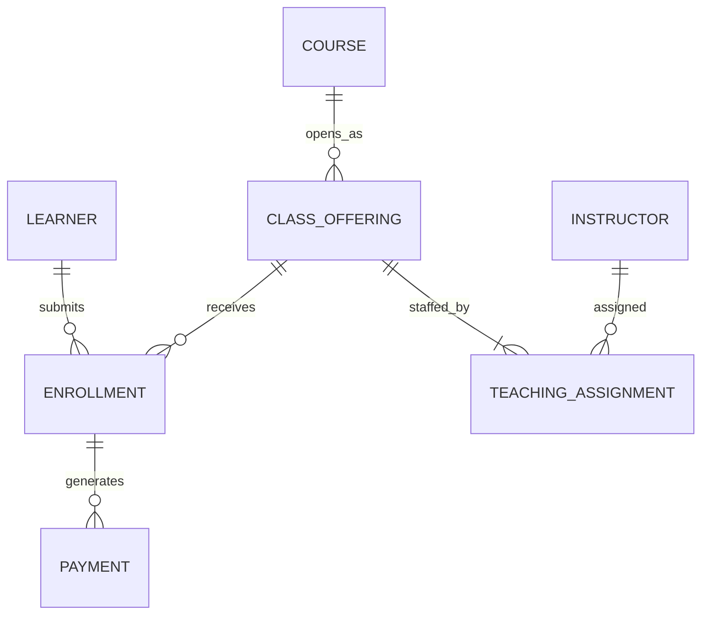

# Nhận diện khái niệm cốt lõi từ tình huống và ngôn ngữ nghiệp vụ

Trong chương **Mô hình khái niệm**, nhiệm vụ đầu tiên là tìm ra những khái niệm mà tổ chức thực sự cần quản lý và cách chúng liên hệ với nhau. Yêu cầu nghiệp vụ thường được viết bằng câu chuyện, biểu mẫu, thuật ngữ chuyên ngành và các quy tắc rải rác. Người thiết kế dữ liệu phải chuyển những mô tả đó thành một bức tranh nhất quán về đối tượng, vai trò, sự kiện, thuộc tính và quan hệ.

Đây là bước nền tảng của quá trình rèn kỹ năng chuyển yêu cầu nghiệp vụ thành mô hình dữ liệu rõ ràng. Mô hình khái niệm tập trung vào ý nghĩa nghiệp vụ: tổ chức đang nói về những thứ gì, mỗi thứ có ý nghĩa gì, tồn tại trong bao lâu, liên kết với thứ nào và quy tắc nào phải luôn đúng. Các quyết định về bảng, kiểu cột, khóa vật lý, chỉ mục hoặc cách lưu trong relational, document, graph hay analytical store sẽ được xem xét ở những bước thiết kế phù hợp sau đó.

Sau bài học, người học có thể:

- Đọc tình huống nghiệp vụ và trích xuất các khái niệm ứng viên từ danh từ, động từ, trạng thái và sự kiện.
- Phân biệt thực thể, thuộc tính, giá trị, vai trò, sự kiện, danh mục và thuật ngữ chỉ thao tác.
- Kiểm tra một khái niệm có cần định danh và vòng đời riêng hay chỉ là thuộc tính của khái niệm khác.
- Xác định quan hệ, số lượng tham gia, tính bắt buộc và các quy tắc nghiệp vụ liên quan.
- Xử lý từ đồng nghĩa, từ đồng âm khác nghĩa, ranh giới phạm vi và các điểm chưa rõ trong ngôn ngữ nghiệp vụ.
- Tạo mô hình khái niệm có thể giải thích, truy vết về bằng chứng và được người sở hữu nghiệp vụ xác nhận.

## 1. Mô hình khái niệm trả lời câu hỏi nào?

Mô hình khái niệm mô tả những điều tổ chức cần hiểu và quản lý về miền nghiệp vụ. Nó tạo ra một ngôn ngữ chung giữa người dùng nghiệp vụ, chuyên viên phân tích, kiến trúc sư và nhóm phát triển. Mô hình giúp trả lời các câu hỏi như:

- Những đối tượng hoặc sự kiện nào cần được nhận biết riêng?
- Mỗi khái niệm có ý nghĩa gì và ranh giới của nó ở đâu?
- Những khái niệm nào có quan hệ với nhau?
- Một đối tượng có thể liên kết với bao nhiêu đối tượng khác?
- Quan hệ có bắt buộc hay tùy chọn ở mỗi phía?
- Thông tin nào mô tả đối tượng, thông tin nào mô tả một lần xảy ra?
- Quy tắc nào phải được thỏa mãn trong mọi tình huống?
- Những thuật ngữ nào còn mơ hồ và cần người có thẩm quyền xác nhận?

Ví dụ, một trung tâm đào tạo nói rằng: “Học viên đăng ký lớp học. Mỗi lớp thuộc một khóa học, có lịch khai giảng và có giảng viên phụ trách. Một học viên có thể tham gia nhiều lớp; một lớp có nhiều học viên.” Câu chuyện này gợi ra các khái niệm `Học viên`, `Khóa học`, `Lớp mở`, `Giảng viên` và `Đăng ký`, cùng các quan hệ giữa chúng. `Đăng ký` có thể cần được nhận diện riêng vì nó ghi lại thời điểm đăng ký, trạng thái và kết quả của một học viên đối với một lớp cụ thể.

Mô hình khái niệm không phải bản sao của biểu mẫu hoặc cấu trúc phần mềm hiện tại. Một biểu mẫu có thể chứa nhiều trường do giới hạn giao diện; một bảng tính có thể gộp nhiều đối tượng vào cùng một dòng; một hệ thống cũ có thể đặt tên cột theo cách triển khai. Nhiệm vụ của người thiết kế là tìm ý nghĩa nghiệp vụ đằng sau các biểu hiện đó.

### 1.1. Phân biệt các mức mô hình

| Mức mô hình | Trọng tâm | Ví dụ câu hỏi |
|---|---|---|
| Khái niệm (conceptual) | Khái niệm nghiệp vụ, quan hệ và quy tắc chính | Trung tâm quản lý khóa học, lớp mở, học viên và đăng ký như thế nào? |
| Logic (logical) | Cấu trúc dữ liệu chi tiết hơn, thuộc tính, định danh, lực lượng quan hệ và chuẩn hóa | Đăng ký có thuộc tính nào? Một đăng ký liên kết chính xác với những đối tượng nào? |
| Vật lý (physical) | Cách triển khai trên công nghệ lưu trữ cụ thể | Dùng bảng nào, kiểu cột gì, chỉ mục nào, phân vùng ra sao? |

Các mức này liên hệ với nhau nhưng không nên trộn lẫn. Trong mô hình khái niệm, có thể gọi một khái niệm là `Đăng ký` và mô tả quy tắc một học viên đăng ký một lớp. Chưa cần quyết định cột `enrollment_id` dùng `BIGINT`, UUID hay khóa ghép. Cũng chưa cần chọn chỉ mục hoặc chiến lược phân vùng.

### 1.2. Khi nào cần mô hình hóa một khái niệm?

Một khái niệm đáng được xem xét khi nó có ý nghĩa ổn định đối với nghiệp vụ, xuất hiện trong nhiều quy trình, cần được tham chiếu, có vòng đời hoặc có các quy tắc riêng. Không phải mọi từ trong yêu cầu đều trở thành một thực thể. “Nhanh chóng”, “đã xác nhận”, “thường xuyên” có thể là tính chất, trạng thái hoặc mô tả. “Gửi đăng ký” có thể là hành động; “Đăng ký” lại là một hồ sơ cần lưu và tra cứu sau khi hành động kết thúc.

Hãy bắt đầu bằng danh sách khái niệm ứng viên rộng, sau đó dùng bằng chứng và câu hỏi kiểm tra để quyết định. Không nên chọn thực thể chỉ vì một danh từ xuất hiện trong câu, cũng không nên bỏ qua một khái niệm quan trọng chỉ vì nghiệp vụ đang gọi nó bằng động từ.

## 2. Đọc tình huống và ngôn ngữ nghiệp vụ

### 2.1. Thu thập câu mô tả từ nhiều góc nhìn

Để hiểu một miền nghiệp vụ, hãy thu thập mô tả từ người trực tiếp thực hiện, người quản lý, bộ phận nhận kết quả và người chịu trách nhiệm về quy tắc. Có thể dùng phỏng vấn, quan sát công việc, quy trình hiện hành, biểu mẫu, báo cáo, hợp đồng và dữ liệu mẫu. Mỗi nguồn phản ánh một góc nhìn; các điểm không thống nhất là tín hiệu cần khảo sát thêm.

Khi hỏi về một quy trình, ưu tiên câu hỏi cụ thể:

- Hãy kể lại một trường hợp gần đây từ lúc bắt đầu đến khi kết thúc.
- Ai hoặc hệ thống nào tạo ra thông tin này?
- Đối tượng nào được theo dõi sau khi thao tác hoàn tất?
- Khi thông tin thay đổi, tổ chức cần biết giá trị trước đó không?
- Có trường hợp nào một đối tượng được chuyển sang bộ phận hoặc người phụ trách khác?
- Hai bản ghi có cùng tên hoặc mã hiển thị có thể là hai đối tượng khác nhau không?
- Có trường hợp một người đảm nhiệm nhiều vai trò không?
- Từ ngữ nào được dùng khác nhau giữa các phòng ban?

Đừng chỉ ghi lại cách người dùng muốn màn hình hoạt động. Hãy tìm hiểu mục tiêu, quy tắc, dữ liệu được tạo ra và cách tổ chức nhận biết từng đối tượng.

### 2.2. Phân tích danh từ, động từ, trạng thái và thời điểm

Ngôn ngữ nghiệp vụ cung cấp nhiều manh mối:

| Thành phần câu | Manh mối có thể tìm thấy | Ví dụ |
|---|---|---|
| Danh từ chỉ đối tượng | Khái niệm, thực thể, nhóm hoặc thuộc tính | học viên, khóa học, lớp mở, địa điểm |
| Động từ chỉ liên kết | Quan hệ giữa các khái niệm | học viên đăng ký lớp, giảng viên phụ trách lớp |
| Động từ tạo sự kiện | Sự kiện hoặc hồ sơ phát sinh | đăng ký được gửi, khoản thanh toán được ghi nhận |
| Tính từ/trạng thái | Tình trạng hoặc đặc điểm của đối tượng | đang mở, đã hủy, còn chỗ |
| Cụm chỉ thời gian | Mốc hiệu lực, lịch, thời điểm phát sinh hoặc lịch sử | ngày khai giảng, thời điểm đăng ký, hạn hủy |
| Cụm điều kiện | Ràng buộc và quy tắc nghiệp vụ | chỉ được hủy trước ngày khai giảng |

Đây là kỹ thuật gợi ý để tìm ứng viên, không phải công thức chuyển mọi danh từ thành thực thể và mọi động từ thành quan hệ. Cần đọc cả câu, ngữ cảnh và các ví dụ cụ thể.

Ví dụ, câu “Nhân viên xác nhận đăng ký” có ít nhất ba cách hiểu cần phân biệt:

1. `Nhân viên` là người thực hiện hành động.
2. `Đăng ký` là hồ sơ được tạo trước đó và được chuyển sang trạng thái đã xác nhận.
3. `Xác nhận` là một sự kiện hoặc một lần xử lý, có thể cần lưu người thực hiện, thời điểm và kết quả.

Nếu chỉ lấy danh từ, ta có thể bỏ lỡ sự kiện xác nhận. Nếu chỉ lấy động từ, ta có thể không nhận ra hồ sơ đăng ký tồn tại độc lập và cần được tra cứu.

### 2.3. Lập từ điển thuật ngữ trước khi gộp khái niệm

Một từ có thể có nhiều nghĩa, và một khái niệm có thể có nhiều tên gọi. Hãy lập từ điển thuật ngữ để thống nhất cách hiểu.

| Thuật ngữ | Định nghĩa đã thống nhất | Ví dụ | Câu hỏi cần làm rõ |
|---|---|---|---|
| Khóa học | Nội dung đào tạo được trung tâm cung cấp, có mục tiêu và chương trình | Phân tích dữ liệu cơ bản | Khóa học có phiên bản chương trình theo từng năm không? |
| Lớp mở | Một đợt tổ chức khóa học vào thời gian cụ thể | Lớp tháng 12, học trực tuyến | “Lớp” có đồng nghĩa với khóa học trong cách nói của một bộ phận không? |
| Học viên | Người tham gia học một lớp mở | Người đã được xác nhận đăng ký | Một người có thể đồng thời là giảng viên không? |
| Đăng ký | Hồ sơ ghi nhận việc một học viên yêu cầu tham gia một lớp mở | Đăng ký đang chờ xác nhận | Có cho phép một người tạo nhiều hồ sơ cho cùng một lớp không? |
| Giảng viên phụ trách | Người được phân công giảng dạy một lớp mở | Giảng viên chính, trợ giảng | Một lớp có nhiều giảng viên hoặc thay đổi người phụ trách không? |

**Từ đồng nghĩa** là các cách gọi khác nhau cho cùng một khái niệm trong một phạm vi. Ví dụ, “người học” và “học viên” có thể cùng chỉ một vai trò nếu nghiệp vụ xác nhận như vậy. **Từ đồng âm khác nghĩa** là cùng một từ nhưng chỉ các khái niệm khác nhau. Ví dụ, “lớp” có thể chỉ nội dung đào tạo, một nhóm học viên hoặc một đợt mở lớp. Không gộp các khái niệm chỉ vì tên gọi giống nhau.

Mỗi thuật ngữ nên có định nghĩa, phạm vi sử dụng, ví dụ, tên gọi tương đương, nguồn xác nhận và người sở hữu. Khi có tranh luận, ghi lại các cách hiểu thay vì âm thầm chọn một cách.

## 3. Quy trình nhận diện khái niệm cốt lõi

Có thể thực hiện theo một quy trình lặp gồm các bước sau.

### Bước 1: Xác định ranh giới miền nghiệp vụ

Nêu rõ tổ chức hoặc hệ thống đang quản lý hoạt động nào, bắt đầu ở đâu và kết thúc ở đâu. Một nền tảng đào tạo có thể quản lý chương trình học, lịch mở lớp, đăng ký và thanh toán; hệ thống kế toán bên ngoài có thể quản lý hóa đơn và hạch toán. Ranh giới này giúp xác định dữ liệu nào được quản lý trực tiếp và dữ liệu nào chỉ được tham chiếu.

Nếu không xác định phạm vi, mô hình dễ phình to vì đưa mọi khái niệm liên quan vào cùng một sơ đồ. Ngược lại, phạm vi quá hẹp có thể bỏ qua đối tượng bên ngoài cần liên kết hoặc quy tắc giao tiếp với hệ thống khác.

### Bước 2: Viết lại tình huống bằng câu nghiệp vụ rõ nghĩa

Tách câu chuyện dài thành các phát biểu đơn giản. Mỗi phát biểu nên mô tả một sự thật, một hành động, một quan hệ hoặc một quy tắc. Ví dụ:

- Trung tâm cung cấp nhiều khóa học.
- Một khóa học có thể được mở thành nhiều lớp ở các thời điểm khác nhau.
- Một lớp mở thuộc về đúng một khóa học.
- Học viên gửi đăng ký để tham gia một lớp mở.
- Một lớp mở có nhiều đăng ký; mỗi đăng ký thuộc về một học viên.
- Một lớp mở có thể được phân công cho một hoặc nhiều giảng viên.
- Một đăng ký có thể phát sinh nhiều lần thanh toán.
- Học viên chỉ được hủy đăng ký trước thời hạn quy định.

Hãy xác nhận các từ “nhiều”, “một”, “có thể”, “phải”, “trước” và “sau” với nghiệp vụ. Chúng thường chứa thông tin về lực lượng quan hệ, tính bắt buộc và điều kiện thời gian.

### Bước 3: Trích xuất danh sách khái niệm ứng viên

Đọc từng phát biểu và đánh dấu:

- Danh từ chỉ đối tượng được quản lý: học viên, khóa học, lớp mở, giảng viên.
- Danh từ chỉ hồ sơ hoặc kết quả: đăng ký, thanh toán.
- Danh từ chỉ sự kiện: xác nhận đăng ký, hủy lớp, hoàn tất thanh toán.
- Danh từ chỉ thuộc tính hoặc giá trị: tên khóa học, ngày khai giảng, sức chứa, trạng thái.
- Danh từ chỉ nhóm hoặc danh mục: hình thức học, loại khóa học, phương thức thanh toán.
- Động từ chỉ liên kết: cung cấp, thuộc về, đăng ký, phụ trách, thanh toán.

Ở bước này, giữ lại nhiều ứng viên hơn mức cần thiết. Đừng vội quyết định một thuật ngữ là thực thể hay thuộc tính. Mục tiêu là không bỏ sót khái niệm để có thể kiểm tra ở bước tiếp theo.

### Bước 4: Kiểm tra ý nghĩa và sự tồn tại độc lập

Với mỗi ứng viên, đặt câu hỏi:

1. Nghiệp vụ có cần nhận biết từng trường hợp cụ thể của khái niệm này không?
2. Có thể mô tả một trường hợp bằng những đặc điểm riêng không?
3. Khái niệm có vòng đời, trạng thái hoặc lịch sử riêng không?
4. Nó có thể liên kết với nhiều đối tượng khác không?
5. Có cần tìm kiếm, tham chiếu hoặc báo cáo về nó như một đối tượng riêng không?
6. Nếu xóa hoặc thay đổi đối tượng cha, thông tin về khái niệm này có cần tồn tại không?

Nếu câu trả lời cho nhiều câu hỏi là có, khái niệm có thể là thực thể. Nếu nó chỉ mô tả một khía cạnh của đối tượng khác và không cần nhận diện riêng, nó có thể là thuộc tính hoặc giá trị. Đây là phép thử định hướng, không phải điều kiện bắt buộc tuyệt đối.

### Bước 5: Tìm quan hệ và vai trò tham gia

Đọc các động từ và cụm giới từ để tìm cách khái niệm liên kết. Ghi quan hệ bằng câu có chủ thể và đối tượng rõ ràng, ví dụ “Học viên gửi Đăng ký”, “Đăng ký áp dụng cho Lớp mở”, “Lớp mở được tổ chức từ Khóa học”.

Xác định vai trò ở từng phía. Trong quan hệ “giảng viên phụ trách lớp”, một người có thể là giảng viên chính hoặc trợ giảng. Nếu vai trò ảnh hưởng đến phân công, quyền hạn hoặc báo cáo, hãy ghi rõ. Đừng dùng một quan hệ chung chung như “liên quan đến” khi nghiệp vụ cần biết bản chất liên kết.

### Bước 6: Ghi thuộc tính và quy tắc quan trọng

Với mỗi khái niệm, liệt kê thông tin mô tả và thông tin định danh. Với mỗi quan hệ, ghi số lượng, tính bắt buộc, điều kiện và các giới hạn. Tách quy tắc được nghiệp vụ xác nhận khỏi giả định của nhóm thiết kế.

### Bước 7: Kiểm chứng bằng tình huống thực tế

Thử mô hình với trường hợp bình thường, trường hợp biên và ngoại lệ. Ví dụ: học viên đăng ký hai lớp; lớp bị hủy; một lớp có hai giảng viên; giảng viên cũng là học viên; học viên hủy đăng ký sau khi thanh toán; một đăng ký được thanh toán nhiều lần. Nếu sơ đồ không giải thích được tình huống hoặc buộc người đọc suy đoán, quay lại làm rõ khái niệm và quy tắc.

## 4. Phân loại khái niệm ứng viên

### 4.1. Thực thể (entity)

Thực thể là khái niệm mà nghiệp vụ cần nhận biết từng trường hợp cụ thể. Mỗi thực thể có một định danh hoặc cách nhận biết ổn định trong phạm vi nghiệp vụ. Nó thường có các thuộc tính mô tả, tham gia quan hệ và có thể có vòng đời.

Ví dụ trong miền đào tạo:

- `Khóa học`: chương trình đào tạo có tên, mục tiêu và nội dung.
- `Lớp mở`: một đợt tổ chức khóa học với lịch và sức chứa cụ thể.
- `Học viên`: người có thể gửi đăng ký và tham gia học.
- `Đăng ký`: hồ sơ ghi nhận yêu cầu tham gia một lớp.
- `Giảng viên`: người được phân công giảng dạy.

Một thực thể không nhất thiết phải là một vật thể hữu hình. Hồ sơ đăng ký, khoản thanh toán hoặc một lần phân công đều có thể là thực thể nếu tổ chức cần nhận diện và quản lý riêng.

### 4.2. Thuộc tính (attribute)

Thuộc tính mô tả một khía cạnh của khái niệm. Ví dụ, `Tên khóa học`, `Ngày khai giảng` và `Sức chứa` có thể là thuộc tính của các khái niệm tương ứng.

Hãy hỏi liệu giá trị có cần được quản lý độc lập hay chỉ có ý nghĩa trong ngữ cảnh của đối tượng. Nếu một địa điểm chỉ là chuỗi mô tả trên lớp mở, nó có thể là thuộc tính. Nếu địa điểm có mã riêng, địa chỉ, sức chứa, quy tắc sử dụng và được nhiều lớp tham chiếu, nó có thể là một thực thể `Địa điểm`.

Một thuộc tính có thể là đơn trị hoặc đa trị ở góc nhìn nghiệp vụ. Ví dụ, một khóa học có nhiều từ khóa; một người có nhiều phương thức liên hệ. Nếu các giá trị có thông tin riêng, thứ tự, thời gian hiệu lực hoặc quan hệ với đối tượng khác, hãy xem xét khái niệm riêng thay vì gộp chúng thành một trường văn bản.

### 4.3. Giá trị hoặc đối tượng giá trị (value)

Giá trị mô tả một khái niệm nhưng thường không có định danh nghiệp vụ độc lập. Ví dụ, khoảng thời gian `09:00–11:00`, số lượng `20`, hoặc cặp tọa độ của một vị trí có thể chỉ có ý nghĩa khi gắn với lớp mở.

Một nhóm giá trị có cấu trúc có thể được xem như một đối tượng giá trị ở mức phân tích, chẳng hạn `Khoảng thời gian` gồm thời điểm bắt đầu và kết thúc. Việc biểu diễn thành kiểu dữ liệu, bảng hay cấu trúc nhúng là quyết định logic/vật lý sau này.

### 4.4. Vai trò (role)

Vai trò mô tả tư cách mà một người hoặc tổ chức tham gia vào một quy trình hoặc quan hệ. Cùng một người có thể là học viên trong một đăng ký và là giảng viên trong một lớp khác. Vai trò thường phụ thuộc ngữ cảnh, thời gian hoặc quyền hạn.

Không nên mặc định mỗi vai trò là một con người khác nhau. Nếu cùng một cá nhân có thể vừa học vừa dạy và tổ chức cần hợp nhất danh tính, hãy xem xét một khái niệm `Người` hoặc `Cá nhân` với các vai trò `Học viên` và `Giảng viên`. Nếu hai nhóm có định danh, vòng đời và dữ liệu hoàn toàn khác nhau, có thể giữ các khái niệm riêng. Quyết định phải dựa trên cách tổ chức nhận biết con người và quy tắc dùng chung dữ liệu.

### 4.5. Sự kiện (event)

Sự kiện ghi nhận một điều đã xảy ra tại một thời điểm, thường do một tác nhân hoặc hệ thống gây ra. Ví dụ: `Đăng ký được gửi`, `Lớp bị hủy`, `Thanh toán được xác nhận`.

Sự kiện đáng được nhận diện riêng khi tổ chức cần lưu nhiều lần xảy ra, thời điểm, nguồn phát sinh, người thực hiện, kết quả hoặc dấu vết kiểm toán. Một thuộc tính `status` chỉ cho biết tình trạng hiện tại có thể không đủ để trả lời ai đã chuyển trạng thái và chuyển khi nào.

Phân biệt hành động và sự kiện: “Xác nhận đăng ký” có thể là yêu cầu thực hiện một hành động; “Đăng ký đã được xác nhận” là sự kiện đã xảy ra. Hệ thống có thể ghi nhận sự kiện thành một hồ sơ hoặc bản ghi lịch sử. Không phải mọi thao tác trên màn hình đều cần trở thành thực thể; hãy dựa vào yêu cầu truy vết và vòng đời.

### 4.6. Danh mục hoặc khái niệm phân loại

Danh mục mô tả tập giá trị được quản lý có quy tắc, ví dụ `Hình thức học` gồm trực tuyến, trực tiếp và kết hợp. Nếu danh sách nhỏ, ổn định và chỉ dùng để phân loại, nó có thể là thuộc tính miền giá trị. Nếu mỗi mục có mô tả, hiệu lực, thứ tự, quyền quản trị hoặc được nhiều quy trình tham chiếu, nó có thể là một khái niệm danh mục riêng.

Đừng tạo thực thể cho mọi danh sách lựa chọn trong giao diện. Một danh sách chỉ tồn tại để hỗ trợ nhập liệu có thể không phải khái niệm nghiệp vụ độc lập.

### 4.7. Phân biệt khái niệm và hành động giao diện

Các nút “Tìm kiếm”, “Lưu”, “In”, “Xuất Excel” là hành động giao diện. Chúng không tự động trở thành thực thể. Tuy nhiên, kết quả của hành động có thể tạo ra dữ liệu cần quản lý. Ví dụ, thao tác “Gửi đăng ký” tạo một hồ sơ `Đăng ký`; thao tác “Xuất danh sách” có thể tạo một `Báo cáo` nếu tổ chức cần lưu phiên bản, người tạo và thời điểm phát hành.

## 5. Phép thử để phân biệt thực thể, thuộc tính và giá trị

Khi chưa rõ cách phân loại, dùng các phép thử dưới đây và ghi lại câu trả lời.

| Phép thử | Nếu câu trả lời là “có” | Ví dụ |
|---|---|---|
| Có cần nhận diện từng trường hợp riêng? | Nghiêng về thực thể hoặc sự kiện. | Mỗi lần đăng ký có mã và trạng thái riêng. |
| Có vòng đời hoặc trạng thái riêng? | Nghiêng về thực thể/hồ sơ. | Đăng ký có thể chờ xác nhận, được duyệt hoặc bị hủy. |
| Có nhiều thuộc tính mô tả riêng? | Có thể là thực thể hoặc đối tượng giá trị. | Địa điểm có tên, địa chỉ, sức chứa và giờ hoạt động. |
| Có quan hệ với nhiều khái niệm khác? | Nghiêng về thực thể. | Địa điểm được nhiều lớp mở sử dụng. |
| Chỉ có ý nghĩa trong ngữ cảnh đối tượng cha? | Có thể là thuộc tính hoặc giá trị. | Sức chứa được khai báo cho một lớp mở. |
| Giá trị có thể thay đổi độc lập và cần lịch sử? | Cần xem xét khái niệm hoặc hồ sơ hiệu lực riêng. | Một giảng viên được phân công cho lớp trong từng giai đoạn. |
| Nghiệp vụ có quản lý danh sách giá trị này? | Có thể là danh mục. | Hình thức học có người quản trị và ngày hiệu lực. |

Ví dụ với từ “Địa điểm”:

- Nếu chỉ lưu “Phòng A” để hiển thị trên lịch của một lớp, có thể là thuộc tính.
- Nếu địa điểm có địa chỉ, sức chứa, thiết bị, lịch sử bảo trì và được nhiều lớp dùng chung, nó có thể là thực thể.
- Nếu chỉ cần một nhóm giá trị “Trực tuyến/Trực tiếp”, đó có thể là danh mục hình thức học.

Không có đáp án đúng cho mọi tổ chức. Câu hỏi quyết định là nghiệp vụ có cần quản lý khái niệm đó như một đối tượng độc lập hay không.

## 6. Nhận diện quan hệ từ câu nghiệp vụ

### 6.1. Viết quan hệ bằng câu có chủ thể và đối tượng

Mỗi quan hệ cần có tên diễn đạt rõ nghĩa và có thể đọc theo cả hai chiều. Ví dụ:

- Học viên **gửi** Đăng ký.
- Đăng ký **áp dụng cho** Lớp mở.
- Khóa học **được tổ chức thành** Lớp mở.
- Giảng viên **được phân công vào** Lớp mở.
- Đăng ký **phát sinh** Thanh toán.

Tên quan hệ nên mô tả ý nghĩa nghiệp vụ, tránh tên quá chung như `có`, `liên quan`, `tham chiếu` nếu có thể dùng từ chính xác hơn. Cần xác định vai trò hai phía: “người gửi” khác “người duyệt”; “người thanh toán” khác “người học” nếu nghiệp vụ cho phép.

### 6.2. Xác định lực lượng quan hệ (cardinality)

Lực lượng quan hệ mô tả số lượng trường hợp ở một phía có thể hoặc phải liên kết với phía còn lại. Những câu hỏi thường dùng:

- Một học viên có thể có bao nhiêu đăng ký?
- Một đăng ký có thể thuộc về bao nhiêu học viên?
- Một lớp mở có thể có bao nhiêu giảng viên?
- Một giảng viên có thể phụ trách bao nhiêu lớp trong cùng thời kỳ?

Các dạng thường gặp:

| Dạng | Ý nghĩa | Ví dụ |
|---|---|---|
| Một - một (1:1) | Mỗi phía liên kết tối đa với một trường hợp phía kia | Một hồ sơ cấp chứng nhận có một mã chứng nhận duy nhất, nếu quy tắc nghiệp vụ xác nhận như vậy. |
| Một - nhiều (1:N) | Một trường hợp phía A có thể liên kết nhiều trường hợp phía B; mỗi B thuộc về một A | Một khóa học có nhiều lớp mở; mỗi lớp mở thuộc một khóa học. |
| Nhiều - nhiều (N:M) | Nhiều trường hợp ở mỗi phía có thể liên kết với nhiều trường hợp phía kia | Học viên tham gia nhiều lớp; mỗi lớp có nhiều học viên. |

Không suy ra lực lượng chỉ từ một ví dụ. Nếu dữ liệu mẫu hiện tại cho thấy mỗi lớp chỉ có một giảng viên, hãy hỏi liệu quy tắc này là bắt buộc hay chỉ là cách tổ chức đang áp dụng. Mô hình cần phản ánh quy tắc nghiệp vụ đã xác nhận, kể cả trường hợp hiếm nhưng hợp lệ.

### 6.3. Phân biệt số lượng tối thiểu và tối đa

Ngoài số lượng tối đa, hãy xác định một đối tượng có bắt buộc tham gia quan hệ hay không. Một lớp mở có thể chưa có giảng viên khi mới được tạo; trước khi khai giảng phải có ít nhất một giảng viên. Đây là quy tắc phụ thuộc thời điểm, không thể mô tả đầy đủ bằng một con số tĩnh nếu không ghi rõ giai đoạn áp dụng.

| Câu hỏi | Ví dụ |
|---|---|
| Có thể không có liên kết nào không? | Một học viên mới có thể chưa có đăng ký. |
| Khi tạo đối tượng, liên kết có bắt buộc không? | Lớp mở phải gắn với một khóa học. |
| Trước khi kích hoạt, có điều kiện tối thiểu nào không? | Lớp phải có giảng viên trước ngày khai giảng. |
| Có giới hạn tối đa không? | Lớp có sức chứa tối đa 30 học viên. |
| Giới hạn thay đổi theo thời gian hoặc loại đối tượng không? | Lớp trực tuyến và lớp trực tiếp có sức chứa khác nhau. |

Phân biệt “không có”, “chưa có” và “không được phép có”. Đây là ba ý nghĩa khác nhau. Một lớp chưa được phân công giảng viên có thể là trạng thái hợp lệ trong giai đoạn chuẩn bị, trong khi lớp đã khai giảng mà không có giảng viên có thể vi phạm quy tắc.

### 6.4. Nhận diện quan hệ nhiều-nhiều có thông tin riêng

Khi quan hệ nhiều-nhiều có thuộc tính, lịch sử hoặc trạng thái riêng, hãy xem xét biến quan hệ thành một khái niệm có thể quản lý. Trong ví dụ đào tạo, `Học viên` và `Lớp mở` có quan hệ nhiều-nhiều. `Đăng ký` ghi lại ngày gửi, trạng thái, nguồn đăng ký và kết quả xác nhận. Vì vậy `Đăng ký` là khái niệm trung gian có ý nghĩa nghiệp vụ, không chỉ là một đường nối giữa hai khái niệm.

Tương tự, một lớp có nhiều giảng viên và một giảng viên có thể phụ trách nhiều lớp. Nếu tổ chức cần ghi vai trò giảng viên, thời gian phân công và tỷ lệ phụ trách, hãy xem xét khái niệm `Phân công giảng dạy`.

## 7. Xác định thuộc tính, định danh và vòng đời

### 7.1. Chọn thuộc tính có ý nghĩa nghiệp vụ

Thuộc tính cần có định nghĩa rõ, phạm vi áp dụng và cách diễn giải thống nhất. Ví dụ:

| Khái niệm | Thuộc tính ứng viên | Câu hỏi cần xác nhận |
|---|---|---|
| Khóa học | Tên, mục tiêu, mô tả | Tên có duy nhất không? Khi đổi tên, lịch sử lớp cũ có dùng tên cũ không? |
| Lớp mở | Ngày khai giảng, sức chứa, hình thức học | Ngày khai giảng có thể thay đổi sau khi học viên đăng ký không? |
| Học viên | Mã học viên, tên hiển thị, thông tin liên hệ | Mã do tổ chức cấp có ổn định khi học viên đổi thông tin không? |
| Đăng ký | Thời điểm gửi, trạng thái, nguồn đăng ký | Có lưu từng lần gửi lại hay chỉ một hồ sơ đang hiệu lực? |
| Phân công giảng dạy | Vai trò, thời điểm bắt đầu, thời điểm kết thúc | Có lưu lịch sử thay đổi người phụ trách không? |

Tránh dùng tên thuộc tính chung chung như `data`, `info`, `type` hoặc `value` khi có thể mô tả chính xác. Một thuộc tính nên có một ý nghĩa chính. Ví dụ, không dùng một trường `contact` để lúc thì lưu email, lúc thì lưu số điện thoại mà không có quy tắc phân biệt.

### 7.2. Định danh nghiệp vụ

Định danh giúp tổ chức phân biệt một trường hợp với các trường hợp khác. Hãy hỏi:

- Mỗi đối tượng được nhận biết bằng mã nào trong công việc?
- Mã có duy nhất trong toàn tổ chức hay chỉ trong một phạm vi?
- Mã có thay đổi khi đối tượng đổi tên, đổi trạng thái hoặc chuyển bộ phận không?
- Có trường hợp hai đối tượng trùng tên hoặc dùng chung thông tin liên hệ không?
- Có cần nhận biết một đối tượng trước khi cấp mã chính thức không?

Tên người, tên khóa học hoặc ngày khai giảng thường không đủ làm định danh ổn định. Hai người có thể trùng tên; một khóa học có thể đổi tên; một lớp có thể dời lịch. Đừng mặc định thuộc tính dễ nhìn thấy là khóa nghiệp vụ.

Ở mức khái niệm, chỉ cần xác định nhu cầu nhận diện và quy tắc duy nhất. Việc chọn khóa tự nhiên, khóa thay thế, kiểu dữ liệu và cách sinh khóa thuộc bước thiết kế chi tiết hơn.

### 7.3. Vòng đời và lịch sử

Mỗi khái niệm có thể có vòng đời khác nhau. Khóa học có thể được soạn, công bố, tạm ngừng và ngừng cung cấp. Lớp mở có thể được lên lịch, nhận đăng ký, bắt đầu, kết thúc hoặc hủy. Đăng ký có thể được gửi, chờ xác nhận, xác nhận, từ chối hoặc hủy.

Hãy phân biệt:

- **Trạng thái hiện tại:** đối tượng đang ở tình trạng nào.
- **Sự kiện:** điều gì đã xảy ra để trạng thái thay đổi.
- **Lịch sử:** chuỗi thay đổi cần lưu để truy vết hoặc giải thích kết quả.
- **Hiệu lực:** khoảng thời gian một giá trị hoặc quan hệ được xem là đúng trong nghiệp vụ.

Ví dụ, thuộc tính `trạng thái = ĐÃ_HỦY` chỉ cho biết tình trạng hiện tại của đăng ký. Nếu cần biết ai hủy, hủy lúc nào, lý do gì và trước đó đã được xác nhận chưa, cần ghi nhận sự kiện hoặc lịch sử tương ứng.

## 8. Chuyển quy tắc nghiệp vụ thành ràng buộc khái niệm

Ràng buộc mô tả điều kiện mà dữ liệu và quan hệ phải thỏa mãn. Ở mức khái niệm, hãy diễn đạt bằng ngôn ngữ nghiệp vụ, ví dụ:

- Mỗi lớp mở thuộc về đúng một khóa học.
- Một đăng ký áp dụng cho đúng một học viên và đúng một lớp mở.
- Một học viên không được có hai đăng ký đang hiệu lực cho cùng một lớp.
- Lớp mở phải có ít nhất một giảng viên trước khi khai giảng.
- Học viên chỉ được hủy đăng ký trước thời hạn hủy.
- Tổng số đăng ký được xác nhận không vượt quá sức chứa của lớp, trừ khi có quy trình ngoại lệ được phê duyệt.

Không phải mọi ràng buộc đều được biểu diễn bằng lực lượng quan hệ. Một số ràng buộc phụ thuộc thuộc tính, thời gian, trạng thái hoặc nhiều đối tượng cùng lúc. Hãy ghi chúng thành quy tắc riêng, có điều kiện và người xác nhận.

| Loại ràng buộc | Nội dung | Ví dụ |
|---|---|---|
| Định danh | Phân biệt các trường hợp | Mỗi đăng ký có một mã hồ sơ riêng trong phạm vi trung tâm. |
| Duy nhất theo phạm vi | Không cho phép tổ hợp giá trị lặp trong một phạm vi | Một học viên chỉ có một đăng ký đang hiệu lực cho cùng lớp. |
| Bắt buộc | Đối tượng phải tham gia quan hệ hoặc có giá trị | Mỗi lớp mở phải thuộc một khóa học. |
| Số lượng | Giới hạn số liên kết | Số học viên được xác nhận không vượt sức chứa. |
| Miền giá trị | Giá trị phải thuộc phạm vi được phép | Sức chứa là số nguyên dương. |
| Thời gian | Điều kiện phụ thuộc mốc thời gian | Chỉ được hủy trước hạn hủy. |
| Trạng thái | Chỉ cho phép chuyển theo luồng hợp lệ | Đăng ký đã bị từ chối không thể chuyển thẳng thành đã tham gia nếu chưa có quy trình mở lại. |
| Liên khái niệm | Quy tắc liên quan nhiều đối tượng | Giảng viên được phân công phải có năng lực phù hợp với khóa học. |

Với mỗi quy tắc, ghi mã, phát biểu, điều kiện áp dụng, ví dụ hợp lệ, ví dụ vi phạm, nguồn bằng chứng và người có thẩm quyền xác nhận. Điều này giúp quy tắc được kiểm chứng ở bước logic, vật lý và kiểm thử sau này.

## 9. Ví dụ xuyên suốt: mô hình khái niệm cho nền tảng đào tạo

### 9.1. Tình huống nghiệp vụ

Một trung tâm cung cấp nhiều khóa học. Mỗi khóa học có thể được mở thành nhiều lớp vào những thời điểm khác nhau. Mỗi lớp có ngày khai giảng, sức chứa và hình thức học. Học viên gửi đăng ký để tham gia lớp. Một học viên có thể đăng ký nhiều lớp và một lớp có nhiều học viên. Trung tâm phân công một hoặc nhiều giảng viên cho mỗi lớp. Đăng ký được xác nhận có thể phát sinh một hoặc nhiều lần thanh toán. Học viên được hủy đăng ký trước thời hạn quy định; trung tâm có thể hủy lớp nếu không đủ điều kiện tổ chức.

Tình huống này là giả định phục vụ học tập. Khi áp dụng vào tổ chức thực tế, phải xác nhận thuật ngữ, quy trình, quy tắc và ngoại lệ với người sở hữu nghiệp vụ.

### 9.2. Trích xuất khái niệm ứng viên

| Từ/cụm từ trong tình huống | Phân loại ứng viên | Lý do cần xem xét |
|---|---|---|
| Trung tâm | Tổ chức hoặc ranh giới miền | Có thể chỉ là bối cảnh; nếu quản lý nhiều trung tâm/chi nhánh thì cần khái niệm riêng. |
| Khóa học | Thực thể | Có nội dung, mục tiêu và nhiều đợt mở lớp. |
| Lớp | Thực thể ứng viên | Có lịch, sức chứa và vòng đời riêng; cần phân biệt với khóa học. |
| Học viên | Thực thể hoặc vai trò của Người | Có thể được nhận diện và tham gia nhiều lớp. |
| Đăng ký | Thực thể liên kết | Ghi nhận một học viên yêu cầu tham gia một lớp và có trạng thái riêng. |
| Giảng viên | Thực thể hoặc vai trò của Người | Có thể được phân công cho nhiều lớp. |
| Phân công | Thực thể liên kết | Có thể cần vai trò và thời gian phân công. |
| Thanh toán | Thực thể/sự kiện nghiệp vụ | Có số tiền, thời điểm, phương thức và kết quả riêng. |
| Ngày khai giảng | Thuộc tính của Lớp mở | Mô tả thời điểm lớp bắt đầu. |
| Sức chứa | Thuộc tính của Lớp mở | Giới hạn số người được xác nhận. |
| Hình thức học | Thuộc tính hoặc danh mục | Cần xem danh sách giá trị có được quản trị độc lập không. |
| Hủy đăng ký | Sự kiện hoặc chuyển trạng thái | Cần lưu thời điểm, lý do và người thực hiện nếu có yêu cầu truy vết. |

Danh sách này chưa phải mô hình cuối cùng. Nó là đầu vào để đặt câu hỏi và xác minh.

### 9.3. Kiểm tra các quyết định phân loại

**Khóa học và Lớp mở:** Khóa học mô tả nội dung đào tạo; lớp mở là một lần tổ chức khóa học vào thời gian cụ thể. Một khóa học có thể có nhiều lớp mở, và mỗi lớp mở thuộc về một khóa học. Không nên gộp lịch khai giảng vào khóa học nếu cùng một khóa có nhiều đợt tổ chức.

**Học viên và Đăng ký:** Học viên là người tham gia; đăng ký là hồ sơ của một yêu cầu tham gia một lớp. Nếu không có đăng ký, trung tâm không thể biết học viên đã yêu cầu lớp nào, vào lúc nào và kết quả ra sao. Vì vậy đăng ký cần được nhận diện riêng.

**Lớp mở và Phân công giảng dạy:** Nếu mỗi lớp chỉ có một giảng viên và không lưu lịch sử thay đổi, có thể mô tả giảng viên như một quan hệ trực tiếp. Nếu một lớp có nhiều giảng viên, mỗi giảng viên có vai trò hoặc thời gian phụ trách riêng, `Phân công giảng dạy` là khái niệm liên kết phù hợp hơn.

**Học viên và Giảng viên:** Nếu cùng một người có thể vừa học vừa dạy, cần xác định trung tâm quản lý một danh tính người dùng chung hay hai hồ sơ độc lập. Nếu dùng danh tính chung, có thể mô hình hóa `Người` và các vai trò. Nếu danh tính hoặc vòng đời khác nhau, cần ghi rõ lý do giữ khái niệm riêng.

**Thanh toán:** Nếu một đăng ký có thể thanh toán nhiều lần hoặc cần lưu cả lần thử thất bại, mỗi giao dịch thanh toán cần được nhận diện. Không nên chỉ lưu một trường `paidAmount` trên đăng ký nếu tổ chức cần đối soát từng giao dịch.

### 9.4. Mô hình quan hệ khái niệm

Sơ đồ sau thể hiện các khái niệm và quan hệ chính. Nó chưa mô tả thuộc tính vật lý hoặc khóa triển khai.



Diễn giải:

- Một `COURSE` có thể được mở thành không hoặc nhiều `CLASS_OFFERING`; mỗi `CLASS_OFFERING` thuộc về đúng một `COURSE`.
- Một `LEARNER` có thể gửi không hoặc nhiều `ENROLLMENT`; mỗi `ENROLLMENT` thuộc về đúng một `LEARNER`.
- Một `CLASS_OFFERING` có thể nhận không hoặc nhiều `ENROLLMENT`; mỗi `ENROLLMENT` áp dụng cho đúng một `CLASS_OFFERING`.
- Một `CLASS_OFFERING` cần ít nhất một `TEACHING_ASSIGNMENT` theo giả định của ví dụ; mỗi phân công thuộc về đúng một lớp.
- Một `INSTRUCTOR` có thể có nhiều phân công; mỗi phân công chỉ định một giảng viên.
- Một `ENROLLMENT` có thể chưa có thanh toán hoặc phát sinh nhiều `PAYMENT`; mỗi thanh toán trong ví dụ gắn với một đăng ký.

Các số lượng trong sơ đồ cần được nghiệp vụ xác nhận. Ví dụ, nếu lớp có thể được tạo trước khi phân công giảng viên, quan hệ lớp-phân công có thể là tùy chọn trong giai đoạn chuẩn bị, kèm quy tắc phải có giảng viên trước ngày khai giảng. Sơ đồ khái niệm cần được bổ sung chú thích cho các quy tắc phụ thuộc thời gian như vậy.

### 9.5. Danh mục quy tắc từ mô hình

| Mã | Quy tắc | Cách kiểm chứng |
|---|---|---|
| CM-01 | Mỗi lớp mở thuộc đúng một khóa học. | Thử tạo lớp không có khóa học hoặc gắn đồng thời hai khóa học. |
| CM-02 | Mỗi đăng ký thuộc đúng một học viên và một lớp mở. | Kiểm tra hồ sơ đăng ký thiếu một trong hai phía. |
| CM-03 | Một học viên không có hai đăng ký đang hiệu lực cho cùng một lớp. | Tạo hai yêu cầu trùng trong các trạng thái khác nhau và xác nhận định nghĩa “đang hiệu lực”. |
| CM-04 | Lớp phải có ít nhất một giảng viên trước ngày khai giảng. | Kiểm tra lớp mới tạo, lớp sắp khai giảng và lớp đã bắt đầu. |
| CM-05 | Số đăng ký được xác nhận không vượt sức chứa, trừ ngoại lệ được duyệt. | Kiểm tra thời điểm nhiều đăng ký được xác nhận gần như đồng thời. |
| CM-06 | Đăng ký chỉ được hủy trước hạn hủy theo quy định. | Thử hủy trước hạn, đúng hạn và sau hạn. |
| CM-07 | Mỗi giao dịch thanh toán được nhận diện riêng để đối soát. | Kiểm tra nhiều lần thử, thanh toán thành công và thông báo gửi lặp. |

### 9.6. Những câu hỏi còn mở

Trước khi chuyển sang mô hình logic, cần làm rõ:

- Một học viên có thể đăng ký lại cùng lớp sau khi đã hủy không?
- Có danh sách chờ khi lớp đủ sức chứa không? Vị trí trong danh sách chờ có cần lưu không?
- Một đăng ký có thể được chuyển sang lớp khác hay phải hủy và tạo đăng ký mới?
- Một lớp có thể có nhiều giảng viên cùng lúc không? Có vai trò giảng viên chính và trợ giảng không?
- Một người có thể đồng thời là học viên và giảng viên không?
- Thanh toán được thực hiện theo từng đăng ký hay có thể thanh toán gộp nhiều đăng ký?
- Khi lớp bị hủy, các đăng ký và thanh toán được xử lý ra sao?
- Hình thức học có thể thay đổi sau khi lớp đã nhận đăng ký không?

Các câu hỏi này ảnh hưởng trực tiếp đến khái niệm, quan hệ và ràng buộc. Không nên tự đưa ra đáp án chỉ để sơ đồ trông hoàn chỉnh.

## 10. Kiểm chứng mô hình bằng kịch bản

Một mô hình chỉ có ý nghĩa khi có thể giải thích các tình huống nghiệp vụ. Hãy dùng bảng kịch bản để kiểm tra.

| Kịch bản | Mô hình cần giải thích | Câu hỏi kiểm tra |
|---|---|---|
| Một học viên đăng ký ba lớp | Một học viên có nhiều đăng ký | Có nhận diện riêng từng đăng ký không? |
| Một lớp có 20 học viên | Một lớp có nhiều đăng ký | Có thể xác định số đăng ký được xác nhận không? |
| Một lớp có hai giảng viên | Quan hệ nhiều-nhiều giữa lớp và giảng viên | Có lưu vai trò của từng người không? |
| Một học viên hủy rồi đăng ký lại | Vòng đời đăng ký | Lưu một hồ sơ với lịch sử hay tạo hồ sơ mới? Quy tắc nào đúng? |
| Một lớp bị hủy sau khi đã thu tiền | Sự kiện hủy lớp và thanh toán | Có truy vết được các đăng ký bị ảnh hưởng và khoản cần hoàn không? |
| Một người vừa là học viên vừa là giảng viên | Danh tính và vai trò | Có tránh tạo hai danh tính cho cùng một người không? |
| Một lớp đổi ngày khai giảng | Thuộc tính thời gian và lịch sử | Có cần biết ngày cũ và ngày mới không? |

Với mỗi kịch bản, ghi kết quả mô hình giải thích được, phần còn thiếu và quyết định cần nghiệp vụ xác nhận. Nếu chỉ giải thích được trường hợp thông thường, mô hình chưa đủ căn cứ.

### 10.1. Kiểm tra câu hỏi nghiệp vụ ngược từ sơ đồ

Đọc sơ đồ và chuyển mỗi quan hệ thành câu hỏi. Ví dụ:

- Từ `COURSE ||--o{ CLASS_OFFERING`: “Một khóa học có thể được mở thành bao nhiêu lớp? Một lớp có thể thuộc nhiều khóa học không?”
- Từ `LEARNER ||--o{ ENROLLMENT`: “Một học viên có thể gửi nhiều đăng ký không? Một đăng ký có thể đứng tên nhiều học viên không?”
- Từ `ENROLLMENT ||--o{ PAYMENT`: “Một đăng ký có thể có nhiều giao dịch thanh toán không? Một giao dịch có thể thanh toán cho nhiều đăng ký không?”

Đưa các câu hỏi này cho người nghiệp vụ xác nhận. Cách đọc ngược giúp phát hiện quan hệ bị đặt sai chiều hoặc số lượng được suy diễn mà không có bằng chứng.

### 10.2. Kiểm tra tính nhất quán của thuật ngữ

Mỗi khái niệm nên có một tên chính thức trong sơ đồ và một định nghĩa trong từ điển. Không dùng xen kẽ `Lớp`, `Lớp học`, `Đợt học` nếu chưa xác định chúng có cùng nghĩa. Tên quan hệ cũng phải thống nhất giữa sơ đồ, bảng quy tắc và tài liệu yêu cầu.

Nếu một thuật ngữ thay đổi theo phòng ban, hãy ghi tên gọi tương đương và chỉ rõ tên chuẩn được chọn. Nếu hai thuật ngữ có vẻ giống nhau nhưng khác vòng đời hoặc quyền sở hữu, hãy giữ chúng tách biệt cho đến khi có bằng chứng để gộp.

## 11. Sai lầm thường gặp khi nhận diện khái niệm

| Sai lầm | Vì sao gây vấn đề | Cách khắc phục |
|---|---|---|
| Biến mọi danh từ thành thực thể | Mô hình phình to với nhiều khái niệm không có ý nghĩa quản lý độc lập. | Dùng phép thử về định danh, vòng đời, quan hệ và nhu cầu truy vấn. |
| Bỏ qua danh từ chỉ hồ sơ hoặc sự kiện | Mất thông tin về lịch sử, trạng thái và từng lần xảy ra. | Tìm các cụm như yêu cầu, đăng ký, lần thanh toán, xác nhận và hủy. |
| Gộp các từ có tên giống nhau | Hai khái niệm khác nghĩa bị trộn vào một đối tượng. | Viết định nghĩa, ví dụ và ranh giới cho từng thuật ngữ. |
| Tách các từ đồng nghĩa thành nhiều thực thể | Tạo dữ liệu trùng và khó đồng bộ. | Hỏi người sở hữu nghiệp vụ và thống nhất từ điển. |
| Nhầm khóa học với lớp mở | Lịch và sức chứa của từng đợt bị gắn vào khái niệm nội dung. | Xác định đối tượng nào có vòng đời và lịch riêng. |
| Coi quan hệ nhiều-nhiều chỉ là đường nối | Bỏ lỡ thuộc tính và lịch sử của chính mối quan hệ. | Xem xét thực thể liên kết như Đăng ký hoặc Phân công. |
| Mặc định vai trò là người khác nhau | Một người có nhiều vai trò bị tạo thành nhiều danh tính. | Xác định danh tính chung và các vai trò theo ngữ cảnh. |
| Chỉ mô hình hóa trạng thái cuối | Không giải thích được ai thay đổi và sự kiện nào đã xảy ra. | Khảo sát nhu cầu sự kiện và lịch sử. |
| Ghi số lượng theo dữ liệu hiện tại | Mô hình không phản ánh trường hợp hợp lệ trong tương lai. | Xác nhận quy tắc và ngoại lệ với người có thẩm quyền. |
| Đưa kiểu cột và chỉ mục vào mô hình khái niệm | Làm lẫn lộn ý nghĩa nghiệp vụ với triển khai công nghệ. | Giữ mô hình ở mức khái niệm, ghi yêu cầu kỹ thuật riêng khi cần. |
| Tự lấp khoảng trống bằng giả định | Quy tắc sai có thể trở thành ràng buộc khó thay đổi. | Ghi câu hỏi mở, tác động và người cần xác nhận. |

## 12. Hồ sơ bàn giao của mô hình khái niệm

Một bộ hồ sơ có thể gồm:

| Thành phần | Nội dung cần có |
|---|---|
| Phạm vi miền nghiệp vụ | Mục tiêu, ranh giới, hệ thống liên quan và giả định phạm vi. |
| Từ điển thuật ngữ | Tên chuẩn, định nghĩa, tên tương đương, ví dụ và người xác nhận. |
| Danh sách khái niệm | Tên, phân loại, mô tả, lý do nhận diện và trạng thái xác nhận. |
| Sơ đồ khái niệm | Các khái niệm và quan hệ có tên rõ nghĩa. |
| Bảng quan hệ | Hai phía, vai trò, số lượng tối thiểu/tối đa và điều kiện tham gia. |
| Danh mục thuộc tính | Ý nghĩa nghiệp vụ, đơn vị hoặc miền giá trị nếu đã biết, nguồn dữ liệu. |
| Danh mục quy tắc | Mã quy tắc, điều kiện, ví dụ hợp lệ/không hợp lệ và người sở hữu. |
| Ma trận truy vết | Liên kết khái niệm/quan hệ với phát biểu, mẫu và nguồn xác nhận. |
| Câu hỏi mở | Nội dung chưa rõ, tác động mô hình, người phụ trách và hạn xác nhận. |

Mẫu ghi nhận một khái niệm:

```text
Tên khái niệm:
Tên gọi tương đương:
Định nghĩa nghiệp vụ:
Phạm vi áp dụng:
Phân loại: Thực thể / Thuộc tính / Giá trị / Vai trò / Sự kiện / Danh mục
Ví dụ về một trường hợp:
Nhu cầu định danh:
Vòng đời hoặc trạng thái:
Quan hệ với khái niệm khác:
Nguồn bằng chứng:
Người xác nhận:
Điểm còn chưa rõ:
```

Mẫu ghi nhận một quan hệ:

```text
Tên quan hệ:
Khái niệm phía A và vai trò:
Khái niệm phía B và vai trò:
Mô tả theo chiều A -> B:
Mô tả theo chiều B -> A:
Số lượng tối thiểu/tối đa ở mỗi phía:
Điều kiện hoặc thời điểm áp dụng:
Quy tắc nghiệp vụ liên quan:
Nguồn bằng chứng:
Người xác nhận:
```

## 13. Danh sách kiểm tra trước khi chuyển sang mô hình logic

- [ ] Ranh giới miền nghiệp vụ và mục tiêu mô hình đã được mô tả.
- [ ] Các tình huống chính được viết thành phát biểu nghiệp vụ rõ nghĩa.
- [ ] Thuật ngữ có định nghĩa; từ đồng nghĩa và từ đồng âm khác nghĩa đã được xử lý.
- [ ] Mỗi khái niệm ứng viên đã được phân loại và có lý do.
- [ ] Thực thể có nhu cầu nhận diện, vòng đời hoặc quan hệ riêng đã được xem xét.
- [ ] Thuộc tính không bị tách thành thực thể nếu không có nhu cầu quản lý độc lập.
- [ ] Sự kiện và hồ sơ liên kết không bị bỏ qua chỉ vì câu mô tả dùng động từ.
- [ ] Vai trò được phân biệt với danh tính của con người hoặc tổ chức.
- [ ] Mỗi quan hệ có tên nghiệp vụ và có thể đọc theo hai chiều.
- [ ] Số lượng tối thiểu/tối đa và tính bắt buộc được xác nhận.
- [ ] Quy tắc phụ thuộc thời gian, trạng thái và nhiều khái niệm được ghi riêng.
- [ ] Sơ đồ giải thích được các tình huống phổ biến, biên và ngoại lệ.
- [ ] Mỗi khái niệm và quy tắc có nguồn bằng chứng hoặc người cần xác nhận.
- [ ] Câu hỏi mở và giả định chưa được xác nhận được ghi rõ.
- [ ] Mô hình chưa bị trộn với quyết định vật lý như kiểu cột, chỉ mục hoặc phân vùng.

## 14. Bài tập thực hành

Một trung tâm thể thao quản lý hội viên và các lớp tập. Hội viên có thể đăng ký nhiều lớp theo lịch. Mỗi lớp có thể do một hoặc nhiều huấn luyện viên phụ trách. Một huấn luyện viên có thể dạy nhiều lớp. Hội viên có thể đặt chỗ trước, đến tham gia hoặc hủy chỗ. Một số lớp có danh sách chờ khi đủ sức chứa. Trung tâm cần biết ai đã đặt chỗ, ai đã tham gia và ai hủy, cùng thời điểm của từng sự kiện.

Hãy thực hiện các nhiệm vụ:

1. Xác định ranh giới nghiệp vụ và viết lại tình huống thành ít nhất tám phát biểu đơn giản.
2. Trích xuất tối thiểu mười khái niệm ứng viên từ danh từ, động từ, trạng thái và thời gian.
3. Phân loại từng ứng viên thành thực thể, thuộc tính, giá trị, vai trò, sự kiện hoặc danh mục; giải thích lý do.
4. Làm rõ sự khác nhau giữa “lớp tập”, “lịch buổi tập” và “lần tham gia” nếu chúng xuất hiện trong quy trình thực tế.
5. Xác định quan hệ giữa hội viên, đặt chỗ, lớp tập, huấn luyện viên và danh sách chờ; ghi số lượng tối thiểu/tối đa.
6. Viết ít nhất sáu quy tắc nghiệp vụ, gồm sức chứa, hủy chỗ, danh sách chờ và ghi nhận tham gia.
7. Vẽ sơ đồ khái niệm và kiểm chứng bằng các tình huống: một hội viên đặt hai lớp; lớp có hai huấn luyện viên; hội viên hủy rồi đặt lại; lớp đủ chỗ; một người vừa là hội viên vừa là huấn luyện viên.
8. Lập từ điển thuật ngữ và danh sách câu hỏi cần người phụ trách xác nhận.

**Tiêu chí tự đánh giá:** người đọc có thể giải thích mỗi khái niệm bằng ngôn ngữ nghiệp vụ; quan hệ thể hiện rõ hai phía và số lượng; các hồ sơ như đặt chỗ hoặc lần tham gia được nhận diện khi cần lưu trạng thái/lịch sử; các giả định được tách khỏi quy tắc đã xác nhận; sơ đồ giải thích được cả trường hợp thông thường và ngoại lệ.

## Kết luận

Nhận diện khái niệm cốt lõi là quá trình đọc ngôn ngữ nghiệp vụ, tìm ý nghĩa phía sau các thuật ngữ và kiểm chứng chúng bằng tình huống thực tế. Danh từ, động từ, trạng thái và mốc thời gian đều cung cấp manh mối, nhưng quyết định phân loại phải dựa trên nhu cầu quản lý, định danh, vòng đời, quan hệ và quy tắc của tổ chức. Khi từ điển thuật ngữ, sơ đồ, bảng quan hệ và bằng chứng được liên kết với nhau, mô hình khái niệm trở thành nền tảng rõ ràng để phát triển mô hình logic và lược đồ vật lý ở các bước tiếp theo.
