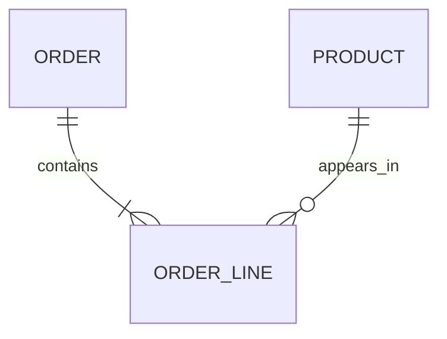
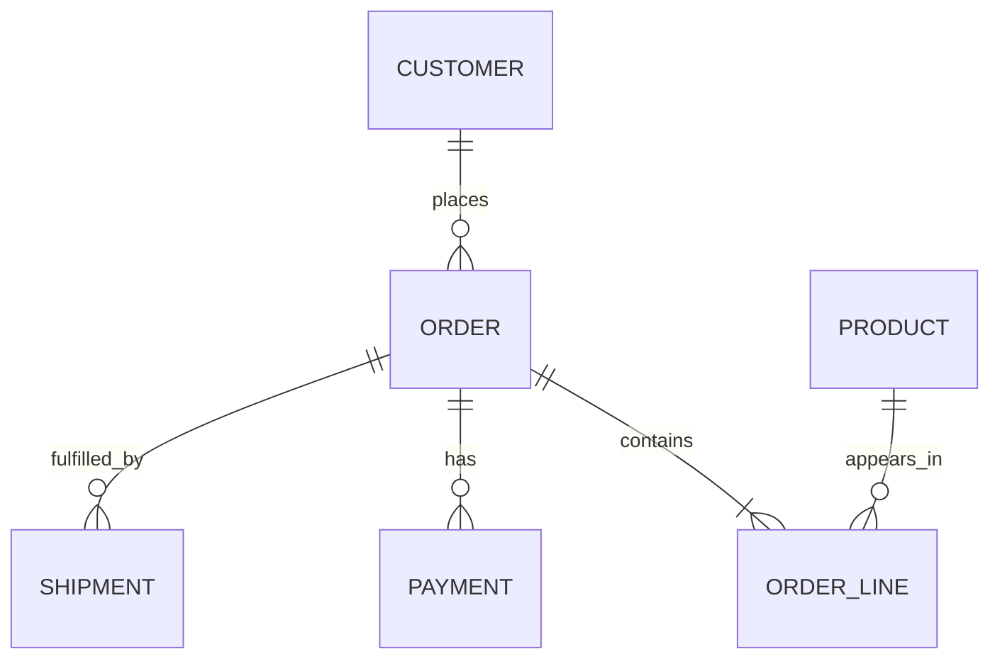
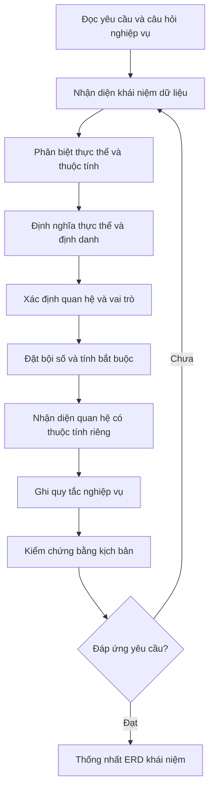

# Biểu diễn thực thể và quan hệ bằng sơ đồ ER

Mô hình thực thể – quan hệ (Entity–Relationship, ER) là cách mô tả các khái niệm dữ liệu quan trọng của một miền nghiệp vụ và cách chúng liên hệ với nhau. Sơ đồ ER giúp nhóm nghiệp vụ, phân tích và phát triển cùng nhìn vào một bức tranh: hệ thống cần quản lý những đối tượng nào, mỗi đối tượng có đặc điểm gì, các đối tượng tham gia vào quan hệ nào và quy tắc nào chi phối những quan hệ đó.

Ở mức khái niệm, mục tiêu là diễn đạt đúng ngữ nghĩa nghiệp vụ. Sơ đồ chưa cần quyết định bảng, kiểu dữ liệu, tên cột, chỉ mục hay cú pháp của một hệ quản trị cơ sở dữ liệu cụ thể. Những quyết định đó thuộc các bước mô hình logic và vật lý. Một ERD tốt phải đủ rõ để người đọc kiểm tra được bằng ví dụ thực tế và đủ độc lập với công nghệ để có thể chuyển thành nhiều phương án triển khai.

## 1. Mô hình ER dùng để trả lời câu hỏi nào?

Khi phân tích một hệ thống, nhóm cần trả lời:

- Hệ thống phải ghi nhận những loại đối tượng nghiệp vụ nào?
- Mỗi loại đối tượng có danh tính riêng hay chỉ là một đặc điểm của đối tượng khác?
- Một đối tượng có thể liên kết với bao nhiêu đối tượng ở phía bên kia?
- Quan hệ có bắt buộc hay có thể không tồn tại?
- Quan hệ có thông tin riêng như thời điểm, vai trò, số lượng hoặc trạng thái không?
- Có đối tượng nào phụ thuộc vào đối tượng khác để tồn tại hoặc được nhận diện không?
- Những quy tắc nào phải luôn đúng trong mọi trạng thái hợp lệ của dữ liệu?

ERD làm rõ cấu trúc và ngữ nghĩa của dữ liệu. Nó không tự mô tả đầy đủ quy trình, quyền truy cập, giao thức tích hợp, hành vi giao diện hoặc toàn bộ quy tắc chuyển trạng thái. Những nội dung này cần được ghi trong yêu cầu và quy tắc nghiệp vụ, sau đó liên kết với các thành phần trên sơ đồ.

### 1.1. Ba mức mô hình cần phân biệt

| Mức | Mục tiêu | Nội dung thường thể hiện |
|---|---|---|
| Khái niệm (conceptual) | Thống nhất cách hiểu về miền nghiệp vụ | Thực thể, quan hệ, thuộc tính có ý nghĩa nghiệp vụ, quy tắc và bội số |
| Logic (logical) | Mô tả cấu trúc dữ liệu chi tiết và nhất quán | Thuộc tính chi tiết, định danh, khóa ứng viên, chuẩn hóa, kiểu quan hệ và ràng buộc logic |
| Vật lý (physical) | Triển khai trên công nghệ lưu trữ cụ thể | Bảng hoặc collection, kiểu dữ liệu, khóa chính/ngoại, chỉ mục, phân vùng và lựa chọn lưu trữ |

Ví dụ, ở mức khái niệm có thể ghi “Khách hàng đặt Đơn hàng”. Ở mức logic, nhóm xác định thuộc tính định danh, các thuộc tính mô tả và cách biểu diễn quan hệ. Ở mức vật lý, nhóm quyết định bảng `customer`, bảng `orders`, kiểu cột và chỉ mục phù hợp với hệ quản trị được chọn.

Không nên đưa quá sớm tên bảng, kiểu `VARCHAR`, `UUID`, tên khóa ngoại hoặc tên chỉ mục vào sơ đồ khái niệm. Các chi tiết đó dễ khiến người xem tập trung vào cách cài đặt trước khi thống nhất ý nghĩa dữ liệu.

## 2. Thực thể và kiểu thực thể

### 2.1. Thực thể là gì?

Thực thể (entity) là một đối tượng hoặc khái niệm trong miền nghiệp vụ mà tổ chức cần nhận diện và quản lý như một cá thể riêng. Ví dụ trong hệ thống bán hàng:

- Một khách hàng cụ thể.
- Một sản phẩm cụ thể.
- Một đơn hàng cụ thể.
- Một kho cụ thể.
- Một giao dịch thanh toán cụ thể.

Kiểu thực thể (entity type) mô tả một nhóm các cá thể có cùng ý nghĩa và đặc điểm chung. “Khách hàng” là kiểu thực thể; “khách hàng có mã KH-1001” là một cá thể thuộc kiểu đó.

Một khái niệm thường đáng được mô hình hóa thành thực thể khi có một hoặc nhiều đặc điểm sau:

- Có danh tính cần phân biệt với các cá thể khác.
- Có nhiều thuộc tính cần quản lý.
- Có vòng đời hoặc trạng thái riêng.
- Được nhiều quy trình hoặc đối tượng khác tham chiếu.
- Có quan hệ riêng với các khái niệm khác.
- Cần lưu lịch sử, kiểm toán hoặc quản lý quyền truy cập riêng.

Không phải mọi danh từ trong tài liệu yêu cầu đều là thực thể. “Màu đỏ” có thể chỉ là giá trị của thuộc tính màu sắc. “Địa chỉ” có thể là một nhóm thuộc tính của khách hàng, hoặc là một thực thể riêng nếu địa chỉ được dùng chung, xác minh, gắn nhãn và quản lý vòng đời độc lập. Quyết định phụ thuộc vào quy tắc nghiệp vụ.

### 2.2. Phân biệt thực thể với thuộc tính

Hãy tự hỏi liệu khái niệm đó có cần được nhận diện và quản lý độc lập hay không.

| Khái niệm | Có thể là thuộc tính khi… | Có thể là thực thể khi… |
|---|---|---|
| Địa chỉ | Chỉ là thông tin mô tả của một hồ sơ | Có mã riêng, được xác minh, dùng chung hoặc có lịch sử |
| Danh mục sản phẩm | Chỉ là một nhãn đơn giản | Có phân cấp, người quản lý, quy tắc hiệu lực và quan hệ riêng |
| Phương thức thanh toán | Chỉ lưu một giá trị lựa chọn cố định | Cần quản lý cấu hình, nhà cung cấp, trạng thái và điều kiện áp dụng |
| Số điện thoại | Một giá trị liên hệ đơn giản | Cần xác minh, lịch sử, trạng thái hoặc gắn nhiều chủ thể |
| Vai trò nhân viên | Chỉ là một nhãn mô tả | Có quyền hạn, phạm vi và quy trình gán vai trò riêng |

Việc nâng một thuộc tính thành thực thể thường làm mô hình rõ hơn khi nó có nhiều quan hệ hoặc vòng đời riêng. Tuy nhiên, tạo thực thể cho mọi giá trị nhỏ sẽ khiến mô hình rườm rà mà không đem lại lợi ích nghiệp vụ.

### 2.3. Thực thể mạnh và thực thể yếu

Thực thể mạnh (strong entity) có thể được nhận diện bằng định danh của chính nó theo quy tắc nghiệp vụ. Ví dụ, sản phẩm có mã sản phẩm riêng.

Thực thể yếu (weak entity) không thể được nhận diện đầy đủ chỉ bằng một định danh độc lập trong phạm vi nghiệp vụ; nó được nhận diện dựa vào thực thể chủ sở hữu cùng với một phần định danh cục bộ. Ví dụ, một dòng hàng được đánh số 1, 2, 3 trong phạm vi một đơn hàng. Số dòng chỉ có ý nghĩa khi đi cùng đơn hàng tương ứng.

Thực thể yếu thường có các đặc điểm:

- Sự tồn tại phụ thuộc vào một thực thể chủ.
- Không có định danh đầy đủ độc lập trong phạm vi nghiệp vụ.
- Có thuộc tính định danh bộ phận (partial key), chỉ duy nhất trong phạm vi chủ sở hữu.
- Có quan hệ nhận dạng (identifying relationship) với thực thể chủ.

Trong mô hình logic, dòng hàng có thể được nhận diện bằng cặp định danh đơn hàng và số thứ tự dòng, hoặc bằng một mã riêng do hệ thống tạo. Dù cách triển khai nào được chọn, ở mức khái niệm cần thể hiện rằng dòng hàng thuộc về một đơn hàng và không có ý nghĩa độc lập nếu thiếu đơn hàng đó.

Không nên gọi một thực thể là yếu chỉ vì nó có khóa ngoại hoặc được tạo từ một quan hệ nhiều nhiều. Tiêu chí cốt lõi là sự phụ thuộc về định danh và ý nghĩa nghiệp vụ.

## 3. Thuộc tính của thực thể

Thuộc tính (attribute) mô tả một đặc điểm cần biết của thực thể hoặc của quan hệ. Ví dụ, khách hàng có tên hiển thị, ngày đăng ký và thông tin liên hệ; dòng hàng có số lượng và đơn giá tại thời điểm mua.

### 3.1. Các loại thuộc tính thường gặp

| Loại thuộc tính | Ý nghĩa | Ví dụ |
|---|---|---|
| Đơn (simple) | Không cần tách thành các thành phần nhỏ hơn trong ngữ cảnh mô hình | Mã đơn hàng, số lượng |
| Phức hợp (composite) | Có thể phân rã thành các thành phần có ý nghĩa | Địa chỉ gồm số nhà, đường, phường, tỉnh/thành phố |
| Đơn trị (single-valued) | Mỗi cá thể có một giá trị tại một thời điểm theo quy tắc nghiệp vụ | Ngày tạo đơn |
| Đa trị (multivalued) | Một cá thể có thể có nhiều giá trị | Một khách hàng có nhiều số liên hệ |
| Dẫn xuất (derived) | Có thể tính từ dữ liệu khác theo một quy tắc | Tuổi tính từ ngày sinh tại một thời điểm |
| Tùy chọn (optional) | Có thể chưa có giá trị hợp lệ | Ngày khách hàng xác minh email |
| Định danh (identifier) | Giúp phân biệt một cá thể với cá thể khác | Mã khách hàng duy nhất |

Các loại trên mô tả những khía cạnh khác nhau và có thể cùng áp dụng cho một thuộc tính. Chẳng hạn địa chỉ có thể là thuộc tính phức hợp, đơn trị tại một vai trò cụ thể nhưng tùy chọn đối với hồ sơ khách hàng mới.

### 3.2. Thuộc tính phức hợp

Một thuộc tính phức hợp có thể được chia thành các thành phần nhỏ hơn có ý nghĩa riêng. Ví dụ, địa chỉ giao hàng có thể gồm:

- Người nhận.
- Số nhà và tên đường.
- Phường hoặc xã.
- Quận hoặc huyện.
- Tỉnh hoặc thành phố.
- Mã bưu chính và quốc gia.

Việc phân rã hữu ích khi nghiệp vụ cần tìm kiếm, xác thực, chuẩn hóa, phân vùng giao hàng hoặc báo cáo theo từng thành phần. Nếu hệ thống chỉ hiển thị nguyên văn một dòng địa chỉ và không có nhu cầu xử lý từng phần, có thể giữ nó như một giá trị đơn giản ở mức phù hợp.

Không nên phân rã chỉ vì có thể phân rã về mặt ngôn ngữ. Cần dựa vào câu hỏi nghiệp vụ và quy tắc sử dụng dữ liệu.

### 3.3. Thuộc tính đa trị

Thuộc tính đa trị là thuộc tính có thể có nhiều giá trị cho một cá thể. Ví dụ, một khách hàng có thể có nhiều số điện thoại hoặc một sản phẩm có nhiều hình ảnh.

Ở mức khái niệm, có thể thể hiện thuộc tính đa trị để ghi nhận đúng nhu cầu. Khi chuyển sang mô hình logic quan hệ, thuộc tính này thường được tách thành thực thể hoặc quan hệ riêng nếu cần quản lý từng giá trị, gắn thêm thông tin, kiểm soát trùng lặp hoặc truy vấn độc lập.

Hãy hỏi:

- Có giới hạn số lượng giá trị không?
- Mỗi giá trị có loại, trạng thái, nhãn hoặc thời gian hiệu lực riêng không?
- Có thể dùng cùng một giá trị cho nhiều thực thể không?
- Có cần đánh dấu giá trị chính hoặc mặc định không?
- Có cần lưu lịch sử thay đổi từng giá trị không?

### 3.4. Thuộc tính dẫn xuất

Thuộc tính dẫn xuất có thể tính từ các thuộc tính khác. Ví dụ, tổng tiền đơn hàng có thể được tính từ các dòng hàng, chiết khấu, thuế và phí vận chuyển theo quy tắc đã xác định.

Không phải giá trị dẫn xuất nào cũng nên lưu vật lý. Ở mức khái niệm, cần ghi nguồn dữ liệu và công thức nghiệp vụ. Khi thiết kế logic hoặc vật lý, nhóm đánh giá có cần lưu bản chụp, cache hoặc dữ liệu tổng hợp vì hiệu năng, kiểm toán hoặc yêu cầu lịch sử hay không.

Ví dụ, tuổi là giá trị dẫn xuất từ ngày sinh và ngày tham chiếu. Nếu lưu tuổi cố định, dữ liệu sẽ lỗi thời theo thời gian. Trong khi đó, tổng tiền tại thời điểm xác nhận đơn có thể cần được bảo toàn như một giá trị giao dịch để hóa đơn cũ không thay đổi khi quy tắc giá hiện tại được cập nhật.

### 3.5. Định danh và khóa ứng viên

Định danh là thuộc tính hoặc tập thuộc tính dùng để phân biệt các cá thể trong một kiểu thực thể. Một kiểu thực thể có thể có nhiều cách nhận diện hợp lệ.

Ví dụ với khách hàng:

- Mã khách hàng do hệ thống cấp.
- Mã khách hàng từ một hệ thống nguồn, nếu duy nhất và ổn định trong phạm vi xác định.
- Một định danh nghiệp vụ khác đã được xác minh là duy nhất theo quy tắc tổ chức.

Ở mức khái niệm, cần ghi nhận quy tắc định danh và phạm vi duy nhất. Chưa cần quyết định dùng số tự tăng, UUID hay kiểu cột nào. Những lựa chọn đó thuộc bước thiết kế logic và vật lý.

Một thuộc tính không nên được xem là định danh chỉ vì hiện tại các giá trị tình cờ không trùng. Cần xác nhận rằng nghiệp vụ bảo đảm tính duy nhất, ổn định và không thay đổi ngoài quy trình được kiểm soát.

## 4. Quan hệ giữa các thực thể

Quan hệ (relationship) mô tả cách các thực thể tham gia cùng một sự kiện, vai trò hoặc quy tắc nghiệp vụ. Ví dụ:

- Khách hàng đặt đơn hàng.
- Đơn hàng chứa dòng hàng.
- Dòng hàng tham chiếu sản phẩm.
- Nhân viên xử lý đơn hàng.
- Giao dịch thanh toán thuộc đơn hàng.

Tên quan hệ nên dùng động từ hoặc cụm động từ thể hiện đúng ý nghĩa nghiệp vụ. “Có” hoặc “liên kết với” thường quá chung chung; “đặt”, “thuộc”, “phê duyệt”, “giao cho” hoặc “được phân công cho” giúp người đọc hiểu vai trò hai phía.

### 4.1. Bậc của quan hệ

Bậc (degree) là số kiểu thực thể tham gia vào một quan hệ.

| Bậc | Ý nghĩa | Ví dụ |
|---|---|---|
| Đệ quy / đơn nguyên (unary) | Một kiểu thực thể liên hệ với chính nó | Nhân viên quản lý nhân viên khác |
| Nhị nguyên (binary) | Hai kiểu thực thể tham gia | Khách hàng đặt đơn hàng |
| Tam nguyên (ternary) | Ba kiểu thực thể tham gia cùng một quan hệ | Nhà cung cấp cung cấp sản phẩm cho một kho cụ thể |
| Bậc cao hơn | Nhiều hơn ba kiểu thực thể tham gia | Một quy tắc nghiệp vụ gắn đồng thời nhiều vai trò và đối tượng |

Quan hệ nhị nguyên phổ biến vì dễ hiểu và dễ biểu diễn. Tuy nhiên, không nên tách một quan hệ tam nguyên thành nhiều quan hệ nhị nguyên nếu việc tách làm mất ngữ nghĩa của tổ hợp.

Ví dụ, “nhà cung cấp cung cấp sản phẩm cho kho” cần giữ được bộ ba nhà cung cấp, sản phẩm và kho. Nếu chỉ có quan hệ nhà cung cấp–sản phẩm và nhà cung cấp–kho, mô hình không nhất thiết cho biết sản phẩm cụ thể nào được nhà cung cấp đó đưa vào kho cụ thể nào.

### 4.2. Quan hệ đệ quy

Quan hệ đệ quy xảy ra khi các cá thể của cùng một kiểu thực thể liên hệ với nhau. Ví dụ, một nhân viên quản lý nhiều nhân viên khác.

Khi mô hình hóa, cần đặt tên vai trò cho hai phía để tránh mơ hồ:

- Nhân viên ở vai trò người quản lý.
- Nhân viên ở vai trò người được quản lý.

Một nhân viên có thể quản lý nhiều nhân viên, trong khi mỗi nhân viên có tối đa một quản lý trực tiếp. Nhưng nhân viên đứng đầu tổ chức có thể không có quản lý. Đây là quy tắc bội số và tính bắt buộc cần thể hiện rõ.

Quan hệ đệ quy khác với việc một thực thể có thuộc tính `manager_name`. Quan hệ có danh tính, bội số và ràng buộc tham chiếu giữa các cá thể; nó có thể được truy vấn theo nhiều cấp hoặc dùng để kiểm tra cấu trúc tổ chức.

### 4.3. Quan hệ có thuộc tính riêng

Một quan hệ có thể mang dữ liệu riêng. Ví dụ, nhân viên được phân công vào dự án có vai trò, ngày bắt đầu, ngày kết thúc và tỷ lệ thời gian tham gia. Các thông tin này mô tả lần phân công giữa nhân viên và dự án, không chỉ mô tả riêng nhân viên hoặc riêng dự án.

Khi quan hệ có thuộc tính quan trọng, cần xem xét mô hình hóa nó như một thực thể kết hợp (associative entity) ở mức logic. Ví dụ `Phân công` liên kết `Nhân viên` và `Dự án`, đồng thời giữ vai trò và thời hạn của lần phân công.

## 5. Bội số và tính bắt buộc của quan hệ

Hai câu hỏi quan trọng khi đọc một quan hệ:

- **Bội số (cardinality):** Một cá thể ở phía này có thể liên hệ với bao nhiêu cá thể ở phía kia?
- **Tính tham gia (participation / optionality):** Một cá thể có bắt buộc phải tham gia quan hệ hay không?

### 5.1. Các dạng quan hệ phổ biến

| Dạng | Diễn giải | Ví dụ |
|---|---|---|
| Một – một (1:1) | Mỗi cá thể phía A liên kết tối đa một cá thể phía B và ngược lại | Một hồ sơ nhân viên có một tài khoản nội bộ, nếu quy tắc tổ chức bảo đảm điều đó |
| Một – nhiều (1:N) | Một cá thể A có thể liên kết với nhiều cá thể B; mỗi B thuộc tối đa một A | Một khách hàng đặt nhiều đơn hàng |
| Nhiều – nhiều (M:N) | Một cá thể A có thể liên kết với nhiều B và một B cũng có thể liên kết với nhiều A | Một đơn hàng có nhiều sản phẩm; một sản phẩm xuất hiện trong nhiều đơn |

Các mô tả “một” và “nhiều” chưa nói rõ quan hệ có bắt buộc hay không. Ví dụ, một khách hàng có thể chưa từng đặt đơn; một đơn hàng đã được tạo phải thuộc về đúng một khách hàng trong mô hình đang xét. Cần ghi rõ hai phía.

### 5.2. Bội số tối thiểu và tối đa

Cách diễn đạt min–max giúp tránh hiểu nhầm:

- `0..1`: không có hoặc có tối đa một.
- `1..1`: bắt buộc có đúng một.
- `0..N`: có thể không có hoặc có nhiều.
- `1..N`: bắt buộc có ít nhất một và có thể có nhiều.

Ví dụ với quan hệ khách hàng đặt đơn hàng:

| Phía được xét | Bội số | Ý nghĩa |
|---|---:|---|
| Đơn hàng → Khách hàng | 1..1 | Mỗi đơn hàng thuộc đúng một khách hàng trong phạm vi mô hình này |
| Khách hàng → Đơn hàng | 0..N | Khách hàng có thể chưa đặt đơn hoặc đã đặt nhiều đơn |

Nếu hệ thống cho phép khách vãng lai, quy tắc trên cần được điều chỉnh. Có thể có khái niệm người mua chưa đăng ký, hồ sơ mua hàng hoặc một kiểu khách hàng tổng quát hơn. Không nên ép mọi đơn hàng phải thuộc một tài khoản đã đăng ký nếu nghiệp vụ không bảo đảm điều đó.

### 5.3. Ký pháp Crow’s Foot

Ký pháp Crow’s Foot thường dùng trên ERD để biểu diễn số lượng tối thiểu và tối đa bằng các dấu ở đầu đường quan hệ:

| Ký hiệu ở đầu quan hệ | Ý nghĩa |
|---|---|
| `||` | Chính xác một |
| `o|` | Không hoặc một |
| `|{` | Một hoặc nhiều |
| `o{` | Không hoặc nhiều |

Khi đọc đường quan hệ, hãy đọc từ mỗi thực thể sang phía bên kia theo ký hiệu đặt ở đầu phía bên kia. Ví dụ `CUSTOMER ||--o{ ORDER` có nghĩa một khách hàng có thể có không hoặc nhiều đơn hàng, và mỗi đơn hàng thuộc chính xác một khách hàng.

Ký pháp khác có thể dùng vòng tròn, gạch và chân quạ với cách trình bày hơi khác. Khi chia sẻ sơ đồ, nên ghi chú rõ quy ước và không trộn ký pháp giữa các công cụ.

## 6. Quan hệ nhiều – nhiều và thực thể kết hợp

Quan hệ nhiều – nhiều thường cần được phân tích kỹ vì nó có thể mang thông tin riêng và ảnh hưởng đến cách triển khai mô hình logic.

Ví dụ, một đơn hàng chứa nhiều sản phẩm và một sản phẩm có thể xuất hiện trong nhiều đơn hàng. Quan hệ `Đơn hàng – Sản phẩm` có các thuộc tính:

- Số lượng sản phẩm trong đơn.
- Đơn giá tại thời điểm mua.
- Mức giảm giá của dòng hàng.
- Ghi chú hoặc trạng thái xử lý riêng của dòng.

Những thuộc tính này không thuộc riêng đơn hàng vì một đơn có nhiều dòng với giá trị khác nhau. Chúng cũng không thuộc riêng sản phẩm vì cùng một sản phẩm có thể được bán với số lượng và giá khác nhau trong các đơn khác nhau.

Do đó, mô hình khái niệm nên đưa `Dòng hàng` thành một khái niệm trung gian:

Mỗi dòng hàng thuộc đúng một đơn hàng và tham chiếu một sản phẩm. Một đơn hàng có ít nhất một dòng hàng trong mô hình đã xác nhận; một sản phẩm có thể chưa xuất hiện trong dòng hàng nào hoặc xuất hiện trong nhiều dòng.

Thực thể kết hợp còn hữu ích trong các trường hợp:

- Học viên đăng ký khóa học: quan hệ đăng ký có ngày đăng ký, điểm và trạng thái.
- Nhân viên tham gia dự án: quan hệ phân công có vai trò, thời lượng và tỷ lệ tham gia.
- Bác sĩ làm việc tại cơ sở y tế: quan hệ công tác có chuyên khoa, lịch trực và thời gian hiệu lực.
- Sản phẩm được nhà cung cấp chào giá: quan hệ chào giá có giá, số lượng tối thiểu và thời hạn hiệu lực.

Một thực thể kết hợp thường có định danh riêng hoặc định danh được hình thành từ các phía tham gia cùng một phần định danh. Cách chọn khóa cụ thể sẽ được xác định ở mô hình logic.

## 7. Quan hệ nhận dạng và phụ thuộc tồn tại

Một số thực thể chỉ có ý nghĩa khi gắn với thực thể chủ. Dòng hàng là ví dụ điển hình: số thứ tự dòng chỉ duy nhất trong phạm vi đơn hàng, và dòng hàng không thể tồn tại nếu đơn hàng bị xóa theo quy tắc nghiệp vụ.

Khi mô hình hóa loại quan hệ này, hãy xác định:

- Thực thể chủ là gì?
- Thực thể phụ thuộc có thể được nhận diện độc lập hay không?
- Một chủ thể có thể có bao nhiêu thực thể phụ thuộc?
- Thực thể phụ thuộc có bắt buộc thuộc về đúng một chủ thể không?
- Khi chủ thể kết thúc hoặc bị hủy, dữ liệu phụ thuộc phải được giữ, chuyển trạng thái hay xóa theo chính sách nào?

Phụ thuộc tồn tại không đồng nghĩa với việc luôn xóa vật lý dữ liệu con khi dữ liệu cha bị xóa. Trong hệ thống tài chính, đơn hàng có thể bị hủy nhưng vẫn phải giữ dòng hàng và lịch sử giao dịch để kiểm toán. Quy tắc vòng đời cần được làm rõ trước khi quyết định hành vi lưu trữ.

## 8. Từ yêu cầu nghiệp vụ đến ERD

Có thể thực hiện theo một quy trình lặp gồm các bước sau.

### Bước 1: Xác định phạm vi và câu hỏi cần trả lời

Chọn một quy trình hoặc nhóm nghiệp vụ đủ rõ, xác định người sử dụng và các câu hỏi dữ liệu quan trọng. Ví dụ, phạm vi đầu tiên là tiếp nhận và xử lý đơn hàng, chưa bao gồm quản lý chiến dịch marketing.

### Bước 2: Tìm các khái niệm nghiệp vụ

Đọc yêu cầu, quy trình, biểu mẫu và báo cáo để tìm các danh từ có ý nghĩa. Đánh dấu các ứng viên như khách hàng, đơn hàng, dòng hàng, sản phẩm, kho, giao dịch thanh toán.

Không biến mọi danh từ thành thực thể. Với từng ứng viên, hỏi nó có danh tính, vòng đời, thuộc tính hoặc quan hệ riêng hay không. Một từ có thể là thuộc tính trong phạm vi này nhưng là thực thể trong phạm vi khác.

### Bước 3: Xác định ý nghĩa và ranh giới của từng thực thể

Viết định nghĩa một câu cho mỗi kiểu thực thể. Ví dụ:

- **Đơn hàng:** yêu cầu mua hàng đã được hệ thống tiếp nhận và theo dõi qua vòng đời xử lý.
- **Dòng hàng:** một mục sản phẩm và số lượng được ghi nhận trong một đơn hàng.
- **Giao dịch thanh toán:** một lần yêu cầu hoặc ghi nhận thanh toán có định danh và kết quả riêng.

Định nghĩa phải giúp phân biệt các khái niệm dễ nhầm lẫn. Đơn hàng không đồng nhất với giao dịch thanh toán; trạng thái đơn không nhất thiết giống trạng thái thanh toán.

### Bước 4: Xác định thuộc tính và định danh

Với mỗi thực thể, liệt kê các thuộc tính cần thiết để trả lời câu hỏi nghiệp vụ. Phân loại thuộc tính đơn, phức hợp, đa trị, dẫn xuất và tùy chọn. Xác định quy tắc định danh, phạm vi duy nhất và độ ổn định.

Chỉ thêm thuộc tính có ý nghĩa nghiệp vụ hoặc cần cho truy vết, không thêm trường kỹ thuật như `created_at`, `updated_at`, `version` vào sơ đồ khái niệm chỉ vì framework thường tạo chúng. Những trường này có thể cần ở mô hình logic hoặc vật lý sau khi thống nhất yêu cầu vận hành.

### Bước 5: Xác định quan hệ và vai trò

Đặt tên quan hệ bằng động từ rõ nghĩa. Xác định bậc của quan hệ, vai trò của từng phía và thuộc tính thuộc về quan hệ. Với quan hệ đệ quy, đặt tên vai trò riêng cho mỗi đầu.

### Bước 6: Xác định bội số và tính bắt buộc

Đặt câu hỏi cho từng phía: một cá thể có thể liên kết với bao nhiêu cá thể ở phía kia? Có thể không có quan hệ hay bắt buộc phải có ít nhất một? Ghi min–max và đối chiếu với các ví dụ thực tế.

### Bước 7: Ghi quy tắc nghiệp vụ

Mô tả các quy tắc không thể hiện đầy đủ bằng đường nối trên sơ đồ, chẳng hạn:

- Một đơn hàng không thể có tổng số lượng dòng hàng bằng không sau khi được xác nhận.
- Tổng tiền phải được tính theo giá trị giao dịch tại thời điểm đặt hàng.
- Một giao dịch thanh toán từ cùng nhà cung cấp không được ghi nhận hai lần.
- Một nhân viên chỉ có một quản lý trực tiếp tại cùng thời điểm, trừ các trường hợp được phê duyệt.

### Bước 8: Kiểm chứng bằng kịch bản

Chọn các cá thể và tình huống cụ thể để thử sơ đồ: khách hàng chưa đặt đơn, đơn có nhiều dòng, sản phẩm chưa từng được bán, đơn thanh toán nhiều lần, nhân viên chuyển quản lý, địa chỉ thay đổi sau khi đặt hàng. Nếu sơ đồ không thể diễn đạt hoặc giải thích tình huống, cần xem lại định nghĩa, quan hệ hoặc ràng buộc.

### Bước 9: Đối chiếu với yêu cầu và thống nhất

Kiểm tra từng câu hỏi nghiệp vụ có dữ liệu và quan hệ để trả lời hay chưa. Kiểm tra thực thể nào không phục vụ yêu cầu nào, thực thể nào bị thiếu, và các bên liên quan có hiểu cùng một nghĩa của thuật ngữ không.

## 9. Ví dụ tổng hợp: ERD cho cửa hàng trực tuyến

Giả sử cửa hàng cần tiếp nhận đơn hàng, quản lý sản phẩm, ghi nhận thanh toán và theo dõi giao hàng. Các câu hỏi chính:

1. Khách hàng nào đã đặt đơn nào?
2. Một đơn có những sản phẩm và số lượng nào?
3. Giá của từng sản phẩm tại thời điểm đặt hàng là bao nhiêu?
4. Một đơn có thể có bao nhiêu lần thanh toán?
5. Đơn được giao theo kiện nào và trạng thái từng kiện ra sao?

### 9.1. Danh sách thực thể và định nghĩa

| Thực thể | Định nghĩa | Một số thuộc tính nghiệp vụ |
|---|---|---|
| Khách hàng | Cá nhân hoặc tổ chức mua hàng | Mã khách hàng, tên, thông tin liên hệ |
| Đơn hàng | Yêu cầu mua hàng được tiếp nhận | Mã đơn, thời điểm đặt, trạng thái đơn |
| Dòng hàng | Một mục sản phẩm trong đơn hàng | Số dòng, số lượng, đơn giá lúc mua, chiết khấu |
| Sản phẩm | Mặt hàng có thể được bán | Mã sản phẩm, tên, mô tả, trạng thái kinh doanh |
| Thanh toán | Một giao dịch thanh toán liên quan đến đơn | Mã tham chiếu, số tiền, thời điểm, trạng thái |
| Kiện giao hàng | Một đơn vị hàng hóa được bàn giao vận chuyển | Mã kiện, mã vận đơn, thời điểm bàn giao, trạng thái |

### 9.2. Sơ đồ ER khái niệm

Diễn giải:

- Một khách hàng có thể chưa đặt đơn hoặc đặt nhiều đơn; mỗi đơn thuộc một khách hàng theo phạm vi ví dụ này.
- Một đơn đã được xác nhận có ít nhất một dòng hàng; mỗi dòng hàng thuộc đúng một đơn.
- Một sản phẩm có thể chưa được bán hoặc xuất hiện trong nhiều dòng hàng; mỗi dòng hàng tham chiếu một sản phẩm.
- Một đơn có thể chưa thanh toán, thanh toán nhiều lần hoặc có giao dịch hoàn tiền được quản lý theo quy tắc riêng; sơ đồ cần phân biệt rõ loại giao dịch nếu nghiệp vụ yêu cầu.
- Một đơn có thể chưa được giao hoặc được thực hiện qua nhiều kiện giao hàng; mỗi kiện trong ví dụ thuộc một đơn.

Sơ đồ là mô hình khái niệm giản lược. Nếu một kiện có thể chứa hàng từ nhiều đơn, hoặc một đơn được giao bởi nhiều nhà vận chuyển, quan hệ giao hàng cần được mở rộng theo quy trình thực tế.

### 9.3. Vì sao cần Dòng hàng?

Nếu chỉ nối Đơn hàng với Sản phẩm, ta biết sản phẩm nào xuất hiện trong đơn nhưng không biết số lượng, đơn giá và chiết khấu của từng lần mua. Các thuộc tính này thuộc về quan hệ giữa đơn và sản phẩm. Vì vậy, `Dòng hàng` được mô hình hóa như thực thể kết hợp.

Điều này còn giúp lưu nhiều dòng cho cùng một sản phẩm khi nghiệp vụ cần tách theo lô, mức giá, chương trình khuyến mại hoặc cách xử lý. Quy tắc có cho phép lặp sản phẩm trong một đơn hay không cần được xác nhận riêng.

### 9.4. Những quy tắc chưa thể suy ra chỉ từ sơ đồ

Sơ đồ chưa tự trả lời các câu hỏi:

- Khách vãng lai có được đặt đơn không?
- Đơn hàng có thể tồn tại khi chưa có dòng hàng ở trạng thái bản nháp không?
- Một đơn có thể có nhiều giao dịch thanh toán đang chờ không?
- Hoàn tiền là một loại giao dịch thanh toán hay một khái niệm nghiệp vụ riêng?
- Một kiện giao hàng có thể chứa hàng từ nhiều đơn không?
- Địa chỉ giao hàng được lưu như bản chụp trên đơn hay tham chiếu đến địa chỉ hồ sơ hiện tại?
- Khi sản phẩm ngừng kinh doanh, dòng hàng lịch sử có còn tham chiếu được sản phẩm đó không?

Những câu hỏi này cần được ghi thành quy tắc nghiệp vụ hoặc yêu cầu bổ sung. Không nên để người đọc tự suy diễn từ đường nối ERD.

## 10. Chọn ký pháp và trình bày sơ đồ

Có nhiều cách biểu diễn ERD. Ký pháp nên được chọn theo đối tượng đọc, mức độ chi tiết và công cụ sử dụng.

### 10.1. Ký pháp Chen

Ký pháp Chen thường biểu diễn:

- Thực thể bằng hình chữ nhật.
- Quan hệ bằng hình thoi.
- Thuộc tính bằng hình elip.
- Thuộc tính định danh được gạch chân.
- Quan hệ hoặc thực thể yếu có ký hiệu riêng.

Chen hữu ích trong giảng dạy và thảo luận khái niệm vì phân biệt trực quan thực thể, quan hệ và thuộc tính. Tuy nhiên, sơ đồ có thể lớn khi hệ thống có nhiều thuộc tính.

### 10.2. Ký pháp Crow’s Foot

Crow’s Foot thường biểu diễn thực thể bằng khung hộp và quan hệ bằng đường nối có ký hiệu bội số ở hai đầu. Ký pháp này gọn, dễ dùng khi mô hình có nhiều thực thể và thường được sử dụng trong thiết kế dữ liệu quan hệ.

Khi dùng Crow’s Foot ở mức khái niệm, hãy giữ tên nghiệp vụ và thuộc tính có ý nghĩa. Không cần đưa toàn bộ kiểu cột hay tên khóa ngoại vào sơ đồ.

### 10.3. Quy tắc trình bày dễ đọc

- Dùng danh từ số ít cho tên thực thể, ví dụ `Khách hàng`, `Đơn hàng`.
- Dùng động từ rõ nghĩa cho tên quan hệ, ví dụ `đặt`, `chứa`, `phê duyệt`.
- Đặt tên vai trò cho quan hệ đệ quy hoặc quan hệ có nhiều vai trò tương tự.
- Thể hiện rõ bội số và tính bắt buộc ở cả hai phía.
- Tránh đường nối chồng chéo; bố trí các thực thể theo luồng nghiệp vụ hoặc nhóm miền.
- Ghi chú quy tắc nghiệp vụ không thể hiện rõ bằng ký pháp.
- Dùng từ vựng nhất quán với tài liệu yêu cầu và glossary của dự án.
- Ghi rõ phạm vi và phiên bản sơ đồ để tránh dùng nhầm bản cũ.

Một sơ đồ đẹp nhưng thiếu bội số hoặc dùng tên mơ hồ vẫn là sơ đồ chưa đủ chất lượng. Ưu tiên tính đúng và khả năng kiểm chứng trước tính trang trí.

## 11. Kiểm chứng ERD

ERD cần được kiểm tra với người hiểu nghiệp vụ và các câu hỏi dữ liệu thực tế.

### 11.1. Kiểm tra từng thực thể

- Định nghĩa thực thể có rõ và không trùng với thực thể khác không?
- Nó có danh tính hoặc lý do quản lý độc lập không?
- Thuộc tính có thuộc về đúng thực thể không?
- Có thuộc tính đa trị hoặc phức hợp bị mô tả sai không?
- Định danh có thực sự duy nhất và ổn định theo nghiệp vụ không?
- Có nhầm một giá trị danh mục với một thực thể độc lập không?

### 11.2. Kiểm tra từng quan hệ

- Tên quan hệ có mô tả đúng hành động hoặc vai trò không?
- Bậc quan hệ có đúng với quy tắc nghiệp vụ không?
- Bội số ở hai phía có được xác nhận bằng ví dụ không?
- Tính tham gia tối thiểu có được phân biệt với tối đa không?
- Quan hệ có thuộc tính riêng cần chuyển thành thực thể kết hợp không?
- Quan hệ đệ quy có tên vai trò rõ ràng không?
- Có quan hệ tam nguyên bị tách làm mất ngữ nghĩa không?

### 11.3. Kiểm tra bằng kịch bản biên

Một số tình huống thường làm lộ lỗi mô hình:

| Kịch bản | Điều cần xác minh |
|---|---|
| Khách hàng mới chưa đặt đơn | Quan hệ khách hàng–đơn có cho phép 0 đơn không? |
| Đơn hàng mới ở trạng thái bản nháp | Có thể chưa có dòng hàng không? |
| Sản phẩm chưa từng được bán | Có thể tồn tại mà không có dòng hàng không? |
| Một đơn có nhiều lần thanh toán | Quan hệ đơn–thanh toán có hỗ trợ không? |
| Một nhân viên thay đổi quản lý | Có cần lưu lịch sử quan hệ theo thời gian không? |
| Địa chỉ khách hàng thay đổi | Dữ liệu giao hàng cũ có giữ nguyên không? |
| Một sản phẩm có nhiều nhà cung cấp | Có cần quan hệ nhiều–nhiều và thuộc tính giá chào không? |

### 11.4. Đối chiếu với câu hỏi nghiệp vụ

Với mỗi câu hỏi trong tài liệu yêu cầu, chỉ ra thực thể, quan hệ và thuộc tính cần thiết để trả lời. Nếu không thể xác định đường đi dữ liệu trên sơ đồ, có thể mô hình đang thiếu một khái niệm hoặc câu hỏi chưa được định nghĩa đủ rõ.

Ngược lại, với mỗi thực thể và quan hệ, hãy hỏi nó phục vụ yêu cầu nào. Một thành phần chưa có mục đích có thể là dữ liệu không cần thiết, hoặc là một nhu cầu chưa được ghi nhận. Cần xác minh trước khi giữ hay loại bỏ.

## 12. Lỗi mô hình ER thường gặp

| Lỗi | Hệ quả | Cách sửa |
|---|---|---|
| Xem mọi danh từ là thực thể | Sơ đồ có quá nhiều đối tượng vụn vặt | Kiểm tra danh tính, vòng đời và nhu cầu quản lý độc lập |
| Gộp nhiều khái niệm khác nhau | Mất ngữ nghĩa và khó kiểm soát vòng đời | Viết định nghĩa và ranh giới riêng cho từng thực thể |
| Không ghi bội số | Không biết quan hệ một hay nhiều | Hỏi số lượng tối thiểu và tối đa ở cả hai phía |
| Nhầm bội số với tính bắt buộc | Bỏ sót trường hợp không có quan hệ | Phân biệt 0..1, 1..1, 0..N và 1..N |
| Đặt thuộc tính quan hệ vào một phía | Dữ liệu bị lặp hoặc không biểu diễn được từng lần liên kết | Tạo thực thể kết hợp khi quan hệ có thuộc tính riêng |
| Tách quan hệ tam nguyên tùy tiện | Mất thông tin về tổ hợp tham gia | Giữ quan hệ bậc cao khi ngữ nghĩa yêu cầu |
| Dùng tên quan hệ chung chung | Người đọc không hiểu vai trò nghiệp vụ | Dùng động từ và tên vai trò rõ nghĩa |
| Đưa chi tiết vật lý vào sơ đồ khái niệm | Khó thảo luận nghiệp vụ và phụ thuộc công nghệ | Tách conceptual, logical và physical model |
| Không kiểm thử tình huống biên | Mô hình chỉ đúng với luồng thuận lợi | Dùng ví dụ thật, ngoại lệ và tình huống không có quan hệ |

## 13. Checklist hoàn thành sơ đồ ER khái niệm

- [ ] Phạm vi nghiệp vụ và nhóm câu hỏi cần trả lời đã được xác định.
- [ ] Mỗi thực thể có tên và định nghĩa nghiệp vụ rõ ràng.
- [ ] Thực thể được phân biệt với thuộc tính và giá trị danh mục.
- [ ] Các thuộc tính quan trọng được gắn với đúng thực thể hoặc quan hệ.
- [ ] Thuộc tính đa trị, phức hợp và dẫn xuất được nhận diện.
- [ ] Định danh có quy tắc duy nhất và phạm vi rõ ràng.
- [ ] Quan hệ được đặt tên bằng động từ và có vai trò rõ ràng.
- [ ] Bậc quan hệ được xác định đúng, bao gồm quan hệ đệ quy hoặc tam nguyên khi cần.
- [ ] Bội số tối thiểu và tối đa được ghi ở cả hai phía.
- [ ] Quan hệ nhiều–nhiều có thuộc tính riêng đã được xem xét như thực thể kết hợp.
- [ ] Quan hệ nhận dạng và phụ thuộc tồn tại được mô tả đúng.
- [ ] Các quy tắc nghiệp vụ không thể hiện bằng đường nối đã được ghi riêng.
- [ ] ERD được kiểm chứng bằng kịch bản bình thường và kịch bản biên.
- [ ] Mỗi câu hỏi nghiệp vụ quan trọng truy vết được đến dữ liệu trên sơ đồ.
- [ ] Sơ đồ chưa bị ràng buộc sớm bởi chi tiết triển khai vật lý.

Một ERD khái niệm có giá trị khi mọi thực thể, thuộc tính và quan hệ đều có ý nghĩa nghiệp vụ, bội số được xác nhận và các câu hỏi quan trọng có thể được truy vết đến dữ liệu cần thiết. Từ nền tảng đó, nhóm mới chuyển sang mô hình logic để xác định khóa và cấu trúc chi tiết, rồi thiết kế vật lý phù hợp với công nghệ lưu trữ và tải truy vấn thực tế.
