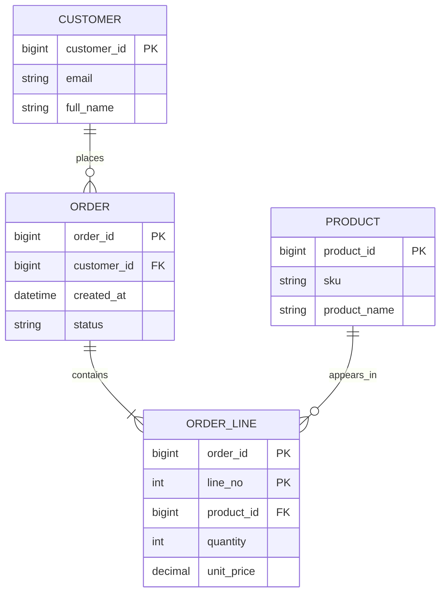
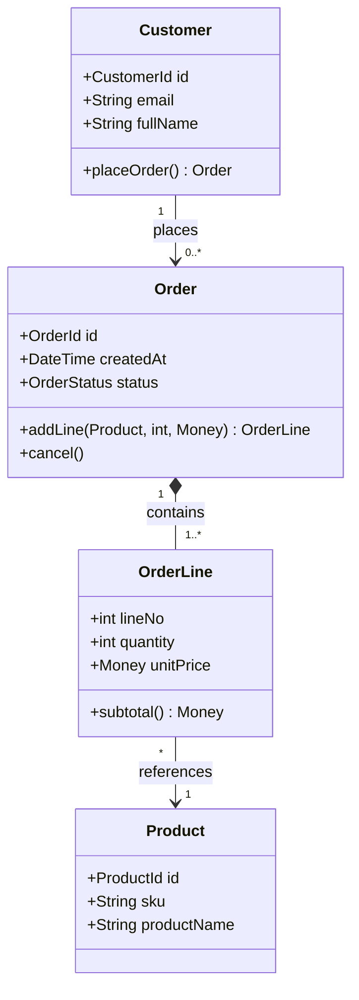

# So sánh sơ đồ ER với sơ đồ lớp UML theo mục đích sử dụng

## 1. Hai sơ đồ trả lời hai nhóm câu hỏi khác nhau

Khi phân tích một miền nghiệp vụ, nhóm thiết kế cần mô tả những khái niệm quan trọng, thuộc tính của chúng và cách chúng liên hệ với nhau. Sơ đồ ER (Entity–Relationship) và sơ đồ lớp UML (Unified Modeling Language Class Diagram) đều có thể biểu diễn cấu trúc tĩnh của miền nghiệp vụ, nhưng chúng xuất phát từ những mục đích khác nhau.

**Sơ đồ ER tập trung vào dữ liệu cần ghi nhận và các quy tắc liên kết dữ liệu.** Nó giúp trả lời: hệ thống cần lưu những loại thực thể nào, mỗi thực thể có thuộc tính gì, quan hệ giữa chúng có lực lượng và mức tham gia ra sao, thuộc tính nào định danh một thực thể?

**Sơ đồ lớp UML tập trung vào cấu trúc của các lớp và quan hệ giữa chúng trong mô hình hướng đối tượng.** Nó giúp trả lời: hệ thống có những lớp nào, mỗi lớp có trạng thái và hành vi gì, lớp nào kế thừa lớp nào, đối tượng liên kết hoặc sở hữu đối tượng khác ra sao?

Trong thiết kế dữ liệu, cả hai đều có thể hỗ trợ phân tích khái niệm. Tuy nhiên, sơ đồ ER thường là lựa chọn trực tiếp hơn khi mục tiêu chính là làm rõ cấu trúc dữ liệu và ràng buộc. Sơ đồ lớp UML hữu ích khi cần nối mô hình miền nghiệp vụ với thiết kế phần mềm hướng đối tượng, bao gồm cả trạng thái và hành vi.

Không nên hiểu rằng ER chỉ dành cho cơ sở dữ liệu quan hệ hoặc UML chỉ dành cho mã nguồn. ER có thể giúp phân tích dữ liệu cho nhiều kiểu lưu trữ; UML có thể mô tả miền nghiệp vụ mà chưa quyết định cách triển khai bằng lớp Java hay bảng cơ sở dữ liệu.

## 2. Sơ đồ ER là gì?

ER mô tả miền dữ liệu bằng ba thành phần cơ bản:

- **Thực thể (Entity):** một loại đối tượng hoặc sự việc mà nghiệp vụ cần nhận diện và lưu thông tin, ví dụ Khách hàng, Đơn hàng, Sản phẩm.
- **Thuộc tính (Attribute):** thông tin mô tả thực thể hoặc mối quan hệ, ví dụ email của khách hàng, thời điểm tạo đơn, số lượng trong dòng hàng.
- **Mối quan hệ (Relationship):** liên kết có ý nghĩa nghiệp vụ giữa các thực thể, ví dụ khách hàng đặt đơn hàng hoặc đơn hàng gồm các dòng hàng.

ER có nhiều cách ký pháp. Trong ký pháp Chen, thực thể thường được vẽ bằng hình chữ nhật, quan hệ bằng hình thoi và thuộc tính bằng hình elip. Trong ký pháp Crow's Foot, thực thể thường được biểu diễn bằng các hộp có danh sách thuộc tính; ký hiệu ở hai đầu đường nối thể hiện số lượng tối thiểu và tối đa. Các công cụ có thể dùng cách trình bày khác nhau, nhưng ý nghĩa về thực thể, thuộc tính, quan hệ và lực lượng cần nhất quán.

### 2.1. Thực thể và định danh

Một thực thể cần có cách phân biệt từng thể hiện. Ví dụ, hai khách hàng có thể trùng tên nhưng vẫn là hai khách hàng khác nhau. Mã khách hàng hoặc một định danh nghiệp vụ phù hợp giúp phân biệt họ.

Khi phân tích ở mức khái niệm, hãy xác định định danh có ý nghĩa trong nghiệp vụ và các thuộc tính có thể dùng để nhận diện. Khi chuyển sang mô hình logic, nhóm thiết kế sẽ quyết định khóa chính, khóa thay thế và các ràng buộc duy nhất cụ thể.

Không phải mọi danh từ trong tài liệu nghiệp vụ đều cần trở thành thực thể. Một khái niệm có thể chỉ là thuộc tính, giá trị phân loại hoặc thuật ngữ mô tả. Ví dụ, trạng thái đơn hàng thường là thuộc tính có miền giá trị xác định; nó chỉ nên trở thành thực thể riêng nếu nghiệp vụ cần quản lý thêm thông tin hoặc quan hệ độc lập về trạng thái.

### 2.2. Quan hệ và lực lượng

ER thể hiện số lượng thể hiện của một thực thể có thể hoặc phải liên kết với thực thể khác. Các dạng thường gặp:

- **Một-một (1:1):** mỗi A liên kết tối đa một B và mỗi B liên kết tối đa một A.
- **Một-nhiều (1:N):** một A có thể liên kết nhiều B, mỗi B liên kết với một A.
- **Nhiều-nhiều (M:N):** nhiều A có thể liên kết nhiều B.

Ngoài lực lượng, cần xác định tính bắt buộc của quan hệ. Ví dụ, một đơn hàng phải thuộc về đúng một khách hàng; một khách hàng có thể chưa đặt đơn nào hoặc đã đặt nhiều đơn. Quan hệ vì vậy có cả giới hạn tối thiểu lẫn tối đa.

Một quan hệ M:N thường được tách thành thực thể kết hợp khi chuyển sang mô hình quan hệ. Ví dụ, quan hệ Đơn hàng–Sản phẩm có các thuộc tính riêng như số lượng và đơn giá tại thời điểm bán; khi đó, Dòng hàng là một khái niệm dữ liệu độc lập cần được mô hình hóa.

### 2.3. Thuộc tính của quan hệ và thực thể yếu

Một số thông tin thuộc về chính mối quan hệ. Với quan hệ giữa Đơn hàng và Sản phẩm, số lượng sản phẩm không thuộc riêng về Sản phẩm vì cùng một sản phẩm có thể được mua với số lượng khác nhau trong các đơn khác nhau. Nó cũng không thuộc riêng về Đơn hàng vì một đơn có nhiều sản phẩm. Số lượng và đơn giá tại thời điểm bán thuộc về liên kết cụ thể đó.

Trong ER, thực thể yếu là thực thể không có định danh đầy đủ nếu tách khỏi thực thể chủ. Ví dụ, Dòng hàng có thể được định danh bằng mã đơn hàng kết hợp với số thứ tự dòng. Dòng hàng tồn tại trong ngữ cảnh của một đơn hàng và thường không có ý nghĩa độc lập khi đơn hàng bị loại bỏ theo quy tắc nghiệp vụ.

## 3. Sơ đồ lớp UML là gì?

Sơ đồ lớp UML mô tả các lớp, thuộc tính, thao tác và quan hệ trong mô hình hướng đối tượng. Một lớp thường được trình bày bằng một hình chữ nhật có tối đa ba ngăn:

1. Tên lớp.
2. Thuộc tính (attributes).
3. Thao tác/phương thức (operations).

Ví dụ, lớp `Customer` có thể có thuộc tính `id`, `email` và thao tác `placeOrder()`. Thuộc tính mô tả trạng thái của đối tượng; phương thức mô tả hành vi mà đối tượng cung cấp.

### 3.1. Quan hệ trong UML

UML có nhiều loại quan hệ để mô tả cấu trúc phần mềm:

- **Association (liên kết):** thể hiện các đối tượng có quan hệ với nhau. Có thể ghi tên vai trò, hướng điều hướng và multiplicity ở hai đầu.
- **Generalization (khái quát hóa/kế thừa):** lớp con kế thừa đặc điểm từ lớp cha.
- **Aggregation (kết tập):** biểu diễn quan hệ toàn thể–thành phần ở mức chia sẻ/lỏng; ký pháp dùng hình thoi rỗng ở phía toàn thể. Ý nghĩa vòng đời cần được nhóm thống nhất vì cách sử dụng aggregation có thể khác nhau giữa các nhóm.
- **Composition (hợp thành):** biểu diễn quan hệ toàn thể–thành phần chặt hơn; ký pháp dùng hình thoi đặc ở phía toàn thể. Thành phần thường phụ thuộc vòng đời vào toàn thể.
- **Dependency (phụ thuộc):** một phần tử sử dụng hoặc phụ thuộc vào phần tử khác mà không nhất thiết giữ liên kết cấu trúc lâu dài.

UML dùng **multiplicity** để biểu diễn số lượng đối tượng ở mỗi đầu quan hệ, chẳng hạn `1`, `0..1`, `0..*` hoặc `1..*`. Những giá trị này có thể diễn đạt giới hạn tương tự min/max trong ER, nhưng UML còn có khái niệm điều hướng, vai trò và ngữ nghĩa quan hệ hướng đối tượng.

### 3.2. Kế thừa, lớp trừu tượng và hành vi

Một lợi thế của sơ đồ lớp là khả năng biểu diễn phân cấp kiểu. Ví dụ, `PaymentMethod` có thể là lớp trừu tượng, còn `CardPayment` và `BankTransfer` là các lớp cụ thể. Mô hình cũng có thể biểu diễn thao tác như `authorize()`, `capture()` hoặc `refund()`.

Trong phân tích miền nghiệp vụ, kế thừa chỉ nên được dùng khi các khái niệm thật sự có quan hệ kiểu cha–con và tuân theo nguyên tắc thay thế. Không nên tạo phân cấp lớp chỉ vì một số thực thể có vài thuộc tính giống nhau. Một nhóm thuộc tính dùng chung đôi khi chỉ cần một giá trị tham chiếu, một thực thể liên kết hoặc một cấu trúc khác.

Sơ đồ lớp cũng có thể bỏ phần phương thức nếu mục đích chỉ là mô tả dữ liệu. Vì vậy, sự khác biệt giữa ER và UML không nằm ở việc UML luôn có hành vi còn ER hoàn toàn không thể mô tả quy tắc; khác biệt chủ yếu là trọng tâm và ngữ nghĩa của ký pháp.

## 4. So sánh trực tiếp theo mục đích sử dụng

| Tiêu chí | Sơ đồ ER | Sơ đồ lớp UML |
|---|---|---|
| Mục tiêu chính | Mô tả cấu trúc dữ liệu và quy tắc liên kết | Mô tả cấu trúc lớp và quan hệ hướng đối tượng |
| Phần tử trung tâm | Thực thể, thuộc tính, quan hệ | Lớp, thuộc tính, thao tác |
| Định danh | Thể hiện khóa/định danh của thực thể theo ký pháp | Có thể ghi thuộc tính định danh, nhưng không có một quy ước khóa cơ sở dữ liệu bắt buộc trong mọi sơ đồ |
| Quan hệ | 1:1, 1:N, M:N; min/max và tính tham gia | Association, multiplicity, navigability, aggregation, composition |
| Thuộc tính của quan hệ | Có thể mô hình hóa trực tiếp hoặc qua thực thể kết hợp | Có thể dùng association class hoặc lớp liên kết |
| Kế thừa | Có thể biểu diễn chuyên biệt hóa/tổng quát hóa trong các mô hình ER mở rộng | Có ký pháp generalization rõ ràng |
| Hành vi/phương thức | Không phải trọng tâm | Có thể mô tả operations và visibility |
| Ràng buộc | Thường tập trung vào định danh, lực lượng, tham gia và quy tắc dữ liệu | Có thể bổ sung constraint, note và OCL để diễn đạt quy tắc |
| Người sử dụng chính | Nhà phân tích dữ liệu, kiến trúc sư dữ liệu, DBA, chủ nghiệp vụ | Nhà phân tích nghiệp vụ, kiến trúc sư phần mềm, lập trình viên, người thiết kế miền |
| Đầu ra thường gặp | Mô hình khái niệm hoặc nền tảng cho mô hình dữ liệu logic | Mô hình miền hoặc thiết kế lớp phần mềm; có thể hỗ trợ mô hình dữ liệu |

Bảng trên mô tả xu hướng sử dụng, không phải giới hạn tuyệt đối. UML có thể được dùng để mô tả mô hình dữ liệu và ER có thể được mở rộng để mô tả các khái niệm phức tạp. Khi đọc sơ đồ, cần xem quy ước mà nhóm dự án đã chọn thay vì chỉ dựa vào hình thức.

## 5. Mô hình hóa cùng một miền nghiệp vụ bằng hai cách

Xét hệ thống bán hàng với các yêu cầu:

- Một khách hàng có thể đặt nhiều đơn hàng.
- Mỗi đơn hàng thuộc về đúng một khách hàng.
- Một đơn hàng có ít nhất một dòng hàng.
- Mỗi dòng hàng tham chiếu đến đúng một sản phẩm.
- Một sản phẩm có thể xuất hiện trong nhiều dòng hàng.
- Mỗi dòng hàng có số lượng và đơn giá tại thời điểm đặt hàng.

### 5.1. Biểu diễn bằng ER

ER tập trung vào các thực thể dữ liệu và lực lượng quan hệ:

Cách đọc sơ đồ:

- Một khách hàng có thể có 0 hoặc nhiều đơn hàng; mỗi đơn hàng gắn với đúng một khách hàng.
- Một đơn hàng có từ 1 dòng hàng trở lên; mỗi dòng hàng thuộc đúng một đơn.
- Một sản phẩm có thể chưa xuất hiện trong đơn nào hoặc xuất hiện ở nhiều dòng hàng; mỗi dòng hàng tham chiếu đúng một sản phẩm.
- `ORDER_LINE` là thực thể kết hợp giữa đơn hàng và sản phẩm, đồng thời chứa `quantity` và `unit_price`.

Sơ đồ cho thấy các quy tắc cấu trúc. Nó chưa tự quyết định kiểu chỉ mục, cách phân vùng, cách lưu tiền, cách xử lý đơn hàng bị hủy hay cách bảo toàn lịch sử giá. Những quyết định đó cần được làm rõ ở các bước tiếp theo.

### 5.2. Biểu diễn bằng sơ đồ lớp UML

UML có thể mô tả cùng các khái niệm dưới dạng lớp, thêm thao tác nghiệp vụ và ngữ nghĩa sở hữu:

Sơ đồ lớp thể hiện thêm một số thông tin:

- `Customer` cung cấp thao tác đặt đơn.
- `Order` có thể thêm dòng hàng và hủy đơn.
- `OrderLine` có hành vi tính thành tiền dòng.
- Composition giữa `Order` và `OrderLine` thể hiện dòng hàng thuộc vòng đời của đơn hàng theo mô hình miền này.

Ký pháp composition là một quyết định ngữ nghĩa của mô hình đối tượng. Nó không tự động có nghĩa rằng cơ sở dữ liệu bắt buộc phải xóa dây chuyền bằng `ON DELETE CASCADE`; quy tắc xóa vật lý phải được quyết định riêng.

### 5.3. Những gì giống và khác nhau trong hai sơ đồ

Cả hai sơ đồ đều cho thấy Khách hàng–Đơn hàng là quan hệ một-nhiều, Đơn hàng–Dòng hàng là quan hệ một-nhiều và Dòng hàng tham chiếu Sản phẩm. Chúng cũng đều cho thấy Dòng hàng cần chứa số lượng và đơn giá.

Tuy nhiên, ER nhấn mạnh Dòng hàng là thực thể kết hợp cần lưu dữ liệu và có định danh. UML nhấn mạnh Dòng hàng là lớp thành phần có trạng thái, hành vi và vòng đời gắn với Đơn hàng. Nếu mục tiêu là thiết kế schema quan hệ, các thuộc tính khóa và ràng buộc của Dòng hàng cần được làm rõ. Nếu mục tiêu là thiết kế miền hướng đối tượng, các thao tác hợp lệ và cách đối tượng kiểm soát trạng thái cũng quan trọng.

## 6. Chuyển đổi giữa ER và UML: điểm tương đồng và giới hạn

Có thể ánh xạ nhiều khái niệm giữa hai sơ đồ, nhưng không nên xem chúng là hai ký pháp thay thế hoàn toàn cho nhau.

| Khái niệm | Trong ER | Trong UML |
|---|---|---|
| Loại đối tượng nghiệp vụ | Entity | Class |
| Dữ liệu mô tả | Attribute | Attribute |
| Liên kết giữa đối tượng | Relationship | Association |
| Số lượng liên kết | Cardinality và participation | Multiplicity |
| Quan hệ nhiều-nhiều có thuộc tính | Associative entity | Association class hoặc lớp liên kết |
| Phân cấp loại | Generalization/specialization trong ER mở rộng | Generalization |
| Định danh | Key | Attribute hoặc constraint mô tả định danh |
| Quy tắc nghiệp vụ | Constraint và ghi chú | Constraint, note, OCL hoặc mô tả bổ sung |

Một số khác biệt cần lưu ý:

**Thứ nhất, định danh không hoàn toàn giống nhau.** ER thường làm rõ khóa của thực thể vì mục tiêu là nhận diện và liên kết dữ liệu. UML có thể đánh dấu thuộc tính định danh hoặc constraint, nhưng bản thân sơ đồ lớp không quy định duy nhất cách tạo khóa chính, khóa ngoại hay unique index trong cơ sở dữ liệu.

**Thứ hai, multiplicity không thay thế toàn bộ ràng buộc dữ liệu.** Multiplicity `1..*` cho biết một đối tượng phải liên kết với ít nhất một đối tượng khác trong mô hình. Nhưng nó chưa giải quyết đầy đủ cách cơ sở dữ liệu đảm bảo quy tắc đó trong mọi thời điểm, đặc biệt khi tạo mới nhiều bản ghi trong một giao dịch. Một số ràng buộc cần được kiểm tra trong logic nghiệp vụ, transaction, trigger hoặc cơ chế phù hợp của hệ quản trị.

**Thứ ba, composition không đồng nghĩa với khóa ngoại có cascade.** Composition mô tả quan hệ sở hữu và phụ thuộc vòng đời trong mô hình đối tượng. Khi chuyển sang cơ sở dữ liệu, cần quyết định riêng hành vi khi xóa, lưu trữ lịch sử và các yêu cầu kiểm toán.

**Thứ tư, một lớp không nhất thiết tương ứng một bảng.** Một lớp có thể được lưu trong nhiều bảng; nhiều lớp có thể được gộp vào một bảng; một lớp có thể chỉ tồn tại trong bộ nhớ hoặc được tính ra từ dữ liệu khác. Ngược lại, một bảng kỹ thuật có thể được tạo ra để hỗ trợ lưu trữ mà không cần một lớp miền tương ứng.

**Thứ năm, thuộc tính trong UML có thể là dữ liệu tính toán hoặc trạng thái tạm.** Ví dụ, `subtotal()` là thao tác tính từ số lượng và đơn giá; giá trị trả về không nhất thiết cần lưu thành một cột. Khi chuyển sang mô hình dữ liệu, cần phân biệt dữ liệu nguồn, dữ liệu dẫn xuất và dữ liệu cần lưu để phục vụ lịch sử hoặc hiệu năng.

## 7. Khi nào nên chọn sơ đồ nào?

Chọn sơ đồ dựa trên câu hỏi cần giải quyết và người sẽ sử dụng tài liệu.

| Tình huống | Sơ đồ phù hợp hơn | Lý do |
|---|---|---|
| Khảo sát thực thể, thuộc tính, khóa và quan hệ dữ liệu | ER | Trọng tâm là cấu trúc dữ liệu và ràng buộc |
| Thảo luận lực lượng, tính bắt buộc và quan hệ M:N | ER | Ký pháp ER tập trung trực tiếp vào cardinality và participation |
| Thiết kế lớp miền cho ứng dụng Java | UML class | Có thể mô tả lớp, thao tác, kế thừa và quan hệ đối tượng |
| Thảo luận vòng đời thành phần và trách nhiệm đối tượng | UML class | Association, aggregation và composition biểu diễn ngữ nghĩa đối tượng |
| Chuẩn bị mô hình logic cho cơ sở dữ liệu quan hệ | ER | Dễ chuyển tiếp sang quan hệ, khóa và ràng buộc |
| Kết nối phân tích miền với thiết kế phần mềm | Cả hai | ER làm rõ cấu trúc dữ liệu; UML làm rõ cấu trúc và hành vi của mô hình đối tượng |

Trong dự án thực tế, có thể dùng cả hai theo trình tự: tạo mô hình ER để thống nhất dữ liệu và quan hệ; sau đó tạo sơ đồ lớp UML để mô tả cách ứng dụng tổ chức đối tượng và hành vi. Hai sơ đồ cần dùng chung thuật ngữ và được đối chiếu khi có thay đổi. Không nên duy trì hai bản vẽ độc lập với các định nghĩa khác nhau về cùng một khái niệm.

## 8. Quy trình xây dựng và đối chiếu hai sơ đồ

Một quy trình thực hành có thể gồm các bước sau:

1. **Thu thập thuật ngữ nghiệp vụ:** ghi nhận danh từ, sự kiện, vai trò và quy tắc xuất hiện trong yêu cầu.
2. **Xác định thực thể hoặc lớp ứng viên:** kiểm tra mỗi khái niệm có định danh, trạng thái, vòng đời hoặc trách nhiệm riêng hay không.
3. **Xác định thuộc tính:** ghi tên, ý nghĩa, kiểu khái niệm, tính bắt buộc và nguồn dữ liệu.
4. **Xác định quan hệ:** mô tả ý nghĩa, hai đầu quan hệ, lực lượng tối thiểu/tối đa và tính bắt buộc.
5. **Xử lý quan hệ có thuộc tính:** tạo thực thể kết hợp trong ER hoặc association class/lớp liên kết trong UML.
6. **Bổ sung quy tắc đặc biệt:** định danh, tính duy nhất, kế thừa, sở hữu, vòng đời và các bất biến nghiệp vụ.
7. **Đối chiếu bằng tình huống:** thử các trường hợp bình thường, thiếu dữ liệu, dữ liệu trùng, hủy giao dịch và thay đổi trạng thái.
8. **Ghi rõ phạm vi mô hình:** đánh dấu phần nào thuộc mô hình khái niệm, phần nào là quyết định thiết kế logic hoặc phần mềm.

Khi chuyển từ ER sang UML, hãy hỏi liệu mỗi thực thể dữ liệu có tương ứng với một khái niệm đối tượng hay không; nếu có, lớp đó có trách nhiệm hoặc hành vi nào? Khi chuyển từ UML sang ER, hãy hỏi thuộc tính nào cần lưu lâu dài, quan hệ nào cần truy vấn, đối tượng nào có định danh bền vững và ràng buộc nào phải được cơ sở dữ liệu bảo đảm?

## 9. Những lỗi thường gặp

- Chọn sơ đồ theo thói quen công cụ mà không xác định mục đích tài liệu.
- Coi mọi danh từ trong yêu cầu đều là một thực thể hoặc một lớp.
- Coi một lớp UML luôn tương ứng một bảng và một thực thể ER luôn tương ứng một lớp.
- Bỏ qua thuộc tính nằm trên quan hệ M:N, dẫn đến mất thông tin như số lượng hoặc đơn giá của dòng hàng.
- Nhầm multiplicity với toàn bộ ràng buộc toàn vẹn trong cơ sở dữ liệu.
- Dùng composition chỉ vì muốn biểu diễn quan hệ một-nhiều, dù vòng đời hai đối tượng độc lập.
- Đưa quá nhiều phương thức kỹ thuật vào sơ đồ ER hoặc quá nhiều chi tiết lưu trữ vật lý vào mô hình lớp khái niệm.
- Dùng kế thừa để gom thuộc tính trùng lặp mà không có quan hệ phân loại thực sự.
- Duy trì sơ đồ ER và UML với tên gọi, cardinality hoặc quy tắc nghiệp vụ không đồng nhất.
- Cho rằng một sơ đồ đẹp đã đủ chứng minh mô hình đúng mà không kiểm tra bằng kịch bản nghiệp vụ.

## 10. Checklist lựa chọn và kiểm chứng

Trước khi hoàn tất mô hình, hãy xác nhận:

- [ ] Mục đích và người đọc của sơ đồ đã được xác định.
- [ ] Các thực thể/lớp đại diện cho khái niệm có ý nghĩa nghiệp vụ.
- [ ] Thuộc tính có tên rõ ràng, ý nghĩa xác định và phân biệt dữ liệu nguồn với dữ liệu tính toán.
- [ ] Mỗi quan hệ có tên hoặc vai trò dễ hiểu.
- [ ] Cardinality/multiplicity và tính bắt buộc đã được ghi ở cả hai đầu khi cần.
- [ ] Quan hệ M:N có thuộc tính đã được mô hình hóa bằng thực thể kết hợp hoặc lớp liên kết phù hợp.
- [ ] Định danh, kế thừa, sở hữu và vòng đời được mô tả có chủ đích.
- [ ] Các ràng buộc không thể hiện trực tiếp trên sơ đồ đã được ghi chú.
- [ ] Không giả định một lớp tương ứng một bảng hoặc một thực thể tương ứng một lớp.
- [ ] Các sơ đồ dùng chung thuật ngữ và đã được kiểm tra bằng tình huống nghiệp vụ thực tế.

ER và sơ đồ lớp UML đều giúp nhóm hiểu cấu trúc của một miền nghiệp vụ, nhưng mỗi loại làm rõ một góc nhìn khác nhau. Chọn đúng sơ đồ theo mục đích giúp tài liệu dễ đọc, các ràng buộc được thảo luận đúng chỗ và việc chuyển từ mô hình khái niệm sang mô hình dữ liệu hoặc thiết kế phần mềm có thể kiểm chứng.

