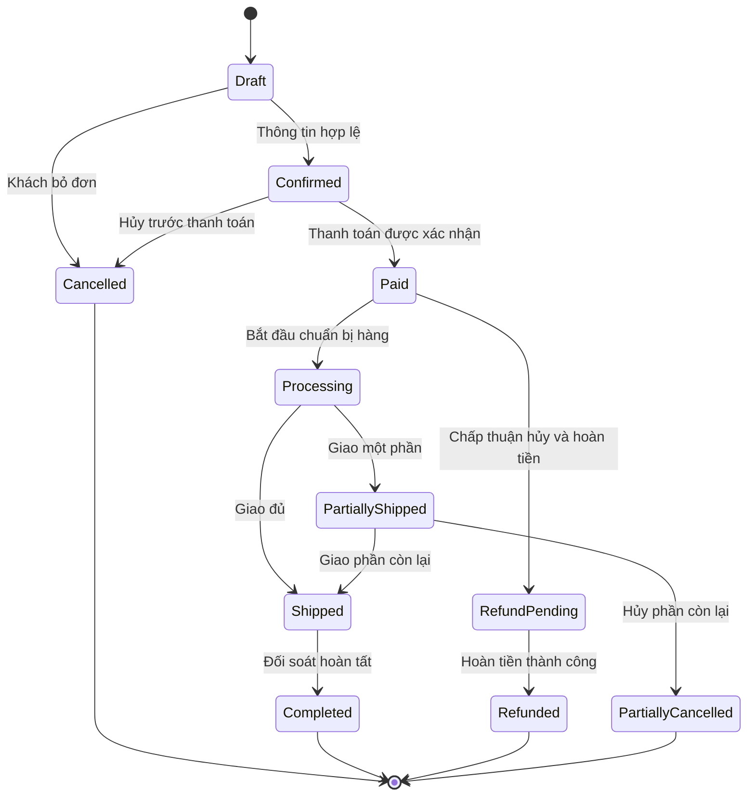

# Rà soát mô hình bằng các tình huống tạo mới, thay đổi và kết thúc vòng đời

Trong chương **Mô hình khái niệm**, một sơ đồ chỉ thực sự có giá trị khi nó giải thích được cách các đối tượng nghiệp vụ xuất hiện, thay đổi và kết thúc. Một mô hình có thể trông hợp lý khi nhìn vào các bản ghi đang tồn tại, nhưng vẫn bỏ sót trường hợp tạo dữ liệu từng phần, đổi quan hệ, chuyển người phụ trách, hủy giao dịch hoặc lưu giữ lịch sử sau khi đối tượng không còn hoạt động.

Rà soát mô hình bằng tình huống vòng đời giúp kiểm tra xem các khái niệm, quan hệ, thuộc tính và quy tắc có phản ánh được hoạt động thực tế hay không. Đây là bước quan trọng trong quá trình chuyển yêu cầu nghiệp vụ thành mô hình dữ liệu rõ ràng, có thể tiến hóa và kiểm chứng. Khi mô hình được thử qua các tình huống cụ thể, nhóm có thể phát hiện thực thể bị thiếu, quan hệ có lực lượng chưa đúng, trạng thái chưa đầy đủ, thuộc tính đặt sai nơi hoặc quy tắc lịch sử chưa được xác định.

Sau bài học, người học có thể:

- Xây dựng kịch bản rà soát cho ba nhóm tình huống: tạo mới, thay đổi và kết thúc vòng đời.
- Kiểm tra tính đầy đủ của thực thể, thuộc tính, quan hệ, định danh và ràng buộc qua từng kịch bản.
- Phân biệt trạng thái hiện tại, sự kiện phát sinh, lịch sử thay đổi và thời gian hiệu lực.
- Nhận diện tác động của thay đổi đến các đối tượng liên quan và dữ liệu đã phát sinh.
- Đánh giá cách xử lý hủy, đóng, lưu trữ, xóa và ẩn danh theo quy tắc nghiệp vụ.
- Ghi nhận phát hiện, câu hỏi mở và bằng chứng để hoàn thiện mô hình.

## 1. Vì sao phải rà soát mô hình theo vòng đời?

Mô hình khái niệm thường được xây dựng từ các yêu cầu và ví dụ ban đầu. Những ví dụ đó có thể chỉ mô tả trạng thái bình thường: khách tạo đơn, nhân viên xử lý, hàng được giao. Nhưng trong thực tế, một đối tượng không đứng yên. Nó được tạo, bổ sung thông tin, liên kết với đối tượng khác, chuyển trạng thái, thay đổi người sở hữu, bị hủy, hết hiệu lực hoặc được lưu trữ.

Nếu chỉ rà soát mô hình tại một thời điểm, nhóm có thể bỏ lỡ những câu hỏi quan trọng:

- Đối tượng có được tạo trước khi mọi thông tin đã sẵn sàng không?
- Có thể lưu bản nháp hoặc dữ liệu chưa hoàn chỉnh không?
- Một thay đổi có ảnh hưởng đến nhiều đối tượng khác không?
- Quan hệ có thể được thay thế hoặc chấm dứt mà vẫn cần giữ lịch sử không?
- Khi một đối tượng bị hủy, dữ liệu liên quan phải được giữ, đóng, tách hoặc xóa thế nào?
- Những giao dịch cũ có phải tiếp tục phản ánh thông tin tại thời điểm phát sinh không?
- Có quy tắc nào chỉ đúng ở một giai đoạn của vòng đời không?

Ví dụ, một đơn hàng có thể được tạo khi khách chưa hoàn tất địa chỉ giao hàng. Sau đó khách bổ sung địa chỉ, thanh toán, yêu cầu đổi một mặt hàng và cuối cùng hủy phần chưa giao. Nếu mô hình chỉ có một bảng đơn hàng với trạng thái `NEW` hoặc `DONE`, nhóm có thể không biết lưu địa chỉ theo thời điểm nào, một đơn có nhiều lần thanh toán hay không, hoặc phần nào của đơn đã bị hủy.

Rà soát theo vòng đời giúp mô hình trả lời được cả câu hỏi “đối tượng là gì?” và “đối tượng thay đổi ra sao trong suốt thời gian tồn tại?”.

### 1.1. Ba nhóm tình huống chính

| Nhóm tình huống | Câu hỏi trọng tâm | Ví dụ |
|---|---|---|
| Tạo mới (create) | Đối tượng xuất hiện khi nào, cần dữ liệu gì, liên kết nào bắt buộc? | Khách tạo đơn nháp, nhân viên lập hồ sơ khách hàng, hệ thống mở lớp mới. |
| Thay đổi (change) | Thuộc tính, quan hệ hoặc trạng thái nào có thể đổi, ai được đổi và lịch sử được giữ ra sao? | Đổi địa chỉ giao hàng, chuyển người phụ trách, điều chỉnh sức chứa lớp. |
| Kết thúc vòng đời (end) | Khi nào đối tượng không còn hoạt động, dữ liệu liên quan được xử lý thế nào? | Hủy đơn, đóng lớp, chấm dứt hợp đồng, lưu trữ hồ sơ. |

Ba nhóm không nhất thiết diễn ra theo một đường thẳng. Đối tượng có thể bị hủy trong lúc tạo, được mở lại sau khi đóng, hoặc được thay thế bởi một đối tượng khác. Hãy mô hình hóa các chuyển tiếp được nghiệp vụ cho phép và ghi rõ điều kiện của chúng.

### 1.2. Phân biệt vòng đời của đối tượng và vòng đời của quan hệ

Một đối tượng có thể tiếp tục tồn tại trong khi quan hệ của nó thay đổi. Ví dụ, nhân viên vẫn còn làm việc nhưng được chuyển sang phòng ban khác; hợp đồng vẫn được lưu nhưng người phụ trách thay đổi; sản phẩm vẫn tồn tại nhưng không còn được cung cấp tại một chi nhánh.

Nếu chỉ lưu quan hệ hiện tại, nhóm có thể không trả lời được ai phụ trách trước đó hoặc sản phẩm đã được bán ở chi nhánh nào trong quá khứ. Vì vậy cần xem xét vòng đời của cả thực thể lẫn quan hệ. Khi quan hệ có thời điểm bắt đầu, kết thúc, vai trò hoặc trạng thái riêng, nó có thể cần được quản lý như một khái niệm liên kết.

## 2. Chuẩn bị bộ kịch bản rà soát

### 2.1. Chọn kịch bản có khả năng kiểm tra mô hình

Không cần mô tả mọi thao tác giao diện. Hãy chọn các tình huống làm lộ ra cấu trúc dữ liệu và quy tắc. Một bộ kịch bản tốt thường có:

- Tình huống phổ biến để kiểm tra luồng cơ bản.
- Tình huống biên để kiểm tra giới hạn và tính bắt buộc.
- Tình huống thay đổi quan hệ để kiểm tra lịch sử và lực lượng quan hệ.
- Tình huống thất bại hoặc bị hủy để kiểm tra trạng thái kết thúc.
- Tình huống lặp, đồng thời hoặc đến trễ để kiểm tra định danh và tính nhất quán.
- Tình huống khôi phục hoặc mở lại nếu nghiệp vụ cho phép.

Ví dụ với đơn hàng:

| Nhóm | Kịch bản | Câu hỏi mô hình cần trả lời |
|---|---|---|
| Tạo mới | Khách tạo đơn với nhiều dòng hàng | Một đơn có bao nhiêu dòng? Dòng hàng có định danh riêng không? |
| Tạo mới | Khách vãng lai tạo đơn | Đơn có bắt buộc liên kết với hồ sơ khách hàng không? |
| Thay đổi | Khách đổi địa chỉ trước khi giao | Địa chỉ hiện tại và địa chỉ đã chốt có cần phân biệt không? |
| Thay đổi | Một dòng hàng được giao thành hai đợt | Cần ghi từng lần giao và số lượng của mỗi lần không? |
| Thay đổi | Đơn được thanh toán nhiều lần | Một đơn có nhiều giao dịch thanh toán hoặc lần thử không? |
| Kết thúc | Đơn bị hủy sau khi đã thanh toán | Hủy đơn có tạo nghĩa vụ hoàn tiền hoặc hồ sơ đối soát không? |
| Kết thúc | Đơn hoàn tất và hết thời hạn đổi trả | Dữ liệu nào vẫn phải tra cứu và lưu giữ? |

Kịch bản phải có nguồn từ yêu cầu, phỏng vấn, dữ liệu mẫu, quy định hoặc người sở hữu nghiệp vụ. Nếu nhóm tự thêm tình huống giả định để kiểm tra độ bền của mô hình, hãy đánh dấu rõ đó là giả định cần xác nhận.

### 2.2. Cấu trúc một kịch bản

Mỗi kịch bản nên có các trường:

| Thành phần | Nội dung |
|---|---|
| Mã và tên | Định danh ổn định, tên ngắn mô tả tình huống. |
| Mục tiêu | Khía cạnh của mô hình cần kiểm tra. |
| Điều kiện ban đầu | Các đối tượng, thuộc tính, quan hệ và trạng thái đã tồn tại. |
| Tác nhân | Người dùng, bộ phận hoặc hệ thống gây ra hành động. |
| Sự kiện/hành động | Điều gì xảy ra trong tình huống. |
| Quy tắc áp dụng | Điều kiện cho phép, từ chối hoặc điều chỉnh hành động. |
| Kết quả mong đợi | Đối tượng, quan hệ, trạng thái và dữ liệu lịch sử sau xử lý. |
| Tác động liên quan | Những đối tượng khác bị ảnh hưởng. |
| Bằng chứng | Phát biểu yêu cầu, mẫu dữ liệu, tài liệu hoặc người xác nhận. |
| Kết quả rà soát | Mô hình đáp ứng, thiếu khái niệm, sai quan hệ hay cần làm rõ. |

Mô tả kịch bản bằng ngôn ngữ nghiệp vụ trước. Sau đó mới đối chiếu từng bước với khái niệm trên sơ đồ. Cách này giúp tránh việc ép tình huống vào mô hình hiện có rồi bỏ qua phần không khớp.

### 2.3. Ma trận bao phủ vòng đời

Một ma trận đơn giản giúp phát hiện khái niệm nào chưa được kiểm tra ở từng giai đoạn.

| Khái niệm | Tạo mới | Thay đổi thuộc tính | Thay đổi quan hệ | Kết thúc | Lịch sử/khôi phục |
|---|---|---|---|---|---|
| Khách hàng | Tạo hồ sơ hoặc khách vãng lai | Đổi liên hệ, địa chỉ | Gộp hồ sơ, thay người đại diện | Ngừng hoạt động, yêu cầu xóa | Giữ thông tin giao dịch theo quy định |
| Đơn hàng | Tạo nháp, xác nhận | Bổ sung thông tin, điều chỉnh hợp lệ | Thêm/bớt dòng, thay địa chỉ nhận | Hủy, hoàn tất | Theo dõi trạng thái và đối soát |
| Dòng đơn hàng | Thêm sản phẩm | Đổi số lượng trước mốc chốt | Chuyển kho, chia đợt giao | Hủy một phần | Giữ số lượng đã giao/hủy |
| Thanh toán | Tạo yêu cầu thanh toán | Cập nhật kết quả đối tác | Gắn với đơn hoặc khoản hoàn | Thất bại, hoàn tất, hoàn tiền | Giữ từng giao dịch và lần thử |

Ma trận không thay thế mô hình. Nó là công cụ tìm khoảng trống: ô nào trống có thể là chưa khảo sát, không nhất thiết là nghiệp vụ không hỗ trợ thao tác đó.

## 3. Rà soát tình huống tạo mới

Tạo mới là thời điểm một khái niệm hoặc một trường hợp cụ thể xuất hiện trong miền nghiệp vụ. Có đối tượng được tạo đầy đủ trong một lần, có đối tượng được tạo từng phần và hoàn thiện sau. Cần xác định rõ thời điểm nào được xem là bắt đầu vòng đời.

### 3.1. Xác định sự kiện tạo và thời điểm định danh

Hãy hỏi:

- Điều gì được xem là tạo một đối tượng mới: lưu bản nháp, gửi yêu cầu, được duyệt hay phát sinh giao dịch?
- Đối tượng có được tạo trước khi có đầy đủ thông tin không?
- Mã định danh được cấp ở thời điểm nào?
- Nếu người dùng gửi lại cùng yêu cầu do không nhận được phản hồi, hệ thống nhận biết đó là lần gửi lại hay đối tượng mới?
- Có thể tạo đối tượng từ nhiều kênh hoặc nhiều hệ thống không?
- Ai là chủ thể sở hữu dữ liệu sau khi tạo?

Ví dụ, một đơn hàng có thể được tạo khi khách bắt đầu giỏ hàng, khi bấm xác nhận đặt hàng hoặc khi hệ thống tiếp nhận yêu cầu. Ba thời điểm này có ý nghĩa khác nhau. Nếu giỏ hàng chưa phải đơn hàng, không nên ghi nhận mọi giỏ hàng như một đơn đã phát sinh nghĩa vụ. Nếu đơn được tạo trước khi thanh toán, trạng thái ban đầu phải thể hiện được việc chưa thanh toán.

### 3.2. Kiểm tra dữ liệu bắt buộc và dữ liệu có thể bổ sung

Không phải mọi thuộc tính đều cần có ngay khi tạo. Phân loại dữ liệu theo thời điểm:

- Bắt buộc tại thời điểm tạo.
- Bắt buộc trước khi chuyển sang trạng thái tiếp theo.
- Có thể bổ sung sau.
- Chỉ phát sinh khi có sự kiện khác.
- Không áp dụng cho một số loại đối tượng.

Ví dụ, địa chỉ giao hàng có thể chưa cần khi tạo đơn nháp, nhưng phải có trước khi xác nhận giao hàng. Mã vận đơn chỉ phát sinh sau khi đơn được bàn giao cho đơn vị vận chuyển. Nếu mô hình đánh dấu tất cả trường là bắt buộc ngay từ đầu, nó có thể không phản ánh được quy trình tạo từng phần.

| Dữ liệu | Thời điểm có thể cần | Câu hỏi xác nhận |
|---|---|---|
| Người mua hoặc thông tin liên hệ | Khi tạo đơn hoặc trước khi xác nhận | Khách vãng lai có được phép không? |
| Dòng hàng và số lượng | Khi tạo đơn | Có cho phép đơn nháp chưa có dòng hàng không? |
| Địa chỉ giao hàng | Trước khi xác nhận giao | Có lưu ảnh chụp địa chỉ tại thời điểm đặt không? |
| Giao dịch thanh toán | Khi khách thanh toán | Có đơn trả khi nhận hàng không? |
| Mã vận đơn | Khi bàn giao vận chuyển | Một đơn có thể có nhiều mã vận đơn không? |

### 3.3. Kiểm tra tạo một-nhiều và tạo đồng thời

Một thao tác tạo đối tượng có thể làm phát sinh nhiều đối tượng con hoặc quan hệ. Ví dụ, tạo đơn hàng có thể đồng thời tạo nhiều dòng đơn hàng. Hãy xác định các đối tượng nào phải được tạo cùng nhau, đối tượng nào có thể tồn tại độc lập và nếu một phần thất bại thì kết quả nghiệp vụ là gì.

Các câu hỏi hữu ích:

- Có thể có đơn không có dòng hàng không?
- Dòng hàng có thể được tạo trước đơn không?
- Khi một dòng hàng không hợp lệ, toàn bộ đơn bị từ chối hay chỉ dòng đó?
- Nếu hai yêu cầu tạo cùng một đối tượng đến gần như đồng thời, quy tắc nhận diện trùng là gì?
- Mã nghiệp vụ có duy nhất trong toàn hệ thống hay theo chi nhánh/kênh?

Rà soát các tình huống này giúp xác định quan hệ bắt buộc, phạm vi duy nhất và các quy tắc tạo đối tượng. Cách thực hiện giao dịch nguyên tử, khóa hoặc cơ chế chống xử lý lặp thuộc thiết kế triển khai sau, nhưng nhu cầu nghiệp vụ phải được làm rõ ngay từ mô hình.

### 3.4. Ví dụ kịch bản tạo mới

**CR-01 — Khách tạo đơn nháp chưa có địa chỉ giao hàng**

| Thành phần | Mô tả |
|---|---|
| Điều kiện ban đầu | Khách đã chọn sản phẩm nhưng chưa cung cấp địa chỉ. |
| Hành động | Khách lưu đơn ở trạng thái nháp. |
| Kết quả mong đợi | Đơn nháp tồn tại; địa chỉ giao hàng có thể chưa có; đơn chưa được xem là sẵn sàng giao. |
| Khái niệm cần kiểm tra | Đơn hàng, dòng đơn hàng, khách hàng/khách vãng lai, địa chỉ giao hàng, trạng thái đơn. |
| Câu hỏi mở | Đơn nháp được lưu trong bao lâu? Khi nào được cấp mã đơn chính thức? |

**CR-02 — Một yêu cầu được gửi lại**

| Thành phần | Mô tả |
|---|---|
| Điều kiện ban đầu | Khách đã gửi yêu cầu tạo đơn nhưng chưa nhận được phản hồi. |
| Hành động | Trình duyệt hoặc ứng dụng gửi lại yêu cầu. |
| Kết quả mong đợi | Hệ thống xác định yêu cầu có phải lần gửi lại của cùng một thao tác hay một đơn mới theo quy tắc đã thống nhất. |
| Khái niệm cần kiểm tra | Đơn hàng, yêu cầu tạo đơn, mã tham chiếu, sự kiện tiếp nhận. |
| Câu hỏi mở | Mã nhận diện yêu cầu được cấp ở đâu và có thời hạn hiệu lực không? |

## 4. Rà soát tình huống thay đổi

Thay đổi có thể tác động đến thuộc tính, quan hệ, trạng thái hoặc ý nghĩa của dữ liệu. Không phải mọi thay đổi đều giống nhau. Đổi số điện thoại liên hệ có thể chỉ cập nhật thông tin hiện tại; đổi giá của một đơn đã xác nhận có thể vi phạm quy tắc chốt giá; thay người phụ trách có thể cần lưu lịch sử quan hệ.

### 4.1. Phân loại thay đổi

| Loại thay đổi | Ví dụ | Câu hỏi mô hình cần trả lời |
|---|---|---|
| Thuộc tính mô tả | Đổi tên hiển thị của khách hàng | Có cần giữ tên cũ trong giao dịch đã phát sinh không? |
| Thuộc tính có hiệu lực | Đổi địa chỉ từ ngày mai | Giá trị cũ có còn hiệu lực trong khoảng thời gian trước đó không? |
| Quan hệ | Chuyển đơn sang nhân viên phụ trách khác | Có cần biết người phụ trách ở từng giai đoạn không? |
| Thành phần con | Thêm hoặc bỏ dòng hàng | Dòng đã giao có được sửa hoặc xóa không? |
| Trạng thái | Chuyển từ chờ xác nhận sang đã xác nhận | Sự kiện nào cho phép chuyển? Có cần người duyệt không? |
| Giá trị được chốt | Giá, tỷ lệ chiết khấu, điều khoản tại thời điểm giao dịch | Thay đổi dữ liệu gốc có ảnh hưởng giao dịch cũ không? |
| Thay đổi do hệ thống ngoài | Cập nhật địa chỉ từ CRM hoặc danh mục đối tác | Hệ thống nào là nguồn có thẩm quyền? |

### 4.2. Phân biệt dữ liệu hiện tại và dữ liệu tại thời điểm giao dịch

Một đối tượng có thể cần cả thông tin hiện tại và thông tin đã được chốt ở một thời điểm. Ví dụ, khách hàng đổi địa chỉ sau khi mua hàng. Hồ sơ khách có thể cập nhật địa chỉ mới, nhưng đơn hàng cũ vẫn cần địa chỉ nhận hàng đã được xác nhận lúc đặt.

Hãy hỏi:

- Thay đổi có áp dụng ngược cho giao dịch đã hoàn tất không?
- Có cần lưu bản chụp (snapshot) của thông tin tại thời điểm giao dịch không?
- Dữ liệu cũ cần giữ vì mục đích đối soát, pháp lý, hỗ trợ hay báo cáo nào?
- Nếu giá trị bị sửa sai, có cần lưu giá trị trước và sau cùng lý do không?
- Có thể xác định giá trị nào đúng tại một thời điểm trong quá khứ không?

Ví dụ, `Địa chỉ khách hàng` là thông tin hiện tại trong hồ sơ khách. `Địa chỉ giao hàng của đơn` là thông tin được dùng cho một giao dịch cụ thể. Hai khái niệm có thể liên quan nhưng không nhất thiết luôn dùng chung một giá trị. Nếu chỉ tham chiếu địa chỉ hiện tại của khách, lịch sử đơn có thể thay đổi ý nghĩa khi khách sửa địa chỉ.

### 4.3. Rà soát thay đổi quan hệ

Quan hệ thường thay đổi mà đối tượng ở hai đầu vẫn tồn tại. Hãy xác định:

- Quan hệ có thể bắt đầu hoặc kết thúc độc lập không?
- Có cần lưu thời điểm bắt đầu và kết thúc không?
- Có thể có nhiều quan hệ đồng thời không?
- Có vai trò hoặc điều kiện riêng cho từng lần liên kết không?
- Khi quan hệ kết thúc, dữ liệu lịch sử còn cần truy vấn không?

Ví dụ, một nhân viên chuyển từ phòng kinh doanh sang phòng hỗ trợ. Nếu chỉ cập nhật `department` trên hồ sơ nhân viên, báo cáo quá khứ có thể cho rằng nhân viên luôn thuộc phòng hỗ trợ. Nếu cần lịch sử điều chuyển, hãy mô hình hóa quá trình phân công phòng ban với thời điểm hiệu lực và kết thúc.

Tương tự, một sản phẩm có thể được bán tại nhiều chi nhánh. Quan hệ sản phẩm-chi nhánh có thể có giá, trạng thái kinh doanh và ngày hiệu lực riêng. Nếu các thông tin này thay đổi độc lập, chúng thuộc về quan hệ hoặc một khái niệm liên kết thay vì chỉ là thuộc tính của sản phẩm.

### 4.4. Rà soát thay đổi một phần và nhiều bước

Một nghiệp vụ có thể chỉ thay đổi một phần đối tượng. Ví dụ, khách hủy một dòng hàng trong đơn nhưng các dòng còn lại vẫn được giao. Nếu mô hình chỉ có một trạng thái chung cho toàn đơn, nó có thể không thể hiện được phần đã giao, phần còn lại và phần đã hủy.

Hãy kiểm tra:

- Đối tượng cha có trạng thái riêng với từng đối tượng con không?
- Mỗi phần có thể có thời điểm, số lượng hoặc kết quả riêng không?
- Có thể thay đổi một phần mà không làm mất lịch sử phần còn lại không?
- Tổng hợp trạng thái của đối tượng cha được xác định theo quy tắc nào?

Không giả định trạng thái của đối tượng cha luôn đủ để mô tả mọi đối tượng con. Nếu mỗi dòng hàng có vòng đời riêng, cần ghi rõ điều đó trong mô hình.

### 4.5. Rà soát thay đổi đồng thời và xung đột

Hai tác nhân có thể cập nhật cùng một đối tượng hoặc cùng một quan hệ gần như đồng thời. Ví dụ, hai nhân viên cùng sửa hồ sơ khách; khách hủy đơn trong lúc kho xác nhận giao; hai giao dịch cùng giữ chỗ cuối cùng của một lớp.

Ở mức nghiệp vụ, hãy xác định:

- Thay đổi nào có quyền ưu tiên?
- Có cần phê duyệt hoặc xác nhận lại khi dữ liệu đã thay đổi không?
- Có trạng thái trung gian để chờ giải quyết xung đột không?
- Những giá trị nào không được ghi đè âm thầm?
- Cần lưu người thực hiện, thời điểm và nguồn cập nhật nào?

Các cơ chế kỹ thuật như optimistic locking, transaction isolation hoặc version column có thể được cân nhắc khi thiết kế logic/vật lý. Mô hình khái niệm cần nêu được quy tắc và nhu cầu truy vết mà các cơ chế đó phải hỗ trợ.

### 4.6. Ví dụ kịch bản thay đổi

**CH-01 — Khách đổi địa chỉ sau khi đơn đã xác nhận**

| Thành phần | Mô tả |
|---|---|
| Điều kiện ban đầu | Đơn đã xác nhận với địa chỉ giao hàng A. |
| Hành động | Khách cập nhật địa chỉ hồ sơ thành B và yêu cầu đổi địa chỉ đơn. |
| Kết quả mong đợi | Hồ sơ khách có thể dùng địa chỉ B; đơn giữ địa chỉ A hoặc chuyển sang B theo điều kiện nghiệp vụ được duyệt. |
| Khái niệm cần kiểm tra | Khách hàng, địa chỉ, đơn hàng, yêu cầu thay đổi, lịch sử địa chỉ. |
| Câu hỏi mở | Khi nào đơn không còn được đổi địa chỉ? Có cần lưu người phê duyệt không? |

**CH-02 — Chuyển nhân viên phụ trách**

| Thành phần | Mô tả |
|---|---|
| Điều kiện ban đầu | Hồ sơ khách đang được nhân viên A phụ trách. |
| Hành động | Quản lý chuyển hồ sơ sang nhân viên B từ một thời điểm xác định. |
| Kết quả mong đợi | Quan hệ phụ trách hiện tại là B; lịch sử thể hiện A phụ trách đến khi nào và B bắt đầu từ khi nào. |
| Khái niệm cần kiểm tra | Nhân viên, khách hàng, phân công phụ trách, thời điểm hiệu lực. |
| Câu hỏi mở | Có cho phép hai nhân viên cùng phụ trách? Ai được quyền chuyển? |

## 5. Rà soát tình huống kết thúc vòng đời

Kết thúc vòng đời không luôn đồng nghĩa với xóa bản ghi. Một đối tượng có thể hoàn tất, bị hủy, hết hiệu lực, ngừng sử dụng, được lưu trữ hoặc được ẩn danh. Các kết quả này có ý nghĩa nghiệp vụ và yêu cầu lưu trữ khác nhau.

### 5.1. Phân biệt các cách kết thúc

| Cách kết thúc | Ý nghĩa | Ví dụ | Dữ liệu cần xem xét |
|---|---|---|---|
| Hoàn tất | Quy trình đã đạt kết quả cuối cùng theo mục tiêu | Đơn đã giao đủ và đối soát xong | Giữ thông tin giao dịch và kết quả cuối. |
| Hủy | Quy trình dừng trước khi đạt mục tiêu hoặc bị chấm dứt theo quy tắc | Đơn bị khách hủy | Lý do, thời điểm, người thực hiện và tác động liên quan. |
| Hết hiệu lực | Giá trị hoặc quan hệ không còn áp dụng từ một thời điểm | Hợp đồng hết hạn, nhân viên hết nhiệm kỳ | Khoảng hiệu lực và tham chiếu lịch sử. |
| Ngừng cung cấp | Đối tượng không còn được dùng cho hoạt động mới | Sản phẩm ngừng kinh doanh | Giữ giao dịch cũ, ngăn phát sinh mới theo quy tắc. |
| Lưu trữ | Đưa dữ liệu ra khỏi quy trình vận hành thường xuyên nhưng vẫn giữ để tra cứu | Hồ sơ đã đóng nhiều năm | Thời hạn lưu, quyền truy cập và khả năng phục hồi. |
| Xóa | Loại bỏ dữ liệu theo chính sách và nghĩa vụ áp dụng | Xóa dữ liệu thử nghiệm không còn cần thiết | Phạm vi xóa, phụ thuộc và bằng chứng hoàn tất nếu cần. |
| Ẩn danh | Loại bỏ hoặc biến đổi khả năng nhận diện cá nhân | Tập dữ liệu dùng cho phân tích | Khả năng tái nhận diện và dữ liệu liên kết còn tồn tại. |

Không dùng một trạng thái `DELETED` để đại diện cho tất cả các trường hợp. Hãy xác định chính xác nghiệp vụ muốn nói “không còn hoạt động”, “không được chọn cho giao dịch mới”, “đã hoàn tất” hay “phải xóa dữ liệu”.

### 5.2. Xác định điều kiện kết thúc và ai có quyền kết thúc

Với mỗi loại kết thúc, hãy hỏi:

- Sự kiện hoặc điều kiện nào kích hoạt kết thúc?
- Ai được quyền thực hiện hoặc phê duyệt?
- Có mốc thời gian hoặc trạng thái nào ngăn việc kết thúc không?
- Đối tượng có thể được mở lại không? Nếu có, trong điều kiện nào?
- Các đối tượng liên quan sẽ chuyển trạng thái ra sao?
- Có phát sinh nghĩa vụ tài chính, thông báo hoặc đối soát không?
- Dữ liệu nào phải tiếp tục tồn tại sau khi kết thúc?

Ví dụ, hủy đơn trước khi thanh toán có thể chỉ cần ghi nhận lý do và thời điểm. Hủy đơn sau khi đã thanh toán có thể tạo quy trình hoàn tiền. Hủy đơn sau khi đã giao một phần có thể chỉ áp dụng cho phần chưa giao. Cùng một hành động “hủy” nhưng tác động dữ liệu khác nhau theo trạng thái và lịch sử.

### 5.3. Rà soát quan hệ phụ thuộc khi kết thúc

Khi một đối tượng kết thúc, hãy đi theo các quan hệ của nó và xác định hậu quả:

- Đối tượng con có bị kết thúc cùng không?
- Đối tượng liên quan có được giữ lại vì còn tham chiếu lịch sử không?
- Quan hệ có cần đóng hiệu lực thay vì xóa không?
- Có đối tượng nào không được phép kết thúc khi vẫn còn liên kết đang hoạt động không?
- Có cần tạo một sự kiện, biên bản, khoản hoàn hoặc hồ sơ thay thế không?

Ví dụ, khi một lớp bị hủy, các đăng ký không nên tự biến mất nếu trung tâm cần biết học viên nào bị ảnh hưởng. Có thể cần chuyển đăng ký sang trạng thái bị ảnh hưởng bởi hủy lớp, tạo khoản hoàn hoặc hỗ trợ chuyển lớp. Mô hình cần biểu diễn được quan hệ và kết quả này.

Ở bước triển khai, việc xóa dây chuyền (cascade delete), đặt tham chiếu thành rỗng hoặc chặn xóa là lựa chọn kỹ thuật có ảnh hưởng lớn. Không nên quyết định hành vi đó chỉ từ cấu trúc hiện tại. Trước hết cần xác định quy tắc nghiệp vụ: dữ liệu nào được phép xóa, dữ liệu nào phải giữ và tại sao.

### 5.4. Xóa, lưu trữ và ẩn danh không giống nhau

**Xóa** loại bỏ dữ liệu theo phạm vi và chính sách áp dụng. **Lưu trữ** giữ dữ liệu nhưng thay đổi cách truy cập hoặc vận hành. **Ẩn danh** làm cho dữ liệu không còn gắn với một cá nhân có thể nhận diện theo tiêu chí đã xác định. Một thao tác không tự động thay thế thao tác khác.

Hãy xác định:

- Dữ liệu nào cần lưu để giải quyết tranh chấp, đối soát hoặc nghĩa vụ lưu trữ?
- Dữ liệu nhận diện cá nhân có thể được xóa hoặc ẩn danh sau khi hết mục đích sử dụng không?
- Các bản ghi liên quan có còn chứa thông tin giúp nhận diện ngược không?
- Dữ liệu tổng hợp có thể được giữ lại sau khi xóa dữ liệu chi tiết không?
- Có cần ghi nhận việc xử lý yêu cầu xóa hoặc ẩn danh không?

Không tự đặt thời hạn lưu trữ. Thời hạn phải dựa trên chính sách tổ chức và quy định áp dụng. Ở giai đoạn mô hình, ghi nhận yêu cầu, phạm vi dữ liệu và người có thẩm quyền xác nhận.

### 5.5. Ví dụ kịch bản kết thúc

**EN-01 — Hủy đơn đã thanh toán nhưng chưa giao hàng**

| Thành phần | Mô tả |
|---|---|
| Điều kiện ban đầu | Đơn đã thanh toán; chưa có lần giao hàng hoàn tất. |
| Hành động | Khách yêu cầu hủy và được chấp thuận theo chính sách. |
| Kết quả mong đợi | Đơn chuyển sang trạng thái hủy; khoản hoàn được ghi nhận riêng; giao dịch thu tiền ban đầu vẫn được giữ. |
| Khái niệm cần kiểm tra | Đơn hàng, thanh toán, yêu cầu hủy, hoàn tiền, sự kiện trạng thái. |
| Câu hỏi mở | Hủy có thể thực hiện từng dòng không? Khi nào đơn được xem là hủy hoàn tất? |

**EN-02 — Ngừng cung cấp sản phẩm**

| Thành phần | Mô tả |
|---|---|
| Điều kiện ban đầu | Sản phẩm đã có các đơn hàng và giao dịch lịch sử. |
| Hành động | Người có quyền đánh dấu sản phẩm ngừng kinh doanh từ ngày xác định. |
| Kết quả mong đợi | Không tạo giao dịch mới sau thời điểm áp dụng; đơn lịch sử vẫn tham chiếu được sản phẩm. |
| Khái niệm cần kiểm tra | Sản phẩm, trạng thái kinh doanh, thời điểm hiệu lực, dòng đơn hàng. |
| Câu hỏi mở | Có cho phép bán nốt tồn kho? Có thể kích hoạt lại không? |

## 6. Rà soát trạng thái, sự kiện và thời gian

### 6.1. Trạng thái phải có ý nghĩa và điều kiện chuyển

Một danh sách trạng thái không đủ để mô tả vòng đời. Với mỗi trạng thái, ghi:

- Ý nghĩa nghiệp vụ.
- Điều kiện để đi vào trạng thái.
- Tác nhân hoặc sự kiện kích hoạt.
- Trạng thái nào có thể chuyển tiếp.
- Thao tác nào bị cấm trong trạng thái đó.
- Dữ liệu nào cần có khi chuyển.
- Có thể quay lại trạng thái trước hoặc mở lại không?

Ví dụ, đơn `CANCELLED` có thể không được chuyển thẳng sang `SHIPPED`. Nếu khách đổi ý sau khi hủy, nghiệp vụ có thể yêu cầu tạo đơn mới thay vì mở lại đơn cũ. Đây là quy tắc cần xác nhận, không nên tự suy ra từ tên trạng thái.

### 6.2. Trạng thái hiện tại và lịch sử sự kiện

Trạng thái hiện tại giúp trả lời “đối tượng đang ở đâu?”. Lịch sử sự kiện giúp trả lời “điều gì đã xảy ra, khi nào và do ai?”. Một mô hình có thể cần cả hai.

Ví dụ:

| Thời điểm | Sự kiện | Trạng thái sau sự kiện | Tác nhân |
|---|---|---|---|
| 09:00 | Đơn được tạo | DRAFT | Khách hàng |
| 09:05 | Đơn được xác nhận | CONFIRMED | Khách hàng |
| 09:08 | Thanh toán được xác nhận | PAID | Cổng thanh toán |
| 14:30 | Giao một phần | PARTIALLY_SHIPPED | Kho |
| Ngày hôm sau | Phần còn lại bị hủy | PARTIALLY_CANCELLED | Bộ phận chăm sóc khách hàng |

Bảng này là lịch sử minh họa, không nhất thiết là cấu trúc lưu trữ cuối cùng. Nó cho thấy nếu chỉ lưu trạng thái cuối, ta không biết đơn đã được thanh toán trước khi giao một phần hay không.

### 6.3. Phân biệt thời gian nghiệp vụ và thời gian ghi nhận

Một sự kiện có thể xảy ra ở một thời điểm nhưng được hệ thống ghi nhận muộn hơn. Ví dụ, đơn vị vận chuyển báo giao hàng thành công vào 10:00 nhưng webhook đến hệ thống lúc 10:05. Nếu nghiệp vụ cần đối soát thời gian thực tế và thời gian nhận thông tin, hai mốc này phải được phân biệt.

Các câu hỏi cần làm rõ:

- Thời điểm nào phản ánh lúc sự kiện thực sự xảy ra?
- Thời điểm nào phản ánh lúc hệ thống nhận hoặc ghi nhận sự kiện?
- Có sự kiện nào được nhập bổ sung sau nhiều ngày không?
- Dữ liệu có hiệu lực từ ngày nào và đến ngày nào?
- Khi hai sự kiện đến sai thứ tự, quy tắc xác định trạng thái đúng là gì?

Đối với dữ liệu có hiệu lực theo thời gian, có thể cần khoảng thời gian bắt đầu/kết thúc. Đối với dữ liệu lịch sử, có thể cần cả thời gian hiệu lực nghiệp vụ và thời gian hệ thống biết đến thay đổi. Cách triển khai cụ thể được quyết định ở mô hình logic/vật lý.

### 6.4. Sơ đồ vòng đời minh họa

Sơ đồ dưới đây mô tả một luồng đơn hàng rút gọn. Các nhánh và trạng thái phải được điều chỉnh theo chính sách của từng tổ chức.



Không phải mọi hệ thống cần các trạng thái riêng như `REFUND_PENDING` hoặc `PARTIALLY_CANCELLED`. Nếu các khái niệm đó có quy trình, dữ liệu và báo cáo riêng, hãy cân nhắc quản lý chúng rõ ràng. Nếu chỉ là cách diễn đạt kết quả tổng hợp, có thể biểu diễn bằng thuộc tính hoặc sự kiện phù hợp.

## 7. Đánh giá tính nhất quán của mô hình sau mỗi kịch bản

Sau khi chạy từng tình huống, không chỉ hỏi “sơ đồ có biểu diễn được không?”. Hãy kiểm tra theo các góc độ sau.

### 7.1. Tính đầy đủ của khái niệm

- Có đối tượng hoặc sự kiện nào trong kịch bản chưa có khái niệm tương ứng?
- Có thực thể nào chỉ xuất hiện để mô tả một thao tác giao diện?
- Có quan hệ nào đang bị ẩn trong một trường văn bản hoặc mã ghép?
- Có hồ sơ trung gian nào cần được quản lý độc lập không?

### 7.2. Tính đúng của quan hệ

- Mỗi quan hệ có đúng hai đầu và đúng vai trò không?
- Số lượng tối thiểu/tối đa có phản ánh trường hợp hợp lệ không?
- Quan hệ có thể thay đổi theo thời gian không?
- Có thuộc tính hoặc lịch sử riêng trên quan hệ không?
- Có quan hệ nào bị mất khi một đối tượng thay đổi hoặc kết thúc không?

### 7.3. Tính đúng của thuộc tính và định danh

- Thuộc tính có thuộc về đúng khái niệm không?
- Giá trị có cần được lưu theo từng giao dịch hoặc từng thời điểm không?
- Định danh có ổn định khi đổi tên hoặc thay đổi quan hệ không?
- Một thuộc tính có đang chứa nhiều ý nghĩa hoặc nhiều giá trị không?
- Có trường hợp trùng hoặc thiếu định danh hợp lệ không?

### 7.4. Tính nhất quán của ràng buộc

- Có hai quy tắc mâu thuẫn nhau không?
- Một quy tắc có phụ thuộc trạng thái hoặc thời gian nhưng mô hình chưa thể hiện không?
- Có thể xảy ra dữ liệu mồ côi khi kết thúc đối tượng không?
- Một thay đổi có làm vi phạm quy tắc trên đối tượng liên quan không?
- Quy tắc có ngoại lệ và người phê duyệt rõ ràng không?

### 7.5. Khả năng truy vết và giải thích lịch sử

- Có thể biết ai tạo, ai sửa hoặc ai kết thúc đối tượng khi nghiệp vụ yêu cầu không?
- Có thể khôi phục ý nghĩa của giao dịch cũ sau khi dữ liệu gốc thay đổi không?
- Có phân biệt thời gian xảy ra và thời gian ghi nhận không?
- Có thể giải thích vì sao một trạng thái được chuyển không?
- Có thể xác định dữ liệu nào còn phải giữ sau khi đối tượng kết thúc không?

## 8. Ví dụ tổng hợp: vòng đời đơn hàng có giao một phần

### 8.1. Tình huống

Một khách đặt hai sản phẩm trong cùng một đơn. Khách có thể là người đã đăng ký tài khoản hoặc khách vãng lai. Đơn được xác nhận và thanh toán toàn bộ. Kho giao sản phẩm thứ nhất, nhưng sản phẩm thứ hai chưa có hàng. Khách chọn hủy phần còn lại và yêu cầu hoàn tiền tương ứng. Sau đó khách cập nhật địa chỉ trong hồ sơ cá nhân.

### 8.2. Kiểm tra khi tạo mới

Đơn cần có định danh riêng, thời điểm đặt, kênh bán và các dòng hàng. Mỗi dòng cần xác định sản phẩm, số lượng và giá được áp dụng tại thời điểm chốt đơn. Quan hệ với khách hàng có thể tùy chọn nếu khách vãng lai được phép; trong trường hợp đó, cần xác định thông tin người mua được lưu ở đâu và có được liên kết về hồ sơ sau này không.

Các câu hỏi cần trả lời:

- Đơn có thể tồn tại ở trạng thái nháp trước khi có địa chỉ không?
- Một đơn có thể chứa nhiều dòng hàng cùng sản phẩm hay phải gộp số lượng?
- Giá được chốt ở thời điểm tạo, xác nhận hay thanh toán?
- Một đơn có thể được thanh toán bởi nhiều giao dịch không?

### 8.3. Kiểm tra khi thay đổi

Khi kho giao một phần, mô hình phải thể hiện số lượng đã giao và số lượng còn lại. Khi khách hủy phần chưa giao, cần lưu số lượng hủy, lý do, thời điểm và kết quả hoàn tiền. Địa chỉ hồ sơ khách thay đổi sau đó không nên làm thay đổi địa chỉ đã chốt của đơn cũ nếu nghiệp vụ yêu cầu giữ bằng chứng giao dịch.

Các câu hỏi cần trả lời:

- Một dòng hàng có thể được chia thành nhiều lần giao không?
- Mỗi lần giao có mã, thời điểm và trạng thái riêng không?
- Việc hủy một phần có tác động đến toàn bộ đơn hay chỉ dòng hàng đó?
- Số tiền hoàn được tính dựa trên giá chốt, chiết khấu và thuế nào?
- Địa chỉ giao hàng của đơn có phải bản chụp tại thời điểm xác nhận không?

### 8.4. Kiểm tra khi kết thúc

Đơn có thể kết thúc ở trạng thái hoàn tất một phần, hủy một phần hoặc hoàn tất sau khi đối soát. Giao dịch thanh toán ban đầu vẫn cần được giữ để giải thích số tiền thu; giao dịch hoàn tiền là một sự kiện hoặc hồ sơ riêng. Dòng hàng đã giao không bị xóa chỉ vì phần còn lại bị hủy.

Các câu hỏi cần trả lời:

- Đơn được xem là hoàn tất khi giao đủ hay khi mọi phần đã được giao hoặc hủy và đối soát?
- Có thể hủy toàn bộ đơn sau khi đã giao một phần không?
- Giao dịch hoàn tiền có thể thất bại hoặc được gửi lại không?
- Dữ liệu đơn, giao hàng và thanh toán cần lưu trong bao lâu theo chính sách?
- Nếu khách yêu cầu xóa hồ sơ, dữ liệu giao dịch nào vẫn phải được giữ và dữ liệu nào có thể ẩn danh?

### 8.5. Các khái niệm và quan hệ cần mô hình giải thích

| Khái niệm | Vai trò trong vòng đời | Điều cần kiểm chứng |
|---|---|---|
| Đơn hàng | Hồ sơ tổng hợp giao dịch | Có trạng thái và thời điểm tạo/xác nhận/kết thúc. |
| Dòng đơn hàng | Chi tiết từng sản phẩm trong đơn | Có thể giao hoặc hủy từng phần. |
| Khách hàng | Chủ thể mua hàng nếu có hồ sơ | Đơn khách vãng lai có được phép không? |
| Thông tin người mua/địa chỉ giao | Thông tin tại một ngữ cảnh hoặc thời điểm | Có cần bản chụp độc lập với hồ sơ hiện tại không? |
| Giao dịch thanh toán | Ghi nhận khoản thu hoặc lần thử | Một đơn có thể có nhiều giao dịch không? |
| Lần giao hàng | Ghi nhận từng đợt giao | Một lần giao có thể chứa nhiều dòng hàng không? |
| Giao dịch hoàn tiền | Ghi nhận khoản hoàn | Có thể hoàn nhiều lần hoặc hoàn một phần không? |
| Sự kiện trạng thái | Ghi nhận chuyển trạng thái | Cần lưu tác nhân, thời điểm và lý do nào? |

Các khái niệm trên là ứng viên để rà soát. Cấu trúc cuối cùng phụ thuộc vào nhu cầu quản lý, truy vấn, đối soát và quy tắc của tổ chức.

## 9. Ghi nhận phát hiện và quyết định cập nhật mô hình

### 9.1. Phân loại kết quả rà soát

Mỗi kịch bản nên kết thúc bằng một kết quả rõ ràng:

- **Được đáp ứng:** mô hình hiện tại giải thích đầy đủ tình huống và quy tắc.
- **Thiếu khái niệm:** cần thêm thực thể, sự kiện, danh mục hoặc hồ sơ liên kết.
- **Sai quan hệ:** lực lượng, tính bắt buộc hoặc vai trò chưa đúng.
- **Thiếu thuộc tính hoặc lịch sử:** cần bổ sung thông tin theo thời điểm hoặc theo sự kiện.
- **Thiếu ràng buộc:** mô hình chưa diễn đạt điều kiện nghiệp vụ.
- **Cần xác nhận:** nguồn bằng chứng chưa đủ hoặc các bên có cách hiểu khác nhau.
- **Ngoài phạm vi:** tình huống không thuộc miền đang mô hình hóa nhưng cần ghi nhận giao tiếp với hệ thống khác.

Không nên cập nhật sơ đồ ngay khi nghe một ý kiến đơn lẻ. Hãy ghi phát hiện, bằng chứng, ảnh hưởng và người cần xác nhận. Khi đã có kết luận, cập nhật mô hình và ma trận truy vết cùng lúc.

### 9.2. Ma trận truy vết tình huống với mô hình

| Mã kịch bản | Khái niệm/quan hệ liên quan | Quy tắc được kiểm tra | Kết quả | Bằng chứng/người xác nhận |
|---|---|---|---|---|
| CR-01 | Đơn hàng, dòng hàng, địa chỉ | Đơn nháp có thể thiếu địa chỉ | Cần xác nhận | Bộ phận bán hàng |
| CH-01 | Khách hàng, địa chỉ, đơn hàng | Địa chỉ giao của đơn giữ theo thời điểm chốt | Được đáp ứng nếu có snapshot | Quy trình xử lý đơn |
| CH-02 | Nhân viên, phân công phụ trách | Thay người phụ trách vẫn giữ lịch sử | Thiếu lịch sử quan hệ nếu chỉ lưu người hiện tại | Quản lý bộ phận |
| EN-01 | Đơn, thanh toán, hoàn tiền | Hủy sau thanh toán phải theo dõi khoản hoàn | Cần hồ sơ hoàn tiền | Kế toán và chăm sóc khách hàng |

Ma trận giúp truy ngược từ một thành phần của mô hình về tình huống đã chứng minh nhu cầu của nó. Ngược lại, nó cũng giúp tìm kịch bản chưa được mô hình hỗ trợ.

### 9.3. Mẫu nhật ký rà soát

```text
Mã phát hiện:
Mã kịch bản:
Ngày rà soát:
Người tham gia:
Khái niệm/quan hệ bị ảnh hưởng:
Mô tả vấn đề:
Bằng chứng:
Tác động nếu không xử lý:
Đề xuất thay đổi mô hình:
Quyết định của người sở hữu nghiệp vụ:
Trạng thái: OPEN / CONFIRMED / REJECTED / DEFERRED
Phiên bản mô hình được cập nhật:
```

## 10. Những sai lầm thường gặp

| Sai lầm | Hệ quả | Cách khắc phục |
|---|---|---|
| Chỉ kiểm tra lúc tạo mới | Không phát hiện thiếu lịch sử, thay đổi quan hệ hoặc kết thúc. | Bao phủ đủ tạo, thay đổi và kết thúc vòng đời. |
| Chỉ kiểm tra luồng thành công | Mô hình bỏ qua thất bại, hủy, thử lại và xử lý từng phần. | Thêm tình huống biên, ngoại lệ và phục hồi. |
| Coi mọi thay đổi là ghi đè thuộc tính | Mất giá trị cũ và không giải thích được giao dịch lịch sử. | Xác định dữ liệu hiện tại, snapshot và lịch sử. |
| Coi hủy, đóng, xóa và lưu trữ là một | Có thể mất dữ liệu cần giữ hoặc cho phép dùng lại đối tượng sai quy tắc. | Phân biệt ý nghĩa và điều kiện của từng cách kết thúc. |
| Chỉ lưu trạng thái cuối | Không biết các sự kiện và tác nhân đã dẫn đến trạng thái đó. | Xác định nhu cầu lưu sự kiện và lịch sử. |
| Bỏ qua vòng đời quan hệ | Không truy vết được chuyển phòng ban, đổi chủ sở hữu hoặc thay phân công. | Kiểm tra thời điểm bắt đầu/kết thúc và thông tin riêng của quan hệ. |
| Giả định dữ liệu con luôn kết thúc cùng cha | Có thể xóa nhầm chứng từ hoặc lịch sử giao dịch. | Rà soát từng quan hệ và quy tắc phụ thuộc. |
| Chọn cascade delete chỉ vì tiện triển khai | Dữ liệu lịch sử có thể biến mất ngoài ý muốn. | Chốt quy tắc lưu giữ trước khi quyết định hành vi vật lý. |
| Không thử tình huống đồng thời | Bỏ qua xung đột cập nhật và giới hạn tài nguyên. | Kiểm tra quy tắc ưu tiên, xác nhận và chống xử lý lặp. |
| Đưa giả định vào mô hình như sự thật | Mô hình khó được xác nhận và dễ sai khi vận hành. | Đánh dấu giả định, nguồn và người cần quyết định. |

## 11. Danh sách kiểm tra trước khi chốt mô hình khái niệm

- [ ] Mỗi khái niệm quan trọng đã có ít nhất một tình huống tạo mới hoặc khởi tạo hợp lệ.
- [ ] Đã xác định thời điểm đối tượng được xem là tồn tại và khi nào được cấp định danh.
- [ ] Dữ liệu bắt buộc tại từng giai đoạn được phân biệt với dữ liệu có thể bổ sung sau.
- [ ] Đã kiểm tra tạo đối tượng con, tạo lặp và tạo từ nhiều kênh.
- [ ] Các thay đổi thuộc tính và quan hệ được rà soát theo thời điểm hiệu lực.
- [ ] Dữ liệu hiện tại được phân biệt với dữ liệu đã chốt trong giao dịch lịch sử.
- [ ] Thay đổi một phần không làm mất thông tin của các phần còn lại.
- [ ] Tình huống cập nhật đồng thời và xung đột có quy tắc nghiệp vụ rõ ràng.
- [ ] Hoàn tất, hủy, hết hiệu lực, ngừng cung cấp, lưu trữ, xóa và ẩn danh được phân biệt.
- [ ] Tác động kết thúc đến các đối tượng liên quan đã được kiểm tra.
- [ ] Trạng thái có định nghĩa và điều kiện chuyển rõ ràng.
- [ ] Nhu cầu lưu sự kiện, tác nhân, thời gian và lý do đã được xác nhận.
- [ ] Các kịch bản phổ biến, biên và ngoại lệ đều có kết quả rà soát.
- [ ] Phát hiện được liên kết với bằng chứng, người xác nhận và phiên bản mô hình.
- [ ] Các giả định và câu hỏi mở không bị trình bày như quy tắc đã xác nhận.

## 12. Bài tập thực hành

Một nền tảng quản lý hợp đồng dịch vụ cho phép nhân viên tạo hợp đồng nháp, gửi khách hàng xem xét, cập nhật điều khoản, ký kết và gia hạn. Hợp đồng có thể được chuyển cho nhân viên phụ trách khác. Khi hết hạn, hợp đồng có thể được gia hạn, kết thúc hoặc chấm dứt sớm. Các hóa đơn và khoản thanh toán đã phát sinh phải được tra cứu sau khi hợp đồng kết thúc.

Hãy thực hiện:

1. Liệt kê các khái niệm chính và vẽ sơ đồ quan hệ ở mức khái niệm.
2. Viết ít nhất ba kịch bản tạo mới, gồm tạo nháp thiếu thông tin, gửi khách xem xét và tạo hợp đồng từ mẫu.
3. Viết ít nhất bốn kịch bản thay đổi, gồm sửa điều khoản, thay nhân viên phụ trách, gia hạn và cập nhật thông tin khách hàng.
4. Viết ít nhất ba kịch bản kết thúc, gồm hết hạn, chấm dứt sớm và hủy trước khi ký.
5. Với từng kịch bản, xác định điều kiện ban đầu, sự kiện, quy tắc, kết quả và đối tượng bị ảnh hưởng.
6. Phân biệt thông tin hợp đồng hiện tại với phiên bản điều khoản đã ký.
7. Xác định cách giữ quan hệ giữa hợp đồng với hóa đơn và thanh toán sau khi hợp đồng kết thúc.
8. Lập ma trận truy vết và ghi các câu hỏi cần bộ phận pháp chế, kinh doanh hoặc kế toán xác nhận.

**Tiêu chí tự đánh giá:** mô hình giải thích được toàn bộ vòng đời; thay đổi không làm sai lịch sử đã chốt; quan hệ phụ trách có thể truy vết; hợp đồng kết thúc không làm mất hóa đơn và thanh toán; trạng thái, thời gian hiệu lực và quyền thực hiện được xác định rõ; các điểm chưa rõ được ghi thành câu hỏi có người chịu trách nhiệm.

## Kết luận

Rà soát mô hình bằng các tình huống tạo mới, thay đổi và kết thúc vòng đời giúp kiểm tra xem mô hình có phản ánh được toàn bộ hành trình của đối tượng và các quan hệ hay không. Khi mỗi kịch bản được đối chiếu với khái niệm, thuộc tính, định danh, trạng thái, lịch sử và ràng buộc, nhóm có thể phát hiện khoảng trống trước khi chuyển sang thiết kế logic và vật lý. Mô hình tốt phải giải thích được dữ liệu khi nó bắt đầu tồn tại, trong lúc thay đổi và sau khi không còn hoạt động, đồng thời giữ được bằng chứng để kiểm chứng các quyết định nghiệp vụ.
