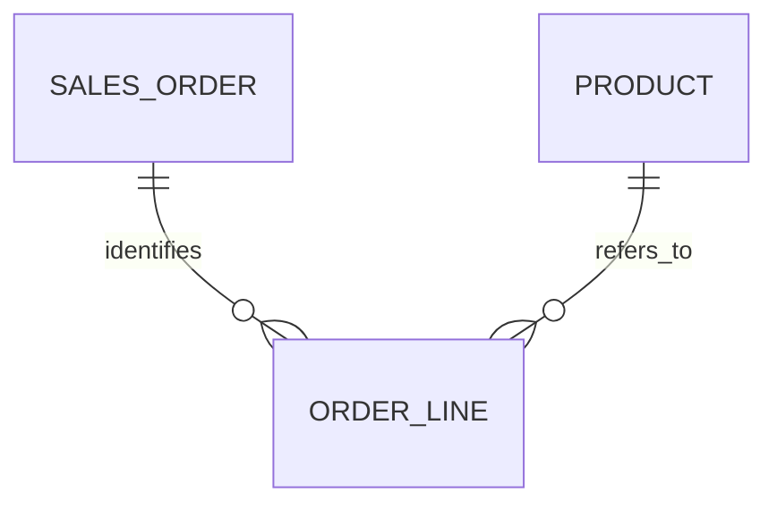
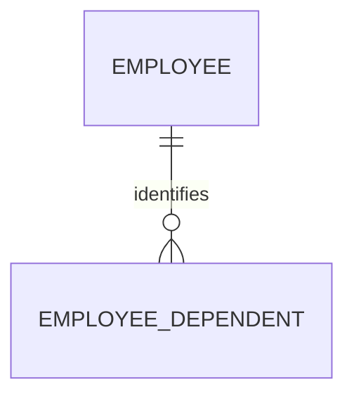

# Thực thể mạnh, thực thể yếu và sự phụ thuộc vào thực thể sở hữu

Khi mô hình hóa dữ liệu, không phải mọi đối tượng đều có danh tính độc lập. Một đơn hàng có thể được nhận diện bằng mã đơn hàng riêng, nhưng một dòng hàng thường chỉ có ý nghĩa trong phạm vi đơn hàng chứa nó. Tương tự, thông tin người phụ thuộc có thể được nhận diện bằng mã nhân viên cùng số thứ tự người phụ thuộc, vì tên người phụ thuộc không đủ để định danh duy nhất.

Sự khác biệt này dẫn đến hai khái niệm quan trọng: **thực thể mạnh (strong entity)** có thể được định danh bằng khóa riêng; **thực thể yếu (weak entity)** cần dựa vào khóa của một thực thể sở hữu cùng khóa bộ phận của chính nó để tạo thành định danh đầy đủ. Hiểu đúng quan hệ này giúp chọn khóa, thiết kế quan hệ, bảo vệ toàn vẹn tham chiếu và xác định cách xử lý vòng đời dữ liệu.

Trong phạm vi **DATABASE_DATA_MODELING**, bài học sử dụng ví dụ Đơn hàng – Dòng hàng và Nhân viên – Người phụ thuộc để giải thích cách nhận diện, mô hình hóa và triển khai hai loại thực thể.

## Mục tiêu học tập

Sau bài học, bạn có thể:

- Phân biệt thực thể mạnh và thực thể yếu dựa trên khả năng định danh.
- Xác định thực thể sở hữu, quan hệ định danh, khóa bộ phận và khóa đầy đủ của thực thể yếu.
- Phân biệt phụ thuộc định danh với phụ thuộc tồn tại.
- Chuyển mô hình ER có thực thể yếu thành lược đồ quan hệ với khóa chính ghép và khóa ngoại.
- Đánh giá khi nào nên dùng khóa thay thế, khi nào cần giữ khóa ghép và cách lựa chọn chính sách xóa dữ liệu.

## 1. Thực thể mạnh và thực thể yếu là gì?

### 1.1. Thực thể mạnh (Strong Entity)

Thực thể mạnh là loại thực thể có thể được nhận diện bằng một khóa của chính nó, không cần ghép khóa của thực thể khác để tạo danh tính. Khóa đó có thể là khóa tự nhiên, khóa nghiệp vụ hoặc khóa thay thế được hệ thống cấp.

Ví dụ:

- `CUSTOMER` được nhận diện bằng `customer_id`.
- `PRODUCT` được nhận diện bằng `product_id` hoặc một mã SKU có quy tắc duy nhất và ổn định.
- `SALES_ORDER` được nhận diện bằng `order_id`.

Thực thể mạnh vẫn có thể tham chiếu thực thể khác. Một đơn hàng cần thuộc về một khách hàng, nhưng `order_id` vẫn đủ để nhận diện đơn hàng mà không phải ghép thêm `customer_id`. Việc có khóa ngoại không khiến một thực thể trở thành thực thể yếu.

### 1.2. Thực thể yếu (Weak Entity)

Thực thể yếu là loại thực thể không có khóa đầy đủ độc lập trong mô hình nghiệp vụ. Để nhận diện một thể hiện cụ thể, cần kết hợp:

1. Khóa của **thực thể sở hữu (owner entity)**.
2. Một **khóa bộ phận (partial key/discriminator)** của thực thể yếu, chỉ phân biệt các thể hiện bên trong cùng một owner.

Ví dụ, `ORDER_LINE` có thể được nhận diện bằng `(order_id, line_no)`. `line_no` có thể là 1, 2, 3 trong mỗi đơn hàng; dòng số 1 của đơn hàng A khác dòng số 1 của đơn hàng B. Chỉ `line_no` không đủ để định danh dòng hàng trên toàn hệ thống.

Tương tự, `EMPLOYEE_DEPENDENT` có thể được nhận diện bằng `(employee_id, dependent_no)`. Số thứ tự người phụ thuộc chỉ có ý nghĩa trong hồ sơ của một nhân viên.

### 1.3. Bảng so sánh

| Tiêu chí | Thực thể mạnh | Thực thể yếu |
|---|---|---|
| Khả năng định danh | Có khóa riêng đủ để nhận diện | Cần khóa owner kết hợp khóa bộ phận |
| Phạm vi khóa | Thường duy nhất trong phạm vi tập thực thể | Khóa bộ phận chỉ duy nhất trong phạm vi owner |
| Quan hệ với owner | Có thể có hoặc không có quan hệ tham chiếu | Bắt buộc có quan hệ định danh với owner |
| Tham gia quan hệ định danh | Không phải điều kiện để tạo danh tính | Tham gia toàn phần; không tồn tại thể hiện yếu thiếu owner hợp lệ |
| Ví dụ | Khách hàng, sản phẩm, đơn hàng | Dòng hàng, người phụ thuộc của nhân viên |
| Khóa quan hệ thường gặp | Khóa riêng như `order_id` | Khóa ghép như `(order_id, line_no)` |

**Điểm quan trọng:** thực thể mạnh/yếu nói về cách định danh trong mô hình. Nó không đơn giản là “bảng có/không có khóa chính”, cũng không phải phân loại theo số lượng thuộc tính hoặc mức độ quan trọng của đối tượng.

## 2. Thực thể sở hữu và quan hệ định danh

Thực thể sở hữu là thực thể mà khóa của nó tham gia vào định danh đầy đủ của thực thể yếu. Quan hệ giữa hai loại thực thể được gọi là **quan hệ định danh (identifying relationship)**.

Trong quan hệ này:

- Mỗi thể hiện của thực thể yếu phải thuộc về đúng một owner theo mô hình đang xét.
- Một owner có thể sở hữu không, một hoặc nhiều thể hiện yếu tùy quy tắc nghiệp vụ.
- Thực thể yếu tham gia toàn phần vào quan hệ định danh: thiếu owner thì không thể xác định thể hiện yếu.
- Khóa owner là một phần của khóa đầy đủ của thực thể yếu.

Ví dụ Đơn hàng – Dòng hàng:



Trong sơ đồ, một đơn hàng có thể có nhiều dòng hàng. Mỗi dòng hàng thuộc về đúng một đơn hàng. Một dòng hàng cũng tham chiếu một sản phẩm; sản phẩm là thực thể mạnh và không phải owner định danh của dòng hàng trong ví dụ này.

Quan hệ đến `PRODUCT` không thay thế quan hệ định danh với `SALES_ORDER`. Dòng hàng có thể được xác định bởi đơn hàng và số dòng, trong khi `product_id` cho biết dòng đó bán sản phẩm nào. Nếu một sản phẩm được thêm hai lần vào cùng đơn hàng với hai mức giá hoặc ghi chú khác nhau, hai dòng hàng vẫn có thể là hai thể hiện riêng.

### 2.1. Bội số và tham gia toàn phần

Khi đọc sơ đồ ER, hãy diễn giải quan hệ từ cả hai phía:

- Phía owner: một đơn hàng có thể chưa có dòng hàng khi còn là bản nháp, hoặc có nhiều dòng hàng.
- Phía thực thể yếu: mỗi dòng hàng bắt buộc gắn với đúng một đơn hàng.

Trong ví dụ, sơ đồ cho phép đơn hàng chưa có dòng hàng vì đơn hàng nháp có thể tồn tại trước khi khách thêm sản phẩm. Quy tắc “đơn hàng đã xác nhận phải có ít nhất một dòng hàng” là invariant theo trạng thái; quan hệ ER và khóa ngoại đơn thuần chưa diễn đạt hết điều kiện này.

### 2.2. Khóa bộ phận (Partial Key)

Khóa bộ phận phân biệt các thể hiện yếu trong cùng một owner, nhưng không đủ để định danh toàn cục.

| Owner | Khóa bộ phận | Khóa đầy đủ của thực thể yếu |
|---|---|---|
| `SALES_ORDER.order_id = 5001` | `line_no = 1` | `(5001, 1)` |
| `SALES_ORDER.order_id = 5001` | `line_no = 2` | `(5001, 2)` |
| `SALES_ORDER.order_id = 5002` | `line_no = 1` | `(5002, 1)` |

Giá trị `line_no = 1` xuất hiện ở nhiều đơn hàng mà không gây trùng vì định danh đầy đủ còn chứa `order_id`. Khi thiết kế khóa bộ phận, phải xác định rõ phạm vi duy nhất. Nếu `line_no` được dùng làm số thứ tự trong từng đơn hàng thì không nên áp đặt ràng buộc duy nhất toàn bảng lên riêng cột này.

## 3. Phụ thuộc định danh và phụ thuộc tồn tại

Hai khái niệm này thường đi cùng nhau nhưng không đồng nghĩa.

- **Phụ thuộc định danh (identification dependence):** danh tính của thực thể con phải kết hợp danh tính owner với khóa bộ phận. Đây là đặc trưng cốt lõi của weak entity theo mô hình ER truyền thống.
- **Phụ thuộc tồn tại (existence dependence):** một đối tượng không được tồn tại nếu đối tượng khác không còn hoặc chưa tồn tại theo quy tắc nghiệp vụ.

Một thực thể yếu thường phụ thuộc tồn tại vào owner. Tuy nhiên, một đối tượng có thể phụ thuộc tồn tại nhưng vẫn có định danh riêng. Ví dụ, một khoản thanh toán có `payment_id` toàn cục nhưng bắt buộc tham chiếu một đơn hàng. Nếu đơn hàng bị xóa, khoản thanh toán có thể phải được giữ lại vì yêu cầu kế toán. Khoản thanh toán phụ thuộc vào đơn hàng về mặt quan hệ nghiệp vụ, nhưng không phải weak entity theo nghĩa định danh nếu `payment_id` tự nó nhận diện được khoản thanh toán.

Ngược lại, một khóa thay thế được thêm vào bảng của thực thể yếu không tự động loại bỏ sự phụ thuộc nghiệp vụ vào owner. Cần phân biệt quy ước định danh ở mức khái niệm với cách lưu trữ vật lý. Nếu mô hình vẫn yêu cầu mỗi dòng hàng được định danh trong phạm vi đơn hàng, thì ràng buộc duy nhất `(order_id, line_no)` và khóa ngoại bắt buộc vẫn cần được duy trì dù bảng có thêm `order_line_id`.

## 4. Ví dụ 1: Đơn hàng và dòng hàng

### 4.1. Phân tích yêu cầu

Giả sử nghiệp vụ có các quy tắc:

1. Đơn hàng được tạo với mã đơn hàng riêng.
2. Mỗi dòng hàng được đánh số trong phạm vi đơn hàng.
3. Một dòng hàng thuộc đúng một đơn hàng và tham chiếu đúng một sản phẩm.
4. Số lượng phải lớn hơn 0; đơn giá không âm.
5. Giá tại thời điểm mua được lưu để lịch sử đơn hàng không đổi khi giá sản phẩm cập nhật.
6. Đơn hàng nháp có thể chưa có dòng hàng; đơn hàng chỉ được xác nhận khi có ít nhất một dòng hợp lệ.

Phân loại:

- `SALES_ORDER` là thực thể mạnh vì `order_id` định danh độc lập.
- `ORDER_LINE` là thực thể yếu trong mô hình dùng số dòng theo phạm vi đơn hàng.
- `line_no` là khóa bộ phận.
- `order_id` vừa là khóa owner, vừa là một phần của khóa đầy đủ của dòng hàng.
- `product_id` là tham chiếu đến thực thể mạnh `PRODUCT`, không phải thành phần cần thiết để phân biệt hai dòng trong ví dụ này.

### 4.2. Mô hình quan hệ

| Quan hệ | Khóa chính | Khóa ngoại | Ghi chú |
|---|---|---|---|
| `SALES_ORDER` | `order_id` | — | Thực thể mạnh |
| `PRODUCT` | `product_id` | — | Thực thể mạnh |
| `ORDER_LINE` | `(order_id, line_no)` | `order_id` → `SALES_ORDER`; `product_id` → `PRODUCT` | Thực thể yếu; `line_no` là khóa bộ phận |

### 4.3. DDL PostgreSQL minh họa

```sql
CREATE TABLE sales_order (
    order_id BIGINT GENERATED BY DEFAULT AS IDENTITY PRIMARY KEY,
    status   VARCHAR(20) NOT NULL
             CHECK (status IN ('DRAFT', 'PENDING', 'CONFIRMED', 'CANCELLED'))
);

CREATE TABLE product (
    product_id BIGINT GENERATED BY DEFAULT AS IDENTITY PRIMARY KEY,
    sku        VARCHAR(64) NOT NULL UNIQUE,
    name       VARCHAR(200) NOT NULL
);

CREATE TABLE order_line (
    order_id   BIGINT NOT NULL,
    line_no    INTEGER NOT NULL CHECK (line_no > 0),
    product_id BIGINT NOT NULL REFERENCES product(product_id),
    quantity   INTEGER NOT NULL CHECK (quantity > 0),
    unit_price NUMERIC(14, 2) NOT NULL CHECK (unit_price >= 0),
    PRIMARY KEY (order_id, line_no),
    CONSTRAINT order_line_owner_fk
        FOREIGN KEY (order_id)
        REFERENCES sales_order(order_id)
        ON DELETE CASCADE
);
```

Trong DDL này:

- `sales_order.order_id` là khóa chính độc lập của thực thể mạnh.
- Khóa chính ghép `(order_id, line_no)` bảo đảm số dòng không trùng trong cùng đơn hàng.
- `order_id NOT NULL` cùng khóa ngoại bảo đảm mỗi dòng hàng có owner hợp lệ.
- `product_id` tham chiếu sản phẩm, còn `unit_price` lưu giá đã chốt của giao dịch.
- `ON DELETE CASCADE` là một chính sách vòng đời được chọn cho ví dụ: khi xóa đơn hàng, các dòng hàng phụ thuộc bị xóa theo. Trong hệ thống thực tế, có thể phải dùng `RESTRICT`, soft delete hoặc lưu trữ lịch sử thay vì xóa cứng.

### 4.4. Những điều DDL chưa tự bảo đảm

Khóa ngoại bảo đảm không có dòng hàng mồ côi, nhưng không buộc mỗi đơn hàng phải có ít nhất một dòng. `CHECK` trên một hàng cũng không thể kiểm tra tổng số hàng con của một đơn hàng theo cách thông thường. Quy tắc “đơn hàng đã xác nhận phải có dòng hàng” cần được bảo vệ ở quy trình xác nhận, transaction hoặc cơ chế DBMS thích hợp.

Ví dụ ở tầng ứng dụng, thao tác xác nhận cần thực hiện kiểm tra dòng hàng và cập nhật trạng thái trong cùng transaction để tránh trường hợp kiểm tra xong nhưng dữ liệu thay đổi trước khi xác nhận. Nếu có nhiều ứng dụng hoặc tác vụ có thể xác nhận đơn, cần có một hàng rào nhất quán dùng chung.

## 5. Ví dụ 2: Nhân viên và người phụ thuộc

Một hệ thống nhân sự cần lưu thông tin người phụ thuộc để phục vụ chế độ phúc lợi. Tên người phụ thuộc không phải khóa tốt: nhiều người có thể trùng tên, tên có thể thay đổi và một nhân viên có thể có nhiều người cùng quan hệ gia đình.

Một mô hình phù hợp:

- `EMPLOYEE` là thực thể mạnh, có `employee_id`.
- `EMPLOYEE_DEPENDENT` là thực thể yếu, được định danh bởi `(employee_id, dependent_no)`.
- `dependent_no` chỉ duy nhất trong hồ sơ của một nhân viên.
- Mỗi người phụ thuộc phải thuộc về đúng một nhân viên theo quy tắc dữ liệu.



DDL minh họa:

```sql
CREATE TABLE employee (
    employee_id BIGINT GENERATED BY DEFAULT AS IDENTITY PRIMARY KEY,
    full_name   VARCHAR(200) NOT NULL
);

CREATE TABLE employee_dependent (
    employee_id  BIGINT NOT NULL,
    dependent_no SMALLINT NOT NULL CHECK (dependent_no > 0),
    full_name    VARCHAR(200) NOT NULL,
    relationship VARCHAR(30) NOT NULL,
    birth_date   DATE,
    PRIMARY KEY (employee_id, dependent_no),
    FOREIGN KEY (employee_id)
        REFERENCES employee(employee_id)
        ON DELETE RESTRICT
);
```

Ở đây chọn `ON DELETE RESTRICT` vì hồ sơ nhân sự và phúc lợi có thể cần lưu theo chính sách lưu trữ. Nếu nhân viên nghỉ việc, hệ thống thường chuyển trạng thái hoặc lưu hồ sơ thay vì xóa toàn bộ người phụ thuộc. Chính sách xóa phải dựa trên yêu cầu nghiệp vụ, kiểm toán và quy định lưu trữ dữ liệu.

Không nên dùng `(employee_id, full_name)` làm khóa nếu tên có thể thay đổi hoặc trùng trong cùng hồ sơ. Số thứ tự `dependent_no` là định danh kỹ thuật trong phạm vi owner; tên là thuộc tính mô tả.

## 6. Khi nào dùng khóa ghép, khi nào dùng khóa thay thế?

Với thực thể yếu, khóa ghép giữa owner key và partial key diễn đạt trực tiếp quy tắc định danh. Tuy nhiên, có hệ thống muốn mỗi dòng hàng có ID toàn cục để tham chiếu từ log, API hoặc dịch vụ khác.

### 6.1. Dùng khóa ghép

```sql
PRIMARY KEY (order_id, line_no)
```

Phù hợp khi:

- Số dòng chỉ có ý nghĩa trong đơn hàng.
- Dòng hàng không cần định danh độc lập ngoài phạm vi owner.
- Các quan hệ khác có thể tham chiếu bằng cặp khóa này.
- Việc chuyển dòng hàng sang đơn khác được xem là thay đổi danh tính hoặc không được phép.

Ưu điểm là mô hình thể hiện rõ phạm vi định danh và không cần thêm ID chỉ để tạo khóa. Nhược điểm là mọi bảng tham chiếu dòng hàng phải mang cả hai cột khóa; khi owner key dài, khóa ghép có thể làm tăng kích thước chỉ mục và khóa ngoại.

### 6.2. Thêm khóa thay thế nhưng giữ ràng buộc owner

Nếu cần ID toàn cục, có thể thiết kế:

```sql
CREATE TABLE order_line (
    order_line_id BIGINT GENERATED BY DEFAULT AS IDENTITY PRIMARY KEY,
    order_id      BIGINT NOT NULL REFERENCES sales_order(order_id),
    line_no       INTEGER NOT NULL CHECK (line_no > 0),
    product_id    BIGINT NOT NULL REFERENCES product(product_id),
    quantity      INTEGER NOT NULL CHECK (quantity > 0),
    UNIQUE (order_id, line_no)
);
```

Trong thiết kế này:

- `order_line_id` là khóa thay thế, thuận tiện cho tham chiếu toàn cục.
- `UNIQUE (order_id, line_no)` vẫn giữ quy tắc số dòng duy nhất trong một đơn hàng.
- `order_id NOT NULL` vẫn bắt buộc dòng hàng có owner.
- Nếu dòng hàng không thể chuyển giữa các đơn, ứng dụng cần bảo vệ quy tắc đó; thay đổi `order_id` không nên được xem như một cập nhật thông thường.

Theo định nghĩa ER chặt chẽ, khi thực thể có khóa riêng đủ để nhận diện toàn cục, nó không còn là weak entity về mặt định danh. Tuy vậy, nó vẫn có thể phụ thuộc tồn tại vào owner theo nghiệp vụ. Vì thế, tài liệu nên nói rõ đang dùng “thực thể yếu” theo nghĩa mô hình khái niệm hay đang mô tả một bảng có phụ thuộc vòng đời.

### 6.3. Câu hỏi để chọn khóa

| Câu hỏi | Nếu câu trả lời là “có” | Hướng cân nhắc |
|---|---|---|
| Định danh của đối tượng có chỉ có ý nghĩa trong phạm vi owner? | Có | Khóa ghép owner key + partial key thể hiện đúng phạm vi |
| Đối tượng cần được tham chiếu rộng rãi từ nhiều hệ thống? | Có | Cân nhắc khóa thay thế toàn cục và giữ unique constraint theo owner |
| Đối tượng có thể chuyển owner mà vẫn giữ nguyên danh tính? | Có | Khóa ghép có thể không phù hợp; cần ID độc lập và quy tắc chuyển owner rõ ràng |
| Đối tượng phải được lưu độc lập sau khi owner bị xóa? | Có | Xem lại phân loại yếu, chính sách lưu trữ và quyền sở hữu dữ liệu |
| Partial key có thể thay đổi theo nghiệp vụ? | Có | Cân nhắc surrogate key để ổn định tham chiếu, đồng thời giữ ràng buộc nghiệp vụ cần thiết |

## 7. Phân biệt thực thể yếu với thực thể liên kết

Thực thể liên kết (associative entity) được dùng để biểu diễn quan hệ nhiều-nhiều hoặc bổ sung thuộc tính cho quan hệ. Ví dụ, `ENROLLMENT` nối `STUDENT` và `COURSE`, có thể chứa `enrolled_at`, `grade` và `status`.

Một thực thể liên kết có thể dùng khóa ghép `(student_id, course_id)`. Trong trường hợp đó, danh tính của enrollment phụ thuộc vào hai đầu quan hệ và có thể được mô hình như thực thể yếu theo cách tiếp cận ER. Nhưng không phải mọi thực thể liên kết đều là thực thể yếu: nếu mỗi lần đăng ký là một lần giao dịch riêng, có thể cần `enrollment_id` độc lập để phân biệt nhiều lần đăng ký cùng một khóa học.

| Tiêu chí | Thực thể yếu | Thực thể liên kết |
|---|---|---|
| Mục đích chính | Biểu diễn đối tượng có danh tính phụ thuộc owner | Biểu diễn quan hệ hoặc biến quan hệ thành thực thể có thuộc tính |
| Số owner | Thường một owner định danh | Thường nối từ hai thực thể trở lên |
| Khóa | Owner key + partial key | Có thể là khóa ghép từ các đầu quan hệ hoặc khóa thay thế |
| Ví dụ | Dòng hàng trong đơn hàng; người phụ thuộc của nhân viên | Đăng ký môn học; thành viên nhóm dự án |

Hãy phân loại dựa trên quy tắc danh tính và ý nghĩa nghiệp vụ, không chỉ dựa vào việc bảng có hai khóa ngoại.

## 8. Thực thể yếu trong các kiểu lưu trữ khác

Ý tưởng phụ thuộc owner không chỉ xuất hiện trong mô hình quan hệ.

- **Document database:** nếu dòng hàng chỉ được truy cập trong ngữ cảnh đơn hàng, có thể nhúng `items` thành mảng trong document `Order`. Ranh giới document phản ánh aggregate và giúp đọc đơn hàng cùng các dòng trong một lần. Cần cân nhắc giới hạn kích thước document, cập nhật đồng thời và nhu cầu truy vấn dòng hàng độc lập.
- **Document tách riêng:** nếu dòng hàng cần truy vấn riêng, có thể lưu document với `orderId` và `lineNo`; cần bảo đảm tính duy nhất của cặp này và xử lý vòng đời theo owner.
- **Graph database:** có thể biểu diễn `ORDER` và `ORDER_LINE` thành node nối bởi quan hệ `CONTAINS`. Quan hệ sở hữu thể hiện sự phụ thuộc, nhưng cần constraint hoặc logic ứng dụng để bảo đảm không có node dòng hàng thiếu owner.
- **Mô hình phân tích:** dòng hàng thường trở thành grain của fact bán hàng. `order_id` và `line_no` có thể cùng tham gia khóa nghiệp vụ hoặc degenerate dimension; thiết kế cần giữ đúng grain và tránh nhân bản số liệu khi join dimension.

Kiểu lưu trữ có thể thay đổi nhưng câu hỏi về danh tính vẫn còn: đối tượng được nhận diện trong phạm vi nào, ai sở hữu vòng đời, và điều gì xảy ra khi owner thay đổi hoặc bị xóa?

## 9. Chính sách vòng đời và toàn vẹn tham chiếu

Khi một thực thể yếu phụ thuộc owner, thao tác xóa hoặc lưu trữ owner cần được xem xét cùng các thể hiện con.

| Chính sách | Hành vi | Khi cân nhắc |
|---|---|---|
| `ON DELETE CASCADE` | Xóa owner thì xóa các bản ghi yếu tham chiếu | Dữ liệu con chỉ có ý nghĩa cùng owner và được phép xóa cùng |
| `ON DELETE RESTRICT` / `NO ACTION` | Chặn xóa owner khi còn bản ghi con | Cần bảo toàn dữ liệu hoặc buộc quy trình xử lý con trước |
| Soft delete | Đánh dấu owner hoặc child đã ngừng hoạt động | Cần lịch sử, kiểm toán hoặc khôi phục |
| Archive / retention workflow | Chuyển dữ liệu sang vùng lưu trữ theo chính sách | Dữ liệu cần giữ lâu dài hoặc có yêu cầu pháp lý/nghiệp vụ |

Không chọn cascade chỉ vì thực thể con là yếu. Một dòng hàng có thể cần được giữ trong lịch sử đơn hàng; một người phụ thuộc có thể nằm trong hồ sơ nhân sự cần lưu trữ. Khóa ngoại và chính sách xóa phải phản ánh đúng vòng đời và nghĩa vụ lưu dữ liệu.

Ngoài xóa, cần xem xét các tình huống:

- Owner key có được phép thay đổi không? Nếu thay đổi, toàn bộ khóa con và tham chiếu có được cập nhật nhất quán không?
- Partial key có thể được tái sử dụng sau khi xóa một child không?
- Có cần lưu lịch sử thay đổi child hoặc owner không?
- Có nhiều transaction đồng thời thêm cùng `line_no` vào một đơn hàng không? Khóa chính/unique constraint phải là hàng rào cuối cùng chống trùng.
- Quy trình xác nhận đơn có thể chạy đồng thời với việc xóa dòng hàng không? Cần transaction và mức cô lập hoặc khóa phù hợp.

## 10. Những lỗi thiết kế thường gặp

| Lỗi | Hệ quả | Cách xử lý |
|---|---|---|
| Dùng `line_no` làm khóa chính toàn bảng | Dòng số 1 ở nhiều đơn hàng bị coi là trùng | Dùng khóa ghép `(order_id, line_no)` hoặc ID thay thế kèm unique constraint |
| Dùng tên người phụ thuộc làm khóa | Tên trùng hoặc thay đổi làm hỏng tham chiếu | Dùng owner key + partial key ổn định hoặc ID thay thế |
| Bỏ `NOT NULL` trên owner key | Có thể tạo child mồ côi, không tuân thủ quan hệ định danh | Bắt buộc owner key và tạo khóa ngoại |
| Cho rằng có khóa ngoại là đủ | Không bảo đảm quy tắc số lượng con tối thiểu hoặc trạng thái hợp lệ | Bảo vệ invariant liên hàng ở transaction/workflow hoặc cơ chế phù hợp |
| Xóa owner bằng cascade không xem xét lịch sử | Mất dữ liệu kiểm toán hoặc dữ liệu giao dịch cần lưu | Chọn restrict, soft delete hoặc archive theo chính sách |
| Thêm surrogate key rồi bỏ unique theo owner | Cho phép hai dòng cùng số thứ tự trong một đơn | Giữ `UNIQUE(owner_id, partial_key)` nếu quy tắc nghiệp vụ yêu cầu |
| Nhầm mọi bảng có FK là thực thể yếu | Phân loại sai mô hình và vòng đời | Kiểm tra khóa riêng, phạm vi định danh và phụ thuộc tồn tại |

## 11. Quy trình xác định và thiết kế thực thể yếu

1. **Tìm đối tượng cần quản lý:** đối tượng có thuộc tính, trạng thái hoặc lịch sử riêng không? Nếu chỉ là một thuộc tính đơn giản của owner, chưa chắc cần tạo thực thể riêng.
2. **Tìm owner:** đối tượng đó thuộc về ai trong nghiệp vụ? Có đúng một owner hay phụ thuộc vào nhiều thực thể?
3. **Xác định phạm vi định danh:** đối tượng có ID riêng toàn cục hay chỉ phân biệt trong phạm vi owner?
4. **Chọn partial key:** thuộc tính nào phân biệt các child trong cùng owner và có ổn định không?
5. **Mô hình hóa quan hệ định danh:** xác định bội số, tham gia toàn phần và quy tắc owner bắt buộc.
6. **Ánh xạ sang lược đồ:** tạo khóa chính ghép hoặc khóa thay thế kèm unique constraint, khóa ngoại và nullability phù hợp.
7. **Xác định vòng đời:** chọn cascade, restrict, soft delete hoặc archive dựa trên nghiệp vụ và yêu cầu lưu trữ.
8. **Kiểm thử:** thử child thiếu owner, trùng partial key trong cùng owner, cùng partial key ở owner khác, xóa owner, thay đổi owner và thao tác đồng thời.

## 12. Checklist kiểm chứng

- [ ] Mỗi thực thể mạnh có khóa ứng viên đủ để định danh độc lập.
- [ ] Mỗi thực thể yếu có owner được xác định rõ.
- [ ] Khóa bộ phận chỉ duy nhất trong phạm vi owner đã mô tả.
- [ ] Khóa đầy đủ của thực thể yếu được xác định rõ trong mô hình.
- [ ] Mỗi child bắt buộc tham chiếu một owner hợp lệ.
- [ ] Bội số phía owner và phía child phản ánh đúng nghiệp vụ.
- [ ] Phụ thuộc định danh được phân biệt với phụ thuộc tồn tại.
- [ ] Khóa chính, khóa ngoại, `NOT NULL` và `UNIQUE` được ánh xạ chính xác.
- [ ] Chính sách xóa, lưu trữ và thay đổi owner phù hợp vòng đời dữ liệu.
- [ ] Các invariant liên quan đến nhiều hàng hoặc trạng thái được kiểm soát trong transaction/workflow phù hợp.
- [ ] Có kiểm thử cho trùng khóa bộ phận, child mồ côi, xóa owner và cập nhật đồng thời.

## Tóm tắt

Thực thể mạnh có khóa riêng đủ để nhận diện. Thực thể yếu cần khóa của owner kết hợp khóa bộ phận để tạo danh tính đầy đủ; mỗi thể hiện yếu tham gia toàn phần vào quan hệ định danh với owner. Phụ thuộc định danh khác với phụ thuộc tồn tại: một đối tượng có thể phải thuộc về owner nhưng vẫn có ID toàn cục riêng.

Trong mô hình quan hệ, cách biểu diễn trực tiếp thường là khóa chính ghép giữa owner key và partial key, cùng khóa ngoại bắt buộc. Nếu dùng khóa thay thế, cần giữ các ràng buộc nghiệp vụ như duy nhất trong phạm vi owner và phụ thuộc vòng đời. Chính sách xóa phải dựa trên ý nghĩa và yêu cầu lưu trữ, không tự động suy ra từ nhãn “weak entity”.

## Thuật ngữ cần nhớ

| Thuật ngữ | Ý nghĩa |
|---|---|
| Strong Entity | Thực thể có khóa riêng đủ để định danh |
| Weak Entity | Thực thể cần khóa owner và khóa bộ phận để định danh đầy đủ |
| Owner Entity | Thực thể sở hữu mà khóa tham gia vào định danh của thực thể yếu |
| Identifying Relationship | Quan hệ định danh giữa owner và thực thể yếu |
| Partial Key | Khóa bộ phận phân biệt child trong phạm vi một owner |
| Composite Primary Key | Khóa chính gồm nhiều thuộc tính, ví dụ `(order_id, line_no)` |
| Identification Dependence | Phụ thuộc về danh tính vào khóa của owner |
| Existence Dependence | Phụ thuộc về vòng đời; child không thể tồn tại nếu thiếu owner theo quy tắc |
| Surrogate Key | Khóa thay thế do hệ thống cấp, không mang ý nghĩa nghiệp vụ trực tiếp |
| Referential Integrity | Toàn vẹn tham chiếu giữa khóa ngoại và khóa được tham chiếu |
