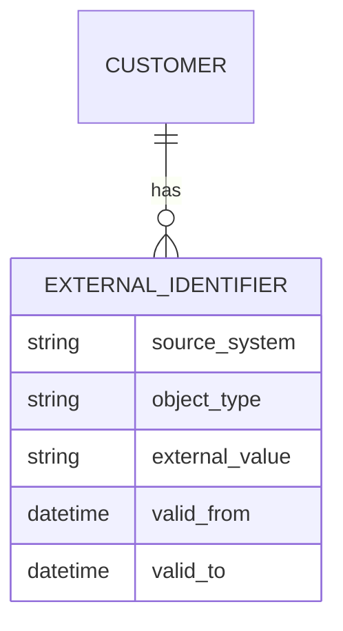
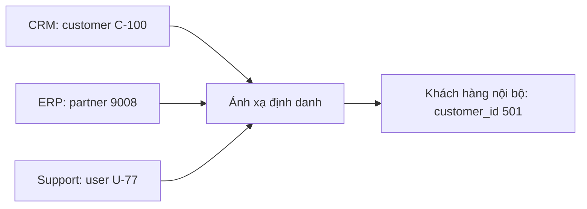
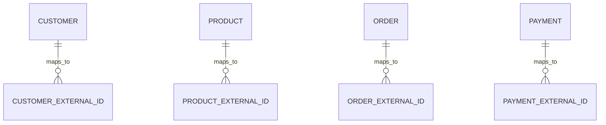
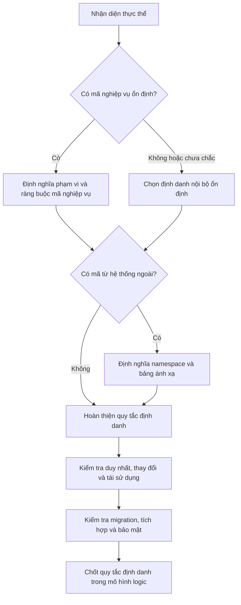

# Định danh nội bộ, mã nghiệp vụ và mã từ hệ thống bên ngoài

Một hệ thống dữ liệu cần phân biệt được từng đối tượng trong suốt vòng đời của nó. Khách hàng có thể đổi tên, sản phẩm có thể đổi mã bán hàng, đơn hàng có thể được đồng bộ qua nhiều hệ thống và một tổ chức có thể hợp nhất hai hồ sơ trùng lặp. Nếu định danh được chọn không phù hợp, các thay đổi nghiệp vụ này dễ làm đứt liên kết, tạo bản ghi trùng hoặc khiến dữ liệu lịch sử không còn truy vết được.

Khi thiết kế mô hình dữ liệu, cần phân biệt ba khái niệm thường bị dùng lẫn: **định danh nội bộ** do hệ thống quản lý để nhận diện ổn định một thực thể; **mã nghiệp vụ** có ý nghĩa với người dùng hoặc quy trình; và **mã từ hệ thống bên ngoài** do một ứng dụng hoặc đối tác khác cấp. Chúng có thể cùng tồn tại trên một thực thể nhưng phục vụ các mục đích khác nhau.

Bài học này trình bày cách lựa chọn, quản lý và liên kết các loại mã; cách xác định phạm vi duy nhất; cách xử lý thay đổi, trùng lặp và di chuyển dữ liệu; đồng thời chỉ ra những quy tắc cần kiểm chứng trước khi chuyển sang khóa và lược đồ vật lý.

## 1. Định danh và khóa trong mô hình dữ liệu

### 1.1. Định danh là gì?

Định danh (identifier) là thông tin hoặc tập hợp thông tin dùng để phân biệt một cá thể với các cá thể khác trong một phạm vi xác định. Định danh trả lời câu hỏi: “Đây là đối tượng nào?”

Ví dụ:

- Một khách hàng được nhận diện bằng mã khách hàng do hệ thống cấp.
- Một đơn hàng được nhận diện bằng mã đơn hàng trong phạm vi cửa hàng.
- Một giao dịch thanh toán được nhận diện bằng mã giao dịch của nhà cung cấp thanh toán.
- Một sản phẩm có thể có mã SKU nội bộ, mã vạch và mã sản phẩm của nhà cung cấp.

Định danh không nhất thiết là một giá trị đơn lẻ. Một cặp giá trị như `(tenant_id, customer_number)` có thể cùng tạo nên định danh duy nhất trong một hệ thống nhiều tổ chức. Một thực thể cũng có thể có nhiều định danh thay thế, chẳng hạn mã nội bộ và mã nghiệp vụ.

### 1.2. Phân biệt định danh, khóa và thuộc tính

Các thuật ngữ có liên quan nhưng khác nhau:

| Khái niệm | Ý nghĩa | Ví dụ |
|---|---|---|
| Định danh | Cách nhận diện một cá thể theo nghiệp vụ hoặc trong hệ thống | Mã khách hàng, mã đơn |
| Khóa ứng viên (candidate key) | Tập thuộc tính tối thiểu có thể nhận diện duy nhất một dòng trong mô hình quan hệ | `customer_id`, hoặc `email` nếu thực sự duy nhất và bắt buộc |
| Khóa chính (primary key) | Khóa ứng viên được chọn làm định danh chính của bảng | `customer_id` |
| Khóa thay thế (alternate key) | Khóa ứng viên hợp lệ nhưng không được chọn làm khóa chính | Mã khách hàng nghiệp vụ duy nhất |
| Khóa ngoại (foreign key) | Thuộc tính tham chiếu đến khóa được bảo đảm duy nhất ở quan hệ khác | `order.customer_id` tham chiếu khách hàng |
| Thuộc tính mô tả | Cung cấp thông tin về đối tượng nhưng không nhận diện duy nhất | Tên hiển thị, địa chỉ |

Trong mô hình khái niệm, ta nói về định danh và quy tắc nhận diện. Trong mô hình logic quan hệ, ta xác định khóa ứng viên, khóa chính, khóa thay thế và khóa ngoại. Khi triển khai vật lý, các khóa được ánh xạ thành cấu trúc cụ thể của hệ quản trị cơ sở dữ liệu.

Không nên gọi mọi mã là khóa chính. Một mã có thể có ý nghĩa nghiệp vụ nhưng không ổn định, không duy nhất toàn cục hoặc có thể thay đổi. Ngược lại, một khóa nội bộ không cần mang ý nghĩa để người dùng đọc.

### 1.3. Các thuộc tính cần có của một định danh tốt

Khi đánh giá định danh, hãy xem xét:

- **Tính duy nhất:** Hai cá thể khác nhau trong phạm vi đã định không được có cùng định danh.
- **Tính ổn định:** Định danh không thay đổi khi tên, địa chỉ hoặc thuộc tính mô tả thay đổi.
- **Tính bền vững:** Định danh còn có thể được tham chiếu trong suốt thời gian cần lưu dữ liệu và lịch sử.
- **Tính không tái sử dụng:** Mã đã cấp cho một đối tượng không bị cấp lại cho đối tượng khác nếu điều đó có thể làm nhầm lịch sử.
- **Tính khả dụng:** Có thể tạo, truyền và lưu định danh trong các hệ thống cần dùng nó.
- **Phạm vi rõ ràng:** Biết mã duy nhất trong một bảng, một tổ chức, một nhà cung cấp hay toàn hệ thống.
- **Khả năng kiểm tra:** Có quy tắc để xác minh mã hợp lệ và phát hiện trùng lặp.

Không phải mọi định danh đều cần ngắn, dễ đọc hoặc có thể đoán được. Những yêu cầu này phụ thuộc vào mục đích sử dụng và có thể xung đột với bảo mật hoặc khả năng mở rộng.

## 2. Định danh nội bộ

Định danh nội bộ (internal identifier) là mã do hệ thống hoặc miền dữ liệu sở hữu cấp để nhận diện thực thể. Mã này thường được dùng trong liên kết dữ liệu, tham chiếu giữa bảng hoặc dịch vụ và xử lý vòng đời bản ghi.

Ví dụ:

```text
customer_id = 7f6b1f5e-8a4b-4a9d-9f2d-7b6c8a1d1234
order_id    = 901284
product_id  = 4c0f2f2e-6c8d-4d6a-a4a8-1a2b3c4d5e6f
```

Các giá trị trên chỉ minh họa hình thức. Mã nội bộ không cần chứa tên khách hàng, loại sản phẩm hay ngày tạo nếu những thành phần đó không phải một phần của hợp đồng định danh.

### 2.1. Định danh thay thế (surrogate identifier)

Định danh thay thế là mã do hệ thống tạo ra, không mang ý nghĩa nghiệp vụ trực tiếp. Ví dụ: số tăng tự động, UUID hoặc một mã ngẫu nhiên đủ lớn.

Ưu điểm thường gặp:

- Ít bị ảnh hưởng khi mã nghiệp vụ hoặc thông tin cá nhân thay đổi.
- Có thể ngắn gọn và ổn định để tham chiếu giữa các bảng.
- Giúp tách cấu trúc liên kết nội bộ khỏi quy tắc mã hóa của phòng ban hoặc đối tác.
- Hữu ích khi một thực thể có nhiều mã bên ngoài hoặc mã nghiệp vụ.

Những điểm cần cân nhắc:

- Cần thêm ràng buộc duy nhất cho các mã nghiệp vụ nếu chúng phải duy nhất.
- Mã nội bộ không tự giải quyết vấn đề dữ liệu trùng lặp về mặt nghiệp vụ.
- Một số kiểu mã có thể làm lộ thứ tự tạo hoặc quy mô nếu được công khai.
- Cần thống nhất cách tạo mã trong môi trường nhiều dịch vụ hoặc nhiều nút ghi dữ liệu.

### 2.2. Các cách tạo định danh nội bộ

| Cách tạo | Đặc điểm | Khi cân nhắc |
|---|---|---|
| Số tăng tự động | Dễ đọc, nhỏ gọn, thuận tiện cho khóa số nguyên | Hệ thống tập trung hoặc có cơ chế cấp số đáng tin cậy |
| UUID | Không cần một bộ cấp số trung tâm; không mang ý nghĩa nghiệp vụ | Hệ thống phân tán, tích hợp hoặc cần tạo ID ở nhiều nơi |
| ULID / định danh có thành phần thời gian | Có thể sắp xếp gần theo thời gian và giảm phụ thuộc bộ cấp số | Khi thứ tự gần đúng theo thời gian hữu ích; cần hiểu đặc tính lộ thời điểm |
| Mã ngẫu nhiên theo miền riêng | Có thể kiểm soát độ dài và định dạng | Khi có yêu cầu giao tiếp hoặc định dạng riêng đã được xác nhận |

Không có một cách tạo mã tối ưu cho mọi hệ thống. Hãy xem xét:

- Có cần tạo mã khi không kết nối được với máy chủ trung tâm không?
- Có nhiều vùng hoặc dịch vụ cùng ghi dữ liệu không?
- Mã có xuất hiện trong URL, hóa đơn hoặc giao tiếp với đối tác không?
- Có yêu cầu không tiết lộ số lượng bản ghi hoặc trình tự tạo không?
- Hệ thống lưu trữ và công cụ có hỗ trợ tốt kiểu mã đó không?
- Có cần sắp xếp theo thời gian hoặc phân bố ghi trên nhiều phân vùng không?

### 2.3. Số tăng tự động

Số tăng tự động thường được cấp bởi sequence hoặc identity của hệ quản trị. Ví dụ:

```sql
CREATE TABLE customer (
    customer_id BIGINT GENERATED ALWAYS AS IDENTITY PRIMARY KEY,
    display_name VARCHAR(200) NOT NULL
);
```

Ưu điểm là khóa nhỏ, dễ tham chiếu và có thể hiệu quả trong nhiều chỉ mục. Tuy nhiên, số tăng tự động không bảo đảm không có khoảng trống. Giao dịch rollback, cấp trước hoặc thao tác đồng thời có thể làm số bị bỏ qua. Vì vậy, không nên dùng số ID để đếm số khách hàng chính xác hoặc giả định rằng các số phải liên tục.

Nếu nhiều hệ thống độc lập cùng tạo bản ghi, cần cơ chế tránh xung đột. Có thể dùng sequence theo từng vùng, một bộ cấp ID chung hoặc một loại định danh phân tán. Việc chọn cách nào phụ thuộc kiến trúc và yêu cầu sẵn sàng.

### 2.4. UUID và định danh phân tán

UUID là định danh 128 bit theo một định dạng chuẩn. Ví dụ UUID v4 thường được tạo ngẫu nhiên; một số phiên bản UUID khác có thành phần thời gian hoặc namespace.

Ưu điểm:

- Xác suất va chạm rất thấp khi tạo độc lập đúng cách.
- Có thể tạo ở nhiều dịch vụ hoặc máy khách mà không cần cấp số tuần tự tập trung.
- Không thể dễ dàng đoán số bản ghi tiếp theo như khóa tăng tự động.

Điểm cần cân nhắc:

- Kích thước lớn hơn khóa số nguyên.
- Giá trị ngẫu nhiên có thể làm tăng phân mảnh chỉ mục ở một số hệ quản trị và kiểu lưu trữ.
- Cần thống nhất cách biểu diễn, chuẩn hóa chữ hoa/chữ thường nếu lưu dạng chuỗi và cách truyền qua API.
- UUID không phải bí mật truy cập; vẫn phải kiểm tra quyền khi người dùng cung cấp một ID.

Nếu UUID được tạo theo namespace, cần thống nhất namespace và dữ liệu đầu vào để cùng một đối tượng tạo ra cùng một mã. Nếu dùng UUID ngẫu nhiên, việc tạo lại cùng một thực thể sẽ tạo ID khác, do đó cần quy trình đối chiếu để tránh bản ghi trùng.

### 2.5. Định danh nội bộ có nên được công khai?

ID nội bộ có thể xuất hiện trong API hoặc URL nếu hợp đồng hệ thống cho phép. Tuy nhiên:

- Không xem ID khó đoán là biện pháp phân quyền.
- Không cho phép người dùng truy cập bản ghi chỉ vì họ biết ID.
- Kiểm tra quyền theo chủ sở hữu, tổ chức hoặc phạm vi truy cập.
- Cân nhắc mã công khai riêng nếu cần che giấu cấu trúc nội bộ hoặc ổn định hợp đồng API.
- Tránh đưa dữ liệu cá nhân hoặc thông tin nhạy cảm vào mã định danh.

Một URL chứa UUID vẫn có thể bị chia sẻ hoặc rò rỉ. Kiểm soát truy cập phải được thực hiện độc lập với cách sinh ID.

## 3. Mã nghiệp vụ

Mã nghiệp vụ (business identifier) là mã có ý nghĩa trong hoạt động của tổ chức hoặc đối với người dùng. Ví dụ:

- Mã khách hàng `CUS-2026-00421`.
- Mã đơn hàng `SO-HCM-2026-001284`.
- SKU `TSHIRT-BLK-M`.
- Mã hóa đơn theo quy tắc kế toán.
- Số hợp đồng hoặc mã hồ sơ.

Mã nghiệp vụ thường được in trên chứng từ, dùng trong giao tiếp hỗ trợ, tìm kiếm hoặc đối chiếu. Nó có thể là định danh duy nhất trong một phạm vi, nhưng không nên mặc định rằng nó ổn định vĩnh viễn.

### 3.1. Mã nghiệp vụ có ý nghĩa và hệ quả

Mã có thể chứa:

- Tiền tố biểu thị loại đối tượng.
- Mã chi nhánh hoặc tổ chức.
- Năm hoặc kỳ phát hành.
- Số thứ tự.
- Ký tự kiểm tra.
- Mã phân loại do nghiệp vụ quy định.

Ví dụ `SO-HCM-2026-001284` có thể biểu thị đơn bán hàng tại chi nhánh HCM trong năm 2026. Cấu trúc này giúp người vận hành đọc và phân loại nhanh. Nhưng nếu đơn hàng được chuyển chi nhánh, tổ chức thay đổi mã vùng hoặc hệ thống chuyển sang cấp số toàn cầu, các thành phần trong mã có thể không còn phản ánh đúng thực tế.

Mã nghiệp vụ nên được xem như một hợp đồng có chủ sở hữu. Cần ghi:

- Ai cấp mã và ở bước nghiệp vụ nào?
- Mã duy nhất trong phạm vi nào?
- Có được đổi mã không? Nếu đổi, mã cũ được xử lý ra sao?
- Mã đã phát hành có được tái sử dụng không?
- Có cần bảo đảm liên tục theo quy định pháp lý hoặc quy trình kiểm toán không?
- Có quy tắc định dạng, độ dài và ký tự hợp lệ nào?
- Các hệ thống nào được phép đọc hoặc tạo mã?

### 3.2. Mã có cấu trúc và mã không mang ý nghĩa

Mã có cấu trúc giúp người dùng hiểu một phần thông tin. Mã không mang ý nghĩa (opaque identifier) chỉ nhằm nhận diện.

| Tiêu chí | Mã có cấu trúc | Mã không mang ý nghĩa |
|---|---|---|
| Dễ đọc với người vận hành | Thường tốt hơn | Có thể thấp hơn |
| Phụ thuộc quy tắc tổ chức | Cao hơn | Thấp hơn |
| Thay đổi khi tổ chức tái cấu trúc | Có thể cần xử lý | Thường ít ảnh hưởng |
| Rò rỉ thông tin qua mã | Có thể tiết lộ vùng, thời gian hoặc loại đối tượng | Thường ít thông tin ngữ nghĩa hơn |
| Tính phù hợp với khóa nội bộ | Cần cân nhắc độ ổn định | Thường phù hợp hơn |

Một lựa chọn phổ biến là dùng ID nội bộ ổn định cho liên kết, đồng thời duy trì mã nghiệp vụ riêng cho người dùng. Không bắt buộc mọi hệ thống phải làm như vậy; nếu mã nghiệp vụ thực sự ổn định, duy nhất và được quản lý chặt, nó có thể là khóa ứng viên hợp lệ. Điều quan trọng là phải chứng minh các thuộc tính đó.

### 3.3. Mã nghiệp vụ thay đổi và lịch sử mã

Nếu mã có thể thay đổi, cần quyết định liệu hệ thống:

- Cập nhật mã hiện tại và ghi lại mã cũ trong lịch sử.
- Giữ mã cũ như một bí danh để tìm kiếm.
- Cấm thay đổi sau khi phát hành.
- Tạo mã mới và liên kết với hồ sơ trước đó.

Ví dụ, SKU của sản phẩm có thể đổi khi tái cấu trúc danh mục. Đơn hàng cũ vẫn phải truy vết đúng sản phẩm và SKU tại thời điểm mua nếu nghiệp vụ yêu cầu. Có thể cần lưu snapshot SKU trên dòng hàng và duy trì lịch sử mã của sản phẩm.

Không nên ghi đè mã cũ mà không đánh giá các chứng từ, hệ thống tích hợp, báo cáo và người dùng đang tham chiếu mã đó.

## 4. Mã từ hệ thống bên ngoài

Mã bên ngoài (external identifier) là mã do một hệ thống, nhà cung cấp hoặc tổ chức khác cấp. Ví dụ:

- Mã khách hàng trong CRM.
- Mã sản phẩm của nhà cung cấp.
- ID khách hàng trong nền tảng thanh toán.
- Mã vận đơn của đơn vị vận chuyển.
- ID bản ghi trong hệ thống ERP cũ.

Mã bên ngoài có thể duy nhất trong hệ thống cấp mã nhưng không duy nhất trong toàn bộ môi trường của doanh nghiệp. Hai nhà cung cấp có thể cùng dùng `12345` cho hai đối tượng khác nhau. Do đó, giá trị mã thường phải đi kèm thông tin nguồn cấp.

### 4.1. Xác định namespace của mã ngoài

Một định danh bên ngoài thường cần ít nhất:

- Hệ thống hoặc nhà cung cấp cấp mã.
- Loại đối tượng mà mã đại diện.
- Giá trị mã.
- Phạm vi duy nhất của mã trong hệ thống nguồn.
- Trạng thái và thời gian hiệu lực nếu mã có vòng đời.

Ví dụ:

| Nguồn cấp | Loại đối tượng | Mã ngoài | Đối tượng nội bộ |
|---|---|---|---|
| CRM-A | Khách hàng | `C-100` | Khách hàng nội bộ 501 |
| ERP-B | Khách hàng | `C-100` | Khách hàng nội bộ 501 |
| Payment-X | Hồ sơ người trả tiền | `C-100` | Hồ sơ thanh toán 88 |

Giá trị `C-100` lặp lại không có nghĩa là cùng một đối tượng. Cần namespace gồm nguồn cấp và loại đối tượng, và có thể cần thêm tenant hoặc tài khoản đối tác nếu nguồn không bảo đảm duy nhất toàn cục.

### 4.2. Bảng ánh xạ mã ngoài

Khi một thực thể nội bộ có nhiều mã từ nhiều nguồn, có thể mô hình hóa một thực thể liên kết mã ngoài. Ví dụ ở mức logic quan hệ:



Trong mô hình logic, có thể có các thuộc tính như:

| Thuộc tính | Mục đích |
|---|---|
| `external_identifier_id` | Định danh nội bộ của bản ghi ánh xạ |
| `customer_id` | Tham chiếu khách hàng nội bộ |
| `source_system` | Nguồn cấp mã, ví dụ CRM-A |
| `object_type` | Loại đối tượng trong nguồn |
| `external_value` | Giá trị mã bên ngoài |
| `source_tenant` | Phạm vi tổ chức/tài khoản ở nguồn nếu cần |
| `valid_from`, `valid_to` | Thời gian mã có hiệu lực nếu cần lưu lịch sử |
| `status` | Trạng thái ánh xạ, ví dụ active, retired, disputed |

Ràng buộc duy nhất có thể là `(source_system, object_type, source_tenant, external_value)` nếu quy tắc nguồn bảo đảm điều đó. Nếu cùng một mã có thể được tái sử dụng sau khi hết hiệu lực, cần thêm khoảng thời gian hoặc cơ chế lịch sử để xác định đúng bản ghi tại thời điểm tham chiếu.

Không nên tạo một cột `external_id` chung duy nhất trên mọi bảng nếu một đối tượng có thể nhận mã từ nhiều nguồn hoặc cùng một nguồn có nhiều loại ID. Cấu trúc riêng giúp tránh nhầm lẫn và dễ mở rộng tích hợp.

### 4.3. Ánh xạ một-một, một-nhiều và nhiều-một

Quan hệ giữa ID ngoài và thực thể nội bộ cần được xác minh:

- **Một mã ngoài → một thực thể nội bộ:** Trường hợp phổ biến khi nguồn cấp mã duy nhất.
- **Nhiều mã ngoài → một thực thể nội bộ:** Một khách hàng có thể xuất hiện trong CRM, ERP và hệ thống hỗ trợ với các mã khác nhau.
- **Một mã ngoài → nhiều thực thể nội bộ:** Có thể xảy ra nếu nguồn cấp mã không duy nhất theo tenant, loại đối tượng hoặc phạm vi thời gian. Cần bổ sung namespace hoặc làm rõ quy tắc nguồn.
- **Một thực thể nội bộ → nhiều mã ngoài trong cùng nguồn:** Có thể xảy ra khi nguồn tạo nhiều hồ sơ, có mã cũ và mã mới, hoặc dữ liệu đang trong quá trình hợp nhất. Cần chính sách trạng thái và lịch sử.

Không nên giả định quan hệ một-một chỉ vì lần đồng bộ đầu tiên chưa thấy trùng lặp. Hãy xem hợp đồng tích hợp, dữ liệu lịch sử và cách nguồn xử lý hợp nhất, tách hoặc tái cấp mã.

## 5. Phạm vi duy nhất và quy tắc kiểm tra mã

Một mã chỉ có ý nghĩa duy nhất khi xác định rõ phạm vi. Các phạm vi phổ biến:

- Toàn bộ hệ thống.
- Một tổ chức hoặc tenant.
- Một chi nhánh.
- Một loại đối tượng.
- Một hệ thống nguồn.
- Một kỳ hoặc khoảng thời gian.
- Một tổ hợp nhiều thành phần.

Ví dụ, số đơn hàng `1001` có thể duy nhất trong từng chi nhánh nhưng không duy nhất toàn công ty. Khi đó định danh nghiệp vụ có thể là `(branch_code, order_number)` hoặc mã được cấp toàn cục.

### 5.1. Khóa đơn và khóa ghép

Khóa đơn gồm một thuộc tính. Khóa ghép (composite key) gồm nhiều thuộc tính. Ví dụ:

```sql
-- Mã sản phẩm duy nhất trong từng tổ chức
UNIQUE (tenant_id, sku)

-- Mã ngoài duy nhất trong từng nguồn và loại đối tượng
UNIQUE (source_system, object_type, external_value)
```

Khóa ghép diễn đạt đúng phạm vi duy nhất, nhưng cần cân nhắc độ dài và việc tham chiếu từ các bảng khác. Một định danh nội bộ đơn có thể đơn giản hóa quan hệ, trong khi khóa ghép vẫn được giữ làm ràng buộc duy nhất cho mã nghiệp vụ.

### 5.2. Chuẩn hóa và so sánh mã

Quy tắc duy nhất cần xác định cách chuẩn hóa giá trị trước khi so sánh:

- Chữ hoa và chữ thường có phân biệt không?
- Khoảng trắng đầu/cuối có bị loại bỏ không?
- Dấu gạch ngang hoặc dấu phân cách có ý nghĩa không?
- Unicode được chuẩn hóa theo quy tắc nào?
- Số 0 ở đầu có được giữ không?
- Mã có phân biệt dấu tiếng Việt không?
- Có cho phép nhiều cách viết tương đương không?

Ví dụ `ab-001`, `AB-001` và `AB001` có thể được xem là cùng một mã trong một quy trình, nhưng không phải lúc nào cũng vậy. Không tự động xóa ký tự hoặc chuyển chữ hoa nếu hợp đồng với nguồn bên ngoài yêu cầu giữ nguyên chuỗi gốc.

Một cách an toàn là lưu giá trị gốc nhận từ nguồn và một giá trị chuẩn hóa dùng cho đối chiếu, khi nghiệp vụ cho phép. Quy tắc chuẩn hóa cần được thống nhất và kiểm thử bằng các trường hợp biên.

### 5.3. Mã không được tái sử dụng

Nếu mã đã phát hành có thể được cấp lại cho một đối tượng mới, các chứng từ cũ, liên kết bên ngoài và log có thể trỏ nhầm sang đối tượng mới. Với các mã có ý nghĩa lịch sử, thường cần quy tắc không tái sử dụng hoặc gắn mã với khoảng thời gian hiệu lực.

Ví dụ, số hợp đồng đã chấm dứt có thể phải được lưu lâu dài. Không nên cấp lại cùng số hợp đồng cho một hợp đồng khác nếu hệ thống hoặc pháp lý yêu cầu khả năng truy vết duy nhất.

## 6. Định danh tự nhiên và định danh thay thế

Định danh tự nhiên (natural identifier) là giá trị vốn có trong miền nghiệp vụ hoặc được tổ chức sử dụng để nhận diện. Ví dụ: số hợp đồng, mã SKU, mã nhân viên. Định danh thay thế là mã do hệ thống tạo và không có ý nghĩa nghiệp vụ trực tiếp.

### 6.1. So sánh

| Tiêu chí | Định danh tự nhiên | Định danh thay thế |
|---|---|---|
| Ý nghĩa nghiệp vụ | Có | Không nhất thiết |
| Khả năng thay đổi | Có thể thay đổi theo quy trình hoặc chính sách | Thường được thiết kế để ổn định |
| Phạm vi duy nhất | Thường có phạm vi nghiệp vụ cụ thể | Có thể được cấp duy nhất trong hệ thống |
| Dễ trao đổi với người dùng | Thường thuận tiện | Có thể khó đọc |
| Phụ thuộc hệ thống nguồn | Có thể cao | Thấp hơn nếu hệ thống tự quản lý |
| Rủi ro lộ thông tin | Có thể tiết lộ loại, vùng hoặc thời gian | Phụ thuộc cách tạo mã |

### 6.2. Khi nào dùng định danh tự nhiên?

Định danh tự nhiên phù hợp khi:

- Nó được tổ chức quản lý như một mã chính thức.
- Tính duy nhất và phạm vi đã được xác nhận.
- Mã ổn định trong toàn bộ thời gian cần tham chiếu.
- Quy trình thay đổi mã được kiểm soát và có lịch sử.
- Các hệ thống tích hợp cần dùng mã này như hợp đồng chung.

Ví dụ, mã ISO quốc gia có thể là định danh phù hợp trong danh mục quốc gia theo phiên bản tiêu chuẩn được xác định. Tuy nhiên, email cá nhân thường không nên làm khóa chính của khách hàng vì có thể thay đổi, dùng chung hoặc bị tái cấp.

### 6.3. Khi nào dùng định danh thay thế?

Định danh thay thế thường phù hợp khi:

- Mã nghiệp vụ có thể đổi.
- Một thực thể có nhiều mã từ các nguồn khác nhau.
- Mã nghiệp vụ không duy nhất toàn hệ thống.
- Mã nghiệp vụ có quy tắc phức tạp hoặc phụ thuộc tổ chức.
- Cần tách quan hệ nội bộ khỏi các thay đổi của hệ thống tích hợp.

Trong nhiều mô hình quan hệ, một lựa chọn thực tế là dùng khóa thay thế làm khóa chính và giữ mã tự nhiên làm khóa thay thế có ràng buộc duy nhất. Cách này không loại bỏ yêu cầu quản lý mã nghiệp vụ; nó chỉ tách vai trò liên kết khỏi vai trò nhận diện trong giao tiếp.

### 6.4. Tránh dùng dữ liệu cá nhân làm khóa

Email, số điện thoại, số giấy tờ hoặc tên người thường không phải định danh nội bộ tốt vì:

- Có thể thay đổi hoặc được cấp lại.
- Có thể trùng hoặc dùng chung.
- Có thể chứa dữ liệu nhạy cảm.
- Có quy tắc định dạng và chuẩn hóa khác nhau giữa các quốc gia.
- Có thể bị xóa hoặc ẩn danh theo chính sách bảo vệ dữ liệu.

Nếu nghiệp vụ cần tìm kiếm theo email hoặc số điện thoại, có thể dùng chúng làm thuộc tính tra cứu và áp dụng ràng buộc phù hợp theo phạm vi. Không nên mặc định chúng là khóa chính.

## 7. Định danh trong hệ thống nhiều tổ chức và nhiều nguồn

Trong hệ thống đa tenant, mã có thể duy nhất trong từng tổ chức nhưng trùng giữa các tổ chức. Cần xác định định danh nội bộ là duy nhất toàn hệ thống hay kết hợp với tenant.

Ví dụ:

| Tenant | SKU | Có trùng hợp lệ? |
|---|---|---|
| Shop-A | `TSHIRT-01` | Có |
| Shop-B | `TSHIRT-01` | Có, nếu SKU chỉ duy nhất trong từng tenant |

Nếu truy vấn luôn được giới hạn theo tenant, khóa nghiệp vụ có thể là `(tenant_id, sku)`. Tuy nhiên, nếu sản phẩm được chia sẻ giữa nhiều tenant hoặc cần mã toàn cục, phải có quy tắc khác. Cần tránh chọn khóa chỉ dựa trên giả định hiện tại mà không xác nhận ranh giới sở hữu dữ liệu.

### 7.1. Mã nguồn trong tích hợp

Khi đồng bộ dữ liệu, nên lưu mối liên hệ giữa ID nội bộ và ID nguồn:



Ánh xạ này cho phép hệ thống tiếp tục nhận diện cùng một khách hàng khi dữ liệu đến từ nhiều nguồn. Nó cũng giúp gửi cập nhật trở lại đúng hệ thống nguồn.

### 7.2. Chống tạo trùng khi đồng bộ

Một quy trình tích hợp cần xác định:

- Khóa nào dùng để tìm đối tượng đã tồn tại?
- Nếu không tìm thấy mã nguồn, có tạo thực thể mới không?
- Nếu tìm thấy nhiều đối tượng nội bộ, xử lý thế nào?
- Nếu hai sự kiện đến đồng thời cùng tạo một đối tượng, làm sao tránh trùng?
- Nếu nguồn thay đổi ID, có thể xác minh đó vẫn là cùng một đối tượng không?
- Nếu một đối tượng nguồn bị xóa hoặc vô hiệu hóa, dữ liệu nội bộ được xử lý ra sao?

Việc tìm theo tên hoặc email gần giống chỉ là gợi ý đối sánh, không đủ để tự động hợp nhất dữ liệu quan trọng nếu chưa có quy tắc và kiểm soát phù hợp.

## 8. Vòng đời và thay đổi định danh

Định danh cần được xem xét xuyên suốt vòng đời dữ liệu, không chỉ ở thời điểm tạo bản ghi.

### 8.1. Tạo mới

Khi tạo thực thể, xác định:

- Ai hoặc dịch vụ nào có quyền cấp ID?
- ID được cấp trước hay sau khi xác nhận nghiệp vụ?
- Có thể tạo ngoại tuyến không?
- Nếu giao dịch thất bại, ID đã cấp có được tái sử dụng không?
- Làm sao tránh hai yêu cầu đồng thời tạo cùng mã nghiệp vụ?

Ví dụ, số đơn hàng có thể được cấp khi đơn chuyển từ bản nháp sang trạng thái xác nhận. Nếu số đơn có yêu cầu pháp lý về trình tự, cần cơ chế cấp số và xử lý lỗi phù hợp; không nên suy ra tính liên tục từ một cột identity thông thường.

### 8.2. Thay đổi mã

Nếu mã nghiệp vụ thay đổi, cần quyết định:

- ID nội bộ có giữ nguyên không? Thông thường nên giữ nguyên nếu vẫn là cùng thực thể.
- Mã cũ có còn được tra cứu không?
- Có lưu thời điểm hiệu lực của mã mới không?
- Các hệ thống tích hợp được thông báo thay đổi bằng cách nào?
- Chứng từ lịch sử hiển thị mã tại thời điểm phát sinh hay mã hiện tại?

### 8.3. Hợp nhất bản ghi trùng

Khi hai hồ sơ được xác định là cùng một khách hàng, hệ thống có thể hợp nhất chúng. Cần giữ lại:

- ID nào là ID chuẩn sau hợp nhất?
- ID cũ có trở thành bí danh hoặc ID đã chuyển hướng không?
- Mã bên ngoài nào thuộc hồ sơ chuẩn?
- Các đơn hàng, giao dịch và quan hệ được chuyển hoặc liên kết ra sao?
- Có lưu người thực hiện, thời điểm và lý do hợp nhất không?
- Có cần khả năng hoàn tác nếu hợp nhất nhầm không?

Không nên xóa vật lý một bản ghi trùng trước khi xác định toàn bộ tham chiếu và yêu cầu kiểm toán. Một bảng alias hoặc bảng ánh xạ ID cũ sang ID chuẩn có thể cần thiết.

### 8.4. Tách một bản ghi thành nhiều thực thể

Một hồ sơ khách hàng có thể được xác định là đang gộp nhầm hai người hoặc hai tổ chức. Khi tách, cần phân bổ lại các quan hệ theo bằng chứng và lưu lịch sử quyết định. Không phải mọi đơn hàng hoặc giao dịch đều có thể tự động gán cho một bên.

Đây là lý do cần giữ nguồn gốc dữ liệu, mã ngoài và lịch sử thay đổi thay vì chỉ lưu một giá trị ID hiện tại.

### 8.5. Xóa và lưu giữ

Khi một thực thể bị xóa, định danh có thể vẫn xuất hiện trong log, chứng từ hoặc hệ thống bên ngoài. Cần phân biệt:

- Xóa logic hoặc ngừng hoạt động.
- Ẩn danh dữ liệu cá nhân.
- Xóa vật lý theo chính sách lưu giữ.
- Giữ bản ghi tối thiểu để bảo toàn tham chiếu và kiểm toán.

Không tái sử dụng ID đã bị xóa nếu việc đó có thể làm tham chiếu lịch sử trỏ sang đối tượng khác.

## 9. Định danh và di chuyển dữ liệu

Khi chuyển dữ liệu từ hệ thống cũ sang hệ thống mới, ID nguồn thường cần được giữ lại để đối chiếu và truy vết. Không nhất thiết phải dùng ID cũ làm ID nội bộ mới.

Một quy trình di chuyển có thể:

1. Đọc ID nguồn và xác định namespace của hệ thống cũ.
2. Kiểm tra trùng lặp, thiếu mã và sai định dạng.
3. Tạo ID nội bộ mới cho thực thể đích.
4. Lưu ánh xạ `(source_system, source_id) → internal_id`.
5. Chuyển các quan hệ dựa trên bảng ánh xạ.
6. Đối chiếu số lượng bản ghi và các tham chiếu sau khi nhập.
7. Lưu báo cáo lỗi và xử lý các bản ghi không thể ánh xạ.

Ví dụ:

| Nguồn cũ | ID nguồn | ID nội bộ mới | Trạng thái ánh xạ |
|---|---|---|---|
| Legacy-CRM | `C-100` | `501` | Đã ánh xạ |
| Legacy-CRM | `C-101` | `502` | Đã ánh xạ |
| Legacy-CRM | `C-102` | — | Cần xử lý trùng |

Việc giữ bảng ánh xạ giúp truy vấn ngược dữ liệu cũ, xử lý sự cố và so sánh kết quả giữa hai hệ thống. Nếu bỏ ID nguồn sau khi nhập, việc điều tra sai lệch có thể rất khó khăn.

## 10. Ví dụ thiết kế định danh cho hệ thống bán hàng

Giả sử một cửa hàng có khách hàng, sản phẩm, đơn hàng và giao dịch thanh toán. Các loại mã có thể được tổ chức như sau:

| Thực thể | ID nội bộ | Mã nghiệp vụ | Mã bên ngoài |
|---|---|---|---|
| Khách hàng | `customer_id` | `customer_code` | CRM customer ID, ERP partner ID |
| Sản phẩm | `product_id` | SKU | Mã sản phẩm nhà cung cấp, mã catalog |
| Đơn hàng | `order_id` | `order_number` | ID đơn trong kênh bán hoặc marketplace |
| Thanh toán | `payment_id` | Mã giao dịch nội bộ nếu cần | Provider transaction ID |

### 10.1. Quy tắc đề xuất cần xác nhận

- `customer_id`, `product_id`, `order_id` và `payment_id` ổn định trong hệ thống nội bộ.
- `customer_code` duy nhất trong phạm vi toàn cửa hàng hoặc tenant đã xác định.
- SKU duy nhất trong phạm vi catalog hoặc tenant, theo quy tắc phân biệt chữ hoa/thường đã thống nhất.
- Mã giao dịch của nhà cung cấp thanh toán duy nhất trong namespace nhà cung cấp và tài khoản merchant tương ứng.
- Mã đơn hàng từ marketplace được lưu kèm nguồn kênh bán và tenant, không dùng trực tiếp làm ID nội bộ.
- Mã cũ được giữ để tra cứu nếu đã xuất hiện trên chứng từ hoặc tích hợp.

### 10.2. Sơ đồ quan hệ định danh



Ở mức logic, có thể dùng một bảng ánh xạ chung `external_identifier` với loại đối tượng hoặc các bảng riêng theo miền. Chọn cách nào phụ thuộc khả năng kiểm soát khóa ngoại, truy vấn và vòng đời. Sơ đồ khái niệm chỉ cần thể hiện rằng mỗi thực thể có thể mang nhiều mã ngoài và các mã được phân biệt theo nguồn.

### 10.3. Tình huống webhook gửi lại

Giả sử nhà cung cấp thanh toán gửi thông báo thành công hai lần với cùng mã giao dịch `TX-9001`. Hệ thống cần nhận ra đây là cùng một giao dịch, tránh ghi nhận hai lần thu tiền. Quy tắc cần có:

- Xác định namespace của mã giao dịch, ví dụ nhà cung cấp và tài khoản merchant.
- Ràng buộc duy nhất trên tổ hợp định danh nguồn.
- Xử lý thông báo lặp theo cách idempotent.
- Lưu trạng thái xử lý và thời điểm nhận để điều tra.
- Không coi hai webhook giống nhau là hai giao dịch độc lập chỉ vì chúng đến ở hai thời điểm.

Đây là yêu cầu định danh kết hợp với yêu cầu giao dịch và tích hợp. Chỉ thêm một cột `external_id` mà không xác định namespace và ràng buộc duy nhất là chưa đủ.

## 11. Quy tắc thiết kế và kiểm chứng

Trước khi chốt định danh, hãy kiểm tra các nhóm câu hỏi sau.

### 11.1. Quy tắc nghiệp vụ

- Định danh đại diện cho cá thể nào?
- Có thể có nhiều mã cho cùng một cá thể không?
- Mã có được thay đổi hoặc tái sử dụng không?
- Mã có duy nhất toàn cục hay chỉ trong một phạm vi?
- Mã có cần hiển thị cho người dùng hoặc đối tác không?
- Có yêu cầu pháp lý về cấu trúc hoặc trình tự mã không?

### 11.2. Quy tắc kỹ thuật

- ID được tạo ở đâu và bởi thành phần nào?
- Nhiều dịch vụ có thể tạo ID đồng thời không?
- Hệ thống có cần tạo bản ghi khi offline không?
- ID có được truyền qua API, sự kiện và log không?
- Các hệ thống lưu trữ có hỗ trợ kiểu ID được chọn không?
- Ràng buộc duy nhất có thể thực thi ở nơi dữ liệu được ghi không?

### 11.3. Quy tắc tích hợp

- Mã ngoài có namespace nào?
- Hệ thống nguồn có thể thay đổi hoặc tái sử dụng mã không?
- Có một mã nguồn đại diện cho nhiều thực thể nội bộ không?
- Làm sao xử lý sự kiện đến lặp, trễ hoặc sai thứ tự?
- Cách ánh xạ có hỗ trợ hợp nhất, tách và di chuyển dữ liệu không?

### 11.4. Quy tắc bảo mật và quyền riêng tư

- Mã có để lộ thông tin cá nhân, vùng địa lý hoặc quy mô dữ liệu không?
- Có thể đoán ID của đối tượng khác không?
- API có kiểm tra quyền trên từng bản ghi không?
- Mã có chứa thông tin nhạy cảm hoặc bí mật xác thực không?
- Khi xóa hoặc ẩn danh, các mã liên quan được xử lý thế nào?

Không dùng số giấy tờ, email hoặc số điện thoại làm ID nội bộ chỉ vì chúng có vẻ duy nhất. Cần xem xét tính thay đổi, phạm vi sử dụng, quyền riêng tư và chính sách lưu giữ.

## 12. Những sai lầm thường gặp

| Sai lầm | Hệ quả | Cách xử lý |
|---|---|---|
| Dùng email làm khóa chính | Đổi email có thể làm đứt tham chiếu; email có thể dùng chung hoặc tái cấp | Dùng ID ổn định, email là thuộc tính có ràng buộc phù hợp |
| Dùng mã nghiệp vụ làm ID nội bộ mà không kiểm tra độ ổn định | Thay đổi quy tắc mã ảnh hưởng toàn bộ quan hệ | Tách ID nội bộ và mã nghiệp vụ khi cần |
| Cho rằng mã ngoài duy nhất toàn cục | Xung đột giữa các nhà cung cấp hoặc tenant | Dùng namespace nguồn, loại đối tượng và phạm vi |
| Chỉ lưu một `external_id` | Không hỗ trợ nhiều nguồn hoặc nhiều mã | Dùng cấu trúc ánh xạ mã ngoài |
| Tái sử dụng mã đã phát hành | Tham chiếu lịch sử có thể trỏ sai đối tượng | Quy định không tái sử dụng hoặc quản lý thời gian hiệu lực |
| Xóa mã cũ khi đổi mã | Không tìm được chứng từ và dữ liệu cũ | Giữ alias hoặc lịch sử mã theo chính sách |
| Tin rằng UUID bảo vệ quyền truy cập | ID bị lộ vẫn có thể truy cập trái phép nếu thiếu kiểm tra quyền | Phân quyền độc lập với tính khó đoán của ID |
| Giả định số tăng liên tục | Báo cáo và quy trình sai khi có khoảng trống | Không dùng ID làm số đếm hoặc số chứng từ pháp lý |
| Bỏ bảng ánh xạ khi migration | Mất khả năng truy vết và đối chiếu nguồn | Lưu source ID và internal ID trong suốt quá trình chuyển đổi |

## 13. Checklist trước khi chốt định danh

- [ ] Mỗi thực thể có quy tắc nhận diện rõ ràng.
- [ ] Phạm vi duy nhất của từng mã được xác định.
- [ ] Đã phân biệt ID nội bộ, mã nghiệp vụ và mã từ hệ thống ngoài.
- [ ] Đã xác định mã nào ổn định, mã nào có thể thay đổi.
- [ ] Đã xác định mã có được tái sử dụng sau khi ngừng hoạt động hay không.
- [ ] Đã ghi quy tắc chuẩn hóa và so sánh mã.
- [ ] Đã xác định namespace cho mã bên ngoài.
- [ ] Đã xác định một thực thể có thể có bao nhiêu mã từ mỗi nguồn.
- [ ] Đã xác định cách xử lý bản ghi trùng, hợp nhất và tách.
- [ ] Đã xác định cách lưu lịch sử và ánh xạ ID khi di chuyển dữ liệu.
- [ ] Đã đánh giá khả năng tạo ID đồng thời và ở nhiều dịch vụ.
- [ ] Đã đánh giá việc công khai ID và kiểm tra quyền truy cập.
- [ ] Đã liên kết các định danh với câu hỏi nghiệp vụ và quy tắc tích hợp.



Định danh tốt giúp một thực thể giữ được danh tính xuyên suốt các thay đổi nghiệp vụ, tích hợp và di chuyển dữ liệu. Khi ID nội bộ, mã nghiệp vụ và mã bên ngoài được phân biệt rõ, nhóm có thể bảo vệ các quan hệ dữ liệu ổn định, đối chiếu được nguồn gốc và thay đổi quy tắc mã mà không làm mất khả năng truy vết. Từ các quy tắc này, bước thiết kế logic sẽ xác định khóa ứng viên, khóa chính, khóa thay thế, khóa ngoại và ràng buộc duy nhất phù hợp.
