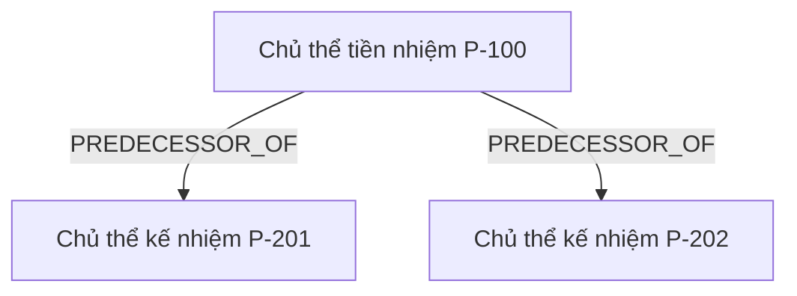

# Tính ổn định khi đổi tên, hợp nhất hoặc tách chủ thể

Một chủ thể trong hệ thống có thể đổi tên, thay đổi thông tin nhận diện, được phát hiện là trùng với một hồ sơ khác, hoặc trải qua một lần hợp nhất hay chia tách trong nghiệp vụ. Những thay đổi này đặt ra một câu hỏi quan trọng: **định danh nào cần được giữ ổn định, và khi nào hệ thống phải tạo định danh mới?**

Nếu dùng tên, email hoặc một thuộc tính có thể thay đổi làm khóa chính, một lần cập nhật thông tin có thể buộc hệ thống sửa hàng loạt khóa ngoại. Nếu hợp nhất hai hồ sơ trùng lặp mà xóa mất dấu vết cũ, hệ thống có thể làm sai lịch sử giao dịch và kiểm toán. Nếu chia một hồ sơ thành hai chủ thể mà sao chép toàn bộ dữ liệu cho cả hai, báo cáo có thể đếm trùng và quan hệ nghiệp vụ bị gán sai.

Trong phạm vi **DATABASE_DATA_MODELING**, bài học này làm rõ sự khác biệt giữa thay đổi thuộc tính và thay đổi danh tính; giữa hợp nhất hồ sơ trùng và hợp nhất các chủ thể thực sự; giữa tách dữ liệu bị gộp nhầm và chia tách một tổ chức. Các ví dụ tập trung vào thiết kế khóa, lưu lịch sử, quản lý quan hệ kế thừa và bảo toàn tham chiếu.

## Mục tiêu học tập

Sau bài học, bạn có thể:

- Giải thích vì sao khóa định danh nội bộ nên ổn định khi tên và các thuộc tính mô tả thay đổi.
- Phân biệt khóa thay thế với định danh tự nhiên, bí danh và thuộc tính nhận diện.
- Phân biệt hợp nhất các bản ghi trùng của cùng một chủ thể với sáp nhập các chủ thể độc lập.
- Phân biệt tách một bản ghi bị gộp nhầm với chia tách một chủ thể trong nghiệp vụ.
- Thiết kế mapping, lịch sử và quan hệ lineage để truy vết các quyết định hợp nhất hoặc tách.
- Xác định cách xử lý khóa ngoại, dữ liệu lịch sử và các hệ thống consumer khi định danh thay đổi.

## 1. Chủ thể, bản ghi và định danh

Trước khi thiết kế cách xử lý đổi tên, hợp nhất hoặc tách, cần tách ba khái niệm thường bị dùng lẫn nhau.

- **Chủ thể (subject/entity):** đối tượng trong thế giới nghiệp vụ mà hệ thống cần theo dõi, chẳng hạn một cá nhân, doanh nghiệp, khách hàng hoặc sản phẩm.
- **Bản ghi (record):** một biểu diễn dữ liệu của chủ thể trong một hệ thống hoặc nguồn dữ liệu. Một chủ thể có thể xuất hiện trong nhiều bản ghi do nhập liệu lặp hoặc đồng bộ từ nhiều hệ thống.
- **Định danh (identifier):** giá trị dùng để tham chiếu một chủ thể hoặc bản ghi trong một phạm vi xác định. Định danh có thể là ID nội bộ, mã từ hệ thống bên ngoài hoặc mã nghiệp vụ.

Một chủ thể có thể có nhiều định danh hợp lệ theo từng phạm vi. Ví dụ, một công ty có `party_id` nội bộ, mã số thuế, mã khách hàng trong hệ thống bán hàng và mã đối tác trong hệ thống kế toán. Các mã này không nhất thiết có cùng vòng đời hoặc cùng phạm vi duy nhất.

### 1.1. Danh tính khác với thuộc tính mô tả

Tên, địa chỉ, số điện thoại, email, chức danh và trạng thái thường mô tả một chủ thể. Chúng có thể thay đổi mà chủ thể vẫn là cùng một đối tượng. ID nội bộ nên đại diện cho danh tính được hệ thống quản lý, thay vì mã hóa một thuộc tính có thể thay đổi vào khóa chính.

| Giá trị | Vai trò thường gặp | Có phù hợp làm khóa chính nội bộ không? |
|---|---|---|
| `party_id` UUID do hệ thống cấp | Định danh nội bộ ổn định | Có, nếu hệ thống quản lý vòng đời ID rõ ràng |
| Tên cá nhân hoặc tên công ty | Thuộc tính mô tả; có thể lưu tên cũ/bí danh | Không, vì có thể trùng hoặc thay đổi |
| Email hoặc số điện thoại | Kênh liên hệ; có thể thay đổi hoặc được cấp lại | Thường không |
| Mã số thuế hoặc số đăng ký | Định danh bên ngoài trong một phạm vi pháp lý/địa lý cụ thể | Có thể là alternate key nếu phạm vi, tính duy nhất và vòng đời được xác nhận; vẫn cần quản lý issuer và lịch sử |
| Mã khách hàng của đối tác | Định danh trong hệ thống của đối tác | Không nên dùng làm khóa chính toàn cục nếu không kiểm soát namespace và quy tắc của đối tác |

Một định danh tự nhiên chỉ an toàn khi nó thực sự duy nhất trong phạm vi xác định, ổn định theo thời gian và có chính sách không tái sử dụng phù hợp. Ngay cả khi các điều kiện đó đúng, hệ thống vẫn có thể chọn khóa thay thế để giảm phụ thuộc vào quy tắc của nguồn bên ngoài.

### 1.2. Khóa thay thế và định danh tự nhiên

- **Khóa thay thế (surrogate key):** ID do hệ thống tạo, không mang ý nghĩa nghiệp vụ trực tiếp, ví dụ UUID hoặc số tăng tự động.
- **Định danh tự nhiên (natural identifier):** mã có ý nghĩa hoặc được cấp bởi nghiệp vụ/bên ngoài, ví dụ mã số thuế, số đăng ký hoặc SKU.
- **Khóa ứng viên (candidate key):** tập thuộc tính tối thiểu có thể định danh duy nhất một thể hiện trong phạm vi và thời điểm đã xác định.
- **Bí danh (alias):** tên hoặc mã thay thế được dùng để tìm kiếm hay tham chiếu chủ thể, nhưng không nhất thiết là định danh chuẩn hiện tại.

Trong nhiều hệ thống, một thiết kế phù hợp là dùng `party_id` làm khóa chính nội bộ, còn các mã tự nhiên được lưu trong bảng định danh riêng kèm namespace, nguồn cấp và thời gian hiệu lực. Nhờ đó, thay đổi mã bên ngoài không buộc đổi khóa chính và hệ thống có thể lưu nhiều mã cho cùng một chủ thể.

## 2. Đổi tên hoặc thay đổi thuộc tính nhận diện

Đổi tên thường là **thay đổi thuộc tính của cùng một chủ thể**, không phải tạo chủ thể mới. Ví dụ, một khách hàng cập nhật tên hiển thị hoặc một doanh nghiệp đổi tên pháp lý nhưng vẫn giữ tính liên tục của chủ thể theo hồ sơ có thẩm quyền.

Giả sử:

- Trước ngày 01-04, công ty có tên “An Bình Trading”.
- Từ ngày 01-04, tên được đổi thành “An Bình Commerce”.
- Mã nội bộ vẫn là `party_id = P-1042`.

Các đơn hàng, hợp đồng và khoản thanh toán đã tham chiếu `P-1042` tiếp tục trỏ đến cùng chủ thể. Không cần cập nhật toàn bộ khóa ngoại chỉ vì tên hiển thị thay đổi.

### 2.1. Lưu tên hiện tại và lịch sử tên

Nếu chỉ cần tên hiện tại, có thể cập nhật thuộc tính trên bản ghi chủ thể. Nếu cần truy vết lịch sử, cần lưu các phiên bản tên với thời điểm hiệu lực và nguồn xác nhận.

| party_id | Tên | Loại tên | Hiệu lực từ | Hiệu lực đến |
|---|---|---|---|---|
| P-1042 | An Bình Trading | LEGAL | 2022-06-01 | 2026-03-31 |
| P-1042 | An Bình Commerce | LEGAL | 2026-04-01 | — |
| P-1042 | An Bình | DISPLAY | 2024-01-01 | — |

Một chủ thể có thể có nhiều loại tên đồng thời: tên pháp lý, tên giao dịch, tên hiển thị, tên viết tắt hoặc tên cũ. Vì vậy, không nên lưu mọi loại tên vào một trường duy nhất nếu ứng dụng cần phân biệt ý nghĩa.

### 2.2. Hiệu lực nghiệp vụ và thời điểm hệ thống ghi nhận

Khi cần lịch sử chính xác, hãy phân biệt:

- **Thời gian hiệu lực (valid time):** khoảng thời gian thông tin đúng trong thế giới nghiệp vụ.
- **Thời gian ghi nhận (transaction/recorded time):** thời điểm hệ thống biết hoặc ghi thông tin đó.

Ví dụ, quyết định đổi tên có hiệu lực từ ngày 01-04 nhưng hệ thống chỉ nhận được giấy tờ vào ngày 05-04. Hai thời điểm này khác nhau. Nếu chỉ lưu `updated_at`, hệ thống không thể trả lời chính xác “tên nào có hiệu lực vào ngày 03-04?” hoặc “khi nào chúng ta biết về việc đổi tên?”.

Không phải ứng dụng nào cũng cần mô hình hai chiều thời gian. Hãy chọn mức lịch sử theo yêu cầu kiểm toán, báo cáo, nghiệp vụ và khả năng sửa dữ liệu hồi tố.

### 2.3. Khi đổi mã định danh bên ngoài

Một chủ thể có thể được cấp mã mới hoặc mã cũ hết hiệu lực. Ví dụ mã khách hàng trong hệ thống đối tác thay đổi sau khi đối tác nâng cấp. Khi đó:

1. Giữ nguyên ID nội bộ nếu chủ thể vẫn là cùng một đối tượng.
2. Đóng thời gian hiệu lực của mã cũ.
3. Ghi mã mới với namespace/issuer chính xác.
4. Lưu nguồn, thời điểm nhận và bằng chứng thay đổi.
5. Kiểm tra xung đột: mã mới có đang được gán cho một chủ thể khác trong cùng phạm vi không?

Nếu một mã bên ngoài bị thu hồi rồi cấp lại cho chủ thể khác, hệ thống không được suy ra hai bản ghi là cùng một người chỉ vì chuỗi mã giống nhau. Phạm vi và thời điểm của định danh là một phần ý nghĩa của nó.

## 3. Hợp nhất hai bản ghi trùng của cùng một chủ thể

Hợp nhất hồ sơ trùng (duplicate-record merge) xảy ra khi nhiều bản ghi thực chất mô tả **cùng một chủ thể**. Ví dụ một khách hàng được tạo hai lần do nhập từ website và cửa hàng trực tiếp:

- Bản ghi `P-1042`: tên “An Bình Commerce”, email `contact@anbinh.example`.
- Bản ghi `P-2098`: tên “An Binh Trading”, cùng mã số thuế và cùng địa chỉ đã xác minh.

Sau khi có đủ bằng chứng, nhóm dữ liệu xác nhận hai bản ghi là cùng một doanh nghiệp. Hệ thống cần chọn một ID chuẩn và lưu quan hệ từ ID trùng về ID chuẩn.

### 3.1. Chọn bản ghi chuẩn (canonical record)

Việc chọn ID chuẩn cần theo chính sách có thể giải thích, chẳng hạn:

- Ưu tiên ID đã được công bố cho hệ thống khác hoặc đã có nhiều tham chiếu.
- Ưu tiên bản ghi do nguồn có thẩm quyền tạo.
- Ưu tiên bản ghi có lịch sử đầy đủ và dữ liệu đã xác minh.
- Nếu có xung đột, yêu cầu người có thẩm quyền phân xử thay vì tự động chọn theo tên hoặc thời điểm tạo.

Không nên chọn bản ghi chuẩn chỉ dựa vào ID nhỏ nhất hoặc bản ghi mới nhất nếu điều đó làm mất dữ liệu có thẩm quyền.

### 3.2. Quy trình hợp nhất

Một quy trình có kiểm soát thường gồm:

1. **Phát hiện ứng viên:** dùng mã định danh đáng tin cậy, thuộc tính liên hệ và quy tắc so khớp để tìm các hồ sơ có khả năng trùng.
2. **Xác minh cùng chủ thể:** kiểm tra nguồn, thời gian, namespace, dữ liệu mâu thuẫn và bằng chứng. Tên giống nhau hoặc địa chỉ giống nhau không đủ để tự động kết luận.
3. **Chọn canonical ID:** ghi rõ lý do và người/phương thức phê duyệt.
4. **Lập kế hoạch chuyển dữ liệu:** xác định thuộc tính nào được giữ, hợp nhất, lưu thành alias hoặc cần xử lý xung đột.
5. **Ghi mapping:** đánh dấu ID trùng là đã hợp nhất và trỏ đến ID chuẩn; giữ thông tin thời điểm, lý do và nguồn quyết định.
6. **Xử lý quan hệ phụ thuộc:** cập nhật hoặc ánh xạ các khóa ngoại, liên kết, quyền truy cập, subscription và dữ liệu dẫn xuất theo chính sách.
7. **Thông báo và đồng bộ:** phát sự kiện hoặc cập nhật mapping cho các hệ thống consumer cần biết.
8. **Kiểm tra sau hợp nhất:** xác nhận không còn tham chiếu bị mất, không tạo quan hệ trùng và mọi truy vấn tìm ID cũ đều giải quyết được.

### 3.3. Không xóa dấu vết ID cũ

Giả sử chọn `P-1042` làm ID chuẩn và `P-2098` là bản ghi trùng. Có thể lưu:

| retired_party_id | canonical_party_id | merged_at | reason |
|---|---|---|---|
| P-2098 | P-1042 | 2026-04-10T09:30Z | MATCHED_TAX_ID_AND_VERIFIED_ADDRESS |

ID `P-2098` không còn được dùng để tạo giao dịch mới, nhưng cần giữ lại để:

- Giải quyết các liên kết cũ hoặc thông điệp đã phát trước đó.
- Truy vết nguồn nhập và lịch sử quyết định.
- Giải thích vì sao dữ liệu cũ có mã khác với mã chuẩn hiện tại.
- Hỗ trợ đồng bộ dần các hệ thống chưa cập nhật.

Hệ thống có thể cập nhật khóa ngoại sang canonical ID trong một migration, hoặc giữ tham chiếu gốc và cung cấp cơ chế resolve ID. Lựa chọn phụ thuộc yêu cầu kiểm toán, quy mô dữ liệu, khả năng downtime và ngữ nghĩa lịch sử. Dù chọn cách nào, mapping phải được lưu bền vững.

### 3.4. Hợp nhất hồ sơ không phải hợp nhất hai chủ thể thật

Đây là phân biệt quan trọng. Nếu hai hồ sơ là bản ghi trùng của cùng một công ty, việc hợp nhất có thể tạo một canonical identity. Nhưng nếu hai công ty độc lập sáp nhập và hình thành một pháp nhân mới, chúng là các chủ thể khác nhau trong lịch sử.

Trong trường hợp sáp nhập thật:

- Hai chủ thể tiền nhiệm giữ ID riêng để lịch sử hợp đồng, công nợ, hóa đơn và quyền sở hữu không bị viết lại.
- Chủ thể kế nhiệm nhận ID mới nếu nghiệp vụ xác định đó là một chủ thể mới.
- Hệ thống ghi quan hệ `PREDECESSOR_OF`/`SUCCESSOR_OF`, ngày hiệu lực và căn cứ.
- Giao dịch sau ngày hiệu lực tham chiếu chủ thể kế nhiệm; giao dịch cũ vẫn tham chiếu chủ thể tại thời điểm phát sinh.

Nếu chỉ đổi tên hoặc tái cấu trúc nhưng chủ thể pháp lý vẫn liên tục, giữ ID cũ có thể phù hợp. Việc xác định tính liên tục phải dựa trên hồ sơ và quy tắc nghiệp vụ có thẩm quyền của miền; không suy ra chỉ từ việc tên hoặc cơ cấu tổ chức thay đổi.

## 4. Tách một bản ghi bị gộp nhầm hoặc chia tách chủ thể

Tương tự hợp nhất, từ “tách” có thể mô tả hai tình huống rất khác nhau.

### 4.1. Tách bản ghi đã gộp nhầm (record split)

Một bản ghi có thể vô tình chứa dữ liệu của hai người khác nhau, ví dụ hai hồ sơ khách hàng bị ghép vì trùng tên và cùng số điện thoại gia đình. Sau khi xác minh, hệ thống phát hiện thực chất có hai chủ thể.

Khi đó cần:

1. Giữ ID cũ như một dấu vết lịch sử, đánh dấu không còn là bản ghi chuẩn có thể sử dụng.
2. Tạo ID riêng cho từng chủ thể đã xác minh, trừ trường hợp một trong hai đã có ID đáng tin cậy.
3. Phân bổ thuộc tính, mã định danh, giao dịch và quan hệ theo bằng chứng nguồn.
4. Ghi mapping từ ID cũ đến nhiều ID mới cùng lý do và thời điểm.
5. Đánh dấu dữ liệu chưa xác định được chủ thể để xử lý thủ công; không tự sao chép sang cả hai.
6. Kiểm tra các báo cáo, quyền truy cập và consumer đã dùng ID cũ.

Khác với merge, split không thể luôn giải quyết bằng một phép thay thế ID đơn giản. Một ID cũ có thể ánh xạ đến nhiều ID mới, và từng giao dịch lịch sử có thể cần được phân loại riêng.

### 4.2. Chia tách một chủ thể trong nghiệp vụ (entity split)

Ví dụ một tổ chức tách thành hai đơn vị độc lập hoặc một doanh nghiệp phân chia hoạt động thành hai chủ thể kế nhiệm. Đây là thay đổi thực tế trong miền nghiệp vụ, không phải sửa lỗi dữ liệu.

Một mô hình thường giữ chủ thể tiền nhiệm với ID cũ, tạo ID mới cho các chủ thể kế nhiệm và ghi quan hệ lineage. Dữ liệu lịch sử trước ngày hiệu lực vẫn thuộc chủ thể tiền nhiệm. Từ ngày hiệu lực, các giao dịch mới thuộc chủ thể kế nhiệm tương ứng.

Không nên sao chép toàn bộ đơn hàng, khoản nợ, hợp đồng hoặc số liệu lịch sử cho cả hai chủ thể mới. Cần quy tắc phân bổ được nghiệp vụ phê duyệt: theo tài sản, hợp đồng, đơn vị vận hành, ngày hiệu lực hoặc một tiêu chí cụ thể khác.

### 4.3. Ví dụ quan hệ lineage



Sơ đồ này biểu diễn một chủ thể cũ được chia thành hai chủ thể mới. Đây không phải trường hợp hai bản ghi trùng được chuyển về một canonical ID.

## 5. Thiết kế dữ liệu để giữ định danh ổn định

Một mô hình dữ liệu tổng quát có thể tách chủ thể, tên, định danh bên ngoài và quan hệ kế thừa thành các cấu trúc riêng. Ví dụ PostgreSQL dưới đây chỉ minh họa nguyên tắc; kiểu ID và chính sách duy nhất cần điều chỉnh theo miền.

### 5.1. Bảng chủ thể

```sql
CREATE TABLE party (
    party_id UUID PRIMARY KEY,
    party_type VARCHAR(20) NOT NULL
        CHECK (party_type IN ('PERSON', 'ORGANIZATION')),
    lifecycle_status VARCHAR(20) NOT NULL
        CHECK (lifecycle_status IN ('ACTIVE', 'RETIRED', 'INACTIVE')),
    created_at TIMESTAMPTZ NOT NULL DEFAULT now()
);
```

`party_id` là khóa nội bộ ổn định. Bảng này không dùng tên, email hay mã số thuế làm khóa chính. `lifecycle_status` mô tả tình trạng quản lý của bản ghi; nếu cần phân biệt trạng thái pháp lý, trạng thái giao dịch và trạng thái đồng bộ thì nên mô hình hóa riêng.

### 5.2. Lưu tên và định danh theo thời gian

```sql
CREATE TABLE party_name (
    party_id UUID NOT NULL REFERENCES party(party_id),
    name_type VARCHAR(20) NOT NULL,
    name_value VARCHAR(300) NOT NULL,
    valid_from DATE NOT NULL,
    valid_to DATE,
    recorded_at TIMESTAMPTZ NOT NULL DEFAULT now(),
    source VARCHAR(100),
    PRIMARY KEY (party_id, name_type, valid_from),
    CHECK (valid_to IS NULL OR valid_to >= valid_from)
);

CREATE TABLE party_identifier (
    party_id UUID NOT NULL REFERENCES party(party_id),
    issuer VARCHAR(100) NOT NULL,
    identifier_type VARCHAR(40) NOT NULL,
    identifier_value VARCHAR(200) NOT NULL,
    valid_from DATE NOT NULL,
    valid_to DATE,
    recorded_at TIMESTAMPTZ NOT NULL DEFAULT now(),
    PRIMARY KEY (party_id, issuer, identifier_type, identifier_value, valid_from),
    CHECK (valid_to IS NULL OR valid_to >= valid_from)
);

CREATE UNIQUE INDEX party_identifier_current_uq
    ON party_identifier (issuer, identifier_type, identifier_value)
    WHERE valid_to IS NULL;
```

Trong ví dụ:

- `issuer` xác định bên cấp mã, tránh nhầm hai mã giống nhau từ hai nguồn khác nhau.
- `identifier_type` phân biệt loại mã, ví dụ TAX_ID, REGISTRATION_NO hoặc PARTNER_CUSTOMER_ID.
- `valid_from` và `valid_to` mô tả thời gian hiệu lực của tên hoặc định danh.
- Chỉ mục duy nhất có điều kiện ngăn cùng một mã đang hiệu lực bị gán cho hai chủ thể trong cùng namespace.

Chỉ mục trên chỉ là chính sách minh họa cho mã không được dùng đồng thời bởi hai chủ thể. Một số loại mã có thể được chia sẻ, tái sử dụng hoặc chỉ duy nhất trong phạm vi địa phương; khi đó cần điều chỉnh khóa duy nhất theo đúng quy tắc nguồn cấp. Nếu cần ngăn các khoảng thời gian hiệu lực chồng lấn, phải bổ sung kiểm tra phù hợp, ví dụ exclusion constraint với range trong PostgreSQL hoặc logic giao dịch có khóa.

### 5.3. Lưu quyết định hợp nhất hồ sơ trùng

```sql
CREATE TABLE party_merge_resolution (
    retired_party_id UUID PRIMARY KEY REFERENCES party(party_id),
    canonical_party_id UUID NOT NULL REFERENCES party(party_id),
    merged_at TIMESTAMPTZ NOT NULL,
    reason TEXT NOT NULL,
    decision_reference VARCHAR(200),
    CHECK (retired_party_id <> canonical_party_id)
);
```

Bảng này lưu mapping một chiều từ ID đã nghỉ do trùng sang ID chuẩn. Quy trình hợp nhất cần bảo đảm đích là canonical đang hoạt động, không tạo chu trình và không tạo chuỗi mapping khó giải quyết. Có thể cập nhật mapping để mọi ID cũ trỏ trực tiếp đến canonical cuối cùng.

### 5.4. Lưu quan hệ tiền nhiệm – kế nhiệm

```sql
CREATE TABLE party_lineage (
    predecessor_party_id UUID NOT NULL REFERENCES party(party_id),
    successor_party_id UUID NOT NULL REFERENCES party(party_id),
    effective_at TIMESTAMPTZ NOT NULL,
    recorded_at TIMESTAMPTZ NOT NULL DEFAULT now(),
    reason TEXT NOT NULL,
    PRIMARY KEY (predecessor_party_id, successor_party_id),
    CHECK (predecessor_party_id <> successor_party_id)
);
```

Mỗi hàng biểu diễn quan hệ `PREDECESSOR_OF` từ cột `predecessor_party_id` sang `successor_party_id`; chiều ngược có thể suy ra khi truy vấn. Cần kiểm tra chu trình nếu nghiệp vụ yêu cầu lineage là đồ thị có hướng không chu trình.

### 5.5. Lưu mapping khi một bản ghi bị tách

```sql
CREATE TABLE party_split_resolution (
    source_party_id UUID NOT NULL REFERENCES party(party_id),
    resolved_party_id UUID NOT NULL REFERENCES party(party_id),
    split_at TIMESTAMPTZ NOT NULL,
    reason TEXT NOT NULL,
    decision_reference VARCHAR(200),
    PRIMARY KEY (source_party_id, resolved_party_id),
    CHECK (source_party_id <> resolved_party_id)
);
```

Một `source_party_id` có thể có nhiều `resolved_party_id`, vì một bản ghi bị gộp nhầm có thể chứa dữ liệu của nhiều chủ thể. Bảng này ghi nhận nguồn gốc của quyết định tách; việc phân bổ từng giao dịch hoặc quan hệ con vẫn cần mapping chi tiết theo đối tượng dữ liệu và bằng chứng tương ứng.

## 6. Xử lý khóa ngoại và dữ liệu lịch sử

Đây là phần dễ gây sai lệch nhất khi thay đổi định danh. Trước khi cập nhật ID, cần hỏi dữ liệu tham chiếu có ý nghĩa gì: nó muốn trỏ đến **chủ thể chuẩn hiện tại**, hay muốn ghi lại **chủ thể đã tham gia sự kiện tại thời điểm đó**?

### 6.1. Hợp nhất bản ghi trùng

Với hai bản ghi cùng một chủ thể, có thể có hai cách:

- **Chuyển khóa ngoại sang canonical ID:** phù hợp khi các tham chiếu chỉ là liên kết đến cùng một hồ sơ hiện tại và việc chuyển đổi không phá ý nghĩa lịch sử. Cần migration có kiểm soát, cập nhật các bảng liên quan và kiểm tra số lượng trước/sau.
- **Giữ khóa ngoại gốc và resolve qua mapping:** phù hợp khi cần bảo toàn dấu vết nguồn, log, sự kiện đã phát hoặc dữ liệu kiểm toán. Truy vấn nghiệp vụ có thể join qua bảng resolution để gom theo canonical ID.

Không nên vừa xóa ID cũ vừa để khóa ngoại trỏ đến ID không còn tồn tại. Cũng không nên cập nhật hàng loạt mọi bảng mà chưa phân loại dữ liệu lịch sử, dữ liệu snapshot và dữ liệu dẫn xuất.

### 6.2. Sáp nhập hoặc chia tách chủ thể thật

Khi các chủ thể thực sự khác nhau trước và sau một sự kiện tổ chức, lịch sử cần giữ đúng đối tượng tại thời điểm phát sinh. Ví dụ, hóa đơn năm trước của Công ty A vẫn là hóa đơn của Công ty A dù hoạt động sau này chuyển sang Công ty C. Không đổi toàn bộ `party_id` cũ sang ID của công ty kế nhiệm chỉ để báo cáo hiện tại trông đơn giản hơn.

Nếu báo cáo cần tổng hợp lịch sử theo cấu trúc tổ chức mới, hãy dùng quan hệ lineage hoặc bảng phân bổ có hiệu lực thời gian. Tách cách trình bày báo cáo khỏi việc viết lại danh tính của sự kiện gốc.

### 6.3. Không nhân đôi dữ liệu khi split

Giả sử bản ghi cũ chứa 100 giao dịch nhưng sau xác minh chỉ 60 giao dịch thuộc chủ thể A và 40 giao dịch thuộc chủ thể B. Cách xử lý đúng là phân bổ 60/40 theo bằng chứng, không sao chép 100 giao dịch sang cả hai. Nếu 5 giao dịch chưa rõ chủ thể, hãy giữ trạng thái chưa phân loại và tạo quy trình xử lý tiếp.

## 7. Entity resolution: xác định khi nào hai bản ghi cùng chủ thể

Hợp nhất và tách chỉ an toàn khi quyết định danh tính có căn cứ. Quá trình tìm và xác định các bản ghi thuộc cùng một chủ thể thường được gọi là **entity resolution** hoặc record linkage.

### 7.1. Tín hiệu so khớp

Các tín hiệu có độ tin cậy khác nhau:

- Mã định danh được cấp bởi nguồn có thẩm quyền, trong đúng namespace và thời gian hiệu lực.
- Tên đã chuẩn hóa, bí danh và tên lịch sử.
- Địa chỉ, ngày sinh, số điện thoại, email hoặc thông tin liên hệ.
- Quan hệ với chủ thể khác, tài khoản, hợp đồng hoặc nguồn tạo dữ liệu.
- Thời điểm và nguồn phát sinh bản ghi.

Không nên coi mọi trường trùng nhau có trọng số ngang nhau. Tên phổ biến hoặc số điện thoại dùng chung có thể tạo nhiều kết quả trùng giả. Một mã định danh có vẻ mạnh cũng cần kiểm tra issuer, thời hạn và khả năng tái cấp.

### 7.2. Quy trình quyết định

Có thể chia kết quả so khớp thành ba nhóm:

| Kết quả | Hành động |
|---|---|
| Bằng chứng mạnh, không có mâu thuẫn | Có thể tự động hợp nhất nếu chính sách dữ liệu cho phép và có audit |
| Có dấu hiệu trùng nhưng còn xung đột | Đưa vào hàng chờ người có thẩm quyền xác minh |
| Bằng chứng yếu hoặc có khác biệt quan trọng | Giữ riêng, không hợp nhất tự động |

Ngưỡng tự động cần được đánh giá bằng dữ liệu thực tế, tỷ lệ false positive/false negative và mức độ rủi ro của miền. Trong dữ liệu khách hàng, tài chính, nhân sự hoặc y tế, hợp nhất nhầm có thể gây hậu quả lớn; mức tự động hóa cần phù hợp với tác động đó.

### 7.3. Ghi nhận quyết định và khả năng hoàn tác

Mỗi quyết định merge/split nên lưu:

- Các ID nguồn và ID đích.
- Loại thao tác: duplicate merge, record split, legal successor, organizational split hoặc loại khác đã định nghĩa.
- Bằng chứng, nguồn, lý do và mức tin cậy.
- Người hoặc quy trình phê duyệt.
- Thời điểm nghiệp vụ có hiệu lực và thời điểm hệ thống ghi nhận.
- Các bảng, quan hệ, consumer và chỉ mục dẫn xuất đã được cập nhật.
- Trạng thái hoàn tất, lỗi và thông tin phục hồi.

Không phải thao tác nào cũng có thể rollback bằng cách đảo ngược một câu `UPDATE`. Nếu đã phát event, gửi thông báo hoặc tạo giao dịch mới theo canonical identity, cần quy trình bù trừ và sự kiện hiệu chỉnh. Vì vậy, hãy lưu đủ dữ liệu trước khi thay đổi và thiết kế bước kiểm tra trước khi commit quyết định.

## 8. Các trường hợp dễ nhầm lẫn

| Tình huống | Cùng một chủ thể trước và sau? | Cách xử lý định danh thường phù hợp |
|---|---|---|
| Cá nhân đổi họ tên | Có, nếu danh tính nghiệp vụ liên tục | Giữ ID; lưu tên mới và lịch sử tên cũ |
| Công ty đổi tên nhưng pháp nhân liên tục | Thường có, cần xác nhận theo hồ sơ miền | Giữ ID; cập nhật lịch sử tên và mã liên quan |
| Email khách hàng thay đổi | Có | Giữ ID; đóng email cũ nếu cần và gán email mới |
| Hai hồ sơ cùng mô tả một khách hàng | Có, hai bản ghi trùng | Chọn canonical ID, lưu merge mapping và xử lý tham chiếu |
| Hai công ty độc lập sáp nhập thành chủ thể kế nhiệm | Không; các chủ thể tiền nhiệm khác nhau với chủ thể kế nhiệm | Giữ ID tiền nhiệm, tạo/ghi nhận ID kế nhiệm và lineage |
| Một hồ sơ chứa nhầm thông tin của hai người | Thực tế là hai chủ thể riêng | Tạo hoặc xác định hai ID, phân bổ dữ liệu có bằng chứng và lưu lịch sử split |
| Một doanh nghiệp chia hoạt động thành hai đơn vị độc lập | Chủ thể kế nhiệm khác chủ thể tiền nhiệm theo mô hình nghiệp vụ | Giữ ID tiền nhiệm, tạo ID kế nhiệm và quan hệ lineage |
| Mã đối tác bị thu hồi rồi cấp cho khách hàng khác | Không thể kết luận cùng chủ thể từ mã giống nhau | Lưu issuer và khoảng hiệu lực; không tái sử dụng mapping lịch sử |

## 9. Quy trình triển khai an toàn

Khi cần đổi tên, hợp nhất hoặc tách chủ thể trong hệ thống đang hoạt động, hãy thực hiện theo trình tự:

1. **Xác định loại thay đổi:** chỉ đổi thuộc tính, đổi mã bên ngoài, hợp nhất bản ghi trùng, sáp nhập chủ thể thật, tách bản ghi sai hay chia tách chủ thể.
2. **Xác minh phạm vi và bằng chứng:** xác định nguồn có thẩm quyền, thời điểm hiệu lực, các ID liên quan và dữ liệu xung đột.
3. **Đánh giá ảnh hưởng:** tìm bảng có khóa ngoại, event đã phát, API consumer, báo cáo, cache, chỉ mục tìm kiếm và hệ thống đồng bộ.
4. **Lập kế hoạch dữ liệu:** chọn canonical ID hoặc ID kế nhiệm; xác định mapping, lineage, dữ liệu lịch sử và cách xử lý các quan hệ con.
5. **Dry run:** đếm số bản ghi và tham chiếu bị ảnh hưởng; phát hiện trùng, thiếu owner, chu trình hoặc dữ liệu không thể phân loại.
6. **Thực hiện trong transaction hoặc theo batch có checkpoint:** ghi mapping và audit trước hoặc cùng transaction với thay đổi; bảo đảm thao tác có thể chạy lại an toàn.
7. **Đồng bộ consumer:** cung cấp API resolve, event thay đổi định danh hoặc file mapping theo contract; theo dõi consumer đã xử lý.
8. **Đối soát sau thay đổi:** so sánh số lượng, tổng tiền, số quan hệ, số giao dịch và kết quả truy vấn theo canonical identity.
9. **Đóng quy trình:** lưu quyết định, bằng chứng, báo cáo và trạng thái hoàn tất; chỉ ngừng hỗ trợ ID cũ khi các consumer đã qua thời gian chuyển tiếp.

### 9.1. Các kiểm tra dữ liệu quan trọng

- Không có hai chủ thể đang hoạt động cùng sở hữu một định danh được quy định là duy nhất trong cùng namespace và thời gian hiệu lực.
- Mọi merge mapping đều trỏ đến một canonical ID hợp lệ, không tự trỏ và không tạo chu trình.
- Không có khóa ngoại mồ côi sau migration.
- Split mapping có thể có nhiều đích; mỗi giao dịch được phân bổ tối đa một lần theo quy tắc, hoặc được đánh dấu chưa xác định.
- Không có giao dịch lịch sử bị đổi chủ thể nếu không có quyết định nghiệp vụ rõ ràng.
- Báo cáo tổng hợp không đếm trùng do đồng thời giữ bản ghi cũ và bản ghi chuẩn.
- Consumer xử lý được ID cũ, event trùng và event đến trễ theo chính sách đã công bố.

## 10. Những lỗi thiết kế thường gặp

| Lỗi | Hệ quả | Cách xử lý |
|---|---|---|
| Dùng tên hoặc email làm khóa chính | Đổi tên/đổi email buộc sửa hàng loạt tham chiếu | Dùng ID nội bộ ổn định; lưu tên và định danh bên ngoài riêng |
| Xem hai tên giống nhau là cùng chủ thể | Hợp nhất nhầm hai người hoặc doanh nghiệp khác nhau | Dùng nhiều tín hiệu, kiểm tra namespace/thời gian và quy trình xác minh |
| Xóa bản ghi trùng sau merge | Mất dấu vết ID cũ, log và tham chiếu từ hệ thống khác | Giữ mapping và trạng thái retired; hỗ trợ resolve ID cũ |
| Nhầm sáp nhập pháp nhân với duplicate merge | Viết lại lịch sử giao dịch của các chủ thể tiền nhiệm | Giữ ID lịch sử và ghi quan hệ predecessor/successor |
| Tách một ID thành hai bằng cách sao chép mọi dữ liệu | Đếm trùng giao dịch, tài sản, công nợ và quan hệ | Phân bổ theo bằng chứng; giữ trạng thái chưa xác định khi chưa đủ dữ liệu |
| Chỉ lưu thời điểm cập nhật cuối | Không tái hiện được thông tin đúng tại thời điểm nghiệp vụ | Lưu valid time và recorded time khi yêu cầu cần lịch sử |
| Cho phép sửa tùy ý khóa định danh | Mất khả năng truy vết và tạo tham chiếu không nhất quán | Quy định ID bất biến; mọi resolve/merge/split đi qua workflow có audit |
| Không thông báo cho consumer | Các hệ thống tiếp tục dùng ID đã nghỉ hoặc dữ liệu cũ | Công bố mapping/event, thời gian chuyển tiếp và giám sát đồng bộ |

## 11. Checklist thiết kế

- [ ] Khóa chính nội bộ không phụ thuộc tên, email hoặc thuộc tính dễ thay đổi.
- [ ] Mỗi định danh bên ngoài có namespace/issuer và phạm vi duy nhất rõ ràng.
- [ ] Tên, bí danh và mã thay đổi được lưu theo lịch sử nếu nghiệp vụ cần.
- [ ] Có quy tắc phân biệt đổi thuộc tính với thay đổi danh tính.
- [ ] Duplicate merge chỉ áp dụng khi các bản ghi cùng mô tả một chủ thể thực tế.
- [ ] Sáp nhập hoặc chia tách chủ thể thật được biểu diễn bằng quan hệ lineage và thời điểm hiệu lực.
- [ ] Merge mapping và split mapping có thể truy vết, giải thích và đối soát.
- [ ] Khóa ngoại và dữ liệu lịch sử được xử lý theo đúng ngữ nghĩa của từng bảng.
- [ ] Có quy tắc phân bổ dữ liệu khi split; không sao chép mọi giao dịch sang nhiều chủ thể.
- [ ] Quyết định merge/split có bằng chứng, nguồn, người/phương thức phê duyệt và audit.
- [ ] Có kế hoạch đồng bộ consumer, resolve ID cũ và xử lý event đến trễ.
- [ ] Có kiểm tra chống chu trình, tham chiếu mồ côi, trùng định danh và đếm trùng báo cáo.

## Tóm tắt

Định danh nội bộ nên ổn định trong vòng đời của chủ thể; tên, email và các mã bên ngoài là thuộc tính hoặc định danh có phạm vi và thời hạn riêng. Đổi tên thường chỉ cần cập nhật thuộc tính và lưu lịch sử. Hợp nhất hồ sơ trùng cần canonical ID cùng mapping từ ID cũ. Sáp nhập hai chủ thể độc lập cần giữ lịch sử các chủ thể tiền nhiệm và ghi quan hệ kế nhiệm. Tách một bản ghi bị gộp nhầm cần phân bổ dữ liệu theo bằng chứng; chia tách một chủ thể thật cần tạo các ID kế nhiệm và quy tắc phân bổ có hiệu lực thời gian.

Thiết kế tốt không chỉ giữ khóa ngoại hợp lệ. Nó còn phải giữ đúng ý nghĩa của giao dịch lịch sử, giải thích được mọi quyết định thay đổi danh tính và giúp các hệ thống liên quan tiếp tục hiểu ID cũ trong thời gian chuyển tiếp.

## Thuật ngữ cần nhớ

| Thuật ngữ | Ý nghĩa |
|---|---|
| Subject / Entity | Chủ thể nghiệp vụ mà hệ thống cần theo dõi |
| Record | Bản ghi biểu diễn chủ thể trong một hệ thống hoặc nguồn dữ liệu |
| Identifier | Giá trị dùng để tham chiếu chủ thể trong một phạm vi xác định |
| Surrogate Key | Khóa thay thế do hệ thống cấp, không mang ý nghĩa nghiệp vụ trực tiếp |
| Natural Identifier | Mã có nguồn gốc nghiệp vụ hoặc bên ngoài, có phạm vi và quy tắc hiệu lực |
| Alias | Tên hoặc mã thay thế dùng để tìm kiếm/tham chiếu chủ thể |
| Canonical Record | Bản ghi được chọn làm đại diện chuẩn sau khi xác minh trùng lặp |
| Duplicate-record Merge | Hợp nhất nhiều bản ghi cùng mô tả một chủ thể |
| Entity Resolution | Quá trình xác định các bản ghi có thuộc cùng một chủ thể hay không |
| Lineage | Quan hệ nguồn gốc, tiền nhiệm và kế nhiệm giữa các chủ thể hoặc bản ghi |
| Valid Time | Khoảng thời gian một thông tin có hiệu lực trong nghiệp vụ |
| Recorded Time | Thời điểm hệ thống ghi nhận thông tin |
