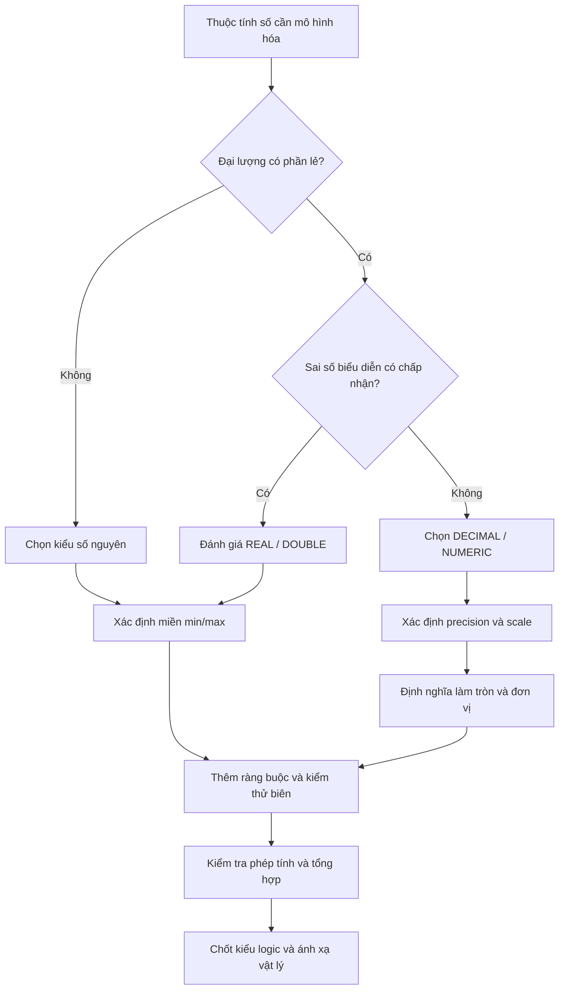

# Số nguyên, số thập phân, độ chính xác và thang số

Các thuộc tính số thường xuất hiện trong hầu hết mô hình dữ liệu: số lượng sản phẩm, giá bán, số dư, thuế, tỷ lệ chiết khấu, trọng lượng, điểm số và tỷ giá. Chọn kiểu số không chỉ là chọn một kiểu dữ liệu có thể chứa giá trị hiện tại. Nhóm thiết kế cần hiểu giá trị đại diện cho điều gì, miền giá trị hợp lệ, số chữ số cần giữ, quy tắc làm tròn và sai số có thể chấp nhận.

Hai nhóm kiểu số quan trọng là **số nguyên** và **số thập phân**. Trong số thập phân, cần phân biệt số thập phân chính xác với số dấu phẩy động gần đúng. Với kiểu `DECIMAL(p, s)` hoặc `NUMERIC(p, s)`, `p` là độ chính xác (precision), tức tổng số chữ số được phép; `s` là thang số (scale), tức số chữ số ở phần thập phân. Hiểu đúng hai tham số này giúp tránh mất dữ liệu, tràn số và sai lệch trong tính toán nghiệp vụ.

## 1. Bắt đầu từ ý nghĩa của giá trị số

Trước khi chọn kiểu dữ liệu, hãy xác định giá trị số mô tả điều gì.

| Khái niệm nghiệp vụ | Ví dụ | Câu hỏi cần làm rõ |
|---|---|---|
| Số đếm | Số sản phẩm trong kho, số lần thử | Có thể âm không? Có phần lẻ không? Giới hạn tối đa? |
| Tiền tệ | Giá bán, số tiền thanh toán | Loại tiền nào? Bao nhiêu chữ số thập phân? Quy tắc làm tròn? |
| Tỷ lệ | Thuế suất, chiết khấu, tỷ lệ hoàn thành | Lưu dạng `0.075` hay `7.5`? Miền hợp lệ? |
| Đo lường | Khối lượng, chiều dài, thể tích | Đơn vị nào? Độ phân giải? Có đổi đơn vị không? |
| Điểm hoặc xếp hạng | Điểm kiểm tra, điểm đánh giá | Có phần lẻ? Có cho phép giá trị ngoài khoảng? |
| Tỷ giá / hệ số | Tỷ giá quy đổi, hệ số tính toán | Độ chính xác cần thiết? Nguồn và thời điểm áp dụng? |
| Thời lượng | Số giây xử lý, số phút làm việc | Đơn vị cơ sở và độ phân giải là gì? |

Hai thuộc tính cùng có dạng số vẫn có thể cần kiểu khác nhau. Số lượng hộp thường là số nguyên; khối lượng hàng hóa có thể cần ba chữ số thập phân; tiền thanh toán thường cần biểu diễn thập phân chính xác theo quy tắc tiền tệ; tỷ lệ có thể cần nhiều chữ số hơn số tiền hiển thị.

Không chọn kiểu chỉ vì một ví dụ hiện tại vừa với nó. Hãy xác định giá trị nhỏ nhất, lớn nhất, độ phân giải và cách tính trong toàn bộ vòng đời dữ liệu.

## 2. Số nguyên

Số nguyên (integer) biểu diễn các giá trị không có phần thập phân, chẳng hạn `-12`, `0`, `25` hoặc `1000000`.

### 2.1. Số nguyên có dấu và không dấu

Kiểu số nguyên có dấu (signed) có thể biểu diễn số âm, số 0 và số dương. Kiểu không dấu (unsigned) chỉ biểu diễn số không âm. Với một số hệ thống biểu diễn nhị phân có `n` bit:

- Signed theo dạng bù hai thường có miền từ (-2^{n-1}) đến (2^{n-1}-1).
- Unsigned có miền từ (0) đến (2^n-1).

Ví dụ với 8 bit:

| Biểu diễn | Giá trị nhỏ nhất | Giá trị lớn nhất |
|---|---:|---:|
| Signed 8 bit | -128 | 127 |
| Unsigned 8 bit | 0 | 255 |

Khả năng hỗ trợ kiểu unsigned phụ thuộc hệ quản trị và ngôn ngữ. PostgreSQL không có các kiểu integer unsigned dựng sẵn như MySQL. Vì vậy, khi mô hình cần tương thích nhiều hệ quản trị, phải xác minh miền giá trị và ràng buộc tương đương trên từng nền tảng.

### 2.2. Các kích thước số nguyên thường gặp

Nhiều hệ quản trị cung cấp các kiểu số nguyên theo kích thước lưu trữ:

| Nhóm thường gặp | Kích thước phổ biến | Miền signed thường gặp |
|---|---:|---:|
| Small integer / `SMALLINT` | 2 byte | -32.768 đến 32.767 |
| Integer / `INT` | 4 byte | -2.147.483.648 đến 2.147.483.647 |
| Big integer / `BIGINT` | 8 byte | -9.223.372.036.854.775.808 đến 9.223.372.036.854.775.807 |

Đây là miền phổ biến của các kiểu signed 16, 32 và 64 bit; chi tiết tên kiểu và khả năng tương thích cần kiểm tra theo hệ quản trị cụ thể. Không phải mọi sản phẩm đều dùng cùng một kiểu vật lý hoặc cùng quy tắc chuyển đổi.

### 2.3. Khi nào dùng số nguyên?

Số nguyên phù hợp với:

- Số lượng vật thể không thể chia nhỏ trong nghiệp vụ, như số ghế hoặc số kiện.
- Số lần thử, số lượt, số phiên bản hoặc số bước.
- Giá trị định danh dạng số nếu được quản lý như mã, không thực hiện phép tính nghiệp vụ trên nó.
- Số tiền theo đơn vị nhỏ nhất của tiền tệ, nếu quy tắc tiền tệ và phạm vi giá trị cho phép.

Không dùng số nguyên cho một đại lượng có phần lẻ có ý nghĩa. Ví dụ, lưu khối lượng `1.275 kg` thành `1` sẽ làm mất thông tin. Cũng không nên dùng kiểu số nguyên để biểu diễn số điện thoại, mã bưu chính hoặc mã sản phẩm chỉ vì chúng gồm các chữ số: các giá trị này là mã, có thể có số 0 ở đầu và không dùng để tính toán.

### 2.4. Chọn kích thước số nguyên

Chọn kiểu nhỏ nhất có thể đáp ứng miền giá trị dự kiến, nhưng cần tính cả tốc độ tăng và các giá trị biên. Ví dụ, số đơn hàng hiện tại chỉ có vài trăm nghìn không có nghĩa một cột `INT` luôn đủ nếu hệ thống dự kiến lưu nhiều thập kỷ hoặc có nhiều tổ chức.

Hãy xác định:

- Giá trị nhỏ nhất có thể phát sinh, bao gồm giá trị âm nếu có.
- Giá trị lớn nhất hiện tại và dự báo trong thời hạn lưu giữ.
- Tốc độ tăng của bộ đếm hoặc số lượng.
- Phép toán trung gian có thể vượt giới hạn của kiểu đầu vào không.
- Hệ quản trị có tự động nâng kiểu hay phát sinh lỗi khi vượt giới hạn?

Không nên dựa vào việc một phép tính “thường không lớn đến vậy”. Hãy kiểm tra giá trị lớn nhất có thể xảy ra theo quy tắc nghiệp vụ và tải dự kiến.

## 3. Số thập phân chính xác và số dấu phẩy động

Không phải mọi kiểu có dấu chấm thập phân đều lưu giá trị theo cách giống nhau.

### 3.1. Số thập phân chính xác

Kiểu `DECIMAL` hoặc `NUMERIC` thường biểu diễn số thập phân chính xác theo số chữ số và scale được khai báo. Ví dụ, `NUMERIC(8, 2)` có thể biểu diễn các giá trị như `12345.67` đúng theo quy tắc thập phân của kiểu.

Kiểu này phù hợp với các giá trị mà sai số biểu diễn không được phép tích lũy tùy tiện, chẳng hạn tiền tệ, giá, thuế và số dư. Phép tính vẫn có thể cần quy tắc làm tròn và giới hạn độ chính xác ở kết quả trung gian; kiểu chính xác không có nghĩa mọi phép tính đều tự động đúng với ý nghĩa nghiệp vụ.

### 3.2. Số dấu phẩy động gần đúng

Các kiểu `REAL`, `FLOAT` hoặc `DOUBLE PRECISION` thường dùng biểu diễn nhị phân dấu phẩy động. Chúng có thể biểu diễn miền giá trị rất rộng và phù hợp với tính toán khoa học, mô phỏng hoặc đo lường khi sai số nhỏ được chấp nhận.

Nhiều phân số thập phân không thể biểu diễn chính xác bằng một số hữu hạn bit nhị phân. Ví dụ, `0.1` không có biểu diễn nhị phân hữu hạn. Vì vậy, giá trị được lưu là số gần nhất có thể biểu diễn và phép tính có thể cho kết quả như `0.30000000000000004` thay vì chính xác `0.3`.

Ví dụ minh họa bằng JavaScript:

```javascript
console.log(0.1 + 0.2);
// Có thể hiển thị: 0.30000000000000004
```

Hiện tượng này không nhất thiết là lỗi của hệ quản trị. Nó là đặc tính của biểu diễn số dấu phẩy động. Khi so sánh hai giá trị gần đúng, thường cần quy định sai số cho phép thay vì dùng phép so sánh bằng tuyệt đối.

### 3.3. So sánh hai nhóm

| Tiêu chí | `DECIMAL` / `NUMERIC` | `REAL` / `FLOAT` / `DOUBLE` |
|---|---|---|
| Cách biểu diễn | Số thập phân theo độ chính xác khai báo | Số nhị phân dấu phẩy động |
| Độ chính xác | Chính xác theo quy tắc kiểu và scale | Gần đúng, có sai số biểu diễn |
| Miền giá trị | Phụ thuộc precision tối đa của hệ quản trị | Thường rất rộng |
| Chi phí tính toán | Có thể cao hơn tùy hệ quản trị và phép toán | Thường phù hợp với phép tính khoa học hiệu năng cao |
| Trường hợp điển hình | Tiền, giá, thuế, số dư | Mô phỏng, khoa học, cảm biến và thống kê gần đúng |

Không nên chọn `FLOAT` chỉ vì nó lưu được nhiều chữ số hoặc có miền giá trị rộng. Cần xác định liệu sai số biểu diễn có chấp nhận được đối với nghiệp vụ hay không.

## 4. Precision và scale trong DECIMAL(p, s)

Hai tham số `p` và `s` thường bị nhầm lẫn. Chúng mô tả hai khía cạnh khác nhau của số thập phân.

### 4.1. Precision là gì?

Precision (`p`) là tổng số chữ số thập phân được phép lưu, tính cả phần nguyên và phần thập phân. Ví dụ `NUMERIC(7, 2)` có tổng cộng tối đa 7 chữ số, trong đó có 2 chữ số ở phần thập phân.

### 4.2. Scale là gì?

Scale (`s`) là số chữ số được dành cho phần thập phân. Với `NUMERIC(7, 2)`, có 5 chữ số phần nguyên và 2 chữ số phần thập phân.

Với kiểu thập phân thông thường có precision `p` và scale `s`:

- Số chữ số phần nguyên được dành là `p - s`.
- Số chữ số phần thập phân được dành là `s`.
- Thông thường cần `p >= s >= 0`; giới hạn và các trường hợp scale âm phụ thuộc hệ quản trị.

### 4.3. Ví dụ đọc precision và scale

| Kiểu | Chữ số phần nguyên | Chữ số phần thập phân | Giá trị dương lớn nhất theo định nghĩa thông thường |
|---|---:|---:|---:|
| `DECIMAL(5, 0)` | 5 | 0 | 99.999 |
| `DECIMAL(7, 2)` | 5 | 2 | 99.999,99 |
| `DECIMAL(12, 2)` | 10 | 2 | 9.999.999.999,99 |
| `DECIMAL(5, 4)` | 1 | 4 | 9,9999 |
| `DECIMAL(9, 6)` | 3 | 6 | 999,999999 |

Lưu ý cách viết số trong bảng dùng dấu chấm phân tách hàng nghìn và dấu phẩy thập phân theo quy ước tiếng Việt. Trong SQL, literal thường viết dấu chấm cho phần thập phân, ví dụ `99999.99`.

Với `DECIMAL(5, 4)`, chỉ có một chữ số phần nguyên. Vì vậy, kiểu này không thể lưu `12.3456`, dù phần thập phân chỉ có bốn chữ số. Đây là lỗi thiết kế thường gặp khi chỉ nhìn vào scale mà quên phần nguyên.

### 4.4. Công thức miền giá trị

Với kiểu decimal thông thường có `p` chữ số tổng cộng và `s` chữ số thập phân, số chữ số phần nguyên là `p-s`. Giá trị dương lớn nhất về mặt biểu diễn là:

\[
10^{p-s} - 10^{-s}
\]

Ví dụ `DECIMAL(8, 2)` có miền phần nguyên 6 chữ số và phần thập phân 2 chữ số. Giá trị dương lớn nhất là `999999.99`.

Kiểu có thể cho phép giá trị âm với độ lớn tương ứng, tùy hệ quản trị và ràng buộc nghiệp vụ. Nếu không được phép âm, cần thêm kiểm tra như `CHECK (amount >= 0)` thay vì cho rằng bản thân kiểu decimal sẽ ngăn giá trị âm.

### 4.5. Precision và scale không phải quy tắc làm tròn nghiệp vụ

Khai báo `DECIMAL(10, 2)` xác định khả năng lưu theo hai chữ số thập phân. Nó không trả lời:

- Giá trị có nhiều hơn hai chữ số thập phân được làm tròn hay bị từ chối?
- Dùng quy tắc làm tròn half-up, half-even hay quy tắc khác?
- Làm tròn ở từng dòng hay chỉ khi tính tổng hóa đơn?
- Phần dư sau chia được giữ lại ở đâu?
- Có lưu giá trị gốc trước khi làm tròn không?

Các câu hỏi này thuộc quy tắc nghiệp vụ và cần được xác định riêng. Hành vi ép kiểu hoặc làm tròn khi ghi dữ liệu có thể khác nhau giữa hệ quản trị, driver và ngôn ngữ ứng dụng.

## 5. Cách chọn precision và scale

Chọn `p` và `s` từ miền giá trị và độ phân giải nghiệp vụ, không chọn theo thói quen.

### 5.1. Xác định phần nguyên tối đa

Hãy xác định giá trị lớn nhất có thể phát sinh trong thời hạn lưu giữ. Với số tiền, có thể phải tính đến tổng giá trị đơn hàng, hoàn tiền, điều chỉnh hoặc tổng hợp theo nhiều giao dịch. Với số lượng, cần tính cả tồn kho cộng dồn và các đơn vị đo được phép.

Ví dụ, nếu số tiền lớn nhất dự kiến là 850.000.000.000,00 thì cần ít nhất 12 chữ số phần nguyên. Giá trị này có 12 chữ số phần nguyên, do đó kiểu cần `p-s >= 12`.

Không dùng số liệu trung bình để xác định miền tối đa. Một hệ thống có giá trị trung bình thấp vẫn có thể nhận giao dịch lớn hoặc tổng hợp từ nhiều bản ghi.

### 5.2. Xác định scale cần thiết

Scale phụ thuộc độ phân giải nghiệp vụ:

- Số lượng sản phẩm đếm theo chiếc thường cần `s = 0`.
- Khối lượng có thể cần `s = 3` nếu đơn vị kg và nghiệp vụ đo đến gram.
- Giá bán theo đồng tiền có hai chữ số thập phân có thể cần `s = 2`, nhưng không phải mọi loại tiền đều có cùng số chữ số lẻ.
- Tỷ lệ phần trăm hoặc tỷ giá có thể cần nhiều chữ số hơn số tiền cuối cùng.

Đừng chọn scale chỉ dựa trên số chữ số hiển thị trên giao diện. Hệ thống có thể cần giữ độ chính xác cao hơn trong quá trình tính toán và chỉ làm tròn ở bước nghiệp vụ được quy định.

### 5.3. Thêm khoảng dự phòng hợp lý

Thiết kế cần đáp ứng tăng trưởng hợp lý trong thời gian dự kiến, nhưng không nên chọn precision cực lớn cho mọi cột mà không đánh giá chi phí. Hãy ghi lại:

- Giá trị lớn nhất đã quan sát.
- Giá trị lớn nhất theo quy tắc nghiệp vụ.
- Tốc độ tăng dự kiến và thời hạn lưu dữ liệu.
- Biên an toàn đã chọn và lý do.
- Điều kiện cần xem xét lại khi dữ liệu tăng.

### 5.4. Ví dụ lựa chọn

| Thuộc tính | Miền giá trị cần hỗ trợ | Kiểu minh họa | Lý do |
|---|---|---|---|
| Số lượng sản phẩm theo chiếc | 0 đến vài triệu | `BIGINT` hoặc `INTEGER` tùy giới hạn | Số đếm nguyên, không có phần lẻ |
| Khối lượng theo kg | 0 đến 999.999,999 kg | `NUMERIC(12,3)` | 9 chữ số phần nguyên và 3 chữ số thập phân |
| Giá trị tiền giao dịch | 0 đến 999.999.999.999,99 | `NUMERIC(14,2)` | 12 chữ số phần nguyên và 2 chữ số thập phân |
| Thuế suất lưu dưới dạng tỷ lệ | 0 đến 1 với độ phân giải 0,000001 | `NUMERIC(7,6)` | Một chữ số phần nguyên và sáu chữ số thập phân |
| Tỷ giá quy đổi | Theo hợp đồng nguồn, ví dụ 10 chữ số phần nguyên và 10 chữ số thập phân | `NUMERIC(20,10)` | Cần độ phân giải cao hơn số tiền cuối cùng |

Các kiểu trong bảng chỉ là ví dụ minh họa. Miền giá trị, scale và quy tắc làm tròn phải được chủ sở hữu nghiệp vụ xác nhận.

## 6. Quy tắc làm tròn và cắt bỏ phần thập phân

Khi số có nhiều chữ số hơn scale đích, hệ thống phải xử lý phần dư. Có nhiều cách xử lý và chúng không tương đương.

### 6.1. Các cách xử lý phổ biến

- **Làm tròn half-up:** với giá trị không âm, chữ số kế tiếp từ 5 trở lên thì tăng chữ số giữ lại một đơn vị; trường hợp đúng giữa hai giá trị thường được làm tròn ra xa 0. Cần xác nhận hành vi cụ thể của thư viện hoặc hệ quản trị.
- **Làm tròn half-even:** khi đúng giữa hai giá trị gần nhất, chọn giá trị có chữ số cuối cùng chẵn để giảm thiên lệch tích lũy trong một số phép tổng hợp.
- **Cắt bỏ (truncate):** bỏ phần dư mà không làm tròn.
- **Làm tròn theo hướng:** luôn lên hoặc luôn xuống theo một quy tắc đã xác định.

Hành vi cụ thể của hàm `ROUND`, phép ép kiểu và kiểu decimal phụ thuộc hệ quản trị và ngôn ngữ. Không nên giả định mọi thành phần trong hệ thống dùng cùng một quy tắc nếu chưa kiểm tra.

### 6.2. Làm tròn từng dòng hay làm tròn tổng?

Giả sử một hóa đơn có nhiều dòng, mỗi dòng có số tiền sau thuế là 10,005 theo đơn vị tiền có hai chữ số thập phân. Nếu làm tròn từng dòng rồi cộng, kết quả có thể khác với cộng số chưa làm tròn rồi làm tròn một lần ở cuối.

Do đó, cần xác định:

- Công thức tính tiền dòng.
- Thời điểm làm tròn giá, thuế và chiết khấu.
- Cách tính tổng hóa đơn.
- Cách xử lý phần chênh lệch do làm tròn.
- Giá trị nào cần lưu để giải thích lại kết quả sau này.

Không có một quy tắc chung phù hợp cho mọi ngành. Kế toán, thanh toán, thuế và quy định địa phương có thể yêu cầu cách xử lý khác nhau.

### 6.3. Lưu giá trị gốc và giá trị đã làm tròn

Nếu cần kiểm toán hoặc tái dựng kết quả, có thể phải lưu:

- Giá trị đầu vào nhận từ nguồn.
- Độ chính xác ban đầu hoặc đơn vị đo.
- Quy tắc và phiên bản công thức áp dụng.
- Giá trị trung gian cần thiết.
- Giá trị cuối cùng đã làm tròn và thời điểm ghi nhận.

Không nhất thiết lưu mọi giá trị trung gian. Chỉ giữ những gì có giá trị nghiệp vụ, pháp lý hoặc kiểm toán, đồng thời xác định thời hạn lưu giữ.

## 7. Tiền tệ và giá trị tài chính

Tiền tệ là một trường hợp quan trọng vì sai số nhỏ có thể tích lũy hoặc gây chênh lệch trong đối soát.

### 7.1. Không dùng FLOAT cho số tiền cần chính xác

Số dấu phẩy động có thể tạo sai số biểu diễn và sai số tích lũy. Với số tiền cần đối soát chính xác, thường nên dùng kiểu decimal chính xác hoặc số nguyên theo đơn vị nhỏ nhất đã xác định.

Ví dụ:

```sql
CREATE TABLE invoice_line (
    invoice_line_id BIGINT GENERATED ALWAYS AS IDENTITY PRIMARY KEY,
    quantity NUMERIC(12, 3) NOT NULL CHECK (quantity > 0),
    unit_price NUMERIC(14, 2) NOT NULL CHECK (unit_price >= 0),
    discount_amount NUMERIC(14, 2) NOT NULL DEFAULT 0
        CHECK (discount_amount >= 0)
);
```

Đây là cú pháp minh họa theo PostgreSQL. Cú pháp tạo ID và chi tiết kiểu dữ liệu có thể cần điều chỉnh theo hệ quản trị đang dùng.

### 7.2. Lưu loại tiền cùng số tiền

Giá trị `100.00` không đủ ý nghĩa nếu không biết đó là VND, USD, EUR hay loại tiền khác. Một số tiền nên được gắn với mã tiền tệ theo chuẩn và quy tắc đã chọn.

Ví dụ:

```text
amount = 1250.50
currency_code = "USD"
```

Không cộng trực tiếp các giá trị thuộc các loại tiền khác nhau. Nếu cần quy đổi, phải xác định tỷ giá, nguồn tỷ giá, thời điểm áp dụng, chiều quy đổi và quy tắc làm tròn.

### 7.3. Số chữ số lẻ phụ thuộc loại tiền

Không phải mọi loại tiền đều dùng hai chữ số thập phân. Có loại tiền thường được biểu diễn không có đơn vị lẻ trong giao dịch thông thường; một số loại khác có quy tắc đơn vị nhỏ nhất riêng. Vì vậy, không nên áp dụng cứng `DECIMAL(..., 2)` cho mọi loại tiền mà không xem xét quy tắc nghiệp vụ.

Hệ thống đa tiền tệ cần có danh mục tiền tệ và quy tắc số chữ số lẻ hoặc đơn vị nhỏ nhất. Một số nghiệp vụ tài chính còn cần scale cao hơn cho tỷ giá và tính toán trung gian, sau đó mới làm tròn số tiền thanh toán.

### 7.4. Lưu tiền bằng số nguyên đơn vị nhỏ nhất

Một lựa chọn khác là lưu tiền bằng số nguyên theo đơn vị nhỏ nhất của loại tiền. Ví dụ, 12,34 đơn vị tiền có hai chữ số lẻ được lưu là 1234 đơn vị nhỏ nhất.

Ưu điểm:

- Biểu diễn chính xác số đơn vị nhỏ nhất.
- Phép cộng và trừ số nguyên không gặp sai số dấu phẩy động.
- Có thể đơn giản hóa một số phép đối soát.

Giới hạn:

- Cần biết số chữ số lẻ theo từng loại tiền.
- Phép nhân, chia và quy đổi vẫn cần quy tắc làm tròn.
- Phạm vi số nguyên phải đủ lớn cho số tiền tối đa.
- Cần tránh nhầm đơn vị lưu với đơn vị hiển thị.

Nếu dùng cách này, tên trường hoặc hợp đồng API nên thể hiện rõ đơn vị, ví dụ `amount_minor_units`, và phải luôn gắn với `currency_code`.

## 8. Tỷ lệ, phần trăm và tỷ giá

Các thuộc tính tỷ lệ thường gây lỗi do không thống nhất cách biểu diễn.

### 8.1. Chọn một quy ước biểu diễn

Tỷ lệ 7,5% có thể được lưu theo một trong hai cách:

- Dạng tỷ lệ: `0.075`.
- Dạng phần trăm: `7.5`.

Cả hai đều có thể hợp lệ, nhưng không được trộn lẫn trong cùng một thuộc tính hoặc hợp đồng API. Nên ghi rõ đơn vị và quy ước trong tên thuộc tính hoặc tài liệu dữ liệu.

Ví dụ:

```text
tax_rate_ratio = 0.075
tax_rate_percent = 7.5
```

### 8.2. Xác định miền hợp lệ

Thuế suất hoặc tỷ lệ chiết khấu có thể bị giới hạn từ 0 đến 1 nếu lưu dưới dạng ratio. Nhưng không phải mọi tỷ lệ đều có miền này: tỷ lệ tăng trưởng có thể âm, tỷ lệ đòn bẩy có thể lớn hơn 1, và tỷ lệ phần trăm hoàn thành có thể được định nghĩa theo cách riêng.

Do đó, cần xác định miền hợp lệ theo ngữ nghĩa, không áp dụng `CHECK (rate BETWEEN 0 AND 1)` cho mọi trường tên `rate`.

### 8.3. Tỷ giá và độ chính xác trung gian

Tỷ giá thường cần nhiều chữ số thập phân hơn số tiền hiển thị. Ví dụ, quy đổi ngoại tệ có thể dùng tỷ giá 10 chữ số thập phân, nhưng số tiền cuối cùng được làm tròn theo đơn vị nhỏ nhất của đồng tiền nhận.

Hãy lưu thêm nguồn và thời điểm tỷ giá nếu cần tái dựng giao dịch. Không chỉ lưu số tỷ giá mà không biết nó áp dụng cho giao dịch nào hoặc được lấy từ nguồn nào.

## 9. Số đo, số lượng và đơn vị

Một thuộc tính số đo chỉ có ý nghĩa đầy đủ khi biết đơn vị. `12.5` có thể là kilogram, mét, lít, giờ hoặc độ C.

### 9.1. Chọn scale theo độ phân giải đo

Nếu nghiệp vụ cân hàng đến gram, có thể lưu kilogram với ba chữ số thập phân. Nếu thiết bị chỉ đo chính xác đến 0,1 kg, lưu sáu chữ số thập phân không làm dữ liệu chính xác hơn.

Hãy xác định:

- Đơn vị chuẩn trong hệ thống.
- Độ phân giải thiết bị hoặc quy trình đo.
- Sai số đo được chấp nhận.
- Quy tắc chuyển đổi đơn vị.
- Có cần lưu đơn vị gốc từ nguồn hay không.

### 9.2. Đơn vị và chuyển đổi

Nếu một sản phẩm có thể được nhập theo thùng nhưng xuất theo chiếc, cần xác định hệ số chuyển đổi và thời điểm hiệu lực. Không nên chỉ lưu `quantity = 10` mà không biết đó là 10 thùng hay 10 chiếc.

Trong một số miền, hệ số chuyển đổi có thể thay đổi theo sản phẩm hoặc lô. Khi đó cần mô hình hóa quy tắc đơn vị riêng và lưu thông tin áp dụng tại thời điểm giao dịch.

### 9.3. Số lượng nguyên và số lượng phân số

Đếm chiếc thường dùng số nguyên. Cân, đo thể tích hoặc phân bổ thời gian có thể cần decimal. Đừng dùng integer cho mọi trường `quantity` nếu nghiệp vụ cho phép chia nhỏ; cũng đừng dùng decimal cho số đếm nếu phần lẻ không có ý nghĩa và cần ngăn dữ liệu không hợp lệ.

## 10. Phép tính số và độ chính xác trung gian

Kiểu dữ liệu của đầu vào không tự quyết định kiểu và độ chính xác của kết quả phép toán. Hệ quản trị có quy tắc riêng cho cộng, nhân, chia, ép kiểu và tổng hợp.

### 10.1. Cộng và nhân

Khi cộng nhiều số tiền, tổng có thể cần nhiều chữ số phần nguyên hơn từng dòng. Khi nhân số lượng với đơn giá, kết quả trung gian có thể cần scale lớn hơn scale của đơn giá.

Ví dụ:

```text
quantity  = 12.500
unit_price = 19.99
line_value = 12.500 × 19.99 = 249.875
```

Nếu tiền cuối cùng chỉ có hai chữ số thập phân, cần xác định 249.875 được xử lý theo quy tắc nào và ở bước nào. Không nên làm tròn sớm nếu nghiệp vụ cần giữ độ chính xác trung gian.

### 10.2. Phép chia

Phép chia thường tạo ra số thập phân vô hạn hoặc có nhiều chữ số hơn scale đầu vào. Ví dụ `1 / 3` không có biểu diễn thập phân hữu hạn. Hệ thống cần quy định precision/scale của kết quả, cách làm tròn và nơi lưu giá trị.

Ngoài ra, phép chia số nguyên có thể cắt bỏ phần lẻ tùy ngôn ngữ hoặc hệ quản trị. Hãy kiểm tra kiểu của toán hạng và dùng phép chuyển đổi phù hợp khi cần kết quả thập phân.

### 10.3. Tổng hợp và tràn số

Một cột có thể đủ chứa từng giao dịch nhưng không đủ chứa tổng của hàng triệu giao dịch. Khi dùng `SUM`, `AVG` hoặc phép nhân, cần xác định kiểu trả về của hàm và phạm vi kết quả.

Ví dụ, tổng doanh thu tháng có thể lớn hơn giá trị tối đa của một hóa đơn. Không nên giả định kiểu kết quả luôn giống kiểu cột nguồn. Hãy kiểm tra tài liệu hệ quản trị và thử bằng dữ liệu gần giới hạn.

### 10.4. So sánh số gần đúng

Với số dấu phẩy động, so sánh bằng tuyệt đối có thể không phù hợp. Thay vì:

```text
measured_value == expected_value
```

có thể cần so sánh sai số:

```text
abs(measured_value - expected_value) <= tolerance
```

Giá trị `tolerance` phải dựa trên độ chính xác đo hoặc yêu cầu khoa học. Không chọn một epsilon tùy ý cho mọi đại lượng.

## 11. Ràng buộc dữ liệu cho thuộc tính số

Kiểu số xác định miền biểu diễn; ràng buộc xác định miền nghiệp vụ hợp lệ. Hai việc này cần phối hợp.

### 11.1. NOT NULL và DEFAULT

`NOT NULL` yêu cầu thuộc tính phải có giá trị. `DEFAULT` cung cấp giá trị khi câu lệnh ghi không truyền giá trị theo quy tắc của hệ quản trị.

Không dùng `DEFAULT 0` để che giấu việc thiếu dữ liệu nếu số 0 có ý nghĩa khác với “chưa biết”. Ví dụ, số dư bằng 0 khác với số dư chưa được đối soát. Cần phân biệt `NULL`, 0 và giá trị mặc định.

### 11.2. CHECK constraint

Ràng buộc `CHECK` giúp thực thi quy tắc giá trị trong cơ sở dữ liệu.

```sql
CREATE TABLE inventory_balance (
    product_id BIGINT NOT NULL,
    available_quantity NUMERIC(14, 3) NOT NULL,
    reserved_quantity NUMERIC(14, 3) NOT NULL,
    CHECK (available_quantity >= 0),
    CHECK (reserved_quantity >= 0)
);
```

Đây chỉ là ví dụ đơn giản. Nếu số lượng khả dụng được tính từ tồn thực tế trừ số lượng giữ chỗ, cần xác định rõ dữ liệu gốc và quy tắc cập nhật đồng thời. Một `CHECK` trên từng dòng không tự bảo đảm tính đúng của tổng tồn kho giữa nhiều bản ghi.

### 11.3. UNIQUE và miền hợp lệ

Một thuộc tính số có thể cần ràng buộc duy nhất nếu nó là mã định danh. Ví dụ, số thứ tự dòng có thể duy nhất trong phạm vi đơn hàng, nên ràng buộc thực tế có thể là duy nhất trên `(order_id, line_number)`, không phải trên `line_number` toàn hệ thống.

Các miền hợp lệ khác:

- Thuế suất không âm và không vượt giới hạn nghiệp vụ.
- Điểm đánh giá nằm trong khoảng cho phép.
- Số lượng đặt lớn hơn 0.
- Tỷ lệ phân bổ phải đáp ứng quy tắc tổng bằng 1 hoặc 100% trong một nhóm.

Một số quy tắc liên quan nhiều dòng hoặc nhiều thực thể không thể thực hiện chỉ bằng `CHECK` đơn giản. Có thể cần transaction, trigger, ràng buộc duy nhất có điều kiện hoặc logic nghiệp vụ được kiểm soát.

## 12. Khác biệt giữa các hệ quản trị cơ sở dữ liệu

Các kiểu `INTEGER`, `BIGINT`, `DECIMAL`, `NUMERIC`, `REAL` và `DOUBLE PRECISION` khá phổ biến, nhưng chi tiết triển khai có thể khác nhau:

- Giới hạn precision tối đa của decimal.
- Kiểu số nguyên có dấu hoặc không dấu.
- Cách suy ra precision/scale của biểu thức tính toán.
- Hành vi khi ghi giá trị vượt scale.
- Cách `ROUND` xử lý trường hợp đúng giữa hai giá trị.
- Kiểu dữ liệu trả về của `SUM` và `AVG`.
- Cách chuyển đổi ngầm giữa integer, decimal và floating point.
- Cách lưu trữ và kích thước thực tế của decimal.

Ví dụ, PostgreSQL hỗ trợ `NUMERIC` với precision tùy chọn trong giới hạn triển khai; MySQL có các quy tắc precision tối đa và kiểu unsigned riêng; SQL Server có `DECIMAL(p, s)` với giới hạn precision riêng. Không nên suy ra hành vi từ tên kiểu giống nhau.

Trước khi triển khai, hãy kiểm tra tài liệu chính thức của hệ quản trị mục tiêu và viết kiểm thử cho các trường hợp biên: giá trị tối đa, tối thiểu, scale vượt giới hạn, làm tròn, chia, tổng hợp và ép kiểu.

## 13. Ví dụ thiết kế thuộc tính số cho cửa hàng trực tuyến

Giả sử hệ thống quản lý sản phẩm, dòng hàng, tồn kho và thanh toán. Bảng dưới đây minh họa cách mô tả thuộc tính trước khi chọn kiểu vật lý.

| Thuộc tính | Ý nghĩa | Kiểu logic đề xuất | Ràng buộc / quy tắc |
|---|---|---|---|
| `ordered_quantity` | Số lượng đặt trong dòng hàng | Decimal scale 3 nếu bán theo phần; integer nếu chỉ bán theo chiếc | Lớn hơn 0 |
| `unit_price` | Đơn giá tại thời điểm mua | Decimal chính xác | Không âm; gắn với loại tiền |
| `discount_rate` | Tỷ lệ giảm giá | Decimal chính xác, lưu theo ratio | Miền theo chính sách khuyến mại |
| `tax_rate` | Thuế suất áp dụng | Decimal chính xác | Gắn với quy tắc thuế và thời điểm hiệu lực |
| `line_total` | Thành tiền dòng | Decimal chính xác hoặc giá trị đã ghi nhận | Tính theo công thức và quy tắc làm tròn |
| `stock_quantity` | Số lượng tồn | Integer hoặc decimal tùy đơn vị | Không âm nếu nghiệp vụ không cho phép tồn âm |
| `exchange_rate` | Tỷ giá dùng quy đổi | Decimal chính xác scale cao | Ghi nguồn và thời điểm tỷ giá |
| `rating` | Điểm đánh giá | Integer hoặc decimal theo thang điểm | Nằm trong thang đã công bố |

### 13.1. Lược đồ SQL minh họa

```sql
CREATE TABLE order_line_amount (
    order_line_id BIGINT GENERATED ALWAYS AS IDENTITY PRIMARY KEY,
    quantity NUMERIC(12, 3) NOT NULL CHECK (quantity > 0),
    unit_price NUMERIC(14, 2) NOT NULL CHECK (unit_price >= 0),
    discount_rate NUMERIC(7, 6) NOT NULL DEFAULT 0
        CHECK (discount_rate >= 0 AND discount_rate <= 1),
    tax_rate NUMERIC(7, 6) NOT NULL DEFAULT 0
        CHECK (tax_rate >= 0 AND tax_rate <= 1),
    currency_code CHAR(3) NOT NULL
);
```

Đây là ví dụ cú pháp theo PostgreSQL và chưa phải thiết kế hoàn chỉnh cho hệ thống thực tế. Nó giả định tỷ lệ được lưu dưới dạng ratio từ 0 đến 1, số tiền có hai chữ số thập phân và số lượng có ba chữ số thập phân. Các giả định này phải được xác nhận theo loại tiền, đơn vị bán và quy tắc tính thuế.

### 13.2. Các câu hỏi phải xác nhận trước khi chốt

- Có sản phẩm nào bán theo trọng lượng hoặc thể tích không?
- Đơn giá được nhập theo đơn vị nào?
- Có loại tiền nào không dùng hai chữ số thập phân không?
- Tỷ lệ chiết khấu có thể lớn hơn 100% hoặc âm trong trường hợp điều chỉnh không?
- Thuế được tính trên giá trước hay sau chiết khấu?
- Làm tròn từng dòng hay làm tròn tổng hóa đơn?
- Có lưu giá trị tỷ giá và quy tắc tại thời điểm thanh toán không?
- Tồn kho có thể âm do nghiệp vụ backorder không?
- Tổng số lượng hoặc doanh thu có thể vượt giới hạn kiểu của từng dòng không?

Nếu câu trả lời thay đổi, kiểu số hoặc ràng buộc có thể phải thay đổi theo. Vì vậy, không nên coi lược đồ SQL minh họa là quyết định cuối cùng trước khi có xác nhận nghiệp vụ.

## 14. Thay đổi precision và scale trong quá trình phát triển

Kiểu số có thể cần điều chỉnh khi nghiệp vụ mở rộng. Thay đổi precision và scale phải được đánh giá như một thay đổi dữ liệu, không chỉ là sửa một con số trong DDL.

### 14.1. Tăng precision

Tăng precision trong khi giữ nguyên scale thường mở rộng miền phần nguyên. Ví dụ từ `NUMERIC(10, 2)` sang `NUMERIC(14, 2)` cho phép giá trị lớn hơn. Dù vậy, vẫn cần kiểm tra:

- Hệ quản trị có hỗ trợ thay đổi trực tiếp không?
- Chỉ mục, view, hàm, API hoặc báo cáo có phụ thuộc kiểu cũ không?
- Ứng dụng và driver có xử lý số lớn hơn không?
- Dữ liệu có được serialize chính xác qua JSON hoặc ngôn ngữ ứng dụng không?

### 14.2. Tăng scale

Tăng scale cho phép giữ thêm chữ số phần thập phân, nhưng có thể ảnh hưởng đến biểu diễn, phép so sánh, ràng buộc và hợp đồng API. Nếu cần tăng scale đồng thời giữ nguyên miền phần nguyên, thường phải tăng precision tương ứng.

Ví dụ, `NUMERIC(10, 2)` có 8 chữ số phần nguyên. Nếu muốn chuyển thành 4 chữ số thập phân mà vẫn giữ 8 chữ số phần nguyên, kiểu mới cần ít nhất `NUMERIC(12, 4)`.

### 14.3. Giảm scale

Giảm scale có nguy cơ làm mất thông tin hoặc yêu cầu làm tròn. Trước khi thực hiện, cần:

1. Thống kê các giá trị hiện tại có nhiều chữ số lẻ hơn scale đích.
2. Xác định quy tắc làm tròn hoặc từ chối dữ liệu.
3. Đánh giá tác động đến tổng tiền, báo cáo và đối soát.
4. Sao lưu và thử chuyển đổi trên dữ liệu đại diện.
5. Đối chiếu số lượng bản ghi và chênh lệch trước/sau.
6. Có kế hoạch rollback nếu kết quả không đạt.

Không âm thầm cắt bỏ phần lẻ chỉ để migration chạy thành công.

## 15. Sai lầm thường gặp

| Sai lầm | Hậu quả | Cách xử lý |
|---|---|---|
| Dùng FLOAT cho tiền | Sai số biểu diễn và chênh lệch đối soát | Dùng decimal chính xác hoặc số nguyên đơn vị nhỏ nhất |
| Chỉ nhìn scale mà quên precision | Không đủ chữ số phần nguyên, gây lỗi khi ghi | Tính cả miền lớn nhất và số chữ số lẻ |
| Dùng decimal quá nhỏ | Giá trị tăng trưởng vượt giới hạn | Dự báo miền giá trị trong thời hạn lưu giữ |
| Dùng decimal quá lớn cho mọi cột | Tốn tài nguyên và che giấu thiếu phân tích | Chọn precision/scale theo nghiệp vụ |
| Nhầm 7,5% với 0,075 | Tính thuế hoặc chiết khấu sai nhiều lần | Ghi rõ quy ước lưu tỷ lệ và đơn vị |
| Làm tròn ở nhiều tầng không thống nhất | Tổng dòng khác tổng hóa đơn | Xác định một quy tắc làm tròn có thể kiểm chứng |
| Dùng integer cho mã số | Mất số 0 ở đầu và biến mã thành đại lượng tính toán | Dùng kiểu ký tự cho mã không mang ý nghĩa số học |
| Mặc định NULL tương đương 0 | Mất phân biệt giữa chưa biết và bằng không | Xác định ngữ nghĩa NULL, 0 và DEFAULT |
| Không kiểm tra kiểu kết quả tổng hợp | Tràn số khi tính tổng hoặc nhân | Kiểm tra kiểu trả về và miền giá trị trung gian |
| Giảm scale mà không kiểm tra dữ liệu | Mất độ chính xác lịch sử | Phân tích và kiểm thử migration trước khi áp dụng |

## 16. Checklist chọn kiểu số

- [ ] Đã xác định ý nghĩa nghiệp vụ và đơn vị của thuộc tính.
- [ ] Đã xác định giá trị nhỏ nhất, lớn nhất và có cho phép số âm không.
- [ ] Đã xác định thuộc tính là số đếm, tiền, tỷ lệ hay đại lượng đo.
- [ ] Đã quyết định cần biểu diễn chính xác hay có thể chấp nhận sai số gần đúng.
- [ ] Nếu dùng decimal, đã xác định precision và scale từ miền giá trị thực tế.
- [ ] Đã tính số chữ số phần nguyên bằng `p - s`.
- [ ] Đã xác định độ phân giải và quy tắc làm tròn.
- [ ] Đã xác định tiền tệ, đơn vị đo hoặc quy ước tỷ lệ đi kèm.
- [ ] Đã phân biệt NULL, 0 và giá trị mặc định.
- [ ] Đã đặt ràng buộc miền giá trị và kiểm tra tính duy nhất khi cần.
- [ ] Đã kiểm tra phép nhân, chia, tổng hợp và nguy cơ tràn số.
- [ ] Đã kiểm tra khác biệt giữa hệ quản trị, driver và ngôn ngữ ứng dụng.
- [ ] Đã xác định cách migration khi precision hoặc scale thay đổi.
- [ ] Đã kiểm thử các giá trị biên và tình huống làm tròn thực tế.



Chọn kiểu số đúng bắt đầu từ ngữ nghĩa nghiệp vụ, miền giá trị và độ phân giải cần giữ. Số nguyên phù hợp với đại lượng đếm; decimal chính xác phù hợp với giá trị cần đối soát; số dấu phẩy động phù hợp với tính toán gần đúng có sai số được kiểm soát. Khi precision, scale, đơn vị và quy tắc làm tròn được xác định rõ, mô hình dữ liệu sẽ hạn chế được tràn số, mất độ chính xác và sai lệch giữa các hệ thống.
