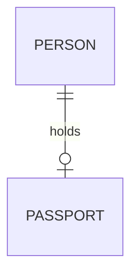
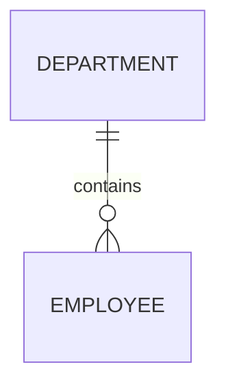

# Bội số tối thiểu, tối đa và tính tùy chọn ở từng đầu quan hệ

Khi mô hình hóa dữ liệu, chỉ nói “một-nhiều” hoặc “nhiều-nhiều” thường chưa đủ. Người thiết kế còn phải xác định mỗi đối tượng có thể hoặc phải tham gia quan hệ bao nhiêu lần. Một khách hàng có thể chưa có đơn hàng hay bắt buộc phải có ít nhất một đơn? Một đơn hàng có thể thuộc về khách vãng lai hay nhất thiết phải gắn với một hồ sơ khách hàng? Một phòng ban có thể tồn tại khi chưa có nhân viên không? Những câu hỏi này được mô tả bằng **bội số tối thiểu (minimum cardinality), bội số tối đa (maximum cardinality) và tính tùy chọn (optionality) ở từng đầu quan hệ**.

Đây là phần quan trọng khi chuyển yêu cầu nghiệp vụ thành mô hình dữ liệu rõ ràng. Nếu chỉ ghi quan hệ mà không xác định giới hạn tham gia, mô hình có thể cho phép những trường hợp nghiệp vụ không chấp nhận hoặc ngăn những trường hợp hoàn toàn hợp lệ. Việc xác định đúng các giới hạn còn giúp nhóm thiết kế khóa ngoại, bảng liên kết, ràng buộc duy nhất và cơ chế kiểm tra dữ liệu ở các bước logic và vật lý.

Sau bài học, người học có thể:

- Giải thích bội số tối thiểu, tối đa và tính tùy chọn của một đầu quan hệ.
- Đọc và viết ký hiệu `(min,max)` cho từng phía của quan hệ.
- Phân biệt quan hệ một-một, một-nhiều và nhiều-nhiều dựa trên giới hạn tối đa ở hai phía.
- Phân biệt tham gia bắt buộc với tham gia tùy chọn dựa trên giới hạn tối thiểu.
- Xác định giới hạn theo vòng đời, trạng thái, thời điểm và điều kiện nghiệp vụ.
- Kiểm chứng bội số bằng ví dụ hợp lệ, ví dụ không hợp lệ và câu hỏi với người sở hữu nghiệp vụ.
- Hiểu cách các giới hạn khái niệm được chuyển thành ràng buộc logic/vật lý và những giới hạn không thể biểu diễn chỉ bằng khóa ngoại.

## 1. Bội số của quan hệ mô tả điều gì?

Một quan hệ nối các trường hợp cụ thể của hai khái niệm. Ví dụ, `Khách hàng đặt Đơn hàng`. Bội số cho biết một trường hợp ở một phía có thể hoặc phải liên kết với bao nhiêu trường hợp ở phía còn lại.

Hãy đọc quan hệ từ cả hai phía:

- Với **một khách hàng**, có thể hoặc phải có bao nhiêu đơn hàng?
- Với **một đơn hàng**, có thể hoặc phải thuộc về bao nhiêu khách hàng?

Hai câu hỏi này độc lập. Một quan hệ có thể cho phép khách hàng chưa có đơn hàng nhưng vẫn yêu cầu mỗi đơn hàng phải thuộc về đúng một khách hàng. Nếu có khách vãng lai, phía đơn hàng có thể cho phép không gắn hồ sơ khách hàng. Không thể suy ra giới hạn của đầu này chỉ từ giới hạn của đầu kia.

### 1.1. Bội số tối thiểu (minimum cardinality)

Bội số tối thiểu cho biết một trường hợp phải tham gia quan hệ ít nhất bao nhiêu lần trong phạm vi và thời điểm đang xét.

- `0`: không bắt buộc tham gia. Đối tượng có thể tồn tại mà chưa có liên kết nào.
- `1`: bắt buộc có ít nhất một liên kết.
- `2` hoặc lớn hơn: nghiệp vụ yêu cầu tối thiểu nhiều liên kết, nếu có quy tắc như vậy.

Ví dụ, một khách hàng mới có thể chưa đặt đơn hàng, nên số đơn tối thiểu của khách hàng là `0`. Ngược lại, một dòng đơn hàng không thể tồn tại nếu không thuộc về đơn hàng nào, nên số đơn hàng tối thiểu mà một dòng đơn hàng phải tham chiếu là `1`.

### 1.2. Bội số tối đa (maximum cardinality)

Bội số tối đa cho biết một trường hợp có thể tham gia quan hệ nhiều nhất bao nhiêu lần.

- `1`: tối đa một liên kết.
- `N` hoặc `*`: nhiều liên kết; mô hình nghiệp vụ không đặt một giới hạn cố định cụ thể tại đầu quan hệ đó.
- Một số hữu hạn như `3`, `5` hoặc `10`: có giới hạn tối đa cụ thể nếu quy tắc nghiệp vụ yêu cầu.

Ví dụ, mỗi đơn hàng trong một tình huống bán lẻ có thể thuộc tối đa một khách hàng. Một khách hàng có thể đặt nhiều đơn hàng. Giới hạn tối đa được tính cho từng trường hợp, không phải tổng số bản ghi của toàn hệ thống.

### 1.3. Tính tùy chọn (optionality)

Trong mô hình quan hệ, một đầu quan hệ là **tùy chọn** khi bội số tối thiểu bằng `0`. Đầu đó là **bắt buộc** khi bội số tối thiểu từ `1` trở lên.

| Min | Cách hiểu | Tính tham gia |
|---:|---|---|
| 0 | Có thể chưa có liên kết | Tùy chọn (optional/partial participation) |
| 1 | Phải có ít nhất một liên kết | Bắt buộc (mandatory/total participation) |
| 2 trở lên | Phải có ít nhất số liên kết được chỉ định | Bắt buộc với ngưỡng tối thiểu cụ thể |

Tính tùy chọn nói về việc có cần tham gia quan hệ hay không. Nó không đồng nghĩa với giá trị thuộc tính bị thiếu hoặc không biết. Ví dụ, khách hàng chưa có đơn hàng là trường hợp không có liên kết; khách hàng có đơn hàng nhưng chưa biết mã đơn là vấn đề dữ liệu khác.

## 2. Ký hiệu `(min,max)` ở từng đầu quan hệ

Một cách ghi rõ ràng là dùng cặp `(min,max)` cho mỗi đầu. Ví dụ:

```text
KHÁCH_HÀNG (0,N) -------- (1,1) ĐƠN_HÀNG
```

Diễn giải:

- Mỗi khách hàng có thể có từ `0` đến nhiều đơn hàng.
- Mỗi đơn hàng phải thuộc về đúng `1` khách hàng.

Nếu nghiệp vụ cho phép khách vãng lai:

```text
KHÁCH_HÀNG (0,N) -------- (0,1) ĐƠN_HÀNG
```

Diễn giải:

- Một khách hàng có thể chưa có đơn hoặc có nhiều đơn.
- Một đơn hàng có thể chưa gắn với hồ sơ khách hàng hoặc gắn với tối đa một hồ sơ khách hàng.

Điều quan trọng là phải ghi rõ góc nhìn của từng cặp. Trong tài liệu hoặc công cụ vẽ, ký hiệu có thể đặt gần đầu thực thể hoặc gần đầu đường nối theo quy ước khác nhau. Vì vậy nên kèm câu diễn giải bằng ngôn ngữ tự nhiên để tránh hiểu ngược.

### 2.1. Cách đọc từng đầu bằng hai câu hỏi

Với quan hệ giữa `A` và `B`, hãy đọc:

1. “Một `A` có thể/phải liên kết với tối thiểu và tối đa bao nhiêu `B`?”
2. “Một `B` có thể/phải liên kết với tối thiểu và tối đa bao nhiêu `A`?”

Không đọc một cặp số như giới hạn của cả quan hệ. Mỗi cặp chỉ mô tả số liên kết nhìn từ một loại đối tượng.

Ví dụ với `Phòng ban` và `Nhân viên`:

| Góc nhìn | Min | Max | Ý nghĩa |
|---|---:|---:|---|
| Một phòng ban có bao nhiêu nhân viên? | 0 | N | Phòng ban mới có thể chưa có nhân viên; sau đó có thể có nhiều người. |
| Một nhân viên thuộc bao nhiêu phòng ban tại cùng một thời điểm? | 1 | 1 | Mỗi nhân viên đang hoạt động phải thuộc đúng một phòng ban. |

Nếu tổ chức cho phép nhân viên ở trạng thái chờ phân công, giới hạn phía nhân viên có thể là `(0,1)` trong giai đoạn đó. Đây là dấu hiệu cần làm rõ thời điểm áp dụng, thay vì ép một quy tắc duy nhất cho mọi giai đoạn.

### 2.2. Bốn tổ hợp thường gặp

| Min–max | Tên thường dùng | Cách hiểu |
|---|---|---|
| `(0,1)` | Không hoặc một | Có thể không tham gia, nếu tham gia thì tối đa một lần. |
| `(1,1)` | Đúng một | Bắt buộc tham gia chính xác một lần. |
| `(0,N)` | Không hoặc nhiều | Có thể không tham gia hoặc tham gia nhiều lần. |
| `(1,N)` | Một hoặc nhiều | Bắt buộc tham gia ít nhất một lần, có thể nhiều lần. |

Các cặp này không phải bốn loại quan hệ riêng. Chúng là các giới hạn ở một đầu quan hệ. Một quan hệ hoàn chỉnh phải có cặp giới hạn cho cả hai phía.

## 3. Phân biệt bội số tối thiểu và tối đa

Hai giới hạn trả lời hai câu hỏi khác nhau:

- Min trả lời: “Có thể không có liên kết không? Nếu không, tối thiểu phải có bao nhiêu?”
- Max trả lời: “Có thể liên kết với bao nhiêu đối tượng cùng loại nhiều nhất?”

Ví dụ, một hồ sơ nhân viên có thể được gắn với tối đa một tài khoản đăng nhập, nhưng không phải nhân viên nào cũng cần tài khoản. Giới hạn là `(0,1)`. Nếu mọi nhân viên đều phải có tài khoản, giới hạn là `(1,1)`. Cả hai đều có max bằng `1`, nhưng tính tùy chọn khác nhau.

Tương tự, một dự án có thể chưa có thành viên khi mới được tạo, nhưng trước khi khởi động phải có ít nhất một người tham gia. Nếu chỉ nhìn vào max `N`, nhóm sẽ không thấy yêu cầu tối thiểu. Cần ghi rõ min và giai đoạn áp dụng.

### 3.1. Max bằng 1 không có nghĩa là bắt buộc

Đây là nhầm lẫn phổ biến. `0..1` và `1..1` đều có tối đa một liên kết. Khác biệt nằm ở min:

- `0..1`: có thể không có liên kết.
- `1..1`: phải có đúng một liên kết.

Ví dụ, một khách hàng có thể có tài khoản thành viên nhưng cũng có thể mua hàng mà không đăng ký. Quan hệ `Khách hàng — Tài khoản thành viên` có thể là `(0,1)` ở phía khách hàng. Nếu mỗi tài khoản thành viên bắt buộc thuộc đúng một khách hàng, phía tài khoản có giới hạn `(1,1)`.

### 3.2. Min bằng 1 không có nghĩa là chỉ một

`1..N` nghĩa là phải có ít nhất một và có thể có nhiều. Ví dụ, một hóa đơn phát hành hợp lệ phải có ít nhất một dòng hóa đơn, nhưng có thể chứa nhiều dòng. Nếu ghi `(1,1)`, mô hình sẽ vô tình cấm hóa đơn có nhiều dòng.

### 3.3. N hoặc dấu `*` không có nghĩa là vô hạn về kỹ thuật

`N` hoặc `*` biểu thị không có giới hạn tối đa cố định trong quy tắc nghiệp vụ đang mô hình hóa. Hệ thống vẫn có giới hạn tài nguyên, dung lượng, hiệu năng hoặc chính sách vận hành. Nếu nghiệp vụ có giới hạn cụ thể, ví dụ mỗi lớp tối đa 30 học viên, cần ghi `max = 30` hoặc diễn đạt thành ràng buộc sức chứa thay vì dùng `N`.

## 4. Từ min–max suy ra 1:1, 1:N và N:M

Các tên một-một, một-nhiều và nhiều-nhiều chủ yếu nói về giới hạn tối đa ở hai đầu. Tính bắt buộc hay tùy chọn lại do giới hạn tối thiểu quyết định. Vì vậy, chỉ nói “một-nhiều” vẫn chưa mô tả đầy đủ quan hệ.

### 4.1. Quan hệ một-một (1:1)

Hai phía đều có max bằng `1`. Min có thể khác nhau:

| Phía A | Phía B | Diễn giải |
|---|---|---|
| `(0,1)` | `(1,1)` | A có thể chưa có B; mỗi B phải gắn đúng một A. |
| `(1,1)` | `(1,1)` | Mỗi A và mỗi B đều phải tham gia đúng một liên kết. |
| `(0,1)` | `(0,1)` | Cả hai phía đều có thể tồn tại độc lập hoặc ghép cặp tối đa một-một. |

Ví dụ: `Người — Hộ chiếu`. Một người có thể chưa có hộ chiếu hoặc có tối đa một hộ chiếu còn hiệu lực theo phạm vi quản lý; mỗi hộ chiếu thuộc đúng một người. Cần xác nhận việc hộ chiếu hết hạn hoặc được cấp lại có tạo hồ sơ mới hay thay thế hồ sơ cũ.



Ký hiệu cho thấy mỗi hộ chiếu thuộc đúng một người, còn một người có thể có không hoặc một hộ chiếu trong phạm vi mô hình ví dụ. Nếu nghiệp vụ cho phép lưu nhiều hộ chiếu lịch sử, quan hệ cần được mở rộng bằng khái niệm hồ sơ hộ chiếu hoặc trạng thái hiệu lực.

### 4.2. Quan hệ một-nhiều (1:N)

Một phía có thể liên kết với nhiều trường hợp ở phía kia; phía nhiều thường tham chiếu tối đa một trường hợp ở phía một. Min vẫn phải được xác định riêng.

Ví dụ: `Phòng ban — Nhân viên`:

| Phía | Min–max | Ý nghĩa |
|---|---|---|
| Phòng ban đối với nhân viên | `(0,N)` | Phòng ban có thể chưa có nhân viên hoặc có nhiều nhân viên. |
| Nhân viên đối với phòng ban | `(1,1)` | Mỗi nhân viên đang hoạt động thuộc đúng một phòng ban. |



Nếu nhân viên có thể tạm thời chưa thuộc phòng ban, thay giới hạn phía nhân viên bằng `(0,1)` trong giai đoạn đó. Nếu một nhân viên có thể làm việc đồng thời ở nhiều phòng ban, quan hệ có thể trở thành nhiều-nhiều và cần khái niệm phân công.

### 4.3. Quan hệ nhiều-nhiều (N:M)

Hai phía đều có max là nhiều. Min có thể là `0` hoặc `1` tùy quy tắc.

Ví dụ: `Học viên — Khóa học`. Một học viên có thể chưa đăng ký khóa học nào hoặc đăng ký nhiều khóa; một khóa học có thể chưa có học viên hoặc có nhiều người tham gia.


Nếu nghiệp vụ yêu cầu mỗi khóa học đã mở phải có ít nhất một học viên, min ở phía khóa học có thể là `1` tại thời điểm bắt đầu. Nhưng một khóa học ở trạng thái bản nháp có thể chưa có học viên. Khi quan hệ N:M có thuộc tính riêng như ngày đăng ký, trạng thái, điểm hoặc kết quả, hãy xem xét khái niệm liên kết `Đăng ký`.

### 4.4. Bảng tổng hợp các mẫu

| Loại theo max | Giới hạn phía A | Giới hạn phía B | Ví dụ |
|---|---|---|---|
| 1:1 | `(0,1)` | `(1,1)` | Người có thể có một hộ chiếu; hộ chiếu thuộc đúng một người. |
| 1:N | `(0,N)` | `(1,1)` | Phòng ban có nhiều nhân viên; nhân viên thuộc một phòng ban. |
| N:M | `(0,N)` | `(0,N)` | Học viên tham gia nhiều khóa; khóa có nhiều học viên. |

Bảng chỉ minh họa các tổ hợp phổ biến. Khi thiết kế, hãy ghi đúng min–max của từng đầu dựa trên nghiệp vụ thay vì chọn mẫu theo tên gọi.

## 5. Tính tùy chọn ở từng đầu quan hệ

### 5.1. Tùy chọn không đối xứng

Hai đầu của cùng một quan hệ có thể có tính tùy chọn khác nhau. Ví dụ, một khách hàng có thể chưa có đơn hàng, nhưng mỗi đơn hàng do khách đã đăng ký tạo ra phải thuộc đúng một khách hàng. Phía khách hàng là `(0,N)`, phía đơn hàng là `(1,1)`.

Trong bán hàng có khách vãng lai, phía đơn hàng có thể là `(0,1)`. Điều đó không có nghĩa đơn hàng thiếu dữ liệu do lỗi; nó phản ánh một trường hợp nghiệp vụ hợp lệ. Ngược lại, nếu tổ chức yêu cầu mọi đơn phải có chủ thể mua hàng được nhận diện, min ở phía đơn hàng là `1`.

### 5.2. Tùy chọn ở cả hai đầu

Một quan hệ có thể tùy chọn ở cả hai phía. Ví dụ, nhân viên có thể chưa được phân công dự án và dự án mới tạo có thể chưa có thành viên. Khi dự án chuẩn bị khởi động, quy tắc có thể yêu cầu phải có ít nhất một thành viên.

Đừng tự biến một quan hệ thành bắt buộc chỉ vì quy trình mong muốn cuối cùng có liên kết. Hãy phân biệt điều kiện khi tạo, điều kiện trước khi kích hoạt và điều kiện trong suốt vòng đời.

### 5.3. Bắt buộc ở cả hai đầu

Một quan hệ có thể bắt buộc ở cả hai phía nếu mọi trường hợp của A phải liên kết với ít nhất một B và mọi trường hợp của B phải liên kết với ít nhất một A. Ví dụ giả định: mỗi hồ sơ phân công phải có đúng một nhân viên và đúng một dự án; bản thân `Phân công` không tồn tại độc lập nếu thiếu một trong hai.

Lưu ý, điều này không có nghĩa mỗi nhân viên phải có ít nhất một phân công hoặc mỗi dự án phải có ít nhất một phân công. Nếu mô hình có khái niệm trung gian `Phân công`, cần phân biệt quan hệ giữa `Phân công` với hai thực thể đầu và quan hệ tổng thể giữa `Nhân viên` với `Dự án`.

### 5.4. Bắt buộc theo điều kiện hoặc giai đoạn

Một quan hệ có thể tùy chọn trong giai đoạn này nhưng bắt buộc trong giai đoạn khác.

Ví dụ:

- Lớp mở ở trạng thái `DRAFT` có thể chưa có giảng viên.
- Trước khi chuyển sang `READY`, lớp phải có ít nhất một giảng viên.
- Sau khi khai giảng, lớp phải luôn có người chịu trách nhiệm chính.

Một cặp min–max tĩnh không thể diễn đạt đầy đủ mọi điều kiện theo thời gian. Hãy ghi thêm quy tắc chuyển trạng thái và thời điểm kiểm tra. Nếu cần quản lý nhiều giai đoạn hoặc lịch sử phân công, có thể cần khái niệm liên kết có thời gian hiệu lực.

## 6. Phân biệt tham gia quan hệ với giá trị thuộc tính

Tính tùy chọn của quan hệ không giống tính bắt buộc của thuộc tính.

Ví dụ, một nhân viên có thể chưa được phân công dự án. Điều đó không nhất thiết có nghĩa thuộc tính `project_id` bị thiếu do dữ liệu chưa hoàn chỉnh; có thể nhân viên chưa có quan hệ dự án hợp lệ. Nếu một nhân viên có thể tham gia nhiều dự án, một cột `project_id` đơn trên nhân viên còn không thể biểu diễn đầy đủ quan hệ.

Một số điểm cần phân biệt:

| Khái niệm | Ý nghĩa | Ví dụ |
|---|---|---|
| Quan hệ tùy chọn | Đối tượng có thể không tham gia liên kết | Khách hàng chưa đặt đơn. |
| Thuộc tính tùy chọn | Đối tượng tồn tại nhưng một giá trị có thể chưa có/không áp dụng | Khách hàng chưa cung cấp số điện thoại phụ. |
| Tham chiếu chưa biết | Nghiệp vụ cần liên kết nhưng chưa xác định được đối tượng đích | Đơn cần gắn khách hàng nhưng mã khách chưa được đồng bộ. |
| Quan hệ không hợp lệ | Dữ liệu vi phạm quy tắc | Đơn tham chiếu đến khách hàng không tồn tại. |

Không dùng `NULL` để che giấu mọi trường hợp. Trước khi quyết định cột có cho phép rỗng hay không, hãy xác định đó là quan hệ thực sự tùy chọn, dữ liệu chưa biết hay dữ liệu lỗi.

## 7. Bội số trong quan hệ có khái niệm liên kết

Quan hệ nhiều-nhiều thường có thông tin riêng. Khi đó, việc đưa quan hệ thành một khái niệm trung gian giúp mô tả chính xác hơn.

Ví dụ, `Học viên` tham gia `Lớp học` thông qua `Đăng ký`:

```mermaid
erDiagram
    STUDENT ||--o{ ENROLLMENT : submits
    CLASS ||--o{ ENROLLMENT : receives
```

Diễn giải:

- Một học viên có thể có `0..N` đăng ký.
- Mỗi đăng ký phải thuộc đúng `1` học viên.
- Một lớp có thể có `0..N` đăng ký.
- Mỗi đăng ký phải áp dụng cho đúng `1` lớp.

Nếu một học viên chỉ được có một đăng ký đang hiệu lực cho một lớp, đây là quy tắc duy nhất có điều kiện trên cặp `Học viên–Lớp`, không chỉ là min–max đơn giản. Nếu học viên hủy rồi đăng ký lại, cần xác định có tạo hồ sơ đăng ký mới hay mở lại hồ sơ cũ.

### 7.1. Giới hạn của thực thể liên kết

Một thực thể liên kết như `Đăng ký` có thể có thuộc tính riêng: thời điểm gửi, trạng thái, nguồn đăng ký, thời điểm xác nhận và kết quả. Nó cũng có vòng đời riêng. Khi đó cần rà soát:

- Đăng ký có thể tồn tại khi chưa xác định học viên hoặc lớp không?
- Có cho phép một đăng ký áp dụng cho nhiều lớp không?
- Một học viên có thể có nhiều đăng ký cho cùng lớp ở các thời điểm khác nhau không?
- Khi lớp bị hủy, đăng ký chuyển trạng thái thế nào?
- Đăng ký đã kết thúc có được xóa hay phải giữ lịch sử?

Thông thường, mỗi hồ sơ đăng ký cần gắn với đúng một học viên và đúng một lớp. Tuy nhiên, có thể có trạng thái bản nháp hoặc yêu cầu chưa hoàn chỉnh; hãy xác định thời điểm nào quan hệ trở thành bắt buộc.

### 7.2. Bội số của quan hệ ba ngôi hoặc nhiều ngôi

Một số nghiệp vụ phụ thuộc đồng thời vào ba khái niệm. Ví dụ, `Nhân viên` sử dụng `Thiết bị` trong `Dự án`. Một lần sử dụng được xác định bởi cả nhân viên, thiết bị và dự án. Không thể luôn tách thành ba quan hệ hai ngôi mà vẫn giữ đúng ý nghĩa, vì tổ hợp ba yếu tố có thể mang thông tin riêng.

Với quan hệ nhiều ngôi, hãy xác định giới hạn cho từng vai trò trong ngữ cảnh của các vai trò còn lại. Ví dụ:

- Với một cặp `(Nhân viên, Dự án)`, có thể có nhiều lần sử dụng thiết bị.
- Với một cặp `(Thiết bị, Dự án)`, có thể có nhiều nhân viên sử dụng.
- Với một cặp `(Nhân viên, Thiết bị)`, có thể có nhiều dự án liên quan.

Các giới hạn này cần được mô tả bằng câu nghiệp vụ hoặc bảng ràng buộc theo tổ hợp. Không áp dụng máy móc ký hiệu min–max của quan hệ hai ngôi cho quan hệ nhiều ngôi nếu chưa xác định rõ ngữ cảnh.

## 8. Cách xác định min–max từ yêu cầu nghiệp vụ

### 8.1. Hỏi về trường hợp nhỏ nhất

Với mỗi phía, hỏi:

- Có thể có một đối tượng không liên kết với đối tượng phía kia không?
- Khi mới tạo, có thể chưa có liên kết không?
- Trước khi chuyển sang trạng thái tiếp theo, phải có ít nhất bao nhiêu liên kết?
- Có trường hợp hợp lệ nào có số liên kết bằng 0 không?

Nếu có trường hợp hợp lệ bằng 0, min có thể là `0` trong phạm vi và giai đoạn đó. Nếu mọi trường hợp hợp lệ đều phải có ít nhất một, min là `1` hoặc cao hơn.

### 8.2. Hỏi về trường hợp lớn nhất

- Một đối tượng có thể liên kết với nhiều đối tượng phía kia không?
- Có giới hạn nghiệp vụ cụ thể không?
- Giới hạn đó áp dụng theo thời gian, trạng thái, vai trò hay phạm vi tổ chức nào?
- Một đối tượng có thể liên kết với cùng đối tượng kia nhiều lần ở các thời điểm khác nhau không?

Ví dụ, một nhân viên có thể tham gia nhiều dự án trong suốt sự nghiệp, nhưng chỉ tối đa hai dự án đồng thời. Đây là giới hạn phụ thuộc thời gian, không đơn giản là max `2` cho toàn bộ lịch sử.

### 8.3. Xác nhận bằng ví dụ và phản ví dụ

Đừng chỉ hỏi “một khách hàng có nhiều đơn không?”. Hãy đưa ra ví dụ cụ thể:

- Khách hàng vừa tạo tài khoản nhưng chưa mua hàng có hợp lệ không?
- Một đơn của khách vãng lai có hợp lệ không?
- Một đơn có thể đứng tên hai người mua không?
- Một khách hàng có thể có hàng nghìn đơn không?

Với mỗi câu trả lời, xác định nó là quy tắc phổ quát, ngoại lệ được phép hay trường hợp bị cấm. Ghi lại nguồn xác nhận và điều kiện áp dụng.

### 8.4. Bảng ghi nhận bội số

| Quan hệ | Một A liên kết với B | Một B liên kết với A | Điều kiện/giai đoạn |
|---|---|---|---|
| Khách hàng–Đơn hàng | `(0,N)` | `(0,1)` nếu cho phép khách vãng lai; `(1,1)` nếu bắt buộc hồ sơ | Khi đơn được xác nhận |
| Khóa học–Lớp mở | `(0,N)` | `(1,1)` | Mỗi lớp mở thuộc một khóa học |
| Học viên–Đăng ký | `(0,N)` | `(1,1)` | Đăng ký hợp lệ phải có một học viên |
| Lớp–Đăng ký | `(0,N)` | `(1,1)` | Đăng ký hợp lệ phải áp dụng cho một lớp |
| Phòng ban–Nhân viên | `(0,N)` | `(1,1)` hoặc `(0,1)` | Phụ thuộc trạng thái phân công |

## 9. Kiểm chứng bội số bằng tình huống

### 9.1. Ví dụ phòng ban và nhân viên

Giả sử tổ chức có phòng ban và nhân viên. Một phòng ban có thể mới được thành lập và chưa có nhân viên. Một nhân viên đang hoạt động phải thuộc một phòng ban tại mỗi thời điểm.

| Đối tượng được xét | Số đối tượng liên kết | Kết quả |
|---|---:|---|
| Phòng ban mới | 0 nhân viên | Hợp lệ nếu cho phép phòng ban chưa có nhân sự. |
| Phòng ban đang hoạt động | N nhân viên | Hợp lệ. |
| Nhân viên đang hoạt động | 1 phòng ban | Hợp lệ. |
| Nhân viên đang hoạt động | 0 phòng ban | Vi phạm nếu quy tắc yêu cầu luôn được phân công. |
| Nhân viên đang hoạt động | 2 phòng ban cùng thời điểm | Vi phạm nếu giới hạn là đúng một phòng ban; hợp lệ nếu cho phép kiêm nhiệm và mô hình đã hỗ trợ. |

Nếu nhân viên có thể chuyển phòng ban, hãy xác định lịch sử quan hệ. Nếu có thể kiêm nhiệm, hãy mô hình hóa thời gian hiệu lực và vai trò thay vì chỉ đổi một giá trị `department_id`.

### 9.2. Ví dụ khách hàng và đơn hàng

Giả sử hệ thống cho phép khách vãng lai đặt hàng.

| Đối tượng được xét | Số liên kết | Kết quả |
|---|---:|---|
| Khách hàng chưa mua | 0 đơn | Hợp lệ. |
| Khách hàng đã mua nhiều lần | N đơn | Hợp lệ. |
| Đơn của khách đăng ký | 1 khách hàng | Hợp lệ. |
| Đơn khách vãng lai | 0 khách hàng | Hợp lệ nếu thông tin người mua được ghi nhận theo quy tắc khác. |
| Đơn gắn hai hồ sơ khách hàng | 2 khách hàng | Không hợp lệ nếu mỗi đơn chỉ có một chủ thể mua. |

Nếu một đơn có người đặt, người nhận và người thanh toán khác nhau, không nên gộp tất cả thành quan hệ “đơn thuộc khách hàng”. Hãy xác định các vai trò `Người mua`, `Người nhận`, `Người thanh toán` và bội số riêng cho từng quan hệ.

### 9.3. Ví dụ lớp học và đăng ký

Một lớp học được tạo trước khi mở đăng ký. Trong trạng thái nháp, lớp có thể chưa có học viên. Sau khi mở đăng ký, số học viên được xác nhận có thể từ `0` đến sức chứa. Nếu lớp chuẩn bị khai giảng, trung tâm có thể yêu cầu ít nhất một học viên hoặc có thể hủy lớp nếu không đủ số lượng.

Điều này cho thấy hai giới hạn khác nhau:

- Số đăng ký tối đa có thể bị giới hạn bởi sức chứa.
- Số đăng ký tối thiểu có thể chỉ được kiểm tra tại thời điểm quyết định mở lớp hoặc khai giảng.

Không nên ghi min `1` cho mọi trạng thái nếu lớp nháp được phép chưa có học viên. Hãy ghi rõ thời điểm và quy tắc chuyển trạng thái.

## 10. Chuyển bội số khái niệm sang mô hình logic và vật lý

Bội số ở mức khái niệm là quy tắc nghiệp vụ. Khi triển khai, mỗi loại quan hệ thường được biểu diễn bằng cấu trúc khác nhau. Cần hiểu mối liên hệ để không nhầm lẫn rằng một ràng buộc vật lý đơn lẻ đã bảo đảm toàn bộ min–max.

### 10.1. Quan hệ một-nhiều

Thông thường, khóa ngoại được đặt ở phía nhiều để tham chiếu đến phía một. Ví dụ, `employee.department_id` tham chiếu `department.id`.

- Nếu mỗi nhân viên bắt buộc thuộc một phòng ban, cột tham chiếu thường phải có giá trị và khóa ngoại phải hợp lệ.
- Nếu nhân viên có thể chưa thuộc phòng ban, tham chiếu có thể cho phép rỗng trong trạng thái được phép.
- Một phòng ban có thể có `0..N` nhân viên; khóa ngoại trên nhân viên cho phép phòng ban không có dòng nhân viên nào.

### 10.2. Quan hệ một-một

Thông thường, một phía dùng khóa ngoại có ràng buộc duy nhất để giới hạn mỗi đối tượng chỉ được tham chiếu một lần. Nếu phía tham chiếu bắt buộc phải có đối tượng đích, tham chiếu còn phải không rỗng và hợp lệ.

Ràng buộc duy nhất chỉ bảo đảm max ở một phía của quan hệ. Muốn bảo đảm min ở phía ngược lại, có thể cần quy trình tạo đồng thời, trigger, kiểm tra trì hoãn hoặc quy tắc nghiệp vụ ở tầng ứng dụng tùy hệ quản trị và thiết kế.

### 10.3. Quan hệ nhiều-nhiều

Thông thường, quan hệ được biểu diễn bằng bảng liên kết chứa tham chiếu đến hai phía. Một cặp khóa có thể được đặt duy nhất nếu không cho phép trùng quan hệ trong phạm vi đó. Nếu cùng một cặp có thể liên kết nhiều lần theo thời gian, cần định danh lần quan hệ hoặc bổ sung thời điểm/loại quan hệ vào quy tắc duy nhất.

### 10.4. Vì sao khóa ngoại chưa đủ cho mọi min?

Khóa ngoại thường kiểm tra rằng một tham chiếu, nếu có, phải trỏ đến bản ghi hợp lệ. Nó không tự đảm bảo rằng mỗi phòng ban có ít nhất một nhân viên hoặc mỗi lớp đã sẵn sàng phải có ít nhất một giảng viên. Những ràng buộc min ở phía cha thường cần kiểm tra trên tập bản ghi con, theo trạng thái và thời điểm.

Vì vậy, trước khi chọn cách triển khai, hãy ghi rõ:

- Ràng buộc nào có thể dùng `NOT NULL`, `FOREIGN KEY` hoặc `UNIQUE`.
- Ràng buộc nào cần kiểm tra số lượng bản ghi liên quan.
- Ràng buộc nào phụ thuộc trạng thái hoặc thời gian.
- Ràng buộc nào cần kiểm tra đồng thời để tránh hai giao dịch cùng vượt giới hạn.
- Ràng buộc nào cần quy trình nghiệp vụ hoặc phê duyệt.

Không cần đưa các chi tiết SQL vào sơ đồ khái niệm, nhưng phải giữ các quy tắc nghiệp vụ đủ rõ để bước thiết kế logic/vật lý có thể triển khai và kiểm chứng.

## 11. Sai lầm thường gặp

| Sai lầm | Hệ quả | Cách khắc phục |
|---|---|---|
| Chỉ ghi 1:N mà không ghi min | Không biết phía nào có thể chưa tham gia. | Ghi `(min,max)` cho cả hai phía. |
| Nghĩ max bằng 1 đồng nghĩa bắt buộc | Biến quan hệ `0..1` thành `1..1`. | Kiểm tra riêng min và max. |
| Chỉ đọc bội số từ một phía | Hiểu sai số lượng ở đầu còn lại. | Đặt hai câu hỏi độc lập cho mỗi đầu. |
| Coi `N` là vô hạn kỹ thuật | Bỏ qua giới hạn nghiệp vụ hoặc tài nguyên. | Xác định có ngưỡng hữu hạn theo chính sách không. |
| Coi tùy chọn là dữ liệu thiếu | Nhầm trường hợp không có quan hệ hợp lệ với lỗi dữ liệu. | Phân biệt không tham gia, chưa biết và không hợp lệ. |
| Áp dụng một min–max cho mọi trạng thái | Không thể hiện quy tắc theo vòng đời. | Ghi điều kiện và thời điểm kiểm tra. |
| Dùng một cột tham chiếu cho quan hệ N:M | Không biểu diễn đủ các liên kết. | Xem xét khái niệm liên kết hoặc cấu trúc nhiều-nhiều. |
| Bỏ qua vai trò khác nhau của cùng một người | Gộp người mua, người nhận và người thanh toán. | Đặt tên quan hệ theo vai trò nghiệp vụ. |
| Nghĩ khóa ngoại bảo đảm mọi giới hạn | Bỏ sót min ở phía cha hoặc giới hạn theo trạng thái. | Đánh giá từng ràng buộc và cơ chế thực thi riêng. |

## 12. Bộ hồ sơ và checklist rà soát quan hệ

Với mỗi quan hệ, nên ghi lại:

| Thành phần | Nội dung |
|---|---|
| Tên quan hệ | Động từ hoặc cụm từ mô tả đúng nghiệp vụ. |
| Khái niệm phía A | Tên và vai trò của đối tượng A. |
| Min–max phía A | Số lượng B tối thiểu/tối đa cho một A. |
| Khái niệm phía B | Tên và vai trò của đối tượng B. |
| Min–max phía B | Số lượng A tối thiểu/tối đa cho một B. |
| Điều kiện áp dụng | Trạng thái, thời gian, loại đối tượng hoặc phạm vi. |
| Quy tắc liên quan | Điều kiện duy nhất, giới hạn số lượng, quyền và ngoại lệ. |
| Ví dụ hợp lệ | Tình huống chứng minh giới hạn. |
| Ví dụ không hợp lệ | Tình huống vi phạm giới hạn. |
| Nguồn xác nhận | Yêu cầu, dữ liệu mẫu, người sở hữu nghiệp vụ. |

Mẫu ghi nhận:

```text
Tên quan hệ:
Mô tả nghiệp vụ:
Phía A:
  Một A liên kết tối thiểu bao nhiêu B:
  Một A liên kết tối đa bao nhiêu B:
Phía B:
  Một B liên kết tối thiểu bao nhiêu A:
  Một B liên kết tối đa bao nhiêu A:
Tính tùy chọn ở phía A:
Tính tùy chọn ở phía B:
Điều kiện/trạng thái/thời điểm áp dụng:
Quy tắc ngoại lệ:
Ví dụ hợp lệ:
Ví dụ vi phạm:
Nguồn bằng chứng:
Người xác nhận:
```

Checklist trước khi chốt:

- [ ] Mỗi quan hệ có tên và mô tả nghiệp vụ rõ nghĩa.
- [ ] Đã đọc quan hệ từ cả hai phía.
- [ ] Min và max được xác định riêng cho từng đầu.
- [ ] Đã xác nhận trường hợp số lượng bằng 0 có hợp lệ không.
- [ ] Đã xác nhận giới hạn tối đa là 1, nhiều hay một số hữu hạn.
- [ ] Đã phân biệt `0..1` với `1..1` và `0..N` với `1..N`.
- [ ] Các trường hợp hợp lệ, không hợp lệ và biên đã được kiểm tra.
- [ ] Điều kiện theo trạng thái và thời gian được ghi rõ.
- [ ] Vai trò của các bên tham gia đã được phân biệt.
- [ ] Quan hệ N:M có thuộc tính/lịch sử riêng đã được xem xét thành khái niệm liên kết.
- [ ] Ràng buộc min không bị nhầm là đã được khóa ngoại bảo đảm.
- [ ] Mỗi giới hạn có bằng chứng hoặc người sở hữu nghiệp vụ xác nhận.

## 13. Bài tập thực hành

Một bệnh viện quản lý bác sĩ, bệnh nhân, khoa khám và lịch hẹn. Một bác sĩ thuộc một khoa chính nhưng có thể hỗ trợ khoa khác theo lịch. Một bệnh nhân có thể chưa từng khám hoặc có nhiều lần khám. Mỗi lịch hẹn phải gắn với một bệnh nhân và một bác sĩ. Bác sĩ có thể chưa có lịch hẹn trong ngày. Một lịch hẹn có thể được tạo trước khi bệnh nhân xác nhận, sau đó được xác nhận, đổi lịch hoặc hủy.

Hãy thực hiện các nhiệm vụ:

1. Xác định các khái niệm và quan hệ chính trong tình huống.
2. Viết min–max cho cả hai phía của quan hệ Bác sĩ–Khoa, Bệnh nhân–Lịch hẹn và Bác sĩ–Lịch hẹn.
3. Phân biệt quan hệ khoa chính với quan hệ hỗ trợ khoa theo lịch.
4. Xác định min–max của quan hệ trong trạng thái lịch hẹn nháp và lịch hẹn đã xác nhận.
5. Viết ít nhất năm tình huống hợp lệ và năm tình huống vi phạm bội số.
6. Giải thích vì sao một lịch hẹn nháp có thể chưa được bệnh nhân xác nhận nhưng lịch hẹn hợp lệ vẫn phải có bệnh nhân và bác sĩ theo quy tắc cuối cùng.
7. Đề xuất cách biểu diễn quan hệ trong mô hình logic và nêu ràng buộc nào cần kiểm tra ngoài khóa ngoại.
8. Lập bảng bội số và ghi câu hỏi cần bệnh viện xác nhận.

**Tiêu chí tự đánh giá:** mỗi quan hệ có min–max cho cả hai phía; không nhầm tính tùy chọn với dữ liệu lỗi; giới hạn thay đổi theo trạng thái được diễn đạt rõ; vai trò khoa chính và hỗ trợ không bị gộp; các quy tắc có thể được kiểm chứng bằng ví dụ.

## Kết luận

Bội số tối thiểu cho biết một đối tượng có bắt buộc tham gia quan hệ hay không và cần ít nhất bao nhiêu liên kết. Bội số tối đa giới hạn số liên kết mà một đối tượng có thể có. Tính tùy chọn là trường hợp min bằng 0, còn tham gia bắt buộc có min từ 1 trở lên. Khi ghi rõ `(min,max)` cho từng đầu, đọc quan hệ theo cả hai chiều và xác nhận điều kiện theo vòng đời, mô hình sẽ diễn tả chính xác hơn quy tắc nghiệp vụ và tạo nền tảng đáng tin cậy cho thiết kế khóa, khóa ngoại và ràng buộc vật lý.
