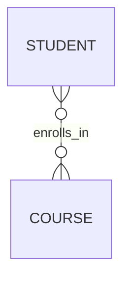
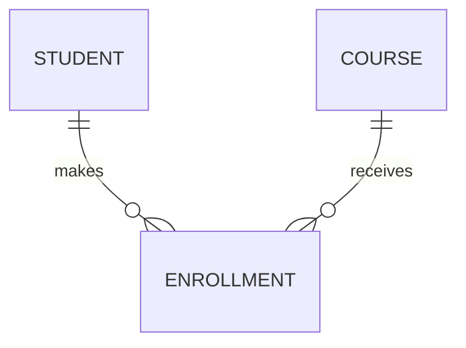
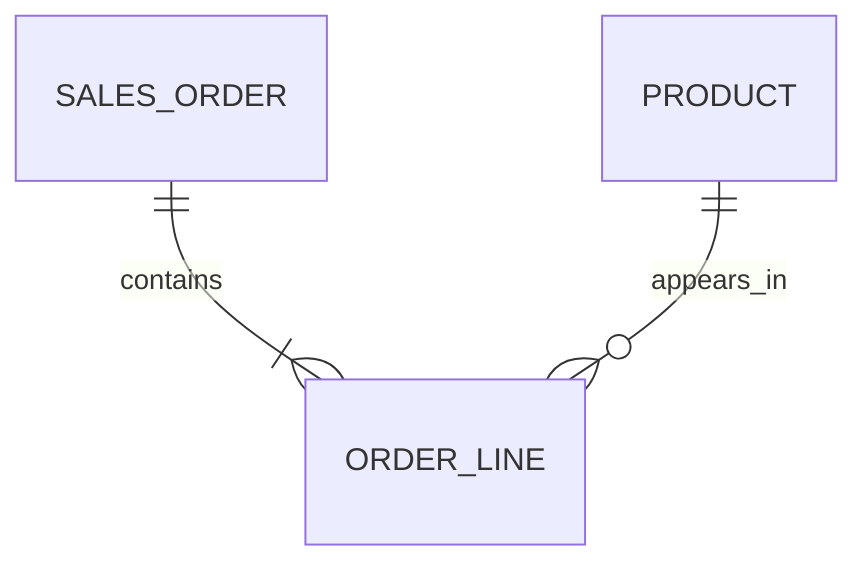
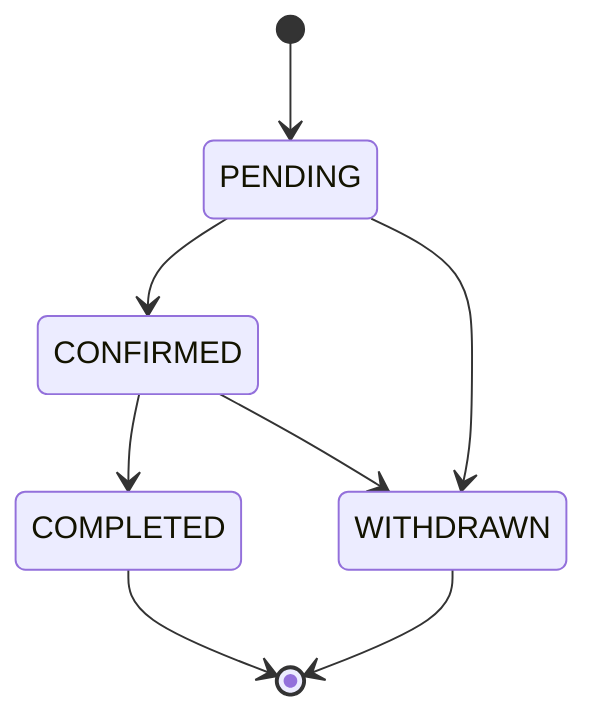
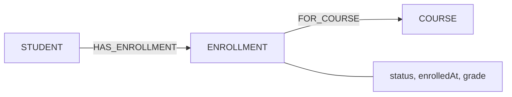

# Thực thể liên kết khi quan hệ có thuộc tính hoặc vòng đời riêng

Trong nghiệp vụ, hai loại thực thể có thể liên hệ với nhau theo quan hệ nhiều-nhiều. Một sinh viên có thể đăng ký nhiều môn học, và một môn học có nhiều sinh viên đăng ký. Nếu chỉ lưu danh sách mã môn học trong hồ sơ sinh viên hoặc danh sách mã sinh viên trong hồ sơ môn học, hệ thống khó quản lý từng lần đăng ký, trạng thái, ngày đăng ký, điểm số và lịch sử thay đổi.

Khi bản thân mối liên hệ cần được quản lý như một đối tượng, ta mô hình hóa nó thành **thực thể liên kết (associative entity)**. Thực thể này nối các thực thể tham gia và mang những thuộc tính, định danh hoặc vòng đời riêng của quan hệ. Nó giúp mô hình diễn đạt chính xác sự kiện nghiệp vụ và tạo nơi đặt các ràng buộc liên quan đến mối liên hệ.

Trong phạm vi **DATABASE_DATA_MODELING**, bài học tập trung vào cách nhận diện thực thể liên kết, chuyển quan hệ nhiều-nhiều thành cấu trúc logic và vật lý, chọn khóa, xử lý nhiều lần phát sinh, quản lý trạng thái và lịch sử, cũng như phân biệt thực thể liên kết với bảng nối thuần kỹ thuật.

## Mục tiêu học tập

Sau bài học, bạn có thể:

- Nhận biết khi nào một quan hệ cần được mô hình hóa thành thực thể liên kết.
- Phân biệt thuộc tính của thực thể tham gia với thuộc tính của chính mối liên hệ.
- Chuyển quan hệ nhiều-nhiều thành thực thể liên kết và hai quan hệ một-nhiều.
- Chọn khóa ghép hoặc khóa thay thế dựa trên định danh và số lần phát sinh của quan hệ.
- Thiết kế ràng buộc duy nhất, khóa ngoại, trạng thái, thời gian hiệu lực và chính sách xóa phù hợp.
- Phân biệt bảng nối đơn giản, thực thể liên kết, thực thể yếu và thực thể sự kiện.

## 1. Khi nào một quan hệ trở thành thực thể liên kết?

Một quan hệ nhiều-nhiều (M:N) mô tả việc nhiều thể hiện của loại thực thể A có thể liên hệ với nhiều thể hiện của loại thực thể B. Ví dụ:

- Một sinh viên đăng ký nhiều môn học; một môn học có nhiều sinh viên.
- Một đơn hàng chứa nhiều sản phẩm; một sản phẩm có thể xuất hiện trong nhiều đơn hàng.
- Một nhân viên tham gia nhiều dự án; mỗi dự án có nhiều nhân viên.

Nếu quan hệ chỉ cần thể hiện sự tồn tại của liên kết, một bảng nối với hai khóa ngoại có thể đủ. Nhưng khi nghiệp vụ cần trả lời thêm câu hỏi về chính liên kết, nó bắt đầu có ý nghĩa riêng.

Ví dụ với đăng ký môn học:

- Sinh viên đăng ký vào ngày nào?
- Đăng ký đang ở trạng thái chờ duyệt, đã xác nhận, đã hoàn thành hay đã rút?
- Sinh viên nhận điểm nào trong lần đăng ký đó?
- Sinh viên có thể đăng ký lại cùng môn trong học kỳ khác hoặc học lại nhiều lần không?
- Ai phê duyệt đăng ký và thời điểm nào?

Các câu hỏi này không thuộc riêng Sinh viên hoặc Môn học. Chúng thuộc về **một lần Sinh viên đăng ký một Môn học**. Vì vậy, `ENROLLMENT` là thực thể liên kết.

### 1.1. Dấu hiệu nhận diện

Hãy cân nhắc tạo thực thể liên kết khi có một hoặc nhiều dấu hiệu sau:

- Quan hệ có thuộc tính riêng như số lượng, giá thỏa thuận, vai trò, điểm số hoặc ngày bắt đầu.
- Quan hệ có trạng thái và các bước chuyển trạng thái riêng.
- Quan hệ có vòng đời: tạo, xác nhận, tạm dừng, hoàn tất, hủy hoặc lưu trữ.
- Có thể phát sinh nhiều lần liên kết giữa cùng hai thực thể theo thời gian.
- Quan hệ cần được tham chiếu từ thực thể hoặc quy trình khác.
- Cần audit người tạo, người duyệt, thời điểm và lịch sử thay đổi.

Không phải cứ có khóa ngoại là cần một thực thể nghiệp vụ mới. Nếu quan hệ chỉ là cấu trúc nối kỹ thuật, không có thuộc tính hay vòng đời riêng và không cần tham chiếu độc lập, bảng nối đơn giản có thể đủ.

### 1.2. Thuộc tính của quan hệ nằm ở đâu?

Giả sử một sinh viên đăng ký môn học với ngày đăng ký, trạng thái và điểm cuối kỳ.

| Thuộc tính | Thuộc về | Lý do |
|---|---|---|
| `student_id` | Liên kết Enrollment | Xác định sinh viên tham gia lần đăng ký |
| `course_id` | Liên kết Enrollment | Xác định môn học được đăng ký |
| `enrolled_at` | Enrollment | Thời điểm của lần đăng ký |
| `status` | Enrollment | Trạng thái của mối liên hệ đăng ký |
| `grade` | Enrollment | Kết quả của sinh viên trong lần đăng ký môn đó |
| `student_name` | Student | Thông tin mô tả sinh viên, không phải thuộc tính của lần đăng ký |
| `course_title` | Course | Thông tin mô tả môn học, không phải thuộc tính của lần đăng ký |

Nếu đặt `grade` trong bảng `STUDENT`, một sinh viên chỉ có thể có một điểm chung cho mọi môn học. Nếu đặt `grade` trong `COURSE`, tất cả sinh viên sẽ dùng chung một điểm. Đưa thuộc tính vào `ENROLLMENT` giữ đúng ngữ nghĩa của dữ liệu.

## 2. Mô hình hóa từ quan hệ M:N thành thực thể liên kết

### 2.1. Trước khi chuyển đổi

Mô hình khái niệm ban đầu:



Quan hệ M:N nói rằng một sinh viên có thể đăng ký nhiều môn và một môn có thể có nhiều sinh viên. Tuy nhiên, sơ đồ chưa có chỗ rõ ràng để đặt trạng thái, ngày đăng ký và điểm của từng lần đăng ký.

### 2.2. Sau khi chuyển đổi

Tạo thực thể `ENROLLMENT` ở giữa:



Quan hệ M:N được chuyển thành hai quan hệ 1:N:

- Một sinh viên có thể có nhiều bản ghi đăng ký; mỗi bản ghi đăng ký thuộc đúng một sinh viên.
- Một môn học có thể có nhiều bản ghi đăng ký; mỗi bản ghi đăng ký tham chiếu đúng một môn học.

Thực thể liên kết là một đối tượng dữ liệu có khóa, thuộc tính và quy tắc riêng. Nó không làm mất ý nghĩa M:N ban đầu; nó biểu diễn từng lần tham gia cụ thể để hệ thống có thể quản lý.

### 2.3. Lược đồ logic

| Quan hệ | Thuộc tính chính | Vai trò |
|---|---|---|
| `STUDENT` | `student_id`, `full_name` | Thực thể sinh viên |
| `COURSE` | `course_id`, `course_code`, `title` | Thực thể môn học |
| `ENROLLMENT` | `enrollment_id`, `student_id`, `course_id`, `enrolled_at`, `status`, `grade` | Thực thể liên kết, lưu từng lần đăng ký |

Mỗi hàng `ENROLLMENT` là một lần đăng ký của một sinh viên vào một môn học. Nếu nghiệp vụ chỉ cho phép một lần đăng ký cho mỗi cặp sinh viên – môn học trong toàn bộ hệ thống, cặp `(student_id, course_id)` có thể là khóa. Nếu sinh viên được đăng ký lại theo học kỳ hoặc học lại nhiều lần, cặp này không còn đủ để định danh.

## 3. Định danh: khóa ghép hay khóa thay thế?

Thực thể liên kết cần có cách định danh từng thể hiện. Có hai cách thường dùng.

### 3.1. Khóa ghép từ các thực thể tham gia

Nếu một cặp sinh viên – môn học chỉ xuất hiện tối đa một lần, có thể dùng:

```sql
PRIMARY KEY (student_id, course_id)
```

Ưu điểm:

- Thể hiện trực tiếp rằng danh tính liên kết được tạo từ hai đầu quan hệ.
- Không cần thêm một ID chỉ để định danh hàng nối.
- Có thể đồng thời bảo đảm không đăng ký trùng cùng một môn.

Hạn chế:

- Nếu cùng cặp có nhiều lần đăng ký theo học kỳ hoặc lần học lại, khóa này không còn phù hợp.
- Các bảng khác tham chiếu Enrollment phải mang cả hai cột khóa.
- Nếu một thành phần khóa thay đổi, các tham chiếu phụ thuộc cũng cần được xử lý.

### 3.2. Khóa thay thế

Nếu mỗi lần đăng ký là một đối tượng riêng, có thể dùng `enrollment_id`:

Ví dụ sau giả định hai bảng `student` và `course` đã được tạo với khóa chính tương ứng.

```sql
CREATE TABLE enrollment (
    enrollment_id BIGINT GENERATED BY DEFAULT AS IDENTITY PRIMARY KEY,
    student_id BIGINT NOT NULL REFERENCES student(student_id),
    course_id BIGINT NOT NULL REFERENCES course(course_id),
    enrolled_at TIMESTAMPTZ NOT NULL DEFAULT now(),
    status VARCHAR(20) NOT NULL
        CHECK (status IN ('PENDING', 'CONFIRMED', 'COMPLETED', 'WITHDRAWN')),
    grade NUMERIC(4, 2),
    CHECK (grade IS NULL OR (grade >= 0 AND grade <= 10))
);
```

Khóa thay thế giúp các bảng khác tham chiếu một cột đơn giản và cho phép cùng một sinh viên đăng ký lại cùng môn nhiều lần. Tuy nhiên, khóa thay thế **không tự động bảo đảm quy tắc nghiệp vụ**. Nếu hệ thống không cho phép hai đăng ký đang hoạt động cho cùng một sinh viên và cùng một lớp học phần, cần ràng buộc duy nhất phù hợp.

### 3.3. Khóa thay thế kết hợp khóa duy nhất nghiệp vụ

Trong hệ thống thực tế, môn học thường được mở theo học kỳ hoặc lớp học phần. Khi đó, mô hình có thể là:

```sql
CREATE TABLE student (
    student_id BIGINT GENERATED BY DEFAULT AS IDENTITY PRIMARY KEY,
    full_name VARCHAR(200) NOT NULL
);

CREATE TABLE course (
    course_id BIGINT GENERATED BY DEFAULT AS IDENTITY PRIMARY KEY,
    course_code VARCHAR(30) NOT NULL UNIQUE,
    title VARCHAR(200) NOT NULL
);

CREATE TABLE course_offering (
    offering_id BIGINT GENERATED BY DEFAULT AS IDENTITY PRIMARY KEY,
    course_id BIGINT NOT NULL REFERENCES course(course_id),
    term_code VARCHAR(20) NOT NULL,
    section_code VARCHAR(20) NOT NULL,
    UNIQUE (course_id, term_code, section_code)
);

CREATE TABLE enrollment (
    enrollment_id BIGINT GENERATED BY DEFAULT AS IDENTITY PRIMARY KEY,
    student_id BIGINT NOT NULL REFERENCES student(student_id),
    offering_id BIGINT NOT NULL REFERENCES course_offering(offering_id),
    attempt_no SMALLINT NOT NULL DEFAULT 1 CHECK (attempt_no > 0),
    enrolled_at TIMESTAMPTZ NOT NULL DEFAULT now(),
    status VARCHAR(20) NOT NULL
        CHECK (status IN ('PENDING', 'CONFIRMED', 'COMPLETED', 'WITHDRAWN')),
    grade NUMERIC(4, 2),
    CHECK (grade IS NULL OR (grade >= 0 AND grade <= 10)),
    UNIQUE (student_id, offering_id, attempt_no)
);
```

`attempt_no` phân biệt các lần đăng ký hoặc học lại của cùng sinh viên trong một lớp học phần. Nếu nghiệp vụ chỉ cho phép một bản ghi duy nhất cho cặp sinh viên – lớp học phần trong toàn bộ lịch sử, có thể thay ràng buộc ba cột bằng:

```sql
ALTER TABLE enrollment
    ADD CONSTRAINT one_enrollment_per_student_offering
    UNIQUE (student_id, offering_id);
```

Nếu cho phép lưu nhiều lần đã rút/đã hoàn tất nhưng chỉ cho phép một lần đang hoạt động, PostgreSQL có thể dùng unique index có điều kiện:

```sql
CREATE UNIQUE INDEX one_active_enrollment_per_student_offering
    ON enrollment (student_id, offering_id)
    WHERE status IN ('PENDING', 'CONFIRMED');
```

Chọn một tập ràng buộc nhất quán với chính sách đăng ký. Điểm quan trọng là phải xác định **grain** của thực thể liên kết: một hàng đại diện cho một cặp tham gia, một lần đăng ký, hay một lần đăng ký vào một lớp cụ thể.

### 3.4. Surrogate key không thay thế candidate key

Khi dùng `enrollment_id`, vẫn cần xác định các tổ hợp thuộc tính nào phải duy nhất. Ví dụ:

- `enrollment_id` định danh hàng trong hệ thống.
- `(student_id, offering_id, attempt_no)` có thể là khóa nghiệp vụ cho một lần đăng ký.
- `(student_id, offering_id)` có thể cần duy nhất đối với đăng ký đang hoạt động.

Khóa thay thế giải quyết việc tham chiếu kỹ thuật. Ràng buộc duy nhất nghiệp vụ bảo vệ ý nghĩa dữ liệu. Hai mục tiêu này có thể cùng tồn tại.

## 4. Ví dụ thực tế: Đơn hàng và dòng hàng

Một đơn hàng có nhiều sản phẩm; một sản phẩm có thể xuất hiện trong nhiều đơn hàng. Mối liên hệ này có thuộc tính riêng:

- Số lượng mua.
- Đơn giá tại thời điểm mua.
- Mức giảm giá hoặc thuế áp dụng cho dòng hàng.
- Số thứ tự hiển thị trong đơn.
- Trạng thái xử lý hoặc hoàn trả của dòng hàng.

Do đó, `ORDER_LINE` là thực thể liên kết giữa `SALES_ORDER` và `PRODUCT`.



### 4.1. Lược đồ và DDL

```sql
CREATE TABLE customer (
    customer_id BIGINT GENERATED BY DEFAULT AS IDENTITY PRIMARY KEY,
    full_name VARCHAR(200) NOT NULL
);

CREATE TABLE sales_order (
    order_id BIGINT GENERATED BY DEFAULT AS IDENTITY PRIMARY KEY,
    customer_id BIGINT NOT NULL REFERENCES customer(customer_id),
    placed_at TIMESTAMPTZ NOT NULL DEFAULT now(),
    status VARCHAR(20) NOT NULL
        CHECK (status IN ('DRAFT', 'CONFIRMED', 'SHIPPED', 'CANCELLED'))
);

CREATE TABLE product (
    product_id BIGINT GENERATED BY DEFAULT AS IDENTITY PRIMARY KEY,
    sku VARCHAR(64) NOT NULL UNIQUE,
    product_name VARCHAR(200) NOT NULL,
    current_price NUMERIC(14, 2) NOT NULL CHECK (current_price >= 0)
);

CREATE TABLE order_line (
    order_id BIGINT NOT NULL REFERENCES sales_order(order_id),
    line_no INTEGER NOT NULL CHECK (line_no > 0),
    product_id BIGINT NOT NULL REFERENCES product(product_id),
    quantity INTEGER NOT NULL CHECK (quantity > 0),
    unit_price_at_purchase NUMERIC(14, 2) NOT NULL
        CHECK (unit_price_at_purchase >= 0),
    discount_amount NUMERIC(14, 2) NOT NULL DEFAULT 0
        CHECK (discount_amount >= 0),
    PRIMARY KEY (order_id, line_no)
);

CREATE INDEX order_line_product_idx ON order_line(product_id);
```

Ở đây, khóa ghép `(order_id, line_no)` định danh dòng hàng trong phạm vi đơn hàng. Không đặt `UNIQUE(order_id, product_id)` nếu nghiệp vụ cho phép cùng sản phẩm xuất hiện ở hai dòng với mức giá, ghi chú hoặc điều kiện khác nhau.

`unit_price_at_purchase` là snapshot của giá giao dịch. Không nên tính lại đơn giá lịch sử bằng cách join `product.current_price`, vì giá hiện tại có thể thay đổi sau khi đơn hàng được tạo.

### 4.2. Vòng đời riêng của dòng hàng

Một dòng hàng có thể có trạng thái xử lý riêng: chờ lấy hàng, đã đóng gói, đã giao, bị hủy hoặc được hoàn trả. Khi đó, hệ thống có thể cần quản lý lịch sử chuyển trạng thái và người thực hiện. Các thông tin này thuộc dòng hàng hoặc một thực thể lịch sử trạng thái liên quan, không thuộc riêng sản phẩm hay đơn hàng.

Nếu chỉ cần trạng thái hiện tại, có thể lưu `status` trong `ORDER_LINE`. Nếu cần audit từng lần chuyển đổi, tạo bảng `ORDER_LINE_STATUS_HISTORY` với `order_line_id`, trạng thái trước/sau, thời điểm, tác nhân và lý do. Không ghi đè lịch sử nếu nghiệp vụ cần truy vết.

## 5. Phân biệt thực thể liên kết với bảng nối thuần kỹ thuật

Trong triển khai quan hệ, cả bảng nối đơn giản và thực thể liên kết đều có thể được tạo thành bảng. Khác biệt nằm ở ý nghĩa và cách quản lý.

| Tiêu chí | Bảng nối đơn giản | Thực thể liên kết |
|---|---|---|
| Mục đích | Biểu diễn sự tồn tại của quan hệ M:N | Biểu diễn một lần hoặc một đối tượng quan hệ có ý nghĩa nghiệp vụ |
| Thuộc tính riêng | Thường chỉ có các khóa ngoại | Có thể có ngày, trạng thái, số lượng, giá, vai trò, kết quả |
| Vòng đời | Thường được thêm/xóa cùng liên kết | Có thể có quy trình tạo, duyệt, thay đổi, hoàn tất hoặc lưu trữ |
| Định danh | Thường dùng khóa ghép từ hai khóa ngoại | Có thể dùng khóa ghép hoặc khóa thay thế; có thể được tham chiếu độc lập |
| Quy tắc | Chủ yếu là toàn vẹn tham chiếu và duy nhất | Có thêm invariant, trạng thái và ràng buộc theo nghiệp vụ |
| Ví dụ | `USER_ROLE(user_id, role_id)` khi chỉ gán quyền | `ENROLLMENT`, `ORDER_LINE`, `EMPLOYEE_ASSIGNMENT` |

Một bảng nối ban đầu có thể trở thành thực thể liên kết khi yêu cầu phát triển. Ví dụ `USER_ROLE` ban đầu chỉ có hai khóa, sau này cần `assigned_at`, `assigned_by`, `expires_at`, `approval_status`. Lúc đó, việc gán vai trò đã có vòng đời và audit riêng; mô hình cần phản ánh điều đó.

Không nhất thiết phải đổi tên bảng hoặc tạo thêm một bảng chỉ vì thuật ngữ. Điều quan trọng là thiết kế đã thể hiện đúng thuộc tính, định danh, quy tắc và vòng đời chưa.

## 6. Phân biệt với thực thể yếu và thực thể sự kiện

### 6.1. Thực thể liên kết và thực thể yếu

Thực thể yếu được định danh nhờ khóa của owner kết hợp khóa bộ phận. Thực thể liên kết được tạo để biểu diễn mối quan hệ giữa hai hoặc nhiều thực thể và các thuộc tính của mối quan hệ đó.

Hai khái niệm có thể giao nhau trong một số mô hình. Ví dụ `ORDER_LINE` có thể được định danh bằng `(order_id, line_no)`, nên có đặc điểm phụ thuộc định danh vào đơn hàng. Đồng thời, nó là thực thể liên kết giữa Đơn hàng và Sản phẩm vì biểu diễn một dòng sản phẩm trong đơn. Không nên xem hai nhãn này luôn loại trừ nhau; hãy nêu rõ đang phân tích khía cạnh định danh hay vai trò của quan hệ.

### 6.2. Thực thể liên kết và thực thể sự kiện

Thực thể sự kiện (event entity) nhấn mạnh một việc đã xảy ra tại một thời điểm, có thể cần định danh riêng và lưu dấu vết bất biến. Thực thể liên kết có thể mô tả trạng thái quan hệ kéo dài, ví dụ nhân viên được phân công vào dự án trong một khoảng thời gian. Nếu mỗi lần phân công, gia hạn hoặc thay đổi vai trò đều là sự kiện riêng, mô hình có thể cần `ASSIGNMENT` cùng bảng lịch sử hoặc các bản ghi sự kiện.

| Câu hỏi | Thực thể liên kết | Thực thể sự kiện |
|---|---|---|
| Điều cần quản lý | Mối liên hệ giữa các thực thể | Một lần xảy ra có thời điểm và kết quả |
| Vòng đời | Có thể kéo dài và thay đổi trạng thái | Thường ghi nhận sự kiện đã xảy ra; sửa đổi cần audit/compensation |
| Ví dụ | Nhân viên được phân công vào dự án | Nhân viên được chuyển sang dự án vào một thời điểm |

Trong thực tế, một mô hình có thể kết hợp cả hai: `ASSIGNMENT` lưu quan hệ hiện tại, `ASSIGNMENT_EVENT` lưu các lần tạo, đổi vai trò, tạm dừng hoặc kết thúc.

## 7. Ràng buộc và vòng đời của thực thể liên kết

Vì thực thể liên kết mang ý nghĩa riêng, chỉ có hai khóa ngoại là chưa đủ. Cần xác định các quy tắc dữ liệu và nghiệp vụ.

### 7.1. Ràng buộc thường gặp

- **NOT NULL:** mỗi Enrollment phải tham chiếu một Student và một Course/Offering.
- **FOREIGN KEY:** không cho phép liên kết đến thực thể không tồn tại.
- **UNIQUE:** ngăn liên kết trùng trong phạm vi đã xác định.
- **CHECK:** kiểm tra miền giá trị cục bộ như số lượng dương, điểm trong khoảng cho phép.
- **Quy tắc thời gian:** `valid_to` không trước `valid_from`; các khoảng hiệu lực không chồng lấn nếu nghiệp vụ yêu cầu.
- **Quy tắc trạng thái:** chỉ cho phép chuyển từ trạng thái này sang trạng thái khác theo quy trình.

Không phải mọi quy tắc đều diễn đạt được bằng `CHECK`. Ví dụ “mỗi lớp học phần không được vượt quá sức chứa” cần kiểm tra tổng số đăng ký đang hoạt động và xử lý đồng thời. Cần transaction, khóa hoặc cơ chế kiểm soát phù hợp để hai yêu cầu đăng ký cùng lúc không vượt giới hạn.

### 7.2. Trạng thái và chuyển trạng thái

Một Enrollment có thể có các trạng thái:



Sơ đồ là ví dụ, quy tắc thật phải được xác nhận với nghiệp vụ. Việc `status` thuộc tập giá trị hợp lệ không có nghĩa mọi chuyển đổi đều được phép. Cần kiểm tra trạng thái hiện tại, quyền của tác nhân, thời hạn và các điều kiện liên quan trước khi cập nhật.

### 7.3. Lịch sử và thời gian hiệu lực

Nếu một quan hệ có hiệu lực trong một khoảng thời gian, có thể lưu:

- `valid_from`: thời điểm quan hệ bắt đầu có hiệu lực.
- `valid_to`: thời điểm kết thúc, có thể rỗng nếu còn hiệu lực.
- `recorded_at`: thời điểm hệ thống ghi nhận.
- `ended_by` hoặc `end_reason`: tác nhân/lý do kết thúc nếu cần.

Ví dụ nhân viên có thể được phân công vào cùng dự án nhiều đợt. Nếu lưu một hàng duy nhất `(employee_id, project_id)` rồi ghi đè ngày bắt đầu và kết thúc, lịch sử các đợt trước sẽ mất. Khi cần lưu nhiều đợt, hãy dùng `assignment_id` hoặc số lần phân công và xác định ràng buộc không chồng lấn theo quy tắc nghiệp vụ.

### 7.4. Xóa và lưu trữ

Không nên tự động xóa thực thể liên kết chỉ vì một đầu quan hệ không còn hoạt động. Cần cân nhắc:

- `ON DELETE CASCADE` khi dữ liệu liên kết chỉ có ý nghĩa cùng owner và được phép xóa cùng.
- `RESTRICT`/`NO ACTION` khi liên kết cần được xử lý trước khi xóa thực thể tham gia.
- Soft delete hoặc trạng thái kết thúc khi cần giữ lịch sử.
- Archive/retention khi có yêu cầu kiểm toán hoặc lưu trữ dài hạn.

Ví dụ, không nên xóa các dòng đơn hàng đã phát hành hóa đơn chỉ vì sản phẩm bị ngừng kinh doanh. Dòng hàng lưu snapshot và tham chiếu sản phẩm lịch sử; quy tắc xóa cần bảo vệ chứng từ và đối soát.

## 8. Thực thể liên kết trong các kiểu lưu trữ

Ý nghĩa nghiệp vụ của liên kết cần được giữ dù cách lưu trữ thay đổi.

| Kiểu lưu trữ | Cách biểu diễn | Khi phù hợp và lưu ý |
|---|---|---|
| Quan hệ | Bảng liên kết với khóa ngoại, thuộc tính, khóa và constraint | Cần giao dịch, join và toàn vẹn tham chiếu rõ |
| Document | Nhúng các mục trong document owner hoặc lưu document liên kết riêng có ID tham chiếu hai phía | Nhúng khi đọc/ghi cùng aggregate; tách riêng khi cần truy vấn hoặc vòng đời độc lập |
| Đồ thị | Node trung gian như `ENROLLMENT` nối Student và Course bằng các edge | Hữu ích khi cần duyệt mạng quan hệ; node liên kết mang thuộc tính riêng |
| Phân tích | Fact/bridge table thể hiện grain của lần đăng ký hoặc phân công | Xác định grain và xử lý thay đổi theo thời gian để không nhân bản số liệu |

### 8.1. Document: nhúng hay tách riêng?

Với đơn hàng, `orderLines` thường được nhúng trong document `Order` nếu chúng được đọc và cập nhật chủ yếu cùng đơn hàng, số dòng có giới hạn và vòng đời phụ thuộc aggregate. Nếu cần tra cứu dòng hàng độc lập, có khối lượng lớn hoặc cần cập nhật đồng thời riêng, có thể lưu mỗi dòng thành document riêng với `orderId` và `productId`.

Việc nhúng không làm mất khái niệm thực thể liên kết. Mỗi phần tử trong `orderLines` vẫn có thuộc tính, định danh trong phạm vi đơn hàng và quy tắc riêng. Cần xác định cách bảo vệ uniqueness của `lineNo` và xử lý cập nhật đồng thời theo khả năng DBMS.

### 8.2. Graph: node liên kết

Trong đồ thị, một quan hệ có thuộc tính có thể được biểu diễn bằng node trung gian:



Node `ENROLLMENT` giúp lưu thuộc tính và danh tính của lần đăng ký. Nếu chỉ dùng edge trực tiếp giữa Student và Course, cần kiểm tra khả năng lưu nhiều edge song song và thuộc tính trên edge của graph engine đang dùng.

### 8.3. Phân tích: xác định grain

Trong kho dữ liệu, một fact có thể có grain là “một lần đăng ký của một sinh viên vào một lớp học phần”. Các dimension thường gồm Sinh viên, Lớp học phần, Thời gian và Trạng thái. Nếu một sinh viên đăng ký lại, phải xác định mỗi lần là một fact riêng hay cập nhật fact cũ. Grain không rõ sẽ gây đếm trùng hoặc mất lịch sử.

## 9. Các truy vấn nghiệp vụ và chỉ mục

Thực thể liên kết thường là điểm truy vấn trung tâm:

- Lấy các môn học của một sinh viên.
- Lấy danh sách sinh viên trong một lớp học phần.
- Tìm các lần đăng ký đang chờ xác nhận.
- Thống kê tỷ lệ hoàn thành theo môn và học kỳ.

Với bảng `ENROLLMENT`, có thể cân nhắc:

```sql
CREATE INDEX enrollment_student_idx
    ON enrollment (student_id, enrolled_at DESC);

CREATE INDEX enrollment_offering_status_idx
    ON enrollment (offering_id, status);
```

Chỉ mục đầu hỗ trợ tra cứu lịch sử đăng ký theo sinh viên; chỉ mục thứ hai hỗ trợ danh sách theo lớp học phần và trạng thái. Cần dựa vào truy vấn thực tế, độ chọn lọc và kế hoạch thực thi trước khi giữ các chỉ mục. Khóa ngoại không tự động đồng nghĩa với mọi cột tham chiếu đều có chỉ mục phù hợp.

## 10. Những lỗi thiết kế thường gặp

| Lỗi | Hệ quả | Cách xử lý |
|---|---|---|
| Đặt thuộc tính quan hệ vào một đầu thực thể | Một điểm số hoặc giá trị bị dùng chung sai cho nhiều liên kết | Đưa thuộc tính vào thực thể liên kết |
| Dùng khóa `(A_id, B_id)` dù có nhiều lần liên kết | Không lưu được học lại, gia hạn hoặc nhiều đợt phân công | Thêm định danh lần phát sinh hoặc thành phần phân biệt |
| Thêm surrogate key nhưng bỏ unique nghiệp vụ | Tạo được các liên kết trùng không hợp lệ | Giữ candidate key/unique theo quy tắc nghiệp vụ |
| Xem mọi bảng có hai FK là thực thể liên kết đầy đủ | Mô hình có thể thiếu ý nghĩa, thuộc tính và vòng đời | Xác định grain, thuộc tính, trạng thái và hành vi của liên kết |
| Dùng `UNIQUE(A_id, B_id)` khi nghiệp vụ cho phép nhiều lần | Chặn dữ liệu hợp lệ | Xác định phạm vi duy nhất theo thời gian, kỳ hoặc lần phát sinh |
| Xóa cascade mọi liên kết khi xóa một đầu | Mất lịch sử, chứng từ hoặc audit | Chọn restrict, soft delete hoặc archive theo vòng đời |
| Nhúng document không giới hạn | Document tăng kích thước, cập nhật cạnh tranh và truy vấn khó | Chọn ranh giới aggregate và giới hạn số phần tử; tách riêng khi cần |
| Không xác định grain trong kho phân tích | Join gây nhân bản số lượng và số liệu | Viết grain bằng câu và kiểm tra mọi phép join |

## 11. Quy trình thiết kế thực thể liên kết

1. **Mô tả quan hệ:** xác định các thực thể tham gia và bội số; xác nhận có quan hệ M:N hoặc một mối liên hệ cần quản lý riêng.
2. **Tìm thuộc tính quan hệ:** liệt kê dữ liệu chỉ có ý nghĩa đối với một lần liên kết, ví dụ ngày, số lượng, vai trò, giá hoặc trạng thái.
3. **Xác định grain:** một hàng đại diện cho cặp liên kết hiện tại, một lần phát sinh, một kỳ hay một sự kiện cụ thể?
4. **Chọn định danh:** dùng khóa ghép nếu các đầu quan hệ đủ phân biệt; dùng khóa thay thế nếu cần tham chiếu riêng hoặc có nhiều lần phát sinh.
5. **Xác định candidate key:** bổ sung `UNIQUE` cho quy tắc nghiệp vụ ngay cả khi đã có surrogate key.
6. **Định nghĩa vòng đời:** trạng thái, chuyển trạng thái, thời gian hiệu lực, audit, hủy và lưu trữ.
7. **Ánh xạ sang schema:** tạo bảng hoặc cấu trúc lưu trữ với khóa ngoại, nullability, check, index và migration.
8. **Kiểm tra đồng thời:** bảo đảm ràng buộc như giới hạn sức chứa hoặc không trùng liên kết vẫn đúng khi có nhiều transaction cùng ghi.
9. **Kiểm thử truy vấn:** xác nhận các câu hỏi nghiệp vụ được trả lời đúng và không làm mất lịch sử.

## 12. Checklist kiểm chứng

- [ ] Quan hệ có ý nghĩa nghiệp vụ rõ và các đầu tham gia được xác định.
- [ ] Thuộc tính của quan hệ được đặt trên thực thể liên kết, không gán nhầm cho một đầu.
- [ ] Grain của một hàng được mô tả rõ.
- [ ] Khóa chính phù hợp với số lần liên kết có thể phát sinh.
- [ ] Candidate key và unique constraint bảo vệ quy tắc duy nhất nghiệp vụ.
- [ ] Các đầu quan hệ có khóa ngoại và nullability đúng.
- [ ] Miền giá trị và quy tắc chuyển trạng thái được kiểm soát.
- [ ] Lịch sử và thời gian hiệu lực được lưu nếu nghiệp vụ cần.
- [ ] Chính sách xóa, soft delete và archive phù hợp yêu cầu lưu trữ.
- [ ] Có kiểm soát transaction cho invariant liên hàng hoặc giới hạn đồng thời.
- [ ] Chỉ mục dựa trên truy vấn đại diện và được kiểm tra bằng kế hoạch thực thi.
- [ ] Nếu dùng document/graph/analytical, cách biểu diễn vẫn giữ đúng grain và ý nghĩa liên kết.

## Tóm tắt

Thực thể liên kết biểu diễn một mối quan hệ có thuộc tính, định danh hoặc vòng đời riêng. Nó thường xuất hiện khi chuyển quan hệ nhiều-nhiều thành hai quan hệ một-nhiều, giúp đặt đúng dữ liệu như ngày đăng ký, số lượng, đơn giá, trạng thái và kết quả. Bảng nối đơn giản có thể đủ nếu chỉ cần lưu sự tồn tại của liên kết; khi quan hệ trở thành đối tượng nghiệp vụ, cần mô hình hóa và quản lý nó như một thực thể.

Khóa ghép thể hiện trực tiếp định danh theo các đầu quan hệ khi mỗi tổ hợp chỉ xuất hiện một lần. Khóa thay thế phù hợp khi liên kết có nhiều lần phát sinh hoặc cần được tham chiếu độc lập, nhưng vẫn phải giữ các ràng buộc duy nhất nghiệp vụ. Thiết kế tốt bắt đầu từ grain, vòng đời và quy tắc của mối liên hệ, sau đó mới chọn cách lưu trữ.

## Thuật ngữ cần nhớ

| Thuật ngữ | Ý nghĩa |
|---|---|
| Associative Entity | Thực thể liên kết biểu diễn quan hệ giữa hai hoặc nhiều thực thể và có thể có thuộc tính riêng |
| Associative Table / Junction Table | Bảng nối dùng để triển khai quan hệ M:N trong mô hình quan hệ |
| Many-to-Many (M:N) | Quan hệ trong đó mỗi phía có thể liên hệ với nhiều thể hiện ở phía kia |
| Composite Key | Khóa gồm nhiều thuộc tính, thường lấy từ các đầu quan hệ |
| Surrogate Key | Khóa thay thế do hệ thống cấp, không mang ý nghĩa nghiệp vụ trực tiếp |
| Candidate Key | Tập thuộc tính tối thiểu có thể định danh duy nhất một thể hiện |
| Grain | Mức chi tiết mà một hàng dữ liệu đại diện |
| Lifecycle | Các giai đoạn và chuyển đổi của một đối tượng trong thời gian tồn tại |
| Valid Time | Khoảng thời gian một quan hệ hoặc thông tin có hiệu lực trong nghiệp vụ |
| Referential Integrity | Toàn vẹn tham chiếu giữa khóa ngoại và thực thể được tham chiếu |
