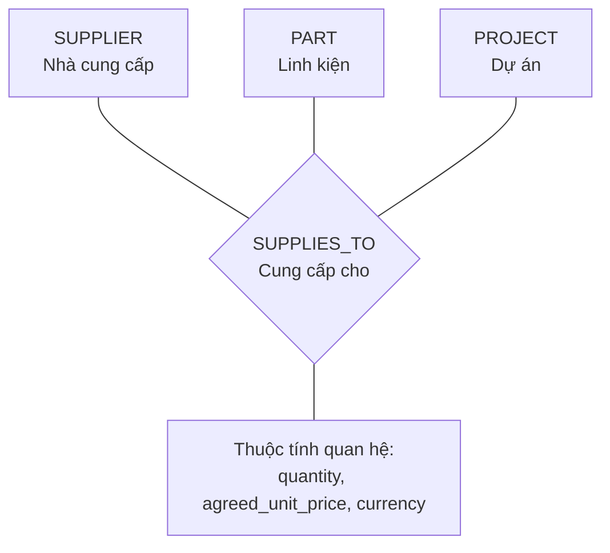

# Quan hệ ba ngôi và nguy cơ mất ý nghĩa khi tách thành các quan hệ đôi

Trong mô hình dữ liệu, một sự kiện nghiệp vụ đôi khi chỉ có ý nghĩa khi **ba loại thực thể cùng tham gia**. Ví dụ, nhà cung cấp cung cấp một linh kiện cho một dự án cụ thể; bác sĩ kê một loại thuốc cho một bệnh nhân; hoặc nhân viên sử dụng một kỹ năng trong một dự án. Nếu chỉ ghi nhận từng cặp thực thể riêng rẽ, hệ thống có thể biết các đối tượng có liên quan nhưng không còn biết chính xác bộ ba nào đã cùng tạo nên một sự kiện.

Đó là lý do cần nhận diện **quan hệ ba ngôi (ternary relationship)** và phân biệt nó với ba quan hệ nhị nguyên (binary relationship). Việc tách một quan hệ ba ngôi thành các quan hệ đôi có thể làm mất thông tin về sự kết hợp ban đầu. Khi nối các quan hệ đôi trở lại, hệ thống thậm chí có thể tạo ra những tổ hợp chưa từng tồn tại trong nghiệp vụ.

Trong phạm vi **DATABASE_DATA_MODELING**, bài học trình bày cách nhận diện quan hệ bậc ba, đọc đúng bội số, ánh xạ sang lược đồ quan hệ và chứng minh nguy cơ phát sinh bộ dữ liệu giả khi phân rã không có căn cứ.

## Mục tiêu học tập

Sau bài học, bạn có thể:

- Giải thích quan hệ ba ngôi và phân biệt bậc của quan hệ với bội số.
- Xác định khi nào ý nghĩa nghiệp vụ phụ thuộc đồng thời vào ba thực thể.
- Giải thích vì sao ba phép chiếu nhị nguyên không mặc nhiên tái tạo được quan hệ ba ngôi ban đầu.
- Nhận biết tuple giả (spurious tuple) sinh ra khi nối các quan hệ đã tách.
- Thiết kế bảng liên kết ba ngôi với khóa, khóa ngoại và ràng buộc phù hợp.
- Xác định điều kiện cần kiểm tra trước khi phân rã một quan hệ bậc ba thành các quan hệ bậc thấp hơn.

## 1. Bậc của quan hệ và quan hệ ba ngôi

**Bậc quan hệ (relationship degree)** cho biết có bao nhiêu loại thực thể tham gia vào một quan hệ:

- Quan hệ nhị nguyên (binary): hai loại thực thể tham gia, ví dụ Khách hàng đặt Đơn hàng.
- Quan hệ ba ngôi (ternary): ba loại thực thể tham gia, ví dụ Nhà cung cấp cung cấp Linh kiện cho Dự án.
- Quan hệ bậc cao hơn (n-ary): nhiều hơn ba loại thực thể cùng tham gia một sự kiện.

Bậc quan hệ không nói rằng quan hệ có bao nhiêu bản ghi. Một quan hệ ba ngôi vẫn có thể có hàng nghìn hoặc hàng triệu bộ dữ liệu. Nó cũng không đồng nghĩa với bội số một-một, một-nhiều hay nhiều-nhiều.

### 1.1. Ví dụ Nhà cung cấp – Linh kiện – Dự án

Giả sử doanh nghiệp quản lý việc cung cấp linh kiện cho các dự án. Một sự kiện cung cấp được xác định bởi ba thông tin:

- Nhà cung cấp nào thực hiện việc cung cấp.
- Linh kiện nào được cung cấp.
- Dự án nào nhận linh kiện đó.

Thuộc tính `quantity` (số lượng) và `agreed_unit_price` (đơn giá đã thỏa thuận) thuộc về **sự kết hợp của cả ba thực thể**. Một nhà cung cấp có thể cung cấp cùng linh kiện cho nhiều dự án với số lượng và giá khác nhau. Một dự án có thể nhận cùng loại linh kiện từ nhiều nhà cung cấp.



Quan hệ trung tâm `SUPPLIES_TO` là một sự kiện ba ngôi. Không thể hiểu `quantity` chỉ là thuộc tính của Nhà cung cấp – Linh kiện nếu số lượng còn phụ thuộc vào Dự án nhận hàng.

### 1.2. Câu hỏi để nhận diện quan hệ ba ngôi

Khi đọc yêu cầu, hãy thử diễn đạt một sự kiện bằng một câu có đủ ba vai trò:

“Nhà cung cấp **S** cung cấp linh kiện **P** cho dự án **J** với số lượng **Q** và đơn giá **V**.”

Sau đó kiểm tra:

1. Nếu bỏ Nhà cung cấp, thông tin còn xác định được một sự kiện cung cấp cụ thể không?
2. Nếu bỏ Linh kiện, còn biết chính xác mặt hàng nào được cung cấp không?
3. Nếu bỏ Dự án, còn biết sự kiện cung cấp phục vụ dự án nào không?
4. Số lượng hoặc giá có thể thay đổi khi một trong ba thành phần thay đổi không?

Nếu ý nghĩa hoặc thuộc tính của sự kiện phụ thuộc vào cả ba thành phần, mô hình cần thể hiện quan hệ ba ngôi. Đây là dấu hiệu quan trọng hơn việc sơ đồ có thể vẽ được nhiều đường nối đôi.

## 2. Vì sao tách thành ba quan hệ đôi có thể làm mất ý nghĩa?

Giả sử quan hệ ba ngôi ban đầu có ba bộ dữ liệu:

| Nhà cung cấp | Linh kiện | Dự án |
|---|---|---|
| S1 | P1 | J1 |
| S1 | P2 | J2 |
| S2 | P1 | J2 |

Mỗi hàng có nghĩa là một tổ hợp đã thực sự xảy ra. Bây giờ, nếu chỉ lưu ba quan hệ đôi bằng cách chiếu từng cặp thuộc tính, ta nhận được:

**SUPPLIER_PART**

| Nhà cung cấp | Linh kiện |
|---|---|
| S1 | P1 |
| S1 | P2 |
| S2 | P1 |

**SUPPLIER_PROJECT**

| Nhà cung cấp | Dự án |
|---|---|
| S1 | J1 |
| S1 | J2 |
| S2 | J2 |

**PART_PROJECT**

| Linh kiện | Dự án |
|---|---|
| P1 | J1 |
| P2 | J2 |
| P1 | J2 |

Mỗi bảng đôi đều đúng nếu xét riêng từng cặp. Nhưng khi nối cả ba bảng bằng các thuộc tính chung, chúng có thể tạo thêm tổ hợp:

| Nhà cung cấp | Linh kiện | Dự án | Có trong dữ liệu ban đầu? |
|---|---|---|---|
| S1 | P1 | J1 | Có |
| S1 | P1 | J2 | **Không** |
| S1 | P2 | J2 | Có |
| S2 | P1 | J2 | Có |

`(S1, P1, J2)` là **tuple giả (spurious tuple)**. Tổ hợp này xuất hiện vì:

- S1 có quan hệ với P1 trong `SUPPLIER_PART`.
- S1 có quan hệ với J2 trong `SUPPLIER_PROJECT`.
- P1 có quan hệ với J2 trong `PART_PROJECT`.

Ba sự thật đôi đó không chứng minh rằng S1 đã cung cấp P1 cho J2. Việc tách đã làm mất thông tin rằng ba giá trị phải cùng xuất hiện trong một sự kiện cụ thể.

### 2.1. Chiếu quan hệ và phép nối tự nhiên

Với quan hệ ban đầu `R(Supplier, Part, Project)`, phép chiếu tạo ra:

- `SP = πSupplier,Part(R)`
- `SJ = πSupplier,Project(R)`
- `PJ = πPart,Project(R)`

Khi nối ba kết quả:

`SP ⋈ SJ ⋈ PJ`

kết quả có thể lớn hơn `R`. Các bộ mới xuất hiện không phải dữ liệu đã tồn tại, mà là những tổ hợp được suy ra từ ba quan hệ đôi độc lập.

Một truy vấn SQL minh họa phép nối đó:

```sql
SELECT
    sp.supplier_id,
    sp.part_id,
    sj.project_id
FROM supplier_part AS sp
JOIN supplier_project AS sj
    ON sj.supplier_id = sp.supplier_id
JOIN part_project AS pj
    ON pj.part_id = sp.part_id
   AND pj.project_id = sj.project_id;
```

Với dữ liệu ở trên, truy vấn trả về cả `(S1, P1, J2)`, dù tổ hợp này không có trong quan hệ ba ngôi ban đầu.

Một phép phân rã là **không mất mát (lossless decomposition)** nếu nối các quan hệ sau phân rã tái tạo chính xác quan hệ ban đầu, không thiếu bộ và không sinh bộ giả. Việc mỗi bảng chiếu đều được lấy từ dữ liệu thật không đủ để bảo đảm phép phân rã không mất mát.

### 2.2. Nguy cơ không chỉ nằm ở số lượng bản ghi

Tuple giả có thể gây ra lỗi nghiệp vụ nghiêm trọng:

- Báo cáo ghi nhận nhà cung cấp đã giao hàng cho một dự án dù thực tế không có giao dịch đó.
- Tính sai số lượng, chi phí hoặc trách nhiệm giao hàng.
- Cho phép hệ thống đặt hàng dựa trên một quan hệ cung cấp chưa từng được phê duyệt.
- Tạo kết quả đối soát hoặc kiểm toán không khớp chứng từ.

Vấn đề cốt lõi là mất **ngữ nghĩa đồng thời (co-occurrence semantics)**: ba thành phần từng cùng tham gia một sự kiện bị biến thành ba khẳng định đôi riêng biệt.

## 3. Phân biệt quan hệ ba ngôi với ba quan hệ nhị nguyên độc lập

Không phải cứ có ba loại thực thể là phải tạo một quan hệ ba ngôi. Cần xem xét nghiệp vụ có một sự kiện chung hay ba sự thật độc lập.

Ví dụ, một hệ thống có thể quản lý riêng:

- Nhà cung cấp được phép bán Linh kiện.
- Nhà cung cấp có hợp đồng với Dự án.
- Dự án có nhu cầu sử dụng Linh kiện.

Ba quan hệ này là ba sự thật độc lập. Chúng không nhất thiết có nghĩa nhà cung cấp đó đã cung cấp linh kiện đó cho dự án đó. Nếu nghiệp vụ còn ghi nhận sự kiện cung cấp thực tế, cần một quan hệ ba ngôi riêng.

| Mô hình | Ý nghĩa được lưu | Có khẳng định một sự kiện chung của cả ba không? |
|---|---|---|
| SUPPLIER_PART | Nhà cung cấp có thể cung cấp linh kiện | Không |
| SUPPLIER_PROJECT | Nhà cung cấp có quan hệ hợp đồng với dự án | Không |
| PART_PROJECT | Dự án có nhu cầu hoặc cho phép dùng linh kiện | Không |
| SUPPLY_EVENT(Supplier, Part, Project) | Nhà cung cấp cung cấp linh kiện cho dự án cụ thể | Có |

Ba quan hệ đôi có thể cùng tồn tại với quan hệ ba ngôi, nhưng chúng biểu diễn các quy tắc khác nhau. Không nên dùng các quan hệ đôi làm đại diện cho một sự kiện ba ngôi nếu không có quy tắc nghiệp vụ chứng minh sự tương đương.

## 4. Bội số trong quan hệ ba ngôi

Khi đọc bội số của quan hệ ba ngôi, cần hiểu ràng buộc theo **tổ hợp của hai thực thể còn lại**. Đây là điểm dễ nhầm khi dùng ký hiệu một-nhiều trên sơ đồ.

Ví dụ, quy tắc:

“Với mỗi cặp (Linh kiện, Dự án), chỉ có tối đa một Nhà cung cấp được chỉ định.”

nghĩa là tổ hợp `(part_id, project_id)` xác định tối đa một `supplier_id`. Trong mô hình quan hệ, có thể thể hiện bằng:

`(part_id, project_id) → supplier_id`

và ràng buộc `UNIQUE(part_id, project_id)`.

Một số quy tắc khác:

| Quy tắc nghiệp vụ | Phụ thuộc hàm / ràng buộc tương ứng |
|---|---|
| Mỗi cặp Linh kiện – Dự án có tối đa một Nhà cung cấp | `(part_id, project_id) → supplier_id` |
| Mỗi cặp Nhà cung cấp – Linh kiện chỉ phục vụ tối đa một Dự án | `(supplier_id, part_id) → project_id` |
| Mỗi cặp Nhà cung cấp – Dự án chỉ cung cấp tối đa một Linh kiện | `(supplier_id, project_id) → part_id` |

Nếu không có quy tắc nào trong ba quy tắc trên, cả ba thành phần có thể cần để xác định một hàng. Khi đó khóa ứng viên tự nhiên có thể là `(supplier_id, part_id, project_id)`.

### 4.1. Bội số không phải lúc nào cũng là “một” hoặc “nhiều” toàn cục

Nếu sơ đồ ghi “một Nhà cung cấp” ở một nhánh, không nên diễn giải thành “toàn hệ thống chỉ có một nhà cung cấp”. Trong quan hệ ba ngôi, ý nghĩa thường là với mỗi tổ hợp của hai vai trò còn lại, có tối đa một nhà cung cấp tham gia. Cần viết quy tắc bằng câu đầy đủ và kiểm tra lại với nghiệp vụ trước khi chuyển thành khóa hoặc `UNIQUE` constraint.

### 4.2. Thuộc tính phụ thuộc vào toàn bộ bộ ba

Các thuộc tính như số lượng, đơn giá thỏa thuận, ngày giao dự kiến hoặc điều kiện giao hàng có thể phụ thuộc vào cả Nhà cung cấp, Linh kiện và Dự án. Không nên gán chúng cho một quan hệ đôi nếu giá trị có thể khác nhau theo thực thể thứ ba.

Ví dụ, S1 có thể bán P1 cho J1 với giá 10, nhưng bán P1 cho J2 với giá 12. Nếu lưu giá trong `SUPPLIER_PART`, không thể biểu diễn hai mức giá cùng lúc mà không thêm chiều Dự án.

## 5. Ánh xạ quan hệ ba ngôi sang mô hình quan hệ

Trong mô hình quan hệ, cách biểu diễn trực tiếp là tạo một bảng liên kết chứa khóa ngoại đến cả ba bảng thực thể. Các thuộc tính của sự kiện được đặt trong bảng này.

### 5.1. Lược đồ logic

| Quan hệ | Thuộc tính chính | Vai trò |
|---|---|---|
| `SUPPLIER` | `supplier_id`, `name` | Thực thể Nhà cung cấp |
| `PART` | `part_id`, `part_name` | Thực thể Linh kiện |
| `PROJECT` | `project_id`, `project_name` | Thực thể Dự án |
| `SUPPLY_EVENT` | `supplier_id`, `part_id`, `project_id`, `quantity`, `agreed_unit_price`, `currency` | Quan hệ ba ngôi và thuộc tính của sự kiện |

Nếu chỉ có một sự kiện cung cấp cho mỗi bộ ba trong phạm vi dữ liệu, khóa chính ghép có thể là:

`PRIMARY KEY (supplier_id, part_id, project_id)`

Ba khóa ngoại `NOT NULL` bảo đảm mỗi sự kiện tham chiếu đủ ba thực thể. Nếu một bộ ba có thể xuất hiện nhiều lần theo đợt giao, hợp đồng hoặc thời gian, cần bổ sung định danh sự kiện hoặc thành phần phân biệt lần phát sinh.

### 5.2. DDL PostgreSQL minh họa

```sql
CREATE TABLE supplier (
    supplier_id BIGINT GENERATED BY DEFAULT AS IDENTITY PRIMARY KEY,
    supplier_name VARCHAR(200) NOT NULL
);

CREATE TABLE part (
    part_id BIGINT GENERATED BY DEFAULT AS IDENTITY PRIMARY KEY,
    part_name VARCHAR(200) NOT NULL
);

CREATE TABLE project (
    project_id BIGINT GENERATED BY DEFAULT AS IDENTITY PRIMARY KEY,
    project_name VARCHAR(200) NOT NULL
);

CREATE TABLE supply_event (
    supplier_id BIGINT NOT NULL REFERENCES supplier(supplier_id),
    part_id BIGINT NOT NULL REFERENCES part(part_id),
    project_id BIGINT NOT NULL REFERENCES project(project_id),
    quantity NUMERIC(14, 3) NOT NULL CHECK (quantity > 0),
    agreed_unit_price NUMERIC(14, 2) NOT NULL
        CHECK (agreed_unit_price >= 0),
    currency CHAR(3) NOT NULL,
    PRIMARY KEY (supplier_id, part_id, project_id)
);
```

Trong thiết kế này:

- Mỗi hàng `supply_event` ghi nhận một tổ hợp Nhà cung cấp – Linh kiện – Dự án.
- `quantity`, `agreed_unit_price` và `currency` thuộc về sự kiện ba ngôi.
- Khóa chính ghép ngăn cùng một bộ ba xuất hiện lặp theo quy tắc “một sự kiện cho mỗi bộ ba”.
- Khóa ngoại bảo đảm ba thực thể tham gia đều tồn tại.
- `NOT NULL` thể hiện cả ba vai trò đều bắt buộc đối với một sự kiện cung cấp.

Nếu mỗi cặp Linh kiện – Dự án chỉ được có tối đa một nhà cung cấp, có thể thêm:

```sql
ALTER TABLE supply_event
    ADD CONSTRAINT one_supplier_per_part_project
    UNIQUE (part_id, project_id);
```

Chỉ thêm ràng buộc này khi đó thực sự là quy tắc nghiệp vụ. Không suy ra khóa hoặc `UNIQUE` chỉ từ hình dạng sơ đồ.

### 5.3. Khi một bộ ba có nhiều lần phát sinh

Nếu nhà cung cấp giao cùng linh kiện cho cùng dự án qua nhiều đợt, một hàng duy nhất theo bộ ba không đủ. Khi đó có thể tách khái niệm **thỏa thuận cung cấp** và **lần giao hàng**:

```sql
CREATE TABLE supply_agreement (
    agreement_id BIGINT GENERATED BY DEFAULT AS IDENTITY PRIMARY KEY,
    supplier_id BIGINT NOT NULL REFERENCES supplier(supplier_id),
    part_id BIGINT NOT NULL REFERENCES part(part_id),
    project_id BIGINT NOT NULL REFERENCES project(project_id),
    agreed_unit_price NUMERIC(14, 2) NOT NULL
        CHECK (agreed_unit_price >= 0),
    currency CHAR(3) NOT NULL,
    UNIQUE (supplier_id, part_id, project_id)
);

CREATE TABLE supply_delivery (
    delivery_id BIGINT GENERATED BY DEFAULT AS IDENTITY PRIMARY KEY,
    agreement_id BIGINT NOT NULL REFERENCES supply_agreement(agreement_id),
    delivered_at TIMESTAMPTZ NOT NULL,
    quantity NUMERIC(14, 3) NOT NULL CHECK (quantity > 0)
);
```

Ở đây, thỏa thuận vẫn gắn với bộ ba, còn mỗi lần giao có định danh riêng. Việc tách này làm rõ hai loại sự kiện có vòng đời khác nhau; nó không phải là tách quan hệ ba ngôi thành ba quan hệ đôi độc lập.

### 5.4. Chỉ mục và truy vấn

Khóa chính ghép `(supplier_id, part_id, project_id)` hỗ trợ truy vấn bắt đầu từ `supplier_id` và lọc tiếp theo `part_id`, nhưng không nhất thiết tối ưu cho mọi truy vấn bắt đầu từ `project_id`. Hãy tạo chỉ mục theo workload thực tế, ví dụ:

```sql
CREATE INDEX supply_event_project_part_idx
    ON supply_event (project_id, part_id);

CREATE INDEX supply_event_part_project_idx
    ON supply_event (part_id, project_id);
```

Không cần tạo cả hai chỉ mục nếu truy vấn không dùng đến. Mỗi chỉ mục làm tăng dung lượng và chi phí ghi; hãy kiểm tra bằng truy vấn đại diện và kế hoạch thực thi.

## 6. Khi nào có thể phân rã quan hệ ba ngôi?

Phân rã chỉ hợp lệ khi có thể chứng minh rằng các quan hệ sau khi tách vẫn giữ đủ thông tin để tái tạo đúng quan hệ ban đầu, hoặc khi nghiệp vụ thực sự chỉ có các sự thật nhị nguyên độc lập.

### 6.1. Có phụ thuộc hàm phù hợp

Với phép phân rã một quan hệ `R(A, B, C)` thành hai quan hệ `R1(A, B)` và `R2(B, C)`, một điều kiện đủ thường dùng để bảo đảm phép nối không mất mát theo tập phụ thuộc hàm là `B → A` hoặc `B → C`. Khi đó thuộc tính chung `B` xác định toàn bộ một phía của phép phân rã.

Đây là điều kiện cho dạng phân rã hai lược đồ nói trên; không thể áp dụng máy móc cho mọi cách chia một quan hệ ba ngôi thành ba quan hệ đôi. Với ba phép chiếu `(A,B)`, `(A,C)`, `(B,C)`, cần chứng minh phụ thuộc nối (join dependency) tương ứng thực sự đúng với miền dữ liệu và quy tắc nghiệp vụ.

### 6.2. Ví dụ có ràng buộc xác định

Giả sử nghiệp vụ quy định mỗi cặp `(part_id, project_id)` xác định duy nhất một nhà cung cấp. Khi đó:

`(part_id, project_id) → supplier_id`

Thông tin về nhà cung cấp có thể được xác định từ cặp Linh kiện – Dự án. Mô hình quan hệ vẫn cần lưu sự kết hợp này trong một quan hệ có đủ các thuộc tính cần thiết, chẳng hạn `SUPPLY_ASSIGNMENT(part_id, project_id, supplier_id)`, với khóa `(part_id, project_id)`. Không có nghĩa là có thể tùy ý thay thế nó bằng ba bảng đôi `SUPPLIER_PART`, `SUPPLIER_PROJECT`, `PART_PROJECT`.

### 6.3. Các quan hệ đôi là sự thật độc lập

Nếu yêu cầu chỉ cần lưu ba sự thật riêng — nhà cung cấp được phê duyệt cho linh kiện, nhà cung cấp ký hợp đồng với dự án, dự án chấp nhận linh kiện — thì ba bảng đôi là đúng với yêu cầu. Nhưng nếu sau này cần biết nhà cung cấp nào thực sự cung cấp linh kiện nào cho dự án nào, phải bổ sung quan hệ ba ngôi thay vì suy luận từ ba danh sách đôi.

### 6.4. Quy trình chứng minh phân rã

Trước khi tách, hãy:

1. Viết rõ ngữ nghĩa của quan hệ ban đầu và các thuộc tính phụ thuộc vào những thành phần nào.
2. Xác định khóa ứng viên và các phụ thuộc hàm từ quy tắc nghiệp vụ đã được xác nhận.
3. Xác định các lược đồ con sau phân rã.
4. Kiểm tra phép nối tự nhiên của các lược đồ con có tái tạo chính xác quan hệ gốc hay không.
5. Dùng dữ liệu phản ví dụ để tìm tuple giả.
6. Kiểm tra các ràng buộc nghiệp vụ có được bảo toàn và có thể thực thi ở schema sau phân rã không.

Nếu không chứng minh được phép nối không mất mát, hãy giữ quan hệ ba ngôi hoặc mô hình hóa sự kiện bằng một thực thể liên kết có đủ ba khóa ngoại.

## 7. Một số ví dụ khác

### 7.1. Nhân viên – Kỹ năng – Dự án

Một nhân viên có kỹ năng Java, một nhân viên tham gia dự án X, và dự án X sử dụng Java là ba quan hệ đôi có thể đúng riêng rẽ. Nhưng chúng không chứng minh nhân viên đó đã dùng Java trong dự án X. Nếu cần lưu mức độ thành thạo hoặc số giờ sử dụng kỹ năng trong dự án, sự kiện phải chứa cả ba thành phần:

`EMPLOYEE_USES_SKILL_ON_PROJECT(employee_id, skill_id, project_id, proficiency, hours)`.

### 7.2. Bác sĩ – Bệnh nhân – Thuốc

Một bác sĩ có thể điều trị một bệnh nhân; bác sĩ có thể kê nhiều loại thuốc; bệnh nhân có thể sử dụng nhiều thuốc. Ba quan hệ đôi không cho biết bác sĩ đã kê thuốc nào cho bệnh nhân nào trong một lần điều trị cụ thể. Nếu cần lưu liều lượng, thời điểm và chỉ định, quan hệ phải gắn cả bác sĩ, bệnh nhân và thuốc; trong nhiều hệ thống, còn cần thêm định danh đơn thuốc hoặc lần khám.

### 7.3. Thực tế có thể cần bậc cao hơn ba

Một giao dịch phân bổ có thể phụ thuộc vào Nhà đầu tư, Quỹ, Tài khoản và Ngày hiệu lực. Nếu bỏ một chiều, số tiền được phân bổ có thể bị gán sai ngữ cảnh. Không nên ép mọi quan hệ về nhị nguyên chỉ vì công cụ vẽ sơ đồ hoặc framework ORM hiển thị quan hệ đôi thuận tiện hơn.

## 8. Biểu diễn quan hệ bậc cao trong các kiểu lưu trữ

Quan hệ ba ngôi là khái niệm nghiệp vụ và logic; mỗi nền tảng có cách triển khai khác nhau.

| Kiểu lưu trữ | Cách biểu diễn quan hệ ba ngôi | Lưu ý |
|---|---|---|
| Quan hệ | Bảng liên kết có ba khóa ngoại và các thuộc tính của sự kiện | Khóa chính/unique phải phản ánh đúng phụ thuộc hàm |
| Document | Một document sự kiện hoặc aggregate chứa ID của cả ba thực thể | Chọn ranh giới document theo truy cập và cập nhật; tránh nhúng dữ liệu lớn không giới hạn |
| Đồ thị | Tạo node sự kiện/quan hệ trung gian, nối đến ba node thực thể | Một edge thông thường chỉ nối hai node; node trung gian giúp giữ ngữ nghĩa ba bên và thuộc tính sự kiện |
| Phân tích | Fact table có grain là một tổ hợp ba bên hoặc một lần phát sinh | Khai báo grain trước; tránh join các dimension tạo nhân bản fact |

Với graph database, có thể tạo node `SUPPLY_EVENT` rồi nối bằng ba cạnh `BY_SUPPLIER`, `FOR_PART` và `FOR_PROJECT`. Các thuộc tính như số lượng và giá đặt trên node sự kiện. Cách này giữ được bộ ba trong một đối tượng có danh tính riêng.

Trong kho dữ liệu, grain của fact phải được viết thành câu, ví dụ “một hàng cho mỗi nhà cung cấp, linh kiện, dự án và lần giao”. Nếu grain là một lần giao nhưng dimension join theo quan hệ đôi không đầy đủ, truy vấn có thể nhân bản số lượng hoặc giá trị tiền.

## 9. Kiểm thử và xác minh ngữ nghĩa

Một mô hình ba ngôi cần được kiểm tra cả về khóa, ràng buộc và ý nghĩa tổ hợp.

### 9.1. Kiểm thử toàn vẹn

- Không cho phép một sự kiện thiếu Nhà cung cấp, Linh kiện hoặc Dự án.
- Từ chối khóa ngoại tham chiếu đến thực thể không tồn tại.
- Ngăn trùng bộ ba nếu nghiệp vụ chỉ cho một sự kiện cho mỗi tổ hợp.
- Kiểm tra các phụ thuộc hàm bằng `UNIQUE` constraint phù hợp.
- Bảo đảm thuộc tính như số lượng và giá có miền giá trị hợp lệ.

### 9.2. Kiểm thử chống tuple giả

Với bộ dữ liệu ví dụ ở phần 2, hãy:

1. Tạo quan hệ ba ngôi ban đầu.
2. Tạo các phép chiếu đôi.
3. Nối các phép chiếu theo các thuộc tính chung.
4. So sánh kết quả với quan hệ ban đầu.
5. Xác nhận tuple `(S1, P1, J2)` xuất hiện trong kết quả nối nhưng không tồn tại trong dữ liệu gốc.

Đây là một test phản ví dụ đơn giản nhưng rất hiệu quả khi review đề xuất phân rã quan hệ.

### 9.3. Kiểm tra truy vấn nghiệp vụ

Các truy vấn cần trả lời đúng câu hỏi ở cấp bộ ba, ví dụ:

- Nhà cung cấp nào đã cung cấp linh kiện P1 cho dự án J2?
- Tổng số lượng linh kiện P1 được giao cho dự án J2 theo từng nhà cung cấp là bao nhiêu?
- Đơn giá thỏa thuận của nhà cung cấp S1 cho linh kiện P1 trong dự án J1 là bao nhiêu?

Truy vấn phải dựa trên bảng sự kiện ba ngôi. Không suy ra câu trả lời bằng cách nối ba danh sách quan hệ đôi nếu các danh sách đó không lưu sự kiện chung.

## 10. Những lỗi thiết kế thường gặp

| Lỗi | Hệ quả | Cách xử lý |
|---|---|---|
| Tách một quan hệ ba ngôi thành ba bảng đôi theo thói quen | Mất thông tin tổ hợp và có thể sinh tuple giả khi join | Giữ bảng liên kết ba ngôi hoặc chứng minh phân rã không mất mát |
| Đặt thuộc tính sự kiện lên một quan hệ đôi | Không biểu diễn được giá trị thay đổi theo thực thể thứ ba | Đặt thuộc tính trên quan hệ ba ngôi hoặc thực thể sự kiện |
| Nghĩ ba bảng đôi đều đúng thì bộ ba suy ra cũng đúng | Các cặp đúng riêng lẻ không chứng minh chúng từng cùng xuất hiện | Lưu sự kiện chung và kiểm tra tuple giả |
| Diễn giải bội số một cách toàn cục | Tạo `UNIQUE` sai hoặc bỏ sót ràng buộc | Đọc bội số theo cặp hai vai trò còn lại và viết phụ thuộc hàm |
| Dùng khóa ghép ba cột dù có nhiều lần phát sinh | Không lưu được các lần giao/đăng ký lặp | Thêm ID sự kiện hoặc số lần phát sinh; giữ unique theo quy tắc đúng |
| Thêm surrogate key nhưng bỏ ràng buộc nghiệp vụ | Cho phép trùng tổ hợp vốn phải duy nhất | Giữ `UNIQUE` trên các thuộc tính xác định sự kiện |
| Nhầm quan hệ ba ngôi với ba quan hệ đôi độc lập | Mô hình trả lời sai câu hỏi nghiệp vụ | Làm rõ mỗi quan hệ khẳng định điều gì và thuộc tính nào phụ thuộc vào toàn bộ tổ hợp |

## 11. Quy trình thiết kế quan hệ ba ngôi

1. **Xác định sự kiện:** viết câu nghiệp vụ nêu rõ ba vai trò tham gia và hành động giữa chúng.
2. **Kiểm tra tính đồng thời:** xác định liệu ba thực thể có phải cùng xuất hiện trong một sự kiện hay chỉ có ba quan hệ đôi độc lập.
3. **Xác định thuộc tính quan hệ:** tìm các thuộc tính phụ thuộc vào cả ba thành phần, ví dụ số lượng, giá, ngày hoặc vai trò.
4. **Xác định bội số:** diễn giải mỗi giới hạn theo tổ hợp của hai vai trò còn lại.
5. **Tìm phụ thuộc hàm và khóa:** xác định bộ ba có phải khóa hay có cặp nào xác định thành phần thứ ba.
6. **Vẽ mô hình logic:** biểu diễn quan hệ bậc ba rõ ràng, không tách chỉ để sơ đồ có các đường đôi.
7. **Ánh xạ sang schema:** tạo bảng sự kiện với ba khóa ngoại, khóa chính/unique và ràng buộc dữ liệu.
8. **Kiểm tra phân rã nếu cần:** chứng minh lossless join, bảo toàn phụ thuộc và dùng phản ví dụ để tìm tuple giả.
9. **Kiểm thử truy vấn:** xác nhận các truy vấn nghiệp vụ trả lời đúng sự kết hợp ba bên.

## 12. Checklist kiểm chứng

- [ ] Đã mô tả sự kiện bằng câu có đủ ba vai trò tham gia.
- [ ] Đã xác định ba thành phần cùng xuất hiện trong một sự kiện hay chỉ là các quan hệ đôi độc lập.
- [ ] Thuộc tính phụ thuộc vào cả ba thành phần được đặt trên quan hệ/sự kiện ba ngôi.
- [ ] Bội số được diễn giải theo tổ hợp của hai vai trò còn lại.
- [ ] Khóa ứng viên và phụ thuộc hàm xuất phát từ quy tắc nghiệp vụ đã xác nhận.
- [ ] Bảng liên kết có đủ ba khóa ngoại và nullability phù hợp.
- [ ] `UNIQUE` constraint phản ánh đúng quy tắc, không áp đặt thêm giả định.
- [ ] Nếu có nhiều lần phát sinh cho cùng bộ ba, mô hình có định danh lần phát sinh.
- [ ] Nếu phân rã, đã chứng minh phép nối không mất mát và kiểm tra phụ thuộc được bảo toàn.
- [ ] Đã thử dữ liệu phản ví dụ để phát hiện tuple giả.
- [ ] Truy vấn báo cáo không suy ra sự kiện ba ngôi từ các quan hệ đôi không tương đương.

## Tóm tắt

Quan hệ ba ngôi biểu diễn một sự kiện mà ý nghĩa phụ thuộc đồng thời vào ba loại thực thể. Ba phép chiếu đôi có thể giữ đúng từng cặp nhưng làm mất thông tin về bộ ba đã cùng tham gia. Khi nối các quan hệ đôi, hệ thống có thể tạo tuple giả và đưa ra kết luận nghiệp vụ chưa từng xảy ra.

Trong mô hình quan hệ, cách biểu diễn thường là một bảng liên kết có ba khóa ngoại và các thuộc tính của sự kiện. Khóa chính và `UNIQUE` phải dựa trên phụ thuộc hàm thực tế. Chỉ phân rã khi có thể chứng minh phép nối không mất mát và các ràng buộc cần thiết vẫn được bảo toàn; nếu không, hãy giữ quan hệ ba ngôi hoặc mô hình hóa nó thành một thực thể sự kiện.

## Thuật ngữ cần nhớ

| Thuật ngữ | Ý nghĩa |
|---|---|
| Relationship Degree | Bậc quan hệ, số loại thực thể tham gia vào quan hệ |
| Binary Relationship | Quan hệ nhị nguyên giữa hai loại thực thể |
| Ternary Relationship | Quan hệ ba ngôi giữa ba loại thực thể |
| N-ary Relationship | Quan hệ có nhiều hơn hai loại thực thể tham gia |
| Projection | Phép chiếu chọn một tập thuộc tính từ quan hệ |
| Natural Join | Phép nối theo các thuộc tính chung có cùng tên/ngữ nghĩa |
| Lossless Decomposition | Phân rã có thể nối lại chính xác quan hệ gốc mà không mất hoặc sinh bộ |
| Spurious Tuple | Bộ dữ liệu giả được tạo ra khi nối các quan hệ đã phân rã |
| Functional Dependency | Phụ thuộc hàm giữa các tập thuộc tính |
| Join Dependency | Ràng buộc cho biết quan hệ có thể tái tạo từ nhiều phép chiếu bằng phép nối |
| Associative Entity | Thực thể liên kết biểu diễn một quan hệ và có thể mang thuộc tính riêng |
| Fact Grain | Mức chi tiết mà một hàng trong bảng fact đại diện |
