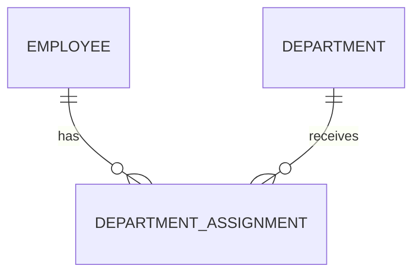

# Quan hệ theo thời gian và các điều kiện có hiệu lực

Một quan hệ trong mô hình dữ liệu không phải lúc nào cũng đúng mãi mãi. Nhân viên có thể chuyển phòng ban, khách hàng có thể thay đổi người đại diện, sản phẩm có thể chỉ được bán tại một chi nhánh trong một khoảng thời gian, hợp đồng có ngày bắt đầu và ngày kết thúc. Nếu chỉ lưu quan hệ hiện tại, hệ thống sẽ khó trả lời câu hỏi “ai phụ trách vào ngày đó?”, “giá nào có hiệu lực khi đơn được xác nhận?” hoặc “quan hệ đã thay đổi từ khi nào?”.

**Quan hệ theo thời gian (temporal relationship)** mô tả một liên kết giữa các đối tượng cùng với khoảng thời gian mà liên kết đó có hiệu lực. Mô hình cần phân biệt thời điểm quan hệ đúng trong nghiệp vụ, thời điểm hệ thống biết hoặc ghi nhận thông tin, điều kiện bắt đầu/kết thúc và quy tắc cho phép các khoảng thời gian chồng lấn hay nối tiếp.

Đây là một phần quan trọng của kỹ năng chuyển yêu cầu nghiệp vụ thành mô hình dữ liệu rõ ràng. Người thiết kế cần xác định vòng đời của quan hệ, bội số tại từng thời điểm, lịch sử thay đổi, các điều kiện hiệu lực và cách truy vấn dữ liệu theo thời điểm. Những yêu cầu này ảnh hưởng đến thực thể liên kết, khóa, ràng buộc, truy vấn và lựa chọn mô hình lưu trữ.

Sau bài học, người học có thể:

- Nhận diện quan hệ có thời hạn hoặc có thể thay đổi theo thời gian.
- Phân biệt thời gian hiệu lực nghiệp vụ (valid time) với thời gian hệ thống ghi nhận (transaction/system time).
- Mô hình hóa khoảng hiệu lực bằng thời điểm bắt đầu và kết thúc.
- Xác định quy tắc chồng lấn, khoảng trống, gia hạn, thay thế và thay đổi hồi tố.
- Kiểm tra bội số và ràng buộc quan hệ tại một thời điểm cụ thể.
- Viết truy vấn tìm quan hệ hiện tại hoặc quan hệ có hiệu lực tại thời điểm quá khứ.
- Lựa chọn cách lưu lịch sử phù hợp và kiểm chứng tính nhất quán của dữ liệu theo thời gian.

## 1. Vì sao quan hệ cần yếu tố thời gian?

### 1.1. Quan hệ có thể thay đổi trong khi các đối tượng vẫn tồn tại

Giả sử nhân viên An chuyển từ phòng Kinh doanh sang phòng Hỗ trợ vào ngày 01/07. Nhân viên An vẫn là cùng một người, hai phòng ban vẫn tồn tại, nhưng quan hệ “An thuộc phòng ban” đã thay đổi.

Nếu chỉ lưu `employee.department_id`, sau khi cập nhật sang phòng Hỗ trợ, hệ thống không còn biết An thuộc phòng Kinh doanh trong tháng 6. Nếu cần tính lương theo đơn vị, xem báo cáo tổ chức hoặc truy vết quyền phê duyệt tại một ngày trong quá khứ, thông tin hiện tại không đủ.

Một số ví dụ khác:

- Một khách hàng có người đại diện khác nhau theo từng giai đoạn.
- Một sản phẩm được phân phối bởi nhà cung cấp A đến hết quý 2 và nhà cung cấp B từ quý 3.
- Một hợp đồng có hiệu lực từ ngày ký đến ngày hết hạn.
- Một nhân viên được phân công vào dự án trong ba tháng rồi chuyển sang dự án khác.
- Một mức giá có hiệu lực trong một khoảng thời gian và được thay bằng mức giá mới.
- Một tài khoản có quyền truy cập vào hệ thống từ ngày được cấp đến ngày bị thu hồi.

Các quan hệ này có lịch sử riêng. Thời gian không chỉ là thuộc tính mô tả hai đối tượng; nó xác định khi nào mối liên kết được xem là đúng.

### 1.2. Câu hỏi nghiệp vụ cần trả lời

Khi khảo sát một quan hệ, hãy hỏi:

- Quan hệ bắt đầu có hiệu lực khi nào?
- Quan hệ kết thúc khi nào? Có thể không có ngày kết thúc không?
- Ngày hiệu lực có trùng ngày ghi nhận trong hệ thống không?
- Có thể tạo quan hệ có hiệu lực trong tương lai không?
- Có thể ghi nhận một thay đổi có hiệu lực từ quá khứ không?
- Một đối tượng có thể có nhiều quan hệ cùng loại tại một thời điểm không?
- Các khoảng hiệu lực có được chồng lấn, nối tiếp hay phải tách biệt?
- Khi sửa thông tin đã ghi nhận, có cần biết hệ thống từng tin điều gì không?
- Khi truy vấn lịch sử, người dùng muốn biết điều gì đã thực sự có hiệu lực hay điều gì hệ thống đã biết tại thời điểm đó?

Hai câu hỏi cuối thường dẫn đến sự khác biệt giữa mô hình thời gian hiệu lực và mô hình hai chiều thời gian.

### 1.3. Quan hệ hiện tại không đủ cho mọi báo cáo

Một báo cáo “nhân viên theo phòng ban hiện tại” chỉ cần quan hệ đang hiệu lực. Báo cáo “doanh số theo phòng ban tại thời điểm phát sinh đơn hàng” cần quan hệ có hiệu lực ở ngày giao dịch. Báo cáo kiểm toán “vào ngày 15/06 hệ thống đã ghi nhận An thuộc phòng nào?” còn cần biết hệ thống đã lưu thông tin gì tại thời điểm 15/06.

Đây là ba câu hỏi khác nhau và có thể cần ba cách truy vấn khác nhau. Thiết kế quan hệ theo thời gian phải bắt đầu từ nhu cầu nghiệp vụ, không chỉ từ việc thêm hai cột `start_date` và `end_date`.

## 2. Mô hình hóa khoảng thời gian có hiệu lực

### 2.1. Thời điểm bắt đầu và kết thúc

Một quan hệ có hiệu lực trong một khoảng được mô tả bằng thời điểm bắt đầu (`valid_from`) và thời điểm kết thúc (`valid_to`).

Ví dụ:

| Nhân viên | Phòng ban | valid_from | valid_to |
|---|---|---|---|
| An | Kinh doanh | 2026-01-01 | 2026-07-01 |
| An | Hỗ trợ | 2026-07-01 | NULL |

Quan hệ với phòng Kinh doanh có hiệu lực trước ngày 01/07; quan hệ với phòng Hỗ trợ có hiệu lực từ ngày 01/07 trở đi. `NULL` ở `valid_to` được dùng trong ví dụ để biểu thị khoảng chưa có ngày kết thúc đã xác định, tức quan hệ vẫn đang mở.

Không nên dùng `NULL` đồng thời cho cả “chưa biết ngày kết thúc” và “không có ngày kết thúc”. Nếu hai ý nghĩa khác nhau trong nghiệp vụ, cần biểu diễn hoặc ghi chú riêng để tránh hiểu sai.

### 2.2. Quy ước khoảng nửa mở `[from, to)`

Một quy ước phổ biến là khoảng nửa mở: bao gồm thời điểm bắt đầu nhưng không bao gồm thời điểm kết thúc, ký hiệu `[valid_from, valid_to)`.

Điều đó có nghĩa:

- Quan hệ có hiệu lực tại `valid_from`.
- Quan hệ không còn hiệu lực tại `valid_to`.
- Nếu quan hệ cũ kết thúc đúng lúc quan hệ mới bắt đầu, hai khoảng nối tiếp mà không chồng lấn.

Ví dụ:

```text
Kinh doanh: [2026-01-01, 2026-07-01)
Hỗ trợ:     [2026-07-01, vô_cực)
```

Tại đúng 00:00 ngày 01/07 theo múi giờ nghiệp vụ, quan hệ Hỗ trợ có hiệu lực; quan hệ Kinh doanh đã kết thúc. Quy ước này giúp tránh việc một thời điểm bị tính đồng thời vào cả hai khoảng liền kề.

Một số tổ chức dùng ngày cuối cùng có hiệu lực theo kiểu bao gồm cả hai đầu, ví dụ từ ngày 01/01 đến hết ngày 30/06. Khi lưu dưới dạng timestamp, quy ước nửa mở thường dễ xử lý hơn. Nếu yêu cầu nghiệp vụ dùng ngày lịch, hãy xác định rõ ngày kết thúc là ngày cuối được tính hay ngày đầu không còn hiệu lực.

### 2.3. Kiểm tra một thời điểm có nằm trong khoảng không

Với khoảng `[from, to)`, thời điểm `t` nằm trong khoảng nếu:

```text
valid_from <= t
AND (valid_to IS NULL OR t < valid_to)
```

Trước khi dùng điều kiện này, cần thống nhất kiểu dữ liệu và múi giờ. Một ngày lịch như `2026-07-01` không giống một thời điểm chính xác như `2026-07-01T00:00:00+07:00`. Nếu nghiệp vụ chỉ quan tâm ngày, không tự thêm độ chính xác giờ/phút gây hiểu sai.

### 2.4. Bất biến cơ bản của khoảng hiệu lực

Với một khoảng đã xác định:

- `valid_from` phải có giá trị.
- Nếu `valid_to` có giá trị, nó phải lớn hơn `valid_from`.
- Hai khoảng của cùng một quan hệ không được chồng lấn nếu nghiệp vụ yêu cầu mỗi thời điểm chỉ có một quan hệ hiệu lực.
- Khoảng kết thúc có thể nối tiếp khoảng kế tiếp nếu không có khoảng trống.
- Khoảng trống chỉ hợp lệ nếu nghiệp vụ cho phép thời gian không có quan hệ.

Ví dụ, nếu mỗi nhân viên phải thuộc đúng một phòng ban trong mọi thời điểm làm việc, một khoảng trống giữa hai lần phân công là vi phạm. Nếu nhân viên có thể tạm nghỉ hoặc chưa được phân công, khoảng trống có thể hợp lệ trong giai đoạn đó.

## 3. Phân biệt Valid Time và Transaction Time

### 3.1. Valid Time — thời gian hiệu lực trong nghiệp vụ

**Valid time** cho biết một sự thật hoặc quan hệ được xem là đúng trong thế giới nghiệp vụ từ khi nào đến khi nào.

Ví dụ, quyết định điều chuyển An có hiệu lực từ ngày 01/07, dù người quản trị nhập thông tin vào hệ thống ngày 03/07. Valid time của quan hệ mới bắt đầu ngày 01/07.

Valid time trả lời:

- An thực sự thuộc phòng ban nào vào ngày 02/07?
- Giá nào được áp dụng cho đơn hàng vào ngày 15/06?
- Hợp đồng có hiệu lực trong khoảng ngày nào?
- Ai là người đại diện hợp pháp trong giai đoạn được hỏi?

### 3.2. Transaction Time — thời gian hệ thống biết hoặc lưu sự thật

**Transaction time** (còn gọi là system time trong một số mô hình) ghi nhận khoảng thời gian thông tin được lưu và được xem là phiên bản mà hệ thống tin tưởng.

Ví dụ, quyết định điều chuyển có hiệu lực từ ngày 01/07 nhưng chỉ được nhập vào hệ thống ngày 03/07. Hệ thống chỉ biết thông tin mới từ ngày 03/07. Trước thời điểm đó, dữ liệu hệ thống có thể vẫn ghi An thuộc Kinh doanh.

Transaction time trả lời:

- Vào ngày 02/07, hệ thống đang ghi nhận An thuộc phòng nào?
- Khi lập báo cáo ngày 02/07, tổ chức đã biết quyết định điều chuyển chưa?
- Ai đã sửa dữ liệu vào ngày 03/07 và thông tin cũ trước đó là gì?

### 3.3. So sánh hai trục thời gian

| Tiêu chí | Valid time | Transaction time |
|---|---|---|
| Ý nghĩa | Khi sự thật có hiệu lực trong nghiệp vụ | Khi hệ thống lưu/biết phiên bản thông tin |
| Nguồn | Quyết định, hợp đồng, sự kiện nghiệp vụ | Thời điểm ghi nhận trong hệ thống |
| Có thể bắt đầu trong quá khứ? | Có, nếu có thay đổi hồi tố | Thông thường bắt đầu khi hệ thống ghi nhận |
| Câu hỏi | Điều gì đúng tại ngày X? | Hệ thống đã biết điều gì tại ngày Y? |
| Ví dụ | Điều chuyển có hiệu lực từ 01/07 | Người quản trị nhập ngày 03/07 |

### 3.4. Mô hình hai chiều thời gian (bitemporal)

Khi cần trả lời cả “đúng trong nghiệp vụ khi nào?” và “hệ thống biết điều đó khi nào?”, có thể dùng mô hình bitemporal. Mỗi phiên bản quan hệ có hai khoảng:

- Khoảng valid time: `valid_from`, `valid_to`.
- Khoảng transaction time: `system_from`, `system_to`.

Ví dụ:

| Phòng ban | Valid from | Valid to | System from | System to |
|---|---|---|---|---|
| Kinh doanh | 2026-01-01 | NULL | 2026-01-01 | 2026-07-03 |
| Kinh doanh | 2026-01-01 | 2026-07-01 | 2026-07-03 | NULL |
| Hỗ trợ | 2026-07-01 | NULL | 2026-07-03 | NULL |

Trước ngày 03/07, hệ thống đã lưu rằng An thuộc Kinh doanh đến vô thời hạn. Ngày 03/07, thông tin được điều chỉnh hồi tố: quan hệ Kinh doanh kết thúc ngày 01/07 và quan hệ Hỗ trợ bắt đầu cùng ngày. Phiên bản hệ thống cũ được giữ lại với `system_to = 2026-07-03`, còn phiên bản mới bắt đầu từ thời điểm đó.

Không phải hệ thống nào cũng cần bitemporal. Nếu chỉ cần truy vấn quan hệ hiện tại và lịch sử hiệu lực, valid time có thể đủ. Bitemporal phù hợp khi cần kiểm toán những gì hệ thống đã biết tại một thời điểm, giải thích thay đổi hồi tố hoặc tái lập báo cáo đã phát hành.

## 4. Mô hình quan hệ có hiệu lực bằng thực thể liên kết

Khi quan hệ có ngày bắt đầu, ngày kết thúc, vai trò, trạng thái hoặc lịch sử riêng, hãy xem xét mô hình nó thành một thực thể liên kết.

Ví dụ `Nhân viên` và `Phòng ban`:



`DEPARTMENT_ASSIGNMENT` đại diện cho một lần phân công. Nó có thể chứa:

- Nhân viên được phân công.
- Phòng ban nhận phân công.
- Vai trò hoặc chức danh trong phòng ban.
- Thời điểm bắt đầu hiệu lực.
- Thời điểm kết thúc hiệu lực.
- Trạng thái hoặc lý do điều chuyển.
- Người phê duyệt và nguồn quyết định nếu cần.

Một nhân viên có thể có nhiều bản ghi phân công trong lịch sử. Một phòng ban có thể có nhiều bản ghi phân công của nhiều nhân viên. Ràng buộc thời gian quyết định có bao nhiêu phân công đồng thời được phép.

### 4.1. Vì sao không chỉ cập nhật khóa ngoại hiện tại?

Nếu chỉ lưu `employee.department_id`, mỗi lần điều chuyển sẽ ghi đè quan hệ cũ. Cách này phù hợp khi chỉ cần biết phòng ban hiện tại và không cần lịch sử. Khi cần báo cáo theo thời gian, cần giữ các khoảng hiệu lực hoặc sự kiện phân công.

Một thiết kế thường dùng là:

- Bảng nhân viên lưu thông tin định danh và thuộc tính tương đối ổn định.
- Bảng phòng ban lưu thông tin đơn vị.
- Bảng phân công lưu quan hệ nhân viên–phòng ban theo từng khoảng hiệu lực.
- Có thể duy trì một tham chiếu hiện tại hoặc view để truy vấn nhanh, nhưng phải có một nguồn có thẩm quyền và quy tắc đồng bộ.

### 4.2. Quan hệ theo thời gian có thể có thuộc tính riêng

Ví dụ một nhân viên thuộc phòng ban với vai trò `MANAGER` từ tháng 1 đến tháng 6, sau đó vẫn thuộc phòng ban đó nhưng giữ vai trò `SPECIALIST` từ tháng 7. Nếu chỉ lưu quan hệ nhân viên–phòng ban mà không lưu thời gian và vai trò, hệ thống không thể giải thích lịch sử trách nhiệm.

Khi thuộc tính thay đổi theo quan hệ, đặt chúng trên thực thể liên kết. Không nên đặt `role` trên nhân viên nếu vai trò chỉ đúng trong một phòng ban hoặc một giai đoạn cụ thể.

## 5. Điều kiện hiệu lực và các kiểu khoảng thời gian

### 5.1. Quan hệ có ngày bắt đầu nhưng chưa biết ngày kết thúc

Một quan hệ có thể đang mở. Ví dụ, một nhân viên hiện thuộc phòng Hỗ trợ và chưa có quyết định chuyển tiếp theo. Có thể biểu diễn `valid_to = NULL` theo quy ước “chưa có ngày kết thúc đã xác định”.

Nếu dùng giá trị vô cực thay vì `NULL`, hãy thống nhất cách truy vấn và hiển thị. Không dùng một giá trị ngày giả như `9999-12-31` mà không có quy ước rõ ràng, vì nó có thể bị hiểu là ngày kết thúc thực.

### 5.2. Quan hệ có hiệu lực trong tương lai

Một quyết định có thể được ghi nhận hôm nay nhưng chỉ có hiệu lực từ ngày mai hoặc tháng sau. Ví dụ, hợp đồng thuê mới bắt đầu ngày 01/08; nhân viên được điều chuyển từ ngày 01/09.

Khi đó:

- Bản ghi quan hệ đã tồn tại trong hệ thống.
- Valid time bắt đầu trong tương lai.
- Quan hệ chưa được xem là hiện hành tại thời điểm hiện tại.
- Có thể cần trạng thái `SCHEDULED` hoặc chỉ dựa vào khoảng hiệu lực, tùy yêu cầu truy vấn.

Không nhầm thời điểm tạo bản ghi với thời điểm quan hệ bắt đầu có hiệu lực.

### 5.3. Khoảng trống giữa các quan hệ

Giả sử một nhân viên kết thúc phân công phòng A ngày 01/05 và bắt đầu phòng B ngày 10/05. Khoảng từ 01/05 đến 10/05 có thể là:

- Hợp lệ nếu nhân viên được nghỉ hoặc chờ phân công.
- Vi phạm nếu quy tắc yêu cầu mọi nhân viên đang làm việc phải thuộc một phòng ban liên tục.
- Chưa xác định nếu chưa rõ ngày kết thúc và ngày bắt đầu được hiểu bao gồm hay không.

Không nên tự động lấp khoảng trống bằng cách kéo dài quan hệ cũ. Cần xác nhận ý nghĩa nghiệp vụ của khoảng thời gian không có quan hệ.

### 5.4. Khoảng chồng lấn

Hai quan hệ chồng lấn khi cùng có hiệu lực tại ít nhất một thời điểm. Chồng lấn có thể hợp lệ hoặc vi phạm.

Ví dụ hợp lệ:

- Một nhân viên đồng thời tham gia hai dự án.
- Một khách hàng có hai người đại diện được ủy quyền cùng thời kỳ.
- Một sản phẩm được bán qua nhiều nhà phân phối.

Ví dụ có thể vi phạm:

- Một nhân viên chỉ được có một phòng ban chính tại mỗi thời điểm nhưng hai phân công chính bị chồng lấn.
- Một sản phẩm chỉ được có một mức giá niêm yết cho cùng kênh và tiền tệ tại một thời điểm nhưng hai mức giá cùng hiệu lực.
- Một phòng chỉ có thể được đặt bởi một cuộc họp tại cùng thời điểm nhưng lịch đặt bị chồng lấn.

Ràng buộc chồng lấn phải được xác định theo đúng phạm vi: một nhân viên, một vai trò, một chi nhánh, một loại giá hoặc một tài nguyên. Không cấm mọi khoảng chồng lấn nếu nghiệp vụ thực sự cho phép nhiều quan hệ đồng thời.

## 6. Ràng buộc thời gian trên quan hệ

### 6.1. Không chồng lấn (non-overlap)

Nếu một nhân viên chỉ có một phòng ban chính tại mỗi thời điểm, các khoảng hiệu lực của phân công chính không được chồng lấn.

Với hai khoảng `[a_from, a_to)` và `[b_from, b_to)`, chúng chồng lấn khi:

```text
a_from < b_to
AND b_from < a_to
```

Trong trường hợp một đầu không có ngày kết thúc, xem nó như khoảng mở đến vô hạn khi so sánh. Với quy ước nửa mở, hai khoảng `[01/01, 01/07)` và `[01/07, 01/10)` không chồng lấn.

### 6.2. Liên tục (no-gap/continuous coverage)

Nếu nhân viên phải luôn có một phòng ban chính trong thời gian làm việc, ngoài việc không chồng lấn còn phải không có khoảng trống. Đây là điều kiện mạnh hơn.

Ví dụ:

| Khoảng | Phòng ban | Kết quả |
|---|---|---|
| `[01/01, 01/04)` | A | Hợp lệ |
| `[01/04, 01/07)` | B | Nối tiếp, không chồng lấn và không có khoảng trống |
| `[01/08, NULL)` | C | Có khoảng trống từ 01/07 đến 01/08 |

Một quy tắc không chồng lấn không tự bảo đảm liên tục. Nếu nghiệp vụ yêu cầu liên tục, cần kiểm tra cả khoảng trống giữa các bản ghi và biên đầu/cuối của giai đoạn được quản lý.

### 6.3. Bao phủ (coverage)

Một quan hệ có thể phải bao phủ toàn bộ khoảng hiệu lực của đối tượng khác. Ví dụ, mỗi hợp đồng đang hoạt động phải có ít nhất một người đại diện được ủy quyền trong toàn bộ thời gian hợp đồng có hiệu lực.

Đây là ràng buộc bao phủ: hợp các khoảng hiệu lực của quan hệ người đại diện phải bao phủ khoảng hiệu lực của hợp đồng. Chỉ kiểm tra có một người đại diện tại ngày bắt đầu là chưa đủ; cần kiểm tra toàn bộ khoảng thời gian.

### 6.4. Giới hạn số quan hệ đồng thời

Một nhân viên có thể tham gia nhiều dự án nhưng tối đa hai dự án đồng thời. Đây không phải giới hạn số dự án trong toàn bộ lịch sử, mà là giới hạn số khoảng hiệu lực đang bao phủ cùng một thời điểm.

Tương tự:

- Một phòng họp có tối đa một cuộc họp tại cùng thời điểm.
- Một khách hàng có tối đa một gói dịch vụ chính đang hiệu lực.
- Một sản phẩm có thể có nhiều chương trình khuyến mãi đồng thời nhưng tổng mức giảm không vượt ngưỡng.

Các điều kiện này cần được mô tả theo thời điểm và phạm vi. Đếm tổng số bản ghi không đủ để kiểm tra giới hạn đồng thời.

## 7. Truy vấn quan hệ theo thời điểm

### 7.1. Truy vấn quan hệ hiện tại

Với bảng phân công có `valid_from` và `valid_to`, truy vấn các phân công đang hiệu lực tại thời điểm hiện tại có thể viết:

```sql
SELECT
    employee_id,
    department_id,
    role,
    valid_from,
    valid_to
FROM department_assignment
WHERE valid_from <= CURRENT_TIMESTAMP
  AND (valid_to IS NULL OR CURRENT_TIMESTAMP < valid_to);
```

Truy vấn giả định `valid_from` và `valid_to` là timestamp cùng quy ước múi giờ. Nếu dùng `DATE`, cần so sánh theo ngày lịch và quy tắc ngày hiệu lực của tổ chức.

### 7.2. Truy vấn quan hệ tại một thời điểm trong quá khứ

```sql
SELECT
    employee_id,
    department_id,
    role
FROM department_assignment
WHERE valid_from <= :as_of_time
  AND (valid_to IS NULL OR :as_of_time < valid_to);
```

Tham số `:as_of_time` là thời điểm cần xem. Truy vấn này trả lời “quan hệ nào có hiệu lực trong nghiệp vụ tại thời điểm đó?” nếu bảng lưu valid time và lịch sử đầy đủ.

### 7.3. Phát hiện khoảng thời gian chồng lấn

Ví dụ truy vấn SQL để tìm các phân công chính chồng lấn của cùng nhân viên:

```sql
SELECT
    a.employee_id,
    a.assignment_id AS assignment_a,
    b.assignment_id AS assignment_b
FROM department_assignment a
JOIN department_assignment b
  ON a.employee_id = b.employee_id
 AND a.assignment_id < b.assignment_id
 AND a.role = 'PRIMARY'
 AND b.role = 'PRIMARY'
 AND a.valid_from < COALESCE(b.valid_to, TIMESTAMP '9999-12-31 00:00:00')
 AND b.valid_from < COALESCE(a.valid_to, TIMESTAMP '9999-12-31 00:00:00');
```

Đây là truy vấn phát hiện chồng lấn trong ví dụ, không phải cơ chế khóa chống chồng lấn đồng thời. Giá trị ngày xa trong `COALESCE` chỉ là cách minh họa để xử lý khoảng mở; hệ quản trị và kiểu dữ liệu thực tế có thể hỗ trợ giá trị vô cực hoặc kiểu range tốt hơn.

### 7.4. Truy vấn bitemporal

Với bảng có `valid_from`, `valid_to`, `system_from`, `system_to`, có thể hỏi:

“Tại thời điểm hệ thống biết là `:known_at`, quan hệ nào được cho là có hiệu lực trong nghiệp vụ tại `:valid_at`?”

```sql
SELECT
    employee_id,
    department_id,
    role
FROM department_assignment_history
WHERE valid_from <= :valid_at
  AND (valid_to IS NULL OR :valid_at < valid_to)
  AND system_from <= :known_at
  AND (system_to IS NULL OR :known_at < system_to);
```

Truy vấn cần đảm bảo phiên bản bitemporal được quản lý đúng và không có các phiên bản hệ thống chồng lấn ngoài quy tắc. Cách lưu lịch sử và xử lý sửa dữ liệu phải nhất quán với truy vấn này.

## 8. Thực thi ràng buộc thời gian trong cơ sở dữ liệu

### 8.1. Kiểm tra khoảng bắt đầu và kết thúc

Một số ràng buộc cơ bản có thể được mô tả bằng `CHECK`:

```sql
CREATE TABLE department_assignment (
    assignment_id BIGINT PRIMARY KEY,
    employee_id BIGINT NOT NULL,
    department_id BIGINT NOT NULL,
    role VARCHAR(20) NOT NULL,
    valid_from TIMESTAMP WITH TIME ZONE NOT NULL,
    valid_to TIMESTAMP WITH TIME ZONE NULL,
    CHECK (valid_to IS NULL OR valid_from < valid_to)
);
```

Ràng buộc này bảo đảm khoảng có độ dài dương nếu có ngày kết thúc. Nó chưa bảo đảm không chồng lấn giữa nhiều bản ghi.

### 8.2. Kiểm tra chồng lấn cần cơ chế trên nhiều hàng

Ràng buộc `CHECK` thông thường chỉ kiểm tra giá trị trong một hàng. Nó không đủ để đảm bảo hai hàng khác nhau không có khoảng hiệu lực chồng lấn. Có thể cần:

- Cơ chế exclusion/range của hệ quản trị có hỗ trợ.
- Trigger hoặc stored procedure được thiết kế để xử lý cạnh tranh đồng thời.
- Transaction với khóa hoặc mức cô lập phù hợp.
- Kiểm tra định kỳ và quy trình sửa sai nếu có nguồn cập nhật ngoài cơ chế kiểm soát.

Ví dụ PostgreSQL, sau khi cài extension `btree_gist`, có thể dùng exclusion constraint với range để ngăn các phân công chính của cùng nhân viên chồng lấn trong các phiên bản hiện hành:

```sql
-- Ví dụ PostgreSQL; cần bật extension btree_gist trước.
CREATE EXTENSION IF NOT EXISTS btree_gist;

ALTER TABLE department_assignment
ADD CONSTRAINT no_overlapping_primary_assignment
EXCLUDE USING gist (
    employee_id WITH =,
    tstzrange(valid_from, valid_to, '[)') WITH &&
)
WHERE (role = 'PRIMARY');
```

Đây là ví dụ đặc thù PostgreSQL. Nếu bảng lưu cả lịch sử phiên bản hoặc có quy tắc chồng lấn khác nhau theo vai trò, điều kiện constraint phải được điều chỉnh. Hãy kiểm chứng tính năng và cú pháp theo phiên bản hệ quản trị đang sử dụng.

### 8.3. Không chồng lấn khác với liên tục

Exclusion constraint như ví dụ chỉ ngăn chồng lấn. Nó không bảo đảm mọi khoảng được nối tiếp không có khoảng trống. Để bảo đảm liên tục, cần kiểm tra thứ tự các khoảng, điểm bắt đầu/kết thúc của giai đoạn và xử lý thay đổi trong cùng một giao dịch hoặc bằng quy trình có thẩm quyền.

### 8.4. Ràng buộc hiệu lực của đối tượng tham chiếu

Một phân công có thể tham chiếu đến nhân viên và phòng ban tồn tại, nhưng điều đó chưa chắc đủ. Nghiệp vụ có thể yêu cầu:

- Nhân viên phải đang làm việc trong toàn bộ khoảng phân công.
- Phòng ban phải đang hoạt động trong thời gian nhận phân công.
- Hợp đồng phải còn hiệu lực trong khoảng dịch vụ được cung cấp.
- Người đại diện phải có ủy quyền trong toàn bộ khoảng ký kết.

Đây là ràng buộc thời gian giữa nhiều đối tượng. Khóa ngoại chỉ bảo đảm bản ghi tham chiếu tồn tại, không tự chứng minh khoảng hiệu lực của hai đối tượng tương thích.

## 9. Thay đổi hồi tố và sửa dữ liệu lịch sử

### 9.1. Thay đổi có hiệu lực từ quá khứ

Một thay đổi hồi tố xảy ra khi hệ thống nhận được thông tin ở hiện tại nhưng thông tin có hiệu lực từ một thời điểm trong quá khứ.

Ví dụ, quyết định điều chuyển được ký ngày 03/07 nhưng ghi hiệu lực từ ngày 01/07. Khi nhập dữ liệu, hệ thống cần:

- Đóng khoảng hiệu lực cũ tại 01/07.
- Tạo khoảng hiệu lực mới bắt đầu từ 01/07.
- Ghi nhận thời điểm hệ thống nhận quyết định là 03/07.
- Giữ lịch sử phiên bản trước nếu cần biết dữ liệu đã được ghi nhận trước ngày 03/07.

Không nên xóa hoặc ghi đè lịch sử nếu nghiệp vụ cần kiểm toán hoặc giải thích báo cáo đã phát hành.

### 9.2. Phân biệt sửa sai và thay đổi nghiệp vụ mới

Hai hành động có thể giống nhau ở dữ liệu cuối nhưng khác ý nghĩa:

- **Sửa sai:** thông tin trước đó được ghi nhận nhầm; cần lưu dấu vết sửa và thời điểm hệ thống biết lỗi.
- **Thay đổi mới:** quan hệ thực sự thay đổi từ một thời điểm; giá trị trước đó vẫn đúng cho giai đoạn trước.

Ví dụ, nếu nhân viên thực tế chuyển phòng ngày 01/07 nhưng nhập nhầm ngày 10/07, đó là sửa sai. Nếu nhân viên chuyển ngày 10/07 theo quyết định mới, đó là thay đổi nghiệp vụ. Cả hai có thể tạo ra cùng quan hệ hiện tại nhưng cần lịch sử khác nhau.

### 9.3. Quy trình sửa lịch sử

Một quy trình kiểm soát có thể gồm:

1. Xác định bản ghi hoặc khoảng hiệu lực cần điều chỉnh.
2. Ghi lý do, nguồn bằng chứng và người yêu cầu.
3. Xác định thay đổi là hồi tố, sửa sai hay cập nhật tương lai.
4. Kiểm tra tác động đến các quan hệ và chỉ số liên quan.
5. Cập nhật valid time theo quy tắc.
6. Ghi transaction time và người thực hiện.
7. Tái tính hoặc đánh dấu cần đối soát các kết quả phụ thuộc.
8. Lưu quyết định và kết quả kiểm tra.

Không phải mọi hệ thống cần quy trình phê duyệt nhiều bước, nhưng cần xác định ai được phép sửa hiệu lực lịch sử và cách truy vết.

## 10. Múi giờ, ngày lịch và độ chính xác thời gian

Thời gian là nguồn gây lỗi phổ biến trong quan hệ có hiệu lực. Một ngày lịch, một thời điểm UTC và một thời điểm theo múi giờ địa phương có thể khác nhau.

### 10.1. Chọn kiểu thời gian theo ý nghĩa

| Ý nghĩa nghiệp vụ | Kiểu dữ liệu thường phù hợp | Lưu ý |
|---|---|---|
| Ngày bắt đầu hợp đồng | DATE | Không cần giờ nếu chỉ có hiệu lực theo ngày lịch. |
| Thời điểm phân công bắt đầu | TIMESTAMP WITH TIME ZONE hoặc kiểu tương đương | Cần thống nhất múi giờ và cách chuẩn hóa. |
| Giờ mở cửa hằng ngày | TIME | Không gắn với ngày cụ thể; có thể cần múi giờ địa điểm. |
| Thời điểm hệ thống ghi nhận | Timestamp theo UTC hoặc kiểu có timezone | Cần nhất quán giữa các dịch vụ. |

Không lưu ngày lịch như một thời điểm UTC rồi chuyển múi giờ tùy ý nếu nghiệp vụ không có khái niệm thời điểm. Ngược lại, không lưu thời điểm sự kiện có độ chính xác cao thành `DATE` nếu cần phân biệt thứ tự trong cùng ngày.

### 10.2. Múi giờ nghiệp vụ

Một hệ thống hoạt động ở nhiều quốc gia có thể có quy tắc ngày hiệu lực theo múi giờ của chi nhánh hoặc địa điểm. Ví dụ, hợp đồng bắt đầu “ngày 01/08 tại chi nhánh Hà Nội” có thể được hiểu là đầu ngày theo giờ địa phương của chi nhánh, không phải đầu ngày UTC.

Hãy xác định:

- Múi giờ nào quyết định ngày hiệu lực?
- Dữ liệu lưu ở UTC hay giữ cả múi giờ nguồn?
- Báo cáo theo ngày sử dụng múi giờ của người dùng, chi nhánh hay doanh nghiệp?
- Có xử lý chuyển giờ mùa hè (DST) ở khu vực áp dụng không?

### 10.3. Độ chính xác và ranh giới

Không dùng `23:59:59.999` làm thời điểm kết thúc nếu có thể dùng khoảng nửa mở. Độ chính xác của timestamp có thể khác nhau giữa hệ quản trị. Quy ước `[from,to)` giúp tránh phải đoán đơn vị nhỏ nhất của thời gian.

## 11. Quan hệ theo thời gian trong các mô hình lưu trữ

### 11.1. Mô hình quan hệ

Mô hình quan hệ thường biểu diễn quan hệ theo thời gian bằng thực thể liên kết chứa hai khóa tham chiếu và các cột hiệu lực. Ưu điểm là dễ đặt khóa ngoại, truy vấn lịch sử, kiểm tra chồng lấn và đối soát bằng SQL. Với bitemporal, có thể lưu nhiều phiên bản cho cùng một quan hệ.

Điểm cần chú ý là ràng buộc thời gian trên nhiều hàng có thể phức tạp và phụ thuộc hệ quản trị. Cần thiết kế chỉ mục phù hợp cho truy vấn theo đối tượng và khoảng hiệu lực.

### 11.2. Mô hình document

Document có thể nhúng lịch sử quan hệ vào tài liệu của đối tượng, ví dụ danh sách các lần phân công của nhân viên. Cách này thuận tiện khi thường đọc toàn bộ lịch sử của một nhân viên. Tuy nhiên, khi cần kiểm tra chồng lấn giữa các nhân viên hoặc truy vấn mọi phân công hiệu lực của một phòng ban tại ngày X, có thể phải quét nhiều document hoặc tạo cấu trúc phụ.

Nếu lịch sử quan hệ tăng không giới hạn hoặc được nhiều đối tượng cùng tham chiếu, cần cân nhắc tách collection quan hệ. Không nên nhúng lịch sử chỉ vì nó thuộc về một đối tượng trong cách kể chuyện; hãy dựa vào truy vấn, cập nhật và quyền sở hữu.

### 11.3. Mô hình đồ thị

Trong mô hình đồ thị, quan hệ có thể là edge với thuộc tính `valid_from`, `valid_to`, vai trò và trạng thái. Cách này tự nhiên khi cần duyệt các quan hệ có hiệu lực tại một thời điểm hoặc phân tích mạng quan hệ theo giai đoạn.

Tuy nhiên, cần xác định cách ngăn các edge chồng lấn trái quy tắc và cách truy vấn phiên bản lịch sử. Không phải cơ sở dữ liệu đồ thị nào cũng có ràng buộc thời gian giống nhau; có thể cần kiểm soát ở tầng ứng dụng hoặc dịch vụ ghi dữ liệu.

### 11.4. Mô hình phân tích

Kho dữ liệu thường lưu sự kiện và các phiên bản chiều theo thời gian. Ví dụ, một chiều nhân viên có thể dùng kỹ thuật Slowly Changing Dimension (SCD) để giữ lịch sử thuộc tính hoặc phòng ban.

- SCD Type 1 ghi đè giá trị, không giữ lịch sử thay đổi.
- SCD Type 2 tạo phiên bản mới với khoảng hiệu lực để truy vấn lịch sử.
- SCD Type 3 giữ một số giá trị trước đó trong các cột riêng, phù hợp với phạm vi lịch sử hạn chế.

SCD Type 2 là một cách phổ biến để phân tích theo lịch sử, nhưng cần xác định ngày hiệu lực, khóa thay thế của phiên bản, cách xử lý bản ghi đến trễ và thay đổi hồi tố. Mô hình phân tích thường cần phân biệt ngày sự kiện với ngày nạp dữ liệu.

## 12. Ví dụ tổng hợp: lịch sử giá sản phẩm theo kênh bán

### 12.1. Tình huống

Một sản phẩm có giá khác nhau theo kênh bán và tiền tệ. Giá mới có thể được nhập trước ngày hiệu lực. Mỗi sản phẩm, kênh và tiền tệ chỉ được có một mức giá cơ bản đang hiệu lực tại một thời điểm. Nhân viên có thể nhập quyết định giá hồi tố nếu có phê duyệt.

### 12.2. Khái niệm và quan hệ

Các khái niệm ứng viên:

- `Product`: sản phẩm.
- `SalesChannel`: kênh bán.
- `Currency`: tiền tệ.
- `ProductPrice`: mức giá cho một sản phẩm, kênh và tiền tệ trong một khoảng hiệu lực.
- `PriceChangeApproval`: hồ sơ phê duyệt thay đổi giá nếu quy trình cần lưu riêng.

`ProductPrice` là thực thể liên kết có thuộc tính riêng: giá trị, valid from/to, trạng thái, nguồn quyết định và phiên bản quy tắc. Quan hệ không chỉ là “sản phẩm có giá”; mỗi mức giá có vòng đời và phạm vi áp dụng.

### 12.3. Bất biến và điều kiện hiệu lực

- Giá phải lớn hơn hoặc bằng 0 theo chính sách.
- Mỗi mức giá phải gắn với đúng một sản phẩm, kênh và tiền tệ.
- `valid_from` phải nhỏ hơn `valid_to` nếu có ngày kết thúc.
- Với cùng sản phẩm, kênh và tiền tệ, các mức giá cơ bản không được chồng lấn.
- Giá tương lai chưa được dùng cho giao dịch trước ngày hiệu lực.
- Giá đã chốt trên đơn hàng cũ không tự đổi khi danh mục giá được cập nhật.
- Thay đổi hồi tố cần có nguồn và phê duyệt theo chính sách.

### 12.4. Dữ liệu ví dụ

| Sản phẩm | Kênh | Tiền tệ | Giá | Valid from | Valid to |
|---|---|---|---:|---|---|
| SKU-01 | WEB | VND | 100000 | 2026-01-01 | 2026-04-01 |
| SKU-01 | WEB | VND | 110000 | 2026-04-01 | 2026-07-01 |
| SKU-01 | WEB | VND | 115000 | 2026-07-01 | NULL |
| SKU-01 | STORE | VND | 105000 | 2026-01-01 | NULL |

Ở ngày 15/05, giá WEB là 110000; giá STORE là 105000. Một đơn WEB tạo ngày 20/06 vẫn cần giữ giá đã chốt là 110000 dù giá WEB mới có hiệu lực từ 01/07.

### 12.5. Tình huống cần kiểm chứng

- Nhập giá mới có ngày hiệu lực trong tương lai.
- Nhập giá mới bị chồng lấn với giá đang có.
- Sửa ngày kết thúc của giá cũ sau khi đơn hàng đã được xác nhận.
- Điều chỉnh giá hồi tố sau khi báo cáo doanh thu đã phát hành.
- Đơn hàng được tạo trước thời điểm đổi giá nhưng thanh toán sau thời điểm đổi giá.
- Hai nhân viên đồng thời nhập mức giá cho cùng phạm vi.

Những tình huống này làm rõ thời điểm nào quyết định giá, liệu giá được chọn khi tạo hay xác nhận đơn, và cách bảo toàn dữ liệu giao dịch.

## 13. Sai lầm thường gặp

| Sai lầm | Hệ quả | Cách khắc phục |
|---|---|---|
| Chỉ lưu quan hệ hiện tại | Mất lịch sử và không truy vấn được tại ngày quá khứ. | Dùng thực thể liên kết có khoảng hiệu lực khi cần. |
| Nhầm valid time với thời gian nhập dữ liệu | Không xử lý đúng thay đổi hồi tố hoặc dữ liệu đến trễ. | Ghi riêng thời gian nghiệp vụ và thời gian hệ thống. |
| Dùng ngày kết thúc bao gồm nhưng truy vấn như khoảng nửa mở | Có thể bỏ sót hoặc tính trùng ở ranh giới. | Chọn và tài liệu hóa quy ước khoảng. |
| Dùng NULL với nhiều ý nghĩa | Không biết quan hệ đang mở hay chưa biết ngày kết thúc. | Định nghĩa rõ ngữ nghĩa của NULL hoặc dùng trạng thái riêng. |
| Cấm mọi khoảng chồng lấn | Loại bỏ các quan hệ đồng thời hợp lệ. | Xác định phạm vi và vai trò áp dụng quy tắc không chồng lấn. |
| Chỉ kiểm tra không chồng lấn nhưng quên khoảng trống | Vi phạm yêu cầu liên tục mà không phát hiện. | Phân biệt non-overlap với continuity/coverage. |
| Dùng khóa ngoại để bảo đảm hiệu lực theo thời gian | Tham chiếu tồn tại nhưng có thể không có hiệu lực trong khoảng liên quan. | Kiểm tra tính tương thích của các khoảng hiệu lực. |
| Ghi đè lịch sử khi sửa hồi tố | Không tái lập được điều hệ thống đã biết trước đó. | Cân nhắc bitemporal hoặc audit history. |
| Dùng timestamp không rõ múi giờ | Truy vấn sai ranh giới ngày và hiệu lực. | Chuẩn hóa UTC, múi giờ nghiệp vụ và kiểu thời gian. |
| Chỉ kiểm tra ở ứng dụng trước khi ghi | Cập nhật đồng thời có thể tạo chồng lấn. | Thực thi ràng buộc trong transaction/cơ chế dữ liệu phù hợp. |

## 14. Checklist và bài tập thực hành

### 14.1. Checklist trước khi chốt quan hệ theo thời gian

- [ ] Đã xác định quan hệ nào cần lịch sử và lý do nghiệp vụ.
- [ ] Đã xác định đối tượng liên kết và thuộc tính riêng của quan hệ.
- [ ] Có định nghĩa rõ thời điểm bắt đầu và kết thúc hiệu lực.
- [ ] Đã chọn quy ước khoảng, ví dụ `[from,to)`, và dùng nhất quán.
- [ ] Đã phân biệt valid time với transaction/system time.
- [ ] Đã xác định quan hệ có thể bắt đầu trong tương lai hoặc hồi tố không.
- [ ] Đã làm rõ khoảng trống, chồng lấn, nối tiếp và liên tục.
- [ ] Đã xác định phạm vi áp dụng của giới hạn số quan hệ đồng thời.
- [ ] Đã kiểm tra hiệu lực của các đối tượng được tham chiếu.
- [ ] Đã xác định kiểu ngày/giờ, múi giờ và độ chính xác.
- [ ] Có truy vấn hiện tại và truy vấn as-of phù hợp.
- [ ] Có cách phát hiện chồng lấn và xử lý cập nhật đồng thời.
- [ ] Đã xác định yêu cầu thay đổi hồi tố và lưu lịch sử phiên bản.
- [ ] Đã đánh giá ảnh hưởng đến báo cáo, chỉ số và dữ liệu giao dịch đã chốt.
- [ ] Mỗi quy tắc có ví dụ, nguồn bằng chứng và người xác nhận.

### 14.2. Bài tập thực hành

Một công ty quản lý nhân viên, phòng ban và dự án. Nhân viên có một phòng ban chính tại mỗi thời điểm nhưng có thể tham gia nhiều dự án đồng thời. Việc điều chuyển có thể được phê duyệt trước và có hiệu lực trong tương lai. Đôi khi quyết định được nhập trễ hoặc điều chỉnh hồi tố. Báo cáo cần biết phòng ban của nhân viên tại ngày phát sinh chi phí dự án và cần tái lập dữ liệu mà hệ thống đã biết tại ngày phát hành báo cáo.

Hãy thực hiện:

1. Xác định các thực thể và quan hệ cần có lịch sử.
2. Thiết kế khái niệm `DepartmentAssignment` và `ProjectAssignment` với khoảng hiệu lực.
3. Viết quy tắc không chồng lấn cho phòng ban chính và giới hạn số dự án đồng thời nếu có.
4. Phân biệt valid time và transaction time bằng một quyết định điều chuyển nhập trễ ba ngày.
5. Tạo bộ dữ liệu có khoảng nối tiếp, khoảng trống và khoảng chồng lấn; xác định trường hợp nào hợp lệ.
6. Viết truy vấn tìm phòng ban hiệu lực tại một ngày và truy vấn bitemporal theo ngày nghiệp vụ/ngày hệ thống biết.
7. Mô tả cách xử lý quyết định hồi tố mà vẫn giữ phiên bản thông tin trước đó.
8. Xác định các ràng buộc có thể thực thi trong cơ sở dữ liệu và phần cần transaction hoặc quy trình nghiệp vụ.

**Tiêu chí tự đánh giá:** mô hình trả lời được cả quan hệ hiện tại và lịch sử; không nhầm ngày hiệu lực với ngày nhập; quy ước khoảng được dùng nhất quán; các khoảng chồng lấn và trống được xử lý đúng theo nghiệp vụ; truy vấn as-of có thể tái lập kết quả; thay đổi hồi tố không xóa dấu vết hệ thống đã biết trước đó.

## Kết luận

Quan hệ theo thời gian cần mô tả không chỉ hai đối tượng liên kết với nhau mà còn khoảng thời gian mối liên kết có hiệu lực. Valid time cho biết sự thật đúng trong nghiệp vụ khi nào; transaction time cho biết hệ thống biết hoặc lưu phiên bản đó khi nào. Khi mô hình xác định rõ khoảng hiệu lực, quy tắc chồng lấn/khoảng trống, điều kiện theo thời gian, thay đổi hồi tố và cách truy vấn as-of, dữ liệu có thể giải thích cả hiện tại lẫn lịch sử. Đây là nền tảng để xây dựng mô hình quan hệ chính xác, có thể kiểm chứng và thích ứng với thay đổi nghiệp vụ.
