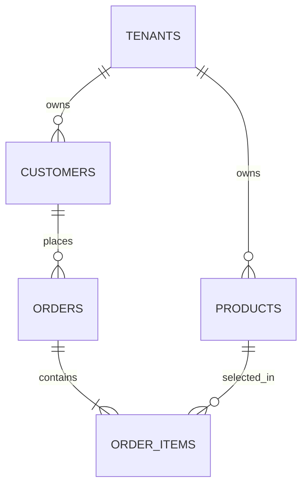

# Ràng buộc miền giá trị, duy nhất, tham chiếu và liên hệ nhiều thuộc tính

Một mô hình dữ liệu tốt phải diễn đạt được **dữ liệu nào được phép tồn tại** chứ không chỉ mô tả những bảng và cột có mặt trong hệ thống. Ví dụ, với ứng dụng bán hàng đa tenant (mỗi doanh nghiệp là một tenant), các phát biểu sau đều là quy tắc nghiệp vụ cần bảo vệ:

- Số lượng mua phải lớn hơn 0; giá bán và số tiền giảm không được âm.
- Trong cùng một tenant, hai khách hàng không được đăng ký cùng một địa chỉ email nếu bỏ qua khác biệt chữ hoa/chữ thường.
- Đơn hàng chỉ được tham chiếu đến khách hàng thuộc chính tenant đó; dòng hàng phải trỏ đến sản phẩm và đơn hàng cùng tenant.
- Một đơn hàng ở trạng thái `CANCELLED` phải có thời điểm hủy; đơn chưa hủy không có thời điểm hủy.
- Số tiền giảm của một dòng hàng không được lớn hơn số lượng nhân đơn giá.

Những phát biểu này gọi là **bất biến dữ liệu** (*data invariants*): điều kiện phải đúng đối với mọi trạng thái dữ liệu hợp lệ mà hệ thống công bố. **Ràng buộc** (*constraint*) là cơ chế giúp cơ sở dữ liệu từ chối những thao tác làm vi phạm bất biến.

Bài học này tập trung vào cách chuyển các quy tắc thành **ràng buộc miền giá trị, tính duy nhất, tính toàn vẹn tham chiếu và điều kiện liên hệ nhiều thuộc tính**, từ mô hình khái niệm đến lược đồ quan hệ vật lý. Ví dụ SQL dùng **PostgreSQL 15+**; với hệ quản trị khác cần kiểm tra lại cú pháp và mức thực thi.

## 1. Xác định phạm vi của từng bất biến

Trước khi chọn câu lệnh SQL, cần biết quy tắc liên quan đến bao nhiêu giá trị và bao nhiêu dòng dữ liệu.

| Phạm vi | Ví dụ nghiệp vụ | Công cụ thường dùng |
|---|---|---|
| Một giá trị trong một cột | `quantity > 0`, `email` bắt buộc | Kiểu dữ liệu, `NOT NULL`, `CHECK` |
| Một tổ hợp giá trị trong một dòng | `discount_amount <= quantity * unit_price` | `CHECK` đa cột |
| Một giá trị hoặc bộ giá trị xuyên nhiều dòng | Mỗi tenant chỉ có một SKU xác định | `PRIMARY KEY`, `UNIQUE`, unique index |
| Giữa dòng con và dòng cha | `order.customer_id` phải tồn tại | `FOREIGN KEY`, kể cả khóa ngoại ghép |
| Giữa nhiều dòng theo một điều kiện | Hai đặt phòng đã xác nhận không được chồng thời gian | Unique/exclusion constraint, transaction hoặc cơ chế đồng bộ phù hợp |
| Tổng hợp xuyên dòng/bảng | Tổng tiền đơn bằng tổng các dòng sau giảm giá | Truy vấn tính toán; hoặc transaction, trigger/cơ chế duy trì dữ liệu tổng hợp nếu lưu dư |

**Nguyên tắc thiết kế:** ràng buộc ở cơ sở dữ liệu nên bảo vệ những điều kiện có thể phát biểu chính xác và phải giữ đúng bất kể ứng dụng nào ghi dữ liệu. Kiểm tra tại API, form hoặc service vẫn hữu ích để báo lỗi thân thiện, nhưng không thay thế được ràng buộc ở nơi dữ liệu được lưu.

Một bất biến cần được viết đủ rõ trước khi triển khai. Ví dụ “email là duy nhất” còn thiếu phạm vi (toàn hệ thống hay trong tenant?), cách so sánh (phân biệt hoa/thường?), và cách xử lý tài khoản đã xóa. Những quyết định ấy ảnh hưởng trực tiếp đến khóa và chỉ mục.

## 2. Ràng buộc miền giá trị: loại bỏ dữ liệu sai ngay từ cột

**Miền giá trị** là tập các giá trị hợp lệ đối với một thuộc tính. Có nhiều lớp kiểm soát bổ trợ nhau:

1. **Kiểu dữ liệu:** dùng `INTEGER` cho số lượng, `NUMERIC(p, s)` cho tiền có độ chính xác thập phân xác định, `TIMESTAMPTZ` cho một thời điểm có múi giờ.
2. **`NOT NULL`:** buộc thuộc tính phải có giá trị. Không được coi chuỗi rỗng là tự động tương đương `NULL`.
3. **`CHECK`:** xác định điều kiện trên giá trị, như `quantity > 0` hoặc trạng thái nằm trong một tập hữu hạn.
4. **`DEFAULT`:** cung cấp giá trị khi lệnh ghi bỏ qua cột; **không** tự động ngăn giá trị không hợp lệ do ứng dụng truyền vào.

Ví dụ độc lập cho một danh mục hàng:

```sql
CREATE TABLE catalog_item_example (
    item_id BIGINT GENERATED ALWAYS AS IDENTITY PRIMARY KEY,
    sku TEXT NOT NULL,
    quantity INTEGER NOT NULL DEFAULT 0,
    price NUMERIC(14, 2) NOT NULL,
    state TEXT NOT NULL DEFAULT 'DRAFT',

    CONSTRAINT ck_catalog_sku
        CHECK (sku = btrim(sku) AND char_length(sku) BETWEEN 1 AND 40),
    CONSTRAINT ck_catalog_quantity
        CHECK (quantity >= 0),
    CONSTRAINT ck_catalog_price
        CHECK (price >= 0),
    CONSTRAINT ck_catalog_state
        CHECK (state IN ('DRAFT', 'ACTIVE', 'ARCHIVED'))
);
```

`NUMERIC(14, 2)` biểu diễn số thập phân chính xác tới hai chữ số sau dấu phẩy, phù hợp hơn `FLOAT` khi tính tiền. Việc chọn độ dài, độ chính xác, đơn vị tiền và quy tắc làm tròn vẫn phải theo yêu cầu nghiệp vụ. Một giá trị `quantity = 0` có thể hợp lệ với **tồn kho** nhưng không hợp lệ với **số lượng mua**; đừng tái sử dụng ràng buộc mà bỏ qua ngữ nghĩa.

### Bẫy quan trọng: `NULL` và logic ba giá trị

SQL có ba kết quả logic: `TRUE`, `FALSE` và `UNKNOWN`. Với PostgreSQL, một điều kiện `CHECK` chỉ bác bỏ dòng khi kết quả là `FALSE`; `TRUE` và `UNKNOWN` đều không bị bác bỏ.

```sql
-- KHÔNG đủ để cấm NULL:
price NUMERIC(14, 2) CHECK (price >= 0)

-- Đúng khi giá bắt buộc phải có:
price NUMERIC(14, 2) NOT NULL CHECK (price >= 0)
```

Nếu `price` bằng `NULL`, biểu thức `price >= 0` có kết quả `UNKNOWN`. Tương tự, quy tắc `end_at > start_at` không đảm bảo một trong hai cột có giá trị nếu thiếu `NOT NULL`.

Có thể dùng `CREATE DOMAIN` khi nhiều cột có **đúng cùng ngữ nghĩa miền giá trị** trong PostgreSQL. Tuy nhiên, ràng buộc đặc thù ngữ cảnh như “số lượng đặt mua tối thiểu 1” nên đặt tại cột/bảng liên quan.

## 3. Ràng buộc duy nhất: khóa định danh và khóa nghiệp vụ

`PRIMARY KEY` định danh một dòng; các cột trong khóa chính phải khác `NULL` và tổ hợp giá trị phải duy nhất. Một bảng chỉ có một khóa chính, nhưng có thể có nhiều khóa ứng viên được bảo vệ bằng `UNIQUE` hoặc unique index.

Ví dụ, `product_id` là khóa kỹ thuật, còn tổ hợp `(tenant_id, sku)` là khóa nghiệp vụ:

```sql
CONSTRAINT pk_products PRIMARY KEY (tenant_id, product_id),
CONSTRAINT uq_products_tenant_sku UNIQUE (tenant_id, sku)
```

Hai tenant được dùng cùng mã `SKU-01`; trong **một** tenant thì không được trùng. `UNIQUE (tenant_id, sku)` kiểm tra **tổ hợp**, không cấm từng cột xuất hiện ở nhiều dòng.

### Chuẩn hóa giá trị trước khi so sánh

Nếu nghiệp vụ coi `Lan@Example.com` và `lan@example.com` là cùng một email, `UNIQUE (email)` mặc định không đảm bảo quy tắc ấy. Trong PostgreSQL có thể dùng:

```sql
CREATE UNIQUE INDEX uq_customers_tenant_email_ci
    ON customers (tenant_id, lower(email));
```

Chỉ mục này giả định đầu vào đã được chuẩn hóa khoảng trắng (bảng ví dụ ở phần sau có `CHECK` tương ứng). Việc so sánh email trong ứng dụng thực tế cần chốt rõ chính sách Unicode/collation và chuẩn hóa; không nên mặc định `lower` là cách chuẩn hóa danh tính hoàn hảo cho mọi hệ thống.

### `UNIQUE` và `NULL`

Theo cách xử lý mặc định của PostgreSQL, các giá trị `NULL` được coi là khác nhau trong kiểm tra duy nhất. Vì vậy, nhiều dòng có `email = NULL` vẫn có thể cùng tồn tại dưới `UNIQUE (email)`. Từ PostgreSQL 15 có thể chọn:

```sql
-- Khi nghiệp vụ yêu cầu NULL cũng chỉ được xuất hiện một lần:
CONSTRAINT uq_external_ref UNIQUE NULLS NOT DISTINCT (external_ref)
```

Nếu thuộc tính bắt buộc có giá trị, `NOT NULL` thường diễn đạt yêu cầu rõ hơn. Đối với khóa duy nhất có nhiều cột, phải xét tác động của `NULL` ở **từng** cột trước khi chọn cú pháp.

### Duy nhất có điều kiện

Chẳng hạn tên hiển thị chỉ cần duy nhất trong các bản ghi **chưa xóa mềm**:

```sql
CREATE UNIQUE INDEX uq_active_name_per_tenant
    ON some_entity (tenant_id, lower(display_name))
    WHERE deleted_at IS NULL;
```

Unique index từng phần (*partial unique index*) diễn đạt điều kiện gắn với trạng thái bản ghi. Đây là tính năng PostgreSQL; không phải hệ quản trị nào cũng có cú pháp hay hành vi giống vậy. Một partial unique index không thể tự động làm đích tham chiếu cho khóa ngoại như khóa ứng viên thông thường.

Đừng chỉ thực hiện `SELECT` kiểm tra trùng rồi `INSERT`: hai request đồng thời có thể cùng nhìn thấy “chưa tồn tại”. Unique constraint/index mới là lớp chặn xung đột ở thời điểm ghi; ứng dụng cần xử lý lỗi trùng khóa và quyết định thử lại hay trả thông báo.

## 4. Toàn vẹn tham chiếu: mối quan hệ phải dẫn tới dòng tồn tại

Khóa ngoại (`FOREIGN KEY`) buộc giá trị ở bảng con phải tham chiếu được đến một khóa chính hoặc khóa duy nhất hợp lệ ở bảng cha. Ví dụ:

```sql
FOREIGN KEY (tenant_id, customer_id)
    REFERENCES customers (tenant_id, customer_id)
```

Đưa `tenant_id` vào **cả hai phía** của khóa ngoại bảo đảm đơn hàng không thể gắn với khách hàng thuộc tenant khác, kể cả khi `customer_id` có giá trị hợp lệ ở một tenant khác. Đây là cách chuyển một bất biến phân quyền/phân vùng dữ liệu thành tính toàn vẹn cấu trúc.

Khóa ngoại ghép cần tham chiếu tới các cột cha tạo thành khóa ứng viên phù hợp (khóa chính hoặc duy nhất thỏa điều kiện của hệ quản trị). Thứ tự cột trong ràng buộc phải khớp theo phép ánh xạ đã khai báo.

### Chọn hành vi khi sửa hoặc xóa dòng cha

| Hành vi | Ý nghĩa | Tình huống cần cân nhắc |
|---|---|---|
| `ON DELETE RESTRICT` | Chặn xóa cha khi còn dòng con tham chiếu | Giữ lịch sử đơn hàng, tài chính |
| `ON DELETE NO ACTION` | Kiểm tra tham chiếu theo thời điểm áp dụng ràng buộc; có thể hoãn nếu ràng buộc hỗ trợ `DEFERRABLE` | Các giao dịch sắp xếp lại dữ liệu |
| `ON DELETE CASCADE` | Xóa dòng con tương ứng | Dữ liệu phụ thuộc không cần tồn tại độc lập |
| `ON DELETE SET NULL` | Đưa khóa ngoại con về `NULL` | Quan hệ tùy chọn, cột con cho phép `NULL` |
| `ON UPDATE CASCADE` | Cập nhật giá trị khóa tham chiếu ở con khi khóa cha đổi | Khóa tự nhiên có thể đổi |

Không mặc định `CASCADE` cho dữ liệu quan trọng. “Đơn hàng có thể bị xóa khi khách hàng bị xóa” là một **quyết định nghiệp vụ**, không phải mặc định kỹ thuật.

Với khóa ngoại ghép, quy tắc xử lý `NULL` cũng đáng chú ý: ở chế độ `MATCH SIMPLE` mặc định, chỉ cần một thành phần tham chiếu là `NULL`, việc kiểm tra tồn tại dòng cha có thể được bỏ qua. Nếu quan hệ bắt buộc, hãy đặt `NOT NULL` trên tất cả cột tham chiếu; khi muốn cho phép **hoặc tất cả rỗng hoặc tất cả có giá trị**, cân nhắc `MATCH FULL` theo khả năng của hệ quản trị.

**Chỉ mục:** PostgreSQL tạo chỉ mục cho khóa chính và ràng buộc duy nhất, nhưng không tự tạo chỉ mục trên mọi cột khóa ngoại ở bảng con. Khi bảng cha bị xóa/cập nhật hoặc khi truy vấn join thường xuyên, chỉ mục phía con có thể rất quan trọng. Chọn chỉ mục theo dạng truy vấn và thứ tự cột, không thêm tràn lan.

## 5. Ràng buộc liên hệ nhiều thuộc tính trong một dòng

Một ràng buộc có thể mô tả quan hệ giữa các cột của **cùng một bản ghi**:

```sql
-- Khoảng thời gian hợp lệ, nếu hai cột đều NOT NULL:
CHECK (end_at > start_at)

-- Giảm giá không vượt giá trị gốc của dòng:
CHECK (discount_amount >= 0
       AND discount_amount <= quantity * unit_price)

-- Trạng thái hủy tương đương với việc có thời điểm hủy:
CHECK (
    (status = 'CANCELLED' AND cancelled_at IS NOT NULL)
    OR
    (status <> 'CANCELLED' AND cancelled_at IS NULL)
)
```

Điều kiện cuối là quan hệ **hai chiều** (*if and only if*). Nếu chỉ viết `status = 'CANCELLED' OR cancelled_at IS NULL`, nhiều tổ hợp sai vẫn có thể lọt qua. Vì thế cần lập bảng các tổ hợp cho phép trước khi viết `CHECK`:

| `status` | `cancelled_at` | Hợp lệ? |
|---|---|---|
| `CANCELLED` | Có | Có |
| `CANCELLED` | `NULL` | Không |
| `DRAFT` / `PLACED` | `NULL` | Có |
| `DRAFT` / `PLACED` | Có | Không |

Nếu trạng thái và thời điểm được cập nhật thành **hai câu lệnh SQL riêng lẻ**, một trong hai lệnh có thể thất bại vì tạo trạng thái trung gian sai. Hãy cập nhật nhất quán trong cùng câu lệnh, hoặc thiết kế giao dịch và ràng buộc phù hợp. Trong PostgreSQL, `CHECK` không phải loại ràng buộc có thể đặt `DEFERRABLE`; đừng trông chờ việc trì hoãn kiểm tra của `CHECK` tới lúc commit.

`CHECK` thông thường không được dùng để truy vấn dòng khác/bảng khác nhằm xác thực tổng hoặc điều kiện tồn tại. Ranh giới này quan trọng khi chuyển từ quy tắc “một dòng” sang quy tắc “toàn hệ thống”.

## 6. Ví dụ xuyên suốt: lược đồ đơn hàng đa tenant

Yêu cầu đã được làm rõ:

- Mỗi tenant có mã riêng; khách hàng có email duy nhất trong tenant, không phân biệt hoa/thường.
- Mã sản phẩm (SKU) duy nhất trong tenant; giá hiện tại không âm.
- Đơn hàng tham chiếu khách hàng cùng tenant; dòng hàng tham chiếu đơn hàng và sản phẩm cùng tenant.
- Đơn hàng có trạng thái `DRAFT`, `PLACED` hoặc `CANCELLED`; trạng thái hủy và dấu thời gian hủy luôn nhất quán.
- Số lượng dòng hàng dương, đơn giá tại thời điểm bán không âm, giảm giá nằm trong khoảng từ 0 đến thành tiền trước giảm.

Các bảng sau minh họa **mô hình vật lý PostgreSQL**, không bao gồm bảng thanh toán, vận chuyển hay quy tắc thuế ngoài phạm vi bài học.

```sql
CREATE TABLE tenants (
    tenant_id BIGINT GENERATED ALWAYS AS IDENTITY,
    code TEXT NOT NULL,
    CONSTRAINT pk_tenants PRIMARY KEY (tenant_id),
    CONSTRAINT uq_tenants_code UNIQUE (code),
    CONSTRAINT ck_tenants_code
        CHECK (code = btrim(code) AND char_length(code) BETWEEN 3 AND 40)
);

CREATE TABLE customers (
    tenant_id BIGINT NOT NULL,
    customer_id BIGINT GENERATED ALWAYS AS IDENTITY,
    email TEXT NOT NULL,

    CONSTRAINT pk_customers PRIMARY KEY (tenant_id, customer_id),
    CONSTRAINT fk_customers_tenant
        FOREIGN KEY (tenant_id) REFERENCES tenants (tenant_id)
        ON DELETE RESTRICT,
    CONSTRAINT ck_customers_email
        CHECK (email = btrim(email) AND char_length(email) BETWEEN 1 AND 254)
);

-- Coi chữ hoa và chữ thường tương đương theo quy tắc đã lựa chọn.
CREATE UNIQUE INDEX uq_customers_tenant_email_ci
    ON customers (tenant_id, lower(email));

CREATE TABLE products (
    tenant_id BIGINT NOT NULL,
    product_id BIGINT GENERATED ALWAYS AS IDENTITY,
    sku TEXT NOT NULL,
    current_price NUMERIC(14, 2) NOT NULL,

    CONSTRAINT pk_products PRIMARY KEY (tenant_id, product_id),
    CONSTRAINT uq_products_tenant_sku UNIQUE (tenant_id, sku),
    CONSTRAINT fk_products_tenant
        FOREIGN KEY (tenant_id) REFERENCES tenants (tenant_id)
        ON DELETE RESTRICT,
    CONSTRAINT ck_products_sku
        CHECK (sku = btrim(sku) AND char_length(sku) BETWEEN 1 AND 40),
    CONSTRAINT ck_products_price CHECK (current_price >= 0)
);

CREATE TABLE orders (
    tenant_id BIGINT NOT NULL,
    order_id BIGINT GENERATED ALWAYS AS IDENTITY,
    customer_id BIGINT NOT NULL,
    status TEXT NOT NULL DEFAULT 'DRAFT',
    ordered_at TIMESTAMPTZ NOT NULL DEFAULT now(),
    cancelled_at TIMESTAMPTZ,

    CONSTRAINT pk_orders PRIMARY KEY (tenant_id, order_id),
    CONSTRAINT fk_orders_customer
        FOREIGN KEY (tenant_id, customer_id)
        REFERENCES customers (tenant_id, customer_id)
        ON DELETE RESTRICT,
    CONSTRAINT ck_orders_status
        CHECK (status IN ('DRAFT', 'PLACED', 'CANCELLED')),
    CONSTRAINT ck_orders_cancelled_state
        CHECK (
            (status = 'CANCELLED' AND cancelled_at IS NOT NULL)
            OR (status <> 'CANCELLED' AND cancelled_at IS NULL)
        ),
    CONSTRAINT ck_orders_cancelled_time
        CHECK (cancelled_at IS NULL OR cancelled_at >= ordered_at)
);

CREATE TABLE order_items (
    tenant_id BIGINT NOT NULL,
    order_id BIGINT NOT NULL,
    line_no INTEGER NOT NULL,
    product_id BIGINT NOT NULL,
    quantity INTEGER NOT NULL,
    unit_price NUMERIC(14, 2) NOT NULL,
    discount_amount NUMERIC(14, 2) NOT NULL DEFAULT 0,
    line_total NUMERIC(16, 2)
        GENERATED ALWAYS AS (quantity * unit_price - discount_amount) STORED,

    CONSTRAINT pk_order_items PRIMARY KEY (tenant_id, order_id, line_no),
    CONSTRAINT fk_order_items_order
        FOREIGN KEY (tenant_id, order_id)
        REFERENCES orders (tenant_id, order_id)
        ON DELETE RESTRICT,
    CONSTRAINT fk_order_items_product
        FOREIGN KEY (tenant_id, product_id)
        REFERENCES products (tenant_id, product_id)
        ON DELETE RESTRICT,
    CONSTRAINT ck_order_items_line_no CHECK (line_no > 0),
    CONSTRAINT ck_order_items_quantity CHECK (quantity > 0),
    CONSTRAINT ck_order_items_price CHECK (unit_price >= 0),
    CONSTRAINT ck_order_items_discount
        CHECK (discount_amount BETWEEN 0 AND quantity * unit_price)
);

-- Hỗ trợ join và kiểm tra FK ở hướng không được PK che phủ.
CREATE INDEX ix_orders_tenant_customer
    ON orders (tenant_id, customer_id);
CREATE INDEX ix_order_items_tenant_product
    ON order_items (tenant_id, product_id);
```

### Vì sao mô hình này dùng cả khóa ghép và khóa kỹ thuật?

`tenant_id` phân chia phạm vi sở hữu dữ liệu. `customer_id`, `order_id` và `product_id` là mã kỹ thuật được sinh tự động. Dù các identity có thể tình cờ là duy nhất toàn cục, **khóa ghép** và **khóa ngoại ghép** vẫn ghi rõ quan hệ nào được phép trong một tenant. Chúng ngăn một câu lệnh ghi sai `tenant_id` liên kết dữ liệu chéo tenant.

Chỉ mục email là khóa nghiệp vụ dùng để từ chối trùng lặp; `customer_id` là định danh ổn định để bảng khác tham chiếu. Với sản phẩm, lưu cả `current_price` và `unit_price` của dòng đơn là có chủ đích: giá đã chốt khi mua không nên biến đổi mỗi khi sửa giá catalog.

`line_total` là **cột sinh ra** từ các giá trị cùng dòng, giúp tránh lưu một kết quả mâu thuẫn với các thành phần của nó. Tuy nhiên, `NUMERIC(16, 2)` cũng giới hạn giá trị biểu diễn được; hệ thống thực tế phải định nghĩa giới hạn số lượng/đơn giá tối đa và làm tròn theo tiền tệ của mình.

Các khóa ngoại ở đây không tự bảo đảm “sản phẩm còn bán”, “người mua được phép đặt hàng” hoặc “tồn kho đủ”. Đó là những quy tắc có trạng thái, thời điểm hoặc phép tính khác cần cơ chế bổ sung.

### Từ phát biểu nghiệp vụ đến DDL

| Phát biểu | Vị trí thực thi |
|---|---|
| “Mỗi tenant có mã duy nhất” | `uq_tenants_code` |
| “Một tenant không có hai email khách hàng trùng nhau khi bỏ qua hoa/thường” | `uq_customers_tenant_email_ci` |
| “SKU không trùng trong tenant” | `uq_products_tenant_sku` |
| “Đơn hàng thuộc khách hàng cùng tenant” | `fk_orders_customer` |
| “Dòng hàng tham chiếu cả đơn và sản phẩm đúng tenant” | `fk_order_items_order` và `fk_order_items_product` |
| “Số lượng dương, giảm giá không quá thành tiền gốc” | `ck_order_items_quantity` và `ck_order_items_discount` |
| “Thời điểm hủy phù hợp trạng thái” | `ck_orders_cancelled_state`, `ck_orders_cancelled_time` |

Một sơ đồ khái niệm đơn giản cho phần tham chiếu:



Ký hiệu “đơn hàng chứa một hoặc nhiều dòng” trong sơ đồ là **mục tiêu nghiệp vụ**, chưa được SQL ở trên bảo vệ đầy đủ: khóa ngoại cho phép dòng hàng chỉ trỏ đến đơn có thật, nhưng không buộc mỗi đơn luôn có ít nhất một dòng. Nếu phải bắt buộc điều đó tại thời điểm xác nhận đơn, cần quy trình chuyển trạng thái và kiểm tra giao dịch bổ sung.

## 7. Khi một `CHECK` không đủ: bất biến xuyên dòng

### 7.1. Không chồng lịch đặt phòng đã xác nhận

Quy tắc: cùng một phòng không có hai đặt chỗ `CONFIRMED` với khoảng thời gian giao nhau. Hai khoảng `[start_at, end_at)` liên tiếp nhau ở điểm biên thì được phép.

Một `CHECK (end_at > start_at)` chỉ biết một dòng, không phát hiện hai dòng trùng lịch. Trong PostgreSQL, có thể dùng **exclusion constraint** với GiST:

```sql
CREATE EXTENSION IF NOT EXISTS btree_gist;

CREATE TABLE room_reservations (
    reservation_id BIGINT GENERATED ALWAYS AS IDENTITY PRIMARY KEY,
    room_id BIGINT NOT NULL,
    start_at TIMESTAMPTZ NOT NULL,
    end_at TIMESTAMPTZ NOT NULL,
    status TEXT NOT NULL,

    CONSTRAINT ck_reservation_interval CHECK (start_at < end_at),
    CONSTRAINT ck_reservation_status
        CHECK (status IN ('DRAFT', 'CONFIRMED', 'CANCELLED')),
    CONSTRAINT ex_confirmed_room_no_overlap
        EXCLUDE USING gist (
            room_id WITH =,
            tstzrange(start_at, end_at, '[)') WITH &&
        )
        WHERE (status = 'CONFIRMED')
);
```

Ràng buộc này diễn đạt rằng không có hai dòng cùng `room_id` và có khoảng thời gian giao nhau khi cả hai ở trạng thái xác nhận. `btree_gist` hỗ trợ toán tử so sánh bằng cho kiểu như `BIGINT` trong GiST. Việc cài extension cần quyền thích hợp; hệ quản trị khác có thể cần mô hình hoặc cơ chế đồng bộ khác.

### 7.2. Tổng tiền đơn và bất biến xuyên bảng

Giả sử nghiệp vụ yêu cầu “tổng tiền của đơn luôn bằng tổng `line_total` của các dòng”. Một `CHECK` trên bảng `orders` không thể trực tiếp bảo đảm phép `SUM` của bảng `order_items`. Có hai hướng thiết kế:

- **Tính khi truy vấn** nếu hiệu năng và yêu cầu nhất quán cho phép:

```sql
SELECT oi.tenant_id, oi.order_id,
       COALESCE(SUM(oi.line_total), 0) AS order_total
FROM order_items AS oi
GROUP BY oi.tenant_id, oi.order_id;
```

- **Lưu tổng đã tổng hợp** khi thực sự cần; lúc đó phải cập nhật dòng hàng và tổng trong cùng transaction hoặc dùng trigger/cơ chế duy trì tổng thích hợp. Cần thiết kế cẩn thận hành vi concurrent update và tránh ghi tổng dựa trên dữ liệu đã cũ.

Không thay ràng buộc xuyên dòng bằng chuỗi kiểm tra ứng dụng thiếu khóa hoặc thiếu cơ chế cô lập phù hợp. Hai giao dịch có thể cùng đọc trạng thái cũ rồi đều ghi kết quả vi phạm bất biến (*race condition*). Với những quy tắc không thể mô tả bằng constraint thông thường, cân nhắc transaction, khóa dòng, isolation `SERIALIZABLE`, hoặc mô hình dữ liệu khác có ràng buộc cưỡng chế trực tiếp.

### 7.3. Thời điểm áp dụng ràng buộc

Nhiều ràng buộc mặc định được kiểm tra ngay trong câu lệnh đang thực thi. PostgreSQL cho phép một số ràng buộc như `UNIQUE`, `FOREIGN KEY` và `EXCLUDE` khai báo `DEFERRABLE` để kiểm tra vào thời điểm phù hợp trong giao dịch. `NOT NULL` và `CHECK` không có cơ chế `DEFERRABLE` tương đương. Chỉ trì hoãn kiểm tra khi nghiệp vụ thực sự cần trạng thái trung gian, và luôn bảo đảm trạng thái cuối khi commit là hợp lệ.

## 8. Kiểm thử ràng buộc bằng tình huống phản ví dụ

Để biết mô hình có bảo vệ đúng bất biến, hãy thử cả dữ liệu **được phép** và dữ liệu **phải bị từ chối**. Với lược đồ đơn hàng ở phần 6:

| Thao tác thử | Kết quả mong đợi | Ràng buộc chính |
|---|---|---|
| Thêm hai khách hàng cùng tenant với email chỉ khác hoa/thường | Từ chối lần thứ hai | Unique index theo `lower(email)` |
| Thêm hai khách hàng khác tenant với cùng email | Chấp nhận | Phạm vi duy nhất theo `tenant_id` |
| Thêm sản phẩm có `current_price = -1` | Từ chối | `ck_products_price` |
| Tạo đơn trỏ đến khách hàng thuộc tenant khác | Từ chối | Khóa ngoại ghép `fk_orders_customer` |
| Đặt `status = 'CANCELLED'` mà `cancelled_at IS NULL` | Từ chối | `ck_orders_cancelled_state` |
| Thêm dòng số lượng 2, đơn giá 100, giảm giá 250 | Từ chối | `ck_order_items_discount` |
| Thêm hai dòng thuộc cùng đơn có `line_no` trùng nhau | Từ chối | `pk_order_items` |
| Xóa sản phẩm đang được dòng đơn tham chiếu | Từ chối | `fk_order_items_product` và `ON DELETE RESTRICT` |
| Tạo đơn `DRAFT` chưa có dòng hàng | Chấp nhận theo DDL hiện tại | Chưa có bất biến “đơn phải có dòng” |

Khi thực nghiệm, nên dùng transaction rồi `ROLLBACK` để không làm bẩn dữ liệu mẫu. Các phép thử lỗi thường cần chạy từng trường hợp trong transaction hoặc savepoint riêng, vì trong PostgreSQL một câu lệnh lỗi khiến transaction hiện tại phải rollback hoặc quay về savepoint trước khi tiếp tục.

Ngoài ràng buộc đơn lẻ, cần thử **đồng thời**: hai phiên thêm cùng email, hai phiên xác nhận lịch đặt phòng trùng nhau, hoặc hai tiến trình cập nhật cùng tổng tiền. Các thử nghiệm này cho thấy sự khác biệt giữa kiểm tra ở ứng dụng và bảo đảm ở cơ sở dữ liệu.

## 9. Thêm ràng buộc vào hệ thống đang có dữ liệu

Không nên áp dụng DDL mới trước khi tìm xem dữ liệu cũ có vi phạm hay không. Quy trình thường gồm:

1. **Chốt lại bất biến:** phạm vi tenant, chuẩn hóa giá trị, ngoại lệ cho bản ghi đã lưu, cách ứng xử với `NULL`.
2. **Kiểm kê dữ liệu hiện hữu:** tìm bản ghi âm, thiếu khóa, tham chiếu mồ côi và nhóm trùng giá trị nghiệp vụ.
3. **Làm sạch và chuẩn hóa:** sửa, gộp hoặc phân loại các trường hợp vi phạm theo quyết định nghiệp vụ có thể kiểm toán.
4. **Triển khai ràng buộc theo pha:** cân nhắc dung lượng bảng, khóa DDL, ảnh hưởng tới lệnh ghi và kế hoạch triển khai ứng dụng.
5. **Kiểm chứng sau chuyển đổi:** chạy truy vấn phản ví dụ, thử cạnh tranh và theo dõi lỗi vi phạm constraint phát sinh.

Ví dụ kiểm tra trùng email theo quy tắc được chọn trước khi tạo unique index:

```sql
SELECT tenant_id, lower(email) AS normalized_email, COUNT(*) AS duplicate_count
FROM customers
GROUP BY tenant_id, lower(email)
HAVING COUNT(*) > 1;
```

Trong PostgreSQL, `CHECK` và `FOREIGN KEY` có thể được thêm dưới dạng `NOT VALID` rồi kiểm chứng sau bằng `VALIDATE CONSTRAINT`, giúp lập kế hoạch chuyển đổi trên bảng lớn. Tuy nhiên, `UNIQUE` không có cùng cơ chế `NOT VALID` để bỏ qua bản ghi cũ; với bảng lớn, có thể cân nhắc `CREATE UNIQUE INDEX CONCURRENTLY` (chạy ngoài transaction block) sau khi đã xử lý trùng. Chỉ mục unique dạng biểu thức hoặc partial index không thể gắn thành ràng buộc `UNIQUE` theo cách `USING INDEX` dành cho unique index đơn giản phù hợp. Cần đánh giá hành vi locking và phiên bản hệ quản trị thực tế trước khi triển khai production.

Một ràng buộc “đúng về mặt lý thuyết” vẫn có thể gây lỗi nghiệp vụ nếu chưa cập nhật luồng ghi dữ liệu. Chẳng hạn với `ck_orders_cancelled_state`, ứng dụng phải đổi `status` và `cancelled_at` trong một câu lệnh `UPDATE` nhất quán.

## 10. Chuyển cùng bất biến sang mô hình document, đồ thị và phân tích

Bất biến là yêu cầu nghiệp vụ độc lập công nghệ; **mức hỗ trợ cưỡng chế** thay đổi theo hệ lưu trữ.

| Mô hình | Cách diễn đạt điển hình | Lưu ý về bảo đảm |
|---|---|---|
| Cơ sở dữ liệu quan hệ | `NOT NULL`, `CHECK`, `UNIQUE`, `FOREIGN KEY`, exclusion constraint nếu hỗ trợ | Mạnh cho ràng buộc cấu trúc và tham chiếu; tổng hợp xuyên dòng vẫn cần thiết kế |
| Document | Schema validation cho thuộc tính/tài liệu, unique index cho trường hoặc khóa ghép | Các tham chiếu sang document khác không mặc nhiên được bảo vệ như FK; cần xem transaction và cơ chế ứng dụng |
| Graph | Unique/property-existence constraints nếu engine hỗ trợ; ràng buộc trên nút/cạnh theo sản phẩm | Không suy ra mọi quan hệ hoặc đường đi đều được kiểm tra tự động; kiểm tra khả năng cưỡng chế của engine |
| Kho dữ liệu phân tích | Kiểu dữ liệu, phép kiểm tra lúc nạp, job chất lượng dữ liệu, các metadata ràng buộc nếu có | Một số hệ chỉ ghi nhận PK/FK làm thông tin cho tối ưu hóa mà không cưỡng chế; không giả định mọi khai báo đều được thực thi |

Ví dụ: mô hình document có thể lưu toàn bộ các dòng hàng trong một document đơn. Khi đó điều kiện “giảm giá không quá thành tiền gốc” ở từng phần tử có thể được kiểm tra ở cấp document theo khả năng của engine. Nhưng tính duy nhất email **trên nhiều document** vẫn cần unique index, và tham chiếu sản phẩm sang document khác có thể cần giao dịch/logic riêng.

Chọn cách lưu trữ theo **kiểu truy cập, biên giao dịch, nhu cầu liên kết và các bất biến phải cưỡng chế**, không chỉ dựa vào hình dạng JSON hay số lượng bảng.

## 11. Danh sách kiểm tra khi thiết kế

Trước khi duyệt lược đồ vật lý, hãy trả lời các câu hỏi sau:

- Mỗi thuộc tính có đúng kiểu dữ liệu, đơn vị đo, mức chính xác và chính sách `NULL` chưa?
- Quy tắc duy nhất áp dụng **toàn cục, theo tenant, theo trạng thái hay theo khoảng thời gian**? Có cần chuẩn hóa trước so sánh không?
- Mỗi tham chiếu có khóa ngoại tương ứng không? Khóa ghép đã bao gồm cột phạm vi sở hữu như `tenant_id` chưa?
- Cơ chế xóa/cập nhật dòng cha có đúng yêu cầu lưu lịch sử và quyền sở hữu dữ liệu không?
- Các quan hệ giữa trạng thái, thời gian, số lượng và số tiền đã được viết thành điều kiện chấp nhận/từ chối rõ ràng chưa?
- Điều kiện đó chỉ liên quan một dòng, hay thực chất là bất biến xuyên dòng/bảng đòi hỏi transaction hoặc cơ chế khác?
- Khi có hai giao dịch đồng thời, có thể tồn tại kết quả mà cả hai lần kiểm tra ứng dụng đều “đúng” nhưng dữ liệu cuối cùng “sai” không?
- Có dữ liệu hiện hữu vi phạm không, và thứ tự triển khai ứng dụng–DDL–làm sạch dữ liệu đã được kiểm chứng chưa?

**Điểm cần nắm:** bắt đầu từ một câu phát biểu nghiệp vụ đủ chính xác, xác định phạm vi của bất biến, rồi chọn cơ chế bảo vệ mạnh nhất phù hợp với nơi dữ liệu sống. `CHECK` mô tả quan hệ trong một dòng; `UNIQUE` bảo vệ tính duy nhất; `FOREIGN KEY` bảo vệ liên kết; các bất biến xuyên dòng và xuyên bảng cần được nhận diện riêng để không đánh giá quá cao một constraint đơn lẻ.
