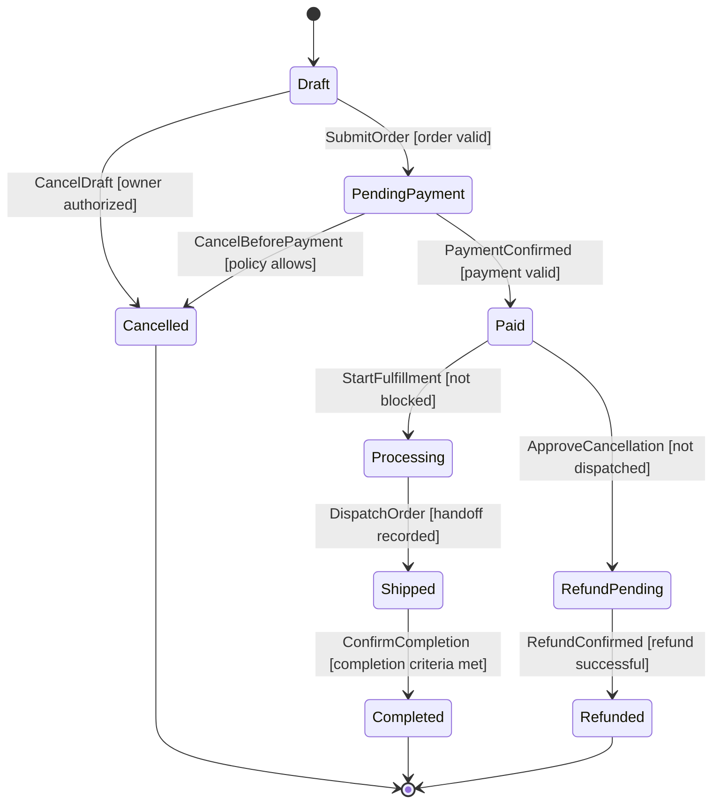

# Trạng thái hợp lệ khác với chuyển trạng thái hợp lệ

Trong mô hình dữ liệu, cần phân biệt hai câu hỏi: **một đối tượng đang ở trạng thái có hợp lệ hay không**, và **sự kiện vừa xảy ra có được phép chuyển đối tượng từ trạng thái hiện tại sang trạng thái mới hay không**. Một trạng thái có thể hợp lệ trong mô hình nhưng không phải trạng thái nào cũng có thể đi tới nó từ mọi trạng thái khác. Ví dụ, `SHIPPED` là trạng thái hợp lệ của đơn hàng, nhưng không có nghĩa một đơn hàng đang ở `DRAFT` được phép chuyển thẳng sang `SHIPPED`.

Sự phân biệt này rất quan trọng khi chuyển yêu cầu nghiệp vụ thành mô hình dữ liệu rõ ràng. Bất biến trạng thái mô tả điều kiện phải đúng đối với mỗi trạng thái dữ liệu đã được chấp nhận. Ràng buộc chuyển trạng thái mô tả những bước thay đổi được phép, điều kiện cần thỏa mãn, tác nhân có quyền thực hiện và sự kiện cần được ghi nhận. Nếu chỉ kiểm tra giá trị trạng thái mà bỏ qua quá trình chuyển, hệ thống có thể lưu một trạng thái có vẻ hợp lệ nhưng được tạo ra bằng một hành động không hợp lệ.

Sau bài học, người học có thể:

- Phân biệt bất biến trạng thái với ràng buộc chuyển trạng thái.
- Mô tả trạng thái, sự kiện, điều kiện bảo vệ (guard) và kết quả chuyển.
- Xây dựng sơ đồ vòng đời và xác định các chuyển tiếp được phép hoặc bị cấm.
- Nhận diện bất biến trên một bản ghi, nhiều bản ghi, quan hệ và dữ liệu theo thời gian.
- Kiểm tra điều kiện trước và sau chuyển trạng thái trong một giao dịch nhất quán.
- Hiểu vai trò của `CHECK`, khóa ngoại, `UNIQUE`, transaction, khóa đồng thời và lịch sử sự kiện.
- Thiết kế tình huống kiểm thử cho trạng thái hợp lệ, trạng thái không hợp lệ và chuyển tiếp không hợp lệ.

## 1. Trạng thái hợp lệ và chuyển trạng thái hợp lệ

### 1.1. Trạng thái là ảnh chụp tình hình hiện tại

Trạng thái mô tả tình hình của một đối tượng tại một thời điểm. Ví dụ, đơn hàng có thể ở `DRAFT`, `PENDING_PAYMENT`, `PAID`, `PROCESSING`, `SHIPPED`, `COMPLETED` hoặc `CANCELLED`.

Một trạng thái được xem là hợp lệ khi nó thuộc tập trạng thái mà nghiệp vụ cho phép và các điều kiện gắn với trạng thái đó đều đúng. Ví dụ:

- Đơn hàng `PAID` phải có bằng chứng thanh toán thành công.
- Đơn hàng `SHIPPED` phải có thông tin bàn giao hoặc vận đơn theo quy trình.
- Đơn hàng `CANCELLED` phải có lý do hoặc sự kiện hủy nếu nghiệp vụ yêu cầu.
- Đơn hàng `DRAFT` có thể chưa có địa chỉ giao hàng hoặc thanh toán.

Các điều kiện này mô tả **tính hợp lệ của trạng thái hiện tại**. Chúng không nói trạng thái đó được tạo ra bằng cách nào.

### 1.2. Chuyển trạng thái là một hành động có điều kiện

Chuyển trạng thái là thay đổi từ trạng thái hiện tại sang trạng thái khác khi có một sự kiện và các điều kiện cần thiết được đáp ứng.

Ví dụ:

- `DRAFT` → `PENDING_PAYMENT` khi đơn có thông tin cần thiết và được gửi xác nhận.
- `PENDING_PAYMENT` → `PAID` khi hệ thống nhận được xác nhận thanh toán hợp lệ.
- `PAID` → `PROCESSING` khi đơn được đưa vào xử lý.
- `PROCESSING` → `SHIPPED` khi hàng được bàn giao theo điều kiện giao đủ.
- `PAID` → `CANCELLED` có thể bị cấm nếu hàng đã được bàn giao; nếu cho phép hủy, có thể cần một quy trình hoàn tiền riêng.

Một chuyển trạng thái chỉ hợp lệ khi trạng thái nguồn, sự kiện, điều kiện bảo vệ, quyền thực hiện và kết quả đều phù hợp với quy tắc nghiệp vụ.

### 1.3. So sánh hai loại quy tắc

| Tiêu chí | Bất biến trạng thái | Ràng buộc chuyển trạng thái |
|---|---|---|
| Câu hỏi | Bản ghi ở trạng thái này có thỏa điều kiện không? | Có được phép chuyển từ trạng thái cũ sang trạng thái mới không? |
| Phạm vi | Giá trị và quan hệ tại một thời điểm | Quan hệ giữa trạng thái trước, sự kiện và trạng thái sau |
| Ví dụ | Đơn `PAID` phải có thời điểm thanh toán | Chỉ chuyển sang `PAID` khi có xác nhận thanh toán hợp lệ |
| Kiểm tra | Điều kiện trên dữ liệu hiện tại | Điều kiện trên dữ liệu trước, sự kiện và dữ liệu sau |
| Lỗi điển hình | Lưu trạng thái thiếu dữ liệu bắt buộc | Nhảy qua bước, lặp hành động hoặc chuyển sai thứ tự |

Hai loại quy tắc bổ sung cho nhau. Một chuyển tiếp được phép vẫn có thể tạo ra trạng thái không hợp lệ nếu bước cập nhật không bảo đảm bất biến. Ngược lại, một trạng thái có đủ dữ liệu vẫn có thể không hợp lệ nếu hệ thống đi tới nó bằng một chuyển tiếp bị cấm.

## 2. Mô tả trạng thái bằng điều kiện có thể kiểm chứng

Không nên chỉ liệt kê tên trạng thái. Mỗi trạng thái cần có định nghĩa nghiệp vụ và điều kiện để xác định một bản ghi thực sự ở trạng thái đó.

### 2.1. Tập trạng thái và ý nghĩa

Ví dụ với đơn hàng:

| Trạng thái | Ý nghĩa nghiệp vụ | Dữ liệu hoặc điều kiện cần xem xét |
|---|---|---|
| `DRAFT` | Đơn đang được tạo, chưa gửi xác nhận | Có thể thiếu địa chỉ giao hàng hoặc thanh toán. |
| `PENDING_PAYMENT` | Đơn đã gửi và đang chờ thanh toán | Có thông tin cần thiết để thanh toán; chưa có xác nhận thu tiền thành công. |
| `PAID` | Khoản thanh toán đã được xác nhận | Có giao dịch thanh toán thành công liên quan đến đơn. |
| `PROCESSING` | Đơn đang được chuẩn bị | Có quy trình xử lý và phân công cần thiết. |
| `SHIPPED` | Hàng đã được bàn giao theo định nghĩa giao hàng của tổ chức | Có thông tin giao hàng phù hợp. |
| `COMPLETED` | Quy trình đơn hàng đã hoàn tất | Các điều kiện giao/đối soát cần thiết đã được thỏa mãn. |
| `CANCELLED` | Đơn đã bị hủy theo quy tắc | Có sự kiện hủy; nghĩa vụ hoàn tiền hoặc xử lý phần đã giao được giải quyết theo chính sách. |

Một hệ thống có thể cần trạng thái chi tiết hơn như `PARTIALLY_SHIPPED`, `REFUND_PENDING` hoặc `PARTIALLY_CANCELLED`. Chỉ thêm trạng thái khi nó thể hiện một tình hình nghiệp vụ có ý nghĩa và giúp xác định hành động tiếp theo.

### 2.2. Bất biến theo từng trạng thái

Một bất biến trạng thái có thể áp dụng cho mọi bản ghi hoặc chỉ khi đối tượng ở một trạng thái cụ thể.

Ví dụ:

- Mọi đơn hàng phải có mã định danh duy nhất.
- Mọi dòng đơn hàng phải có số lượng lớn hơn 0.
- Khi đơn ở `PAID`, phải có ít nhất một giao dịch thu tiền được xác nhận theo quy tắc thanh toán.
- Khi đơn ở `SHIPPED`, phải có thông tin bàn giao hợp lệ.
- Khi đơn ở `CANCELLED`, phải xác định phần nghĩa vụ còn lại và kết quả xử lý liên quan.

Hãy viết bất biến thành phát biểu có thể kiểm tra. Câu “đơn phải hợp lệ” không đủ rõ; câu “đơn ở `PAID` phải có một giao dịch thu tiền thành công với tổng số tiền đáp ứng số tiền cần thu theo chính sách” có thể được phân tích và kiểm chứng.

### 2.3. Trạng thái hợp lệ không đồng nghĩa trạng thái có thể đạt tới

Một trạng thái có thể thuộc tập trạng thái hợp lệ nhưng chưa chắc có thể đạt tới từ trạng thái hiện tại. Ví dụ, `COMPLETED` là trạng thái hợp lệ, nhưng một đơn đang `DRAFT` không thể chuyển thẳng sang `COMPLETED` nếu chưa qua xác nhận, xử lý và giao hàng.

Khi rà soát mô hình, cần phân biệt:

- **Tập trạng thái hợp lệ:** những trạng thái mà đối tượng có thể có trong nghiệp vụ.
- **Trạng thái khởi tạo:** trạng thái được dùng khi đối tượng bắt đầu vòng đời.
- **Tập chuyển tiếp hợp lệ:** các cặp trạng thái và sự kiện được phép.
- **Trạng thái kết thúc:** trạng thái không còn hoạt động hoặc không còn chuyển tiếp thông thường.
- **Trạng thái có thể đạt tới:** trạng thái có thể được đi tới từ trạng thái khởi tạo bằng chuỗi chuyển tiếp hợp lệ.

Một trạng thái không thể đạt tới thường là dấu hiệu của sơ đồ thiếu chuyển tiếp, quy tắc mâu thuẫn hoặc trạng thái được định nghĩa nhưng không còn sử dụng.

## 3. Mô tả chuyển trạng thái bằng nguồn, sự kiện, guard và đích

Một chuyển tiếp nên được mô tả ít nhất bằng bốn thành phần:

1. **Trạng thái nguồn:** đối tượng đang ở trạng thái nào trước hành động.
2. **Sự kiện:** hành động hoặc thông điệp nào yêu cầu thay đổi.
3. **Điều kiện bảo vệ (guard):** điều kiện phải đúng để chuyển tiếp được chấp nhận.
4. **Trạng thái đích:** trạng thái mới sau khi chuyển thành công.

Có thể bổ sung tác nhân, quyền hạn, dữ liệu đầu vào, tác động phụ và sự kiện lịch sử.

Ví dụ:

| Nguồn | Sự kiện | Guard | Đích |
|---|---|---|---|
| `DRAFT` | `SubmitOrder` | Có ít nhất một dòng hàng; thông tin bắt buộc hợp lệ | `PENDING_PAYMENT` |
| `PENDING_PAYMENT` | `PaymentConfirmed` | Mã giao dịch hợp lệ; số tiền và tiền tệ khớp quy tắc | `PAID` |
| `PAID` | `StartFulfillment` | Đơn chưa bị chặn; hàng có thể được xử lý | `PROCESSING` |
| `PROCESSING` | `DispatchOrder` | Hàng được bàn giao và có dữ liệu giao hàng cần thiết | `SHIPPED` |
| `SHIPPED` | `ConfirmCompletion` | Đã đạt điều kiện hoàn tất theo chính sách | `COMPLETED` |
| `DRAFT` | `CancelDraft` | Người yêu cầu có quyền hủy bản nháp | `CANCELLED` |

### 3.1. Sự kiện không phải trạng thái

Sự kiện mô tả điều đã xảy ra; trạng thái mô tả tình hình sau khi sự kiện được xử lý. `PaymentConfirmed` là sự kiện, còn `PAID` là trạng thái. Một sự kiện có thể đến nhưng không làm thay đổi trạng thái nếu nó không hợp lệ, đã được xử lý trước đó hoặc không phù hợp với trạng thái hiện tại.

Ví dụ, cổng thanh toán gửi lại thông báo `PaymentConfirmed` cho một giao dịch đã được xác nhận. Hệ thống cần nhận biết đây là thông báo lặp và xử lý theo quy tắc idempotency. Không nên tạo thêm một khoản thu chỉ vì nhận cùng thông báo lần thứ hai.

### 3.2. Guard khác với bất biến

Guard là điều kiện để một chuyển tiếp được phép. Bất biến là điều kiện phải đúng ở trạng thái dữ liệu đã được chấp nhận.

Ví dụ:

- Guard: chỉ cho phép `SubmitOrder` khi đơn có ít nhất một dòng hàng.
- Bất biến: mọi đơn ở `PENDING_PAYMENT` phải có ít nhất một dòng hàng hợp lệ.

Guard kiểm tra trước hành động. Bất biến kiểm tra kết quả sau hành động và mọi trạng thái được lưu. Cùng một điều kiện có thể được dùng ở cả hai nơi khi cần, nhưng vai trò của chúng khác nhau.

### 3.3. Chuyển tiếp bị cấm phải được mô tả rõ

Không nên chỉ liệt kê các chuyển tiếp được phép mà bỏ qua những bước có nguy cơ xảy ra do lỗi ứng dụng hoặc thao tác thủ công. Ví dụ:

- Không cho phép `DRAFT` → `SHIPPED`.
- Không cho phép `CANCELLED` → `PAID` bằng một thông báo thanh toán đến muộn nếu quy tắc yêu cầu xử lý giao dịch riêng.
- Không cho phép `COMPLETED` → `PROCESSING` theo luồng thông thường.
- Không cho phép một đơn đã giao đủ bị hủy toàn bộ mà không có quy trình trả hàng/hoàn tiền.

Một số nghiệp vụ có thể cho phép mở lại hoặc điều chỉnh sau khi kết thúc. Khi đó, cần mô tả đó là một chuyển tiếp đặc biệt với tác nhân, điều kiện và dấu vết riêng, không âm thầm xem như chuyển tiếp thông thường.

## 4. Sơ đồ trạng thái và vòng đời

Sơ đồ trạng thái giúp nhìn thấy các trạng thái, sự kiện và đường đi được phép. Nó cũng giúp phát hiện trạng thái cô lập, chuyển tiếp thiếu guard hoặc đường đi không có kết thúc.



Sơ đồ trên là ví dụ rút gọn. Một đơn có thể giao một phần, hủy một phần hoặc hoàn tiền một phần; khi nghiệp vụ yêu cầu, cần bổ sung trạng thái hoặc mô hình các dòng hàng, lần giao và giao dịch hoàn tiền với vòng đời riêng. Không nên ép toàn bộ quy trình phức tạp vào một trạng thái tổng của đơn.

### 4.1. Kiểm tra trạng thái khởi tạo và trạng thái kết thúc

Hãy xác định:

- Đối tượng được tạo ở trạng thái nào?
- Có thể tồn tại bản nháp hoặc trạng thái chờ không?
- Có bao nhiêu trạng thái kết thúc?
- Trạng thái kết thúc có thể được mở lại không?
- Nếu mở lại, đó là cùng một đối tượng hay một đối tượng mới liên kết với đối tượng cũ?

Ví dụ, một hợp đồng đã hết hạn có thể được gia hạn bằng phụ lục hoặc tạo hợp đồng mới. Hai cách có ý nghĩa pháp lý và lịch sử khác nhau; không nên chỉ chuyển trạng thái `EXPIRED` trở lại `ACTIVE` nếu nghiệp vụ cần giữ các kỳ hợp đồng riêng.

### 4.2. Tìm trạng thái không thể đạt tới

Từ trạng thái khởi tạo, lần theo tất cả chuyển tiếp hợp lệ. Nếu có trạng thái không thể đi tới, hãy kiểm tra:

- Thiếu chuyển tiếp trong sơ đồ?
- Guard quá chặt hoặc mâu thuẫn?
- Trạng thái không còn được sử dụng?
- Chuyển tiếp chỉ được kích hoạt bởi một hệ thống ngoài chưa được mô tả?
- Có một vai trò đặc biệt được phép thực hiện mà mô hình chưa ghi nhận?

Không xóa trạng thái chỉ để sơ đồ gọn hơn. Trước tiên cần xác nhận với người sở hữu nghiệp vụ.

## 5. Bất biến ở các phạm vi khác nhau

Không phải mọi bất biến đều nằm trong một cột hoặc một bản ghi. Một số điều kiện liên quan đến nhiều đối tượng, nhiều dòng dữ liệu hoặc thời gian.

### 5.1. Bất biến thuộc tính hoặc bản ghi

Ví dụ:

- Số lượng đặt phải lớn hơn 0.
- Ngày kết thúc không được trước ngày bắt đầu.
- Mã đơn hàng phải có giá trị và duy nhất.
- Nếu trạng thái là `PAID`, thời điểm thanh toán phải có giá trị.

Các điều kiện này thường có thể được kiểm tra trên một bản ghi bằng miền giá trị, `NOT NULL`, `UNIQUE` hoặc `CHECK` tùy hệ quản trị.

### 5.2. Bất biến tham chiếu và quan hệ

Ví dụ:

- Mỗi dòng đơn hàng phải thuộc một đơn hàng tồn tại.
- Mỗi thanh toán phải tham chiếu một đơn hoặc một đối tượng phải thu hợp lệ.
- Mỗi phân công phải có nhân viên và dự án tương ứng.
- Một nhân viên không được có hai phân công chính trùng thời gian nếu quy tắc không cho phép.

Khóa ngoại giúp bảo đảm tham chiếu đến đối tượng tồn tại. Tuy nhiên, các điều kiện phức tạp như không chồng lấn thời gian hoặc chỉ có một quan hệ đang hiệu lực có thể cần ràng buộc bổ sung.

### 5.3. Bất biến tổng hợp trên nhiều bản ghi

Ví dụ:

- Tổng số lượng được phân bổ không vượt số lượng tồn khả dụng.
- Số học viên được xác nhận không vượt sức chứa lớp.
- Tổng số tiền hoàn không vượt số tiền thu hợp lệ theo chính sách.
- Tổng tỷ lệ phân bổ ngân sách của các hạng mục không vượt ngưỡng cho phép.

Đây là các điều kiện không thể luôn kiểm tra bằng một `CHECK` đơn giản trên một hàng. Chúng thường cần kiểm tra nhiều bản ghi trong một giao dịch nhất quán, ràng buộc chuyên biệt của hệ quản trị hoặc một quy trình kiểm soát có tính đồng thời phù hợp.

### 5.4. Bất biến theo thời gian

Ví dụ:

- Một giấy phép chỉ được sử dụng trong khoảng hiệu lực.
- Một nhân viên chỉ có một phân công chính tại một thời điểm.
- Hợp đồng không được có hai phiên bản cùng hiệu lực nếu quy tắc yêu cầu một phiên bản duy nhất.
- Một lần đặt chỗ chỉ được giữ đến thời hạn nhất định.

Các bất biến này cần mô tả mốc thời gian, múi giờ, khoảng hiệu lực và cách xử lý khoảng thời gian chồng lấn. Chỉ lưu trạng thái hiện tại có thể không đủ để kiểm chứng lịch sử.

## 6. Điều kiện trước và sau chuyển trạng thái

Một cách hữu ích để đặc tả chuyển tiếp là mô tả **precondition** (điều kiện trước) và **postcondition** (điều kiện sau).

- Precondition: điều phải đúng trước khi hành động bắt đầu.
- Hành động: thao tác hoặc sự kiện được yêu cầu.
- Postcondition: điều phải đúng sau khi hành động hoàn tất thành công.

Ví dụ chuyển đơn từ `PENDING_PAYMENT` sang `PAID`:

| Thành phần | Điều kiện |
|---|---|
| Precondition | Đơn đang `PENDING_PAYMENT`; giao dịch tham chiếu thuộc đơn; số tiền và tiền tệ phù hợp; thông báo được xác thực. |
| Hành động | Xử lý sự kiện xác nhận thanh toán. |
| Postcondition | Đơn ở `PAID` theo quy tắc; giao dịch được ghi nhận thành công; sự kiện được lưu; thông báo lặp không tạo khoản thu mới. |

Nếu một điều kiện không thỏa mãn, hệ thống phải từ chối, trì hoãn hoặc đưa vào xử lý ngoại lệ theo quy tắc. Không được cập nhật một phần rồi để dữ liệu ở trạng thái mâu thuẫn.

### 6.1. Chuyển tiếp nhiều bước và tính nguyên tử

Một hành động nghiệp vụ có thể cập nhật nhiều đối tượng. Ví dụ xác nhận thanh toán có thể:

1. Ghi nhận giao dịch thanh toán thành công.
2. Cập nhật trạng thái đơn.
3. Ghi sự kiện lịch sử.
4. Cập nhật số dư phải thu hoặc dữ liệu liên quan.

Các thay đổi cần được thiết kế sao cho không có trạng thái trung gian sai được xem là kết quả hoàn tất. Với dữ liệu trong cùng cơ sở dữ liệu, transaction có thể bảo đảm các thay đổi cùng thành công hoặc cùng thất bại. Với hệ thống ngoài, cần quy tắc xử lý thông điệp lặp, kết quả đến trễ, đối soát và bù trừ; không thể giả định một transaction cơ sở dữ liệu bao trùm mọi hệ thống.

### 6.2. Guard phải được kiểm tra trên trạng thái mới nhất

Giả sử một lớp chỉ còn một chỗ. Hai yêu cầu đăng ký đến gần như đồng thời. Nếu cả hai cùng đọc số chỗ còn trống trước khi ghi, cả hai có thể cùng được chấp nhận và làm vượt sức chứa.

Guard “còn chỗ” phải được kiểm tra cùng với thao tác cập nhật theo cơ chế bảo đảm tính nhất quán và đồng thời phù hợp. Tùy thiết kế, có thể dùng transaction, khóa hàng, cập nhật có điều kiện, mức cô lập hoặc cơ chế giữ chỗ. Chỉ kiểm tra ở giao diện hoặc trong một bước đọc trước đó là chưa đủ.

## 7. Biểu diễn và thực thi ràng buộc trong cơ sở dữ liệu

Mô hình khái niệm mô tả quy tắc nghiệp vụ. Mô hình logic và vật lý xác định cách thực thi. Không có một loại ràng buộc SQL duy nhất bảo đảm mọi bất biến và chuyển tiếp.

### 7.1. `NOT NULL`, `CHECK`, `UNIQUE` và khóa ngoại

Ví dụ SQL minh họa:

```sql
CREATE TABLE orders (
    order_id BIGINT PRIMARY KEY,
    status VARCHAR(24) NOT NULL,
    placed_at TIMESTAMP NOT NULL,
    paid_at TIMESTAMP NULL,
    CHECK (status IN (
        'DRAFT', 'PENDING_PAYMENT', 'PAID',
        'PROCESSING', 'SHIPPED', 'COMPLETED', 'CANCELLED'
    )),
    CHECK (status <> 'PAID' OR paid_at IS NOT NULL)
);

CREATE TABLE order_lines (
    order_line_id BIGINT PRIMARY KEY,
    order_id BIGINT NOT NULL REFERENCES orders(order_id),
    quantity INTEGER NOT NULL CHECK (quantity > 0)
);
```

Các ràng buộc trên minh họa hai loại kiểm tra:

- `status` phải thuộc miền giá trị được định nghĩa.
- Nếu đơn ở `PAID`, `paid_at` phải có giá trị.
- Mỗi dòng đơn hàng phải tham chiếu một đơn hàng tồn tại và có số lượng dương.

Đây là ví dụ về bất biến trạng thái và tham chiếu. Chúng chưa bảo đảm `DRAFT` chỉ được chuyển sang `PENDING_PAYMENT` hoặc `PAID` chỉ được chuyển từ `PENDING_PAYMENT`. Một câu lệnh cập nhật trực tiếp vẫn có thể đưa đơn từ `DRAFT` sang `PAID` mà các `CHECK` trên không phát hiện, nếu các điều kiện dữ liệu của trạng thái `PAID` đều được thỏa mãn.

### 7.2. Kiểm soát chuyển tiếp bằng cập nhật có điều kiện

Một cách minh họa là chỉ cập nhật khi trạng thái nguồn đúng:

```sql
UPDATE orders
SET status = 'PAID',
    paid_at = CURRENT_TIMESTAMP
WHERE order_id = :order_id
  AND status = 'PENDING_PAYMENT';
```

Ứng dụng phải kiểm tra số hàng được cập nhật. Nếu không có hàng nào được cập nhật, trạng thái đã thay đổi hoặc đơn không còn đủ điều kiện; không được báo thành công như thể chuyển tiếp đã xảy ra.

Trong thực tế, cập nhật trạng thái cần nằm trong một giao dịch cùng với việc ghi nhận giao dịch thanh toán và sự kiện. Cần xác minh giao dịch đối tác, số tiền, tiền tệ, mã tham chiếu và tính lặp trước khi chấp nhận chuyển trạng thái. Câu lệnh ví dụ chỉ minh họa điều kiện trạng thái nguồn, không phải một quy trình thanh toán hoàn chỉnh.

### 7.3. Khi cần kiểm tra nhiều bản ghi

Một `CHECK` trên bảng đơn hàng không thể đơn giản kiểm tra tổng số lượng ở tất cả các dòng giao hàng hoặc tổng các khoản hoàn tiền ở bảng khác. Có thể cần:

- Transaction kiểm tra và cập nhật các bản ghi liên quan.
- Trigger hoặc stored procedure nếu đó là cơ chế kiểm soát được tổ chức lựa chọn và quản trị.
- Ràng buộc đặc thù của hệ quản trị, chẳng hạn kiểm soát khoảng thời gian không chồng lấn nếu được hỗ trợ.
- Quy trình đối soát định kỳ để phát hiện dữ liệu lệch do tích hợp hoặc xử lý bất đồng bộ.

Không nên chỉ dựa vào kiểm tra ở giao diện. Nếu nhiều ứng dụng hoặc tác vụ nền có thể ghi cùng dữ liệu, quy tắc quan trọng cần được bảo vệ ở nơi mọi đường ghi đều tuân thủ.

### 7.4. Bảo vệ chuyển tiếp trước cập nhật đồng thời

Một cập nhật có điều kiện như `WHERE status = 'PENDING_PAYMENT'` giúp ngăn hai tiến trình cùng chuyển một đơn từ trạng thái nguồn cũ nếu chỉ một tiến trình có thể cập nhật thành công. Tuy nhiên, các bất biến liên quan đến nhiều hàng như sức chứa lớp hoặc tổng số tiền hoàn còn cần bảo vệ phạm vi dữ liệu và tính đồng thời.

Hãy xác định:

- Đối tượng nào cần được khóa hoặc kiểm tra phiên bản?
- Phạm vi dữ liệu nào phải được đọc và cập nhật nguyên tử?
- Có thể có hai giao dịch cùng vượt một giới hạn không?
- Khi xung đột, hệ thống từ chối, thử lại hay đưa vào hàng chờ?
- Làm thế nào để nhận biết một yêu cầu đã được xử lý trước đó?

## 8. Lịch sử chuyển trạng thái và khả năng kiểm toán

Nếu chỉ lưu giá trị `status` hiện tại, hệ thống không thể biết đầy đủ đường đi đã tạo ra nó. Khi nghiệp vụ cần giải thích hoặc kiểm toán, nên xác định dữ liệu lịch sử cần giữ.

### 8.1. Lịch sử trạng thái

Một bản ghi lịch sử có thể gồm:

- Đối tượng được thay đổi.
- Trạng thái trước và sau.
- Sự kiện hoặc lý do chuyển.
- Người hoặc hệ thống thực hiện.
- Thời điểm sự kiện xảy ra.
- Thời điểm hệ thống ghi nhận.
- Kết quả, mã tham chiếu hoặc thông tin phê duyệt.

Ví dụ:

| Thời điểm sự kiện | Trạng thái trước | Sự kiện | Trạng thái sau | Tác nhân |
|---|---|---|---|---|
| 09:00 | — | `OrderCreated` | `DRAFT` | Khách hàng |
| 09:05 | `DRAFT` | `SubmitOrder` | `PENDING_PAYMENT` | Khách hàng |
| 09:08 | `PENDING_PAYMENT` | `PaymentConfirmed` | `PAID` | Cổng thanh toán |
| 09:15 | `PAID` | `StartFulfillment` | `PROCESSING` | Hệ thống kho |
| 14:30 | `PROCESSING` | `DispatchOrder` | `SHIPPED` | Nhân viên kho |

### 8.2. Lưu trạng thái hiện tại và lịch sử sự kiện

Có thể lưu trạng thái hiện tại trên đối tượng để truy vấn nhanh và lưu lịch sử chuyển trạng thái ở bảng hoặc luồng sự kiện riêng. Hai phần phải nhất quán: trạng thái hiện tại phản ánh kết quả mới nhất đã được chấp nhận; lịch sử giải thích các bước đã xảy ra.

Nếu sử dụng event sourcing, sự kiện là nguồn dữ liệu chính để tái dựng trạng thái. Nếu dùng mô hình CRUD thông thường, lịch sử có thể là audit log hoặc bảng trạng thái. Không cần áp dụng event sourcing cho mọi hệ thống; lựa chọn phụ thuộc vào nhu cầu truy vết, độ phức tạp và cách vận hành.

### 8.3. Sự kiện đến trễ, trùng lặp hoặc sai thứ tự

Trong tích hợp, sự kiện có thể đến trễ, gửi lại hoặc đến sai thứ tự. Ví dụ, thông báo thanh toán thành công có thể đến sau khi đơn đã bị hủy; thông báo giao hàng có thể được gửi lại nhiều lần.

Hãy xác định:

- Mã sự kiện hoặc mã giao dịch nào dùng để nhận diện trùng lặp?
- Sự kiện đến trễ có được chấp nhận không?
- Nếu sự kiện mâu thuẫn trạng thái hiện tại, hệ thống xử lý thế nào?
- Có cần đối soát với hệ thống nguồn không?
- Có sự kiện nào phải chuyển sang xử lý thủ công thay vì tự động đổi trạng thái?

Không được tự động áp dụng mọi sự kiện đến sau cùng như trạng thái mới nhất. Thời điểm nhận thông điệp không nhất thiết là thứ tự nghiệp vụ.

## 9. Ví dụ tổng hợp: đăng ký lớp học có giới hạn sức chứa

### 9.1. Quy tắc nghiệp vụ

Một lớp học có sức chứa tối đa 30 học viên. Học viên có thể tạo yêu cầu đăng ký, nhưng chỉ đăng ký được xác nhận mới chiếm chỗ. Khi lớp đủ chỗ, các yêu cầu tiếp theo được đưa vào danh sách chờ. Nếu một học viên hủy trước hạn, chỗ trống được chuyển cho người tiếp theo theo thứ tự ưu tiên.

### 9.2. Bất biến trạng thái

- Sức chứa lớp là số nguyên dương.
- Số đăng ký ở trạng thái `CONFIRMED` không vượt quá sức chứa.
- Mỗi đăng ký phải tham chiếu đúng một học viên và một lớp.
- Đăng ký ở `CONFIRMED` phải có thời điểm xác nhận.
- Đăng ký ở `WAITLISTED` phải có vị trí hoặc thông tin thứ tự chờ theo quy tắc.
- Đăng ký `CANCELLED` không còn chiếm chỗ.

### 9.3. Ràng buộc chuyển trạng thái

| Trạng thái nguồn | Sự kiện | Guard | Trạng thái đích |
|---|---|---|---|
| `REQUESTED` | `ConfirmEnrollment` | Còn chỗ và thông tin hợp lệ | `CONFIRMED` |
| `REQUESTED` | `ConfirmEnrollment` | Đã đủ sức chứa | `WAITLISTED` |
| `WAITLISTED` | `PromoteFromWaitlist` | Có chỗ trống và đăng ký còn hiệu lực | `CONFIRMED` |
| `CONFIRMED` | `CancelEnrollment` | Yêu cầu hủy đúng hạn | `CANCELLED` |
| `WAITLISTED` | `CancelEnrollment` | Đăng ký còn trong danh sách chờ | `CANCELLED` |

### 9.4. Vì sao cần cả hai lớp kiểm tra?

Giả sử một đăng ký có trạng thái `CONFIRMED` và đầy đủ thời điểm xác nhận. Nó thỏa các bất biến trên bản ghi. Nhưng nếu lớp đã có 30 đăng ký xác nhận khác, bản ghi mới có thể làm vi phạm bất biến tổng hợp sức chứa. Vì vậy trạng thái hợp lệ của riêng đăng ký chưa đủ để chứng minh toàn bộ lớp hợp lệ.

Ngược lại, giả sử lớp còn chỗ và đăng ký đủ thông tin. Nếu đăng ký đang `CANCELLED`, hệ thống không được tự chuyển nó sang `CONFIRMED` chỉ vì có chỗ trống. Phải có một chuyển tiếp được phép, ví dụ `ReopenEnrollment` hoặc tạo đăng ký mới theo chính sách.

### 9.5. Tình huống đồng thời

Lớp chỉ còn một chỗ và hai học viên cùng xác nhận gần như đồng thời. Nếu hai yêu cầu cùng đọc số chỗ còn trống rồi cùng ghi trạng thái `CONFIRMED`, lớp có thể vượt sức chứa. Quy tắc nghiệp vụ phải được thực thi trong một cơ chế cập nhật nhất quán, có kiểm soát đồng thời và xử lý rõ người được xác nhận trước.

Ví dụ này cho thấy bất biến tổng hợp và ràng buộc chuyển trạng thái cần được kiểm tra cùng nhau. Chỉ có `CHECK (status = 'CONFIRMED')` trên bảng đăng ký không thể bảo đảm sức chứa của lớp.

## 10. Cách xây dựng bộ kiểm thử

Một bộ kiểm thử tốt phải kiểm tra cả trạng thái và đường chuyển. Với mỗi trạng thái, tạo ví dụ hợp lệ và không hợp lệ. Với mỗi chuyển tiếp, thử đúng điều kiện, sai điều kiện và sai trạng thái nguồn.

### 10.1. Kiểm thử bất biến trạng thái

| Tình huống | Kết quả mong đợi |
|---|---|
| Đơn `PAID` có `paid_at` và giao dịch hợp lệ | Chấp nhận. |
| Đơn `PAID` không có thời điểm thanh toán | Từ chối. |
| Dòng đơn có số lượng bằng 0 | Từ chối nếu quy tắc yêu cầu số lượng dương. |
| Dòng đơn tham chiếu đơn không tồn tại | Từ chối. |
| Lớp có 31 đăng ký xác nhận khi sức chứa là 30 | Từ chối hoặc phát hiện vi phạm theo cơ chế kiểm soát. |

### 10.2. Kiểm thử chuyển trạng thái

| Trạng thái nguồn | Sự kiện | Guard | Kết quả mong đợi |
|---|---|---|---|
| `DRAFT` | `SubmitOrder` | Đơn có dữ liệu hợp lệ | Chuyển sang `PENDING_PAYMENT`. |
| `DRAFT` | `DispatchOrder` | Không phù hợp trạng thái nguồn | Từ chối. |
| `PENDING_PAYMENT` | `PaymentConfirmed` | Xác nhận hợp lệ | Chuyển sang `PAID`. |
| `PENDING_PAYMENT` | `PaymentConfirmed` | Sai mã giao dịch hoặc số tiền | Từ chối hoặc đưa vào xử lý ngoại lệ. |
| `CANCELLED` | `PaymentConfirmed` | Thông báo đến trễ | Không tự động chuyển sang `PAID`; xử lý theo quy tắc đối soát. |
| `COMPLETED` | `StartFulfillment` | Chuyển tiếp không được phép | Từ chối. |

### 10.3. Kiểm thử chuỗi chuyển tiếp

Một số lỗi chỉ xuất hiện khi nhiều bước kết hợp. Ví dụ:

1. Tạo đơn nháp.
2. Gửi xác nhận.
3. Nhận thanh toán thành công.
4. Hủy đơn.
5. Nhận lại thông báo thanh toán cũ.

Kiểm tra xem đơn có chuyển sai trạng thái, giao dịch có bị ghi nhận hai lần hoặc khoản hoàn có bị bỏ sót không. Cũng cần thử các chuỗi thất bại giữa chừng để bảo đảm không có dữ liệu nửa hoàn tất.

### 10.4. Kiểm thử tính bất biến sau mọi chuyển tiếp

Với mỗi chuyển tiếp được chấp nhận, kiểm tra tất cả bất biến liên quan trước khi commit. Không chỉ kiểm tra guard. Một chuyển tiếp có thể thỏa điều kiện đầu vào nhưng vẫn làm sai tổng tiền, số lượng, quan hệ hoặc trạng thái của đối tượng liên quan.

## 11. Sai lầm thường gặp

| Sai lầm | Hệ quả | Cách khắc phục |
|---|---|---|
| Chỉ kiểm tra trạng thái nằm trong danh sách cho phép | Có thể nhảy từ bất kỳ trạng thái nào sang bất kỳ trạng thái nào khác. | Kiểm tra trạng thái nguồn, sự kiện và guard. |
| Cho rằng trạng thái hợp lệ đồng nghĩa chuyển tiếp hợp lệ | Chấp nhận đường đi sai thứ tự. | Mô tả riêng tập trạng thái và tập chuyển tiếp. |
| Chỉ kiểm tra guard trước khi cập nhật | Dữ liệu có thể đổi giữa lúc kiểm tra và ghi. | Kiểm tra trên trạng thái mới nhất trong cơ chế giao dịch phù hợp. |
| Chỉ kiểm tra ở giao diện | Tác vụ nền hoặc ứng dụng khác có thể bỏ qua quy tắc. | Bảo vệ quy tắc tại đường ghi có thẩm quyền và tầng dữ liệu phù hợp. |
| Chỉ lưu trạng thái hiện tại | Không giải thích được lịch sử chuyển. | Lưu sự kiện hoặc audit history theo nhu cầu. |
| Dùng một trạng thái cho nhiều ý nghĩa | Khó xác định hành động tiếp theo và điều kiện hợp lệ. | Định nghĩa trạng thái rõ hoặc tách vòng đời con. |
| Dùng `CHECK` để kiểm tra tổng nhiều bảng | Ràng buộc không được bảo đảm như mong muốn. | Dùng transaction, cơ chế chuyên biệt và đối soát. |
| Bỏ qua thông báo trùng hoặc đến trễ | Có thể thu tiền, hoàn tiền hoặc chuyển trạng thái lặp. | Có định danh sự kiện, idempotency và quy tắc xử lý đến trễ. |
| Bỏ qua cập nhật đồng thời | Vượt sức chứa hoặc ghi đè kết quả. | Kiểm soát đồng thời trong cùng phạm vi dữ liệu. |

## 12. Hồ sơ đặc tả bất biến và chuyển trạng thái

Để mô hình có thể được triển khai và kiểm thử, hãy bàn giao hai nhóm đặc tả riêng nhưng có liên kết.

### 12.1. Mẫu bất biến trạng thái

```text
Mã bất biến:
Tên:
Đối tượng/phạm vi áp dụng:
Điều kiện phải đúng:
Trạng thái áp dụng:
Thời điểm kiểm tra:
Ví dụ hợp lệ:
Ví dụ vi phạm:
Nguồn bằng chứng:
Người xác nhận:
Nơi thực thi dự kiến:
```

### 12.2. Mẫu chuyển trạng thái

```text
Mã chuyển tiếp:
Đối tượng:
Trạng thái nguồn:
Sự kiện:
Tác nhân/quyền thực hiện:
Guard/precondition:
Trạng thái đích:
Postcondition:
Tác động đến đối tượng liên quan:
Sự kiện lịch sử cần ghi:
Xử lý lặp/đến trễ:
Chuyển tiếp bị cấm liên quan:
Nguồn bằng chứng:
Người xác nhận:
```

### 12.3. Ma trận trạng thái và chuyển tiếp

| Trạng thái nguồn | Sự kiện | Trạng thái đích | Guard chính | Bất biến sau chuyển |
|---|---|---|---|---|
| `DRAFT` | `SubmitOrder` | `PENDING_PAYMENT` | Đơn có ít nhất một dòng hợp lệ | Dữ liệu thanh toán chờ được khởi tạo đúng. |
| `PENDING_PAYMENT` | `PaymentConfirmed` | `PAID` | Xác nhận và số tiền hợp lệ | Có giao dịch thu tiền thành công. |
| `PAID` | `StartFulfillment` | `PROCESSING` | Đơn không bị chặn | Có thông tin xử lý cần thiết. |
| `PROCESSING` | `DispatchOrder` | `SHIPPED` | Bàn giao được ghi nhận | Có thông tin giao hàng hợp lệ. |
| `SHIPPED` | `ConfirmCompletion` | `COMPLETED` | Điều kiện hoàn tất đạt | Đơn đã hoàn tất theo định nghĩa nghiệp vụ. |

## 13. Checklist trước khi chốt mô hình

- [ ] Tập trạng thái hợp lệ và ý nghĩa từng trạng thái đã được xác nhận.
- [ ] Trạng thái khởi tạo và các trạng thái kết thúc đã được xác định.
- [ ] Mỗi trạng thái có bất biến hoặc điều kiện dữ liệu cần thiết.
- [ ] Các chuyển tiếp được phép có trạng thái nguồn, sự kiện, guard và trạng thái đích.
- [ ] Các chuyển tiếp nguy hiểm hoặc bị cấm đã được nêu rõ.
- [ ] Đã phân biệt guard với bất biến sau chuyển.
- [ ] Đã kiểm tra trạng thái có thể đạt tới từ trạng thái khởi tạo.
- [ ] Bất biến trên một bản ghi, nhiều bản ghi, quan hệ và thời gian được nhận diện.
- [ ] Tác động của chuyển tiếp đến đối tượng liên quan đã được mô tả.
- [ ] Giao dịch nhiều bước có yêu cầu nguyên tử hoặc xử lý bù trừ rõ ràng.
- [ ] Cập nhật đồng thời, sự kiện lặp và sự kiện đến trễ đã được xem xét.
- [ ] Lịch sử chuyển trạng thái có đủ tác nhân, thời điểm, sự kiện và lý do theo yêu cầu.
- [ ] Cơ chế thực thi được phân công rõ giữa ràng buộc cơ sở dữ liệu và logic nghiệp vụ.
- [ ] Có kiểm thử trạng thái hợp lệ, trạng thái vi phạm và chuyển tiếp sai.
- [ ] Mỗi quy tắc có nguồn bằng chứng và người chịu trách nhiệm xác nhận.

## 14. Bài tập thực hành

Một hệ thống quản lý yêu cầu bảo hành cho phép khách tạo yêu cầu, tải bằng chứng mua hàng, nhân viên tiếp nhận, yêu cầu bổ sung thông tin, duyệt hoặc từ chối. Khi được duyệt, yêu cầu có thể chuyển sang sửa chữa, đổi sản phẩm hoặc hoàn tiền. Một yêu cầu đã hoàn tất không được xử lý lại theo luồng thông thường. Tuy nhiên, quản lý có thể mở lại yêu cầu nếu phát hiện sai sót và có lý do được ghi nhận.

Hãy thực hiện:

1. Liệt kê các trạng thái hợp lệ và định nghĩa ý nghĩa của từng trạng thái.
2. Viết ít nhất tám bất biến trạng thái, gồm điều kiện về dữ liệu, tham chiếu và trạng thái.
3. Lập ma trận chuyển tiếp với trạng thái nguồn, sự kiện, guard, tác nhân và trạng thái đích.
4. Chỉ ra ít nhất năm chuyển tiếp bị cấm, giải thích lý do nghiệp vụ.
5. Mô tả điều kiện mở lại yêu cầu đã hoàn tất và dữ liệu lịch sử cần lưu.
6. Phân biệt thông báo từ đối tác đến trễ với một yêu cầu mở lại hợp lệ.
7. Đề xuất ràng buộc có thể thực thi bằng `CHECK`, `UNIQUE`, khóa ngoại và phần cần xử lý trong transaction hoặc logic nghiệp vụ.
8. Viết bộ kiểm thử cho trạng thái hợp lệ, trạng thái sai và chuyển tiếp sai thứ tự.

**Tiêu chí tự đánh giá:** không nhầm trạng thái hợp lệ với chuyển tiếp hợp lệ; mọi chuyển tiếp đều có guard; trạng thái sau chuyển thỏa bất biến; mở lại có quyền và lý do; thông báo lặp/đến trễ không làm thay đổi dữ liệu sai; lịch sử đủ để giải thích toàn bộ quá trình xử lý.

## Kết luận

Trạng thái hợp lệ mô tả điều kiện dữ liệu phải thỏa tại một thời điểm; chuyển trạng thái hợp lệ mô tả đường đi được phép từ trạng thái nguồn qua một sự kiện và guard đến trạng thái đích. Một mô hình dữ liệu đáng tin cậy cần cả hai lớp: bất biến để bảo vệ mọi trạng thái đã lưu, và ràng buộc chuyển tiếp để ngăn hành động sai thứ tự hoặc sai điều kiện. Khi các quy tắc được mô tả rõ, thực thi nhất quán và kiểm thử qua chuỗi tình huống thực tế, hệ thống có thể giữ dữ liệu đúng trong suốt vòng đời của đối tượng.
