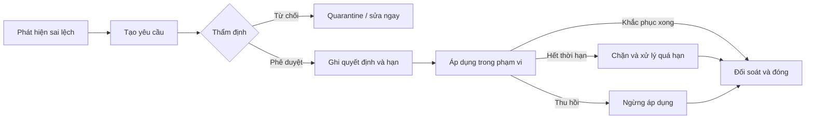

# Tài liệu hóa ngoại lệ có thời hạn thay vì ngầm bỏ qua ràng buộc

Trong một dự án mô hình hóa dữ liệu, câu “trường hợp này cứ cho qua tạm” thường là dấu hiệu của một **quy tắc chưa được biểu diễn đầy đủ**. Nếu đội phát triển âm thầm bỏ kiểm tra `NOT NULL`, vô hiệu hóa `FOREIGN KEY`, tắt unique index hoặc thêm ngoại lệ vào code mà không có dấu vết, dữ liệu có thể trở nên khó giải thích: không ai biết trường hợp nào được phép, ai đã phê duyệt, còn hiệu lực hay không và khi nào phải sửa.

Một cách tiếp cận có thể kiểm chứng là **tài liệu hóa ngoại lệ có thời hạn** (*time-bound exception*): một quyết định chấp nhận sai lệch đã được định nghĩa, trong phạm vi đối tượng và thời gian cụ thể, kèm điều kiện kiểm soát, người chịu trách nhiệm, bằng chứng và kế hoạch khôi phục tính hợp lệ. Ngoại lệ này không mặc nhiên có quyền vượt qua mọi bất biến của hệ thống.

Bài học thuộc học phần **DATABASE_DATA_MODELING**: chuyển nhu cầu nghiệp vụ thành thực thể, quan hệ, ràng buộc và lược đồ vật lý rõ ràng; đồng thời cân nhắc cách giữ cùng một quy tắc khi dùng cơ sở dữ liệu quan hệ, document, đồ thị hoặc kho phân tích.

## 1. Tình huống: nhà cung cấp gửi sản phẩm thiếu mã GTIN

Một nền tảng quản lý danh mục nhập dữ liệu từ nhiều nhà cung cấp. Quy tắc nghiệp vụ được chốt như sau:

> **Bất biến P-01:** Sản phẩm được công bố trong danh mục chính thức phải có mã GTIN hợp lệ; không có hai sản phẩm cùng tenant sử dụng cùng mã GTIN theo chính sách định danh đã thống nhất.

Trong một đợt đồng bộ, nhà cung cấp gửi 500 sản phẩm, trong đó 12 sản phẩm thiếu GTIN. Nhà cung cấp cam kết bổ sung trong 48 giờ. Đội vận hành muốn giữ lại 12 bản ghi để đối soát, đồng thời không làm gián đoạn quá trình nhận dữ liệu.

Có ba lựa chọn rất khác nhau:

| Cách xử lý | Hành vi | Hệ quả |
|---|---|---|
| Âm thầm bỏ kiểm tra | Cho phép ghi sản phẩm thiếu GTIN vào danh mục đã công bố | Bất biến P-01 không còn được bảo vệ; khó xác định sai lệch |
| Từ chối toàn bộ dữ liệu | Loại bỏ cả đợt nhập vì một số bản ghi thiếu dữ liệu | Giữ tính hợp lệ nhưng có thể làm tăng chi phí vận hành |
| **Ngoại lệ có thời hạn trong vùng chờ** | Lưu 12 bản ghi vào staging; ghi quyết định cho phép giữ chờ tối đa 48 giờ; không công bố cho tới khi hợp lệ | Giữ được dữ liệu phục vụ sửa lỗi, vẫn bảo vệ danh mục chính thức |

Giả sử chính sách thông thường buộc bản ghi chờ thiếu GTIN được xử lý hoặc loại khỏi hàng đợi trong **2 giờ**. Trường hợp 48 giờ là ngoại lệ của **thời hạn giữ bản ghi chờ**, chứ không phải ngoại lệ của điều kiện **được công bố**. Việc phát biểu chính xác quy tắc được nới lỏng là quyết định mô hình hóa quan trọng nhất.

Nếu nghiệp vụ thực sự yêu cầu **công bố sản phẩm chưa có GTIN**, nhóm thiết kế phải định nghĩa lại trạng thái, quyền truy cập và hậu quả của “công bố có điều kiện”, sau đó đánh giá xem P-01 có cần đổi thành một bất biến khác hay không. Không thể chỉ ghi “đã phê duyệt ngoại lệ” rồi kỳ vọng `NOT NULL` tự cho phép dữ liệu trái ràng buộc.

## 2. Phân biệt bất biến, chính sách và ngoại lệ

Trước khi tạo bảng ngoại lệ, hãy phân loại yêu cầu đang được đề nghị nới lỏng.

| Loại quy tắc | Ví dụ | Hướng xử lý |
|---|---|---|
| **Bất biến cấu trúc cứng** | Khóa chính không trùng; khóa ngoại của đơn hàng phải trỏ đúng tenant | Giữ nguyên cơ chế cưỡng chế; dùng staging/cách sửa dữ liệu nếu đầu vào chưa đạt |
| **Điều kiện hợp lệ theo trạng thái** | Hàng ở trạng thái `PUBLISHED` phải có GTIN | Mô hình hóa các trạng thái `PENDING`, `VALIDATED`, `PUBLISHED`; ràng buộc điều kiện chuyển trạng thái |
| **Chính sách vận hành có ngưỡng** | Bản ghi nhập thiếu GTIN phải được xử lý trong 2 giờ | Có thể cho phép một hạn xử lý riêng, có phê duyệt và giám sát |
| **Quy tắc chất lượng dữ liệu** | Tỷ lệ thiếu mã nhà cung cấp của một lô phải dưới 1% | Ghi nhận sai lệch và điều kiện chấp nhận theo lô; không coi đây là FK/UNIQUE |
| **Quy tắc thay đổi theo phiên bản** | Từ ngày áp dụng quy định mới, một trường bổ sung là bắt buộc | Ghi `rule_version` và thời điểm hiệu lực; phân biệt chuyển đổi lược đồ với ngoại lệ cá biệt |

Một thay đổi chính sách lâu dài không nên bị ngụy trang thành ngoại lệ liên tục được gia hạn. Ngược lại, một trường hợp đơn lẻ có hạn xử lý cụ thể không nhất thiết đòi hỏi bỏ ràng buộc dữ liệu cho toàn bộ hệ thống.

**Câu hỏi nền tảng:** “Ta cho phép *điều gì*, với *đối tượng nào*, trong *khoảng thời gian nào*, và điều gì tuyệt đối vẫn không được xảy ra?”

## 3. Một hồ sơ ngoại lệ cần ghi những gì?

Một ghi chú mơ hồ như “theo yêu cầu business, tạm bỏ qua” không đủ để người khác tái hiện quyết định. Hồ sơ nên chứa ít nhất các trường sau.

| Nhóm | Thuộc tính tối thiểu | Ý nghĩa |
|---|---|---|
| Quy tắc | `rule_code`, `rule_version`, mô tả bất biến gốc | Biết rõ quy tắc nào bị ảnh hưởng tại thời điểm phê duyệt |
| Phạm vi | `tenant_id`, loại thực thể, khóa bản ghi/lô, thuộc tính ảnh hưởng | Giới hạn chính xác tập dữ liệu được áp dụng |
| Sai lệch cho phép | Giá trị hoặc tình huống chấp nhận tạm; hành động vẫn bị cấm | Ngăn ngoại lệ lan sang quy tắc khác |
| Lý do và bằng chứng | Mô tả nguyên nhân, yêu cầu/ticket, tham chiếu tài liệu | Có thể truy cứu quyết định và kiểm chứng dữ liệu nguồn |
| Quyền quyết định | Người yêu cầu, người phê duyệt, thời điểm phê duyệt | Xác định trách nhiệm; có thể áp dụng phân tách nhiệm vụ |
| Thời gian | `valid_from`, `valid_until`, múi giờ và quy ước biên | Không để ngoại lệ trở thành vô thời hạn |
| Kiểm soát bù | Cách cách ly, cảnh báo, giới hạn API, bước kiểm tra bổ sung | Giảm rủi ro trong lúc ngoại lệ còn hiệu lực |
| Khắc phục | Người sở hữu, hạn xử lý, điều kiện đóng, phương án khi hết hạn | Biết thế nào là hoàn tất |
| Dấu vết vòng đời | Được cấp, sử dụng, sửa, gia hạn, thu hồi, đóng; người thực hiện và thời điểm | Phục vụ kiểm toán và phân tích nguyên nhân |

Mã quy tắc nên **ổn định qua phiên bản** (ví dụ `GTIN_REQUIRED_TO_PUBLISH`). Nếu cách hiểu quy tắc thay đổi, tăng `rule_version` hoặc liên kết tới bản chính sách cụ thể; không sửa âm thầm nội dung bản cũ. Với nhiều loại ngoại lệ, có thể xây dựng `rule_catalog` để quản lý mã, phiên bản, phân loại độ nghiêm trọng và cơ chế phê duyệt.

### Ví dụ hồ sơ đã được phê duyệt

Ví dụ sau là dữ liệu minh họa, không phải metadata hệ thống tạo bài:

```yaml
exception_id: EX-2048
rule_code: STAGING_MISSING_GTIN_SLA
rule_version: 2
scope:
  tenant_id: 42
  import_batch_id: 778
  import_item_ids: [901, 902, 903]
allowed_deviation: "Giữ ba bản ghi thiếu GTIN trong staging tối đa 48 giờ"
explicitly_forbidden: "Công bố các bản ghi vào catalog_products khi thiếu GTIN"
reason: "Nhà cung cấp chưa trả kết quả tra cứu GTIN"
evidence_ref: "DQ-148"
requested_by: "import-operator"
approved_by: "catalog-data-owner"
approved_at: "2026-11-22T04:00:00Z"
valid_from: "2026-11-22T04:00:00Z"
valid_until: "2026-11-24T04:00:00Z"
remediation_owner: "supplier-integration-team"
mitigation: "Cách ly staging, không đồng bộ ra API danh mục"
on_expiry: "Chặn luồng tiếp tục xử lý, cảnh báo và đưa vào hàng cần xử lý"
closure_criteria: "GTIN hợp lệ và đối soát xong; hoặc loại bỏ bản ghi"
```

Một bản ghi ngoại lệ cho **một lô** có thể bao phủ nhiều đối tượng nếu phạm vi được khai báo và kiểm soát chính xác. Nhưng nếu từng bản ghi có thời điểm xử lý, người phụ trách hoặc kết quả khác nhau, nên có bảng chi tiết `exception_subjects` để theo dõi từng đối tượng thay vì nhét danh sách khóa tùy ý vào một chuỗi văn bản.

## 4. “Có thời hạn” là một bất biến thời gian, không chỉ là một cột ngày

Thời gian hiệu lực thường được mô hình hóa bằng khoảng **nửa mở**:

\[
[\,valid\_from,\ valid\_until\,)
\]

Nghĩa là có hiệu lực từ `valid_from` (kể cả đúng thời điểm bắt đầu) và hết hiệu lực ngay khi đồng hồ chạm `valid_until`.

Tại thời điểm \(t\), một ngoại lệ chỉ được xem là có hiệu lực khi đồng thời thỏa:

\[
\begin{aligned}
effective(E,t) ={}&
  approved(E)\\
 &{}\land valid\_from(E) \le t < valid\_until(E)\\
 &{}\land \neg revoked(E,t)\\
 &{}\land \neg resolved(E,t).
\end{aligned}
\]

Điều này tách **quyết định đã phê duyệt** khỏi **quyền được sử dụng tại thời điểm hiện tại**. Một quyết định từng được duyệt hôm qua không đương nhiên còn hợp lệ hôm nay.

Các bất biến thời gian quan trọng gồm:

- `valid_until > valid_from`; không có ngoại lệ thời hạn bằng 0 hoặc âm.
- Thời hạn không vượt ngưỡng chính sách, chẳng hạn 48 giờ, trừ khi cơ chế phê duyệt riêng cho phép.
- Không cấp hiệu lực hồi tố nếu chính sách không cho phép; thời điểm bắt đầu phải phù hợp thời điểm duyệt.
- Thu hồi/đóng sớm phải làm ngoại lệ mất hiệu lực trước `valid_until`.
- Gia hạn là **một quyết định mới có lý do, người duyệt và dấu vết riêng**; không âm thầm sửa `valid_until` trong bản ghi cũ.
- Thời gian nên lưu ở dạng có múi giờ, ví dụ PostgreSQL `TIMESTAMPTZ`, và biểu diễn rõ UTC/offset khi trao đổi giữa các hệ thống.

**Không dùng `CHECK (valid_until > now())` để mong cơ sở dữ liệu tự hết hạn bản ghi.** Trong PostgreSQL, điều kiện `CHECK` không được hệ quản trị đánh giá liên tục khi đồng hồ chạy; ngoài ra PostgreSQL giả định biểu thức kiểm tra ổn định theo cùng một dòng qua thời gian. Hết hạn là một **điều kiện phải được đánh giá khi sử dụng** và cần có cơ chế vận hành phát hiện những trường hợp còn mở sau hạn.

## 5. Vòng đời quyết định và trách nhiệm xử lý

Một quy trình quản trị phù hợp có thể biểu diễn như sau:



Có thể lưu trạng thái nghiệp vụ như `REQUESTED`, `APPROVED`, `REJECTED`, `RESOLVED`, `REVOKED`. Nhưng trạng thái `APPROVED` đơn thuần **không** đồng nghĩa “đang hiệu lực”; quyết định phải kết hợp trạng thái với mốc thời gian và dấu đóng/thu hồi.

Cần phân biệt ba mốc:

1. **Phê duyệt**: người có thẩm quyền chấp nhận sai lệch trong phạm vi cho phép.
2. **Kích hoạt sử dụng**: ứng dụng thực thi hành động được nêu trong ngoại lệ, sau khi kiểm tra thời điểm và đối tượng.
3. **Khắc phục/đóng**: dữ liệu đã đạt chuẩn hoặc đã được cách ly/loại bỏ theo điều kiện kết thúc, có bằng chứng xác nhận.

Một ngoại lệ có thể hết hạn trước khi được khắc phục. Khi đó **quyền sử dụng kết thúc**, còn **công việc sửa dữ liệu vẫn tồn tại**. Không được tự động chuyển dữ liệu sai thành dữ liệu đúng chỉ vì thời hạn đã qua.

## 6. Thiết kế quan hệ: tách dữ liệu chờ khỏi dữ liệu đã công bố

Cách tiếp cận an toàn cho ví dụ GTIN là giữ tính toàn vẹn của danh mục chính thức và cho phép dữ liệu chưa hoàn chỉnh tồn tại trong một vùng có chủ đích.

Giả sử tenant đã được định danh ở hệ thống bao quanh; lược đồ tối giản sau tập trung vào ba đối tượng: **đầu vào**, **quyết định ngoại lệ** và **sản phẩm công bố**.

```sql
-- PostgreSQL 15+; các bảng minh họa chưa bao gồm phân quyền
-- và bảng tenant/nhà cung cấp ở hệ thống thực tế.
CREATE TABLE staging_supplier_items (
    tenant_id BIGINT NOT NULL,
    import_item_id BIGINT GENERATED ALWAYS AS IDENTITY,
    supplier_sku TEXT NOT NULL,
    gtin TEXT,
    imported_at TIMESTAMPTZ NOT NULL DEFAULT CURRENT_TIMESTAMP,
    review_state TEXT NOT NULL DEFAULT 'PENDING',

    CONSTRAINT pk_staging_supplier_items
        PRIMARY KEY (tenant_id, import_item_id),
    CONSTRAINT ck_supplier_sku_not_blank
        CHECK (btrim(supplier_sku) <> ''),
    CONSTRAINT ck_staging_review_state
        CHECK (review_state IN ('PENDING', 'READY', 'REJECTED')),
    CONSTRAINT ck_ready_requires_gtin
        CHECK (review_state <> 'READY'
               OR (gtin IS NOT NULL AND btrim(gtin) <> ''))
);

CREATE TABLE data_quality_exception_approvals (
    exception_id BIGINT GENERATED ALWAYS AS IDENTITY PRIMARY KEY,
    tenant_id BIGINT NOT NULL,
    import_item_id BIGINT NOT NULL,
    rule_code TEXT NOT NULL DEFAULT 'STAGING_MISSING_GTIN_SLA',
    rule_version INTEGER NOT NULL,
    allowed_action TEXT NOT NULL DEFAULT 'RETAIN_IN_STAGING',
    reason TEXT NOT NULL,
    evidence_ref TEXT NOT NULL,
    mitigation TEXT NOT NULL,
    requested_by TEXT NOT NULL,
    approved_by TEXT NOT NULL,
    remediation_owner TEXT NOT NULL,
    approved_at TIMESTAMPTZ NOT NULL,
    valid_from TIMESTAMPTZ NOT NULL,
    valid_until TIMESTAMPTZ NOT NULL,
    resolved_at TIMESTAMPTZ,
    revoked_at TIMESTAMPTZ,

    CONSTRAINT fk_exception_item
        FOREIGN KEY (tenant_id, import_item_id)
        REFERENCES staging_supplier_items (tenant_id, import_item_id)
        ON DELETE RESTRICT,
    CONSTRAINT ck_exception_rule
        CHECK (rule_code = 'STAGING_MISSING_GTIN_SLA'),
    CONSTRAINT ck_rule_version
        CHECK (rule_version > 0),
    CONSTRAINT ck_exception_action
        CHECK (allowed_action = 'RETAIN_IN_STAGING'),
    CONSTRAINT ck_exception_justification
        CHECK (btrim(reason) <> '' AND btrim(evidence_ref) <> ''
               AND btrim(mitigation) <> ''),
    CONSTRAINT ck_exception_participants
        CHECK (btrim(requested_by) <> '' AND btrim(approved_by) <> ''
               AND btrim(remediation_owner) <> ''
               AND requested_by <> approved_by),
    CONSTRAINT ck_exception_time
        CHECK (valid_from >= approved_at
               AND valid_until > valid_from
               AND valid_until <= valid_from + INTERVAL '48 hours')
);

-- Chặn hai quyết định cùng mở cho cùng một đối tượng và quy tắc.
-- Quyết định đã quá hạn vẫn "mở" cho đến khi có xử lý rõ ràng.
CREATE UNIQUE INDEX uq_open_exception_per_item_rule
    ON data_quality_exception_approvals
       (tenant_id, import_item_id, rule_code)
    WHERE resolved_at IS NULL AND revoked_at IS NULL;

CREATE TABLE catalog_products (
    tenant_id BIGINT NOT NULL,
    product_id BIGINT GENERATED ALWAYS AS IDENTITY,
    import_item_id BIGINT NOT NULL,
    gtin TEXT NOT NULL,

    CONSTRAINT pk_catalog_products
        PRIMARY KEY (tenant_id, product_id),
    CONSTRAINT uq_catalog_gtin_per_tenant
        UNIQUE (tenant_id, gtin),
    CONSTRAINT uq_catalog_origin_per_tenant
        UNIQUE (tenant_id, import_item_id),
    CONSTRAINT fk_catalog_source
        FOREIGN KEY (tenant_id, import_item_id)
        REFERENCES staging_supplier_items (tenant_id, import_item_id)
        ON DELETE RESTRICT,
    CONSTRAINT ck_published_gtin_nonempty
        CHECK (btrim(gtin) <> '')
);
```

### Những gì lược đồ trên bảo đảm

- Bản ghi staging có thể thiếu GTIN mà không làm sai ý nghĩa của bảng `catalog_products`.
- Bảng công bố luôn đòi GTIN khác `NULL`, không rỗng và duy nhất **trong một tenant** theo quy tắc so sánh đã chọn.
- Một bản ghi công bố phải có nguồn nhập đúng tenant nhờ khóa ngoại ghép.
- Quyết định ngoại lệ trỏ được tới đối tượng cụ thể, có người yêu cầu, người duyệt, người khắc phục, bằng chứng và hạn tối đa 48 giờ.
- Unique index từng phần ngăn có hai quyết định đồng thời còn mở đối với một đối tượng/quy tắc. Thiết kế cố ý buộc xử lý quyết định cũ trước khi cấp mới.

### Những gì lược đồ **chưa** tự bảo đảm

Các `CHECK` không thể tra cứu trạng thái của một dòng khác để khẳng định rằng bản ghi staging thiếu GTIN chỉ được giữ sau 2 giờ nếu có phê duyệt còn hiệu lực. Chúng cũng không tự phát hiện thời điểm 48 giờ đã trôi qua. Và khóa ngoại từ `catalog_products` sang staging chỉ bảo đảm **dòng nguồn tồn tại**, không bảo đảm `gtin` được sao chép đúng từ nguồn hoặc mã đã vượt qua kiểm tra số kiểm (*check digit*) theo tiêu chuẩn GTIN.

Nếu các điều kiện ấy phải được cưỡng chế ở cơ sở dữ liệu, cần thiết kế thêm **giao diện ghi có kiểm soát**, transaction, trigger hoặc cơ chế ràng buộc bổ trợ phù hợp. Chẳng hạn, chỉ cấp quyền chuyển trạng thái/đẩy sang danh mục cho một stored procedure có kiểm tra đầy đủ; ứng dụng thông thường không được ghi trực tiếp. Hãy kiểm tra lại khả năng ghi ngoài luồng (batch, script, service khác) trước khi tuyên bố bất biến đã được thực thi.

Ví dụ thao tác chuyển dữ liệu sang danh mục **chỉ minh họa điều kiện GTIN không rỗng**:

```sql
INSERT INTO catalog_products (tenant_id, import_item_id, gtin)
SELECT s.tenant_id, s.import_item_id, s.gtin
FROM staging_supplier_items AS s
WHERE s.tenant_id = 42
  AND s.import_item_id = 901
  AND s.review_state = 'READY'
  AND s.gtin IS NOT NULL
  AND btrim(s.gtin) <> '';
```

Cần bổ sung bước xác thực GTIN theo nghiệp vụ, phân quyền, trạng thái phê duyệt và điều kiện cạnh tranh trước khi dùng trong production. `NOT NULL` và `UNIQUE` của bảng đích vẫn là lớp bảo vệ cuối cùng trong trường hợp luồng ứng dụng có lỗi.

### Tại sao không thêm cột `ignore_validation BOOLEAN`?

Một cột boolean chung không lưu được ai đã phê duyệt, ngoại lệ thuộc quy tắc nào, áp dụng tới đâu, khi nào hết hạn và làm sao đóng. Nó còn dễ bị sử dụng để bỏ qua **mọi** kiểm tra của cùng bản ghi. Thay vì vậy, hãy mô hình hóa một quyết định ngoại lệ có khóa, phạm vi, quyền và thời gian, rồi chỉ cho phép đúng hành động đã được phê duyệt.

## 7. Dùng ngoại lệ theo thời gian: truy vấn và cơ chế chặn

Đối với bảng phê duyệt vừa thiết kế, truy vấn sau liệt kê các ngoại lệ **đang có hiệu lực** tại thời điểm truy vấn:

```sql
SELECT
    e.exception_id, e.tenant_id, e.import_item_id,
    e.rule_code, e.valid_until, e.remediation_owner
FROM data_quality_exception_approvals AS e
WHERE e.valid_from <= CURRENT_TIMESTAMP
  AND CURRENT_TIMESTAMP < e.valid_until
  AND e.resolved_at IS NULL
  AND e.revoked_at IS NULL;
```

Nếu dùng quyền “giữ staging quá SLA” cho một lệnh ghi, truy vấn này phải trở thành **điều kiện gác cổng** tại nơi thực hiện hành động, cùng kiểm tra đối tượng và `allowed_action`. Trong môi trường đồng thời, quyết định xem và thao tác ghi phải được đồng bộ bằng transaction/locking hoặc cơ chế nhất quán tương đương. Kiểm tra trước ở một request rồi ghi ở request khác có thể làm thay đổi trạng thái giữa hai bước.

Một báo cáo quá hạn độc lập sẽ tìm các quyết định chưa đóng và đã qua `valid_until`:

```sql
SELECT
    e.exception_id, e.tenant_id, e.import_item_id,
    e.valid_until, e.remediation_owner,
    CURRENT_TIMESTAMP - e.valid_until AS overdue_by
FROM data_quality_exception_approvals AS e
WHERE e.valid_until <= CURRENT_TIMESTAMP
  AND e.resolved_at IS NULL
  AND e.revoked_at IS NULL
ORDER BY e.valid_until;
```

Báo cáo này phải được gắn với công việc thực tế: ngừng cho phép hành động ngoại lệ, chặn xử lý kế tiếp nếu cần, cách ly đối tượng, cảnh báo người chịu trách nhiệm và đối soát dữ liệu đã phát sinh. Job nhắc việc có thể chạy định kỳ; **điều kiện gác cổng phải tự kiểm tra hết hạn ngay lúc dùng** để hệ thống không phụ thuộc hoàn toàn vào lịch chạy job.

Nếu một quyết định được duyệt với hạn 48 giờ, không có nghĩa dữ liệu bên trong sẽ tự mất đi sau 48 giờ. Hệ thống phải định nghĩa rõ việc giữ dữ liệu để truy vết, đóng hồ sơ và cách phục hồi đúng ràng buộc. Xóa ngay khi hết hạn có thể làm mất chứng cứ cần cho đối soát.

## 8. Không tạo lỗ hổng qua sửa dữ liệu hoặc gia hạn

Tính toàn vẹn của hồ sơ ngoại lệ cần được bảo vệ như chính dữ liệu nghiệp vụ.

**Một là, tách yêu cầu khỏi quyết định.** Người phát hiện sai lệch có thể tạo đề nghị; chỉ vai trò có thẩm quyền mới được duyệt. Với quy tắc quan trọng, có thể yêu cầu người phê duyệt khác người yêu cầu. `CHECK (requested_by <> approved_by)` chỉ kiểm tra hai chuỗi khác nhau; nó không chứng minh danh tính hoặc phân quyền thật. Cần cơ chế định danh và quyền truy cập tương ứng.

**Hai là, tránh sửa lịch sử phê duyệt.** Thay vì cập nhật trực tiếp `reason`, `approved_by` hoặc `valid_until` trên quyết định cũ, nên ghi sự kiện mới và liên kết tới quyết định trước đó. Có thể áp dụng bảng `exception_events`:

```sql
CREATE TABLE exception_events (
    event_id BIGINT GENERATED ALWAYS AS IDENTITY PRIMARY KEY,
    exception_id BIGINT NOT NULL
        REFERENCES data_quality_exception_approvals (exception_id),
    event_type TEXT NOT NULL
        CHECK (event_type IN (
            'APPROVED', 'USED', 'REVIEWED',
            'REVOKED', 'REMEDIATED', 'CLOSED'
        )),
    actor_id TEXT NOT NULL,
    event_at TIMESTAMPTZ NOT NULL DEFAULT CURRENT_TIMESTAMP,
    evidence_ref TEXT,
    details TEXT NOT NULL,
    CONSTRAINT ck_event_actor CHECK (btrim(actor_id) <> '')
);
```

DDL trên **chưa làm bảng sự kiện bất biến**; muốn sổ sự kiện chỉ được thêm, cần hạn chế quyền `UPDATE`/`DELETE` hoặc dùng cơ chế lưu vết khác. Dù có lưu event, vẫn phải thiết kế giao dịch sao cho cập nhật trạng thái quyết định và thêm event không bị lệch nhau.

**Ba là, không tự động gia hạn.** Nếu sau 48 giờ vẫn thiếu GTIN, hệ thống cần báo trường hợp quá hạn. Muốn thêm 24 giờ, người có trách nhiệm phải đánh giá lại rủi ro và đưa ra quyết định mới. Nếu unique index chặn quyết định mới do bản cũ chưa đóng, hãy xử lý đúng vòng đời bản cũ, tránh sửa ngày hết hạn để lách kiểm soát.

**Bốn là, quy định rõ khi thu hồi hoặc quá hạn.** Ngoại lệ mất hiệu lực ngay nhưng dữ liệu sai vẫn còn. Phải có trạng thái chặn, kế hoạch cách ly, người xử lý và bằng chứng hoàn tất. Với dữ liệu chứa thông tin nhạy cảm, tuyệt đối không hiểu “ngoại lệ dữ liệu” là cho phép bỏ qua kiểm soát quyền truy cập hay bảo mật.

## 9. Ranh giới giữa ngoại lệ và thay đổi lược đồ

Không phải mọi yêu cầu nới ràng buộc đều có thể giải quyết bằng cách thêm bảng ngoại lệ. Xem xét ba trường hợp:

### Trường hợp A: Cho phép thiếu dữ liệu tạm thời trước khi công bố

**Giải pháp phù hợp:** mô hình hóa staging, trạng thái chất lượng, quyết định ngoại lệ và cổng công bố bắt buộc. Ràng buộc của bản ghi công bố vẫn giữ nguyên.

### Trường hợp B: Hai sản phẩm tạm có cùng mã định danh

Nếu mã định danh là khóa nghiệp vụ duy nhất của bảng chính, không nên tắt unique index để nhập hai bản ghi rồi “sẽ xử lý sau”. Hai bản ghi xung đột có thể nằm trong staging hoặc bảng reconciliation; chỉ khi hợp nhất/đổi mã xong mới đưa về bảng có unique constraint. Nếu nghiệp vụ khẳng định cả hai phải cùng tồn tại lâu dài, cần xem lại định nghĩa khóa: mã định danh có thể chỉ duy nhất theo tenant, nguồn, khoảng hiệu lực hoặc phiên bản chứ không phải toàn cục.

### Trường hợp C: Quy định mới cho phép một trường hợp đặc biệt lâu dài

Nếu yêu cầu là một **quy tắc chính thức** áp dụng cho nhiều thực thể, hãy sửa mô hình khái niệm, logic, DDL và hợp đồng API tương ứng, rồi lên kế hoạch migration. Không nên tích lũy hàng nghìn ngoại lệ “tạm” để thực hiện một quy tắc lâu dài nhưng chưa được ghi nhận.

Một mô hình tốt phải phân biệt **đối tượng ở trạng thái chưa hoàn chỉnh hợp lệ**, **sai lệch đã phê duyệt trong thời gian giới hạn** và **dữ liệu không hợp lệ cần loại bỏ**. Gộp cả ba thành `is_valid = false` thường khiến báo cáo và xử lý trở nên thiếu chính xác.

## 10. Bảo đảm tính đúng trong transaction và khi có cạnh tranh

Giả sử một request kiểm tra ngoại lệ còn hạn, một request khác thu hồi quyết định ngay sau đó. Nếu thao tác ghi dựa trên thông tin cũ, có thể phát sinh hành động mà tại thời điểm ghi quyền đã mất hiệu lực.

Các lựa chọn cần xét theo mức rủi ro:

- Thực hiện kiểm tra quyết định và ghi dữ liệu trong **cùng transaction**, khóa các dòng có thể bị cập nhật đồng thời khi cần; định nghĩa rõ thời điểm nào quyết định tính hợp lệ.
- Dùng cổng ghi tập trung (stored procedure/service) và giới hạn quyền ghi trực tiếp để tất cả luồng đều thực thi cùng quy tắc.
- Giữ những ràng buộc cứng như `PRIMARY KEY`, `UNIQUE`, `FOREIGN KEY`, `NOT NULL` trên dữ liệu chính thức; chúng giúp tránh phụ thuộc vào một lần đọc quyết định ngoại lệ.
- Ghi sự kiện `USED` kèm tham chiếu dữ liệu và thời điểm để biết ngoại lệ đã thực sự được sử dụng hay chỉ được phê duyệt.
- Kiểm thử thao tác tại đúng biên `valid_from` và `valid_until`, cùng hai giao dịch cấp/thu hồi/sử dụng diễn ra sát nhau.

**Lưu ý về thời gian trong PostgreSQL:** `CURRENT_TIMESTAMP` tương ứng thời điểm bắt đầu transaction. Với transaction kéo dài qua giờ hết hạn, thời gian này có thể không phản ánh đồng hồ thực ở thời điểm câu lệnh cuối đang chạy. Nếu quy tắc đòi tính theo thời gian thực tại điểm kiểm tra, cần chủ động chọn nguồn thời gian thích hợp (chẳng hạn `clock_timestamp()`), xác định điểm tuyến tính hóa và chiến lược đồng bộ; không trộn tùy tiện đồng hồ ứng dụng với đồng hồ database.

Nếu yêu cầu là “không có thao tác nào sau đúng thời điểm hết hạn”, job chạy mỗi phút không đủ làm hàng rào. Phải kiểm tra hiệu lực trong chính đường ghi và chấp nhận thiết kế rõ ràng về cạnh tranh quanh mốc hết hạn.

## 11. Kiểm chứng quyết định: danh sách tình huống cần thử

Bản ghi ngoại lệ chỉ có giá trị nếu có thể kiểm chứng bằng dữ liệu và hành vi.

| Tình huống | Kết quả mong đợi |
|---|---|
| Thiếu GTIN và không có ngoại lệ | Có thể lưu ở staging theo chính sách nhận dữ liệu; không được công bố; quá SLA thường phải được xử lý |
| Thiếu GTIN, ngoại lệ có hạn và đúng tenant/đối tượng | Được thực hiện **chỉ** hành động đã duyệt, ví dụ giữ chờ trong staging |
| Ngoại lệ cho tenant 42 nhưng thao tác trên tenant 43 | Không được áp dụng |
| Ngoại lệ cho quy tắc GTIN nhưng thao tác muốn bỏ kiểm tra FK | Không được áp dụng |
| Ngoại lệ chưa tới `valid_from` | Chưa có hiệu lực |
| Thời điểm hiện tại bằng `valid_until` | Đã hết hiệu lực theo khoảng nửa mở |
| Ngoại lệ bị thu hồi trước hạn | Ngừng hiệu lực ngay theo quyết định thu hồi |
| Đã qua hạn nhưng chưa sửa bản ghi | Bị liệt kê quá hạn, chặn hành động ngoại lệ và chuyển xử lý |
| Đã sửa GTIN, đối soát đạt và có bằng chứng | Có thể đóng ngoại lệ; sau đó mới chuyển trạng thái/công bố theo chính sách |
| Hai quyết định còn mở cho cùng đối tượng/quy tắc | Bị unique index từ chối theo thiết kế minh họa |
| Hai transaction cùng cập nhật quyền và dùng ngoại lệ | Không xuất hiện hành vi trái quy tắc nhất quán đã định nghĩa |

Bên cạnh kiểm thử dữ liệu đơn, cần thử **đường đi ngoài luồng**: import batch, script khắc phục, dịch vụ thứ ba, job chạy lại và thao tác quản trị. Một ngoại lệ được bảo vệ ở API nhưng có thể bị bypass qua một kênh ghi khác thì chưa thực sự được quản trị.

Có thể đánh giá định kỳ bằng các chỉ số: số ngoại lệ đang mở, số ngoại lệ quá hạn, tuổi trung vị và lớn nhất, tỷ lệ đóng trước hạn, tỷ lệ gia hạn, nhóm nguyên nhân lặp lại, và số lượng bản ghi từng được xử lý khi ngoại lệ còn hiệu lực. Chỉ số nhằm xác định vấn đề nguồn dữ liệu và cải tiến mô hình, không thay thế trách nhiệm xử lý từng trường hợp.

## 12. Tài liệu hóa khi dùng document, graph và hệ thống phân tích

Khái niệm ngoại lệ có phạm vi, phê duyệt và hạn xử lý có thể áp dụng ngoài cơ sở dữ liệu quan hệ, nhưng **không nên giả định mọi nền tảng cưỡng chế giống nhau**.

| Mô hình lưu trữ | Cách ghi nhận | Điều cần chú ý |
|---|---|---|
| Quan hệ | Bảng quyết định ngoại lệ, FK tới thực thể nguồn, unique index hạn chế quyết định trùng, event log | `CHECK` và FK không tự thay thế điều kiện về thời gian thực và các quy tắc xuyên bảng |
| Document | Document ngoại lệ có `rule_code`, phạm vi, hạn, trạng thái, lịch sử sự kiện; schema validation của document chính | Ràng buộc tham chiếu giữa document và giao dịch đa document phụ thuộc engine/cấu hình |
| Graph | Node `Exception` liên kết tới `Rule`, `Entity`, `Approver` và các sự kiện xử lý | Đường quan hệ rõ để truy vết nhưng cần kiểm tra khả năng cưỡng chế điều kiện thời gian và tính duy nhất |
| Phân tích/data warehouse | Sự kiện yêu cầu–phê duyệt–sử dụng–đóng, snapshot hiệu lực theo thời điểm | Phải dùng đúng thời điểm sự kiện khi phân tích lịch sử; cờ “đang hiệu lực” hiện tại có thể làm sai báo cáo quá khứ |

Ví dụ, để báo cáo tỷ lệ bản ghi nhập thiếu GTIN **được phép chờ** vào ngày 22/11, hệ phân tích cần kết hợp dữ liệu tại thời điểm đó với khoảng hiệu lực và lịch sử thu hồi, chứ không thể chỉ nhìn cột trạng thái hiện tại. Đây là lý do nên giữ dấu vết quyết định và event thay vì ghi đè.

Trong mọi mô hình, một exception record chỉ là **bằng chứng quyết định**. Hành vi cưỡng chế còn cần gắn với đường xử lý dữ liệu thực tế.

## 13. Mẫu quyết định ngoại lệ có thể tái sử dụng

Trước khi đưa trường hợp ngoại lệ vào triển khai, đội phân tích, kỹ thuật và người sở hữu dữ liệu nên cùng trả lời các mục sau:

| Câu hỏi | Nội dung cần xác nhận |
|---|---|
| Quy tắc gốc là gì? | Mã/phiên bản, phát biểu bất biến, mục đích, ranh giới không được nới |
| Vì sao cần ngoại lệ? | Nguyên nhân, ảnh hưởng nếu từ chối, lựa chọn đã cân nhắc |
| Cho phép làm gì? | Tác vụ cụ thể, tập đối tượng, tenant, hệ thống và dữ liệu được sử dụng |
| Cấm làm gì? | Các thao tác tiếp tục bị chặn, như công bố, thanh toán, liên kết sai tenant |
| Có hiệu lực bao lâu? | UTC/offset, mốc bắt đầu và kết thúc, giới hạn theo chính sách |
| Ai chịu trách nhiệm? | Người yêu cầu, phê duyệt, khắc phục và người xác nhận đóng |
| Kiểm soát rủi ro bằng cách nào? | Cách ly, cấp quyền, cảnh báo, chặn giao dịch, kiểm tra định kỳ |
| Điều kiện kết thúc là gì? | Bất biến đã được khôi phục hoặc dữ liệu được loại bỏ/cách ly có kiểm soát |
| Nếu quá hạn thì sao? | Chặn hành động, báo động, xử lý tồn đọng và quyết định mới nếu cần |
| Lấy bằng chứng ở đâu? | Ticket, batch import, truy vấn kiểm chứng, event và lịch sử quyết định |

Một quyết định tốt phải cho phép một thành viên khác đọc hồ sơ và trả lời được: **“Dòng dữ liệu này vì sao được giữ, lúc này có còn được phép xử lý không, và ai phải chịu trách nhiệm làm nó hợp lệ?”**

## 14. Bài tập thực hành và câu hỏi tự kiểm tra

**Bài tập.** Hệ thống thuê thiết bị quy định mỗi thiết bị đang được giao chỉ có một hợp đồng có hiệu lực; một lô dữ liệu cũ được nhập thiếu `contract_id`. Đội vận hành xin “tạm bỏ ràng buộc trong ba ngày”.

Hãy thiết kế:

1. Phát biểu bất biến chính xác: cần phân biệt khóa định danh, hợp đồng đang hiệu lực và trạng thái staging.
2. Phạm vi dữ liệu nhập cũ được giữ chờ; xác định xem có được đưa vào bảng hợp đồng chính thức hay không.
3. Một mẫu hồ sơ ngoại lệ gồm `rule_code`, đối tượng, người duyệt, khoảng thời gian, kiểm soát bù và điều kiện đóng.
4. Một mô hình bảng tối thiểu với ràng buộc cứng còn hiệu lực và cơ chế phát hiện quá hạn.
5. Bộ kiểm thử cho trường hợp đúng tenant, sai tenant, trước hạn, hết hạn và hai giao dịch đồng thời.

**Gợi ý đánh giá:** nếu phương án cho phép xóa FK, unique index hoặc tắt toàn bộ xác thực mà không nêu rõ phạm vi/điều kiện khôi phục, phương án đó chưa bảo vệ được bất biến. Nếu phương án giữ dữ liệu chưa đạt chuẩn trong staging và chỉ cho phép chuyển khi đạt yêu cầu, bất biến của dữ liệu chính thức dễ kiểm chứng hơn.

### Những điều cần nhớ

- Ngoại lệ phải diễn đạt **sai lệch được cho phép**, không chỉ nói “bỏ qua kiểm tra”.
- Ghi rõ **quy tắc, đối tượng, phạm vi, quyền, người phê duyệt, thời hạn, biện pháp giảm rủi ro và kế hoạch đóng**.
- Giữ các ràng buộc cứng của dữ liệu chính thức. Khi đầu vào chưa hợp lệ, ưu tiên mô hình hóa staging, trạng thái và luồng phục hồi.
- Hết hạn là một điều kiện **theo thời điểm sử dụng**; một cột deadline và một job cảnh báo chưa đủ để bảo đảm việc chặn.
- Quyết định mới, thu hồi, sử dụng và khắc phục cần có dấu vết riêng. Ngoại lệ có thời hạn phải thúc đẩy sửa dữ liệu, không trở thành con đường tránh thiết kế ràng buộc lâu dài.
