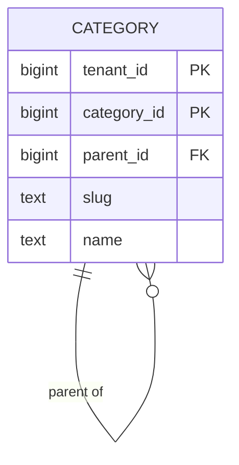

# Mô hình cây bằng danh sách kề (adjacency list)

Một hệ thống thương mại điện tử có danh mục sản phẩm “Tất cả → Điện tử → Điện thoại”; một doanh nghiệp có cơ cấu “Công ty → Khối công nghệ → Nhóm nền tảng”; một ứng dụng quản trị có cây thư mục. Những cấu trúc đó đều có thể biểu diễn bằng **cây phân cấp** (*hierarchical tree*): mỗi nút, ngoại trừ nút gốc, có đúng một nút cha và có thể có nhiều nút con.

**Danh sách kề** (*adjacency list*) là một mô hình phổ biến để lưu cây trong cơ sở dữ liệu quan hệ. Mỗi nút là một dòng; cột `parent_id` của dòng đó tham chiếu đến khóa định danh của **nút cha trong chính bảng**. Cách lưu đơn giản, dễ thêm nút và dễ bảo vệ quan hệ cha–con bằng khóa ngoại, nhưng truy vấn toàn bộ tổ tiên/hậu duệ cần đệ quy và việc chuyển nhánh phải chống chu trình.

Bài học thuộc chương **Kế thừa và phân cấp** của module **DATABASE_DATA_MODELING**. Mục tiêu là chuyển yêu cầu phân cấp nghiệp vụ thành thực thể, quan hệ, khóa, ràng buộc, chỉ mục và truy vấn vật lý có thể kiểm chứng; từ đó biết khi nào adjacency list phù hợp hơn các cách lưu cây khác hoặc mô hình document/graph. Lưu ý: **cây phân cấp** mô tả quan hệ cha–con giữa *các bản ghi*; nó không đồng nghĩa với **kế thừa kiểu** (*supertype/subtype*) giữa các *loại thực thể*.

## 1. Nhận diện đúng một cây trong yêu cầu nghiệp vụ

Xét danh mục sản phẩm của một tenant:

```text
Tất cả
├── Điện tử
│   ├── Điện thoại
│   └── Máy tính
└── Thời trang
    └── Giày
```

Ta xác định:

- **Nút** (*node*): một danh mục, chẳng hạn “Điện tử”.
- **Nút gốc** (*root*): “Tất cả”; không có nút cha.
- **Nút cha/nút con** (*parent/child*): “Điện tử” là cha trực tiếp của “Điện thoại”.
- **Anh chị em** (*siblings*): “Điện thoại” và “Máy tính” có cùng cha.
- **Nút lá** (*leaf*): nút không có nút con, ví dụ “Giày”.
- **Tổ tiên/hậu duệ** (*ancestors/descendants*): “Tất cả” là tổ tiên của “Điện thoại”; “Điện thoại” là hậu duệ của “Tất cả”.
- **Độ sâu** (*depth*): số cạnh từ gốc đến nút; trong ví dụ, gốc có độ sâu 0 và “Điện thoại” có độ sâu 2.
- **Cây con** (*subtree*): một nút cùng toàn bộ hậu duệ của nó; cây con “Điện tử” có ba nút.

Một cấu trúc chỉ thực sự là **cây** khi mỗi nút có nhiều nhất một cha, không tồn tại chu trình và mỗi nút đều có đường đi hữu hạn dẫn tới đúng một gốc. Nếu có nhiều nút gốc, ta có một **rừng** (*forest*) gồm nhiều cây. Nếu một nút được phép có **nhiều cha**, như một kỹ năng thuộc đồng thời nhiều nhóm chuyên môn, quan hệ không còn là cây thông thường; có thể cần bảng liên kết cho đồ thị có hướng không chu trình (DAG) hoặc mô hình graph.

### Chuyển yêu cầu thành các bất biến

| Phát biểu nghiệp vụ | Bất biến cần thiết kế |
|---|---|
| Mỗi danh mục có mã định danh | Mỗi nút có khóa chính ổn định |
| Một danh mục thuộc tối đa một danh mục cha | Một thuộc tính `parent_id` đơn trị |
| Danh mục gốc không có cha | `parent_id IS NULL` |
| Không có danh mục mồ côi | `parent_id` khác `NULL` phải tham chiếu đến nút tồn tại |
| Không được kéo một nhóm vào chính nó hay hậu duệ của nó | Cây phải **không có chu trình** |
| Danh mục của tenant A không thuộc cha của tenant B | Quan hệ cha–con phải giữ cùng `tenant_id` |
| Trong cùng một cha, không có hai nhánh cùng `slug` | Tính duy nhất theo cha và tenant |
| Nếu yêu cầu một gốc duy nhất cho mỗi tenant | Có tối đa một nút có `parent_id IS NULL` trong tenant; việc tồn tại ít nhất một gốc cần bảo đảm riêng |

Đừng bắt đầu bằng câu lệnh SQL rồi mới đoán quy tắc. Phân biệt rõ “tối đa một” và “chính xác một”, cũng như “một gốc cho mỗi cây” và “một gốc cho toàn bộ tenant”.

## 2. Từ quan hệ 1–N tới danh sách kề

Một bảng duy nhất có thể chứa cả nút cha lẫn nút con:

| `category_id` | `name` | `parent_id` |
|---:|---|---:|
| 10 | Tất cả | `NULL` |
| 20 | Điện tử | 10 |
| 30 | Điện thoại | 20 |
| 40 | Máy tính | 20 |
| 50 | Thời trang | 10 |
| 60 | Giày | 50 |

`parent_id` là **khóa ngoại tự tham chiếu** (*self-referencing foreign key*). Với ví dụ trên, dòng `category_id = 30` mang `parent_id = 20`, diễn đạt “Điện thoại trực thuộc Điện tử”.

Trong sơ đồ thực thể:



Ký hiệu trên thể hiện ý tưởng một cha có thể có nhiều con. `parent_id` **được phép rỗng cho nút gốc**, còn với các nút khác thì phải trỏ tới một dòng trong cùng bảng. Nếu mỗi danh mục cần thêm mô tả, trạng thái, thứ tự hiển thị hay người sở hữu, chúng vẫn là thuộc tính của nút; không cần tạo một bảng riêng cho từng cấp “ngành”, “nhóm”, “loại”.

### Vì sao không tạo các cột `level_1`, `level_2`, `level_3`?

Mẫu cột cố định buộc cấu trúc có số cấp tối đa đã biết, khó biểu diễn nút ở cấp khác nhau và gây khó khăn khi đổi cha. Adjacency list biểu diễn độ sâu biến thiên mà không cần thay đổi lược đồ khi thêm tầng thứ tư hay thứ năm.

Mặt khác, một phép đọc “lấy toàn bộ đường đi từ nút lá lên gốc” không thể hoàn thành bằng đúng một phép nối cha cố định cho mọi cây. Cần truy vấn đệ quy hoặc một cơ chế hỗ trợ đường đi.

## 3. Thiết kế lược đồ quan hệ PostgreSQL

Ví dụ dưới đây dùng **PostgreSQL 15+**, với mỗi danh mục thuộc một `tenant_id`. Ta giả định tenant đã được quản lý bởi hệ thống khác; khi có bảng `tenants`, cần bổ sung khóa ngoại từ `tenant_id` sang bảng ấy.

```sql
CREATE TABLE catalog_categories (
    tenant_id BIGINT NOT NULL,
    category_id BIGINT GENERATED ALWAYS AS IDENTITY,
    parent_id BIGINT,
    slug TEXT NOT NULL,
    name TEXT NOT NULL,
    is_active BOOLEAN NOT NULL DEFAULT TRUE,

    CONSTRAINT pk_catalog_categories
        PRIMARY KEY (tenant_id, category_id),

    CONSTRAINT fk_catalog_categories_parent
        FOREIGN KEY (tenant_id, parent_id)
        REFERENCES catalog_categories (tenant_id, category_id)
        ON DELETE RESTRICT,

    CONSTRAINT ck_category_not_own_parent
        CHECK (parent_id IS NULL OR parent_id <> category_id),

    CONSTRAINT ck_category_slug
        CHECK (slug = btrim(slug)
               AND char_length(slug) BETWEEN 1 AND 80),

    CONSTRAINT ck_category_name
        CHECK (btrim(name) <> ''),

    CONSTRAINT uq_category_slug_per_parent
        UNIQUE NULLS NOT DISTINCT (tenant_id, parent_id, slug)
);
```

Các quyết định thiết kế đáng chú ý:

1. **`PRIMARY KEY (tenant_id, category_id)`:** khóa ghép thể hiện danh mục thuộc tenant nào. `category_id` được sinh tự động để không phải dùng tên hiển thị làm định danh; tên có thể đổi.
2. **`FOREIGN KEY (tenant_id, parent_id)`:** không cho một nút nhận cha ở tenant khác. Khi `parent_id` là `NULL`, bản ghi là gốc và không cần dòng cha.
3. **`ON DELETE RESTRICT`:** không xóa được một nút khi còn con đang tham chiếu. Chính sách xóa phải do nghiệp vụ quyết định; `CASCADE` có thể làm mất cả nhánh nếu áp dụng không thận trọng.
4. **`CHECK(parent_id <> category_id)`:** ngăn một nút làm cha trực tiếp của chính nó. Điều kiện đã thêm nhánh `parent_id IS NULL` để diễn đạt gốc rõ ràng; **chưa ngăn chu trình qua nhiều nút**.
5. **`UNIQUE NULLS NOT DISTINCT (tenant_id, parent_id, slug)`:** trong mỗi nhóm anh chị em, `slug` là duy nhất. Ở PostgreSQL 15+, `NULLS NOT DISTINCT` khiến hai giá trị `NULL` ở vị trí cha được coi tương đương khi kiểm tra unique, nên không thể có hai nút gốc với cùng `slug` trong một tenant.

Nếu cần **tối đa một gốc cho mỗi tenant**, có thể bổ sung:

```sql
CREATE UNIQUE INDEX uq_one_root_per_tenant
    ON catalog_categories (tenant_id)
    WHERE parent_id IS NULL;
```

Chỉ mục này không buộc tenant phải có ít nhất một nút gốc. Yêu cầu “mỗi tenant luôn có một gốc” còn liên quan tới khởi tạo tenant, xóa gốc và giao dịch quản trị. Nếu nghiệp vụ muốn **nhiều cây độc lập** trong một tenant, không thêm chỉ mục này.

### Chỉ mục đọc cây

Ràng buộc unique trên `(tenant_id, parent_id, slug)` đã tạo chỉ mục có tiền tố `(tenant_id, parent_id)`, hữu ích khi tìm con trực tiếp của một nút. Khóa chính `(tenant_id, category_id)` phục vụ tra cứu nút cha theo khóa. Không cần tạo lại hai chỉ mục tương tự một cách máy móc; hãy đọc kế hoạch thực thi và đo dữ liệu thực.

Nếu thường lấy nút con theo thứ tự hiển thị, có thể thêm `display_order` và cân nhắc chỉ mục như `(tenant_id, parent_id, display_order)`. Thứ tự hiển thị là yêu cầu nghiệp vụ riêng, không nên suy ra từ thứ tự các identity.

## 4. Khởi tạo một cây mẫu

Sau khi đã chọn tenant thử nghiệm, ví dụ `tenant_id = 42`, ta tạo gốc và các nhánh. `category_id` do hệ quản trị sinh ra; những lệnh sau tìm cha bằng điều kiện nghiệp vụ đã biết để tránh phụ thuộc vào ID ngẫu nhiên.

```sql
-- 1. Gốc:
INSERT INTO catalog_categories (tenant_id, parent_id, slug, name)
VALUES (42, NULL, 'all', 'Tất cả');

-- 2. Hai con trực tiếp của gốc:
INSERT INTO catalog_categories (tenant_id, parent_id, slug, name)
SELECT 42, root.category_id, v.slug, v.name
FROM catalog_categories AS root
CROSS JOIN (
    VALUES ('electronics', 'Điện tử'), ('fashion', 'Thời trang')
) AS v(slug, name)
WHERE root.tenant_id = 42
  AND root.parent_id IS NULL
  AND root.slug = 'all';

-- 3. Hai con của Điện tử:
INSERT INTO catalog_categories (tenant_id, parent_id, slug, name)
SELECT 42, electronics.category_id, v.slug, v.name
FROM catalog_categories AS electronics
JOIN catalog_categories AS root
  ON root.tenant_id = electronics.tenant_id
 AND root.category_id = electronics.parent_id
CROSS JOIN (
    VALUES ('phones', 'Điện thoại'), ('computers', 'Máy tính')
) AS v(slug, name)
WHERE electronics.tenant_id = 42
  AND electronics.slug = 'electronics'
  AND root.parent_id IS NULL
  AND root.slug = 'all';

-- 4. Con của Thời trang:
INSERT INTO catalog_categories (tenant_id, parent_id, slug, name)
SELECT 42, fashion.category_id, 'shoes', 'Giày'
FROM catalog_categories AS fashion
JOIN catalog_categories AS root
  ON root.tenant_id = fashion.tenant_id
 AND root.category_id = fashion.parent_id
WHERE fashion.tenant_id = 42
  AND fashion.slug = 'fashion'
  AND root.parent_id IS NULL
  AND root.slug = 'all';
```

Trong hệ thống thực, việc xác định cha thường dựa vào `category_id` ổn định do client truyền lên sau khi chọn danh mục, không cần đi tìm theo chuỗi `slug` mỗi lần ghi. Mẫu trên chỉ giúp người học tạo được dữ liệu mà không phải đoán ID của identity.

## 5. Truy vấn nút cha, nút con và nút lá

Các thao tác ở **một cấp** khá đơn giản:

```sql
-- Tìm các gốc của tenant:
SELECT category_id, slug, name
FROM catalog_categories
WHERE tenant_id = 42 AND parent_id IS NULL
ORDER BY name;

-- Tìm con trực tiếp của nút gốc 'all':
SELECT child.category_id, child.slug, child.name
FROM catalog_categories AS child
JOIN catalog_categories AS parent
  ON parent.tenant_id = child.tenant_id
 AND parent.category_id = child.parent_id
WHERE parent.tenant_id = 42
  AND parent.parent_id IS NULL
  AND parent.slug = 'all'
ORDER BY child.name;

-- Liệt kê các nút lá:
SELECT c.category_id, c.slug, c.name
FROM catalog_categories AS c
WHERE c.tenant_id = 42
  AND NOT EXISTS (
      SELECT 1
      FROM catalog_categories AS child
      WHERE child.tenant_id = c.tenant_id
        AND child.parent_id = c.category_id
  )
ORDER BY c.name;
```

`NOT EXISTS` nhận diện nút lá theo **sự vắng mặt của dòng con**, khác với dựa vào cờ `is_leaf` lưu sẵn. Nếu vừa lưu `is_leaf` vừa cho phép thêm/xóa con, phải có cơ chế giữ hai biểu diễn đồng bộ.

Truy vấn nút cha của một nút bất kỳ chỉ cần một phép join với chính bảng:

```sql
SELECT child.name AS child_name,
       parent.name AS parent_name
FROM catalog_categories AS child
LEFT JOIN catalog_categories AS parent
  ON parent.tenant_id = child.tenant_id
 AND parent.category_id = child.parent_id
WHERE child.tenant_id = 42
  AND child.slug = 'phones';
```

Ở dữ liệu minh họa, tên cha của “Điện thoại” là “Điện tử”. `LEFT JOIN` giữ được dòng gốc dù nó không có cha.

## 6. Truy vấn toàn bộ hậu duệ bằng recursive CTE

Trong PostgreSQL, `WITH RECURSIVE` cho phép bắt đầu tại một nút và lặp lại quan hệ cha–con cho đến khi không tìm thấy dòng mới.

Một truy vấn có hai thành phần:

- **Anchor:** chọn nút bắt đầu, độ sâu bằng 0.
- **Recursive member:** tìm những nút có `parent_id` bằng `category_id` của nút vừa tìm được; tăng độ sâu lên 1.

Ví dụ tìm **toàn bộ cây con “Điện tử”**, tính luôn nút “Điện tử”:

```sql
WITH RECURSIVE subtree AS (
    -- Anchor:
    SELECT c.tenant_id, c.category_id, c.parent_id,
           c.slug, c.name,
           0 AS depth,
           ARRAY[c.category_id]::BIGINT[] AS id_path
    FROM catalog_categories AS c
    JOIN catalog_categories AS root
      ON root.tenant_id = c.tenant_id
     AND root.category_id = c.parent_id
    WHERE c.tenant_id = 42
      AND c.slug = 'electronics'
      AND root.parent_id IS NULL
      AND root.slug = 'all'

    UNION ALL

    -- Recursive member:
    SELECT child.tenant_id, child.category_id, child.parent_id,
           child.slug, child.name,
           tree.depth + 1,
           tree.id_path || child.category_id
    FROM catalog_categories AS child
    JOIN subtree AS tree
      ON child.tenant_id = tree.tenant_id
     AND child.parent_id = tree.category_id
    WHERE NOT (child.category_id = ANY(tree.id_path))
)
SELECT category_id, parent_id, name, depth, id_path
FROM subtree
ORDER BY id_path;
```

Kết quả dự kiến gồm “Điện tử” (`depth = 0`), “Điện thoại” và “Máy tính” (`depth = 1`). Cột `id_path` là mảng ID từ nút bắt đầu tới nút hiện tại, vừa phục vụ quan sát đường đi vừa ngăn truy vấn lặp vô hạn nếu dữ liệu có chu trình: không thăm một ID đã có trên đường hiện tại.

**Chi tiết quan trọng:**

- `UNION ALL` giữ nguyên các dòng mà truy vấn đệ quy sinh ra. Với cây hợp lệ, một nút chỉ có một cha nên có duy nhất một đường đi từ nút bắt đầu tới nó.
- Điều kiện nối luôn bao gồm `tenant_id` để không đọc nhầm dữ liệu của tenant khác.
- `ORDER BY id_path` giúp hiển thị theo một đường duyệt xác định dựa trên ID, không phải thứ tự tên hay thứ tự nghiệp vụ. Không nên dựa vào thứ tự ngẫu nhiên mà engine phát sinh ở bước đệ quy.
- Query có phòng vệ chu trình **không sửa được chu trình trong dữ liệu gốc**. Nếu thấy dữ liệu đáng ngờ, cần xử lý bất biến khi ghi và chạy kiểm tra riêng.
- Trên cây lớn, CTE vẫn phải đi qua nhiều dòng. Hạn chế phạm vi, thêm phân trang theo yêu cầu và chú ý rằng `LIMIT` ở kết quả cuối không phải lúc nào cũng giải quyết được chi phí duyệt.

### Tính số hậu duệ và độ sâu lớn nhất

Có thể thay phần `SELECT` cuối của CTE bằng phép tổng hợp:

```sql
SELECT COUNT(*) - 1 AS descendant_count,
       MAX(depth) AS max_relative_depth
FROM subtree;
```

Đây là **mảnh kết thúc** của truy vấn `WITH RECURSIVE ... subtree AS (...)` ngay phía trên, không phải câu lệnh chạy độc lập. Trừ một nút vì truy vấn chứa cả nút bắt đầu. `MAX(depth)` tính độ sâu tương đối trong cây con.

## 7. Truy vấn tổ tiên và dựng breadcrumb

Để dựng breadcrumb “Tất cả / Điện tử / Điện thoại”, ta đi **ngược từ con lên cha**:

```sql
WITH RECURSIVE ancestors AS (
    SELECT c.tenant_id, c.category_id, c.parent_id,
           c.name, 0 AS hops_to_target,
           ARRAY[c.category_id]::BIGINT[] AS visited
    FROM catalog_categories AS c
    WHERE c.tenant_id = 42
      AND c.slug = 'phones'

    UNION ALL

    SELECT parent.tenant_id, parent.category_id, parent.parent_id,
           parent.name, child.hops_to_target + 1,
           child.visited || parent.category_id
    FROM catalog_categories AS parent
    JOIN ancestors AS child
      ON parent.tenant_id = child.tenant_id
     AND parent.category_id = child.parent_id
    WHERE NOT (parent.category_id = ANY(child.visited))
)
SELECT category_id, name, hops_to_target
FROM ancestors
ORDER BY hops_to_target DESC;
```

Ở dữ liệu mẫu, kết quả đi từ gốc đến nút lá. Với hệ thống cho phép `slug` lặp trong các nhánh, điều kiện `slug = 'phones'` **chưa nhất thiết xác định duy nhất một dòng**; trong API thực tế nên truyền `category_id` đã được định danh, cùng `tenant_id`.

Để hiển thị breadcrumb, ứng dụng có thể lấy kết quả đã sắp xếp và ghép nhãn với dấu phân cách. Không nên lưu chuỗi breadcrumb làm dữ liệu nguồn duy nhất, vì việc đổi tên hay chuyển cha sẽ làm chuỗi cũ sai lệch nếu không cập nhật đồng bộ.

## 8. Thao tác thêm nút, đổi tên, chuyển nhánh và xóa

### Thêm nút và đổi tên

Thêm nút là một lệnh `INSERT` với `parent_id` hợp lệ. Nếu một cha không tồn tại, khóa ngoại từ chối; nếu hai nút cùng cha trùng `slug`, ràng buộc unique từ chối. Đổi `name` của một danh mục thường chỉ sửa **một dòng**:

```sql
UPDATE catalog_categories
SET name = 'Điện thoại thông minh'
WHERE tenant_id = 42 AND category_id = 105;
```

`105` chỉ là ID giả định dùng để minh họa. Trong ứng dụng, dùng ID thực đã xác định từ truy vấn hoặc kết quả insert.

### Chuyển cây con (reparenting)

Giả sử người quản trị muốn chuyển nhánh `X` sang một cha mới `Y`. Cơ chế adjacency list có ưu điểm: về mặt lưu trữ, chỉ cần đổi `parent_id` của `X`, các hậu duệ vẫn tham chiếu gián tiếp đúng nhánh. Tuy nhiên, **phải kiểm tra `Y` không phải `X` hoặc hậu duệ của `X`**, nếu không sẽ tạo chu trình.

Ví dụ:

```text
A
└── B
    └── C
```

Lệnh đặt `A.parent_id = C` sẽ tạo vòng `A → C → B → A`. Khóa ngoại không cản được vì cả ba ID đều tồn tại; `CHECK (parent_id <> category_id)` cũng không cản vì không có nút nào trực tiếp trỏ chính nó.

Một mẫu thao tác có kiểm soát dùng transaction PostgreSQL:

```sql
BEGIN;

-- Quy ước: mọi thao tác chuyển cha trong tenant 42
-- đều lấy cùng advisory lock trước khi kiểm tra và sửa.
SELECT pg_advisory_xact_lock(42::BIGINT);

-- Ví dụ: chuyển nút 105 sang cha mới 120.
WITH RECURSIVE subtree AS (
    SELECT category_id, parent_id,
           ARRAY[category_id]::BIGINT[] AS visited
    FROM catalog_categories
    WHERE tenant_id = 42 AND category_id = 105

    UNION ALL

    SELECT child.category_id, child.parent_id,
           tree.visited || child.category_id
    FROM catalog_categories AS child
    JOIN subtree AS tree
      ON child.parent_id = tree.category_id
    WHERE child.tenant_id = 42
      AND NOT (child.category_id = ANY(tree.visited))
)
UPDATE catalog_categories AS moved
SET parent_id = 120
WHERE moved.tenant_id = 42
  AND moved.category_id = 105
  AND EXISTS (
      SELECT 1 FROM catalog_categories AS new_parent
      WHERE new_parent.tenant_id = 42
        AND new_parent.category_id = 120
  )
  AND NOT EXISTS (
      SELECT 1 FROM subtree
      WHERE subtree.category_id = 120
  )
RETURNING moved.category_id, moved.parent_id;

COMMIT;
```

Ở đây, `120` không được thuộc cây con gốc `105`; nếu không, lệnh `UPDATE` không sửa dòng nào. Ứng dụng phải **kiểm tra số dòng trả về**: cập nhật 0 dòng có thể do thiếu nút, thiếu cha, hoặc đích nằm trong cây con; cần phân biệt và xử lý như một yêu cầu thất bại. Ràng buộc unique cũng có thể chặn chuyển nhánh nếu `slug` mới xung đột với anh chị em ở cha đích.

Khóa `pg_advisory_xact_lock` chỉ giúp tuần tự hóa khi **mọi đường ghi có thể chuyển cha đều tuân theo cùng một quy ước khóa**. Ví dụ phù hợp với transaction `READ COMMITTED` và lấy khóa ở câu lệnh riêng trước câu lệnh đọc cây. Đây là chiến lược minh họa, chưa phải một API sản xuất hoàn chỉnh. Những hệ thống có nhiều đường ghi có thể cần stored procedure tập trung, phân quyền, khóa dòng phù hợp hoặc transaction `SERIALIZABLE` cùng cơ chế retry. Nếu một service bỏ qua khóa, nó vẫn có thể tạo chu trình.

**Rủi ro cạnh tranh:** hai giao dịch cùng đọc cây trước khi cập nhật có thể thấy mỗi phép chuyển là hợp lệ, nhưng kết quả kết hợp tạo vòng. Vì vậy, không thể chỉ “kiểm tra trong ứng dụng rồi update sau” nếu thiếu chiến lược đồng bộ.

### Xóa nhánh

Có hai chính sách thường gặp:

1. **Không cho xóa cha còn con:** giữ `ON DELETE RESTRICT`; người dùng phải chuyển/xử lý con trước. Cách này giảm nguy cơ vô tình xóa nhiều dữ liệu.
2. **Cho xóa toàn bộ cây con:** cân nhắc `ON DELETE CASCADE` nếu nghiệp vụ chấp nhận xóa mọi nút phụ thuộc. Việc xóa danh mục có thể còn liên quan sản phẩm, lịch sử đơn hàng hoặc phân quyền, nên phải xem các khóa ngoại khác trước khi dùng.

Khi giữ `RESTRICT` và cần xóa nhiều cấp, phải tổ chức xóa các nút lá trước rồi mới tới cha trong transaction, với cơ chế chống thao tác đồng thời. Chỉ viết một `DELETE` trên toàn bộ tập ID cây con rồi mong `RESTRICT` tự giải quyết thứ tự xóa không phải một thiết kế đủ tin cậy. Với hệ thống cần giữ dấu vết lịch sử, **ẩn/archived** có thể phù hợp hơn xóa vật lý. Nếu một nút bị ẩn nhưng con còn hoạt động, phải xác định rõ con có được hiển thị hay không.

## 9. Bảo vệ bất biến không chu trình

Adjacency list cùng self-FK bảo vệ “cha tồn tại” nhưng không tự bảo vệ “tất cả đường cha đều đi tới gốc và không có vòng”.

Bốn mức kiểm soát có thể kết hợp:

| Mức kiểm soát | Bảo vệ điều gì? | Giới hạn |
|---|---|---|
| `CHECK (parent_id <> category_id)` | Không tự trỏ trực tiếp | Không chặn vòng dài 2+ nút |
| FK tự tham chiếu cùng tenant | Cha tồn tại, không trỏ khác tenant | Không phát hiện chu trình |
| Kiểm tra tổ tiên/hậu duệ trước khi chuyển cha | Từ chối cha mới nằm trong cây con | Có thể race nếu không đồng bộ giao dịch |
| Cổng ghi/trigger/transaction với khóa hoặc cô lập phù hợp | Cưỡng chế kiểm tra ngay tại đường ghi | Cần thiết kế kỹ cạnh tranh, phân quyền, cập nhật hàng loạt và rollback |

Nếu bảng chỉ cho phép chỉnh sửa qua một stored procedure đáng tin cậy, cổng ghi có thể tính tổ tiên của cha mới, kiểm tra node chuyển và cập nhật trong transaction. Tuy nhiên, trigger chạy từng dòng cũng cần xử lý **các cập nhật đồng thời**; chỉ có một trigger kiểm tra hậu duệ mà không có chiến lược cô lập/khóa thì chưa đủ để bảo đảm không có vòng trong mọi trường hợp.

Có thể viết truy vấn kiểm tra chất lượng dữ liệu định kỳ để phát hiện nhánh đáng ngờ hoặc chu trình. Một lựa chọn với PostgreSQL 14+ là mệnh đề `CYCLE` trong recursive CTE; lựa chọn khác là lưu mảng ID đã thăm và phát hiện khi ID kế tiếp xuất hiện trong mảng. Đây là **kiểm toán sau ghi**; nó không thay thế phòng ngừa.

Các bất biến bổ sung thường gặp:

- **Một gốc duy nhất:** dùng partial unique index nếu có **tối đa một** gốc/tenant; cơ chế tạo/xóa gốc phải bảo đảm **tồn tại** khi nghiệp vụ bắt buộc.
- **Giới hạn độ sâu:** ví dụ nhiều nhất 5 cấp. Cột `CHECK` đơn giản không thể tính toàn bộ đường cha; cần kiểm tra đường đi trong thao tác chuyển nhánh.
- **Chặn chuyển nút thuộc cây cố định:** ví dụ một số danh mục hệ thống là nút bất biến; cần phân quyền hoặc chính sách riêng.
- **Không cho con hoạt động dưới cha đã khóa:** điều kiện phụ thuộc trạng thái của nhiều dòng, cần kiểm tra trong giao dịch hoặc mô hình bổ sung.
- **Nhiều cha:** nếu yêu cầu thật sự cho phép nhiều cha, một `parent_id` đơn trị không thể biểu diễn đầy đủ; phải đổi mô hình dữ liệu.

## 10. Đặc điểm hiệu năng: đọc cây và cập nhật cây

Adjacency list tối ưu cho một số kiểu truy cập, nhưng không phải tất cả.

| Nghiệp vụ | Chi phí điển hình | Ghi chú |
|---|---|---|
| Tìm nút theo khóa | Một tra cứu khóa chính | Rất phù hợp |
| Tìm con trực tiếp | Một truy vấn lọc `parent_id` | Tốt khi có chỉ mục ghép phù hợp |
| Thêm một nút lá | Một `INSERT` và kiểm tra FK | Đơn giản |
| Đổi tên một nút | Một `UPDATE` | Không cần cập nhật mọi hậu duệ |
| Chuyển toàn bộ nhánh | Một thay đổi `parent_id` về mặt cấu trúc | Phải kiểm tra chu trình và đồng thời |
| Lấy tổ tiên | Đệ quy theo chiều cao cây | Chi phí tăng theo độ sâu |
| Lấy toàn bộ hậu duệ | Đệ quy qua các nút trong cây con | Chi phí tăng theo quy mô cây con |
| Tính số nút trong tất cả nhánh | Nhiều bước duyệt/tổng hợp | Có thể cần cache hoặc bảng phụ khi đọc rất thường xuyên |

Chỉ mục quan trọng không làm biến mất chi phí đệ quy. Khi một cây có hàng triệu nút hoặc người dùng thường xuyên truy vấn mọi hậu duệ, hãy đo `EXPLAIN (ANALYZE, BUFFERS)` với số liệu đại diện. Thử các trường hợp cây **sâu** (ít con, nhiều cấp) và cây **rộng** (nhiều con, ít cấp) vì chúng tạo tải khác nhau.

Không nên mặc định lưu thêm `depth`, `full_path` hay `descendant_count` chỉ để “tối ưu”. Những trường này là dữ liệu suy ra; khi chuyển nhánh, có thể phải cập nhật nhiều hậu duệ và cần cơ chế tránh sai lệch. Chỉ bổ sung khi có yêu cầu đo đạc rõ ràng cùng chiến lược cập nhật/khôi phục.

## 11. So sánh các mô hình lưu cây quan hệ

| Mô hình | Cách lưu | Điểm mạnh | Đánh đổi |
|---|---|---|---|
| **Adjacency list** | Mỗi nút có `parent_id` | Đơn giản; dễ thêm nút, đổi tên; FK bảo vệ cha tồn tại | Truy vấn cây con/tổ tiên cần đệ quy; phải chặn chu trình |
| **Materialized path** | Lưu đường đi, ví dụ `/10/20/30/` | Tìm nhánh theo tiền tố đường đi tiện lợi | Chuyển nhánh phải cập nhật đường dẫn của hậu duệ; cần bảo vệ đồng bộ |
| **Closure table** | Bảng `(ancestor_id, descendant_id, depth)` chứa mọi quan hệ tổ tiên–hậu duệ | Truy vấn tổ tiên, hậu duệ, độ sâu nhanh với join phù hợp | Số quan hệ phụ tăng; thao tác chuyển nhánh phức tạp |
| **Nested sets** | Mỗi nút có khoảng `left`/`right` | Đọc toàn bộ nhánh theo khoảng hiệu quả | Chèn/xóa/chuyển cây có thể cập nhật nhiều nút |
| **Đồ thị cạnh riêng** | Bảng cạnh `(parent_id, child_id)` | Linh hoạt với nhiều cha/quan hệ DAG | Nếu chỉ cần cây, thêm phức tạp; vẫn phải cưỡng chế không có vòng |

### Khi nào chọn adjacency list?

Nó thường là phương án khởi đầu tốt khi **mỗi nút có tối đa một cha**, số cấp vừa phải, thao tác thêm và chuyển nhánh cần đơn giản, và cơ sở dữ liệu hỗ trợ recursive CTE. Nếu hệ thống liên tục chạy phân tích tổ tiên/hậu duệ trên cây rất lớn, closure table hoặc một cấu trúc đường đi được duy trì nhất quán có thể đáng cân nhắc.

Không nên chuyển sang closure table chỉ vì “truy vấn đệ quy nghe có vẻ chậm”. Hãy đo trước: nhiều hệ thống có cây vài nghìn nút và chỉ truy vấn một số nhánh, adjacency list với chỉ mục tốt vẫn đáp ứng được.

## 12. Dùng mô hình document, graph hoặc phân tích khi nào?

Nhu cầu nghiệp vụ về cha, con, gốc và chu trình vẫn giữ nguyên dù chọn công nghệ lưu trữ khác nhau.

**Cơ sở dữ liệu document.** Có thể lưu cây con lồng trong một document khi dữ liệu thường được đọc cùng nhau, kích thước bị chặn hợp lý và việc sửa cây con không quá thường xuyên. Nhưng document khổng lồ có giới hạn kích thước, khó cập nhật cạnh tranh và có thể phải di chuyển nội dung khi chuyển nhánh. Cách khác là giữ mỗi nút thành một document có `parentId`; khi đó bài toán gần adjacency list nhưng tính toàn vẹn tham chiếu tùy engine và ứng dụng.

**Cơ sở dữ liệu graph.** Mô hình node–edge phù hợp khi cần truy vấn đường đi, nhiều loại quan hệ và nhiều cha. Tuy nhiên, có graph database không đồng nghĩa tự động có ràng buộc “không chu trình”; phải xem khả năng constraint và giao dịch của engine cụ thể.

**Kho phân tích.** Cây tổ chức/danh mục thường được dùng để cuộn số liệu theo nhánh: doanh thu của “Điện tử” bằng tổng doanh thu các danh mục lá được gắn trực tiếp hoặc gián tiếp. Cần xác định đây là **cây hiện tại** hay **cây tại thời điểm giao dịch**. Nếu tổ chức chuyển nhóm trong tháng, phân tích lịch sử theo cấu trúc mới có thể cho kết quả khác so với cấu trúc cũ. Với yêu cầu báo cáo theo thời gian, cân nhắc versioning/snapshot hoặc bảng lịch sử hiệu lực của quan hệ cha–con, thay vì ghi đè `parent_id` mà mất quá khứ.

**Phân cấp và kế thừa kiểu:** bảng `categories` với `parent_id` biểu diễn “Điện thoại là danh mục con của Điện tử”; bảng `employees` có phân loại `employee_type` hoặc quan hệ `PERSON`–`EMPLOYEE` là vấn đề supertype/subtype khác. Không dùng adjacency list chỉ vì hai thực thể có chữ “cha” và “con” trong mô tả.

## 13. Kiểm thử tính đúng của mô hình

Một mô hình hoàn chỉnh phải có phép thử cho cả đường đọc và đường ghi.

| Ca kiểm thử | Kết quả mong đợi |
|---|---|
| Thêm nút có cha hợp lệ cùng tenant | Thành công |
| Thêm gốc có `parent_id = NULL` | Thành công, trừ khi vi phạm chính sách gốc duy nhất |
| Thêm nút trỏ tới `parent_id` không tồn tại | Bị FK từ chối |
| Thêm nút tenant 42 trỏ cha của tenant 43 | Bị khóa ngoại ghép từ chối |
| Đặt `parent_id = category_id` | Bị `CHECK` từ chối |
| Tạo vòng A → B → C → A bằng nhiều thao tác | Bị cơ chế chống chu trình của đường ghi từ chối |
| Tạo hai nút có cùng `slug` dưới cùng một cha | Bị unique constraint từ chối |
| Tạo hai nút cùng `slug` dưới hai cha khác nhau | Được phép |
| Truy vấn hậu duệ của nút lá | Chỉ trả về nút bắt đầu nếu truy vấn tính cả gốc cây con |
| Truy vấn tổ tiên của nút gốc | Chỉ trả về nút gốc nếu truy vấn tính cả nút bắt đầu |
| Chuyển nhánh hợp lệ sang một cha khác | Cấu trúc mới không có chu trình; mọi hậu duệ còn trong đúng cây con |
| Hai giao dịch đồng thời cố gắng chuyển A xuống B và B xuống A | Không tạo vòng, theo cơ chế khóa/cô lập đã chọn |
| Xóa nút cha còn con dưới `ON DELETE RESTRICT` | Bị chặn |
| Hiển thị breadcrumb sau chuyển nhánh | Phản ánh đường cha mới, không dùng path cache cũ |

Đối với truy vấn có `WITH RECURSIVE`, kiểm thử cả cây chỉ có một gốc, cây sâu, cây rộng, cây con có một nút và trường hợp dữ liệu đã bị hỏng để tránh lặp vô hạn. Với giới hạn độ sâu hay dung lượng lớn, kiểm tra hiệu năng bằng dữ liệu gần thực tế.

## 14. Bài tập thực hành: cây phòng ban

Một doanh nghiệp có các phòng ban “Công ty → Công nghệ → Nền tảng” và “Công ty → Kinh doanh”. Mỗi phòng ban có mã riêng; mã phòng ban chỉ cần duy nhất trong cùng một đơn vị cha. Đội nhân sự muốn chuyển “Nền tảng” sang trực thuộc “Công ty”, đồng thời yêu cầu không được sinh vòng quan hệ.

Hãy thực hiện các bước:

1. Xác định nút, cha, gốc, lá, khóa nghiệp vụ và phạm vi duy nhất; quyết định cho phép một hay nhiều gốc.
2. Viết lược đồ `departments` dùng `parent_id` tự tham chiếu, khóa chính, `NOT NULL`, FK và unique constraint phù hợp.
3. Chèn dữ liệu mẫu cho bốn phòng ban.
4. Viết recursive CTE tìm toàn bộ hậu duệ của “Công ty” và breadcrumb của “Nền tảng”.
5. Thiết kế thao tác chuyển “Nền tảng” dưới “Công ty” và từ chối thao tác chuyển “Công ty” xuống “Nền tảng”.
6. Đề xuất cách bảo vệ thao tác chuyển nhánh đồng thời giữa hai người quản trị.
7. Giải thích trường hợp nào cần lưu phiên bản lịch sử phân cấp để báo cáo số nhân sự theo phòng ban ở một thời điểm trong quá khứ.

**Tiêu chí đạt:** DDL bảo vệ quan hệ cùng phạm vi, câu truy vấn cho ra đúng tổ tiên/hậu duệ, quy trình cập nhật ngăn được vòng nhiều nút ngay cả khi có giao dịch đồng thời, và giải thích rõ những bất biến mà FK/`CHECK` đơn lẻ chưa xử lý.

## 15. Tổng kết các quyết định thiết kế

- **Mỗi nút một dòng, `parent_id` trỏ nút cha** là hạt nhân của adjacency list.
- **Khóa ngoại tự tham chiếu** bảo đảm cha tồn tại; với ứng dụng đa tenant, dùng khóa ngoại ghép để giữ đúng phạm vi.
- **`parent_id IS NULL`** diễn đạt gốc. Nhiều gốc tạo rừng; nếu chỉ cho một gốc, phải nêu và cưỡng chế chính sách ấy.
- **Recursive CTE** giải quyết truy vấn nhiều cấp; khi cần kết quả có thứ tự, phải khai báo `ORDER BY` phù hợp.
- **Không có chu trình** là bất biến quan trọng mà FK và `CHECK` tự trỏ chưa bảo đảm. Cần chiến lược cập nhật và đồng bộ giao dịch.
- **Chọn cấu trúc theo kiểu truy vấn và cách tiến hóa cây**: adjacency list mạnh về cập nhật đơn giản; materialized path, closure table, nested sets hoặc graph có ưu thế ở yêu cầu khác.
