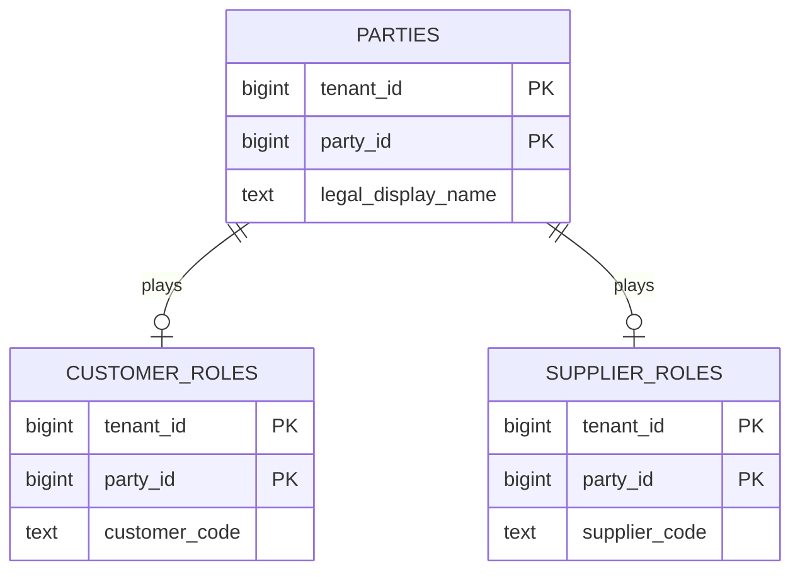
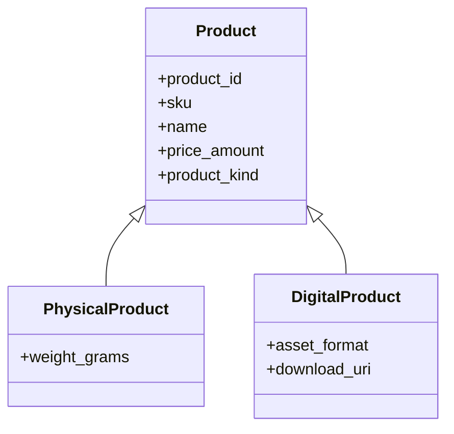

# Tránh dùng quan hệ kế thừa chỉ để tái sử dụng vài thuộc tính

Khi thiết kế cơ sở dữ liệu, rất dễ gặp lập luận: “`Customer` và `Supplier` đều có `name`, `email`, `phone`, vậy hãy tạo bảng cha `Contact` rồi cho hai bảng kế thừa”. Lập luận này nhìn thấy sự giống nhau về **cấu trúc cột**, nhưng chưa chứng minh hai loại thực thể có chung **danh tính, ý nghĩa nghiệp vụ và bất biến**.

**Quan hệ kế thừa** (*inheritance*, *supertype/subtype* hay *generalization/specialization*) là một quyết định **mô hình khái niệm**: mỗi đối tượng của một loại con cũng là một đối tượng của loại cha (*is-a*), có cùng định danh và tuân theo những quy tắc chung. Kế thừa không nên được thêm chỉ vì hai bảng trùng vài trường, hoặc vì muốn tránh viết lại vài dòng DDL.

Bài học nằm trong chương **Kế thừa và phân cấp** của **DATABASE_DATA_MODELING**, với mục tiêu chuyển yêu cầu nghiệp vụ thành thực thể, quan hệ, ràng buộc, khóa và lược đồ vật lý có thể kiểm chứng. Nội dung phân biệt kế thừa với quan hệ sở hữu, liên kết và vai trò; minh họa khi nào nên giữ hai thực thể độc lập, khi nào dùng một danh tính chung và khi nào mô hình supertype/subtype thực sự có ích. Ví dụ dùng PostgreSQL 15+; các nguyên tắc khái niệm cũng áp dụng cho document, graph và mô hình phân tích.

## 1. Vấn đề: giống tên cột không có nghĩa là cùng loại thực thể

Giả sử hệ thống mua bán có hai đối tượng:

| Thuộc tính | Khách hàng (`Customer`) | Nhà cung cấp (`Supplier`) |
|---|---|---|
| Mã nghiệp vụ | `customer_code` | `supplier_code` |
| Tên | `display_name` | `legal_name` |
| Email liên hệ | `contact_email` | `contact_email` |
| Số điện thoại | `contact_phone` | `contact_phone` |
| Trạng thái | `ACTIVE` / `BLOCKED` | `ONBOARDING` / `APPROVED` / `SUSPENDED` |
| Quy tắc riêng | Hạn mức tín dụng, nhóm giá | Phê duyệt nguồn hàng, điều khoản thanh toán |
| Vòng đời | Đăng ký, hoạt động, chấm dứt | Đánh giá, ký hợp đồng, ngừng cung cấp |

Điểm giống nhau: cả hai cần tên và thông tin liên hệ. Điểm khác nhau: **vì sao một dòng tồn tại**, khi nào dòng được tạo/xóa, ai được sửa, những ràng buộc nào chi phối dòng và đối tượng nào tham chiếu đến dòng.

Hai khả năng nghiệp vụ cần được làm rõ:

- **Khả năng A — hai thực thể độc lập:** khách hàng của cửa hàng trực tuyến là tài khoản người mua; nhà cung cấp là hợp đồng với một doanh nghiệp. Mã, vòng đời và quyền quản trị tách biệt. Không có định danh dùng chung có ý nghĩa nghiệp vụ. Trùng cột liên hệ không đủ lý do để tạo supertype.
- **Khả năng B — cùng một chủ thể pháp lý có nhiều vai trò:** một tổ chức có mã định danh duy nhất trong hệ thống có thể vừa mua hàng vừa cung cấp hàng. Khi đó thực thể `Party` mang danh tính chung; `CustomerRole` và `SupplierRole` mang các quan hệ/vai trò. Đây là lý do về **cùng một chủ thể**, không phải mẹo tái sử dụng cột.

Không thể chọn A hay B chỉ từ sơ đồ các cột. Phải hỏi người sở hữu nghiệp vụ **cùng một khách hàng và nhà cung cấp có thể là cùng một chủ thể hay không**, ai quyết định danh tính đó và nếu gộp hai hồ sơ thì các giao dịch, quyền và lịch sử sẽ thay đổi thế nào.

### Cây kế thừa khác cây phân cấp

Một cây danh mục `Điện tử → Điện thoại → Android` mô tả quan hệ **nút cha–nút con** giữa các bản ghi. `Android` là một danh mục nằm dưới `Điện thoại`, không nhất thiết là một *loại bảng* đặc biệt kế thừa các cột của bảng `Điện thoại`. Ngược lại, `PhysicalProduct` và `DigitalProduct` có thể là hai **loại sản phẩm** cùng chung định danh `Product`. Đừng trộn quan hệ phân cấp dữ liệu (`parent_id`) với quan hệ kế thừa loại (`supertype/subtype`).

## 2. Phân biệt năm quan hệ thường bị nhầm

| Quan hệ | Câu hỏi kiểm tra | Ví dụ | Biểu diễn thường gặp |
|---|---|---|---|
| **Is-a** (*là một loại của*) | Mọi đối tượng con có phải cũng là một đối tượng cha, có cùng danh tính không? | Sản phẩm vật lý là một loại sản phẩm | Supertype/subtype, discriminator, quan hệ 1–1 theo khóa |
| **Has-a** (*có/sở hữu*) | Đối tượng A có một thành phần hoặc tài sản B? | Khách hàng có địa chỉ giao hàng | FK 1–N/1–1, bảng phụ thuộc, document lồng |
| **Plays-a-role** (*đóng vai trò*) | Một chủ thể có thể giữ một hoặc nhiều vai trò thay đổi theo thời gian? | Công ty vừa là khách hàng vừa là nhà cung cấp | Thực thể danh tính + bảng vai trò/liên kết |
| **References** (*tham chiếu*) | A cần liên kết đến B mà không cùng danh tính? | Đơn hàng tham chiếu khách hàng | Khóa ngoại, quan hệ liên kết |
| **Shares-a-value-shape** (*cùng dạng giá trị*) | Hai nơi cùng dùng cấu trúc dữ liệu nhưng không có cùng vòng đời? | Địa chỉ gồm đường, thành phố, quốc gia | Value object, domain, kiểu dữ liệu, quy ước xác thực |

Một dấu hiệu cảnh báo: nếu tên của bảng cha chỉ là từ trừu tượng như `HasNameAndEmail`, `Contactable`, `BaseRecord`, `CommonFields` và **không có yêu cầu nghiệp vụ** nào nhắc đến các đối tượng loại cha, rất có thể mô hình đang lấy việc tái sử dụng cột làm mục tiêu chính.

Một loại cha hợp lệ thường có **danh tính và nghĩa nghiệp vụ độc lập**: có thể nói “sản phẩm này có ID P100”, truy vấn mọi sản phẩm, gắn giá hoặc trạng thái bán ở cấp sản phẩm và diễn đạt quy tắc áp dụng cho mọi loại sản phẩm. Nếu không ai cần loại cha tồn tại như một khái niệm nghiệp vụ, hãy đặt câu hỏi trước khi thêm nó.

## 3. Năm phép kiểm tra trước khi chọn kế thừa

### 3.1. Kiểm tra phát biểu “mỗi X đều là Y”

Thử phát biểu: “Mỗi `DigitalProduct` đều là một `Product`”. Câu này có thể đúng theo ngôn ngữ nghiệp vụ. Nhưng “Mỗi `Supplier` đều là một `Customer`” rõ ràng không đúng. “Mỗi `Supplier` đều là một `Contactable`” có thể đúng về đặc điểm kỹ thuật mà không mang ý nghĩa danh tính cần được quản lý.

Đừng chỉ dựa vào tên lớp trong mã nguồn. Câu “A extends B” trong ngôn ngữ lập trình không tự chứng minh “A is-a B” trong dữ liệu nghiệp vụ.

### 3.2. Kiểm tra danh tính ổn định

Một instance con có dùng **chính khóa của instance cha** không? Có thể tham chiếu một `Product` mà không cần biết loại vật lý/số không? Nếu chuyển loại, danh tính sản phẩm có được giữ? Nếu hai loại con thực sự là hai danh tính độc lập, liên kết giữa chúng có thể là quan hệ hoặc sở hữu, không phải kế thừa.

Ví dụ, một tổ chức cùng lúc là khách mua hàng và nhà cung cấp có thể có **một `party_id`** cùng hai vai trò. Ngược lại, một “tài khoản mua hàng” và một “hợp đồng nhà cung cấp” có thể thuộc cùng tổ chức nhưng vẫn là **hai thực thể nghiệp vụ khác nhau**, mỗi thực thể có ID riêng, liên kết tới cùng tổ chức khi cần.

### 3.3. Kiểm tra quy tắc chung và truy vấn chung

Một supertype mạnh khi nó mang những ràng buộc được **bảo vệ chung**: định danh sản phẩm duy nhất, giá bán, trạng thái công bố, quyền sở hữu tenant, thời điểm tạo và tham chiếu từ đơn hàng. Nếu bảng cha chỉ chứa `name` và `created_at`, rất có thể bạn đang tăng join và phức tạp chỉ để giảm trùng lặp cú pháp.

Hỏi thêm: có câu truy vấn hoặc quan hệ thực tế “tất cả `Product`” không, chẳng hạn `order_items.product_id` trỏ tới mọi loại sản phẩm? Nếu không có đường truy cập chung, lợi ích của supertype giảm đáng kể.

### 3.4. Kiểm tra ranh giới vòng đời

Một bản ghi loại cha và một bản ghi loại con có được tạo, cập nhật, vô hiệu hóa, chuyển loại hoặc xóa như **một đối tượng logic** hay không? Nếu hai bản ghi có người sở hữu khác nhau, quyền và quy trình phê duyệt khác nhau, việc gộp chung danh tính có thể khiến các ràng buộc trở nên khó cưỡng chế.

Mỗi biến thể con phải được đánh giá về việc nó có thể tồn tại khi cha không tồn tại hay không. Với kế thừa thực sự, đối tượng con **không có ý nghĩa** nếu thiếu đối tượng cha tương ứng.

### 3.5. Kiểm tra quy tắc phân loại

Khi đã có một supertype, phải trả lời:

- **Rời nhau hay chồng lắp?** (*disjoint* vs *overlapping*): một đối tượng có thể thuộc đồng thời hai subtype không?
- **Đầy đủ hay không đầy đủ?** (*total* vs *partial*): mọi đối tượng cha có buộc phải thuộc ít nhất một subtype không?
- **Loại có thể thay đổi theo thời gian?** Nếu có, chuyển loại là cập nhật trạng thái hay tạo một bản ghi mới? Dữ liệu chuyên biệt cũ xử lý thế nào?
- **Quan hệ chính thức có thể tham chiếu cha?** Ví dụ bảng `order_items` trỏ `products` thay vì buộc có hai loại FK riêng.

Các câu trả lời quyết định việc dùng một bảng, nhiều bảng hay thậm chí không cần inheritance.

## 4. Phương án đúng khi thực thể chỉ trùng vài thuộc tính

Nếu khách hàng và nhà cung cấp độc lập về danh tính, hệ thống có thể giữ **hai bảng rõ nghĩa**:

```sql
-- PostgreSQL 15+, ví dụ đơn giản cho hai thực thể độc lập.
CREATE TABLE customers (
    customer_id BIGINT GENERATED ALWAYS AS IDENTITY PRIMARY KEY,
    customer_code TEXT NOT NULL UNIQUE,
    display_name TEXT NOT NULL,
    contact_email TEXT,
    status TEXT NOT NULL DEFAULT 'ACTIVE',

    CONSTRAINT ck_customer_code CHECK (btrim(customer_code) <> ''),
    CONSTRAINT ck_customer_name CHECK (btrim(display_name) <> ''),
    CONSTRAINT ck_customer_status
        CHECK (status IN ('ACTIVE', 'BLOCKED'))
);

CREATE TABLE suppliers (
    supplier_id BIGINT GENERATED ALWAYS AS IDENTITY PRIMARY KEY,
    supplier_code TEXT NOT NULL UNIQUE,
    legal_name TEXT NOT NULL,
    contact_email TEXT,
    onboarding_state TEXT NOT NULL DEFAULT 'PENDING',

    CONSTRAINT ck_supplier_code CHECK (btrim(supplier_code) <> ''),
    CONSTRAINT ck_supplier_legal_name CHECK (btrim(legal_name) <> ''),
    CONSTRAINT ck_supplier_state
        CHECK (onboarding_state IN ('PENDING', 'APPROVED', 'SUSPENDED'))
);
```

Hai cột `contact_email` giống kiểu dữ liệu **không tạo ra bất biến sai**. Có thể thống nhất một định nghĩa “email liên hệ có thể rỗng”, cách chuẩn hóa và kiểm thử ở tầng ứng dụng hoặc qua một domain SQL nếu quy tắc thật sự giống hệt nhau. Không nên tạo supertype chỉ để tiết kiệm hai cột.

Ưu điểm của cách này là mỗi bảng dễ đặt đúng ràng buộc và quyền; nhà cung cấp có quy trình duyệt riêng còn khách hàng có trạng thái chặn riêng. Chi phí là có thể phải duy trì hai nhóm trường liên hệ và viết truy vấn tổng hợp bằng `UNION ALL` nếu có nhu cầu xem hai nhóm cùng lúc.

### Tái sử dụng *giá trị* hoặc quy tắc, không mặc định tái sử dụng *danh tính*

Có nhiều cách tránh lặp logic mà không tạo quan hệ kế thừa dữ liệu:

- **Giá trị dùng chung:** cùng thư viện kiểm tra số điện thoại, chuẩn hóa chuỗi, kiểu ngày/tiền, component form hoặc schema API cho `Address`. Một value object trong ứng dụng có thể tái sử dụng cấu trúc mà không đồng nhất ID của khách hàng và nhà cung cấp.
- **Bảng tra cứu:** nếu cả hai bảng tham chiếu cùng mã quốc gia, tiền tệ hoặc múi giờ, dùng bảng `countries`/`currencies` có khóa ngoại phù hợp. Đó là liên kết tới **danh mục tham chiếu**, không phải kế thừa.
- **Thực thể phụ thuộc:** nếu khách hàng có nhiều địa chỉ giao hàng, dùng `customer_addresses` với `customer_id` FK. Nhà cung cấp có địa chỉ kho, dùng bảng kho hoặc địa chỉ gắn `supplier_id` phù hợp vòng đời. Không ép hai quan hệ vào một bảng “mọi địa chỉ của mọi thứ” nếu không thể bảo vệ FK.
- **Định nghĩa dùng chung:** một SQL domain hoặc quy ước migration giúp thống nhất miền giá trị cột. Tuy nhiên, cùng kiểu SQL không chứng minh hai cột có cùng chính sách nghiệp vụ.

Chẳng hạn, nếu hai trường có đúng cùng miền “chuỗi bắt buộc không trắng”, PostgreSQL có thể dùng domain cho **một chính sách giá trị cụ thể**:

```sql
CREATE DOMAIN nonblank_label AS TEXT
    CHECK (VALUE IS NOT NULL AND btrim(VALUE) <> '');
```

Việc dùng domain ở một cột vẫn cần xem yêu cầu `NOT NULL`, hệ quản trị và khả năng thay đổi chính sách; domain không thay thế khóa, quan hệ hoặc ràng buộc theo ngữ cảnh. Nếu tên pháp lý và tên hiển thị có quy tắc độ dài, chuẩn hóa, lịch sử khác nhau, đừng buộc chúng vào cùng một domain quá chặt chỉ vì đều là “tên”.

### Cảnh báo với liên kết đa hình giả

Một cách thường thấy để “tái sử dụng” bảng liên hệ là:

```sql
-- Minh họa thiết kế cần xem xét, KHÔNG phải DDL được khuyên dùng:
-- contact_records(owner_type, owner_id, email)
-- owner_type = 'CUSTOMER' hoặc 'SUPPLIER'
```

Cặp `(owner_type, owner_id)` không phải một FK bình thường có thể trỏ có điều kiện tới hai bảng cha khác nhau. Nếu không có cơ chế riêng, hệ thống có thể lưu `owner_type = 'CUSTOMER'` nhưng `owner_id` chỉ tồn tại trong `suppliers`, hoặc không tồn tại ở đâu cả. Để có toàn vẹn tham chiếu thật, cân nhắc bảng con theo từng loại, bảng liên kết có các FK rõ ràng, hoặc một `Party` chung **khi danh tính chung có ý nghĩa**.

## 5. Trường hợp có danh tính chung: một chủ thể, nhiều vai trò

Bây giờ thay đổi **đúng một giả định nghiệp vụ**: cùng một công ty có thể vừa mua sản phẩm vừa cung cấp sản phẩm, và hệ thống muốn một mã chủ thể dùng chung cho hợp đồng, hồ sơ pháp lý, quyền kiểm soát và báo cáo.

Ta có thể thiết kế:



`Party` là chủ thể có danh tính ổn định. `CustomerRole` và `SupplierRole` là các vai trò **có thể đồng thời tồn tại**. Không phải một hierarchy rời nhau giữa “customer hoặc supplier”; một party có thể là cả hai hoặc hiện thời không giữ vai trò nào.

```sql
CREATE TABLE parties (
    tenant_id BIGINT NOT NULL,
    party_id BIGINT GENERATED ALWAYS AS IDENTITY,
    legal_display_name TEXT NOT NULL,
    contact_email TEXT,

    CONSTRAINT pk_parties PRIMARY KEY (tenant_id, party_id),
    CONSTRAINT ck_party_name CHECK (btrim(legal_display_name) <> '')
);

CREATE TABLE customer_roles (
    tenant_id BIGINT NOT NULL,
    party_id BIGINT NOT NULL,
    customer_code TEXT NOT NULL,
    credit_limit NUMERIC(14, 2) NOT NULL DEFAULT 0,

    CONSTRAINT pk_customer_roles PRIMARY KEY (tenant_id, party_id),
    CONSTRAINT uq_customer_code UNIQUE (tenant_id, customer_code),
    CONSTRAINT fk_customer_role_party
        FOREIGN KEY (tenant_id, party_id)
        REFERENCES parties (tenant_id, party_id)
        ON DELETE RESTRICT,
    CONSTRAINT ck_customer_role_code
        CHECK (btrim(customer_code) <> ''),
    CONSTRAINT ck_credit_limit CHECK (credit_limit >= 0)
);

CREATE TABLE supplier_roles (
    tenant_id BIGINT NOT NULL,
    party_id BIGINT NOT NULL,
    supplier_code TEXT NOT NULL,
    approved_at TIMESTAMPTZ,

    CONSTRAINT pk_supplier_roles PRIMARY KEY (tenant_id, party_id),
    CONSTRAINT uq_supplier_code UNIQUE (tenant_id, supplier_code),
    CONSTRAINT fk_supplier_role_party
        FOREIGN KEY (tenant_id, party_id)
        REFERENCES parties (tenant_id, party_id)
        ON DELETE RESTRICT,
    CONSTRAINT ck_supplier_role_code
        CHECK (btrim(supplier_code) <> '')
);
```

Một `(tenant_id, party_id)` có thể có dòng ở **cả hai** bảng vai trò. Tên và email của chủ thể được lưu một lần vì chúng được xác định là dữ liệu của **cùng một chủ thể**, không phải vì công cụ ORM muốn kế thừa class.

Một mô hình như vậy kéo theo trách nhiệm xác nhận **đồng nhất danh tính**: hai hồ sơ có cùng email chưa chắc là một party; hai tổ chức có cùng tên cũng chưa chắc là một pháp nhân. Nếu gộp nhầm, mọi quan hệ qua `party_id` sẽ bị ảnh hưởng. Phải định nghĩa quy trình ghép, tách, chuyển quyền và kiểm toán danh tính.

Cũng cần phân biệt **vai trò** với **subtype bản chất**. `CustomerRole` là quan hệ mà party có thể nhận hoặc bỏ; `Person` và `Organization` có thể là hai kiểu chủ thể với tập thuộc tính và bất biến khác nhau. Mô hình party có thể dùng thêm subtype thật khi đủ lý do, nhưng không bắt buộc mọi vai trò trở thành một lớp kế thừa.

### Khi nào không nên tạo `Party`?

Nếu các tổ chức mua và bán được quản lý bởi hai hệ thống và không có cơ chế tin cậy để hợp nhất danh tính, `Party` có thể trở thành chỗ ép dữ liệu khác nghĩa. Lúc ấy hai bảng riêng với liên kết “đã xác nhận cùng pháp nhân” sẽ rõ ràng hơn một supertype giả. Quyết định phải dựa vào nghiệp vụ danh tính, quyền và nguồn dữ liệu chuẩn.

## 6. Trường hợp kế thừa thật: sản phẩm vật lý và sản phẩm số

Xét yêu cầu khác, trong đó `PhysicalProduct` và `DigitalProduct` **đều là `Product`**:

- Mọi sản phẩm có ID, SKU, tên, giá và trạng thái bán; đơn hàng có thể tham chiếu sản phẩm mà không cần biết biến thể.
- Sản phẩm vật lý cần cân nặng để tính vận chuyển; sản phẩm số cần định dạng tệp và đường dẫn phân phối.
- Một sản phẩm **thuộc đúng một** trong hai loại tại một thời điểm (*disjoint*).
- Có thể cho phép tạo một sản phẩm ở trạng thái **DRAFT** trước khi nhập dữ liệu chuyên biệt; trước khi **PUBLISHED**, phải xác nhận loại sản phẩm có đủ thông tin.

Khác biệt giữa hai subtype là **nghĩa và bất biến**, không chỉ cặp cột `weight_grams` và `download_uri`. Ta có thể định nghĩa một supertype `Product` có cùng định danh và quy tắc dùng chung, cùng các subtype chứa dữ liệu chuyên biệt.



Sơ đồ trên diễn đạt **loại** đối tượng, không quy định bắt buộc cách map sang bảng. Việc đặt hai bảng con hay một bảng duy nhất là bước thiết kế vật lý.

### Mô hình class-table inheritance với khóa con = khóa cha

```sql
CREATE TABLE products (
    product_id BIGINT GENERATED ALWAYS AS IDENTITY,
    sku TEXT NOT NULL,
    product_name TEXT NOT NULL,
    price_amount NUMERIC(14, 2) NOT NULL,
    product_kind TEXT NOT NULL,

    CONSTRAINT pk_products PRIMARY KEY (product_id),
    CONSTRAINT uq_product_sku UNIQUE (sku),
    CONSTRAINT uq_product_id_kind UNIQUE (product_id, product_kind),
    CONSTRAINT ck_product_name CHECK (btrim(product_name) <> ''),
    CONSTRAINT ck_product_price CHECK (price_amount >= 0),
    CONSTRAINT ck_product_kind
        CHECK (product_kind IN ('PHYSICAL', 'DIGITAL'))
);

CREATE TABLE physical_products (
    product_id BIGINT PRIMARY KEY,
    product_kind TEXT NOT NULL DEFAULT 'PHYSICAL',
    weight_grams NUMERIC(12, 2) NOT NULL,

    CONSTRAINT ck_physical_kind
        CHECK (product_kind = 'PHYSICAL'),
    CONSTRAINT ck_physical_weight
        CHECK (weight_grams > 0),
    CONSTRAINT fk_physical_product
        FOREIGN KEY (product_id, product_kind)
        REFERENCES products (product_id, product_kind)
        ON DELETE CASCADE
);

CREATE TABLE digital_products (
    product_id BIGINT PRIMARY KEY,
    product_kind TEXT NOT NULL DEFAULT 'DIGITAL',
    asset_format TEXT NOT NULL,
    download_uri TEXT NOT NULL,

    CONSTRAINT ck_digital_kind
        CHECK (product_kind = 'DIGITAL'),
    CONSTRAINT ck_digital_format
        CHECK (btrim(asset_format) <> ''),
    CONSTRAINT ck_digital_uri
        CHECK (btrim(download_uri) <> ''),
    CONSTRAINT fk_digital_product
        FOREIGN KEY (product_id, product_kind)
        REFERENCES products (product_id, product_kind)
        ON DELETE CASCADE
);
```

Các ràng buộc có ý nghĩa sau:

1. Khóa chính `products.product_id` là danh tính chung; mỗi bảng con dùng đúng `product_id` đó làm khóa chính, nên tối đa một dòng biến thể tương ứng.
2. `(product_id, product_kind)` trên bảng con tham chiếu khóa duy nhất tương ứng của cha. Ràng buộc `CHECK` cố định `product_kind` ở bảng con; không thể tạo `physical_products` cho một dòng cha có `product_kind = 'DIGITAL'`.
3. Với đúng hai loại và discriminator đơn trị, một dòng cha không thể cùng có **hai loại bảng con khác nhau** khi tất cả các FK được thực thi. Đây là cách bảo vệ tính rời nhau trong ví dụ.
4. Bảng `products` **vẫn có thể có dòng không có dòng con**. Khóa ngoại từ bảng con lên cha không thể bắt cha phải có ít nhất một con. Bảng DDL thể hiện **phân loại chưa bắt buộc đầy đủ ở mọi trạng thái** (*partial specialization về sự hiện diện của bản ghi con*), dù `product_kind` đã được chọn.
5. `ON DELETE CASCADE` của bảng con là quyết định cho ví dụ: xóa sản phẩm sẽ xóa dữ liệu biến thể. Cần kiểm tra các quan hệ đơn hàng, lịch sử, thanh toán trước khi dùng chính sách xóa vật lý trong production.

Một giao dịch tạo sản phẩm vật lý kèm dữ liệu chuyên biệt:

```sql
BEGIN;

WITH created AS (
    INSERT INTO products
        (sku, product_name, price_amount, product_kind)
    VALUES
        ('LAPTOP-01', 'Laptop 14 inch', 15990000.00, 'PHYSICAL')
    RETURNING product_id
)
INSERT INTO physical_products (product_id, weight_grams)
SELECT product_id, 1350.00
FROM created;

COMMIT;
```

Trong production, không nên dựa vào việc ứng dụng luôn chèn đủ hai dòng nếu bất biến là “mọi sản phẩm được công bố phải có subtype đúng”. Có thể cho phép sản phẩm ở `DRAFT` chưa hoàn chỉnh, rồi chỉ **đổi sang `PUBLISHED` qua một cổng giao dịch** đã kiểm tra sự tồn tại của dòng con phù hợp; hoặc dùng trigger/ràng buộc trì hoãn được thiết kế rõ ràng. PostgreSQL `CHECK` trên `products` không được phép dùng truy vấn sang bảng con để cưỡng chế trực tiếp điều kiện ấy.

### Truy vấn chung và truy vấn chuyên biệt

Một đơn hàng chứa sản phẩm bất kỳ chỉ cần `product_id` và FK tới `products`; đó là lợi ích của một danh tính chung có giá trị nghiệp vụ.

```sql
-- Truy vấn chung:
SELECT product_id, sku, product_name, price_amount, product_kind
FROM products
WHERE sku = 'LAPTOP-01';

-- Truy vấn cần thuộc tính chuyên biệt của sản phẩm vật lý:
SELECT p.product_id, p.product_name, ph.weight_grams
FROM products AS p
JOIN physical_products AS ph
  ON ph.product_id = p.product_id
WHERE p.product_kind = 'PHYSICAL';
```

Nếu mọi màn hình phải lấy đầy đủ chi tiết của mọi loại, mô hình nhiều bảng sẽ tạo join hoặc nhiều truy vấn. Đó là **chi phí thật** cần cân đối với lợi ích ràng buộc và phân tách kiểu. Quan hệ kế thừa có ý nghĩa vẫn có thể được map bằng **một bảng** khi vật lý phù hợp hơn.

## 7. Ba chiến lược ánh xạ kế thừa sang bảng

Thiết kế supertype/subtype thuộc mô hình khái niệm hoặc logic; việc chọn chiến lược lưu trữ là một quyết định khác.

| Chiến lược | Cấu trúc | Ưu điểm | Đánh đổi |
|---|---|---|---|
| **Single-table inheritance** | Một bảng chứa mọi cột chung và cột riêng; cột `type` phân biệt | Truy vấn tất cả loại đơn giản, không cần join subtype | Cột chuyên biệt có thể `NULL` nhiều, `CHECK` điều kiện phức tạp khi nhiều loại |
| **Class-table inheritance** / joined strategy | Bảng cha chung và một bảng cho mỗi subtype; khóa con là FK tới khóa cha | Phân tách miền dữ liệu và ràng buộc subtype rõ hơn; tham chiếu cha thuận tiện | Join cho dữ liệu chuyên biệt, thao tác tạo/xóa đa bảng, khó cưỡng chế total specialization |
| **Concrete-table inheritance** / table-per-concrete-type | Mỗi loại cụ thể có bảng độc lập chứa cả trường chung | Truy vấn từng loại trực tiếp, ràng buộc mỗi bảng rõ | Trùng cột và quy tắc, khó có một FK tới “mọi sản phẩm”; `UNION ALL` khi truy vấn toàn bộ |

Tên chiến lược trong framework/ORM có thể khác, và không phải mọi chiến lược được mọi framework hỗ trợ giống nhau. Không quyết định lược đồ chỉ từ khả năng sinh class hoặc annotation của ORM.

### 7.1. Một bảng duy nhất với ràng buộc theo loại

Nếu chỉ có vài subtype ổn định, một bảng có thể đủ rõ:

```sql
CREATE TABLE product_one_table (
    product_id BIGINT GENERATED ALWAYS AS IDENTITY PRIMARY KEY,
    sku TEXT NOT NULL UNIQUE,
    product_kind TEXT NOT NULL,
    name TEXT NOT NULL,
    price_amount NUMERIC(14, 2) NOT NULL,
    weight_grams NUMERIC(12, 2),
    asset_format TEXT,
    download_uri TEXT,

    CONSTRAINT ck_product_one_table_name CHECK (btrim(name) <> ''),
    CONSTRAINT ck_product_one_table_price CHECK (price_amount >= 0),
    CONSTRAINT ck_product_one_table_variant CHECK (
        (
            product_kind = 'PHYSICAL'
            AND weight_grams IS NOT NULL AND weight_grams > 0
            AND asset_format IS NULL AND download_uri IS NULL
        )
        OR
        (
            product_kind = 'DIGITAL'
            AND weight_grams IS NULL
            AND asset_format IS NOT NULL AND btrim(asset_format) <> ''
            AND download_uri IS NOT NULL AND btrim(download_uri) <> ''
        )
    )
);
```

Đây là một **mô hình vật lý khác** với class-table ở phần trên; không nên tạo cả `products`/bảng con và `product_one_table` như hai nguồn chân lý độc lập cho cùng sản phẩm.

Ràng buộc `CHECK` dùng `IS NOT NULL` rõ ràng để tránh trường hợp `UNKNOWN` lọt qua khi SQL kiểm tra logic ba giá trị. Tuy nhiên bảng này **đòi thông tin subtype ngay khi tạo dòng**; không hỗ trợ trạng thái bản nháp thiếu dữ liệu chuyên biệt như ví dụ trước. Nếu nghiệp vụ cần DRAFT, phải chỉnh bất biến theo trạng thái và thiết kế cổng công bố phù hợp, không chỉ bỏ `CHECK`.

Một bảng duy nhất tránh join nhưng có thể phình to khi số subtype tăng mạnh và mỗi subtype có hàng chục trường. Ngược lại, vài trường `NULL` có chủ ý không mặc nhiên đồng nghĩa với chuẩn hóa kém; hãy xét giá trị thật và ràng buộc của từng loại.

### 7.2. Class-table chỉ đáng dùng khi nó bảo vệ điều gì đó

Tách bảng con có ích khi các biến thể thực sự có nhiều thuộc tính, quan hệ và quy tắc riêng; khi cần truy vấn chúng độc lập; hoặc khi đối tượng cùng dùng ID chung được tham chiếu bởi nhiều nghiệp vụ.

Nếu `DigitalProduct` chỉ khác `PhysicalProduct` một cờ và một cột mà không có quy tắc riêng, dùng ba bảng có thể gây thêm transaction, join và nguy cơ thiếu subtype. Đó là lý do lựa chọn mapping phải căn cứ **kiểu dữ liệu, workload và bất biến**, thay vì mục tiêu “mỗi class là một table”.

### 7.3. Concrete-table và bài toán tham chiếu

Nếu `physical_products` và `digital_products` là hai bảng độc lập mà không có `products`, `order_items.product_id` không thể có **một FK thông thường** tự động trỏ tới “một trong hai bảng”. Có thể cần bảng `product_registry` giữ định danh chung, điều kiện loại hoặc hai loại dòng đơn hàng riêng biệt. Tạo `owner_type`/`owner_id` rồi bỏ FK sẽ làm yếu toàn vẹn tham chiếu.

Concrete-table phù hợp hơn khi từng loại có đời sống độc lập và truy vấn chung hiếm, hoặc khi danh tính chung không được nghiệp vụ yêu cầu. Một lần nữa, chính **nghĩa của định danh** quyết định sự cần thiết của supertype.

## 8. Nhận diện những chi phí ẩn do kế thừa không cần thiết

Khi tạo bảng cha giả chỉ để dùng lại `name`, `email`, hệ thống thường gánh thêm các vấn đề sau:

**Tăng quan hệ và số lần ghi.** Tạo một khách hàng có thể phải chèn `common_entities` và `customers` trong cùng transaction. Xóa/sửa cần xử lý cả hai bảng, quyết định cascade/restrict và dọn bản ghi cha bị mồ côi về mặt nghiệp vụ.

**Thêm join và liên kết rối.** Chức năng chỉ cần email khách hàng lại phải đọc thêm bảng cha. Mọi báo cáo phải hiểu xem cha là đối tượng thực hay chỉ là container của thuộc tính.

**Khó diễn đạt bắt buộc có subtype.** FK con → cha bảo vệ “không có con thiếu cha”, nhưng **không bảo vệ “không có cha thiếu con”**. Nếu bảng cha không có ý nghĩa độc lập, các dòng cha không subtype là lỗi do mô hình tự tạo ra.

**Cưỡng chế loại không đầy đủ.** Nếu các bảng con cùng trỏ một cha và không có discriminator/ràng buộc đúng, một dòng cha có thể đồng thời có nhiều subtype trái nghiệp vụ. Ngược lại, nếu vai trò được phép chồng lắp, ràng buộc rời nhau lại sai.

**Sai ranh giới xóa và bảo mật.** Một bảng cha liên kết nhiều thực thể có thể khiến thao tác gỡ liên hệ cho vai trò nhà cung cấp vô tình tác động dữ liệu khách hàng; phân quyền cấp bản ghi trở nên khó giải thích.

**Khó tiến hóa schema.** Thay đổi quy tắc `email` của khách hàng nhưng không áp dụng cho nhà cung cấp có thể khiến domain/bảng cha quá chung cản trở triển khai. Tạo thêm một subtype vì trùng hai cột tiếp tục khuếch đại vấn đề.

**Dữ liệu trùng ý nghĩa hoặc khó hợp nhất.** Nếu hai thực thể thực sự là một chủ thể mà bị tách bừa bãi, hai bản địa chỉ có thể lệch nhau. Nếu chúng không có chung danh tính mà lại bị gộp, cập nhật thông tin của bên này có thể làm sai bên kia. Cả hai cực đoan đều xuất phát từ việc không hỏi về **danh tính và quyền sở hữu dữ liệu**.

Số bảng ít hơn không tự động tốt hơn; số cột ít trùng hơn cũng không phải mục tiêu tối cao. Mô hình tốt là mô hình thể hiện đúng bất biến và cung cấp truy vấn/cập nhật ổn định với chi phí hợp lý.

## 9. Ràng buộc phải kiểm chứng nếu chọn supertype/subtype

Một thiết kế có kế thừa cần nêu rõ những điều được phép và không được phép xảy ra.

| Bất biến cần xét | Cách biểu diễn | Giới hạn phải nhận biết |
|---|---|---|
| Mỗi subtype có đúng một cha tồn tại | Khóa chính ở con đồng thời là FK tới cha | Chưa đảm bảo chiều cha → con |
| Một cha có nhiều nhất một dòng trong mỗi bảng con | PK ở `product_id` của bảng con | Chưa đảm bảo các subtype rời nhau |
| Không đồng thời thuộc subtype loại trừ nhau | Discriminator ở cha + FK ghép tới loại; hoặc cơ chế kiểm tra phù hợp | Phải xem mọi đường ghi, thao tác đổi loại và dữ liệu cũ |
| Mọi cha có subtype nếu chính sách bắt buộc | Cổng tạo/công bố, transaction, trigger hoặc ràng buộc bổ trợ | FK con → cha không diễn đạt được total specialization |
| Thuộc tính của subtype bắt buộc | `NOT NULL`, `CHECK` trên bảng con; ràng buộc theo loại nếu một bảng | `CHECK` chỉ từ chối `FALSE`; xử lý `NULL` rõ ràng |
| Các loại dùng một ID chung | PK ở cha; FK khác trỏ về cha | Phải định nghĩa sản phẩm có tồn tại hợp lệ khi chưa có subtype không |
| Một chủ thể có nhiều vai trò đồng thời | Các bảng vai trò độc lập với PK/FK tới `Party` | Không đặt discriminator độc quyền nếu vai trò chồng lắp |
| Xóa hoặc vô hiệu hóa nhất quán | Quy tắc cascade/restrict, transaction và trạng thái | Lịch sử nghiệp vụ có thể yêu cầu giữ dòng thay vì xóa |

### Total, partial, disjoint và overlapping

Hãy tách hai trục phân loại thay vì dùng một chữ “inheritance” chung chung:

| | **Disjoint** — tối đa một loại | **Overlapping** — có thể nhiều loại |
|---|---|---|
| **Total** — phải có ít nhất một loại | Mỗi sản phẩm đã hoàn thiện là *vật lý hoặc số*, đúng một loại | Một chủ thể bắt buộc có ít nhất một vai trò nhưng có thể có nhiều vai trò |
| **Partial** — có thể chưa có loại | Sản phẩm bản nháp chưa nhập dữ liệu chuyên biệt | Party đã được xác minh danh tính nhưng chưa tham gia vai trò nào |

Cần chú ý “một cột `product_kind` bắt buộc có giá trị” **không đồng nghĩa** “đã có đủ dòng subtype”. Hai điều kiện này khác nhau trong lược đồ nhiều bảng. Nếu ứng dụng cho phép tạo bản nháp, có thể giữ một quy tắc **partial theo dữ liệu chuyên biệt** trong DRAFT và yêu cầu **total khi PUBLISHED**. Phát biểu bất biến phải nêu trạng thái và thời điểm áp dụng.

### Chuỗi thao tác chuyển loại

Nếu sản phẩm số được chuyển thành vật lý, việc đổi `product_kind` trong bảng cha mà không xử lý bảng con thường sẽ bị FK ghép từ chối hoặc để lại dữ liệu không nhất quán. Hãy coi đó là một **lệnh nghiệp vụ rõ ràng**, có transaction, kiểm tra dữ liệu bắt buộc, quyền và lịch sử. Với một số miền, chuyển loại không được phép và cần tạo sản phẩm mới; quyết định này thuộc nghiệp vụ.

## 10. Cách dùng kế thừa trong ORM và tính năng bảng của PostgreSQL

Một ORM có thể cho lập trình viên khai báo:

```java
// Minh họa ý tưởng, KHÔNG phải đoạn mapping đầy đủ.
class Customer extends BaseContact { /* ... */ }
class Supplier extends BaseContact { /* ... */ }
```

Nhưng có ba việc rất khác nhau:

1. **Kế thừa mã nguồn** để dùng lại hàm, validation hoặc cấu trúc dữ liệu.
2. **Quan hệ supertype/subtype trong mô hình khái niệm** để biểu diễn is-a và chung danh tính.
3. **Chiến lược lưu trữ** mà ORM chọn khi biến class thành bảng.

Không nên suy từ (1) sang (2) hoặc (3). Một class base để chia sẻ code có thể được đánh dấu *mapped superclass* hoặc triển khai như một value object trong ORM, tùy framework; đó không nhất thiết là một thực thể có bảng/ID riêng. Ngược lại, mô hình quan hệ có thể có supertype rõ ràng mà không cần class inheritance trong ứng dụng.

PostgreSQL có cú pháp `CREATE TABLE child (...) INHERITS (parent)`, nhưng đó là **cơ chế kế thừa bảng của PostgreSQL**, không tự động thay thế mô hình PK/FK 1–1 cho supertype/subtype. Các giới hạn liên quan khóa chính, unique, khóa ngoại, chỉ mục và hành vi truy vấn giữa bảng cha/con cần được kiểm chứng theo phiên bản PostgreSQL. Không dùng `INHERITS` chỉ vì sơ đồ có mũi tên kế thừa. Tương tự, **partitioning** chia dữ liệu vì quy mô/khả năng quản trị, không mặc định mang cùng ý nghĩa nghiệp vụ với subtype.

## 11. So sánh theo mô hình document, graph và phân tích

Bài toán “trùng thuộc tính nhưng có phải cùng một thực thể không?” xuất hiện ở mọi cách lưu dữ liệu:

| Công nghệ | Cách biểu diễn thường gặp | Rủi ro nếu gộp sai |
|---|---|---|
| **Quan hệ** | Bảng riêng, bảng cha + bảng con, một bảng có discriminator, bảng vai trò | FK yếu/thiếu, thêm join và quy tắc rỗng khó bảo vệ |
| **Document** | Document theo loại với một số trường giống nhau; hoặc document chung có `kind` và cấu trúc khác nhau | Document quá đa hình, schema validation phức tạp, đổi loại khó kiểm soát |
| **Graph** | Node `Party` và các cạnh vai trò; label/thuộc tính cho loại khác nhau | Một node bị ghép từ các danh tính độc lập, quan hệ thừa kế quyền sai |
| **Phân tích** | Dimension chung khi có khóa danh tính nhất quán; dimension hoặc role-playing dimension theo nghiệp vụ | Gộp sai grain, double count, mất lịch sử hoặc phân loại sai |

### Document: không cần một document cha chỉ để chia sẻ vài trường

Ví dụ `CustomerDocument` và `SupplierDocument` cùng có `contact.email`. Schema validation có thể tái sử dụng một định nghĩa con ở tầng công cụ, nhưng dữ liệu thực tế vẫn có thể là hai collection hoặc hai loại document khác nhau. Chỉ dùng một collection “entities” với `kind` khi thực sự cần chung cách định danh, tìm kiếm, phân quyền và vòng đời; đồng thời thiết kế ràng buộc theo từng loại.

Nếu một tổ chức có hai vai trò dùng chung hồ sơ pháp lý, có thể lưu `party` riêng và reference/nhúng vai trò theo nhu cầu truy cập, song phải cân nhắc cập nhật đồng thời và tính toàn vẹn tham chiếu của engine.

### Graph: cạnh vai trò khác với quan hệ kế thừa loại

Một node `Organization` có cạnh `:IS_CUSTOMER_OF` với một cửa hàng và `:SUPPLIES_TO` với chính cửa hàng đó. Đó là **hai quan hệ nghiệp vụ**, không nhất thiết là hai subtype loại trừ nhau. Nếu thực sự có phân loại `Person` và `Organization`, có thể dùng label và constraint cho từng loại, tùy cơ sở dữ liệu đồ thị. Không giả định engine tự cưỡng chế mọi bất biến is-a.

### Analytics: chú ý grain và thời gian

Một dimension `Party` chung có thể hữu ích cho báo cáo “cùng pháp nhân vừa mua vừa bán”, nhưng chỉ khi khóa `party_id` đã được quản lý đúng. Trong fact table, `customer_party_id` và `supplier_party_id` có thể là hai **vai trò tham chiếu** tới cùng dimension, không phải cùng một cột vì “đều là party”.

Nếu vai trò thay đổi theo thời gian, báo cáo kỳ trước có thể cần biết party **giữ vai trò nào tại thời điểm giao dịch**. Một cột `current_role` bị ghi đè không đáp ứng yêu cầu lịch sử. Cân nhắc versioned dimension, bảng hiệu lực từ–đến hoặc snapshot theo kỳ. Tái sử dụng dimension sai grain sẽ gây đếm trùng hoặc quy trách nhiệm nhầm.

## 12. Ma trận chọn mô hình theo yêu cầu

| Tình huống đã xác nhận | Phương án nên đánh giá trước | Vì sao |
|---|---|---|
| Hai loại chỉ trùng vài trường, khác ID và vòng đời | **Hai thực thể độc lập** | Giữ đúng danh tính và ràng buộc; trùng cột có chủ đích |
| Hai loại dùng chung cấu trúc địa chỉ nhưng không chung danh tính | **Value object / cấu trúc phụ thuộc / validation dùng chung** | Tái sử dụng quy tắc giá trị mà không tạo cha giả |
| Một chủ thể có nhiều vai trò đồng thời, cần một ID toàn hệ thống | **Party + bảng vai trò** | Cùng danh tính, vai trò có thể chồng lắp |
| Một thực thể thật sự có các biến thể loại trừ nhau, thường truy vấn chung | **Supertype/subtype**, cân nhắc một bảng hoặc nhiều bảng | Bảo vệ danh tính và bất biến chung |
| Biến thể ít cột, ít quan hệ riêng, loại ổn định | **Một bảng + discriminator + CHECK** | Truy vấn đơn giản, tránh join subtype không cần thiết |
| Biến thể nhiều trường/quan hệ riêng và vòng đời chuyên biệt | **Bảng cha + bảng con** nếu cùng danh tính | Cưỡng chế miền riêng, giảm nhiều cột tùy chọn |
| Loại thực thể hoàn toàn độc lập, hiếm truy vấn cùng | **Bảng cụ thể độc lập** | Không cần một định danh cha không dùng tới |
| Quan hệ nhiều cha trong phân cấp dữ liệu | **Bảng cạnh/graph** | Bài toán DAG/graph, khác inheritance loại |

Ma trận này là hướng khởi đầu. Nên đối chiếu với nghiệp vụ trước khi viết migration hoặc bật mapping inheritance trong ORM.

## 13. Kiểm thử phản ví dụ để biết mô hình có đúng không

Thiết kế cần được kiểm chứng bằng **những trường hợp có thể làm lộ quyết định sai về danh tính**:

| Tình huống | Kết quả mong đợi |
|---|---|
| Khách hàng và nhà cung cấp độc lập có cùng email liên hệ | Không tự động gộp ID hoặc suy ra cùng chủ thể |
| Một party được thêm cả vai trò khách hàng và nhà cung cấp | Thành công nếu nghiệp vụ cho phép chồng lắp |
| Một party chưa có vai trò nào | Được phép hoặc bị chặn **theo chính sách đã chọn**, không suy đoán |
| Một dòng `physical_products` dùng `product_id` của product loại `DIGITAL` | Bị FK ghép/discriminator từ chối |
| Một sản phẩm vật lý có `weight_grams <= 0` | Bị `CHECK` từ chối |
| Một sản phẩm số không có `download_uri` | Bị `NOT NULL` hoặc `CHECK` từ chối theo schema |
| Một dòng cha product không có dòng subtype | Được phép với DDL class-table hiện tại; nếu công bố phải có subtype thì cần kiểm soát bổ sung |
| Hai bảng con khác loại cùng dùng một `product_id` trong thiết kế disjoint | Không được tồn tại nếu discriminator và FK được thực thi |
| Đơn hàng tham chiếu một product chưa hợp lệ để bán | Phải bị luồng nghiệp vụ từ chối; FK chỉ kiểm tra sản phẩm tồn tại |
| Đổi `product_kind` khi subtype cũ còn tồn tại | Không được để lại quan hệ loại mâu thuẫn; xử lý như một chuyển đổi nghiệp vụ |
| Xóa vai trò supplier của một party vẫn là customer | Không được làm mất party và dữ liệu customer nếu chính sách cho phép giữ |
| Gộp hai party bị phát hiện trùng danh tính | Phải đối soát khóa/quan hệ, quyền và lịch sử; không chỉ sửa tên |

Nếu một ca kiểm thử chỉ thành công vì ứng dụng tự nhớ cần thêm bảng con nhưng cơ sở dữ liệu không cưỡng chế được điều kiện mà nhóm tuyên bố là “luôn đúng”, hãy ghi rõ bất biến ấy được bảo vệ bởi **cổng ghi, transaction, phân quyền hay cơ chế bổ trợ nào**. Tách lời hứa nghiệp vụ khỏi ràng buộc DDL thực sự đã có.

## 14. Quy trình thiết kế từng bước

### Bước 1: Viết câu chuyện nghiệp vụ và định nghĩa danh tính

Ghi lại từng thực thể: vì sao tồn tại, sự kiện tạo/đóng, khóa nghiệp vụ, ai sở hữu, ai được cập nhật và những bảng nào tham chiếu nó. Đặc biệt hỏi “hai hồ sơ này có thể là cùng một đối tượng trong thực tế không?” và “nếu có, hệ thống có chịu trách nhiệm quản lý một ID chung không?”.

### Bước 2: Phân loại quan hệ

Đánh dấu is-a, has-a, plays-role, references hoặc chỉ trùng dạng giá trị. Thử phát biểu “mọi X là Y”, xác định có cùng ID không, và liệu vai trò có thể đồng thời xuất hiện hay thay đổi độc lập.

### Bước 3: Liệt kê bất biến theo cấp

Phân nhóm ràng buộc **chung** (`product_id`, `sku`, `price_amount`) và **riêng** (`weight_grams`, `download_uri`). Ghi rõ disjoint/overlapping, total/partial, chính sách loại, điều kiện chuyển trạng thái và chính sách xóa. Đừng dừng ở danh sách cột trùng nhau.

### Bước 4: Chọn mô hình khái niệm trước, mapping sau

Chỉ khi có quan hệ is-a có ý nghĩa mới cân nhắc supertype/subtype. Sau đó chọn single-table, class-table hoặc concrete-table theo kiểu truy cập, ràng buộc và khối lượng dữ liệu. Không để tính năng ORM quyết định hộ nghiệp vụ.

### Bước 5: Viết phản ví dụ và kiểm tra cơ chế cưỡng chế

Thử gộp nhầm hai người có cùng email, thử vai trò chồng lắp, thử subtype sai discriminator, thử cha thiếu con, thử xóa/đổi loại. Với mô hình nhiều bảng, ghi rõ thao tác tạo và chuyển trạng thái trong transaction, cùng các điều kiện mà FK một chiều chưa đủ bảo vệ.

### Bước 6: Đánh giá chi phí và khả năng tiến hóa

Đo số bảng, join, chỉ mục, dòng phải ghi mỗi giao dịch, độ phức tạp khi thêm subtype mới, thay chính sách riêng và truy vấn lịch sử. Một thiết kế có vài cột trùng nhưng dễ hiểu và ít join có thể tốt hơn một hierarchy trừu tượng khiến mọi nghiệp vụ phải đi qua bảng cha.

## 15. Bài tập thực hành: khách hàng, nhà cung cấp và đối tác

Một nền tảng quản lý các đối tượng sau:

- `BuyerAccount`: tài khoản đặt hàng, có email đăng nhập, chính sách khóa tài khoản.
- `SupplierContract`: hợp đồng với nhà cung cấp, có tên pháp lý, mã số thuế, ngày hiệu lực và người ký.
- `DeliveryPartner`: bên vận chuyển, có mã nhà cung cấp dịch vụ và khu vực hoạt động.

Cả ba có thể có tên, email và số điện thoại liên hệ. Một số đối tác vận chuyển cũng ký hợp đồng cung ứng hàng hóa. Hệ thống cần báo cáo chi phí và doanh thu theo **cùng pháp nhân**, nhưng không được làm mất lịch sử hợp đồng.

Hãy trả lời:

1. Có nên tạo bảng `Contact` làm cha của cả ba chỉ vì trùng trường? Chỉ ra ít nhất ba rủi ro.
2. Đề xuất thực thể **danh tính pháp nhân** nếu cần và phân biệt nó với `BuyerAccount`, `SupplierContract`, `DeliveryPartner`. Vai trò nào có thể chồng lắp? Quan hệ nào là *has-a* hoặc *references*?
3. Xác định khóa chính, khóa nghiệp vụ và khóa ngoại; nêu chính sách khi không thể xác định hai hồ sơ có cùng pháp nhân.
4. Thiết kế một bảng/quan hệ chung thực sự có ích cho báo cáo theo pháp nhân mà không gộp sai vòng đời tài khoản và hợp đồng.
5. Mô tả cách lưu vai trò/hợp đồng theo thời gian để truy vấn tại ngày quá khứ.
6. Viết ba ca kiểm thử cho việc một pháp nhân vừa là nhà cung cấp vừa là đối tác vận chuyển, và một ca kiểm thử phòng ngừa ghép nhầm hai pháp nhân có email giống nhau.
7. Nếu thêm `DigitalProduct` và `PhysicalProduct` vào hệ thống, hãy chọn single-table hoặc class-table và giải thích bằng ràng buộc chuyên biệt, truy vấn đơn hàng, chi phí join và điều kiện công bố.

**Tiêu chí đạt:** lựa chọn inheritance dựa trên cùng danh tính và quan hệ is-a thực tế; mỗi quan hệ được bảo vệ bằng FK/ràng buộc rõ ràng; phân biệt vai trò có thể chồng lắp với subtype rời nhau; mô hình không được phụ thuộc vào sự giống nhau hình thức của vài tên cột.

## 16. Những điều cần nhớ

- **Trùng cột không suy ra kế thừa.** Kế thừa cần một quan hệ *is-a* có ý nghĩa, danh tính chung và bất biến được dùng chung.
- Phân biệt **is-a**, **has-a**, **plays-role** và **shares-a-value-shape** trước khi thiết kế bảng.
- Hai thực thể độc lập được phép trùng vài thuộc tính. Có thể tái sử dụng validation, domain hoặc value object mà không tạo bảng cha giả.
- Khi cùng một chủ thể có nhiều vai trò, mô hình **Party + vai trò** có thể phù hợp; đừng cưỡng chế rời nhau nếu vai trò có thể chồng lắp.
- Một supertype/subtype thực sự vẫn phải chọn **mapping vật lý**: một bảng, bảng cha/con hay bảng cụ thể. Mỗi lựa chọn có chi phí và giới hạn ràng buộc khác nhau.
- Khóa ngoại từ con lên cha **không tự bảo vệ** rằng mọi cha đều có con. Cần mô tả rõ total/partial và cổng ghi khi dữ liệu chỉ hợp lệ ở một số trạng thái.
- Chọn cấu trúc theo **danh tính, bất biến, vòng đời, quyền, truy vấn và khả năng tiến hóa**, thay vì ưu tiên loại bỏ mọi sự lặp lại của DDL.
