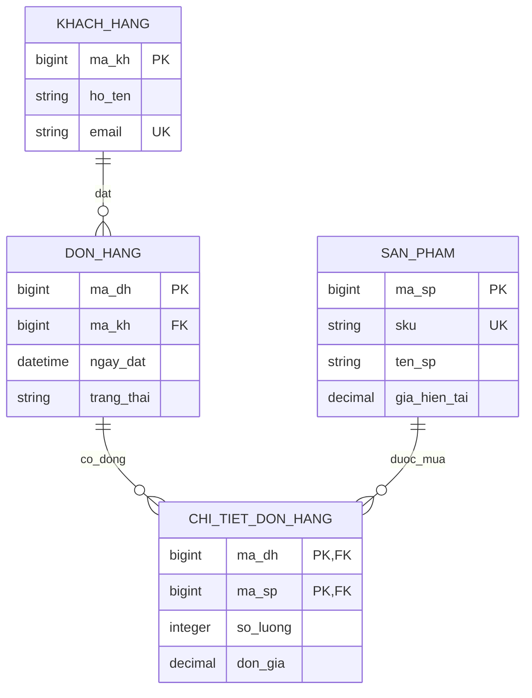

# Quan hệ, bộ và thuộc tính trong mô hình logic quan hệ

## Mục tiêu học tập

Mô hình quan hệ (relational model) cung cấp một cách diễn đạt dữ liệu bằng **quan hệ**, **bộ** và **thuộc tính**. Đây là nền tảng để chuyển yêu cầu nghiệp vụ thành lược đồ logic có thể kiểm tra được, trước khi quyết định kiểu cột, chỉ mục và cách lưu trữ trên một hệ quản trị cơ sở dữ liệu cụ thể.

Sau bài này, người học có thể:

1. Phân biệt **lược đồ quan hệ** với **trạng thái quan hệ** và giải thích chính xác quan hệ, bộ, thuộc tính, miền giá trị, bậc và lực lượng.
2. Biểu diễn một yêu cầu nghiệp vụ thành các quan hệ, xác định khóa và mô tả quan hệ giữa các thực thể thông qua khóa ngoại.
3. Nhận biết các ràng buộc dữ liệu cũng như sự khác nhau giữa mô hình quan hệ lý thuyết và bảng SQL trong thực tế.
4. Đọc và viết những phép chọn, chiếu, kết nối cơ bản; kiểm chứng thiết kế bằng dữ liệu ví dụ và các tình huống bất thường.

> **Bối cảnh học tập:** Trong phạm vi **DATABASE_DATA_MODELING**, mục tiêu là rèn kỹ năng chuyển yêu cầu nghiệp vụ thành mô hình dữ liệu rõ ràng, từ thực thể, quan hệ và ràng buộc đến chuẩn hóa, khóa, chỉ mục và lược đồ vật lý. Bài này tập trung vào **mô hình logic quan hệ**; nó cung cấp nền tảng để sau đó so sánh mô hình quan hệ với document, đồ thị và mô hình phục vụ phân tích.

## 1. Từ yêu cầu nghiệp vụ đến mô hình logic

Xét hệ thống bán hàng đơn giản với các quy tắc:

- Mỗi khách hàng có thể đặt nhiều đơn hàng; mỗi đơn hàng thuộc về đúng một khách hàng.
- Một đơn hàng có thể chứa nhiều sản phẩm; một sản phẩm có thể xuất hiện trong nhiều đơn hàng.
- Khi bán, đơn giá trên dòng đơn hàng phải giữ nguyên giá được chốt lúc mua, dù giá niêm yết của sản phẩm thay đổi.
- Số lượng mua phải là số nguyên dương; đơn hàng phải có trạng thái hợp lệ.

Nhìn vào màn hình đặt hàng, ta dễ hình dung một bản ghi gồm khách hàng, đơn hàng và danh sách sản phẩm. Nhưng một màn hình hay một đối tượng trong chương trình **không đương nhiên tương ứng với một quan hệ**. Để biểu diễn logic rõ ràng, có thể tách thành bốn quan hệ:

```text
KHACH_HANG(ma_kh, ho_ten, email)
SAN_PHAM(ma_sp, sku, ten_sp, gia_hien_tai)
DON_HANG(ma_dh, ma_kh, ngay_dat, trang_thai)
CHI_TIET_DON_HANG(ma_dh, ma_sp, so_luong, don_gia)
```

Ở đây, `ma_kh` trong `DON_HANG` tham chiếu khách hàng; `CHI_TIET_DON_HANG` nối một đơn hàng với một sản phẩm và lưu các thông tin riêng của lần mua. Cách biểu diễn này giúp chỉ rõ dữ liệu nào mô tả một đối tượng và dữ liệu nào mô tả một sự liên kết. Phần tiếp theo giải thích ý nghĩa hình thức của các ký hiệu trên.

## 2. Quan hệ, lược đồ quan hệ và trạng thái quan hệ

### 2.1. Lược đồ quan hệ là gì?

**Lược đồ quan hệ** (*relation schema*) xác định tên quan hệ, tập thuộc tính và miền giá trị của từng thuộc tính. Có thể viết:

\[
R(A_1:D_1, A_2:D_2, \ldots, A_n:D_n)
\]

Trong đó:

- `R` là tên quan hệ, chẳng hạn `DON_HANG`.
- `A_i` là tên thuộc tính, chẳng hạn `ma_dh` hoặc `ngay_dat`.
- `D_i` là **miền giá trị** (*domain*) hợp lệ của thuộc tính tương ứng.
- `n` là **bậc** (*degree/arity*) của quan hệ, tức số thuộc tính.

Ví dụ, ta có thể mô tả logic:

```text
DON_HANG(
  ma_dh: MaDonHang,
  ma_kh: MaKhachHang,
  ngay_dat: ThoiDiem,
  trang_thai: {moi, da_thanh_toan, da_huy}
)
```

`MaDonHang`, `MaKhachHang` và `ThoiDiem` là các miền khái niệm; chúng chưa bắt buộc phải là kiểu `BIGINT` hoặc `TIMESTAMPTZ`. Quyết định kiểu dữ liệu SQL thuộc bước ánh xạ từ mô hình logic sang lược đồ triển khai.

**Lược đồ cơ sở dữ liệu quan hệ** gồm nhiều lược đồ quan hệ cùng những ràng buộc giữa chúng. Nó tương đối ổn định. Ngược lại, dữ liệu đang lưu thay đổi sau mỗi thao tác thêm, sửa, xóa.

### 2.2. Trạng thái quan hệ là gì?

**Trạng thái quan hệ** (*relation instance/state*) là tập các bộ hợp lệ tại một thời điểm. Nếu `D1, D2, ..., Dn` là những miền giá trị, ký hiệu toán học thường dùng là:

\[
r(R) \subseteq D_1 \times D_2 \times \cdots \times D_n
\]

Tích Descartes ở vế phải chứa các tổ hợp giá trị có thể có; trạng thái quan hệ ở vế trái chỉ chứa **những bộ thực sự tồn tại và thỏa các ràng buộc**. Ký hiệu dạng tích có thứ tự phục vụ biểu diễn toán học; về ý nghĩa logic, mỗi giá trị được gắn với **tên thuộc tính** tương ứng, nên không phụ thuộc vào vị trí trình bày cột.

Ví dụ, trạng thái của `KHACH_HANG` có thể là:

| ma_kh | ho_ten | email |
| --- | --- | --- |
| 101 | Nguyễn An | an@example.com |
| 102 | Trần Bình | binh@example.com |

Và trạng thái của `DON_HANG` là:

| ma_dh | ma_kh | ngay_dat | trang_thai |
| --- | --- | --- | --- |
| 5001 | 101 | 2026-10-01 | da_thanh_toan |
| 5002 | 101 | 2026-10-02 | moi |
| 5003 | 102 | 2026-10-03 | da_huy |

`DON_HANG` có **bậc 4** vì có bốn thuộc tính, và ở trạng thái minh họa này có **lực lượng 3** (*cardinality* của quan hệ, tức ba bộ). Sau khi có một đơn hàng mới, lực lượng có thể thành 4 nhưng bậc vẫn là 4 nếu lược đồ chưa thay đổi.

> **Phân biệt hai cách dùng “cardinality”:** Trong lý thuyết quan hệ, lực lượng là **số bộ** của một quan hệ. Khi thiết kế mối liên kết giữa thực thể, thuật ngữ này còn mô tả **1–1, 1–N, N–N**. Hai ý nghĩa liên quan đến đếm nhưng không thay thế cho nhau.

### 2.3. Một “quan hệ” khác với một “mối liên hệ” nghiệp vụ

Trong *mô hình quan hệ*, `DON_HANG` là một **quan hệ toán học** biểu diễn một tập bộ. Trong mô hình thực thể–liên kết, câu “khách hàng **đặt** đơn hàng” lại nói về **mối liên hệ giữa thực thể**. Khi ánh xạ sang mô hình quan hệ, mối liên hệ này thường được thể hiện bằng thuộc tính khóa ngoại `DON_HANG.ma_kh`.

Vì vậy, “quan hệ” không có nghĩa đơn giản là “đường nối giữa hai bảng”. Ngay cả `KHACH_HANG` đứng riêng cũng là một quan hệ theo nghĩa toán học.

## 3. Bộ: Một sự kiện hoặc đối tượng được mô tả bằng các giá trị

**Bộ** (*tuple*) là một phần tử của trạng thái quan hệ. Trong ví dụ, bộ đơn hàng 5001 có thể diễn đạt bằng ánh xạ từ tên thuộc tính sang giá trị:

```text
t = {
  ma_dh      ↦ 5001,
  ma_kh      ↦ 101,
  ngay_dat   ↦ 2026-10-01,
  trang_thai ↦ da_thanh_toan
}
```

Giá trị `t[ma_kh] = 101` cho biết đơn hàng thuộc khách hàng nào. Một bộ không chỉ là dòng chữ hiển thị trên bảng: nó phải tuân theo miền giá trị và các ràng buộc của lược đồ. Nếu `ma_kh = 999` nhưng không có khách hàng 999, bộ có thể đúng kiểu dữ liệu song **vi phạm ràng buộc tham chiếu**.

Trong lý thuyết tập hợp của mô hình quan hệ cổ điển:

- **Không có hai bộ hoàn toàn trùng nhau** trong cùng một trạng thái quan hệ.
- **Không có thứ tự hàng mặc định**: bộ 5001 đứng trước hay sau bộ 5002 không làm thay đổi quan hệ.
- **Không có thứ tự thuộc tính mang ý nghĩa logic**: đổi cách hiển thị `ma_dh, ma_kh` thành `ma_kh, ma_dh` không đổi nội dung nếu tên và giá trị vẫn được ghép đúng.
- Quan hệ **có thể rỗng**: không có đơn hàng nào là một trạng thái hợp lệ nếu các quy tắc nghiệp vụ cho phép.

Một bộ không nhất thiết phải “đại diện cho vật thể”. Trong `CHI_TIET_DON_HANG`, một bộ đại diện cho **việc một sản phẩm xuất hiện trong một đơn hàng**, có thêm số lượng và đơn giá tại thời điểm mua.

## 4. Thuộc tính và miền giá trị

### 4.1. Thuộc tính diễn đạt một khía cạnh rõ nghĩa

**Thuộc tính** (*attribute*) là thành phần có tên của lược đồ. Tên cần cho người đọc hiểu ý nghĩa nghiệp vụ, thay vì chỉ biết kiểu kỹ thuật. Ví dụ:

| Quan hệ | Thuộc tính | Ý nghĩa | Miền logic minh họa |
| --- | --- | --- | --- |
| `KHACH_HANG` | `ma_kh` | Định danh khách hàng | Mã khách hàng hợp lệ |
| `KHACH_HANG` | `email` | Email liên hệ | Chuỗi email theo quy tắc hệ thống |
| `DON_HANG` | `ngay_dat` | Thời điểm ghi nhận đơn | Thời điểm hợp lệ |
| `DON_HANG` | `trang_thai` | Trạng thái vòng đời đơn | `moi`, `da_thanh_toan`, `da_huy` |
| `CHI_TIET_DON_HANG` | `so_luong` | Lượng sản phẩm mua | Số nguyên dương |
| `CHI_TIET_DON_HANG` | `don_gia` | Đơn giá đã chốt | Số tiền không âm |

**Miền** không đồng nhất với kiểu SQL. `so_luong` và số lần đăng nhập đều có thể được lưu bằng `INTEGER`, nhưng một thuộc miền “số nguyên dương”, còn một thuộc miền “số nguyên không âm”. `ma_kh` và `ma_dh` có thể đều là `BIGINT` nhưng không được dùng thay thế cho nhau về mặt nghiệp vụ.

Độ chặt của miền cần dựa trên yêu cầu: một email không rỗng là một điều kiện, email hợp lệ theo tiêu chuẩn định dạng lại là điều kiện khác. Ràng buộc `VARCHAR(254)` chỉ giới hạn độ dài; tự nó không xác minh một địa chỉ email có thể nhận thư.

### 4.2. Tính nguyên tử phụ thuộc vào cách hệ thống sử dụng dữ liệu

Ở dạng chuẩn thứ nhất (1NF), một vị trí thuộc tính trong một bộ được xem là chứa **một giá trị thuộc miền đã khai báo**, thay vì một nhóm lặp lại cần được truy vấn như các phần tử riêng. Ví dụ dưới đây dễ gây vấn đề:

```text
DON_HANG(ma_dh, ma_kh, san_pham = "10:2;20:1")
```

Chuỗi `"10:2;20:1"` nhồi nhiều cặp sản phẩm–số lượng vào cùng một ô. Nếu cần kiểm tra từng sản phẩm, tham chiếu `SAN_PHAM` và tính thành tiền, nên dùng các bộ riêng trong `CHI_TIET_DON_HANG`.

Ngược lại, **không phải mọi chuỗi chứa dấu phân cách đều bắt buộc phải tách cột**. Ví dụ, một địa chỉ hiển thị có thể được coi là một giá trị nếu ứng dụng chỉ lưu và in ra nguyên văn. Khi nghiệp vụ cần lọc theo tỉnh hoặc mã bưu chính, cần mô hình hóa những thành phần đó rõ ràng. “Nguyên tử” là quyết định theo ngữ nghĩa và thao tác dự kiến, không phải quy tắc đơn giản rằng dữ liệu phải là một ký tự hay một con số.

### 4.3. Thuộc tính dẫn xuất và thuộc tính ghi nhận lịch sử

Ví dụ một dòng đơn hàng có `so_luong = 2` và `don_gia = 115000` thì thành tiền là `230000`. Giá trị này có thể tính từ hai thuộc tính gốc. Lưu thêm `thanh_tien` đòi hỏi cơ chế duy trì tính nhất quán nếu số lượng hoặc đơn giá thay đổi.

Tuy nhiên, `CHI_TIET_DON_HANG.don_gia` **không nên** luôn lấy từ `SAN_PHAM.gia_hien_tai`: giá hiện tại là thuộc tính của sản phẩm, còn đơn giá đã chốt là dữ liệu lịch sử của lần bán. Hai giá trị có ngữ nghĩa khác nhau. Đây là trường hợp chủ động lưu một thông tin trông có vẻ lặp lại để giữ đúng sự kiện nghiệp vụ.

## 5. Khóa và ràng buộc: Điều gì khiến một trạng thái hợp lệ?

Một bảng với đúng tên cột chưa đủ tạo nên mô hình dữ liệu tốt. Cần diễn đạt **bộ nào được phép tồn tại** và **các bộ liên hệ với nhau như thế nào**.

### 5.1. Siêu khóa, khóa ứng viên và khóa chính

Giả sử `KHACH_HANG.ma_kh` xác định duy nhất một khách hàng, và quy tắc nghiệp vụ bảo đảm `email` cũng duy nhất, không rỗng:

- **Siêu khóa** (*superkey*) là tập thuộc tính phân biệt được mọi cặp bộ khác nhau trong mọi trạng thái hợp lệ. `{ma_kh}` và `{ma_kh, ho_ten}` đều có thể là siêu khóa.
- **Khóa ứng viên** (*candidate key*) là siêu khóa **tối thiểu**: bỏ bất kỳ thuộc tính nào sẽ mất tính duy nhất. `{ma_kh}` là khóa ứng viên; `{ma_kh, ho_ten}` không tối thiểu.
- **Khóa chính** (*primary key*) là một khóa ứng viên được chọn làm định danh chính. Có thể chọn `ma_kh` làm khóa chính, còn `email` là khóa ứng viên khác khi quy tắc duy nhất thực sự được bảo đảm.
- **Khóa ghép** gồm nhiều thuộc tính. Với quy tắc “mỗi sản phẩm xuất hiện nhiều nhất một lần trong một đơn”, cặp `{ma_dh, ma_sp}` là khóa của `CHI_TIET_DON_HANG`.

Không nên suy ra khóa chỉ từ vài bản ghi mẫu. Nếu hiện tại chưa có hai khách hàng trùng tên, `ho_ten` vẫn không tự động trở thành khóa. Khóa phải được bảo đảm bởi **quy tắc cho mọi dữ liệu hợp lệ trong tương lai**.

Khóa tự nhiên như `email` có thể thay đổi theo thời gian. Khóa thay thế như `ma_kh` thường ổn định hơn cho tham chiếu; quyết định này không loại bỏ việc khai báo `UNIQUE` cho email nếu hệ thống yêu cầu.

### 5.2. Khóa ngoại và tính toàn vẹn tham chiếu

Một **khóa ngoại** (*foreign key*, FK) là thuộc tính hoặc tập thuộc tính của quan hệ con tham chiếu tới khóa hợp lệ ở quan hệ cha. Các liên kết trong ví dụ:

```text
DON_HANG.ma_kh                    → KHACH_HANG.ma_kh
CHI_TIET_DON_HANG.ma_dh          → DON_HANG.ma_dh
CHI_TIET_DON_HANG.ma_sp          → SAN_PHAM.ma_sp
```

Với các khóa ngoại `NOT NULL` như ví dụ này, không được tạo `DON_HANG(ma_kh = 999)` khi khách hàng 999 không tồn tại. Đồng thời, xóa khách hàng 101 khi vẫn còn đơn hàng 5001 và 5002 sẽ cần một chính sách rõ ràng: **chặn xóa**, **xóa dây chuyền** hoặc một quy tắc chuyển giao phù hợp. Chọn `ON DELETE CASCADE` bừa bãi có thể làm mất dữ liệu giao dịch cần lưu lịch sử.

Khóa ngoại bảo đảm **sự tồn tại của bản ghi được tham chiếu**, nhưng không tự bảo đảm mọi quy tắc nghiệp vụ. Chẳng hạn, FK từ dòng đơn hàng tới đơn hàng không bảo đảm “đơn đã thanh toán phải có ít nhất một dòng”. Quy tắc liên quan đến **sự tồn tại của bản ghi con** hoặc nhiều bảng thường cần logic giao dịch, trigger hay cơ chế kiểm soát riêng.

### 5.3. Các loại ràng buộc cần phân biệt

| Loại | Câu hỏi cần trả lời | Ví dụ |
| --- | --- | --- |
| Miền giá trị | Một thuộc tính nhận giá trị gì? | `so_luong > 0`; `trang_thai` thuộc tập trạng thái |
| Khóa và duy nhất | Những thuộc tính nào định danh bộ? | `ma_dh` duy nhất; `(ma_dh, ma_sp)` duy nhất |
| Toàn vẹn thực thể | Bản ghi có định danh hợp lệ không? | Thành phần khóa chính không được `NULL` |
| Toàn vẹn tham chiếu | Giá trị FK có trỏ tới bộ hợp lệ không? | `DON_HANG.ma_kh` tồn tại ở `KHACH_HANG` |
| Liên bảng / theo quy trình | Trạng thái của nhiều bộ có phù hợp không? | Đơn đã thanh toán phải có dòng hàng; không thanh toán đơn đã hủy |

Một thiết kế logic tốt phải nêu rõ nơi thực thi các ràng buộc. Ràng buộc nào có thể khai báo bằng `PRIMARY KEY`, `FOREIGN KEY`, `UNIQUE`, `CHECK` nên diễn đạt trong lược đồ vật lý; ràng buộc nào cần giao dịch hoặc ứng dụng cũng phải được ghi lại, thay vì mặc định rằng “bảng sẽ tự hiểu”.

## 6. Biểu diễn liên kết 1–N và N–N

Trong ví dụ bán hàng, một khách hàng có thể có nhiều đơn hàng. Quan hệ `DON_HANG` mang khóa ngoại `ma_kh` để biểu diễn liên kết **1–N**. Một đơn hàng có thể có nhiều sản phẩm và một sản phẩm xuất hiện ở nhiều đơn, nên liên kết **N–N** được chuyển thành quan hệ trung gian `CHI_TIET_DON_HANG`.



Ký hiệu `o{` biểu thị khả năng có **0 hoặc nhiều** bản ghi ở phía nhiều. Sơ đồ cho phép đơn mới có 0 dòng trong quá trình soạn; nếu nghiệp vụ chỉ cho phép xác nhận đơn đã có sản phẩm, đó là một ràng buộc theo trạng thái cần kiểm tra khi xác nhận. Các ký hiệu `PK`, `FK`, `UK` trong sơ đồ lần lượt chỉ khóa chính, khóa ngoại và thuộc tính duy nhất.

Dữ liệu chi tiết minh họa:

| ma_dh | ma_sp | so_luong | don_gia |
| --- | --- | --- | --- |
| 5001 | 10 | 2 | 115000 |
| 5001 | 20 | 1 | 45000 |
| 5002 | 20 | 3 | 45000 |

Giả sử sản phẩm 10 hiện được niêm yết `120000` và sản phẩm 20 niêm yết `45000`. Tổng tiền đơn 5001 vẫn phải là `2 × 115000 + 1 × 45000 = 275000`, dựa trên đơn giá giao dịch đã ghi trong hai bộ chi tiết.

**Giả định cần ghi lại:** Khóa ghép `(ma_dh, ma_sp)` phù hợp khi mỗi sản phẩm chỉ có **một dòng trong cùng đơn hàng**. Nếu nghiệp vụ cho phép cùng sản phẩm xuất hiện thành nhiều dòng với khuyến mãi, đợt giao hoặc tùy chọn khác nhau, phải đổi cách định danh dòng, ví dụ thêm `ma_dong` hoặc một số thứ tự dòng trong đơn. Thiết kế khóa luôn phụ thuộc vào quy tắc nghiệp vụ, không phải sở thích đặt cột.

## 7. Phép toán trên quan hệ và kết quả truy vấn

Mô hình quan hệ không chỉ diễn tả cách lưu mà còn tạo nền tảng cho **đại số quan hệ**: các phép biến đổi nhận quan hệ làm đầu vào và tạo quan hệ làm đầu ra.

### 7.1. Phép chọn (selection)

Phép chọn `σ` giữ lại các bộ thỏa điều kiện. Ví dụ:

\[
\sigma_{\mathrm{trang\_thai} = \text{'moi'}}(DON\_HANG)
\]

Với dữ liệu mẫu, kết quả có duy nhất bộ đơn hàng `5002`. SQL gần tương đương:

```sql
SELECT ma_dh, ma_kh, ngay_dat, trang_thai
FROM don_hang
WHERE trang_thai = 'moi';
```

### 7.2. Phép chiếu (projection)

Phép chiếu `π` chỉ giữ các thuộc tính được chọn. Ví dụ:

\[
\pi_{\mathrm{ma\_kh}}(DON\_HANG)
\]

Trong đại số quan hệ theo ngữ nghĩa tập hợp, kết quả là hai bộ một thuộc tính chứa `101` và `102` — `101` không bị lặp lại dù khách hàng đó có hai đơn. Để nhận ngữ nghĩa tập hợp này trong SQL, dùng `DISTINCT`:

```sql
SELECT DISTINCT ma_kh
FROM don_hang;
```

### 7.3. Phép kết nối (join)

Kết nối các quan hệ dựa trên điều kiện tương ứng, chẳng hạn `DON_HANG.ma_kh = KHACH_HANG.ma_kh`, để trả lời câu hỏi “đơn nào do khách hàng nào đặt?”.

```sql
SELECT dh.ma_dh, kh.ho_ten, dh.trang_thai
FROM don_hang AS dh
JOIN khach_hang AS kh ON kh.ma_kh = dh.ma_kh
ORDER BY dh.ma_dh;
```

| ma_dh | ho_ten | trang_thai |
| --- | --- | --- |
| 5001 | Nguyễn An | da_thanh_toan |
| 5002 | Nguyễn An | moi |
| 5003 | Trần Bình | da_huy |

Điều kiện `ON` thể hiện chính xác thuộc tính tham chiếu. Nếu nối sai cột hoặc quên điều kiện nối, kết quả có thể ghép các bộ không liên quan, tạo ra rất nhiều dòng sai. Phép kết nối cũng **không** tự phát hiện rằng hai thuộc tính cùng tên luôn có cùng nghĩa nghiệp vụ.

## 8. Mô hình quan hệ lý thuyết và bảng SQL thực tế

Một hệ quản trị SQL triển khai nhiều ý tưởng của mô hình quan hệ, nhưng **bảng SQL không hoàn toàn giống quan hệ toán học thuần túy**:

| Vấn đề | Mô hình quan hệ lý thuyết | SQL thường gặp |
| --- | --- | --- |
| Tập hay đa tập | Quan hệ là tập bộ, không có bộ trùng | Truy vấn có thể trả về các dòng trùng; `DISTINCT` loại trùng |
| Thứ tự | Bộ và thuộc tính không có thứ tự mang ý nghĩa logic | Kết quả chỉ được bảo đảm thứ tự khi truy vấn có `ORDER BY` |
| Giá trị không xác định | Mô hình quan hệ cổ điển giả định giá trị thuộc miền; không có `NULL` theo cách SQL dùng | `NULL` biểu diễn giá trị thiếu/chưa biết/không áp dụng, tùy ngữ cảnh |
| Phép so sánh | Dựa trên logic thông thường trên giá trị xác định | So sánh với `NULL` thường cho `UNKNOWN`; điều kiện `WHERE` chỉ giữ giá trị `TRUE` |
| Khóa | Các khóa ứng viên được xác định bởi quy tắc logic | `PRIMARY KEY`, `UNIQUE`, `NOT NULL` biểu đạt một phần các quy tắc trong DDL |

Ví dụ, `SELECT ma_kh FROM don_hang` có thể trả `101, 101, 102`: SQL mặc định dùng ngữ nghĩa **đa tập** (*bag semantics*) cho kết quả truy vấn. Điều đó không làm thay đổi việc một thiết kế logic cần xác định rõ những bộ nào là hợp lệ và cách định danh chúng.

Đặc biệt cần cẩn thận với `NULL`:

```sql
-- Không tìm được NULL bằng toán tử bằng thông thường:
SELECT * FROM khach_hang WHERE email = NULL;

-- Phép kiểm tra đúng cú pháp SQL là:
SELECT * FROM khach_hang WHERE email IS NULL;
```

Trong PostgreSQL, một ràng buộc `UNIQUE` thông thường có thể cho phép nhiều giá trị `NULL`, còn khóa chính buộc các thành phần không `NULL`. Hành vi chi tiết có thể khác giữa các hệ quản trị hoặc tùy cấu hình ràng buộc. Vì thế, nếu nghiệp vụ yêu cầu email bắt buộc và duy nhất, nên diễn đạt **cả** `NOT NULL` và `UNIQUE`.

## 9. Từ mô hình logic sang lược đồ SQL

Sau khi định nghĩa các quan hệ, có thể chuyển thành bảng vật lý. Ví dụ sau dùng **PostgreSQL** để minh họa cách chuyển miền, khóa và ràng buộc thành DDL; đây là một cách triển khai, không phải định nghĩa duy nhất của mô hình quan hệ.

```sql
CREATE TABLE khach_hang (
    ma_kh BIGINT GENERATED ALWAYS AS IDENTITY PRIMARY KEY,
    ho_ten VARCHAR(120) NOT NULL,
    email VARCHAR(254) NOT NULL UNIQUE,
    CONSTRAINT ck_kh_ho_ten CHECK (btrim(ho_ten) <> '')
);

CREATE TABLE san_pham (
    ma_sp BIGINT GENERATED ALWAYS AS IDENTITY PRIMARY KEY,
    sku VARCHAR(40) NOT NULL UNIQUE,
    ten_sp VARCHAR(200) NOT NULL,
    gia_hien_tai NUMERIC(12, 2) NOT NULL,
    CONSTRAINT ck_sp_gia CHECK (gia_hien_tai >= 0)
);

CREATE TABLE don_hang (
    ma_dh BIGINT GENERATED ALWAYS AS IDENTITY PRIMARY KEY,
    ma_kh BIGINT NOT NULL REFERENCES khach_hang(ma_kh),
    ngay_dat TIMESTAMPTZ NOT NULL DEFAULT CURRENT_TIMESTAMP,
    trang_thai VARCHAR(20) NOT NULL DEFAULT 'moi',
    CONSTRAINT ck_dh_trang_thai
        CHECK (trang_thai IN ('moi', 'da_thanh_toan', 'da_huy'))
);

CREATE TABLE chi_tiet_don_hang (
    ma_dh BIGINT NOT NULL REFERENCES don_hang(ma_dh),
    ma_sp BIGINT NOT NULL REFERENCES san_pham(ma_sp),
    so_luong INTEGER NOT NULL,
    don_gia NUMERIC(12, 2) NOT NULL,
    CONSTRAINT pk_chi_tiet_don_hang PRIMARY KEY (ma_dh, ma_sp),
    CONSTRAINT ck_ct_so_luong CHECK (so_luong > 0),
    CONSTRAINT ck_ct_don_gia CHECK (don_gia >= 0)
);
```

Một vài quyết định đáng chú ý:

- `GENERATED ALWAYS AS IDENTITY` tạo khóa định danh ổn định; các mã số trong bảng ví dụ là **giá trị minh họa**, không phải câu lệnh `INSERT` trực tiếp vào cột identity.
- `NUMERIC(12, 2)` phù hợp hơn kiểu số thực nhị phân khi nghiệp vụ yêu cầu số tiền thập phân chính xác ở hai chữ số sau dấu phẩy; đơn vị tiền tệ và quy tắc làm tròn vẫn phải được quy định riêng.
- `CHECK (trang_thai IN (...))` chặn trạng thái ngoài tập đã liệt kê, nhưng không tự kiểm soát mọi **chuyển trạng thái** (ví dụ `da_huy → da_thanh_toan`).
- Khóa chính ghép giúp mỗi sản phẩm chỉ xuất hiện một lần trong một đơn. Các FK ngăn dòng chi tiết tham chiếu đơn hoặc sản phẩm không tồn tại.
- Ràng buộc định danh và tham chiếu không đồng nghĩa với chỉ mục tối ưu cho mọi truy vấn. Việc bổ sung chỉ mục trên cột FK hoặc các cột tìm kiếm cần đánh giá theo truy vấn, dữ liệu và chi phí ghi; với PostgreSQL, khai báo FK ở bảng con **không tự tạo chỉ mục cho cột FK**.

### Truy vấn tổng tiền và giới hạn cần hiểu

Với dữ liệu mẫu, muốn hiện cả đơn chưa có dòng chi tiết, dùng `LEFT JOIN` và `COALESCE`:

```sql
SELECT
    dh.ma_dh,
    kh.ho_ten,
    COALESCE(SUM(ct.so_luong * ct.don_gia), 0) AS tong_tien
FROM don_hang AS dh
JOIN khach_hang AS kh ON kh.ma_kh = dh.ma_kh
LEFT JOIN chi_tiet_don_hang AS ct ON ct.ma_dh = dh.ma_dh
GROUP BY dh.ma_dh, kh.ho_ten
ORDER BY dh.ma_dh;
```

| ma_dh | ho_ten | tong_tien |
| --- | --- | ---: |
| 5001 | Nguyễn An | 275000 |
| 5002 | Nguyễn An | 135000 |
| 5003 | Trần Bình | 0 |

Truy vấn tính tổng từ dữ liệu giao dịch thực tế. Đơn 5003 không có dòng chi tiết nên tổng được hiển thị bằng `0`; số `0` này chỉ có nghĩa **không tìm thấy khoản tiền trong dữ liệu mẫu**, không nhất thiết là một đơn hợp lệ để thanh toán. Nếu hệ thống có giảm giá, thuế, phí vận chuyển hoặc hoàn tiền, công thức tổng tiền cần bổ sung mô hình tương ứng. Không nên dùng một công thức đơn giản để thay thế quy tắc nghiệp vụ chưa được định nghĩa.

## 10. Những sai lầm thường gặp khi mô hình hóa

| Cách làm gây lỗi | Hậu quả | Hướng xử lý |
| --- | --- | --- |
| Đưa nhiều mã sản phẩm vào chuỗi `"10,20,30"` ở `DON_HANG` | Khó áp FK, khó lọc và tính theo từng dòng | Tách thành `CHI_TIET_DON_HANG` |
| Lưu tên và email khách hàng lặp trong mọi đơn, không xác định nhu cầu lịch sử | Sửa thông tin ở một chỗ khiến những chỗ khác không đồng nhất | Lưu khóa tham chiếu; chỉ lưu bản chụp lịch sử khi có lý do nghiệp vụ |
| Chọn `ho_ten` làm khóa vì hiện chưa trùng | Người trùng tên gây xung đột | Xác định khóa qua quy tắc duy nhất bền vững |
| Dùng giá hiện tại của sản phẩm để tính đơn cũ | Tổng tiền lịch sử thay đổi khi cập nhật bảng sản phẩm | Lưu `don_gia` tại dòng giao dịch |
| Chỉ kiểm tra FK ở ứng dụng | Đường ghi dữ liệu khác có thể tạo tham chiếu mồ côi | Khai báo FK trong cơ sở dữ liệu khi có thể |
| Xem thứ tự hàng trả về như mặc định ổn định | Kết quả hiển thị thay đổi theo kế hoạch thực thi | Dùng `ORDER BY` với tiêu chí rõ ràng |
| Nhầm `UNIQUE` với `NOT NULL` | Giá trị thiếu có thể lọt qua yêu cầu bắt buộc | Khai báo đầy đủ ràng buộc và kiểm tra hành vi DBMS |

Không phải cứ tách càng nhiều bảng là càng đúng. Mục tiêu là biểu diễn chính xác sự kiện, khóa, phụ thuộc và quy tắc thay đổi dữ liệu. Việc chuẩn hóa sẽ phân tích sâu hơn những **phụ thuộc hàm** và cách tránh bất thường khi thêm, cập nhật hoặc xóa; còn lựa chọn mô hình document, đồ thị hay phân tích cần dựa trên mô hình truy vấn và nhu cầu tiến hóa dữ liệu. Những bước đó đều bắt đầu bằng việc hiểu rõ các thực thể, thuộc tính và ràng buộc đã xác lập ở đây.

## 11. Quy trình thực hành và câu hỏi tự kiểm tra

Khi gặp yêu cầu mới, có thể làm tuần tự như sau:

1. **Ghi quy tắc nghiệp vụ thành câu kiểm chứng được.** Ví dụ: “Mỗi đơn thuộc đúng một khách hàng”, “Một dòng đơn có số lượng dương”.
2. **Xác định quan hệ và ý nghĩa mỗi bộ.** Hỏi: “Một bộ của quan hệ này nói lên sự kiện gì?”.
3. **Liệt kê thuộc tính và miền giá trị.** Phân biệt dữ liệu bắt buộc, dữ liệu tùy chọn, dữ liệu dẫn xuất và dữ liệu lịch sử.
4. **Chọn khóa ứng viên và khóa chính.** Kiểm tra tính duy nhất bằng quy tắc nghiệp vụ, không chỉ bằng dữ liệu mẫu.
5. **Thể hiện mối liên kết bằng FK hoặc quan hệ trung gian.** Xác định rõ tối thiểu/tối đa khi cần và chính sách khi xóa hoặc đổi bản ghi cha.
6. **Viết các trạng thái mẫu hợp lệ và bất hợp lệ.** Thử trùng khóa, tham chiếu không tồn tại, giá trị ngoài miền, sửa giá hiện tại, xóa dữ liệu được tham chiếu.
7. **Đối chiếu truy vấn thực tế.** Thử tìm đơn của khách, cộng tổng tiền, liệt kê sản phẩm bán được và đơn chưa có dòng; sau đó mới lựa chọn kiểu SQL, chỉ mục và tối ưu triển khai.

### Bài tập 1 — Bậc, lực lượng và phép chiếu

Với `DON_HANG` có dữ liệu ở mục 2:

1. Bậc và lực lượng của quan hệ là bao nhiêu?
2. Phép chiếu chỉ lấy `ma_kh` cho bao nhiêu bộ theo ngữ nghĩa tập hợp?
3. Nếu SQL viết `SELECT ma_kh FROM don_hang` thì có nhất thiết được đúng số dòng như phép chiếu trên không?

**Đáp án:** (1) Bậc `4`, lực lượng `3`. (2) Hai bộ: `101`, `102`. (3) Không; truy vấn SQL mặc định có thể trả ba dòng `101`, `101`, `102`, nên cần `DISTINCT` để loại trùng.

### Bài tập 2 — Chọn khóa cho đăng ký lớp học

Một hệ thống đào tạo có `SINH_VIEN(ma_sv, ho_ten)`, `LOP_HOC(ma_lop, ten_lop)` và mỗi sinh viên chỉ được đăng ký **một lần** cho một lớp. Đề xuất lược đồ quan hệ cho sự kiện đăng ký, nêu khóa chính và các khóa ngoại.

**Đáp án tham khảo:** `DANG_KY(ma_sv, ma_lop, ngay_dang_ky, trang_thai)`, khóa chính `(ma_sv, ma_lop)`, hai khóa ngoại lần lượt tham chiếu `SINH_VIEN(ma_sv)` và `LOP_HOC(ma_lop)`. Nếu cho phép đăng ký lại nhiều đợt, khóa ghép này không còn phù hợp; cần bổ sung định danh lần đăng ký hoặc thành phần thời điểm/đợt theo quy tắc xác định.

### Bài tập 3 — Đánh giá ràng buộc

Trong mô hình đơn hàng, xem xét ba yêu cầu:

- A. Không chấp nhận dòng chi tiết có `so_luong = -2`.
- B. Không chấp nhận dòng chi tiết với `ma_sp = 999` nếu sản phẩm 999 không tồn tại.
- C. Chỉ cho đổi trạng thái từ `moi` sang `da_thanh_toan` khi có ít nhất một dòng chi tiết.

**Đáp án tham khảo:** A có thể dùng `CHECK (so_luong > 0)`. B dùng FK `chi_tiet_don_hang.ma_sp → san_pham.ma_sp`. C cần kiểm tra điều kiện liên bảng và chuyển trạng thái tại thời điểm cập nhật, thường bằng giao dịch trong ứng dụng hoặc cơ chế database phù hợp; một FK hay `CHECK` đơn bảng thông thường không diễn đạt trọn vẹn điều kiện này.

### Bài tập 4 — Phân biệt hai loại giá

Sản phẩm 10 đang niêm yết `120000`; một dòng đơn cũ bán hai sản phẩm 10 với đơn giá `115000`. Nếu mai giá niêm yết tăng lên `130000`, tổng tiền của dòng đơn cũ là bao nhiêu và vì sao?

**Đáp án:** Vẫn là `230000` (`2 × 115000`). `gia_hien_tai` mô tả sản phẩm tại thời điểm truy vấn; `don_gia` mô tả sự kiện mua đã chốt. Chúng là hai thuộc tính có ý nghĩa khác nhau trong hai quan hệ khác nhau.

## 12. Tóm tắt khái niệm cốt lõi

| Khái niệm | Cách ghi nhớ chính xác |
| --- | --- |
| Quan hệ (*relation*) | Tập các bộ hợp lệ trên những thuộc tính được xác định; không phải chỉ là đường nối bảng |
| Lược đồ quan hệ (*relation schema*) | Tên quan hệ, thuộc tính, miền giá trị và các quy tắc cấu trúc |
| Trạng thái quan hệ (*relation instance*) | Tập các bộ hiện có tại một thời điểm |
| Bộ (*tuple*) | Một ánh xạ các thuộc tính sang giá trị hợp lệ, diễn tả một sự kiện/đối tượng |
| Thuộc tính (*attribute*) | Một đặc điểm có tên và ý nghĩa nghiệp vụ xác định |
| Miền (*domain*) | Tập giá trị hợp lệ của thuộc tính, giàu ý nghĩa hơn kiểu dữ liệu kỹ thuật |
| Bậc (*degree*) | Số thuộc tính của quan hệ |
| Lực lượng (*cardinality*) | Số bộ trong trạng thái quan hệ |
| Khóa ứng viên | Tập thuộc tính tối thiểu định danh duy nhất mỗi bộ |
| Khóa ngoại | Ràng buộc tham chiếu giữa các quan hệ |

Điểm cần mang sang các bài tiếp theo là: **mô hình logic phải mô tả đúng ý nghĩa dữ liệu và những trạng thái được phép tồn tại**. Khi quan hệ, bộ, thuộc tính và ràng buộc đã rõ, việc chuẩn hóa, lựa chọn khóa, thiết kế truy vấn, bổ sung chỉ mục và tạo lược đồ vật lý sẽ có cơ sở để kiểm chứng.
