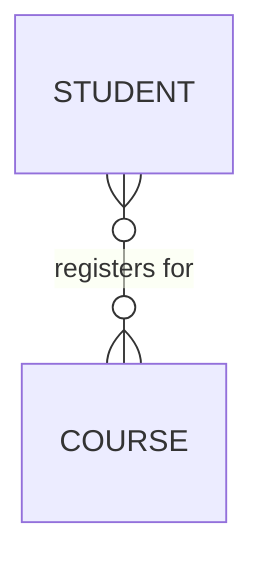
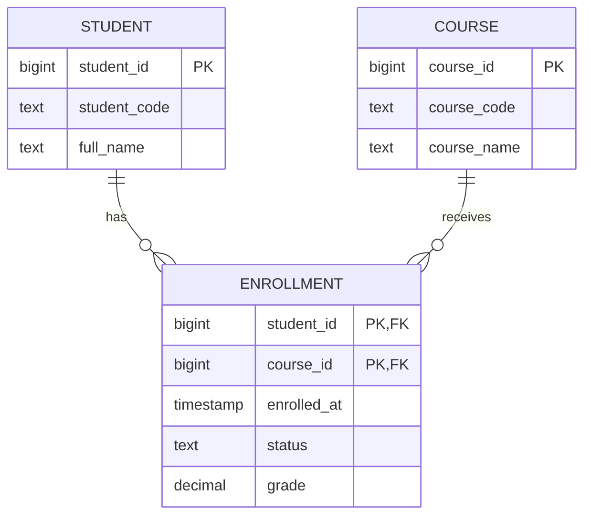

# Chuyển quan hệ nhiều với nhiều thành bảng liên kết

Trong mô hình dữ liệu quan hệ, yêu cầu “một học viên tham gia nhiều khóa học, một khóa học có nhiều học viên” không thể được diễn đạt đầy đủ bằng **một khóa ngoại đơn** đặt ở một trong hai bảng. Đây là quan hệ **nhiều với nhiều** (*many-to-many*, viết tắt **N:M**). Cách ánh xạ phổ biến là tạo **bảng liên kết** (*junction table*, *associative table*, *bridge table*) để lưu mỗi cặp đối tượng tham gia quan hệ thành một dòng.

Bảng liên kết không chỉ là thủ thuật kỹ thuật để viết SQL. Nó biểu diễn một sự kiện nghiệp vụ xác định: **học viên A đã đăng ký khóa học B**, cùng những dữ kiện chỉ có ý nghĩa với *chính cặp đó*, như ngày đăng ký, trạng thái và điểm kết quả. Khi xác định đúng khóa, ràng buộc duy nhất, khóa ngoại và vòng đời của mối quan hệ, ta có thể bảo vệ dữ liệu trước việc ghi trùng, tham chiếu sai và cập nhật không nhất quán.

Bài thuộc chương **Mô hình quan hệ** của module **DATABASE_DATA_MODELING**. Mục tiêu là chuyển phát biểu nghiệp vụ thành thực thể, quan hệ và ràng buộc rõ ràng, tiếp đó đánh giá lược đồ vật lý, chỉ mục và phương án lưu trữ khi chuyển sang document, graph hoặc hệ phân tích. Các ví dụ DDL dùng **PostgreSQL 15+**; tư duy mô hình hóa áp dụng rộng hơn nhưng cú pháp và khả năng cưỡng chế cần đối chiếu với hệ quản trị cụ thể.

## 1. Nhận diện quan hệ N:M từ yêu cầu nghiệp vụ

Giả sử nền tảng đào tạo có hai loại thực thể:

- **Học viên** (`Student`): có mã học viên, họ tên và trạng thái hồ sơ.
- **Khóa học** (`Course`): có mã khóa học, tên và thông tin chương trình.

Người phụ trách nghiệp vụ xác nhận:

> Một học viên được đăng ký nhiều khóa học. Một khóa học cho phép nhiều học viên đăng ký. Với một khóa học cụ thể, một học viên chỉ có **một hồ sơ đăng ký hiện hành** trong mô hình ban đầu.

Ví dụ dữ liệu:

| Học viên | Khóa học tham gia |
|---|---|
| SV001 — An | CSDL101 — Cơ sở dữ liệu; JAVA101 — Java |
| SV002 — Bình | CSDL101 — Cơ sở dữ liệu |

Từ chiều học viên, `SV001` liên kết với **hai khóa học**. Từ chiều khóa học, `CSDL101` liên kết với **hai học viên**. Đó là dấu hiệu N:M.

### Phân biệt “có thể có nhiều” với “bắt buộc phải có nhiều”

Ký hiệu N:M mô tả **số lượng tối đa** của liên kết theo hai chiều. Nó không nói rằng mọi học viên hiện tại đều có ít nhất hai khóa, hay mọi khóa đều có nhiều học viên. Học viên mới có thể chưa đăng ký khóa nào; khóa học mới có thể chưa có người học.

Cần ghi riêng số lượng tối thiểu và tối đa:

| Phía quan hệ | Mệnh đề cần xác nhận | Ví dụ ở hệ thống này |
|---|---|---|
| Từ `Student` sang `Course` | Mỗi học viên liên kết với tối thiểu/tối đa bao nhiêu khóa? | `0..N` |
| Từ `Course` sang `Student` | Mỗi khóa có tối thiểu/tối đa bao nhiêu học viên? | `0..N` |
| Một **dòng đăng ký** | Tham chiếu bao nhiêu học viên và khóa học? | Đúng **1 học viên** và **1 khóa học** |

Nếu nghiệp vụ nói “mọi khóa học đã mở phải có ít nhất một học viên”, đó là **quy tắc tham gia tối thiểu**, cần cơ chế xác nhận trạng thái mở khóa. Khóa ngoại ở bảng liên kết chỉ bảo đảm mỗi dòng đăng ký dẫn đến thực thể hợp lệ; nó không tự buộc một khóa học phải có dòng đăng ký.

### ERD trước và sau khi chuyển đổi

Ở mức khái niệm, ta có thể vẽ:



Khi sang lược đồ quan hệ, tách N:M thành **hai quan hệ 1:N** thông qua `ENROLLMENT`:



Trong ví dụ một tenant, `ENROLLMENT` có thể định danh bằng cặp `(student_id, course_id)`. Với môi trường đa tenant, ví dụ ở phần sau dùng **`(tenant_id, student_id, course_id)`** làm khóa chính và hai khóa ngoại ghép để ngăn liên kết khác tenant.

## 2. Vì sao không đặt “danh sách ID” trong một cột?

Một thiết kế vội vàng có thể thêm cột `course_ids = '101,102'` ở `students` hoặc `student_ids = '[1,2]'` ở `courses`.

Các cách này gây ra nhiều vấn đề khi quan hệ là dữ liệu nghiệp vụ cần bảo vệ:

| Cách lưu | Vấn đề chính |
|---|---|
| Chuỗi ID ngăn bằng dấu phẩy | Không có FK riêng cho từng ID; cập nhật/xóa một quan hệ đòi phân tích chuỗi; tìm kiếm và index khó chính xác |
| Một danh sách JSON/array trong `students` | Cần tự thiết kế kiểm tra tồn tại, chống trùng và cập nhật cạnh tranh bên trong danh sách; khó gắn thuộc tính riêng cho mỗi lần đăng ký |
| Danh sách ở **cả** `students` và `courses` | Hai bản sao quan hệ có thể lệch nhau khi thêm, xóa hoặc lỗi giữa các bước ghi |
| Chỉ một `course_id` trong `students` | Mỗi học viên chỉ trỏ được tối đa một khóa, chuyển yêu cầu N:M thành N:1 ngoài ý muốn |
| Chỉ một `student_id` trong `courses` | Mỗi khóa chỉ trỏ được tối đa một học viên, chuyển yêu cầu N:M thành 1:N ngoài ý muốn |

Điều này **không có nghĩa** JSON/array luôn sai: trong mô hình document, danh sách nhúng có thể hợp lý với tập nhỏ có vòng đời chung và cơ chế kiểm soát đầy đủ. Nhưng nếu dùng cơ sở dữ liệu quan hệ, cần join thường xuyên, có ràng buộc tham chiếu mạnh và mỗi liên kết mang thuộc tính riêng, **một dòng trên bảng liên kết** thường là biểu diễn rõ ràng nhất.

## 3. Quy tắc chuyển N:M thành hai quan hệ 1:N

Quy trình chuyển đổi cơ bản:

1. **Giữ hai thực thể đầu mút** với khóa và thuộc tính của chúng: `students` và `courses`.
2. **Tạo bảng liên kết** `enrollments`. Mỗi dòng thể hiện học viên nào đăng ký khóa nào.
3. **Đặt khóa ngoại** từ bảng liên kết tới từng đầu mút; nếu có tenant, khóa ngoại phải bảo vệ cùng phạm vi tenant.
4. **Định nghĩa khóa của quan hệ**: tổ hợp hai đầu mút nếu mỗi cặp chỉ được xuất hiện một lần, hoặc khóa riêng kèm unique thích hợp khi cần định danh từng lần tham gia.
5. **Đặt thuộc tính của chính mối quan hệ** tại bảng liên kết: `enrolled_at`, `status`, `grade`.
6. **Xác nhận chính sách xóa và thay đổi**: có giữ lịch sử đăng ký không, có cho rút đăng ký không, một học viên có thể học lại cùng khóa không.

Bất biến trung tâm của mô hình ban đầu:

\[
\forall s, c:\quad
\#\{\text{Enrollment}(s,c)\}\leq 1.
\]

Nghĩa là với mỗi cặp học viên–khóa học, có tối đa một dòng liên kết. Khi cặp lặp lại được phép do học lại, bất biến này phải **được thay đổi có chủ đích**; đừng bỏ unique constraint mà không đưa ra một khóa thay thế đủ nghĩa.

### Thuộc tính nằm ở đâu?

| Thuộc tính | Bảng phù hợp | Lý do |
|---|---|---|
| `student_code`, `full_name` | `students` | Phụ thuộc vào học viên, không phụ thuộc vào khóa |
| `course_code`, `course_name` | `courses` | Phụ thuộc vào khóa học, không phụ thuộc vào học viên |
| `enrolled_at` | `enrollments` | Thời điểm **một học viên đăng ký một khóa** |
| `status` của đăng ký | `enrollments` | SV001 có thể hoàn thành CSDL101 nhưng còn học JAVA101 |
| `grade` | `enrollments` | Điểm có nghĩa trong **một lần tham gia khóa** |
| `course_capacity` | `courses` | Giới hạn thuộc khóa; quy tắc không vượt quá sức chứa là một bất biến tổng hợp qua nhiều dòng |

Đặt `grade` ở `students` sẽ thiếu khóa nào đang được chấm; đặt nó ở `courses` sẽ thiếu học viên nào được chấm. Đây là dấu hiệu cho thấy liên kết đã trở thành một **thực thể kết hợp** (*associative entity*) với thuộc tính nghiệp vụ thực sự.

## 4. Lược đồ PostgreSQL có khóa, FK, UNIQUE và CHECK

Giả sử hệ thống hỗ trợ nhiều tổ chức đào tạo. Mỗi tổ chức là một tenant; học viên và khóa học đều phải thuộc cùng tenant khi đăng ký.

```sql
CREATE TABLE tenants (
    tenant_id BIGINT PRIMARY KEY,
    tenant_name TEXT NOT NULL
        CHECK (btrim(tenant_name) <> '')
);

CREATE TABLE students (
    tenant_id BIGINT NOT NULL,
    student_id BIGINT GENERATED ALWAYS AS IDENTITY,
    student_code TEXT NOT NULL,
    full_name TEXT NOT NULL,

    CONSTRAINT pk_students PRIMARY KEY (tenant_id, student_id),
    CONSTRAINT uq_students_code UNIQUE (tenant_id, student_code),
    CONSTRAINT fk_students_tenant FOREIGN KEY (tenant_id)
        REFERENCES tenants (tenant_id) ON DELETE RESTRICT,
    CONSTRAINT ck_student_code CHECK (btrim(student_code) <> ''),
    CONSTRAINT ck_student_name CHECK (btrim(full_name) <> '')
);

CREATE TABLE courses (
    tenant_id BIGINT NOT NULL,
    course_id BIGINT GENERATED ALWAYS AS IDENTITY,
    course_code TEXT NOT NULL,
    course_name TEXT NOT NULL,

    CONSTRAINT pk_courses PRIMARY KEY (tenant_id, course_id),
    CONSTRAINT uq_courses_code UNIQUE (tenant_id, course_code),
    CONSTRAINT fk_courses_tenant FOREIGN KEY (tenant_id)
        REFERENCES tenants (tenant_id) ON DELETE RESTRICT,
    CONSTRAINT ck_course_code CHECK (btrim(course_code) <> ''),
    CONSTRAINT ck_course_name CHECK (btrim(course_name) <> '')
);

CREATE TABLE enrollments (
    tenant_id BIGINT NOT NULL,
    student_id BIGINT NOT NULL,
    course_id BIGINT NOT NULL,
    enrolled_at TIMESTAMPTZ NOT NULL DEFAULT CURRENT_TIMESTAMP,
    status TEXT NOT NULL DEFAULT 'ENROLLED',
    grade NUMERIC(5, 2),

    CONSTRAINT pk_enrollments
        PRIMARY KEY (tenant_id, student_id, course_id),

    CONSTRAINT fk_enrollments_student
        FOREIGN KEY (tenant_id, student_id)
        REFERENCES students (tenant_id, student_id)
        ON DELETE RESTRICT,

    CONSTRAINT fk_enrollments_course
        FOREIGN KEY (tenant_id, course_id)
        REFERENCES courses (tenant_id, course_id)
        ON DELETE RESTRICT,

    CONSTRAINT ck_enrollments_status
        CHECK (status IN ('ENROLLED', 'COMPLETED', 'DROPPED')),

    CONSTRAINT ck_enrollments_grade_range
        CHECK (grade BETWEEN 0 AND 100),

    CONSTRAINT ck_enrollments_grade_by_status
        CHECK (
            (status = 'COMPLETED' AND grade IS NOT NULL)
            OR
            (status <> 'COMPLETED' AND grade IS NULL)
        )
);

-- Phục vụ truy vấn ngược: từ khóa học sang danh sách học viên.
CREATE INDEX ix_enrollments_course_student
    ON enrollments (tenant_id, course_id, student_id);
```

**Các lựa chọn nghiệp vụ được minh định trong ví dụ:**

- `status` chỉ nhận ba giá trị. Một đăng ký `COMPLETED` bắt buộc có điểm; ở trạng thái `ENROLLED` và `DROPPED`, điểm còn là `NULL`. Đây là **quy ước của bài**, không phải mọi nền tảng đào tạo đều chấm theo cách này.
- `grade BETWEEN 0 AND 100` từ chối điểm ngoài khoảng khi giá trị không rỗng. `CHECK` một mình không từ chối `NULL`; vì thế `ck_enrollments_grade_by_status` xác định tình huống nào được/không được thiếu điểm.
- Học viên và khóa học không được xóa vật lý nếu còn liên kết vì có `ON DELETE RESTRICT`. Quyết định này giữ hồ sơ đăng ký để đối soát; sản phẩm thực tế có thể dùng trạng thái lưu trữ hoặc chính sách xóa khác.
- Hai FK ghép đều mang `tenant_id` để không thể gán học viên tenant 42 vào khóa của tenant 43. Một cặp FK đơn chỉ theo ID kỹ thuật có thể vô tình bỏ sót bất biến phạm vi sở hữu.
- `tenant_id`, `student_id`, `course_id` đều `NOT NULL`. Không dùng `NULL` làm dấu “chưa biết đối tượng” trong liên kết đã phát sinh; nếu chưa xác định đầu mút, lưu yêu cầu ở vùng chờ riêng.

### Vì sao khóa chính gồm ba cột?

Ở mức nghiệp vụ, khóa của một lần đăng ký là **học viên + khóa học trong cùng tenant**. Trong lược đồ đa tenant:

\[
K_{\text{enrollment}} = (tenant\_id,\ student\_id,\ course\_id).
\]

`PRIMARY KEY` bảo đảm **không trùng bộ khóa** và cả ba thành phần không rỗng. Một học viên được phép tham gia hai khóa; một khóa được phép có hai học viên. Chỉ **cùng cặp học viên–khóa** mới bị từ chối khi xuất hiện lần thứ hai.

Không nên đặt `UNIQUE(student_id)` hoặc `UNIQUE(course_id)` ở `enrollments`: điều đó vô tình ép một trong hai chiều thành 1:1. Cũng không nên đặt `UNIQUE (tenant_id, student_id)` nếu học viên phải tham gia nhiều khóa.

### Vì sao cần chỉ mục chiều ngược?

Khóa chính `(tenant_id, student_id, course_id)` tạo chỉ mục phục vụ tốt truy vấn *tìm các khóa học của một học viên*. Khi tìm *tất cả học viên của một khóa*, bộ cột `(tenant_id, course_id)` không phải tiền tố đầy đủ của chỉ mục khóa chính. Chỉ mục `(tenant_id, course_id, student_id)` phục vụ hướng truy vấn thứ hai và những lần kiểm tra/xóa cập nhật khóa học được tham chiếu.

PostgreSQL tạo chỉ mục cho PK/UNIQUE nhưng **không tự tạo chỉ mục cho mọi FK ở bảng con**. Trên hệ thống khác, phải kiểm tra cơ chế chỉ mục cụ thể. Đừng tạo chỉ mục trùng mà chưa xem kế hoạch truy vấn và tải ghi thực tế.

## 5. Nạp dữ liệu mẫu và quan sát liên kết

Dữ liệu minh họa dùng tenant 42, hai học viên và hai khóa học. Khóa `student_id`/`course_id` do PostgreSQL sinh tự động; dùng mã nghiệp vụ khi tạo liên kết để không đoán giá trị identity.

```sql
INSERT INTO tenants (tenant_id, tenant_name)
VALUES (42, 'Trung tâm đào tạo X');

INSERT INTO students (tenant_id, student_code, full_name)
VALUES
    (42, 'SV001', 'An'),
    (42, 'SV002', 'Bình');

INSERT INTO courses (tenant_id, course_code, course_name)
VALUES
    (42, 'CSDL101', 'Cơ sở dữ liệu'),
    (42, 'JAVA101', 'Java');

INSERT INTO enrollments (tenant_id, student_id, course_id)
SELECT s.tenant_id, s.student_id, c.course_id
FROM (
    VALUES
        ('SV001', 'CSDL101'),
        ('SV001', 'JAVA101'),
        ('SV002', 'CSDL101')
) AS pair(student_code, course_code)
JOIN students AS s
  ON s.tenant_id = 42
 AND s.student_code = pair.student_code
JOIN courses AS c
  ON c.tenant_id = s.tenant_id
 AND c.course_code = pair.course_code;
```

Ba cặp tạo **ba dòng liên kết**, không tạo thêm học viên hoặc khóa học. Mỗi lần `JOIN` tìm được một học viên và một khóa từ mã đã xác định, rồi lưu **khóa kỹ thuật** vào liên kết.

Lệnh nạp mẫu ở trên giả định các mã tồn tại đầy đủ. Trong một luồng nhập thực tế, nếu một mã không tồn tại, phép `JOIN` có thể **bỏ qua cặp đó** thay vì sinh lỗi; vì vậy cần đối soát số cặp đầu vào với số dòng được tạo, xác định dòng thiếu khóa và dùng transaction có cơ chế báo lỗi. Không coi một lệnh `INSERT ... SELECT` chạy thành công là bằng chứng mọi bản ghi nguồn đều đã được nhập.

## 6. Đọc dữ liệu qua hai chiều quan hệ

### 6.1. Các khóa học của một học viên

```sql
SELECT
    s.student_code,
    s.full_name,
    c.course_code,
    c.course_name,
    e.status,
    e.enrolled_at,
    e.grade
FROM students AS s
JOIN enrollments AS e
  ON e.tenant_id = s.tenant_id
 AND e.student_id = s.student_id
JOIN courses AS c
  ON c.tenant_id = e.tenant_id
 AND c.course_id = e.course_id
WHERE s.tenant_id = 42
  AND s.student_code = 'SV001'
ORDER BY c.course_code;
```

Kết quả dự kiến: `SV001` có hai dòng, ứng với `CSDL101` và `JAVA101`. Số dòng tăng do **một học viên có nhiều liên kết**, không phải dữ liệu học viên bị trùng trong bảng `students`.

### 6.2. Các học viên của một khóa học

```sql
SELECT
    c.course_code,
    c.course_name,
    s.student_code,
    s.full_name,
    e.status
FROM courses AS c
JOIN enrollments AS e
  ON e.tenant_id = c.tenant_id
 AND e.course_id = c.course_id
JOIN students AS s
  ON s.tenant_id = e.tenant_id
 AND s.student_id = e.student_id
WHERE c.tenant_id = 42
  AND c.course_code = 'CSDL101'
ORDER BY s.student_code;
```

Kết quả dự kiến: `SV001` và `SV002`. Đây là chiều ngược của cùng một quan hệ; **không cần cột danh sách học viên** trong `courses`.

### 6.3. Thống kê số đăng ký theo khóa học

Dùng `LEFT JOIN` khi cần giữ khóa học chưa có đăng ký:

```sql
SELECT
    c.course_code,
    c.course_name,
    COUNT(e.student_id) AS total_enrollment_records,
    COUNT(e.student_id) FILTER (WHERE e.status = 'ENROLLED')
        AS currently_enrolled
FROM courses AS c
LEFT JOIN enrollments AS e
  ON e.tenant_id = c.tenant_id
 AND e.course_id = c.course_id
WHERE c.tenant_id = 42
GROUP BY c.tenant_id, c.course_id, c.course_code, c.course_name
ORDER BY c.course_code;
```

`COUNT(e.student_id)` không đếm dòng NULL do `LEFT JOIN` tạo khi không có liên kết, vì vậy khóa chưa có học viên được đếm bằng 0. `COUNT(*)` trong truy vấn `LEFT JOIN` có thể cho kết quả 1 đối với khóa không có ai đăng ký, nếu không lọc đúng.

Tên `total_enrollment_records` ở đây gồm cả liên kết `DROPPED`/`COMPLETED`; còn `currently_enrolled` chỉ đếm `ENROLLED`. Phải định nghĩa chính xác “số học viên của khóa” để không dùng một bộ đếm cho hai nghĩa khác nhau.

### 6.4. Kiểm tra tồn tại liên kết bằng `EXISTS`

Khi câu hỏi chỉ là “Học viên An đã đăng ký khóa SQL chưa?”, không cần nhân bản dòng kết quả qua `JOIN` rồi dùng `DISTINCT` để che điều đó:

```sql
SELECT
    s.student_code,
    EXISTS (
        SELECT 1
        FROM enrollments AS e
        JOIN courses AS c
          ON c.tenant_id = e.tenant_id
         AND c.course_id = e.course_id
        WHERE e.tenant_id = s.tenant_id
          AND e.student_id = s.student_id
          AND c.course_code = 'CSDL101'
    ) AS has_course
FROM students AS s
WHERE s.tenant_id = 42
  AND s.student_code = 'SV001';
```

`EXISTS` biểu đạt điều kiện tồn tại và thường phù hợp với thao tác xác thực thành viên. Tuy nhiên nếu `CSDL101` không tồn tại, kết quả `FALSE` không phân biệt “khóa không tồn tại” với “khóa có tồn tại nhưng học viên chưa đăng ký”; API có thể phải xác minh mã khóa trước khi trả lời.

## 7. Ghi, hủy và cập nhật quan hệ an toàn

### 7.1. Thêm một đăng ký

Trong bảng liên kết, hành vi “đăng ký khóa” là tạo một dòng mới:

```sql
INSERT INTO enrollments (tenant_id, student_id, course_id)
VALUES (42, 1, 10);
```

Hai ID ở đây **chỉ là ví dụ** và phải được thay bằng ID tồn tại thật; nếu không, FK sẽ từ chối. Nếu cặp đã tồn tại, PK từ chối trùng. Ứng dụng nên xử lý lỗi unique thành “học viên đã đăng ký khóa này” hoặc chọn hành vi ghi idempotent khi nghiệp vụ phù hợp.

Trong PostgreSQL có thể dùng:

```sql
-- Với các ID hợp lệ đã được xác định:
INSERT INTO enrollments (tenant_id, student_id, course_id)
VALUES (42, 1, 10)
ON CONFLICT (tenant_id, student_id, course_id) DO NOTHING;
```

`DO NOTHING` chỉ có nghĩa bỏ qua thao tác trùng bộ khóa; nó không chứng minh mọi kiểm tra nghiệp vụ khác như sức chứa, lịch mở lớp hay quyền đăng ký đã đạt. Dùng câu lệnh này khi **đăng ký lặp được phép coi như thành công mà không thay đổi trạng thái cũ**. Nếu cần báo lỗi hoặc cập nhật đăng ký cũ, phải định nghĩa hành vi khác.

### 7.2. Hoàn thành và ghi điểm

Với quy ước “chỉ `COMPLETED` có điểm”, cập nhật **hai cột trong một câu lệnh**:

```sql
UPDATE enrollments
SET status = 'COMPLETED', grade = 87.50
WHERE tenant_id = 42
  AND student_id = 1
  AND course_id = 10;
```

Nếu chỉ đổi `status` mà chưa đặt `grade`, `CHECK` sẽ từ chối trạng thái trung gian sai. `CHECK` trong PostgreSQL không phải constraint có thể `DEFERRABLE` như một số FK/UNIQUE, nên không thể dựa vào việc cập nhật hai cột trong hai câu lệnh và đợi tới commit mới kiểm tra.

### 7.3. Hủy đăng ký hay xóa liên kết?

Hai hành vi mang ý nghĩa khác nhau:

- **`DROPPED`:** giữ dòng đăng ký và thay trạng thái. Có lịch sử tối thiểu cho việc học viên đã từng tham gia, nhưng không có chuỗi sự kiện đầy đủ nếu muốn biết mỗi lần đổi trạng thái.
- **`DELETE` khỏi `enrollments`:** xóa bằng chứng tồn tại của mối quan hệ hiện tại. Phù hợp với một số liên kết thuần túy có thể tái tạo và không cần giữ lịch sử, nhưng thường không phù hợp với hồ sơ đào tạo cần kiểm toán.

Ví dụ cập nhật trạng thái:

```sql
UPDATE enrollments
SET status = 'DROPPED', grade = NULL
WHERE tenant_id = 42
  AND student_id = 1
  AND course_id = 10;
```

Nếu cần biết **ai hủy và khi nào**, thêm `dropped_at`, `dropped_by` hoặc một bảng sự kiện `enrollment_events` có khóa ngoại phù hợp. Không suy ra ngày hủy từ `enrolled_at`.

## 8. Khi khóa ghép không còn đủ: học lại và lịch sử nhiều lần

Bộ khóa `(tenant_id, student_id, course_id)` chỉ đúng nếu hệ thống xem một cặp học viên–khóa học là **một quan hệ duy nhất**, dù trạng thái có thay đổi. Nếu học viên có thể đăng ký, rút, rồi **đăng ký lại cùng khóa nhiều lần**, phải làm rõ:

- Mỗi lần học lại có điểm và ngày bắt đầu/kết thúc riêng không?
- Có được có hai lượt học cùng khóa **đồng thời** không?
- Lần học thứ hai có thay thế hay giữ nguyên lịch sử lần thứ nhất?
- Báo cáo “số học viên duy nhất” khác “số lượt đăng ký” thế nào?

Trong trường hợp **mỗi lượt là một đối tượng nghiệp vụ**, nên dùng `attempt_id` hoặc `attempt_no` để định danh từng lần. Ví dụ một bảng thay thế:

```sql
CREATE TABLE course_attempts (
    attempt_id BIGINT GENERATED ALWAYS AS IDENTITY PRIMARY KEY,
    tenant_id BIGINT NOT NULL,
    student_id BIGINT NOT NULL,
    course_id BIGINT NOT NULL,
    attempt_no INTEGER NOT NULL,
    started_at TIMESTAMPTZ NOT NULL,
    ended_at TIMESTAMPTZ,

    CONSTRAINT uq_attempt_number
        UNIQUE (tenant_id, student_id, course_id, attempt_no),

    CONSTRAINT fk_attempt_student
        FOREIGN KEY (tenant_id, student_id)
        REFERENCES students (tenant_id, student_id)
        ON DELETE RESTRICT,

    CONSTRAINT fk_attempt_course
        FOREIGN KEY (tenant_id, course_id)
        REFERENCES courses (tenant_id, course_id)
        ON DELETE RESTRICT,

    CONSTRAINT ck_attempt_positive CHECK (attempt_no > 0),
    CONSTRAINT ck_attempt_interval
        CHECK (ended_at IS NULL OR ended_at > started_at)
);

-- Tối đa một lượt đang mở cho cùng học viên và khóa học.
CREATE UNIQUE INDEX uq_one_open_attempt
    ON course_attempts (tenant_id, student_id, course_id)
    WHERE ended_at IS NULL;
```

`attempt_id` giúp bảng khác tham chiếu **một lần tham gia cụ thể**, còn `UNIQUE (tenant_id, student_id, course_id, attempt_no)` bảo vệ số lần học không bị trùng. Chỉ mục unique từng phần chỉ chặn **hai lượt đang mở** tại cùng thời điểm; nó **không tự chặn hai khoảng học đã đóng nhưng chồng thời gian**. Nếu không được phép có khoảng trùng, cần bổ sung cơ chế kiểm tra khoảng thời gian ở cơ sở dữ liệu (ví dụ exclusion constraint trong PostgreSQL khi phù hợp) hoặc đường ghi đồng bộ bảo đảm bất biến đó.

Mô hình `course_attempts` là **biến thể thiết kế** cho yêu cầu học lại, không phải bảng phải tạo song song với `enrollments` để lưu hai bản sao của cùng quan hệ. Nếu chọn biến thể này làm nguồn chân lý, các bảng/chỉ mục/báo cáo liên quan cần chuyển sang dùng lượt học phù hợp.

### Surrogate key không thay thế ràng buộc duy nhất nghiệp vụ

Có thể đặt `enrollment_id BIGINT GENERATED ... PRIMARY KEY` ngay cả khi mỗi học viên chỉ được có một đăng ký cho một khóa. Khi đó vẫn cần:

```sql
-- Mẫu ràng buộc cho biến thể dùng enrollment_id:
UNIQUE (tenant_id, student_id, course_id)
```

Nếu chỉ có `enrollment_id` là unique, hai dòng khác ID vẫn có thể biểu diễn **cùng một liên kết** mà không bị từ chối. Chọn khóa kỹ thuật để thuận tiện tham chiếu, nhưng phải giữ ràng buộc diễn đạt **khóa nghiệp vụ**.

## 9. Bất biến vượt phạm vi một dòng liên kết

Một số quy tắc về quan hệ N:M không giải quyết được chỉ bằng PK, FK và `CHECK` thông thường.

| Quy tắc | Vì sao khó hơn? | Hướng giải quyết |
|---|---|---|
| Khóa học đã mở phải có ít nhất 1 đăng ký | Cần kiểm tra **sự tồn tại dòng khác** | Kiểm tra khi chuyển trạng thái mở khóa, transaction/trigger phù hợp |
| Một khóa chỉ tối đa 30 học viên đang `ENROLLED` | Cần đếm nhiều dòng; hai request có thể cùng nhìn thấy còn chỗ | Transaction với khóa trên khóa học hoặc cơ chế cấp chỗ có kiểm soát |
| Một học viên không được có hai khóa trùng lịch | Phải so khoảng thời gian thông qua nhiều dòng và khóa học | Ràng buộc khoảng/kiểm tra đồng bộ với chiến lược isolation thích hợp |
| Học viên chỉ đăng ký khi đã đạt điều kiện tiên quyết | Phụ thuộc kết quả từ những đăng ký khác | Cổng nghiệp vụ kiểm tra điều kiện và tính cạnh tranh |
| Giáo viên phải dạy ít nhất một khóa trong kỳ | Ràng buộc tham gia tối thiểu, không suy ra từ FK một chiều | Quy trình phân công/trạng thái và kiểm chứng cuối kỳ |

**Ví dụ cạnh tranh về sức chứa:** khóa có 29/30 chỗ, hai giao dịch cùng chạy `SELECT COUNT(*)`, đều thấy còn một chỗ, rồi cùng chèn đăng ký. Nếu không có biện pháp đồng bộ, khóa kết thúc với 31 học viên. PK chỉ ngăn *cùng học viên trùng khóa*, không ngăn hai học viên khác nhau vượt sức chứa.

Một cách giải quyết là lấy khóa dòng `courses` để tuần tự hóa các lần giữ chỗ của **cùng khóa**, kiểm tra số chỗ và chèn trong một transaction, buộc mọi đường ghi tuân theo quy ước đó. Hệ thống tải cao có thể dùng bộ đếm chỗ được duy trì nguyên tử hoặc cơ chế reservation riêng. Cần kiểm thử hai giao dịch đồng thời; thêm `CHECK (capacity >= 0)` trong bảng khóa học **không đủ** nếu số người đăng ký không được duy trì đúng.

## 10. Thiết kế chỉ mục theo hai hướng và theo truy vấn trạng thái

Bảng liên kết thường rất lớn: 100.000 học viên × nhiều khóa có thể tạo hàng triệu dòng. Nên đánh giá các câu hỏi thực tế:

| Truy vấn | Trục tìm kiếm | Chỉ mục phù hợp trong ví dụ |
|---|---|---|
| Các khóa của một học viên | `tenant_id, student_id` | Tiền tố PK `(tenant_id, student_id, course_id)` |
| Các học viên của một khóa | `tenant_id, course_id` | `(tenant_id, course_id, student_id)` |
| Có liên kết giữa một học viên–khóa? | Cả ba thành phần khóa | PK, truy cập một bộ khóa |
| Những học viên `ENROLLED` của khóa | `tenant_id, course_id, status` | Xem xét chỉ mục có `status` hoặc partial index nếu truy vấn thường xuyên |
| Những đăng ký hoàn thành trong một tháng | Thời gian/trạng thái, phạm vi tenant | Chỉ mục theo cột lọc thực tế và phân bố dữ liệu |

Ví dụ một chỉ mục chuyên biệt **chỉ khi workload chứng minh cần**:

```sql
CREATE INDEX ix_active_enrollments_by_course
    ON enrollments (tenant_id, course_id, student_id)
    WHERE status = 'ENROLLED';
```

Một partial index có thể nhỏ hơn khi phần lớn đăng ký đã kết thúc. Nhưng mỗi lần đổi trạng thái có thể gây thêm chi phí bảo trì chỉ mục. Câu truy vấn phải có điều kiện giúp planner suy ra phù hợp với predicate của chỉ mục; không thể mặc định mọi truy vấn qua `status` sẽ dùng nó.

Kiểm tra bằng `EXPLAIN (ANALYZE, BUFFERS)` trên dữ liệu gần thực tế; nhìn số hàng quét, số lần tìm, join, độ chọn lọc và thời gian khóa. **Tạo nhiều chỉ mục hơn không luôn tốt hơn**, vì mọi `INSERT`, `UPDATE` và `DELETE` ở bảng liên kết đều phải bảo trì những chỉ mục liên quan.

## 11. Tự liên kết N:M và quan hệ có nhiều hơn hai đầu mút

### 11.1. N:M giữa các dòng **cùng một bảng**

Ví dụ học viên có thể kết bạn học tập với nhau. Nếu quan hệ là **không có hướng** (An kết bạn Bình tương đương Bình kết bạn An), chỉ nên lưu một cặp theo quy tắc thứ tự chuẩn:

```sql
CREATE TABLE study_partners (
    tenant_id BIGINT NOT NULL,
    student_a_id BIGINT NOT NULL,
    student_b_id BIGINT NOT NULL,
    paired_at TIMESTAMPTZ NOT NULL DEFAULT CURRENT_TIMESTAMP,

    CONSTRAINT pk_study_partners
        PRIMARY KEY (tenant_id, student_a_id, student_b_id),

    CONSTRAINT fk_partner_a
        FOREIGN KEY (tenant_id, student_a_id)
        REFERENCES students (tenant_id, student_id),

    CONSTRAINT fk_partner_b
        FOREIGN KEY (tenant_id, student_b_id)
        REFERENCES students (tenant_id, student_id),

    CONSTRAINT ck_partner_order
        CHECK (student_a_id < student_b_id)
);
```

`student_a_id < student_b_id` ngăn cả tự kết bạn và hai dòng đảo chiều. Ứng dụng phải chuẩn hóa cặp trước khi ghi: dùng ID nhỏ hơn ở cột `student_a_id`. Nếu quan hệ có **hướng** như “học viên A theo dõi B”, không áp đặt thứ tự chuẩn này; cặp `(follower_id, followed_id)` có nghĩa định hướng và hai chiều có thể tồn tại độc lập.

### 11.2. Một sự kiện có ba đầu mút không phải ba N:M độc lập

Ví dụ nhà cung cấp S giao sản phẩm P tới kho W. Quan hệ thực tế là **bộ ba `(supplier_id, product_id, warehouse_id)`** với thuộc tính như giá nhập và thời gian hiệu lực. Nếu tách thành ba bảng cặp `Supplier–Product`, `Supplier–Warehouse` và `Product–Warehouse`, phép nối lại có thể sinh **tổ hợp ba bên chưa từng được phê duyệt**.

Khi toàn bộ ba thành phần xác định một sự kiện, cần bảng kết hợp có ba FK và khóa nghiệp vụ đúng với **tổ hợp ba chiều**, hoặc một thực thể giao dịch riêng. Việc một bảng có ba khóa ngoại không có nghĩa nó là “ba quan hệ N:M không liên quan”; grain của dữ liệu phải được quyết định ở cấp sự kiện.

### 11.3. Bảng dòng đơn hàng: liên kết có danh tính riêng

`order_items` nối `orders` với `products`, nhưng mỗi dòng còn có số lượng, đơn giá đã chốt, giảm giá và số thứ tự. Nếu một đơn cho phép sản phẩm xuất hiện ở **hai dòng** vì lô, chương trình khuyến mãi hoặc thời điểm giao khác nhau, `UNIQUE(order_id, product_id)` sẽ sai. Có thể dùng `PRIMARY KEY (order_id, line_no)` hoặc `order_item_id` với ràng buộc thứ tự phù hợp.

Không rập khuôn “mọi N:M đều có khóa ghép chính xác bằng hai FK”; hãy hỏi mỗi liên kết là một **tập cặp duy nhất** hay một **sự kiện có thể lặp lại**.

## 12. Chuyển mô hình cũ sang bảng liên kết

Khi hệ thống đã lưu `course_ids` trong một chuỗi hoặc một danh sách, chuyển đổi cần quan tâm cả **dữ liệu cũ** và **đường ghi mới**:

1. **Chốt phạm vi quan hệ:** có bao gồm tenant không; một cặp có thể lặp lại không; bản ghi đã hủy có giữ lịch sử không.
2. **Kiểm kê dữ liệu nguồn:** ID không tồn tại, trùng cặp, định dạng sai, liên kết chéo tenant, trạng thái thiếu hoặc mâu thuẫn.
3. **Tạo bảng liên kết** với khóa, FK, `NOT NULL`, `CHECK` và chỉ mục theo truy vấn.
4. **Làm sạch và backfill:** chuẩn hóa ID, loại trùng theo quyết định nghiệp vụ, ghi lại bản ghi không ánh xạ được để xử lý thay vì bỏ qua.
5. **Đối soát hai chiều:** số cặp hợp lệ ở nguồn bằng số dòng đã nạp, kiểm tra theo tenant và một số mẫu truy vấn liên kết.
6. **Chuyển đường đọc/ghi** sang bảng liên kết, tránh duy trì hai bản sao dữ liệu lâu dài không có cơ chế đồng bộ.
7. **Gỡ cấu trúc cũ** sau khi đã xác minh dữ liệu và truy cập phụ thuộc, có kế hoạch rollback thích hợp.

Trên bảng rất lớn, thêm FK/unique index có thể ảnh hưởng thời gian khóa và hiệu năng. PostgreSQL hỗ trợ `NOT VALID` cho một số constraint như FK/CHECK rồi `VALIDATE CONSTRAINT` sau; unique constraint có cơ chế triển khai khác và có thể cần tạo unique index đồng thời sau khi làm sạch dữ liệu. Phải kiểm tra phiên bản PostgreSQL và thực nghiệm trên môi trường tương đương trước khi áp dụng production.

Nếu ứng dụng đang dùng **dual write** trong giai đoạn chuyển đổi, cần quy định bảng nào là nguồn chân lý, cách xử lý lỗi ghi một bên và cơ chế phát hiện sai lệch. Thường nên giới hạn thời gian tồn tại của giai đoạn chuyển tiếp để tránh biến “tạm thời” thành một mô hình hai nguồn không rõ trách nhiệm.

## 13. Cùng quan hệ N:M trong document, graph và phân tích

Việc chọn bảng liên kết là cách **mô hình quan hệ** biểu diễn N:M. Những mô hình lưu trữ khác vẫn phải trả lời các câu hỏi về danh tính và tính duy nhất của liên kết.

| Mô hình | Biểu diễn thường gặp | Điểm cần cân nhắc |
|---|---|---|
| **Quan hệ** | Bảng `enrollments` với FK tới hai đầu mút, PK/UNIQUE cho cặp | Ràng buộc rõ, join hai chiều; phát sinh chỉ mục và lượng dòng lớn |
| **Document** | Mảng khóa học nhúng trong student, tham chiếu document hoặc collection enrollment riêng | Tập nhỏ có vòng đời chung dễ nhúng; N:M lớn và ghi từ hai phía cần cân nhắc đồng bộ, index và transaction |
| **Graph** | Cạnh `ENROLLED_IN` từ `Student` tới `Course` với thuộc tính `enrolledAt`, `status` | Duyệt quan hệ trực tiếp; quy tắc mỗi cặp tối đa một cạnh và ràng buộc endpoint phụ thuộc engine |
| **Kho phân tích** | Bridge/fact table nối dimension học viên với dimension khóa học | Xác định grain (học viên–khóa hay từng lần đăng ký); join N:M có thể gây nhân bản số liệu và đếm trùng |

Trong graph, một cạnh có thuộc tính là cách diễn đạt tự nhiên của bảng liên kết; nhưng **không mặc định** mọi cơ sở dữ liệu graph chặn được cạnh trùng, sai tenant hoặc vi phạm điều kiện trạng thái như PostgreSQL có PK/FK/CHECK.

Trong document, nhúng toàn bộ danh sách khóa của học viên có thể giảm join cho màn hình hồ sơ. Tuy nhiên, khi danh sách lớn, cần tra cứu cả hai chiều, mỗi liên kết có điểm và lịch sử riêng, một collection `enrollments` với hai reference có thể gần hơn với associative entity.

### Bẫy nhân bản số liệu khi làm phân tích

Giả sử một học viên tham gia ba khóa; nếu bảng doanh thu lưu **một dòng doanh thu cho mỗi học viên** rồi join trực tiếp sang ba dòng `enrollments`, doanh thu của học viên ấy có thể xuất hiện **ba lần**. Đây là hiệu ứng *fan-out* khi join với N:M.

Cần xác định grain của chỉ tiêu và cách phân bổ: doanh thu ở cấp học viên, cấp lượt đăng ký hay cấp giao dịch? Dùng `COUNT(DISTINCT student_id)` có thể đúng khi đếm học viên duy nhất nhưng không sửa được phép `SUM(revenue)` nhân bản trong mọi tình huống. Có thể phải tổng hợp trước khi join, dùng bảng bridge với quy tắc phân bổ trọng số, hoặc tổ chức fact table ở đúng grain nghiệp vụ.

Nếu đăng ký có hiệu lực theo thời gian, báo cáo kỳ trước cần lịch sử trạng thái/lượt đăng ký của thời điểm tương ứng, không chỉ trạng thái hiện tại.

## 14. Những kiểm thử giúp nhận ra sai lược đồ

| Dữ liệu/tác vụ thử | Kết quả kỳ vọng theo mô hình ban đầu | Ràng buộc hoặc cơ chế |
|---|---|---|
| SV001 đăng ký CSDL101 và JAVA101 | Thành công, hai liên kết | PK không unique riêng `student_id` |
| SV001 và SV002 cùng đăng ký CSDL101 | Thành công, hai liên kết | PK không unique riêng `course_id` |
| SV001 đăng ký CSDL101 lần thứ hai | Bị từ chối nếu dùng `INSERT` thường | PK bộ ba |
| Thêm liên kết có `student_id` không tồn tại | Bị từ chối | FK tới `students` |
| Học viên tenant 42 đăng ký khóa tenant 43 | Bị từ chối | Hai FK ghép với `tenant_id` |
| Đăng ký có `grade = 120` | Bị từ chối | `CHECK` miền điểm |
| `status = COMPLETED` nhưng `grade = NULL` | Bị từ chối | `ck_enrollments_grade_by_status` |
| Cập nhật `status = DROPPED` nhưng vẫn giữ điểm | Bị từ chối theo quy ước ví dụ | `ck_enrollments_grade_by_status` |
| Xóa học viên đang có đăng ký | Bị từ chối | FK `ON DELETE RESTRICT` |
| Khóa chưa có học viên khi thống kê | Vẫn hiển thị với số đăng ký bằng 0 | `LEFT JOIN` + `COUNT(e.student_id)` |
| Hai request đồng thời ghi cùng một cặp | Chỉ một dòng tồn tại | PK/UNIQUE được database cưỡng chế |
| Hai request đồng thời giữ chỗ cuối của khóa | Không vượt sức chứa nếu hệ thống có quy tắc capacity | Cơ chế transaction/khóa riêng, PK không đủ |
| Học viên học lại cùng khóa vào năm sau | **Không thể** có thêm dòng trong mô hình ban đầu | Phải đổi model sang lượt đăng ký/attempt |

Khi kiểm thử câu lệnh dự kiến thất bại trên PostgreSQL, mỗi lỗi có thể làm transaction hiện tại chuyển sang trạng thái cần rollback. Dùng transaction hoặc savepoint riêng cho từng ca; đừng để ca lỗi trước khiến ca sau thất bại vì nguyên nhân phụ.

## 15. Bài tập: từ mô tả nghiệp vụ đến lược đồ

Một nền tảng quản lý dự án có ba thực thể:

- `Employee`: mã nhân viên, tên, email công ty.
- `Project`: mã dự án, tên, ngân sách, trạng thái.
- `ProjectMembership`: nhân viên nào tham gia dự án nào, vai trò trong dự án, ngày bắt đầu và ngày kết thúc.

Yêu cầu nghiệp vụ:

- Một nhân viên có thể tham gia nhiều dự án; một dự án có thể có nhiều nhân viên.
- Một nhân viên chỉ có **một vai trò đang có hiệu lực** trong cùng dự án tại một thời điểm, nhưng lịch sử đổi vai trò phải được giữ.
- Không được liên kết nhân viên của công ty A với dự án của công ty B.
- Dự án `ACTIVE` phải có ít nhất một thành viên, và số người đang tham gia không được vượt quá giới hạn dự án.

Hãy thực hiện:

1. Vẽ ERD khái niệm N:M và ERD quan hệ sau khi tạo bảng liên kết. Xác định cardinality tối thiểu và tối đa ở mỗi phía.
2. Liệt kê thuộc tính của `Employee`, `Project` và thuộc tính **thuộc chính membership**. Giải thích vì sao `role` không nên đặt cố định ở `Employee`.
3. Viết DDL có PK, FK ghép theo công ty/tenant, `NOT NULL` và `CHECK` cho ngày bắt đầu/kết thúc.
4. Chọn giữa PK bộ ba, khóa `membership_id` kèm unique có điều kiện, hoặc cấu trúc lịch sử với khoảng hiệu lực. Giải thích ràng buộc “chỉ một vai trò đang có hiệu lực”.
5. Viết truy vấn tìm mọi dự án của một nhân viên, mọi thành viên của một dự án, và danh sách dự án chưa có thành viên.
6. Thiết kế cách ngăn hai request đồng thời thêm thành viên vượt giới hạn, phân biệt ràng buộc trên một dòng với bất biến đếm nhiều dòng.
7. Đề xuất bộ chỉ mục theo cả hai chiều quan hệ, và cách lưu lịch sử để báo cáo tình trạng nhân sự ở ngày trong quá khứ.
8. So sánh phương án quan hệ với document/graph nếu các chức năng chính là truy vấn liên kết sâu, hiển thị nhanh hồ sơ nhân viên và phân tích nhân sự theo kỳ.

**Tiêu chí đạt:** lược đồ cho phép nhiều liên kết theo cả hai phía, không có liên kết mồ côi hoặc chéo tenant, bảo vệ đúng khái niệm **một membership đang hoạt động**, và giải thích rõ vì sao FK/UNIQUE thông thường chưa bảo vệ điều kiện sức chứa của dự án.

## 16. Tóm lược tư duy mô hình hóa

- Quan hệ **N:M** không được thay bằng một FK đơn ở một trong hai bảng đầu mút. Trong lược đồ quan hệ, dùng **bảng liên kết** và hai FK để phân rã thành hai quan hệ **1:N**.
- Mỗi dòng liên kết diễn đạt **một cặp hoặc một sự kiện nghiệp vụ**. Thuộc tính như ngày đăng ký, vai trò hay điểm phải ở đúng grain của liên kết.
- Chọn khóa theo ý nghĩa: PK ghép khi mỗi cặp chỉ tồn tại một lần; có thể dùng khóa kỹ thuật và unique nghiệp vụ hoặc số lượt khi cần lịch sử lặp lại.
- FK bảo vệ hai đầu mút; **khóa ngoại ghép theo tenant** bảo vệ phạm vi sở hữu. PK/UNIQUE ngăn liên kết trùng.
- Thiết kế chỉ mục theo **cả hai hướng truy vấn** và số lượng bản ghi thực, tránh chỉ tối ưu một chiều.
- Quy tắc như sức chứa tối đa, tối thiểu một thành viên hoặc lịch không chồng lắp là **bất biến nhiều dòng**, cần cơ chế đồng bộ và kiểm chứng bổ sung.
- Khi sang document, graph hay phân tích, vẫn phải định nghĩa danh tính, trạng thái và lịch sử liên kết; đặc biệt chú ý **fan-out** làm nhân bản số liệu khi join N:M.
