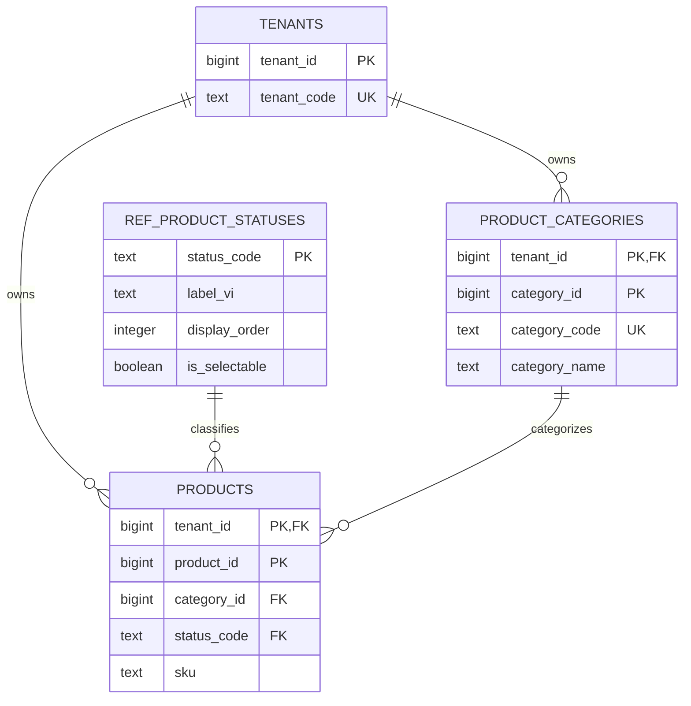

# Thiết kế bảng danh mục và ràng buộc tham chiếu

Khi thiết kế một hệ thống bán hàng, các trường như **trạng thái sản phẩm**, **loại sản phẩm**, **đơn vị tính**, **quốc gia**, **phương thức giao hàng** thường nhận giá trị từ một tập có kiểm soát. Nếu mỗi bảng giao dịch tự lưu chuỗi tùy ý như `"Đang bán"`, `"đang bán"`, `"ACTIVE"` hoặc `"on sale"`, hệ thống có thể hiểu cùng một trạng thái thành nhiều giá trị khác nhau. Nếu lập trình viên sửa tên hiển thị, hàng triệu dòng giao dịch có thể phải được cập nhật hoặc trở nên khó tổng hợp.

**Bảng danh mục** (*reference table*, *lookup table*, *code table*) lưu những giá trị được hệ thống công nhận và các thuộc tính mô tả chúng. **Khóa ngoại** (*foreign key*, FK) từ bảng nghiệp vụ tới bảng danh mục bảo đảm rằng **giá trị được tham chiếu tồn tại**. Cách thiết kế này đưa các quy tắc về miền giá trị và liên kết từ mô tả bằng lời sang một lược đồ quan hệ có thể kiểm chứng.

Bài học thuộc chương **Mô hình quan hệ** của module **DATABASE_DATA_MODELING**. Mục tiêu là chuyển yêu cầu nghiệp vụ thành bảng, khóa, quan hệ, ràng buộc và chỉ mục rõ ràng; nhận biết giới hạn của FK khi danh mục có vòng đời, quyền truy cập hoặc hiệu lực theo thời gian; sau đó cân nhắc cách biểu diễn tương ứng trong document, graph và mô hình phân tích. Ví dụ SQL sử dụng **PostgreSQL 15+**; những hệ quản trị khác có thể có cú pháp và hành vi khác.

## 1. Bảng danh mục dùng để trả lời câu hỏi gì?

Xét hai yêu cầu của cửa hàng đa tenant (mỗi doanh nghiệp là một tenant):

1. Mọi sản phẩm đều có một **trạng thái** thuộc tập `DRAFT`, `PUBLISHED`, `ARCHIVED`. Trạng thái có mã máy đọc được, nhãn tiếng Việt và thứ tự hiển thị. Bộ trạng thái do toàn hệ thống quy định.
2. Mọi sản phẩm thuộc một **nhóm hàng** như “Điện thoại”, “Máy tính xách tay”. Mỗi tenant tự quản lý nhóm hàng và có thể dùng cùng mã `PHONE` mà không ảnh hưởng tenant khác.

Hai yêu cầu đều có “danh sách chọn”, nhưng vòng đời và phạm vi khác nhau:

| Thuộc tính | Danh mục trạng thái | Danh mục nhóm hàng |
|---|---|---|
| Ai sở hữu? | Chủ sản phẩm/hệ thống | Quản trị viên của từng tenant |
| Khóa nghiệp vụ ví dụ | `DRAFT`, `PUBLISHED` | `PHONE`, `LAPTOP`, **trong tenant** |
| Có thể đổi nhãn? | Có, nếu không đổi nghĩa của mã | Có |
| Có thể thêm mục bằng giao diện quản trị? | Thường phải theo quy trình thay đổi sản phẩm | Có thể, tùy quyền |
| Quan hệ với `products` | Một trạng thái được nhiều sản phẩm tham chiếu | Một nhóm hàng có nhiều sản phẩm |
| Khi mục không còn cho chọn mới? | Thường vẫn phải đọc được dữ liệu cũ | Thường vẫn phải tra cứu được sản phẩm lịch sử |

Vì vậy, **“bảng danh mục” không đồng nghĩa “bảng nhỏ, ít thay đổi, có thể xóa tùy ý”**. Một số danh mục là dữ liệu chuẩn ít đổi, như mã tiền tệ; một số là dữ liệu nghiệp vụ được quản lý thường xuyên, như nhóm hàng của từng cửa hàng.

### Phân biệt danh mục với thực thể nghiệp vụ

Một danh mục trả lời “giá trị này thuộc tập nào và mang nghĩa gì?”; thực thể nghiệp vụ có thể có danh tính, người sở hữu, giao dịch và vòng đời riêng. Ví dụ `customer_statuses` là danh mục; `customers` là các thực thể khách hàng. `product_categories` có thể là danh mục nghiệp vụ có cây phân cấp và người quản trị, nhưng `products` không phải danh mục chỉ vì thường được hiển thị trong một danh sách.

Không phải mọi trường có ít giá trị đều cần một bảng mới: nếu trường `is_gift` chỉ nhận `TRUE`/`FALSE` với nghĩa rõ ràng, dùng `BOOLEAN` thường đơn giản hơn tạo bảng `yes_no`. Quyết định cần xét ngữ nghĩa, thay đổi giá trị, thông tin mô tả và các nơi cùng tham chiếu.

## 2. Phát biểu bất biến trước khi viết DDL

Đối với ví dụ sản phẩm, cần thống nhất ít nhất các quy tắc sau:

| Mã | Bất biến / chính sách | Nơi có thể bảo vệ |
|---|---|---|
| R-01 | Mỗi mã trạng thái được hệ thống công nhận là duy nhất, không rỗng | PK/`UNIQUE`, `NOT NULL`, `CHECK` |
| R-02 | Mỗi sản phẩm tham chiếu đúng một mã trạng thái tồn tại | `NOT NULL` + FK tới bảng trạng thái |
| R-03 | Mã nhóm hàng duy nhất **trong một tenant** | `UNIQUE (tenant_id, category_code)` |
| R-04 | Sản phẩm chỉ tham chiếu nhóm hàng **cùng tenant** | FK ghép `(tenant_id, category_id)` |
| R-05 | Không xóa vật lý danh mục còn được sản phẩm tham chiếu | `ON DELETE RESTRICT` hoặc chính sách kiểm tra tương đương |
| R-06 | Mục đã ngừng sử dụng không được gán cho sản phẩm mới | Cổng ghi/transaction kiểm tra trạng thái khả dụng; **FK đơn thuần chưa đủ** |
| R-07 | Có thể đọc chính xác nhãn/ý nghĩa danh mục của giao dịch quá khứ | Lịch sử phiên bản, snapshot hoặc chính sách nhãn bất biến theo nhu cầu |
| R-08 | Chỉ người được cấp quyền mới thay đổi danh mục của tenant | Phân quyền ứng dụng/database, có thể kèm Row-Level Security |

Các quy tắc trên không cùng bản chất. R-01 đến R-05 có thể mô hình hóa khá trực tiếp bằng constraint. R-06 phụ thuộc **trạng thái của dòng danh mục**; R-07 liên quan **thời gian**; R-08 liên quan **quyền**. Đặt FK rồi cho rằng đã đáp ứng cả tám quy tắc là đánh giá quá cao khả năng của FK.

Trước khi thiết kế, cũng cần xác định một mã có thể **được đổi**, **được dùng lại sau khi xóa**, hoặc **đổi nghĩa theo thời gian** không. Các quyết định này chi phối khóa chính, lịch sử và dữ liệu tham chiếu.

## 3. Khóa tự nhiên, khóa kỹ thuật và khóa duy nhất theo phạm vi

Có hai cách định danh phổ biến cho mục danh mục.

**Khóa tự nhiên (business/natural key).** Mã `DRAFT` là một định danh có nghĩa nghiệp vụ, có thể dùng làm khóa chính khi mã ổn định, ngắn, được quản trị chặt chẽ và không bị sử dụng lại cho nghĩa khác. Sản phẩm lưu `status_code = 'DRAFT'` và FK trực tiếp đến mã này.

**Khóa kỹ thuật (surrogate key).** Nhóm hàng được định danh bằng `category_id` ổn định, còn `category_code` là mã nghiệp vụ duy nhất trong tenant. Nhãn hoặc mã hiển thị có thể được điều chỉnh theo chính sách mà không làm đổi ID trong bảng sản phẩm.

| Câu hỏi | Khi ưu tiên mã nghiệp vụ làm PK | Khi ưu tiên ID kỹ thuật |
|---|---|---|
| Mã có chắc chắn ổn định không? | Có, nằm trong một chuẩn rõ ràng | Có thể đổi tên/mã hoặc tồn tại nhiều nguồn |
| Mã có ngắn và dễ chuẩn hóa không? | Thường có | Không nhất thiết |
| Phạm vi duy nhất | Toàn hệ thống hoặc đã có định danh ghép rõ | Có thể theo tenant, phiên bản, nguồn |
| Các bảng tham chiếu | Lưu mã rõ nghĩa, không cần join để đọc mã | Lưu ID ổn định; join để đọc mã/nhãn |
| Rủi ro sửa mã | Đổi PK có thể ảnh hưởng rất nhiều FK | Đổi mã nghiệp vụ không làm đổi FK |

**Không có quy tắc “mọi bảng danh mục đều phải có `id` tự tăng”**. Nhưng dù chọn khóa nào, hãy giữ **ràng buộc duy nhất của mã nghiệp vụ** nếu mã phải duy nhất. Một surrogate key chỉ đảm bảo ID không trùng; nó không tự ngăn hai dòng `PHONE` cùng tenant.

### Chọn phạm vi duy nhất

`UNIQUE (category_code)` là sai nếu mã `PHONE` được phép xuất hiện ở nhiều tenant. `UNIQUE (tenant_id, category_code)` diễn đạt chính xác “một mã trong một tenant”.

Ngược lại, nếu `status_code` là mã chuẩn dùng chung toàn hệ thống, thêm `tenant_id` không cần thiết có thể tạo ra các dòng `PUBLISHED` với nghĩa khác nhau ở từng tenant, làm khó kiểm soát thống nhất. Phạm vi **global**, **tenant**, **quốc gia**, **nguồn dữ liệu** hay **phiên bản** phải do yêu cầu nghiệp vụ quyết định.

Tên hiển thị thường không phải khóa tốt: “Điện thoại” có thể được đổi thành “Điện thoại di động”, dịch sang ngôn ngữ khác hoặc trùng với nhãn ở một nhánh khác. Nên tách `code` định danh với `display_name` để cho phép đổi nhãn không làm đổi tham chiếu.

## 4. Lược đồ mẫu: trạng thái toàn hệ thống và nhóm hàng theo tenant

Thiết kế sau dùng bốn bảng: `tenants`, `ref_product_statuses`, `product_categories` và `products`.



### 4.1. DDL PostgreSQL 15+

```sql
CREATE TABLE tenants (
    tenant_id BIGINT PRIMARY KEY,
    tenant_code TEXT NOT NULL,
    CONSTRAINT uq_tenants_code UNIQUE (tenant_code),
    CONSTRAINT ck_tenants_code
        CHECK (tenant_code = btrim(tenant_code)
               AND char_length(tenant_code) BETWEEN 1 AND 40)
);

-- Danh mục chuẩn, dùng chung toàn hệ thống.
CREATE TABLE ref_product_statuses (
    status_code TEXT PRIMARY KEY,
    label_vi TEXT NOT NULL,
    display_order INTEGER NOT NULL UNIQUE,
    is_selectable BOOLEAN NOT NULL DEFAULT TRUE,

    CONSTRAINT ck_product_status_code
        CHECK (status_code ~ '^[A-Z][A-Z0-9_]*$'),
    CONSTRAINT ck_product_status_label
        CHECK (btrim(label_vi) <> ''),
    CONSTRAINT ck_product_status_order
        CHECK (display_order > 0)
);

-- Danh mục nghiệp vụ, riêng cho từng tenant.
CREATE TABLE product_categories (
    tenant_id BIGINT NOT NULL,
    category_id BIGINT GENERATED ALWAYS AS IDENTITY,
    category_code TEXT NOT NULL,
    category_name TEXT NOT NULL,
    is_selectable BOOLEAN NOT NULL DEFAULT TRUE,

    CONSTRAINT pk_product_categories
        PRIMARY KEY (tenant_id, category_id),
    CONSTRAINT uq_category_code_per_tenant
        UNIQUE (tenant_id, category_code),
    CONSTRAINT fk_category_tenant
        FOREIGN KEY (tenant_id)
        REFERENCES tenants (tenant_id)
        ON DELETE RESTRICT,
    CONSTRAINT ck_category_code
        CHECK (category_code = btrim(category_code)
               AND char_length(category_code) BETWEEN 1 AND 60),
    CONSTRAINT ck_category_name
        CHECK (btrim(category_name) <> '')
);

-- Bảng nghiệp vụ tham chiếu cả hai danh mục.
CREATE TABLE products (
    tenant_id BIGINT NOT NULL,
    product_id BIGINT GENERATED ALWAYS AS IDENTITY,
    sku TEXT NOT NULL,
    product_name TEXT NOT NULL,
    category_id BIGINT NOT NULL,
    status_code TEXT NOT NULL DEFAULT 'DRAFT',

    CONSTRAINT pk_products PRIMARY KEY (tenant_id, product_id),
    CONSTRAINT uq_product_sku_per_tenant
        UNIQUE (tenant_id, sku),
    CONSTRAINT fk_product_tenant
        FOREIGN KEY (tenant_id)
        REFERENCES tenants (tenant_id)
        ON DELETE RESTRICT,
    CONSTRAINT fk_product_category
        FOREIGN KEY (tenant_id, category_id)
        REFERENCES product_categories (tenant_id, category_id)
        ON UPDATE RESTRICT ON DELETE RESTRICT,
    CONSTRAINT fk_product_status
        FOREIGN KEY (status_code)
        REFERENCES ref_product_statuses (status_code)
        ON UPDATE RESTRICT ON DELETE RESTRICT,
    CONSTRAINT ck_product_sku
        CHECK (sku = btrim(sku) AND sku <> ''),
    CONSTRAINT ck_product_name
        CHECK (btrim(product_name) <> '')
);

-- Hỗ trợ truy vấn theo nhóm hàng và kiểm tra FK chiều bảng con.
CREATE INDEX ix_products_tenant_category
    ON products (tenant_id, category_id);
```

**Phạm vi FK:** `(tenant_id, category_id)` của `products` tham chiếu chính cặp `(tenant_id, category_id)` của `product_categories`. Vì hai cột ở bảng con đều `NOT NULL`, một sản phẩm tenant 42 không thể lấy nhóm hàng của tenant 43. Nếu chỉ tham chiếu `category_id` mà không có thiết kế bảo vệ tenant tương ứng, rất dễ bỏ sót điều kiện sở hữu.

**FK tới danh mục toàn cục:** `products.status_code` tham chiếu trực tiếp `ref_product_statuses.status_code` vì trạng thái là tập mã dùng chung, không thuộc một tenant riêng.

**Ý nghĩa của `is_selectable`:** cờ này phục vụ **chính sách được gán cho sản phẩm mới hoặc khi đổi phân loại**. Nó không phải `CHECK` của `products` và không ảnh hưởng khả năng FK tìm thấy dòng danh mục. Sản phẩm cũ có thể tiếp tục tham chiếu một mục đã ngừng cho chọn mới.

**Tham chiếu tới tenant:** cả hai bảng nghiệp vụ cũng tham chiếu `tenants` để không tạo dữ liệu cho tenant không tồn tại. Khóa ngoại ghép giữa sản phẩm–nhóm hàng bảo vệ tính cùng tenant, nhưng **không thay thế phân quyền truy cập** tới tenant.

### 4.2. Nạp danh mục và dữ liệu tham chiếu

```sql
INSERT INTO tenants (tenant_id, tenant_code)
VALUES (42, 'STORE-42'), (43, 'STORE-43');

INSERT INTO ref_product_statuses
    (status_code, label_vi, display_order)
VALUES
    ('DRAFT', 'Bản nháp', 10),
    ('PUBLISHED', 'Đã công bố', 20),
    ('ARCHIVED', 'Đã lưu trữ', 30);

INSERT INTO product_categories
    (tenant_id, category_code, category_name)
VALUES
    (42, 'PHONE', 'Điện thoại'),
    (42, 'LAPTOP', 'Máy tính xách tay'),
    (43, 'PHONE', 'Thiết bị di động');

-- Dùng mã nghiệp vụ để tìm ID, không giả định identity bằng số cố định.
INSERT INTO products
    (tenant_id, sku, product_name, category_id, status_code)
SELECT 42, 'PHONE-A1', 'Điện thoại mẫu A1',
       c.category_id, 'DRAFT'
FROM product_categories AS c
WHERE c.tenant_id = 42 AND c.category_code = 'PHONE';
```

Ở đây mã `PHONE` xuất hiện tại cả tenant 42 và 43 nhưng không vi phạm `UNIQUE (tenant_id, category_code)`. Trạng thái `DRAFT` chỉ có **một dòng** được dùng chung trong bảng `ref_product_statuses`.

Lệnh `INSERT ... SELECT` trên chỉ tạo sản phẩm nếu tìm được nhóm hàng phù hợp. Nếu không có mã, nó có thể chèn **0 dòng mà không báo lỗi**; luồng nhập thực tế phải xác nhận số dòng được ghi, báo lỗi mã danh mục không tồn tại và dùng transaction. `UNIQUE` bảo đảm trong một tenant mã `PHONE` cho tối đa một nhóm hàng, nên truy vấn tìm mã không vô tình trả hai dòng.

### 4.3. Truy vấn sản phẩm kèm nhãn danh mục

```sql
SELECT
    p.tenant_id,
    p.product_id,
    p.sku,
    p.product_name,
    c.category_code,
    c.category_name,
    s.status_code,
    s.label_vi AS status_label
FROM products AS p
JOIN product_categories AS c
  ON c.tenant_id = p.tenant_id
 AND c.category_id = p.category_id
JOIN ref_product_statuses AS s
  ON s.status_code = p.status_code
WHERE p.tenant_id = 42
ORDER BY p.sku;
```

Một lần cập nhật tên “Điện thoại” thành “Điện thoại di động” chỉ thay **một dòng danh mục**; sản phẩm vẫn tham chiếu đúng `category_id`, và truy vấn sẽ thấy nhãn mới. Điều này phù hợp cho **màn hình hiện tại**. Nếu báo cáo quá khứ cần nhãn tại thời điểm giao dịch, phải có cách lưu lịch sử hoặc snapshot như phân tích ở phần sau.

## 5. Vì sao chuẩn hóa thuộc tính danh mục ra bảng riêng?

Giả sử mỗi sản phẩm tự lưu cả `status_code` và `status_label`:

| `sku` | `status_code` | `status_label` |
|---|---|---|
| PHONE-A1 | DRAFT | Bản nháp |
| PHONE-B2 | DRAFT | Bản nháp |
| LAPTOP-C3 | PUBLISHED | Đã công bố |

Ta có phụ thuộc hàm kỳ vọng:

\[
status\_code \rightarrow status\_label
\]

Nếu cùng mã `DRAFT` có thể mang hai nhãn khác nhau mà không có chính sách phiên bản hay ngôn ngữ, dữ liệu chứa dư thừa và xảy ra **update anomaly**: đổi nhãn phải sửa nhiều sản phẩm; sửa thiếu tạo ra các giá trị không nhất quán.

Chuyển cặp `(status_code, label_vi)` thành bảng `ref_product_statuses` làm cho:

- Danh mục có một nơi ghi nhận mã, nhãn, thứ tự và trạng thái khả dụng.
- `products` chỉ cần lưu mã trạng thái, không lặp thuộc tính mô tả ở từng sản phẩm.
- FK loại bỏ mã trạng thái không tồn tại, trong khi PK/UNIQUE loại bỏ mã danh mục trùng.
- Những bảng nghiệp vụ khác có thể tham chiếu cùng một tập giá trị, **nếu chúng thực sự dùng cùng ngữ nghĩa trạng thái**.

Không có nghĩa tất cả các trường tên/nhãn nên được tách ra. Nếu nhãn là **snapshot bắt buộc giữ nguyên tại thời điểm giao dịch** (ví dụ tên hàng ghi trên hóa đơn), lưu bản chụp là một quyết định nghiệp vụ hợp lệ, không phải lỗi chuẩn hóa cần xóa bỏ. Phải phân biệt **thuộc tính danh mục hiện tại** với **thông tin lịch sử được chốt**.

### Danh mục khác với danh sách giá trị trong ứng dụng

Đặt các mã ở một file cấu hình hoặc enum trong code cũng giúp tránh gõ sai khi lập trình, nhưng cơ sở dữ liệu **không tự biết** danh sách code hợp lệ trừ khi có `CHECK`, enum type hoặc FK. Nếu một script khác ghi trực tiếp chuỗi `PUBLSHED` sai chính tả và cột chỉ là `TEXT`, cơ sở dữ liệu vẫn có thể nhận dòng đó.

Nguồn chân lý của **tập mã hợp lệ** cần được xác định và triển khai nhất quán với DDL, migration và client API.

## 6. Chọn giữa `CHECK`, enum type và bảng danh mục

Không phải danh sách giá trị nào cũng nên dùng bảng tham chiếu. Ba cách dưới đây có phạm vi phù hợp khác nhau.

| Tiêu chí | `CHECK (value IN (...))` | Enum type của DB | Bảng danh mục + FK |
|---|---|---|---|
| Tập nhỏ, gần như bất biến | Rất phù hợp | Phù hợp khi engine hỗ trợ | Có thể hơi nặng |
| Cần nhãn, thứ tự, mô tả | Không có chỗ lưu riêng | Thường không có chỗ lưu riêng | Có cột dữ liệu |
| Người quản trị thêm/bỏ mục | Cần thay DDL | Thường cần thay schema/type | Có thể quản lý bằng DML và quyền |
| Nhiều bảng tham chiếu cùng nghĩa | Có thể lặp `CHECK` | Có thể dùng cùng kiểu enum | FK tới một bảng chung |
| Kiểm tra mục còn cho chọn mới | Phải thêm logic ngoài `CHECK` | Phải thêm logic | Có trạng thái để kiểm tra, nhưng FK **chưa tự kiểm tra trạng thái** |
| Lịch sử/phiên bản/đa ngôn ngữ | Cần cấu trúc bổ sung | Cần cấu trúc bổ sung | Dễ mở rộng bằng bảng phụ và khóa |
| Đơn giản của truy vấn | Không cần join nhãn | Không cần join nhãn | Join khi cần thuộc tính danh mục |

**Chọn `CHECK`** khi tập giá trị rất nhỏ, có ý nghĩa riêng một bảng và chỉ đổi qua triển khai lược đồ. Ví dụ `payment_direction IN ('IN', 'OUT')` nếu chỉ có hai hướng và không cần metadata.

**Chọn enum type** khi muốn kiểu mạnh tại cơ sở dữ liệu và tập giá trị ổn định, trong giới hạn của engine. PostgreSQL hỗ trợ enum nhưng thao tác xóa hoặc sắp xếp lại giá trị không đơn giản như quản lý dữ liệu trong bảng.

**Chọn bảng danh mục** khi các mã có nhãn/thuộc tính, cần tra cứu từ nhiều bảng, có chủ sở hữu quản trị, ngừng sử dụng, nội địa hóa hoặc phiên bản. Bảng danh mục tạo thêm join và quy trình duy trì dữ liệu; lợi ích phải được biện minh bằng nhu cầu thật.

Dù dùng cách nào, **thay đổi danh sách giá trị phải có chính sách tương thích với dữ liệu cũ**. Xóa một giá trị từng được giao dịch sử dụng có thể làm mất nghĩa lịch sử hoặc khiến migration thất bại.

## 7. Chính sách xóa, ngừng sử dụng và sửa mã

Một câu hỏi quan trọng là: **người quản trị có được xóa một mục danh mục khi sản phẩm còn tham chiếu hay không?**

| Chính sách FK | Hành vi nếu xóa mục danh mục | Đánh giá |
|---|---|---|
| `ON DELETE RESTRICT` | Từ chối xóa nếu còn bản ghi tham chiếu | Thường hợp lý với mã trạng thái/nhóm hàng đã dùng |
| `ON DELETE NO ACTION` | Kiểm tra theo thời điểm áp dụng ràng buộc; có thể trì hoãn nếu FK `DEFERRABLE` trong PostgreSQL | Cần hiểu giao dịch và thời điểm kiểm tra |
| `ON DELETE CASCADE` | Xóa luôn bản ghi nghiệp vụ đang tham chiếu | Thường **nguy hiểm** nếu xóa một trạng thái lại xóa sản phẩm/đơn hàng |
| `ON DELETE SET NULL` | Thay FK ở bảng con bằng `NULL` | Chỉ phù hợp khi quan hệ là tùy chọn và cột cho phép `NULL` |
| `ON UPDATE CASCADE` | Khi khóa danh mục đổi, cập nhật FK tương ứng | Có thể dùng nếu khóa tự nhiên thực sự cần thay đổi; cần đánh giá tác động |

Trong lược đồ mẫu, `ON DELETE RESTRICT` và `ON UPDATE RESTRICT` giữ các mã/ID đã tham chiếu ổn định. Đặc biệt, xóa trạng thái `PUBLISHED` không nên dẫn tới việc xóa hàng nghìn sản phẩm đã công bố.

### Ngừng cho chọn mới khác với xóa dòng

Có thể cập nhật:

```sql
UPDATE product_categories
SET is_selectable = FALSE
WHERE tenant_id = 42 AND category_code = 'PHONE';
```

Dữ liệu sản phẩm cũ vẫn tham chiếu `PHONE` và có thể được đọc bình thường. Đây là ưu điểm của **ngừng sử dụng mềm** (*retire/deactivate*) thay vì xóa hẳn danh mục.

Nhưng hãy chú ý: **FK chỉ kiểm tra `category_id` tồn tại**, không kiểm tra `is_selectable = TRUE`. Nếu có một sản phẩm mới được gán nhóm `PHONE` đã ngừng sử dụng, FK vẫn hợp lệ. Cần thêm cổng nghiệp vụ ở đường ghi nếu quy tắc là “không được gán mục ngừng sử dụng cho sản phẩm mới”.

Tương tự với trạng thái `PUBLISHED`: `is_selectable = FALSE` có thể có nghĩa ngừng cho gán, nhưng những sản phẩm cũ đang `PUBLISHED` vẫn tồn tại hợp lệ. Nếu việc ngừng trạng thái làm thay đổi ngữ nghĩa của các sản phẩm cũ, phải có kế hoạch chuyển đổi riêng; không coi `is_selectable` là công tắc xóa toàn bộ quan hệ.

### Không tái sử dụng mã cũ cho nghĩa mới

Nếu `PHONE` từng có nghĩa “thiết bị điện thoại”, sau đó được ngừng sử dụng, việc dùng lại `PHONE` cho “phụ kiện điện thoại” có thể khiến dữ liệu cũ bị diễn giải sai. Một chính sách an toàn là **không tái sử dụng cùng mã cho nghĩa khác**, ngay cả khi dòng cũ không còn được sử dụng mới. Nếu cần thay đổi hệ phân loại, tạo mã mới và bảng ánh xạ chuyển đổi có kiểm soát.

### Sửa nhãn và sửa định nghĩa không giống nhau

Sửa `category_name` do lỗi chính tả thường chỉ ảnh hưởng giao diện. Sửa **định nghĩa danh mục** có thể làm thay đổi tập sản phẩm thuộc nhóm, báo cáo và quyền truy cập. Nếu thay đổi bản chất, cần ghi phiên bản/hiệu lực và rà soát những tham chiếu hiện hữu. Không dùng cập nhật nhãn như cách ngầm thay đổi nghĩa của mã.

## 8. Ràng buộc “chỉ gán danh mục đang hoạt động” cần cơ chế gì?

Giả sử business yêu cầu:

> Tại thời điểm tạo sản phẩm hoặc đổi nhóm, nhóm hàng được chọn phải có `is_selectable = TRUE`.

Cách kiểm tra sơ sài:

1. Ứng dụng chạy `SELECT is_selectable FROM product_categories`.
2. Nếu thấy `TRUE`, vài giây sau mới `INSERT/UPDATE products`.

Khoảng giữa hai câu lệnh có thể xuất hiện thao tác từ quản trị viên đổi `is_selectable` thành `FALSE`. Một request đã đọc giá trị cũ vẫn cố gán nhóm, gây **race condition**.

### Kiểm tra trong một transaction có đồng bộ

Một cách xử lý trên PostgreSQL là sử dụng transaction, lấy khóa đọc đủ mạnh trên dòng danh mục và chỉ ghi khi kiểm tra thành công:

```sql
BEGIN;

-- Ví dụ: chọn nhóm hàng 42/101.
-- Nếu không trả về dòng, ứng dụng PHẢI hủy giao dịch.
SELECT category_id
FROM product_categories
WHERE tenant_id = 42
  AND category_id = 101
  AND is_selectable = TRUE
FOR SHARE;

-- Chỉ chạy nếu câu SELECT trước đó trả về đúng một dòng.
INSERT INTO products
    (tenant_id, sku, product_name, category_id, status_code)
VALUES (42, 'NEW-ITEM', 'Sản phẩm mới', 101, 'DRAFT');

COMMIT;
```

`101` là ID minh họa, cần thay bằng ID thực. Khóa `FOR SHARE` xung đột với những thao tác cập nhật dòng danh mục, vì vậy giúp tránh trường hợp quản trị viên đổi cờ khả dụng giữa bước kiểm tra và ghi trong **cùng transaction**. Phải bảo đảm tất cả đường ghi liên quan, kể cả script import và thao tác sửa sản phẩm, tuân thủ quy tắc; không cấp quyền ghi trực tiếp bypass cổng kiểm tra.

Đoạn SQL minh họa **cơ chế**, chưa phải một API production hoàn chỉnh: ứng dụng phải kiểm tra số dòng trả về, phân quyền người gọi, xử lý timeout/deadlock và retry, đồng thời quyết định nếu trạng thái danh mục thay đổi sau commit thì các sản phẩm cũ có được giữ nguyên hay phải chuyển nhóm.

Nếu cần bảo đảm mọi giao dịch chỉ gán mã trạng thái khi còn khả dụng, áp dụng nguyên tắc tương tự cho `ref_product_statuses`. Đối với **chuyển trạng thái hợp lệ** (ví dụ chỉ cho `DRAFT → PUBLISHED` sau khi kiểm tra thông tin sản phẩm), FK chỉ kiểm tra mã đích tồn tại; một **state machine** và cổng cập nhật mới bảo vệ được các cạnh chuyển đổi được phép.

### Có thể dùng FK tới tập “đang hoạt động” không?

Một unique index từng phần như `UNIQUE (...) WHERE is_selectable` không phải lúc nào cũng dùng được làm khóa đích FK; trong PostgreSQL, khóa đích FK phải thỏa điều kiện khóa chính/duy nhất phù hợp, **không phải chỉ mục unique từng phần**. Thêm FK rồi trỏ tới “view danh mục còn hoạt động” cũng không tự tạo được ràng buộc như FK bảng gốc.

Nếu muốn danh mục đã ngừng sử dụng vẫn phục vụ dữ liệu cũ nhưng cấm gán mới, việc kiểm tra trạng thái lúc ghi và cơ chế đồng bộ thường phải được thiết kế rõ ràng ngoài một FK đơn giản.

## 9. Danh mục dùng chung, danh mục theo tenant và phân quyền

Lược đồ đa tenant cần hai lớp kiểm soát khác nhau:

1. **Toàn vẹn cấu trúc:** một sản phẩm thuộc tenant 42 không tham chiếu nhóm của tenant 43. FK ghép `(tenant_id, category_id)` bảo vệ điều này.
2. **Quyền truy cập:** người dùng của tenant 42 không được đọc/chỉnh sửa danh mục tenant 43. FK **không bảo vệ** quyền này.

Quyền có thể được kiểm tra bởi lớp ứng dụng, database roles hoặc cơ chế **Row-Level Security (RLS)** phù hợp với kiến trúc. Một thao tác `INSERT` dùng đúng `tenant_id` và category_id tồn tại vẫn có thể là hành vi trái quyền nếu người gọi không được phép thao tác tenant đó. Thiết kế quyền là phần không thể bỏ qua khi dữ liệu danh mục có nhiều người quản trị.

### Có nên tạo bảng global và tenant trong cùng một bảng?

Một mô hình như `categories(tenant_id NULL, code, label)` với `NULL` biểu diễn danh mục toàn cục trông đơn giản, nhưng kéo theo nhiều câu hỏi:

- Khóa duy nhất có coi `NULL` là một giá trị hay không?
- FK từ bảng con tham chiếu đúng một trong hai phạm vi toàn cục/tenant như thế nào?
- Một mã global và mã tenant có thể trùng nhau không? Nếu trùng, dòng tenant có ghi đè nghĩa global không?
- Quyền chỉnh sửa giá trị global và tenant được tách ra sao?

Trong PostgreSQL, `UNIQUE` mặc định coi `NULL` ở các dòng khác nhau là không bằng nhau; một cột `tenant_id` để `NULL` có thể khiến kiểm tra trùng mã global không như mong đợi. Nếu nghiệp vụ cho phép **ghi đè danh mục chuẩn theo tenant**, cần thiết kế rõ quy tắc ưu tiên và khóa phân biệt; có thể sử dụng bảng global riêng và bảng override riêng thay vì một `tenant_id NULL` mơ hồ.

### Danh mục có quan hệ cha–con

Nếu nhóm hàng tạo thành cây, thêm `parent_category_id` vào `product_categories` sẽ tạo **khóa ngoại tự tham chiếu**:

```sql
ALTER TABLE product_categories
    ADD COLUMN parent_category_id BIGINT;

ALTER TABLE product_categories
    ADD CONSTRAINT fk_category_parent
        FOREIGN KEY (tenant_id, parent_category_id)
        REFERENCES product_categories (tenant_id, category_id)
        ON DELETE RESTRICT;

ALTER TABLE product_categories
    ADD CONSTRAINT ck_category_not_self_parent
        CHECK (parent_category_id IS NULL
               OR parent_category_id <> category_id);
```

Đoạn này là **phần mở rộng tùy chọn** cho lược đồ mẫu. Nó bảo vệ cha tồn tại và cùng tenant, nhưng không ngăn chu trình qua nhiều nút, ví dụ A → B → C → A. Cần thêm kiểm tra đệ quy khi đổi cha, transaction và chiến lược đồng bộ, hoặc chọn cấu trúc lưu cây khác khi workload yêu cầu. Không coi cây danh mục là hệ thống đơn giản chỉ vì nó nằm trong bảng lookup.

## 10. Đa ngôn ngữ: mã ổn định, nhãn có nhiều bản dịch

Nếu ứng dụng hiển thị tiếng Việt và tiếng Anh, không nên sao chép thành hai dòng mã `PUBLISHED_VI` và `PUBLISHED_EN`. Hai mã ấy dễ bị hiểu thành hai trạng thái khác nhau trong khi nghiệp vụ chỉ có một trạng thái `PUBLISHED`.

Một bảng bản dịch riêng làm rõ quan hệ **một mã – nhiều ngôn ngữ**:

```sql
CREATE TABLE product_status_translations (
    status_code TEXT NOT NULL,
    locale TEXT NOT NULL,
    display_label TEXT NOT NULL,
    description TEXT,

    CONSTRAINT pk_product_status_translations
        PRIMARY KEY (status_code, locale),
    CONSTRAINT fk_status_translation
        FOREIGN KEY (status_code)
        REFERENCES ref_product_statuses (status_code)
        ON DELETE RESTRICT,
    CONSTRAINT ck_translation_locale
        CHECK (locale IN ('vi', 'en')),
    CONSTRAINT ck_translation_label
        CHECK (btrim(display_label) <> '')
);

INSERT INTO product_status_translations
    (status_code, locale, display_label)
VALUES
    ('DRAFT', 'vi', 'Bản nháp'),
    ('DRAFT', 'en', 'Draft'),
    ('PUBLISHED', 'vi', 'Đã công bố'),
    ('PUBLISHED', 'en', 'Published');
```

Cặp `(status_code, locale)` là khóa chính, ngăn một mã có hai bản dịch cho cùng locale. FK bảo đảm bản dịch không tham chiếu trạng thái không tồn tại. Nhưng FK **không buộc mọi trạng thái phải có đủ bản dịch**; nếu bắt buộc hỗ trợ đủ `vi` và `en` trước khi công bố, cần quy trình kiểm tra tính đầy đủ hoặc ràng buộc bổ trợ.

Ví dụ truy vấn ưu tiên bản dịch tiếng Anh, rồi quay về nhãn tiếng Việt mặc định:

```sql
SELECT
    p.sku,
    p.status_code,
    COALESCE(t.display_label, s.label_vi) AS status_label
FROM products AS p
JOIN ref_product_statuses AS s
  ON s.status_code = p.status_code
LEFT JOIN product_status_translations AS t
  ON t.status_code = s.status_code
 AND t.locale = 'en'
WHERE p.tenant_id = 42;
```

`ref_product_statuses.label_vi` là nhãn mặc định cho ví dụ ban đầu. Khi bảng dịch trở thành nguồn chân lý cho mọi nhãn, có thể bỏ cột này theo kế hoạch migration và dùng chính sách fallback có kiểm soát. Không duy trì hai nơi sửa nhãn không đồng bộ lâu dài.

## 11. Danh mục có hiệu lực theo thời gian và dữ liệu lịch sử

Một vấn đề khó hơn xuất hiện khi danh mục **thay đổi ý nghĩa hoặc phân loại theo thời gian**.

Ví dụ nhóm `PHONE` trước ngày 01/01 năm sau bao gồm điện thoại thông minh và điện thoại cơ bản; sau đó đội nghiệp vụ tách thành `SMARTPHONE` và `FEATURE_PHONE`. Báo cáo theo danh mục **hiện tại** có thể cần ánh xạ lại sản phẩm, nhưng báo cáo doanh thu **tháng trước** có thể phải giữ cách phân nhóm tại thời điểm bán.

Có ba cách xử lý thường gặp:

| Nhu cầu | Cách tiếp cận | Hệ quả |
|---|---|---|
| Chỉ cần nhãn hiện tại | Sửa dòng danh mục, giữ `category_id` | Rẻ và đơn giản; báo cáo quá khứ cũng thấy nhãn mới |
| Cần giữ nhãn đã in/chốt | Lưu `category_name_snapshot` hoặc `product_name_snapshot` trong dòng giao dịch | Giữ chứng từ ổn định; có dữ liệu snapshot có chủ đích |
| Cần lịch sử **cấu trúc phân loại** | Bảng phiên bản/hiệu lực của danh mục hoặc bảng lịch sử quan hệ phân loại | Truy vấn phức tạp hơn; bảo đảm kết quả “tại thời điểm T” |

Không thể chỉ thêm `valid_from`, `valid_until` vào dòng danh mục đang được FK tham chiếu rồi cập nhật chúng khi quy tắc đổi, vì sẽ mất các giá trị trước. Nếu cần tái hiện lịch sử, phải **giữ phiên bản cũ**, định nghĩa khóa phiên bản và khoảng hiệu lực.

### Một mô hình phiên bản tối giản

Một bảng bổ trợ có thể lưu nhãn/định nghĩa nhóm hàng qua các giai đoạn:

```sql
CREATE TABLE product_category_versions (
    tenant_id BIGINT NOT NULL,
    category_id BIGINT NOT NULL,
    version_no INTEGER NOT NULL,
    category_name TEXT NOT NULL,
    definition TEXT NOT NULL,
    valid_from TIMESTAMPTZ NOT NULL,
    valid_until TIMESTAMPTZ,

    CONSTRAINT pk_category_versions
        PRIMARY KEY (tenant_id, category_id, version_no),
    CONSTRAINT fk_category_version_parent
        FOREIGN KEY (tenant_id, category_id)
        REFERENCES product_categories (tenant_id, category_id)
        ON DELETE RESTRICT,
    CONSTRAINT ck_category_version_no
        CHECK (version_no > 0),
    CONSTRAINT ck_category_version_name
        CHECK (btrim(category_name) <> ''),
    CONSTRAINT ck_category_version_interval
        CHECK (valid_until IS NULL OR valid_until > valid_from)
);
```

Bảng này **chưa tự ngăn hai phiên bản có khoảng hiệu lực chồng lên nhau**. Muốn bảo đảm một danh mục chỉ có một định nghĩa hiệu lực tại thời điểm T, cần thêm cơ chế chống chồng khoảng (ví dụ exclusion constraint PostgreSQL với extension/opclass phù hợp), đường ghi đồng bộ và kiểm tra không có khoảng trống nếu nghiệp vụ yêu cầu liên tục.

Quan trọng hơn: **chọn được phiên bản danh mục** mới là một nửa bài toán. Nếu sản phẩm được chuyển từ `PHONE` sang `SMARTPHONE`, lịch sử `products.category_id` cũng cần lưu biến động hoặc bản chụp tại thời điểm bán để tái hiện phân loại cũ. Một bảng phiên bản cho nhãn không thể tự phục hồi lịch sử liên kết đã bị ghi đè ở bảng sản phẩm.

### Sự khác nhau giữa “hợp lệ lúc đó” và “đang còn hợp lệ”

Một bản ghi giao dịch năm trước vẫn có thể tham chiếu mã `OLD_METHOD` đã ngừng dùng hôm nay; về mặt **lịch sử**, tham chiếu ấy đúng. Hệ thống có thể giữ hàng cũ và cấm giao dịch mới dùng mã ấy. Đây là một yêu cầu khác với kiểm tra mã tồn tại, vì điều kiện còn phụ thuộc thời điểm tạo/chuyển trạng thái của giao dịch.

Hãy nêu rõ người dùng muốn báo cáo theo **định nghĩa hiện tại**, **định nghĩa có hiệu lực lúc phát sinh**, hay **định nghĩa tại ngày bất kỳ**. Ba lựa chọn cho kết quả khác nhau và cần chiến lược lưu trữ khác nhau.

## 12. Bảng danh mục một–nhiều hay cần bảng liên kết nhiều–nhiều?

Trong lược đồ mẫu, mỗi sản phẩm thuộc đúng **một** nhóm hàng tại thời điểm hiện tại; `products.category_id` là FK 1:N từ nhóm hàng sang sản phẩm.

Nếu nghiệp vụ thay đổi thành “một sản phẩm có thể nằm trong nhiều nhóm hàng”, một FK đơn sẽ không đủ. Ta chuyển sang bảng liên kết:

```sql
-- Biến thể lược đồ khi một sản phẩm có nhiều nhóm hàng:
CREATE TABLE product_category_assignments (
    tenant_id BIGINT NOT NULL,
    product_id BIGINT NOT NULL,
    category_id BIGINT NOT NULL,
    assigned_at TIMESTAMPTZ NOT NULL DEFAULT CURRENT_TIMESTAMP,

    CONSTRAINT pk_category_assignments
        PRIMARY KEY (tenant_id, product_id, category_id),
    CONSTRAINT fk_assignment_product
        FOREIGN KEY (tenant_id, product_id)
        REFERENCES products (tenant_id, product_id)
        ON DELETE RESTRICT,
    CONSTRAINT fk_assignment_category
        FOREIGN KEY (tenant_id, category_id)
        REFERENCES product_categories (tenant_id, category_id)
        ON DELETE RESTRICT
);

CREATE INDEX ix_assignments_by_category
    ON product_category_assignments (tenant_id, category_id, product_id);
```

Đây là **biến thể thiết kế**: nếu áp dụng, cần quyết định có bỏ `products.category_id`, giữ nó làm “nhóm chính” hay định nghĩa quan hệ riêng để tránh hai nguồn phân loại mâu thuẫn. Không tạo bảng liên kết rồi bỏ mặc cột `category_id` cũ cùng mang nghĩa “tất cả nhóm hàng”.

Nếu có quan hệ 1:N hoặc N:M, khóa ngoại vẫn cần diễn đạt **cùng tenant**. Bảng liên kết phải có unique/PK để không lưu trùng một cặp sản phẩm–nhóm, trừ khi mỗi lần gán là một sự kiện riêng có danh tính/lịch sử.

## 13. Cách đánh chỉ mục và tổ chức truy vấn

Ràng buộc và chỉ mục đáp ứng hai mục tiêu khác nhau:

- **Đúng dữ liệu:** PK/UNIQUE/FK/`CHECK` ngăn một số trạng thái không hợp lệ.
- **Đủ nhanh:** chỉ mục và kế hoạch truy vấn giúp đọc/ghi đáp ứng workload thực tế.

PostgreSQL tự tạo chỉ mục cho PK/UNIQUE ở bảng danh mục; ví dụ `(tenant_id, category_code)` hỗ trợ tìm mã nhóm trong tenant. PostgreSQL **không tự động tạo chỉ mục ở mọi cột FK của bảng con**, vì thế `ix_products_tenant_category` có ý nghĩa khi thường tìm sản phẩm theo nhóm hoặc kiểm tra tác động của việc xóa/đổi khóa nhóm.

Một chỉ mục trên `products.status_code` có thể hữu ích khi cần lọc hàng triệu sản phẩm theo trạng thái hoặc kiểm tra bảng con khi sửa mã trạng thái, nhưng vì trạng thái thường có ít giá trị, hiệu quả phụ thuộc độ chọn lọc và số hàng. Không mặc định “mỗi FK phải thêm một index” mà không xem query plan và tải ghi.

### Truy vấn đọc danh mục được phép chọn

```sql
SELECT category_id, category_code, category_name
FROM product_categories
WHERE tenant_id = 42
  AND is_selectable = TRUE
ORDER BY category_name, category_id;
```

Danh sách trả về phù hợp cho form chọn nhóm, nhưng người dùng có thể giữ trang mở lâu rồi gửi ID đã hết hiệu lực. Vì vậy **lọc dropdown không thay thế kiểm tra tại thời điểm ghi**. Mặt khác, chỉ mục theo `is_selectable` có thể không giúp nhiều khi hầu hết nhóm đang được chọn; cần đo mức độ chọn lọc trước khi tối ưu.

### Tránh cache làm sai nghĩa của danh mục

Các danh mục ít đổi thường được cache ở ứng dụng. Cần trả lời:

- Danh mục được cập nhật qua đâu? Ai làm mới cache?
- Có chấp nhận một cửa sổ eventual consistency cho nhãn không?
- Với quy tắc “đã ngừng cho chọn”, cache cũ có được dùng để quyết định ghi không?
- Có cần mã phiên bản hoặc `updated_at` để phát hiện thay đổi không?

Cache phù hợp cho **hiển thị** nếu cho phép chậm một chút; với quyết định chặn gán mới, đường ghi phải dùng nguồn dữ liệu và cơ chế nhất quán đã được xác định. Đừng dựa hoàn toàn vào việc TTL cache sẽ hết đúng hạn.

## 14. Chuyển dữ liệu hiện hữu từ cột chuỗi sang FK

Hệ thống cũ có thể lưu trạng thái tự do trong `products.status_text`: `"Draft"`, `"DRAFT"`, `"Nháp"`, `"published"`. Trước khi tạo FK, phải lập quy tắc ánh xạ và xác định dữ liệu nào không thể tự động sửa.

Quy trình thực tế:

1. **Kiểm kê:** thống kê tập giá trị hiện có, `NULL`, chuỗi rỗng, lỗi gõ, mã cũ và mức sử dụng từng giá trị.
2. **Chốt mã chuẩn:** quyết định `DRAFT`, `PUBLISHED`, `ARCHIVED`; ghi người sở hữu nghĩa của từng mã và các trường hợp ngoại lệ.
3. **Tạo/bổ sung danh mục chuẩn:** bảo vệ tính duy nhất và miền giá trị của bảng danh mục.
4. **Tạo cột FK mới hoặc chuẩn hóa cột hiện hữu:** xử lý các giá trị ánh xạ được; giữ danh sách ngoại lệ để người chịu trách nhiệm quyết định.
5. **Backfill có đối soát:** xác nhận số dòng, kết quả ánh xạ theo tenant và mẫu dữ liệu quan trọng, không âm thầm bỏ dữ liệu nguồn.
6. **Thêm/kiểm chứng ràng buộc:** FK, `NOT NULL` khi dữ liệu đã đầy đủ; chọn chiến lược triển khai để giảm thời gian khóa bảng lớn.
7. **Chuyển đường ghi và đọc:** cập nhật API, import job, báo cáo; ngừng ghi hai định nghĩa trạng thái trong cùng bảng.
8. **Giám sát và dọn đường cũ:** kiểm tra lỗi FK, số mã không biết, tình trạng cache, rồi mới bỏ cột/luồng tương thích cũ theo kế hoạch.

Một truy vấn rà soát giá trị trạng thái trước chuyển đổi:

```sql
-- Ví dụ nếu products_legacy có cột status_text:
SELECT
    lower(btrim(status_text)) AS raw_normalized,
    COUNT(*) AS row_count
FROM products_legacy
GROUP BY lower(btrim(status_text))
ORDER BY row_count DESC;
```

Đây là truy vấn **minh họa** cho bảng cũ `products_legacy`, không phải bảng trong DDL phần 4. Việc chuẩn hóa `lower/btrim` chỉ giúp tìm các biến thể hình thức; không tự xác nhận `"done"` có cùng nghĩa với `PUBLISHED`.

Trong PostgreSQL, một số FK và `CHECK` có thể thêm với `NOT VALID` và kiểm chứng sau bằng `VALIDATE CONSTRAINT` để quản lý triển khai trên bảng lớn. Khóa duy nhất và `NOT NULL` có yêu cầu/mức khóa khác, cần thiết kế riêng. Không bật một ràng buộc khiến dữ liệu lịch sử hợp lệ theo quy tắc cũ thành lỗi nếu chưa có phương án chuyển đổi đã được duyệt.

### Tạo danh mục bằng migration, không bằng thao tác thủ công không kiểm soát

Với danh mục chuẩn nhỏ, seed data nên đi cùng migration có kiểm soát phiên bản. Ví dụ ứng dụng mới cần trạng thái `ARCHIVED` thì môi trường DB phải có dòng danh mục đó **trước khi ứng dụng ghi mã**. Không để ứng dụng tự tạo mã khi gặp FK lỗi; lỗi có thể đến từ mã gõ sai hoặc yêu cầu chưa được phê duyệt.

Seed dạng idempotent như `INSERT ... ON CONFLICT DO UPDATE` hữu ích cho đồng bộ nhãn, nhưng phải nêu rõ cột nào được phép cập nhật. **Không tự động ghi đè định nghĩa hoặc tái dùng mã** khi môi trường đang có dữ liệu nghiệp vụ tham chiếu.

## 15. So sánh khi lưu bằng document, graph và kho phân tích

Một mã danh mục có nghĩa độc lập công nghệ, nhưng mức cưỡng chế tham chiếu phụ thuộc mô hình dữ liệu.

| Mô hình | Biểu diễn thường gặp | Ràng buộc cần chú ý |
|---|---|---|
| **Quan hệ** | Bảng danh mục có PK/UNIQUE; bảng nghiệp vụ có FK | Kiểm tra tồn tại mạnh; trạng thái khả dụng và thời gian thường cần logic bổ sung |
| **Document** | Mã trong document và một collection chứa metadata; đôi khi nhúng bản sao nhãn | Tham chiếu chéo document thường không có FK tương đương; cần validation/transaction theo engine |
| **Graph** | Node danh mục; cạnh từ đối tượng tới node danh mục, hoặc property mã | Có thể dễ duyệt phân cấp; không mặc định cưỡng chế cardinality và quyền chỉ bằng một cạnh |
| **Phân tích/warehouse** | Dimension bảng mã, surrogate key theo phiên bản và fact tham chiếu | Cần chọn grain, version và “giá trị tại thời điểm giao dịch”; FK đôi khi chỉ là metadata, không thực thi |

**Ví dụ document:** một sản phẩm có `categoryId` và một snapshot `categoryName` để hiển thị nhanh. Nếu tên nhóm đổi, bản sao snapshot có thể cũ; phải quyết định đó là lịch sử cố ý hay lỗi đồng bộ. Nếu cần bảo vệ “categoryId tồn tại” ở nhiều document, engine có thể không cung cấp FK như PostgreSQL, nên quy trình ghi/cập nhật cần bù đắp.

**Ví dụ graph:** sản phẩm có cạnh `IN_CATEGORY` nối tới node danh mục. Nếu một sản phẩm chỉ được có một nhóm chính, phải kiểm tra hoặc cưỡng chế cardinality của cạnh; không suy ra từ việc nó là graph. Danh mục phân cấp có thể sử dụng cạnh `PARENT_OF`, nhưng vẫn cần ngăn chu trình nếu nghiệp vụ đòi một cây.

**Ví dụ warehouse:** một đơn hàng phát sinh khi nhóm của sản phẩm là “Điện thoại”, nhưng hôm nay nhóm đã chuyển thành “Thiết bị di động”. Báo cáo quá khứ phải biết dùng **dimension hiện tại** hay **dimension theo hiệu lực tại giao dịch**. Với slowly changing dimensions (ví dụ Type 2), một mã nghiệp vụ có thể có nhiều phiên bản dimension và fact phải liên kết đúng phiên bản nếu muốn giữ lịch sử.

## 16. Ma trận quyết định cho từng loại danh mục

| Tình huống | Hướng thiết kế khởi đầu | Điều cần kiểm chứng |
|---|---|---|
| Cờ đúng/sai, không có metadata | `BOOLEAN` | Nghĩa của `NULL`, mặc định |
| Ít trạng thái riêng một bảng, đổi rất hiếm | `CHECK` hoặc enum DB | Migration khi thêm/bỏ trạng thái |
| Tập mã chuẩn chia sẻ nhiều bảng, có nhãn | Bảng danh mục toàn cục, FK | Mã ổn định, chủ sở hữu, seed data |
| Nhóm hàng riêng mỗi tenant | Bảng danh mục có `tenant_id`, unique/FK ghép | Không tham chiếu chéo tenant, phân quyền |
| Danh mục có ngừng cho chọn mới | Cờ khả dụng + cổng ghi có kiểm tra | FK không kiểm tra cờ, xử lý giao dịch đồng thời |
| Danh mục đa ngôn ngữ | Bảng bản dịch theo `(code, locale)` | Bản dịch thiếu, fallback và nguồn nhãn chuẩn |
| Danh mục có nhiều phiên bản lịch sử | Bảng hiệu lực/phiên bản, quy tắc chọn tại thời điểm T | Khoảng chồng lắp, snapshot, lịch sử liên kết |
| Danh mục tạo thành cây | `parent_id` cùng tenant hoặc mô hình cây khác | Chu trình, chuyển nhánh, hiệu năng đọc cây |
| Một đối tượng thuộc nhiều mục danh mục | Bảng liên kết với PK/FK hai chiều | Trùng cặp, nhóm chính, vòng đời liên kết |

Điểm quyết định không nằm ở việc “có dropdown hay không” mà ở **bất biến**, **chủ sở hữu**, **phạm vi duy nhất**, **lịch sử cần giữ** và **đường ghi cần bảo vệ**.

## 17. Kiểm thử để xác nhận ràng buộc thực sự hoạt động

Với lược đồ `products`, `product_categories` và `ref_product_statuses` của phần 4:

| Trường hợp thử | Kết quả mong đợi |
|---|---|
| Chèn hai dòng trạng thái cùng `status_code = 'DRAFT'` | Bị PK từ chối |
| Chèn trạng thái có mã `draft` chữ thường | Bị `CHECK` từ chối theo chính sách ví dụ |
| Hai tenant cùng có `category_code = 'PHONE'` | Được phép |
| Một tenant có hai dòng nhóm `PHONE` | Bị `UNIQUE (tenant_id, category_code)` từ chối |
| Sản phẩm có `status_code = 'PUBLSHED'` | Bị FK trạng thái từ chối |
| Sản phẩm tenant 42 trỏ `category_id` chỉ tồn tại ở tenant 43 | Bị FK ghép nhóm hàng từ chối |
| Xóa nhóm hàng đang được sản phẩm tham chiếu | Bị `ON DELETE RESTRICT` từ chối |
| Đổi nhãn nhóm đã có sản phẩm | Thành công; ID và FK không đổi |
| Đặt `is_selectable = FALSE` trên nhóm đang được tham chiếu | FK vẫn cho phép; sản phẩm cũ tiếp tục tồn tại |
| Cố gán nhóm đã ngừng sử dụng cho sản phẩm mới | **FK vẫn cho phép**; phải bị cổng ghi nghiệp vụ từ chối |
| Hai giao dịch đồng thời, một ngừng nhóm và một gán nhóm | Không phát sinh thao tác trái chính sách nếu cổng ghi và khóa đã thiết kế đúng |
| Truy vấn nhãn tiếng Anh của mã chưa dịch | Dùng nhãn fallback đã định nghĩa |
| Tạo hai bản phiên bản danh mục có thời gian hiệu lực giao nhau | DDL bảng phiên bản minh họa **chưa chặn**; cần ràng buộc bổ sung |
| Truy vấn báo cáo lịch sử sau khi sản phẩm đổi nhóm | Phải dùng snapshot/lịch sử liên kết nếu yêu cầu “tại thời điểm T” |

Khi thử SQL gây lỗi, nên chạy từng ca trong transaction riêng hoặc dùng savepoint. Trong PostgreSQL, một câu lệnh lỗi thường đưa transaction hiện tại vào trạng thái phải rollback hoặc quay lại savepoint trước khi tiếp tục. Để kiểm tra đồng thời, cần hai phiên giao dịch thật và lịch thao tác có kiểm soát.

## 18. Bài tập thực hành: danh mục phương thức thanh toán

Hệ thống đơn hàng đa tenant lưu các phương thức `CASH`, `BANK_TRANSFER`, `WALLET`, với các yêu cầu:

- Phương thức thanh toán có **mã chuẩn toàn hệ thống**, nhãn tiếng Việt/tiếng Anh và thứ tự hiển thị.
- Tenant có thể **bật/tắt phương thức được phép dùng** cho đơn mới, nhưng không thể đổi nghĩa mã chuẩn.
- Mỗi đơn hàng có đúng một phương thức tại thời điểm thanh toán.
- Đơn cũ vẫn phải đọc được phương thức đã sử dụng khi tenant đã tắt phương thức đó.
- Sau một ngày nhất định, `BANK_TRANSFER` được đổi nhãn và áp dụng một chính sách xác nhận mới; báo cáo lịch sử cần giải thích đúng dữ liệu quá khứ.

Hãy thực hiện:

1. Phân biệt danh mục global `payment_methods` và bảng cấu hình theo tenant. Xác định khóa nghiệp vụ và phạm vi unique.
2. Vẽ ERD gồm `tenants`, `payment_methods`, `tenant_payment_methods` và `orders`; chỉ ra các FK cần có.
3. Viết DDL để `orders` chỉ tham chiếu phương thức được **cấu hình cho đúng tenant** (gợi ý: FK ghép `(tenant_id, method_code)` vào bảng cấu hình).
4. Giải thích vì sao FK tới `tenant_payment_methods` vẫn chưa bảo vệ điều kiện `enabled = TRUE` tại thời điểm tạo đơn; đề xuất cổng ghi có transaction phù hợp.
5. Lựa chọn `ON DELETE RESTRICT` hay `CASCADE` cho từng liên kết; giải thích chính sách lưu đơn lịch sử.
6. Thiết kế bảng bản dịch và quy tắc fallback khi một locale chưa có nhãn.
7. Đề xuất cách lưu phiên bản chính sách xác nhận và bản chụp cần thiết để giải thích đơn tại thời điểm quá khứ.
8. Viết bộ kiểm thử cho mã không tồn tại, sai tenant, trùng phương thức, phương thức bị tắt và hai transaction cập nhật cạnh tranh.
9. So sánh phương án dùng `CHECK IN (...)` với bảng danh mục trong yêu cầu có tenant override và hiệu lực thời gian.

**Tiêu chí đạt:** phân biệt rõ **giá trị danh mục tồn tại**, **tenant được phép dùng giá trị** và **giá trị còn hiệu lực tại thời điểm ghi**. Mỗi điều kiện cần một cơ chế bảo vệ tương ứng; chỉ một FK tới bảng global chưa đủ.

## 19. Những điều cần nhớ

- **Bảng danh mục** lưu tập mã được công nhận và metadata mô tả; **FK** bảo vệ sự tồn tại của giá trị tham chiếu.
- Chọn **khóa tự nhiên hay ID kỹ thuật** dựa trên tính ổn định của mã, phạm vi duy nhất, vòng đời và nhu cầu liên kết; luôn giữ unique nghiệp vụ khi cần.
- Danh mục global và theo tenant là **hai mô hình phạm vi khác nhau**. Với dữ liệu tenant, FK ghép giúp tránh tham chiếu chéo tenant, nhưng không thay thế phân quyền.
- Dùng `ON DELETE RESTRICT` có chủ đích khi cần giữ sản phẩm/đơn hàng cũ; ngừng cho sử dụng mới không đồng nghĩa xóa dòng danh mục.
- **`is_selectable` không phải ràng buộc FK.** Muốn cấm gán mới khi danh mục bị ngừng, cần cổng ghi và cơ chế đồng bộ tại thời điểm ghi.
- Phân biệt đổi **nhãn**, đổi **mã**, đổi **nghĩa**, đổi **trạng thái khả dụng** và đổi **phiên bản lịch sử**; mỗi loại thay đổi có hậu quả khác nhau.
- Đánh giá `CHECK`, enum, bảng danh mục, cấu trúc dịch thuật và lịch sử theo **bất biến, truy vấn, tốc độ thay đổi và khả năng kiểm chứng**, thay vì tạo bảng lookup theo thói quen.
