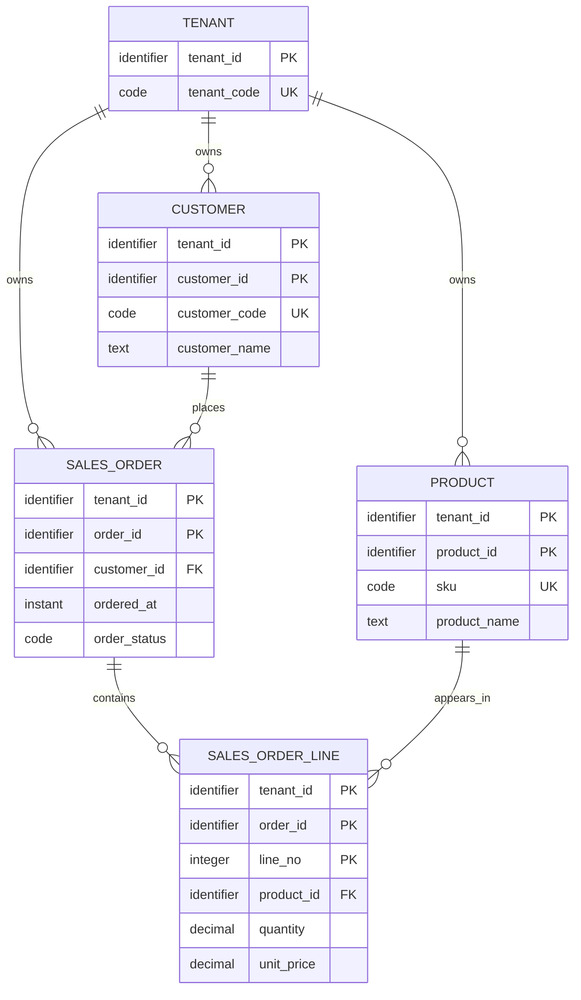
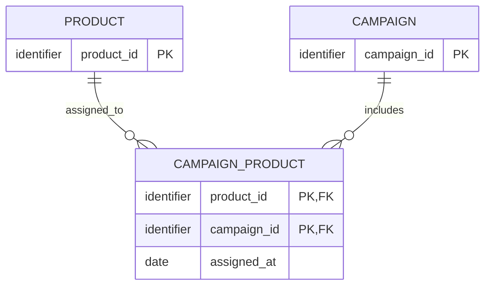

# Đọc sơ đồ logic mà chưa gắn chặt với một hệ quản trị cụ thể

Một sơ đồ dữ liệu có thể được vẽ bằng các hộp và đường nối rất dễ nhìn, nhưng hai kỹ sư đọc cùng sơ đồ vẫn có thể tạo ra hai cơ sở dữ liệu khác nhau: một người cho phép đơn hàng không có khách, người khác bắt buộc có khách; một người cho rằng email phải duy nhất, người khác cho phép các thành viên gia đình dùng chung email. Nếu lập tức biến các hộp thành câu lệnh `CREATE TABLE` của một hệ quản trị, những khác biệt này có thể bị che khuất bởi kiểu dữ liệu, index và cú pháp.

**Đọc sơ đồ logic** là khả năng diễn giải mô hình theo **ngữ nghĩa nghiệp vụ trước**, sau đó mới kiểm tra các khóa, quan hệ, lực lượng kết hợp, tính tùy chọn và bất biến mà sơ đồ biểu đạt. Một sơ đồ logic tốt phải đủ rõ để các đội dùng PostgreSQL, MySQL, SQL Server hoặc một nền tảng khác hiểu **cùng một tập quy tắc**, dù triển khai vật lý có thể khác nhau.

Bài học thuộc chương **Mô hình quan hệ** của module **DATABASE_DATA_MODELING**: rèn kỹ năng chuyển yêu cầu thành thực thể, quan hệ, ràng buộc, chuẩn hóa và lược đồ vật lý; đồng thời so sánh việc biểu diễn dữ liệu ở mô hình quan hệ, document, đồ thị và phân tích. Trọng tâm ở đây là **đọc và phản biện mô hình logic độc lập hệ quản trị** (*DBMS-agnostic logical modeling*), không phải học thuộc cú pháp DDL của một nhà cung cấp.

## 1. Phân biệt ba tầng: khái niệm, logic và vật lý

Cùng một miền nghiệp vụ “khách hàng đặt đơn hàng” có thể được mô tả ở ba độ chi tiết khác nhau.

| Tầng | Câu hỏi cần trả lời | Nội dung thường xuất hiện | Không nên vội kết luận |
|---|---|---|---|
| **Khái niệm** (*conceptual*) | Doanh nghiệp quản lý những sự vật/sự kiện nào và quan hệ giữa chúng ra sao? | `Customer`, `Order`, “khách hàng đặt đơn”, số lượng tham gia | Kiểu `BIGINT`, bộ máy lưu trữ hay index |
| **Logic** (*logical*) | Mỗi sự vật có khóa nào, thuộc tính nào, cardinality và ràng buộc nào? | Khóa của `Order`, quan hệ 1:N, thuộc tính bắt buộc, bảng liên kết N:M, phụ thuộc hàm | Mặc định dùng `SERIAL`, `IDENTITY`, collation hay loại B-tree cụ thể |
| **Vật lý** (*physical*) | Hệ quản trị đã chọn sẽ lưu và thực thi mô hình bằng cơ chế gì? | `CREATE TABLE`, kiểu số, FK, index, phân vùng, partition, quyền, migration | Không được tự thay đổi nghĩa nghiệp vụ chỉ vì công cụ hỗ trợ thuận tiện |

Ví dụ, ở tầng logic ta có thể viết:

> Mỗi đơn hàng thuộc đúng một khách hàng trong cùng tenant. Một khách hàng có thể chưa có đơn hàng hoặc có nhiều đơn hàng.

Khi chuyển sang vật lý, một phương án dùng khóa ghép `(tenant_id, customer_id)` và FK; phương án khác có thể dùng một ID toàn cục kèm ràng buộc tenant riêng. Hai phương án chỉ tương đương nếu cùng thực thi được quy tắc **không liên kết chéo tenant**.

**Nguyên tắc đọc:** lược đồ logic là một **hợp đồng về ý nghĩa và tính hợp lệ của dữ liệu**. Lược đồ vật lý là một hoặc nhiều cách thực thi hợp đồng đó. “Chưa gắn chặt với DBMS” không có nghĩa bỏ qua toàn vẹn dữ liệu; ngược lại, phải tách chính xác **bất biến nào cần được bảo vệ** khỏi **cơ chế bảo vệ cụ thể**.

### ERD không phải luôn là lược đồ logic đầy đủ

Một ERD (*entity–relationship diagram*) chỉ thể hiện những gì được vẽ hoặc ghi chú. Những ràng buộc như “mỗi đơn phải có ít nhất một dòng chi tiết ở thời điểm xác nhận”, “số lượng phải dương”, “mã hàng duy nhất trong tenant” có thể không thể hiện đầy đủ bằng một đường nối. Vì vậy người đọc cần đồng thời xem **sơ đồ, từ điển dữ liệu và danh sách quy tắc nghiệp vụ**; không suy ra ràng buộc không có mặt trong tài liệu.

## 2. Bảy câu hỏi cần hỏi khi nhìn vào một sơ đồ

Thay vì hỏi ngay “dùng kiểu dữ liệu nào?”, hãy lần lượt hỏi:

1. **Hộp này đại diện cho loại đối tượng hay sự kiện gì?** Ví dụ `SalesOrder` là yêu cầu mua hàng đã được tạo, không phải một giỏ hàng đang chỉnh sửa.
2. **Một dòng/đối tượng có ý nghĩa gì?** Một dòng `OrderLine` là một dòng hàng trong đơn, hay một lần giao hàng, hay một sản phẩm duy nhất trong đơn?
3. **Khóa nhận dạng đối tượng là gì?** Có ID kỹ thuật, mã nghiệp vụ, khóa ứng viên hoặc khóa ghép theo tenant không?
4. **Đường nối được đọc theo hai chiều ra sao?** Một khách có thể có bao nhiêu đơn? Một đơn có thể thuộc bao nhiêu khách?
5. **Quan hệ có bắt buộc không?** Chấp nhận 0, 1 hay nhiều đối tượng liên quan? Có mốc trạng thái mà điều kiện này thay đổi không?
6. **Các thuộc tính phụ thuộc vào thực thể nào?** Giá hiện hành của sản phẩm khác với giá đã chốt ở một dòng đơn hàng như thế nào?
7. **Bất biến nào sơ đồ chưa diễn đạt?** Không trùng mã, không tham chiếu sai tenant, đơn được xác nhận phải có dòng, giao dịch không vượt hạn mức...

Một câu trả lời chưa chắc chắn cần được ghi thành **điểm cần xác nhận nghiệp vụ**, không được âm thầm lấp bằng mặc định của ORM hoặc SQL.

## 3. Ví dụ xuyên suốt: đọc sơ đồ đơn hàng đa tenant

Giả sử nền tảng thương mại quản lý nhiều doanh nghiệp độc lập (*tenant*). Mỗi tenant có khách hàng, danh mục sản phẩm và đơn hàng riêng.

Các phát biểu đã xác nhận:

- Mỗi khách hàng thuộc đúng một tenant; mỗi sản phẩm và đơn hàng cũng thuộc đúng một tenant.
- Một khách hàng có thể chưa đặt đơn nào hoặc đặt nhiều đơn; một đơn hàng thuộc đúng một khách hàng.
- Một đơn có thể có nhiều dòng hàng. Khi ở trạng thái **DRAFT**, đơn có thể chưa có dòng nào; khi **CONFIRMED**, đơn phải có ít nhất một dòng.
- Mỗi dòng đơn hàng trỏ đến một sản phẩm. Một sản phẩm có thể chưa từng xuất hiện hoặc xuất hiện trong nhiều dòng của nhiều đơn.
- Một dòng lưu số lượng và **đơn giá tại thời điểm đặt**; giá sản phẩm hiện tại có thể thay đổi sau đó.
- Dữ liệu của tenant này không được tham chiếu tới khách hàng hoặc sản phẩm của tenant khác.

### 3.1. ERD logic để đọc



Đây là **sơ đồ logic minh họa**. Các từ `identifier`, `code`, `instant`, `decimal` gợi ý loại giá trị khái niệm; **không phải cam kết tên kiểu dữ liệu SQL hợp lệ của một DBMS**. Ký hiệu `PK`, `UK` và `FK` cho biết vai trò khóa ở mức logic; trong lược đồ vật lý còn phải xác định **cụm cột** nào hợp thành từng khóa hoặc khóa ngoại.

Sơ đồ vẽ quan hệ `SALES_ORDER ||--o{ SALES_ORDER_LINE` theo khả năng có **0..N** dòng vì đơn nháp có thể rỗng. Điều kiện **đơn đã CONFIRMED phải có ít nhất một dòng** là quy tắc theo trạng thái, không thể diễn đạt chỉ bằng đường nối này. Không đổi ký hiệu thành bắt buộc 1..N cho mọi trạng thái nếu nghiệp vụ thực sự cho phép đơn nháp rỗng.

### 3.2. Từ điển thực thể và khóa

| Thực thể | Grain — một bản ghi là gì? | Khóa định danh logic | Thuộc tính đáng chú ý |
|---|---|---|---|
| `Tenant` | Một tổ chức được quản lý độc lập | `tenant_id`; `tenant_code` duy nhất toàn hệ thống theo chính sách | Tên, trạng thái hoạt động |
| `Customer` | Một hồ sơ khách hàng của một tenant | `(tenant_id, customer_id)`; mã `customer_code` duy nhất **trong tenant** | Tên, thông tin liên hệ |
| `Product` | Một sản phẩm được tenant quản lý | `(tenant_id, product_id)`; `(tenant_id, sku)` là khóa ứng viên nếu SKU không trùng | Tên hiện tại, trạng thái bán, giá niêm yết hiện tại |
| `SalesOrder` | Một đơn hàng được tạo trong tenant | `(tenant_id, order_id)` | Khách đặt, thời điểm, trạng thái, đơn vị tiền |
| `SalesOrderLine` | Một dòng có số thứ tự trong **một đơn** | `(tenant_id, order_id, line_no)` | Sản phẩm, số lượng, đơn giá chốt |

Việc dùng các khóa ghép gồm `tenant_id` là **một thiết kế logic có chủ đích**, không phải yêu cầu mọi hệ thống đa tenant phải dùng PK ghép. Nếu ID toàn cục đã bảo đảm duy nhất, vẫn cần diễn đạt **và thực thi** tính cùng tenant ở các quan hệ; không thể coi toàn cục duy nhất là bằng chứng quan hệ không chéo tenant.

Một đơn có thể chứa hai dòng cùng `product_id` khi khác lô hàng, chương trình ưu đãi hoặc cách giao; do đó **không tự áp** `UNIQUE (tenant_id, order_id, product_id)`. Khóa `line_no` chỉ định danh dòng trong phạm vi một đơn. Đây là ví dụ vì sao phải xác nhận **grain** trước khi đặt khóa.

## 4. Đọc đường nối: cardinality và optionality

Với ký hiệu chân quạ (*crow's foot*), ta quan tâm số lượng tối thiểu và tối đa ở mỗi đầu quan hệ:

| Ký hiệu ở một đầu | Nghĩa |
|---|---|
| `o|` | Không hoặc một — `0..1` |
| `||` | Chính xác một — `1..1` |
| `o{` | Không hoặc nhiều — `0..N` |
| `|{` | Một hoặc nhiều — `1..N` |

Ví dụ cách đọc `CUSTOMER ||--o{ SALES_ORDER`:

- Đứng từ **một đơn hàng**, đi về phía `CUSTOMER`: đơn thuộc **đúng một** khách hàng.
- Đứng từ **một khách hàng**, đi về phía `SALES_ORDER`: khách có thể có **không hoặc nhiều** đơn.

Không đọc ngược thành “một khách hàng chỉ có một đơn” chỉ vì ký hiệu `||` nằm gần `CUSTOMER`. Ký hiệu ở đầu nào mô tả số đối tượng **ở đầu đó** có thể liên quan đến một đối tượng ở đầu kia.

### Cùng quan hệ, hai câu hỏi độc lập

Đối với `PRODUCT ||--o{ SALES_ORDER_LINE`:

1. **Một dòng đơn hàng tham chiếu bao nhiêu sản phẩm?** Đúng một sản phẩm.
2. **Một sản phẩm có thể hiện diện trên bao nhiêu dòng đơn?** Từ 0 đến nhiều.

Đối với `SALES_ORDER ||--o{ SALES_ORDER_LINE` trong trạng thái cho phép nháp:

1. **Một dòng thuộc bao nhiêu đơn?** Đúng một đơn.
2. **Một đơn có thể có bao nhiêu dòng?** Từ 0 đến nhiều; nếu xác nhận, quy tắc riêng yêu cầu tối thiểu một.

### Cardinality không tự nói lên ràng buộc vật lý nào

Quan hệ “mỗi đơn có đúng một khách” thường dẫn tới một khóa ngoại **không được rỗng** ở `SalesOrder`. Ngược lại, yêu cầu “một đơn đã xác nhận phải có ít nhất một dòng” **không được bảo vệ bởi FK từ `SalesOrderLine` lên `SalesOrder`**: FK chỉ kiểm tra dòng con trỏ tới cha tồn tại, không bảo đảm cha phải có con.

Nếu dùng công cụ vẽ ký hiệu `1..N` nhưng lược đồ vật lý chỉ có FK một chiều, ghi rõ quy tắc **đang được cưỡng chế ở đâu**: transaction xác nhận đơn, trigger hoặc một cơ chế kiểm chứng khác.

## 5. Đọc khóa đúng nghĩa: PK, khóa ứng viên, UK, FK

Một sơ đồ logic nên chỉ ra **quy tắc nhận dạng dữ liệu**, không buộc người đọc chọn kiểu số tự tăng.

### 5.1. Khóa ứng viên và khóa chính

Giả sử `Product` có:

- `(tenant_id, product_id)`: khóa ổn định do hệ thống quản lý.
- `(tenant_id, sku)`: cũng là khóa ứng viên nếu nghiệp vụ khẳng định một SKU không trùng và không rỗng **trong cùng tenant**.

Khi chọn khóa đầu tiên làm **khóa chính** (*primary key*), khóa thứ hai vẫn phải được bảo vệ bằng quy tắc duy nhất nếu nó là bất biến nghiệp vụ. Một ID tự tăng không ngăn được hai sản phẩm cùng SKU.

**Khóa chính** là một khóa ứng viên được chọn làm định danh chuẩn cho dòng. **Khóa ngoại** là giá trị hoặc bộ giá trị trong bảng này tham chiếu tới khóa chính/khóa duy nhất được hỗ trợ ở bảng khác. **Khóa nghiệp vụ** có thể được dùng làm khóa chính hoặc một ràng buộc duy nhất riêng, tùy tính ổn định và nhu cầu thay đổi của nó.

### 5.2. Bộ khóa ngoại đa cột phải đọc thành một ràng buộc

Trong ví dụ:

\[
\mathrm{SalesOrder}(tenant\_id, customer\_id)
\to \mathrm{Customer}(tenant\_id, customer\_id)
\]

và:

\[
\mathrm{SalesOrderLine}(tenant\_id, order\_id)
\to \mathrm{SalesOrder}(tenant\_id, order\_id)
\]

\[
\mathrm{SalesOrderLine}(tenant\_id, product\_id)
\to \mathrm{Product}(tenant\_id, product\_id).
\]

Không phải mỗi cột đều là một FK độc lập có thể trỏ tùy ý. Một **FK ghép** so sánh **cả bộ** cột của dòng con với bộ khóa ở dòng cha.

Ví dụ, tenant 42 có `customer_id = 7`, tenant 43 cũng có `customer_id = 7`. Nếu `SalesOrder` của tenant 42 chỉ kiểm tra `customer_id = 7` mà bỏ tenant, nó có thể trỏ sai hồ sơ. FK ghép làm rõ ý nghĩa **khách hàng cùng tenant với đơn**.

### 5.3. Một khóa ứng viên chỉ hợp lệ khi quy tắc thực sự tồn tại

Không thấy hai người cùng email trong dữ liệu mẫu **không chứng minh email duy nhất**. Email có thể dùng chung trong gia đình, bị thay đổi, chưa xác minh hoặc không tồn tại. Do đó không vội đưa `email` vào danh sách khóa ứng viên nếu nghiệp vụ chưa xác nhận duy nhất, phạm vi và điều kiện áp dụng.

Tương tự, số đơn hiển thị như `SO-2026-001` có thể chỉ duy nhất theo tenant và năm. Nếu chọn nó làm khóa nghiệp vụ, phải diễn đạt đúng phạm vi, cấu trúc và chính sách tái sử dụng số khi hủy đơn.

## 6. Đọc thuộc tính theo grain và phụ thuộc hàm

**Grain** là định nghĩa chính xác “một dòng đại diện cho điều gì”. Từ grain, ta mới xác định đúng nơi đặt mỗi thuộc tính.

| Thuộc tính | Cấp dữ liệu đúng | Lý do |
|---|---|---|
| `customer_name` | `Customer` | Mô tả hồ sơ khách hàng hiện tại |
| `sku`, `product_name` | `Product` | Mô tả sản phẩm hiện tại trong tenant |
| `ordered_at`, `order_status` | `SalesOrder` | Mô tả một đơn |
| `quantity` | `SalesOrderLine` | Số lượng của một dòng đặt hàng |
| `unit_price` | `SalesOrderLine` | Đơn giá **đã chốt** khi đặt, có thể khác giá hiện tại của sản phẩm |
| `currency_code` | Thường ở `SalesOrder` nếu mọi dòng dùng cùng đơn vị tiền | Tránh mỗi dòng mâu thuẫn đơn vị tiền |
| `delivery_address_snapshot` | Đơn/chặng giao hoặc một bảng snapshot liên quan tùy nghiệp vụ | Cần giữ địa chỉ tại thời điểm mua dù hồ sơ khách đổi địa chỉ |

Một số phụ thuộc hàm được ngụ ý:

\[
(tenant\_id, product\_id)\rightarrow(sku, product\_name)
\]

\[
(tenant\_id, order\_id)\rightarrow(customer\_id, ordered\_at, order\_status)
\]

\[
(tenant\_id, order\_id, line\_no)\rightarrow(product\_id, quantity, unit\_price).
\]

Đó là các giả định logic: cùng một khóa nhận dạng một dòng và xác định các thuộc tính của dòng đó. Nếu muốn lưu **nhiều phiên bản** tên sản phẩm, grain mới phải gồm khóa phiên bản hoặc mốc hiệu lực; không chỉ thêm hai dòng trùng `product_id` trong cùng bảng với PK cũ.

### 6.1. Tránh lặp thông tin hiện hành gây bất thường cập nhật

Nếu `SalesOrderLine` lưu thêm `product_name_current` và dùng nó làm tên sản phẩm hiện tại, mỗi lần đổi tên sản phẩm phải cập nhật nhiều dòng đơn; sửa thiếu sẽ tạo mâu thuẫn.

Tuy nhiên, nếu dòng đơn lưu `product_name_at_purchase` để giữ tên đã in trên chứng từ, đó là **snapshot lịch sử có mục đích** chứ không phải sao chép hiện hành. Quy tắc ở đây là phải đặt tên và giải thích **thời điểm mà giá trị phản ánh**.

### 6.2. Đọc chuẩn hóa không cần đếm số bảng

Trong một mô hình logic chuẩn hóa tốt, thuộc tính mô tả **một loại đối tượng** được đặt ở nơi mà khóa của loại đó xác định nó. Ví dụ mã tiền tệ và tên tiền tệ không cần lặp trong mọi dòng đơn nếu có bảng danh mục tiền tệ chuẩn; đơn chỉ cần mã và giá trị tại giao dịch.

Dấu hiệu cần xem xét:

- Một nhóm cột có nhiều giá trị lặp cho một dòng, như `product_ids = '3,4,7'`.
- Tên khách và số điện thoại bị sao chép vào bảng đơn nhưng lại được dùng như **dữ liệu hồ sơ hiện tại**.
- `order_line` chứa các cột `course_1`, `course_2` hoặc `item_1`, `item_2` thay vì các dòng liên kết.
- Một thuộc tính của sản phẩm bị đặt trong `SalesOrder` dù một đơn chứa nhiều sản phẩm khác nhau.
- Một bảng liên kết dùng khóa quá rộng hoặc quá hẹp so với grain của sự kiện.

Chuẩn hóa không có nghĩa cấm mọi trùng lặp. Bản chụp tại thời điểm giao dịch, dữ liệu suy ra được quản lý nhất quán và cấu trúc phục vụ phân tích có thể được chủ động giữ lại khi có **quy tắc nguồn chân lý và chi phí cập nhật** rõ ràng.

## 7. Hiểu NULL, tính tùy chọn và trạng thái thiếu dữ liệu

Trên sơ đồ, “không bắt buộc” có thể mang nhiều nghĩa:

1. Chưa biết giá trị ở thời điểm hiện tại.
2. Giá trị không áp dụng cho loại thực thể này.
3. Quan hệ có thể chưa được hình thành, ví dụ đơn nháp chưa có địa chỉ giao.
4. Trường chưa thu thập được do lỗi nguồn dữ liệu và cần xử lý sau.

Bốn tình huống không nhất thiết nên dùng cùng một `NULL` mà không ghi chú.

Ví dụ `Customer.email` có thể là tùy chọn nếu hỗ trợ khách mua tại quầy không có email. `SalesOrder.customer_id` lại là bắt buộc nếu nghiệp vụ quy định mọi đơn phải liên kết hồ sơ khách hàng, kể cả hồ sơ khách lẻ. Đừng tự cho `customer_id` rỗng chỉ vì sợ phải tạo khách lẻ; có thể cần mô hình rõ ràng cho bán hàng không định danh nếu nghiệp vụ yêu cầu.

### NULL ảnh hưởng đến unique và foreign key

Ở tầng logic, nói “email duy nhất nếu có” khác với “email bắt buộc và duy nhất”. Khi ánh xạ sang DBMS, phải kiểm tra ngữ nghĩa `NULL` trong unique constraint; cách xử lý các giá trị rỗng và các biến thể điều kiện có thể khác nhau giữa hệ.

Với khóa ngoại ghép, thành phần có thể rỗng khiến quy tắc so khớp thay đổi theo kiểu so khớp FK. Trong ví dụ, khóa `(tenant_id, customer_id)` của `SalesOrder` **đều bắt buộc**, tránh tình huống một bộ khóa tham chiếu nửa chừng.

**Quy tắc đọc:** khi thấy cột tùy chọn, hỏi “đây là một trạng thái nghiệp vụ hợp lệ hay một tình trạng thiếu dữ liệu cần sửa?” rồi mới quyết định `NULL`, trạng thái riêng, bảng bổ trợ hoặc vùng staging.

## 8. Đọc N:M và thực thể kết hợp trong sơ đồ logic

Giả sử sản phẩm có thể được gắn nhiều chiến dịch khuyến mãi, mỗi chiến dịch áp dụng cho nhiều sản phẩm. Một đường N:M ở sơ đồ khái niệm chưa phải là cấu trúc bảng trực tiếp trong mô hình quan hệ thông thường.

Ta chuyển thành một thực thể kết hợp:



Bảng `CampaignProduct` có thể dùng khóa `(tenant_id, campaign_id, product_id)` nếu một sản phẩm chỉ được gắn vào chiến dịch **một lần** trong phạm vi tenant. Nếu mỗi lần gắn là một sự kiện độc lập có hiệu lực từ–đến, khóa có thể phải chứa `assignment_id` hoặc số phiên bản/lượt, kèm unique/ràng buộc thời gian theo nghiệp vụ.

**Điểm quan trọng:** không tự gộp mọi N:M thành bảng có hai FK rồi kết luận phải unique hai FK. Nếu liên kết có thể xuất hiện nhiều lần theo thời gian, *grain của lần liên kết* mới là cơ sở chọn khóa.

## 9. Phân biệt ràng buộc logic với khả năng cưỡng chế trực tiếp

Một sơ đồ có thể ghi **bất biến** mạnh hơn những gì một FK, unique hay check thông thường làm được.

| Quy tắc nghiệp vụ | Mô hình logic cần diễn đạt | Cơ chế vật lý thường gặp và giới hạn |
|---|---|---|
| Mỗi dòng đơn thuộc đúng một đơn | FK bắt buộc tới `SalesOrder` | `NOT NULL` + FK bảo vệ tồn tại; cần xét chính sách xóa |
| Không có dòng số 1 trùng trong cùng đơn | Khóa `(tenant_id, order_id, line_no)` | PK/UNIQUE phù hợp |
| Không được gắn sản phẩm khác tenant | FK ghép theo tenant | Phải thực thi ràng buộc tương ứng; FK đơn tới ID toàn cục không tự chứng minh cùng tenant |
| Số lượng đặt phải lớn hơn 0 | Miền giá trị dương | `CHECK` theo khả năng DBMS |
| Đơn `CONFIRMED` phải có ít nhất một dòng | Bất biến phụ thuộc trạng thái và sự tồn tại ở bảng khác | Cổng xác nhận đơn, giao dịch, trigger hoặc cơ chế bổ trợ; **FK con → cha chưa đủ** |
| Không vượt số lượng hàng tồn có thể bán | Bất biến tổng hợp qua dòng hàng và kho | Kiểm tra/giữ chỗ nguyên tử, transaction và concurrency |
| Đơn đã thanh toán không được thay đơn giá | Quy tắc chuyển trạng thái và quyền cập nhật | Cổng ghi/state machine/trigger/phân quyền; không thể suy từ quan hệ ERD |
| Giá trị tiền phải cùng đơn vị tiền trong phép tổng | Miền/đơn vị của giá và tổng | Kiểu tiền logic + quy tắc tính, kiểm tra/thiết kế bổ sung |

### Ví dụ về điều kiện “ít nhất một dòng”

Ở mức logic, ta nói:

> Đơn đã xác nhận cần ít nhất một dòng có số lượng dương.

Nếu tạo `SalesOrder` rồi tạo `SalesOrderLine` bằng hai câu lệnh, có thể có một khoảng ngắn trong transaction mà đơn chưa có dòng. Thiết kế vật lý phải quyết định **khi nào bất biến bắt buộc**: ngay khi tạo đơn, tại thời điểm chuyển sang `CONFIRMED`, hay ở commit.

Một quy trình hợp lệ thường cho phép tạo `DRAFT` rỗng, thêm dòng, rồi **xác nhận** chỉ sau khi đã kiểm tra có dòng. Nếu nhiều request cùng xóa dòng và xác nhận đơn, cần đồng bộ giao dịch để không xác nhận một đơn vừa trở nên rỗng. Không nên viết “có FK nên đơn luôn có dòng”.

## 10. Đọc một sơ đồ rồi thử bằng dữ liệu nhỏ

Một sơ đồ logic có thể nhìn hợp lý nhưng chứa khóa hoặc cardinality sai. Một cách kiểm tra là tạo **dữ liệu mẫu cực nhỏ** và đặt câu hỏi “dòng nào được phép, dòng nào phải bị từ chối?”.

### 10.1. Dữ liệu thử

Giả sử:

- Tenant A có `customer_id=7` (An), `product_id=11` (Bút), `product_id=12` (Sách).
- Tenant B cũng có `customer_id=7` (Bình) và `product_id=11` (Máy tính).
- Đơn A-100 thuộc tenant A, khách An, có hai dòng: `line_no=1` mua Bút, `line_no=2` mua Sách.

Dữ liệu trùng ID cục bộ giữa các tenant không phải lỗi nếu khóa logic là **bộ gồm tenant và ID**.

### 10.2. Ma trận kỳ vọng

| Thao tác | Hợp lệ? | Vì sao |
|---|---|---|
| Tạo đơn A-101 cho khách An trong tenant A | Có | Khách tồn tại cùng tenant |
| Tạo đơn A-102 trỏ khách Bình của tenant B | Không | Vi phạm quan hệ cùng tenant |
| Thêm dòng 3 vào đơn A-100 cho sản phẩm Bút | Có, nếu phép mua cho phép cùng sản phẩm ở nhiều dòng | Khóa dòng là `line_no`, không phải `product_id` |
| Thêm dòng khác cũng có `line_no=2` vào đơn A-100 | Không | Trùng khóa dòng của cùng đơn |
| Tạo đơn `DRAFT` chưa có dòng | Có | Chưa cần thỏa điều kiện xác nhận |
| Chuyển một đơn không có dòng sang `CONFIRMED` | Không | Vi phạm bất biến phụ thuộc trạng thái |
| Thêm dòng có `quantity = 0` | Không | Miền số lượng phải dương |
| Đổi tên sản phẩm sau khi đơn đã thanh toán | Có thể có | Dòng đơn vẫn phải giữ thông tin lịch sử chốt giá/tên theo chính sách |
| Xóa khách có đơn hàng lưu trữ | Theo chính sách, thường bị hạn chế | Quan hệ và nghĩa lịch sử quyết định hạn chế xóa |

Nếu không thể trả lời một hàng trong bảng vì thiếu chính sách, hãy ghi rõ **câu hỏi mở**. Đây chính là lợi ích của việc review lược đồ logic trước khi viết DDL: phát hiện mơ hồ với chi phí thấp.

## 11. Chuyển sơ đồ logic thành một bản đặc tả trung lập

Một cách trình bày độc lập DBMS là dùng **từ điển dữ liệu** kèm ràng buộc logic, thay cho việc gắn trực tiếp kiểu SQL riêng của nhà cung cấp.

Ví dụ:

```text
ENTITY Customer
  Identity: (tenant_id, customer_id)
  Candidate key: (tenant_id, customer_code)
  Attribute customer_name: required, nonblank

ENTITY Product
  Identity: (tenant_id, product_id)
  Candidate key: (tenant_id, sku)
  Attribute product_name: required, nonblank

ENTITY SalesOrder
  Identity: (tenant_id, order_id)
  Attribute customer_id: required
  Attribute ordered_at: required, instant
  Attribute order_status: required, one of {DRAFT, CONFIRMED, CANCELLED}
  Relationship (tenant_id, customer_id)
    -> Customer(tenant_id, customer_id), exactly one Customer

ENTITY SalesOrderLine
  Identity: (tenant_id, order_id, line_no)
  Relationship (tenant_id, order_id)
    -> SalesOrder(tenant_id, order_id), exactly one SalesOrder
  Relationship (tenant_id, product_id)
    -> Product(tenant_id, product_id), exactly one Product
  Attribute quantity: required, decimal > 0
  Attribute unit_price: required, money amount >= 0
  Invariant: unit_price is the agreed snapshot for this line

CROSS-ENTITY RULE
  If SalesOrder.status = CONFIRMED:
    count(SalesOrderLine where same tenant_id/order_id) >= 1
```

Đặc tả trên có nhiều giá trị:

- Không phụ thuộc `IDENTITY`, `AUTO_INCREMENT`, `SERIAL` hay sequence.
- Diễn đạt rõ tính cùng tenant và phạm vi unique.
- Chỉ ra **kiểu giá trị có nghĩa** (`instant`, tiền tệ, số lượng) trước khi chọn `TIMESTAMP`, `NUMERIC` hoặc cấu trúc riêng.
- Tách bất biến xuyên bảng khỏi các quan hệ FK đơn giản.
- Cho phép so sánh hai phương án vật lý khác nhau trên **cùng bộ ca kiểm thử**.

Nếu sơ đồ là tài liệu giao tiếp giữa product owner, backend, data engineer và DBA, một đặc tả logic như vậy thường giảm tranh luận do cách đọc ký hiệu khác nhau.

## 12. Những quyết định nên để sang thiết kế vật lý

Một số quyết định chỉ có thể chốt sau khi biết DBMS, tải dữ liệu, yêu cầu sẵn sàng và cách triển khai.

| Mục cần quyết định | Đã biết ở tầng logic | Để sang tầng vật lý |
|---|---|---|
| Định danh `Product` | Có ID ổn định, SKU duy nhất trong tenant | ID dạng số, UUID hay định danh khác; cách sinh |
| Giá trị tiền | Đơn vị tiền và số chữ số chính xác, quy tắc làm tròn | `DECIMAL/NUMERIC` cụ thể, precision/scale, kiểu riêng |
| Thời điểm đặt | Là một thời điểm tuyệt đối hoặc local time có vùng theo nghiệp vụ | Kiểu timestamp, chuẩn timezone, cách chuyển đổi |
| Chống trùng | Cặp khóa nào phải duy nhất | Cú pháp unique index, collation/case-folding, xử lý NULL |
| Kiểm tra FK | Liên kết nào phải tồn tại, chính sách xóa | Cú pháp `FOREIGN KEY`, timing/deferrability, index hỗ trợ |
| Truy vấn hậu duệ | Cần đọc cây theo quan hệ cha–con | Recursive CTE, path, closure table, index chuyên biệt |
| Khối lượng đọc/ghi | Các kiểu truy vấn và SLA kỳ vọng | Index, partition, clustering, cache, replica |
| Phân quyền tenant | Không được đọc/ghi chéo tenant | DB roles, Row-Level Security, API auth, phân tách database |
| Migration | Không được mất dữ liệu hoặc làm sai bất biến | Công cụ triển khai, thứ tự backfill, validation, rollback |

**Điểm cần cẩn trọng:** việc chọn `BIGINT` hay `UUID` không làm thay đổi định nghĩa “mỗi đơn thuộc một khách”, nhưng việc **bỏ tenant khỏi FK** có thể làm thay đổi nghĩa của chính quan hệ đó. Phân biệt tùy chọn vật lý hợp lệ với việc vô tình **nới lỏng hợp đồng logic**.

### 12.1. SQL minh họa không phải bản hợp đồng logic

Một đoạn SQL ngắn có thể là bước ánh xạ:

```sql
-- SQL minh họa phần quan hệ, không phải lược đồ triển khai đầy đủ.
CREATE TABLE customers (
    tenant_id BIGINT NOT NULL,
    customer_id BIGINT NOT NULL,
    customer_name VARCHAR(200) NOT NULL,
    PRIMARY KEY (tenant_id, customer_id)
);

CREATE TABLE sales_orders (
    tenant_id BIGINT NOT NULL,
    order_id BIGINT NOT NULL,
    customer_id BIGINT NOT NULL,
    PRIMARY KEY (tenant_id, order_id),
    FOREIGN KEY (tenant_id, customer_id)
        REFERENCES customers (tenant_id, customer_id)
);

CREATE TABLE sales_order_lines (
    tenant_id BIGINT NOT NULL,
    order_id BIGINT NOT NULL,
    line_no INTEGER NOT NULL,
    quantity DECIMAL(14, 3) NOT NULL,
    PRIMARY KEY (tenant_id, order_id, line_no),
    FOREIGN KEY (tenant_id, order_id)
        REFERENCES sales_orders (tenant_id, order_id),
    CHECK (quantity > 0)
);
```

Đây là **mảnh minh họa**, cố ý chưa chứa `products`, `product_id`, đơn giá, ngày và trạng thái, nên **không được coi là bản triển khai đầy đủ của sơ đồ ở phần 3**. Giá trị của nó là chỉ ra cách một **FK ghép** diễn đạt đúng quan hệ đa tenant trên một cú pháp SQL tương đối phổ biến.

Khi đưa vào dự án, phải hoàn thiện toàn bộ thuộc tính và ràng buộc logic, kiểm tra cách DBMS xử lý check/constraint, thêm chỉ mục và migration phù hợp. Sự hiện diện của cú pháp SQL trong tài liệu học không làm cho nội dung này phụ thuộc vào PostgreSQL.

## 13. Các “bẫy” khiến mô hình logic bị khóa chặt vào công nghệ

### 13.1. Dùng kiểu dữ liệu sản phẩm để suy ra nghiệp vụ

“Trường này là `VARCHAR(255)` nên chắc đủ”, “trường này là `FLOAT` vì DB chạy nhanh”, hay “có thể rỗng vì ORM mặc định nullable” đều là suy luận ngược.

Mô hình logic cần nêu: mã có độ dài tối đa bao nhiêu theo tiêu chuẩn? Tiền có cho phép sai số không? Thời gian có cần timezone? Giá trị có phải bắt buộc khi đối tượng được công bố không? Sau đó vật lý mới chọn kiểu.

Đặc biệt, **tiền** thường cần số thập phân chính xác hoặc đơn vị nhỏ nhất theo loại tiền; dùng số dấu phẩy động nhị phân mà không xác định sai số có thể làm phép tính và đối soát không đúng.

### 13.2. Cho rằng các DBMS xử lý NULL và duy nhất như nhau

Một quy tắc “email duy nhất khi đã xác minh” có thể phải mô tả là **duy nhất có điều kiện** chứ không phải một `UNIQUE(email)` chung. Hành vi của `NULL`, collation, so sánh chữ hoa/thường, khoảng trắng và chỉ mục từng phần khác nhau giữa hệ quản trị.

Tầng logic nên mô tả ví dụ: “Trong cùng tenant, hai khách đã xác minh không được dùng cùng email **sau chuẩn hóa**; các khách chưa xác minh có thể chưa có email.” Cách cưỡng chế chính xác là quyết định vật lý cần kiểm tra.

### 13.3. Lấy tính năng riêng làm thiết kế gốc

Các tính năng như `ENUM`, bảng kế thừa của một DBMS, JSON column, materialized view hoặc index chuyên biệt đều có thể hữu ích. Nhưng không vì công nghệ có sẵn mà kết luận một khái niệm nghiệp vụ nhất thiết phải được diễn đạt bằng tính năng đó.

Nếu mục đích là bảng danh mục có thể thêm giá trị khi vận hành, khóa, nhãn, quyền và hiệu lực theo thời gian, một kiểu enum đóng có thể không đáp ứng đầy đủ. Nếu chỉ là vài trạng thái ít đổi, bảng danh mục có thể lại là phức tạp không cần thiết. Cần chốt ngữ nghĩa rồi mới chọn cơ chế.

### 13.4. Đọc đường nối như `ON DELETE CASCADE` mặc định

ERD nói khách hàng có nhiều đơn, nhưng **không tự cho biết** xóa khách sẽ xóa đơn hay bị cấm. Lịch sử thanh toán, kiểm toán và quyền riêng tư quyết định chính sách xóa, ẩn, vô danh hóa hoặc lưu trữ. FK `ON DELETE` là cơ chế; **chính sách vòng đời** phải được định nghĩa trước.

### 13.5. Nhầm hiệu năng với cardinality

Quan hệ N:M không có nghĩa truy vấn nhất định chậm; quan hệ 1:N không có nghĩa luôn nhanh. Hiệu năng phụ thuộc số dòng thật, độ chọn lọc, chỉ mục, kế hoạch join, phân vùng và lượng dữ liệu trả về. Đừng thêm bảng tổng hợp hoặc cột JSON để “giảm join” khi chưa có workload và phép đo đại diện.

## 14. Đọc trạng thái, thời gian và lịch sử trước khi chọn bảng

Một sơ đồ tĩnh thường chỉ cho biết **trạng thái hiện tại** của dữ liệu. Nhiều nghiệp vụ cần biết trạng thái **đã có tại một thời điểm quá khứ**.

### 14.1. Trạng thái là thuộc tính hay một vòng đời?

Trường `order_status` nhận các mã `DRAFT`, `CONFIRMED`, `CANCELLED` chưa diễn đạt hết các **chuyển trạng thái được phép**. Ví dụ, có thể không được chuyển `CANCELLED → CONFIRMED`; hoặc chỉ cho hủy đơn chưa giao. Các ràng buộc này cần được ghi dưới dạng state machine/các quy tắc nghiệp vụ, không suy từ một cột text.

Nếu mỗi lần chuyển trạng thái phải được kiểm toán, cân nhắc `OrderStatusEvent`: khóa đơn, trạng thái cũ/mới, thời điểm và chủ thể thực hiện. Khi đó **một dòng event** đại diện cho một lần chuyển, khác với **một dòng order** đại diện cho một đơn. Không trộn hai grain này.

### 14.2. Khóa hiện tại và khóa theo phiên bản

Một sản phẩm có thể thay tên, giá và nhóm hàng. Nếu báo cáo quý trước phải hiển thị phân nhóm **tại quý trước**, mô hình logic cần thêm khái niệm **lịch sử phân loại** hoặc **snapshot giao dịch**.

Lưu `product_id` trong dòng đơn chỉ trỏ tới sản phẩm hiện tại; nó không tự trả về tên, nhóm hoặc giá tại lúc mua. `unit_price` trên dòng đơn là một ví dụ chủ động giữ snapshot để tránh đổi quá khứ khi giá sản phẩm được cập nhật.

Khi mô hình có thời gian hiệu lực:

- Xác định **thời gian hiệu lực nghiệp vụ** (*valid time*) và/hoặc **thời gian hệ thống ghi nhận** (*transaction/system time*) có quan trọng không.
- Định nghĩa khoảng hiệu lực, quy tắc chồng lắp, phiên bản và cách truy vấn “as of T”.
- Phân biệt hủy bản ghi hiện tại với giữ lịch sử pháp lý/kiểm toán.
- Không coi việc có cột `updated_at` là có đầy đủ lịch sử; cột này chỉ phản ánh một mốc cập nhật gần nhất.

## 15. Không gắn chặt với quan hệ: đối chiếu document, graph và phân tích

Một **mô hình logic nghiệp vụ** tốt có thể được dùng để lựa chọn cách lưu ngoài bảng quan hệ. Nó không biến các công nghệ thành tương đương, nhưng giữ được ngữ nghĩa cần bảo vệ.

### 15.1. Document model

Trong cơ sở dữ liệu document, có thể nhúng các dòng đơn hàng vào document `Order`:

```json
{
  "tenantId": "T42",
  "orderId": "O100",
  "customerId": "C7",
  "status": "CONFIRMED",
  "lines": [
    {"lineNo": 1, "productId": "P11", "quantity": 2, "unitPrice": "25000.00"},
    {"lineNo": 2, "productId": "P12", "quantity": 1, "unitPrice": "100000.00"}
  ]
}
```

Cách lưu này phù hợp nếu phần lớn thao tác đọc/ghi **cả đơn cùng các dòng** và kích thước document có giới hạn hợp lý. Tuy nhiên, nó **không làm mất yêu cầu logic**: đơn phải thuộc đúng khách, product reference phải tồn tại/cùng tenant, số dòng không trùng trong đơn, số lượng dương và đơn xác nhận phải có dòng. Mức độ tự động cưỡng chế phụ thuộc engine, schema validation, transaction và các đường ghi.

Document có thể giảm join cho một số truy vấn nhưng khiến các quan hệ tham chiếu xuyên document hoặc giao dịch mở rộng trở nên phức tạp. Không chuyển sang document chỉ vì ERD có nhiều đường nối.

### 15.2. Graph model

Graph biểu diễn `Customer`, `Order`, `Product` bằng node, và các quan hệ như `PLACES`, `HAS_LINE`, `REFERS_TO` bằng edge. Truy vấn nhiều bước, tìm đường đi hay quan hệ mạng có thể trực quan hơn.

Nhưng một edge tồn tại **chưa tự bảo đảm** “đơn chỉ thuộc một khách”, “không tham chiếu chéo tenant” hoặc “đơn có ít nhất một dòng”. Các ràng buộc cardinality và phạm vi sở hữu phải được thiết kế theo khả năng cụ thể của graph database.

### 15.3. Mô hình phân tích (analytics)

Trong kho dữ liệu, cùng một miền có thể được tổ chức thành **fact** và **dimension**:

- `FactOrderLine` có grain **một dòng đơn**.
- `DimCustomer` và `DimProduct` chứa thuộc tính phân tích của khách/sản phẩm.
- `DimDate` hoặc các trường thời gian phục vụ tổng hợp theo kỳ.
- Nếu cần lịch sử nhóm hàng, dimension có thể được phiên bản hóa.

Điểm cần giữ là **grain**. Nếu doanh thu của đơn được lưu ở cấp đơn rồi join sang nhiều dòng đơn và tính `SUM`, doanh thu có thể bị nhân lên theo số dòng. Lược đồ logic quan hệ là nguồn để nhận diện rủi ro *fan-out* này trước khi xây data mart.

### 15.4. Chọn mô hình lưu không làm biến mất yêu cầu nghiệp vụ

| Quy tắc logic | Quan hệ | Document | Graph / phân tích |
|---|---|---|---|
| Đơn thuộc một khách cùng tenant | FK ghép/constraint | Reference + validation/transaction phù hợp | Cạnh có cardinality/phạm vi; fact-key và kiểm thử dữ liệu |
| Đơn có nhiều dòng | Bảng `SalesOrderLine` | Array/document con hoặc collection dòng | Node/edge hoặc fact line |
| Một dòng có sản phẩm và đơn giá chốt | FK sản phẩm + thuộc tính dòng | Nội dung dòng nhúng/ref | Thuộc tính edge/entity hoặc fact |
| Đơn xác nhận có dòng | Cổng xác nhận/triggers phù hợp | Validation và cổng ghi | Constraint/validation nghiệp vụ theo engine |
| Tái hiện giao dịch quá khứ | Snapshot/lịch sử | Snapshot/versioned document | Versioned node/edge/dimension |

Đọc sơ đồ logic độc lập DBMS cho phép giữ được những yêu cầu này khi so sánh phương án, thay vì biến công nghệ đã chọn thành định nghĩa nghiệp vụ.

## 16. Một quy trình review sơ đồ logic trong nhóm

Khi được giao review một mô hình chưa có DDL, có thể thực hiện theo thứ tự sau.

### Bước 1 — Đọc tên, định nghĩa và grain

Với từng thực thể, ghi một câu “một bản ghi là...”. Tên `Transaction` quá chung cần được làm rõ: là lệnh thanh toán, bút toán kế toán hay giao dịch hệ thống? Nếu không xác định grain, mọi khóa và quan hệ sau đó đều có nguy cơ sai.

### Bước 2 — Xác nhận khóa và phạm vi

Liệt kê PK logic, khóa ứng viên, phạm vi tenant/đơn vị kinh doanh và chính sách thay đổi mã. Hỏi “nếu cùng mã xuất hiện ở hai tenant thì sao?”, “nếu đổi tên sản phẩm, ID có đổi không?”.

### Bước 3 — Đọc từng quan hệ theo hai chiều

Với mỗi đường nối, viết hai câu tương ứng. Ví dụ: “một khách có 0..N đơn” và “một đơn thuộc đúng một khách”. Đối chiếu số lượng tối thiểu/tối đa với yêu cầu, nhất là quan hệ tùy chọn và trường hợp theo trạng thái.

### Bước 4 — Đặt thuộc tính đúng grain

Tìm phụ thuộc hàm, thuộc tính lặp sai nơi, giá trị hiện tại khác snapshot lịch sử. Xác định có cần bảng liên kết cho N:M hoặc bảng sự kiện cho lần tham gia lặp lại không.

### Bước 5 — Liệt kê bất biến chưa hiển thị

Ghi quy tắc về số lượng, trạng thái, thời gian, không trùng, cùng tenant, quyền, lịch sử và tổng hợp nhiều dòng. Chia nhóm quy tắc mà constraint thông thường có thể bảo vệ và quy tắc cần transaction/cổng ghi hay cơ chế khác.

### Bước 6 — Thử phản ví dụ

Tạo một bộ dữ liệu chỉ vài dòng: hai tenant trùng ID cục bộ; một đơn nháp rỗng; một đơn xác nhận rỗng; một sản phẩm lặp trong hai dòng; một khách chưa có đơn; một dòng có quantity 0. Mô hình phải cho câu trả lời thống nhất “được phép hay không, vì sao”.

### Bước 7 — Lập bảng ánh xạ vật lý nhưng giữ vết logic

Sau khi thống nhất ngữ nghĩa, ghi mapping sang DBMS chọn dùng, bao gồm constraint, kiểu dữ liệu, index và những bất biến chưa cưỡng chế trực tiếp. Khi thay công nghệ hoặc nâng phiên bản, **kiểm thử hợp đồng logic** vẫn phải cho kết quả như cũ.

## 17. Bảng câu hỏi kiểm tra nhanh

| Câu hỏi review | Dấu hiệu tốt | Dấu hiệu cần xem lại |
|---|---|---|
| Thực thể có được định nghĩa bằng grain không? | “Một dòng là một lần đặt hàng” | “Bảng chứa thông tin đơn” |
| Mọi khóa có phạm vi duy nhất rõ không? | `(tenant_id, sku)` duy nhất trong tenant | “SKU chắc là unique” |
| Quan hệ được đọc theo hai chiều không? | Có câu mô tả 0..N, 1..1 rõ ràng | Chỉ nhìn mũi tên hoặc tên FK |
| Quan hệ bắt buộc có thời điểm áp dụng không? | “`CONFIRMED` phải có dòng” | “Đơn lúc nào cũng có dòng” dù có DRAFT |
| Một dòng liên kết có grain phù hợp không? | “Một dòng cho mỗi lượt tham gia” | Unique một cặp dù nghiệp vụ cho phép lặp lượt |
| Giá trị hiện tại và lịch sử được phân biệt? | `unit_price_at_order` là snapshot | Lấy giá hiện tại để tính doanh thu cũ |
| Phạm vi tenant được bảo vệ? | FK ghép hoặc cơ chế tương đương đã kiểm chứng | Chỉ tin client luôn gửi đúng tenant |
| Cơ chế và quy tắc được tách? | Invariant độc lập + mapping cụ thể | “Vì framework sinh cột này nên nghiệp vụ phải như vậy” |
| Có ca dữ liệu phản ví dụ không? | Có bảng allowed/rejected | Chỉ có ảnh ERD đẹp |
| Phạm vi model đủ cho báo cáo không? | Có grain fact, lịch sử nếu cần | Join N:M không xét nhân bản số liệu |

## 18. Bài tập thực hành: đọc sơ đồ quản lý thư viện

Một thư viện đa chi nhánh có:

- `LibraryBranch`: mỗi chi nhánh có mã và địa chỉ.
- `BookTitle`: một đầu sách như “Lập trình Java”, có ISBN và tên.
- `BookCopy`: một bản vật lý cụ thể thuộc một chi nhánh và một đầu sách; một đầu sách có thể có nhiều bản.
- `Member`: độc giả có thể mượn nhiều bản sách theo thời gian.
- `Loan`: mỗi lần mượn một bản cụ thể, có thời điểm mượn, hạn trả và thời điểm trả.

Yêu cầu:

- Mỗi bản sách thuộc đúng một chi nhánh; một chi nhánh có thể chưa có bản nào.
- Mỗi bản sách gắn đúng một đầu sách; một đầu sách có thể có nhiều bản.
- Một độc giả có thể có nhiều lượt mượn; một lượt mượn thuộc đúng một độc giả và một bản sách.
- Một bản sách **không được có hai lượt mượn còn mở đồng thời**, nhưng được mượn nhiều lần sau khi trả.
- Một chi nhánh không được quản lý bản sách thuộc chi nhánh khác.
- Báo cáo phải thể hiện trạng thái mượn tại một ngày trong quá khứ.

Hãy làm:

1. Vẽ ERD khái niệm và sơ đồ logic, đọc tất cả quan hệ theo **hai chiều** với cardinality/optionality.
2. Viết định nghĩa grain cho `BookTitle`, `BookCopy` và `Loan`. Giải thích vì sao `Loan` **không chỉ là bảng liên kết duy nhất theo `(member_id, copy_id)`**.
3. Đề xuất khóa chính, khóa nghiệp vụ và phạm vi unique; cân nhắc ISBN có luôn đủ để định danh một đầu sách không, cần xác minh gì với nghiệp vụ?
4. Chỉ ra các FK cần bảo vệ cùng phạm vi chi nhánh/tenant. Phân biệt FK với chính sách phân quyền của độc giả.
5. Xác định những quy tắc có thể bảo vệ bằng PK, FK, `NOT NULL`, `CHECK`, và quy tắc “không hai lượt mượn mở đồng thời” cần cơ chế bổ sung nào.
6. Mô tả việc lưu lịch sử để truy vấn “ai đang mượn bản X ngày 01/10”, thay vì chỉ xem cờ `is_borrowed` hiện tại.
7. Đưa ra 8 ca kiểm thử gồm nhánh trống, đầu sách nhiều bản, mượn lặp theo thời gian, mượn đồng thời, trả sách và nhập nhầm chi nhánh.
8. So sánh cấu trúc quan hệ với document và graph cho hai chức năng: tra cứu kho sách theo chi nhánh và truy vấn mạng lưới độc giả–đầu sách.

**Tiêu chí đạt:** mô hình được mô tả bằng **ngữ nghĩa độc lập DBMS**, các khóa phản ánh đúng grain, các quan hệ tùy chọn được đọc đúng chiều, và có phân biệt **bất biến logic** với **cơ chế cưỡng chế vật lý**.

## 19. Tổng kết

- Đọc sơ đồ logic theo **thực thể, grain, khóa, quan hệ, cardinality, optionality và bất biến**, không theo cú pháp SQL hoặc annotation ORM trước tiên.
- Một đường nối phải được diễn giải **theo cả hai chiều**. FK bảo vệ đầu mút tồn tại nhưng không tự bảo vệ mọi điều kiện tham gia tối thiểu hoặc trạng thái.
- Khóa có **phạm vi**; trong mô hình đa tenant, phải diễn đạt rõ tính cùng tenant của quan hệ.
- Thuộc tính phải ở **đúng grain**. Phân biệt thông tin hiện tại với snapshot đã chốt và dữ liệu lịch sử.
- Lược đồ logic là **hợp đồng có thể kiểm chứng**; lược đồ vật lý chọn kiểu, cơ chế constraint, index và transaction để thực thi hợp đồng ấy.
- Phản ví dụ bằng vài dòng dữ liệu thường phát hiện sai sót nhanh hơn tranh luận về kiểu cột hay engine.
- Khi so sánh quan hệ, document, graph và analytics, giữ nguyên ngữ nghĩa nghiệp vụ rồi mới cân nhắc cách lưu và chi phí thực thi.
