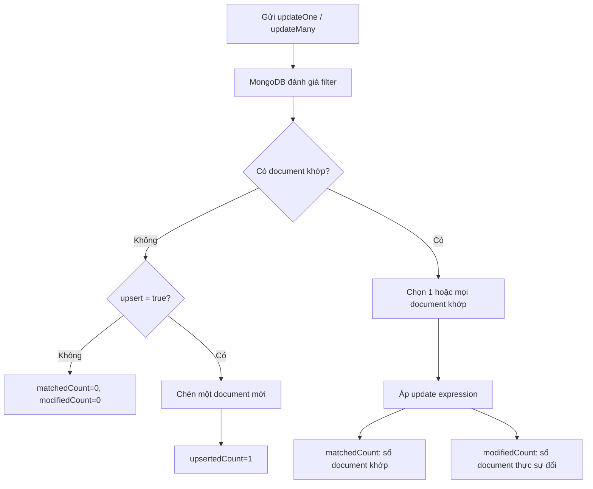

# updateOne, updateMany và phân biệt matchedCount với modifiedCount

> **Module:** Database Engine Document MongoDB  
> **Chương:** Cập nhật document

## 1. Mục tiêu và ý nghĩa thực tế

Khi gửi một lệnh cập nhật tới MongoDB, ứng dụng cần biết **có bao nhiêu document thỏa điều kiện** và **có bao nhiêu document thực sự thay đổi**. Hai thông tin này được phản ánh qua `matchedCount` và `modifiedCount` trong kết quả của `updateOne()` hoặc `updateMany()`.

Ví dụ, ứng dụng yêu cầu đặt `processed: true` cho một đơn hàng. Nếu đơn hàng đã có giá trị `true` từ trước, MongoDB vẫn có thể tìm thấy document nhưng không cần sửa dữ liệu. Kết quả khi đó là `matchedCount = 1`, `modifiedCount = 0`. Đó là một kết quả bình thường, khác hẳn trường hợp không tìm thấy document.

Bài học giúp bạn:

- Dùng đúng `updateOne()` và `updateMany()` để sửa một hoặc nhiều document.
- Viết bộ lọc `filter` và update expression với `$set`, `$inc`, `$unset`, `$currentDate`.
- Hiểu kết quả thành công, không khớp, không có thay đổi và upsert.
- Phân biệt số document được sửa với số field hoặc phần tử array được sửa.
- Dùng hai bộ đếm để xử lý API, kiểm soát cập nhật đồng thời và thiết kế retry.
- Áp dụng cú pháp tương đương trong MongoDB Java Sync Driver.

## 2. Cú pháp và phạm vi cập nhật

Trong MongoDB Shell, hai lệnh có cú pháp:

```javascript
db.collection.updateOne(filter, update, options)
db.collection.updateMany(filter, update, options)
```

| Thành phần | Ý nghĩa | Ví dụ |
|---|---|---|
| `filter` | Biểu thức chọn document cần cập nhật | `{ status: "NEW" }` |
| `update` | Thay đổi bằng update operator hoặc aggregation pipeline | `{ $set: { reviewed: true } }` |
| `options` | Tùy chọn bổ sung như `upsert`, `collation` và `arrayFilters` | `{ upsert: true }` |

Điểm khác biệt giữa hai phương thức:

| Phương thức | Số document có thể cập nhật | Tình huống điển hình |
|---|---:|---|
| `updateOne()` | Tối đa **1** document khớp filter | Sửa một đơn hàng theo `_id`, chuyển trạng thái một bản ghi |
| `updateMany()` | **Tất cả** document khớp filter | Gắn nhãn toàn bộ đơn hàng thuộc một nhóm, áp cờ xử lý hàng loạt |

Nếu filter của `updateOne()` khớp nhiều document, ứng dụng **không được giả định** document nào sẽ được chọn khi chưa có tiêu chí xác định cụ thể. Hãy ưu tiên filter theo `_id` hoặc khóa có unique index nếu cần cập nhật đúng một thực thể.

Nếu filter của `updateMany()` là `{}`, lệnh có thể tác động tới toàn bộ document trong collection. Hãy kiểm soát phạm vi filter trước khi chạy trên dữ liệu thật.

### 2.1. Chu trình xử lý



Với thao tác được xác nhận và hoàn tất thành công, số document sửa không lớn hơn số document khớp:

```text
0 <= modifiedCount <= matchedCount

updateOne:  matchedCount có thể là 0 hoặc 1
updateMany: matchedCount có thể là 0, 1, 2, 3, ...
```

Nếu thao tác gặp lỗi (ví dụ vi phạm unique index), không diễn giải như thể toàn bộ batch đã xử lý thành công.

## 3. Chuẩn bị collection thực hành

Dùng một MongoDB Server mà bạn có quyền ghi, mở `mongosh`:

```bash
mongosh "mongodb://127.0.0.1:27017"
```

Tạo dữ liệu trong database riêng:

```javascript
const lab = db.getSiblingDB("mongo_update_lab");
const orders = lab.getCollection("orders");

orders.insertMany([
  { _id: "ORD-001", status: "NEW",       processed: false, amount: 120, version: 1 },
  { _id: "ORD-002", status: "PAID",      processed: false, amount: 250, version: 1 },
  { _id: "ORD-003", status: "NEW",       processed: false, amount: 80,  version: 1 },
  { _id: "ORD-004", status: "NEW",       processed: false, amount: 400, version: 1 },
  { _id: "ORD-005", status: "PAID",      processed: true,  amount: 150, version: 1 },
  { _id: "ORD-006", status: "CANCELLED", processed: false, amount: 75,  version: 1 }
]);
```

Xem dữ liệu:

```javascript
printjson(orders.find(
  {},
  { _id: 1, status: 1, processed: 1, amount: 1 }
).sort({ _id: 1 }).toArray());
```

Có 6 đơn hàng: ba đơn `NEW`, hai đơn `PAID`, một đơn `CANCELLED`. Các ví dụ dưới đây giả định bạn **chạy tuần tự trên bộ dữ liệu mới tạo**. Nếu lệnh `insertMany()` báo duplicate key vì document đã tồn tại, hãy dùng database lab khác hoặc chuẩn bị lại dữ liệu trong môi trường thực hành; không xóa dữ liệu production.

## 4. updateOne: tìm thấy và thay đổi

Chuyển đơn `ORD-001` từ `NEW` sang `PAID`:

```javascript
const first = orders.updateOne(
  { _id: "ORD-001", status: "NEW" },
  { $set: { status: "PAID" } }
);

printjson(first);
```

Kết quả tiêu biểu:

```javascript
{
  acknowledged: true,
  matchedCount: 1,
  modifiedCount: 1,
  upsertedCount: 0,
  upsertedId: null
}
```

Ý nghĩa:

- Có một document với `_id = "ORD-001"` **và** `status = "NEW"`.
- `$set` đổi giá trị của field `status` từ `NEW` sang `PAID`.
- Vì có một document khớp và được sửa thật, hai bộ đếm đều bằng 1.

Đọc lại:

```javascript
printjson(orders.findOne({ _id: "ORD-001" }));
```

### 4.1. Chạy lại cùng filter: không còn document phù hợp

```javascript
const second = orders.updateOne(
  { _id: "ORD-001", status: "NEW" },
  { $set: { status: "PAID" } }
);

printjson(second);
```

Kết quả:

```javascript
{
  acknowledged: true,
  matchedCount: 0,
  modifiedCount: 0,
  upsertedCount: 0,
  upsertedId: null
}
```

Lần này `ORD-001` đã ở trạng thái `PAID`. Nó tồn tại, nhưng **không thỏa điều kiện** `status: "NEW"`. Do đó `matchedCount = 0` không nhất thiết có nghĩa document đã bị xóa: filter có thể không còn đúng sau một thay đổi trước đó.

### 4.2. Document khớp nhưng không cần thay đổi

Bỏ điều kiện trạng thái:

```javascript
const third = orders.updateOne(
  { _id: "ORD-001" },
  { $set: { status: "PAID" } }
);

printjson(third);
```

Kết quả thường là:

```javascript
{
  acknowledged: true,
  matchedCount: 1,
  modifiedCount: 0,
  upsertedCount: 0,
  upsertedId: null
}
```

Document được chọn bằng `_id` vẫn có mặt. Tuy nhiên, `status` đã là `PAID` và `$set` cùng giá trị không làm nội dung document thay đổi. Vì thế **matched = 1 nhưng modified = 0**.

Hai tình huống này rất dễ bị nhầm:

| Tình huống | `matchedCount` | `modifiedCount` |
|---|---:|---:|
| `ORD-001` hiện không còn `NEW`, filter vẫn yêu cầu `NEW` | 0 | 0 |
| Chọn `ORD-001` theo ID, đặt lại `status = "PAID"` vốn đã đúng | 1 | 0 |

**Kết luận thực hành:** Không dùng riêng `modifiedCount == 0` để kết luận “không tìm thấy đơn hàng”.

## 5. updateMany: nhiều document cùng khớp

Sau bước cập nhật `ORD-001` ở mục 4, chỉ còn `ORD-003` và `ORD-004` có trạng thái `NEW`.

```javascript
const manyFirst = orders.updateMany(
  { status: "NEW" },
  { $set: { processed: true } }
);

printjson(manyFirst);
```

Kết quả dự kiến:

```javascript
{
  acknowledged: true,
  matchedCount: 2,
  modifiedCount: 2,
  upsertedCount: 0,
  upsertedId: null
}
```

Hai document được chọn đều có `processed: false` nên cả hai thực sự chuyển sang `true`.

### 5.1. Chạy lại lệnh updateMany

```javascript
const manySecond = orders.updateMany(
  { status: "NEW" },
  { $set: { processed: true } }
);

printjson(manySecond);
```

Lúc này:

```javascript
{
  acknowledged: true,
  matchedCount: 2,
  modifiedCount: 0,
  upsertedCount: 0,
  upsertedId: null
}
```

Hai document vẫn có `status: "NEW"`, nên vẫn khớp filter. Nhưng trường `processed` đã là `true` ở cả hai; MongoDB không cần sửa lần nữa.

### 5.2. Một phần document khớp được sửa

Trong dữ liệu sau các bước trên, có ba document đang ở trạng thái `PAID`:

| ID | `processed` trước lệnh |
|---|---|
| `ORD-001` | `false` |
| `ORD-002` | `false` |
| `ORD-005` | `true` |

Thực hiện:

```javascript
const mixed = orders.updateMany(
  { status: "PAID" },
  { $set: { processed: true } }
);

printjson(mixed);
```

Kết quả:

```javascript
{
  acknowledged: true,
  matchedCount: 3,
  modifiedCount: 2,
  upsertedCount: 0,
  upsertedId: null
}
```

Ba document khớp trạng thái, nhưng chỉ hai document cần sửa. `ORD-005` đã có giá trị đích, vì vậy không tăng `modifiedCount`.

### 5.3. Bảng so sánh các khả năng

| Lệnh | Số khớp | Số sửa | Diễn giải |
|---|---:|---:|---|
| `updateOne` theo ID, đổi giá trị | 1 | 1 | Sửa thành công một document |
| `updateOne` theo ID, gán giá trị giống cũ | 1 | 0 | No-op, document vẫn tồn tại |
| `updateOne` với filter không có bản ghi | 0 | 0 | Không có document thỏa filter |
| `updateMany`, mọi document cần đổi | 5 | 5 | Năm document cùng thay đổi |
| `updateMany`, chỉ một số document cần đổi | 5 | 3 | Hai document đã có giá trị đích |
| `updateMany`, giá trị đã đúng ở tất cả | 5 | 0 | Năm document khớp nhưng không thay đổi |

Các bộ đếm là **số document**, không phải số field được sửa. Nếu một lệnh thay đổi 4 field của cùng một document thì `modifiedCount` vẫn là 1.

## 6. Những update operator quan trọng

Đối số `update` thường là một object chứa các update operator.

| Operator | Tác dụng | Ví dụ |
|---|---|---|
| `$set` | Gán hoặc tạo field | `{ $set: { status: "PAID" } }` |
| `$unset` | Xóa field | `{ $unset: { legacyStatus: "" } }` |
| `$inc` | Cộng giá trị số vào field | `{ $inc: { retryCount: 1 } }` |
| `$mul` | Nhân field số với hệ số | `{ $mul: { factor: 2 } }` |
| `$min` / `$max` | Chỉ thay field nếu giá trị mới nhỏ hơn/lớn hơn | `{ $max: { highScore: 100 } }` |
| `$currentDate` | Gán thời gian tại server | `{ $currentDate: { updatedAt: true } }` |
| `$setOnInsert` | Chỉ gán khi thao tác insert qua upsert | `{ $setOnInsert: { createdAt: new Date() } }` |
| `$push` | Thêm phần tử vào array | `{ $push: { tags: "urgent" } }` |
| `$addToSet` | Thêm phần tử nếu array chưa chứa giá trị đó | `{ $addToSet: { tags: "urgent" } }` |
| `$pull` | Xóa phần tử array khớp điều kiện | `{ $pull: { tags: "obsolete" } }` |

Ví dụ dùng nhiều operator trong một lần cập nhật document:

```javascript
const result = orders.updateOne(
  { _id: "ORD-003" },
  {
    $set: { status: "PAID" },
    $inc: { version: 1 },
    $currentDate: { updatedAt: true }
  }
);

printjson(result);
```

Trong cùng một document, cập nhật nhiều field bằng một write operation là **atomic ở cấp document**: các field được đổi trong một thao tác, không phải ba lệnh độc lập.

### 6.1. Những thao tác no-op thường gặp

```javascript
// Nếu status đã là "PAID": không đổi dữ liệu
orders.updateOne(
  { _id: "ORD-001" },
  { $set: { status: "PAID" } }
);

// Nếu obsoleteField không tồn tại: không có field để xóa
orders.updateOne(
  { _id: "ORD-001" },
  { $unset: { obsoleteField: "" } }
);

// Nếu version là số đã tồn tại: cộng 0 giữ nguyên giá trị
orders.updateOne(
  { _id: "ORD-001" },
  { $inc: { version: 0 } }
);
```

Tùy trạng thái document, các lệnh trên có thể có `matchedCount = 1`, `modifiedCount = 0`. Ngược lại, `$currentDate` với thời điểm mới hoặc `$inc: { version: 1 }` thường thật sự sửa document.

### 6.2. Tăng bộ đếm và atomicity

Để tăng một counter, nên dùng:

```javascript
orders.updateOne(
  { _id: "ORD-004" },
  { $inc: { version: 1 } }
);
```

Nếu hai client cùng đọc counter rồi tính `oldValue + 1` ở phía client và `$set` lại, cả hai có thể cùng ghi giá trị từ lần đọc cũ, gây lost update. `$inc` thực hiện phép tăng trên server trong thao tác atomic của document.

## 7. Upsert và ý nghĩa của các trường kết quả

Mặc định, nếu filter không khớp document nào thì update **không tạo document mới**. Tùy chọn `upsert: true` yêu cầu MongoDB **chèn một document khi không có document để cập nhật**.

```javascript
const inserted = orders.updateOne(
  { _id: "ORD-999" },
  {
    $set: {
      status: "NEW",
      processed: false,
      amount: 500
    },
    $setOnInsert: {
      createdAt: new Date()
    }
  },
  { upsert: true }
);

printjson(inserted);
```

Nếu `ORD-999` chưa tồn tại, phản hồi điển hình là:

```javascript
{
  acknowledged: true,
  matchedCount: 0,
  modifiedCount: 0,
  upsertedCount: 1,
  upsertedId: "ORD-999"
}
```

**Không có document cũ nào bị sửa.** Vì vậy `modifiedCount = 0`, trong khi `upsertedCount = 1` cho biết **một document mới được chèn**. Nếu filter không chỉ rõ `_id`, MongoDB thường sinh một ObjectId cho document mới. `upsertedId` phản ánh giá trị `_id` thực tế của document được chèn.

Chạy lại với cùng filter và giá trị `$set`:

```javascript
const repeated = orders.updateOne(
  { _id: "ORD-999" },
  { $set: { status: "NEW", processed: false, amount: 500 } },
  { upsert: true }
);

printjson(repeated);
```

Với dữ liệu đã tạo và không thay đổi nơi khác, kết quả thường là `matchedCount = 1`, `modifiedCount = 0`, `upsertedCount = 0`.

### 7.1. updateMany + upsert

Nếu `updateMany(..., { upsert: true })` **không khớp document nào**, MongoDB tạo **một document**, không phải nhiều document. Nếu đã có document khớp, `updateMany` sửa tập document đó thay vì insert một bản ghi mới cho từng document. Không dùng `updateMany + upsert` để nhập một danh sách nhiều entity.

### 7.2. Lưu ý về upsert đồng thời

Hai request upsert có thể cùng thấy điều kiện chưa có bản ghi. Hãy đảm bảo khóa nghiệp vụ cần duy nhất được bảo vệ bằng unique index (hoặc `_id`). Nếu cùng cố insert, một request có thể nhận lỗi duplicate key; nếu không có unique index phù hợp, hệ thống có thể tạo dữ liệu trùng nghiệp vụ. Cần xử lý retry và idempotency theo hợp đồng ứng dụng, không coi upsert là cơ chế khóa toàn cục.

## 8. Đọc kết quả cập nhật: không chỉ có hai bộ đếm

Kết quả được xác nhận thường có các trường:

| Trường | Ý nghĩa |
|---|---|
| `acknowledged` | Server/driver có cung cấp xác nhận thao tác ghi hay không |
| `matchedCount` | Số document khớp filter trong kết quả |
| `modifiedCount` | Số document thực sự thay đổi |
| `upsertedCount` | Số document được **insert** do nhánh upsert; thường là 0 hoặc 1 cho một lệnh update |
| `upsertedId` | Giá trị `_id` của document mới do upsert, hoặc `null` nếu không có |

Khi cần quyết định kết quả API, đọc theo thứ tự:

1. **Có lỗi/exception không?** Một write thất bại vì validation, duplicate key hoặc timeout không thể được xử lý như một no-op bình thường.
2. **Kết quả có được xác nhận không?** Nếu không có write acknowledgment thì không giả định chắc chắn giá trị các bộ đếm.
3. **Có upsert không?** Kiểm tra `upsertedCount`/`upsertedId` trước khi kết luận không tạo dữ liệu.
4. **Có document nào khớp?** Kiểm tra `matchedCount`.
5. **Có document nào thật sự đổi?** Kiểm tra `modifiedCount`.
6. **Điều đó có đúng nghiệp vụ không?** Lệnh “đảm bảo đã reviewed” có thể thành công khi no-op; lệnh “chuyển trạng thái từ NEW sang PAID” cần xét trạng thái dự kiến.

Lưu ý `matchedCount = 0` với filter chứa cả `_id` và `version` **không đủ** để kết luận ID không tồn tại: có thể version đã thay đổi bởi request khác.

## 9. updateOne không lựa chọn theo thứ tự nếu filter quá rộng

Ví dụ:

```javascript
orders.updateOne(
  { status: "NEW" },
  { $set: { underReview: true } }
);
```

Nếu nhiều đơn hàng cùng `NEW`, lệnh chỉ sửa một trong số đó; ứng dụng không thể mặc định đó là document “đầu tiên được insert” hay “có ID nhỏ nhất”. Kế hoạch truy vấn và thứ tự duyệt có thể thay đổi.

Giải pháp tùy bài toán:

- Dùng `_id` hoặc unique key nếu cần chọn entity đã biết.
- Dùng `findOneAndUpdate()` cùng tùy chọn `sort` khi cần chọn document theo ưu tiên và đọc kết quả document.
- Ở MongoDB Server/driver có hỗ trợ tùy chọn sort cho `updateOne`, phải kiểm tra version trước khi sử dụng; không mặc định tùy chọn này có ở mọi phiên bản.

**Quan trọng:** Đừng chạy ví dụ filter rộng này nếu bạn muốn giữ bộ dữ liệu theo đúng trạng thái cho các bước thực hành còn lại.

## 10. Update nhiều document và giới hạn atomicity

Một thao tác `updateOne()` sửa một document là atomic ở cấp document. Với `updateMany()`, mỗi lần cập nhật một document vẫn atomic, nhưng **toàn bộ các document không tự tạo thành một transaction atomic duy nhất**.

Ví dụ:

```javascript
orders.updateMany(
  { status: "NEW" },
  { $set: { campaignCode: "NOV-2026" } }
);
```

Nếu lỗi hoặc bị gián đoạn giữa chừng, có thể một số document đã được sửa trước khi lệnh dừng. Một client đọc song song cũng có thể quan sát sự thay đổi ở những thời điểm khác nhau, tùy read concern, isolation và việc sử dụng transaction.

Nếu nghiệp vụ cần **all-or-nothing qua nhiều document hoặc collection**, hãy thiết kế multi-document transaction ở deployment hỗ trợ, đánh giá chi phí và giới hạn phù hợp. Không áp dụng transaction cho mọi thao tác cập nhật chỉ vì có nhiều field trong một document.

### 10.1. Cập nhật có thể retry không?

Phụ thuộc update expression:

| Update | Chạy lại cùng điều kiện có thể an toàn? | Lý do |
|---|---|---|
| `$set: { processed: true }` | Thường có | Gán cùng giá trị; lần sau không cần sửa |
| `$unset: { legacyField: "" }` | Thường có | Field đã bị xóa |
| `$inc: { quantity: 1 }` | Không mặc nhiên | Chạy hai lần tăng hai lần |
| `$push: { tags: "urgent" }` | Không mặc nhiên | Có thể thêm cùng giá trị hai lần |
| `$addToSet: { tags: "urgent" }` | Có thể phù hợp khi muốn tránh trùng phần tử | Kiểm tra semantics với loại phần tử |
| `$currentDate: { updatedAt: true }` | Giá trị có thể khác mỗi lần | Thời điểm mới được ghi |

Driver có cơ chế retryable writes trong phạm vi được hỗ trợ, nhưng **không coi mọi thao tác `updateMany` nhiều document đều có khả năng retry tự động giống nhau**. Nếu tự retry ở tầng ứng dụng, phải xét idempotency và trạng thái đã ghi một phần.

## 11. Chống ghi đè khi nhiều client cùng cập nhật

### 11.1. Conditional state transition

Ví dụ chỉ chuyển đơn `ORD-004` từ `NEW` sang `PAID`:

```javascript
const transition = orders.updateOne(
  { _id: "ORD-004", status: "NEW" },
  {
    $set: { status: "PAID" },
    $currentDate: { updatedAt: true }
  }
);

if (transition.matchedCount === 0) {
  print("Không có đơn phù hợp với trạng thái kỳ vọng.");
}
```

Nếu request khác đã đổi status trước, filter sẽ không còn khớp. Đây là cơ chế kiểm soát cạnh tranh hữu ích mà không phải đọc document rồi ghi đè vô điều kiện.

### 11.2. Optimistic locking theo version

Giả sử client đọc document ở `version = 3`:

```javascript
const change = orders.updateOne(
  { _id: "ORD-004", version: 3 },
  {
    $set: { note: "Ghi chú mới" },
    $inc: { version: 1 }
  }
);

if (change.matchedCount === 0) {
  print("Version đã thay đổi hoặc document không tồn tại; cần đọc lại.");
}
```

Lưu ý: `version: 3` trong ví dụ chỉ minh họa. Khi thực hành, phải dùng version thực tế mà client đã đọc, không hardcode. Nếu client khác cập nhật và tăng version trước, filter cũ không khớp. Kỹ thuật này giúp tránh lost update trong các luồng chỉnh sửa cùng một entity.

### 11.3. Không dùng modifiedCount để suy ra nghiệp vụ một cách máy móc

Một API PATCH “đánh dấu đã xử lý” có thể trả thành công nếu `matchedCount = 1`, `modifiedCount = 0` vì document đã ở trạng thái mong muốn. Ngược lại, một API “thực hiện chuyển trạng thái duy nhất” có thể yêu cầu báo conflict khi `matchedCount = 0` do trạng thái đã đổi.

Trong cả hai trường hợp, bộ đếm là dữ kiện kỹ thuật; **hợp đồng API** quyết định ý nghĩa của kết quả với người dùng.

## 12. Cập nhật mảng với arrayFilters

Một document có thể chứa array nhiều object. Ví dụ:

```javascript
const baskets = lab.getCollection("baskets");

baskets.insertOne({
  _id: "B-001",
  items: [
    { sku: "SKU-01", checked: false },
    { sku: "SKU-02", checked: false },
    { sku: "SKU-03", checked: true }
  ]
});
```

Đánh dấu một phần tử:

```javascript
const arrayResult = baskets.updateOne(
  { _id: "B-001" },
  { $set: { "items.$[item].checked": true } },
  { arrayFilters: [{ "item.sku": "SKU-02" }] }
);

printjson(arrayResult);
```

`$[item]` đại diện phần tử thỏa `arrayFilters`. Nếu một document có 10 phần tử mảng bị sửa, `modifiedCount` vẫn **đếm một document**. Với `updateMany`, count là tổng số document khớp/thay đổi, **không phải tổng số phần tử mảng đã sửa**.

Một ví dụ khác sử dụng update pipeline để tính field từ giá trị hiện có:

```javascript
orders.updateOne(
  { _id: "ORD-006" },
  [
    { $set: { statusLabel: { $concat: ["Status: ", "$status"] } } }
  ]
);
```

Pipeline update sử dụng cú pháp aggregation stage và biểu thức `"$status"` để tham chiếu field. Đây là phương thức khác dạng update operators, nhưng ngữ nghĩa bộ đếm kết quả vẫn như nhau.

## 13. Filter, index, collation và quyền ghi

### 13.1. Tìm đúng document trước khi cập nhật

Một filter không có index phù hợp có thể khiến MongoDB duyệt nhiều document. Trong collection lớn, `updateMany` còn tạo nhiều thao tác ghi và phải duy trì các index bị ảnh hưởng.

Ví dụ nếu truy vấn thường dùng tổ hợp `customerId` và `status`:

```javascript
orders.createIndex(
  { customerId: 1, status: 1 },
  { name: "idx_customer_status" }
);
```

Index này chỉ hữu ích nếu schema và query thực tế sử dụng các field đó. Trong dữ liệu lab ban đầu không có `customerId`; chỉ coi lệnh index là ví dụ thiết kế cho một collection ứng dụng có các field phù hợp.

Để khảo sát phạm vi filter trước khi update:

```javascript
print("Candidate documents:", orders.countDocuments({ status: "PAID" }));
printjson(orders.find(
  { status: "PAID" },
  { _id: 1, status: 1, processed: 1 }
).toArray());
```

Đây là bước hỗ trợ review, nhưng giữa truy vấn xem trước và thao tác update, dữ liệu vẫn có thể bị client khác thay đổi. Khi cần tránh race, thêm điều kiện kỳ vọng hoặc giao dịch phù hợp.

### 13.2. Collation và so sánh chữ hoa/thường

Mặc định, so sánh string theo collation `simple` phân biệt hoa/thường. Nếu business rule muốn so sánh chuỗi không phân biệt casing:

```javascript
orders.updateMany(
  { status: "paid" },
  { $set: { reviewed: true } },
  { collation: { locale: "en", strength: 2 } }
);
```

Collation ảnh hưởng so sánh giá trị string, không làm `status` và `Status` trở thành cùng một tên field. Với hệ thống trạng thái định danh như enum, thông thường nên chuẩn hóa giá trị tại nguồn và áp dụng một quy tắc nhất quán.

### 13.3. Schema validation và unique index

Nếu document sau update vi phạm validator của collection, server có thể từ chối. Nếu cập nhật một field được bảo vệ bởi unique index thành giá trị đã có ở document khác, thao tác có thể thất bại với duplicate key.

Không suy ra từ `matchedCount = 0` rằng có vấn đề về validation; phải xem lỗi/exception và thông tin từ server. Mọi luồng ghi nên sử dụng quyền tối thiểu, không tùy ý dùng quyền bỏ qua schema validation.

## 14. Java Sync Driver: lấy đúng hai bộ đếm

MongoDB Java Sync Driver trả về `UpdateResult` cho các phương thức cập nhật. Ví dụ:

```java
import com.mongodb.client.MongoClient;
import com.mongodb.client.MongoClients;
import com.mongodb.client.MongoCollection;
import com.mongodb.client.MongoDatabase;
import com.mongodb.client.result.UpdateResult;
import org.bson.Document;

import static com.mongodb.client.model.Filters.eq;
import static com.mongodb.client.model.Updates.set;

public class UpdateDocumentDemo {
    public static void main(String[] args) {
        String uri = System.getenv("MONGODB_URI");
        if (uri == null || uri.isBlank()) {
            uri = "mongodb://127.0.0.1:27017";
        }

        try (MongoClient client = MongoClients.create(uri)) {
            MongoDatabase database = client.getDatabase("mongo_update_lab");
            MongoCollection<Document> orders =
                    database.getCollection("orders");

            UpdateResult result = orders.updateOne(
                    eq("_id", "ORD-002"),
                    set("reviewed", true)
            );

            System.out.println("acknowledged = " + result.wasAcknowledged());
            if (result.wasAcknowledged()) {
                System.out.println("matchedCount = " + result.getMatchedCount());
                System.out.println("modifiedCount = " + result.getModifiedCount());
                System.out.println("upsertedId = " + result.getUpsertedId());
            }
        }
    }
}
```

Các getter quan trọng:

| API | Kiểu trả về | Nội dung |
|---|---|---|
| `wasAcknowledged()` | `boolean` | Kết quả có được xác nhận |
| `getMatchedCount()` | `long` | Số document khớp |
| `getModifiedCount()` | `long` | Số document bị sửa |
| `getUpsertedId()` | `BsonValue` hoặc `null` | ID insert qua upsert nếu có |

Nếu kết quả **unacknowledged**, các getter đếm có thể ném `UnsupportedOperationException` vì không có thông tin xác nhận. Đừng giả định dữ liệu đã được ghi chỉ vì phía client phát lệnh.

### 14.1. updateMany trong Java

```java
import com.mongodb.client.result.UpdateResult;
import static com.mongodb.client.model.Filters.eq;
import static com.mongodb.client.model.Updates.set;

// Giả định biến orders đã được tạo như ví dụ phía trên:
UpdateResult result = orders.updateMany(
        eq("status", "NEW"),
        set("processed", true)
);

if (result.wasAcknowledged()) {
    long matched = result.getMatchedCount();
    long modified = result.getModifiedCount();
    System.out.printf("Matched=%d, Modified=%d%n", matched, modified);
}
```

### 14.2. Upsert trong Java

```java
import com.mongodb.client.model.UpdateOptions;
import com.mongodb.client.result.UpdateResult;

import static com.mongodb.client.model.Filters.eq;
import static com.mongodb.client.model.Updates.combine;
import static com.mongodb.client.model.Updates.set;
import static com.mongodb.client.model.Updates.setOnInsert;

UpdateResult result = orders.updateOne(
        eq("_id", "ORD-1000"),
        combine(
                set("status", "NEW"),
                set("processed", false),
                setOnInsert("createdBy", "lab")
        ),
        new UpdateOptions().upsert(true)
);

if (result.wasAcknowledged()) {
    if (result.getUpsertedId() != null) {
        System.out.println("Inserted: " + result.getUpsertedId());
    } else {
        System.out.printf("Matched=%d, Modified=%d%n",
                result.getMatchedCount(), result.getModifiedCount());
    }
}
```

Nếu application dùng schema validator chặt, document được tạo qua upsert phải thỏa validator; ví dụ chỉ tập trung vào API driver và kết quả.

### 14.3. Chuyển số đếm thành phản hồi API

Không viết:

```java
// Sai khi API muốn thông báo "document tồn tại":
if (result.getModifiedCount() == 0) {
    throw new RuntimeException("Not Found");
}
```

Vì `modifiedCount == 0` bao gồm cả no-op hợp lệ. Nên quyết định dựa trên nghiệp vụ:

```java
if (result.wasAcknowledged() && result.getMatchedCount() == 0) {
    // Có thể không tồn tại, hoặc status/version không thỏa filter.
} else if (result.wasAcknowledged()) {
    // Có document khớp; modified=0 vẫn có thể là thành công idempotent.
}
```

Nếu filter gồm thêm trạng thái/version, muốn trả 404 hay 409 chính xác có thể cần đọc lại document; xử lý thêm cạnh tranh cập nhật phát sinh giữa các thao tác theo mức nhất quán mong muốn.

## 15. Những lỗi thường gặp

| Hiện tượng | Nguyên nhân thường thấy | Hướng xử lý |
|---|---|---|
| `matchedCount = 0` | Filter không khớp ID, giá trị, trạng thái hoặc version | Kiểm tra cả điều kiện và kiểu BSON |
| `matchedCount = 1, modifiedCount = 0` | Giá trị đích đã đúng, no-op | Không vội báo 404 hoặc retry cưỡng ép |
| `matchedCount > modifiedCount` | Một số document đã mang giá trị đích | Xem lại trạng thái dữ liệu ban đầu |
| `matchedCount = 0, upsertedCount = 1` | Có insert do `upsert: true` | Đọc `upsertedId` |
| `updateOne` sửa “nhầm” bản ghi | Filter khớp nhiều bản ghi | Dùng khóa unique hoặc phương thức có sort |
| `updateMany` sửa quá nhiều bản ghi | Filter rộng hoặc `{}` | Kiểm tra `find()`/`countDocuments()` trước |
| Lỗi duplicate key | Giá trị vi phạm unique index | Xử lý khóa nghiệp vụ và concurrency |
| Lỗi document validation | Document sau update không đúng validator | Kiểm tra schema và update expression |
| `$inc` cập nhật lặp làm tăng quá nhiều | Retry không idempotent | Dùng idempotency/condition cho workflow |
| Java driver báo số khác dự đoán | Dữ liệu đã đổi, sai URI/collection, filter sai kiểu | Xác nhận đúng namespace, truy vấn và kiểu BSON |
| Cập nhật mảng sửa 5 phần tử nhưng modified=1 | Count tính theo document | Đọc lại mảng khi cần thống kê phần tử |

### 15.1. Bẫy kiểu BSON của _id

Ví dụ:

```javascript
{ _id: ObjectId("507f1f77bcf86cd799439011"), status: "NEW" }
```

không khớp filter:

```javascript
{ _id: "507f1f77bcf86cd799439011" }
```

vì filter dùng string, trong khi field thực là BSON ObjectId. Khi `matchedCount = 0`, kiểm tra **cả giá trị lẫn kiểu**; không chỉ nhìn chuỗi hiển thị giống nhau.

### 15.2. Không nhầm updateOne với replaceOne

```javascript
orders.updateOne(
  { _id: "ORD-002" },
  { $set: { note: "Reviewed" } }
);
```

Lệnh trên chỉ thêm/sửa `note`, giữ các field khác. `replaceOne()` thay phần nội dung document bằng replacement và có thể xóa những field không còn xuất hiện; không dùng replacement nếu chỉ muốn chỉnh một field. Không thể đổi giá trị `_id` của document đang tồn tại.

### 15.3. updateOne không trả document sau cập nhật

`updateOne()` trả count và metadata, không trả toàn bộ document. Nếu cần nhận document trước/sau trong cùng thao tác, dùng `findOneAndUpdate()` với tùy chọn `returnDocument` phù hợp:

```javascript
const after = orders.findOneAndUpdate(
  { _id: "ORD-002" },
  { $set: { reviewed: true } },
  { returnDocument: "after" }
);

printjson(after);
```

Đối tượng trả về của `findOneAndUpdate` khác dạng kết quả của `updateOne`; không nên lấy `matchedCount` từ kết quả document nếu API không cung cấp nó.

## 16. Bài thực hành kiểm chứng

Các bài dưới đây dùng collection riêng để tránh ảnh hưởng các ví dụ trước.

### Bài A: ba kịch bản một document

```javascript
const checks = lab.getCollection("checks");

checks.insertOne({ _id: "C-01", active: false });

const changed = checks.updateOne(
  { _id: "C-01" },
  { $set: { active: true } }
);

const unchanged = checks.updateOne(
  { _id: "C-01" },
  { $set: { active: true } }
);

const absent = checks.updateOne(
  { _id: "C-99" },
  { $set: { active: true } }
);

printjson({ changed, unchanged, absent });
```

Dự đoán:

| Kết quả | matched | modified |
|---|---:|---:|
| `changed` | 1 | 1 |
| `unchanged` | 1 | 0 |
| `absent` | 0 | 0 |

### Bài B: updateMany khớp ba, sửa hai

```javascript
const tasks = lab.getCollection("tasks");

tasks.insertMany([
  { _id: "T-01", group: "A", done: false },
  { _id: "T-02", group: "A", done: true },
  { _id: "T-03", group: "A", done: false },
  { _id: "T-04", group: "B", done: false }
]);

const result = tasks.updateMany(
  { group: "A" },
  { $set: { done: true } }
);

printjson(result);
```

Kết quả kỳ vọng: `matchedCount = 3`, `modifiedCount = 2`. Chạy lại y hệt: `matchedCount = 3`, `modifiedCount = 0`.

### Bài C: upsert vào collection bài tập

```javascript
const first = tasks.updateOne(
  { _id: "T-99" },
  { $set: { group: "C", done: false } }
);

const second = tasks.updateOne(
  { _id: "T-99" },
  { $set: { group: "C", done: false } },
  { upsert: true }
);

printjson({ first, second });
```

Hãy giải thích vì sao lệnh đầu không tạo document nhưng lệnh thứ hai tạo document; cả hai có thể `modifiedCount = 0` vì nhánh insert được ghi vào `upsertedCount`.

### Bài D: chuyển trạng thái đúng một lần

```javascript
const attempt1 = tasks.updateOne(
  { _id: "T-04", done: false },
  { $set: { done: true } }
);

const attempt2 = tasks.updateOne(
  { _id: "T-04", done: false },
  { $set: { done: true } }
);

printjson({ attempt1, attempt2 });
```

Lần đầu có một document khớp và sửa; lần thứ hai `done` đã là `true`, filter không còn khớp. Đây là khác biệt then chốt giữa “không được phép chuyển trạng thái lần nữa” và “đặt lại cùng giá trị”.

### Bài E: phân biệt document count với số phần tử array

Tạo một document `basket` chứa ba item chưa duyệt. Dùng `arrayFilters` để đổi hai item. Dù có hai phần tử được sửa trong một document, `modifiedCount` vẫn là 1. Trình bày giải thích dựa trên đơn vị đếm là document.

## 17. Những nguyên tắc cần nhớ

1. **`updateOne` sửa tối đa một document**, còn **`updateMany` sửa mọi document khớp**.
2. **`matchedCount` cho biết bao nhiêu document khớp filter**; **`modifiedCount` cho biết bao nhiêu document thực sự thay đổi**.
3. `matchedCount = 1, modifiedCount = 0` là một kết quả bình thường khi document có sẵn giá trị đích.
4. `matchedCount = 0` có thể nghĩa là không tồn tại document, hoặc điều kiện `status`/`version` không còn khớp.
5. **Upsert insert mới** được phản ánh qua `upsertedCount`/`upsertedId`, không phải `modifiedCount`.
6. Đếm theo **document**, không theo số field hoặc số phần tử array được thay đổi.
7. Các update operator như `$inc` giúp thao tác atomic trên từng document; `updateMany` không tự là transaction trên toàn tập.
8. API phải diễn giải các bộ đếm theo hợp đồng nghiệp vụ, chú ý retry, index, validation và concurrency.

## 18. Tài liệu chính thức

- [MongoDB Manual – db.collection.updateOne()](https://www.mongodb.com/docs/manual/reference/method/db.collection.updateOne/)
- [MongoDB Manual – db.collection.updateMany()](https://www.mongodb.com/docs/manual/reference/method/db.collection.updateMany/)
- [MongoDB Manual – Update Operators](https://www.mongodb.com/docs/manual/reference/operator/update/)
- [MongoDB Manual – Atomicity and Transactions](https://www.mongodb.com/docs/manual/core/write-operations-atomicity/)
- [MongoDB Manual – Update Documents with Aggregation Pipeline](https://www.mongodb.com/docs/manual/tutorial/update-documents-with-aggregation-pipeline/)
- [MongoDB Manual – Array Filters](https://www.mongodb.com/docs/manual/reference/operator/update/positional-filtered/)
- [MongoDB Java Sync Driver – Update Documents](https://www.mongodb.com/docs/drivers/java/sync/current/crud/update/)
- [MongoDB Java API – UpdateResult](https://mongodb.github.io/mongo-java-driver/5.5/apidocs/mongodb-driver-core/com/mongodb/client/result/UpdateResult.html)

Với các tùy chọn thay đổi theo phiên bản MongoDB Server/driver, hãy đối chiếu đúng tài liệu của deployment đang dùng. Các bộ đếm cho biết kết quả kỹ thuật; muốn xác nhận nghiệp vụ thành công cần xét thêm filter, nội dung update và trạng thái mong đợi.
