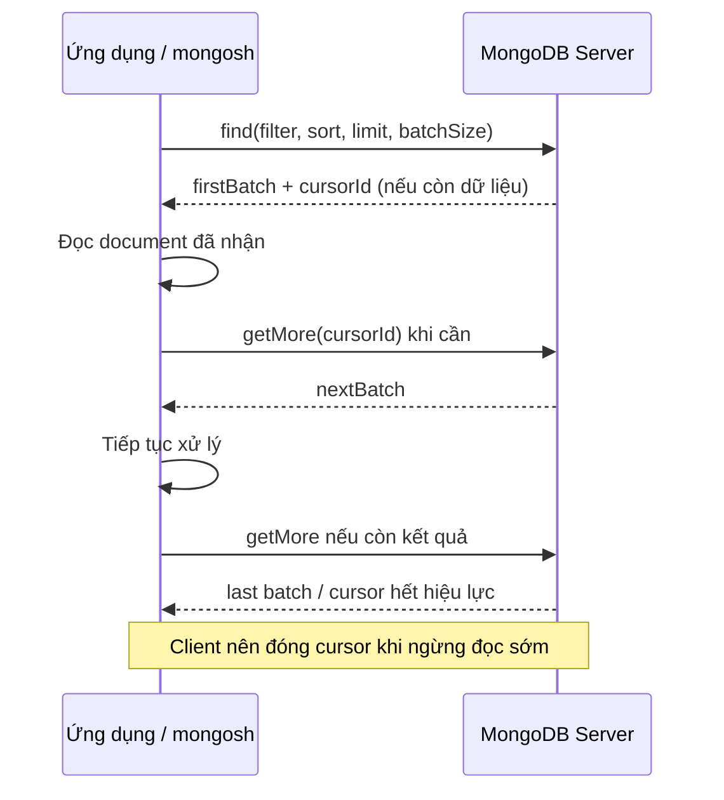

# batchSize, limit và ảnh hưởng đến bộ nhớ, số lần truyền dữ liệu trong MongoDB

> **Module:** Database Engine Document MongoDB  
> **Chương:** Cursor và phân trang

## 1. Vì sao cần quan tâm tới batchSize và limit?

Một collection MongoDB có thể có hàng nghìn, hàng triệu hoặc nhiều hơn số document. Khi ứng dụng cần đọc 20 đơn hàng để hiển thị một trang, việc tải toàn bộ kết quả vào RAM là không cần thiết. Ngược lại, khi xử lý từng document để xuất dữ liệu hoặc làm báo cáo, lấy mỗi lần một document có thể tạo quá nhiều lần trao đổi qua mạng.

MongoDB trả kết quả truy vấn thông qua **cursor** (con trỏ kết quả). Hai điều khiển quan trọng là:

- **`limit(n)`** giới hạn **tổng số document** được trả về bởi truy vấn.
- **`batchSize(n)`** đề nghị server trả **bao nhiêu document trong mỗi đợt truyền dữ liệu** (batch).

Hai thông số tác động đến hai phạm vi khác nhau. `limit` giúp khống chế khối lượng kết quả cuối cùng; `batchSize` điều chỉnh nhịp nhận dữ liệu và sự đánh đổi giữa số lần lấy dữ liệu, độ trễ và lượng dữ liệu được giữ trong bộ đệm.

Ví dụ, một API muốn trả tối đa 50 document:

```javascript
db.orders.find({ status: "PAID" })
  .sort({ _id: 1 })
  .limit(50)
  .batchSize(10);
```

Truy vấn trên trả **không quá 50 document**. Với những document nhỏ và điều kiện thông thường, chúng có thể được chuyển qua nhiều batch, mỗi batch hướng tới tối đa 10 document. Nó **không** có nghĩa kết quả chỉ gồm 10 document, cũng không có nghĩa cứ 10 document thì ứng dụng thực hiện một truy vấn `find` mới.

Sau bài học, bạn có thể:

- Giải thích vòng đời `find → first batch → getMore → hết dữ liệu/đóng cursor`.
- Dùng `batchSize()` và `limit()` trong `mongosh` và MongoDB Java Sync Driver.
- Ước lượng ảnh hưởng của batch size tới round trip mạng và bộ nhớ phía ứng dụng.
- Phân biệt streaming cursor với `toArray()` và phân trang theo trang.
- Kết hợp `sort`, `limit`, `projection`, `skip` hoặc phân trang theo khóa một cách có chủ đích.
- Nhận biết giới hạn kích thước batch, truy vấn chậm do thiếu index và một số nhầm lẫn thường gặp.

## 2. Cursor hoạt động như thế nào?

Một lời gọi `find()` biểu diễn truy vấn trên collection và tạo ra cursor. Khi truy vấn được thực thi và client tiêu thụ kết quả, MongoDB có thể gửi một **batch đầu tiên** cùng thông tin cursor; nếu vẫn còn document, client tiếp tục yêu cầu các batch sau bằng lệnh giao thức **`getMore`**.



Một cursor **không đồng nghĩa** với một mảng chứa sẵn toàn bộ document. API của driver có thể giữ một batch trong bộ nhớ và tiếp tục lấy batch mới khi code đọc tới cuối batch hiện tại. Tuy nhiên, kết quả cuối cùng chiếm bao nhiêu RAM còn phụ thuộc vào cách ứng dụng sử dụng cursor.

Ví dụ:

```javascript
const cursor = db.orders.find({ status: "PAID" });

while (cursor.hasNext()) {
  const order = cursor.next();
  print(order._id);
}
```

Về ý tưởng, vòng lặp đọc từng document từ cursor, thay vì yêu cầu client tạo một mảng khổng lồ chứa toàn bộ document trước khi xử lý. Driver vẫn có thể giữ **một batch** (và các đối tượng tạm khác) trong bộ đệm.

Khi kết quả đã hết, MongoDB đóng cursor tương ứng. Nếu ứng dụng ngừng xử lý giữa chừng, nên gọi `close()` trên cursor nếu API hỗ trợ; đừng dựa hoàn toàn vào timeout phía server.

### 2.1. Một find có thể dẫn tới nhiều lần truyền dữ liệu

Giả sử truy vấn có 250 document hợp lệ nhưng client chỉ đọc 20 document mỗi batch:

```text
Client                       MongoDB
  | ---- find() --------------> |
  | <--- firstBatch ~20 ------- |
  | ---- getMore() -----------> |
  | <--- nextBatch ~20 -------- |
  |            ...             |
  | ---- getMore() -----------> |
  | <--- batch cuối ----------- |
```

Đây vẫn là **một truy vấn cursor có nhiều đợt lấy dữ liệu**, không phải 13 truy vấn `find` độc lập. Thời gian kết nối, chính sách prefetch, kích thước document và giới hạn byte có thể khiến số lần thực tế khác phép chia đơn giản.

### 2.2. First batch và các batch tiếp theo

Khi client **không chỉ định batch size**, các lệnh `find` thường nhận **batch đầu mặc định tối đa 101 document**; các lần `getMore` sau được điều khiển bởi giới hạn kích thước truyền và các thiết lập liên quan. Batch có thể ít document hơn nếu server đã hết kết quả hoặc đạt giới hạn kích thước dữ liệu.

Khi client chỉ định `batchSize(n)` dương, nó yêu cầu số document hướng tới cho mỗi batch, nhưng server vẫn áp dụng giới hạn kích thước phản hồi. Vì vậy:

- `batchSize(20)` không đảm bảo mọi batch đều chứa chính xác 20 document.
- `batchSize(1000)` không cho phép một batch vượt giới hạn kích thước byte mà MongoDB áp dụng.
- Batch cuối thường có ít document hơn.
- `limit` có thể khiến cursor kết thúc trước khi nhận đủ số document theo `batchSize`.

Các hành vi mặc định chi tiết có thể thay đổi theo phiên bản MongoDB Server, driver và loại lệnh; kiểm tra tài liệu của phiên bản đang sử dụng khi cần tối ưu chính xác.

## 3. batchSize(n): số document mong muốn trong một lần lấy

Cú pháp trong `mongosh`:

```javascript
db.collection.find(filter).batchSize(25)
```

Ví dụ:

```javascript
db.orders.find({ status: "PAID" })
  .batchSize(25);
```

Thông số `25` không đổi bộ lọc, thứ tự hay tổng số document hợp lệ. Nó ảnh hưởng cách cursor phân phối các document cho client.

### 3.1. Batch nhỏ: ít dữ liệu đệm, nhiều lần giao tiếp

Giả sử cần đọc 1000 document, mỗi document sau khi truyền/giải mã trung bình khoảng 2 KiB:

```text
batchSize = 20
Mỗi batch ~ 20 × 2 KiB = 40 KiB
Khoảng 50 batch để đọc hết 1000 document
Khoảng 49 getMore sau batch đầu
```

Những số trên chỉ là **mô hình minh họa** khi mọi document có kích thước tương tự, server luôn trả đủ batch và không có giới hạn khác làm rút ngắn batch.

Ưu điểm của batch nhỏ:

- Giảm lượng document được nhận và giữ đồng thời trong một batch.
- Ứng dụng có thể bắt đầu xử lý với lượng dữ liệu nhận ban đầu nhỏ.
- Hữu ích khi mỗi document lớn hoặc ứng dụng xử lý rất chậm.
- Tránh tải trước quá nhiều kết quả nếu người dùng sớm ngừng đọc.

Nhược điểm:

- Nhiều lần gọi `getMore` hơn.
- Độ trễ mạng trên từng round trip tích lũy, nhất là khi database ở vùng mạng xa.
- Có thể tăng overhead CPU/serialization, quản lý cursor và số thông điệp.

### 3.2. Batch lớn: ít round trip, yêu cầu bộ đệm lớn hơn

Với cùng 1000 document và batch size 500:

```text
batchSize = 500
Mỗi batch ~ 500 × 2 KiB = 1000 KiB
Khoảng 2 batch để đọc hết 1000 document
Khoảng 1 getMore sau batch đầu
```

Nếu tài liệu nhỏ và đường truyền có độ trễ cao, batch lớn có thể cải thiện throughput. Nhưng ứng dụng cần đủ RAM để chứa dữ liệu nhận, giải mã và xử lý. Nếu client chỉ định `batchSize` rất lớn, MongoDB vẫn giới hạn dữ liệu có thể trả về trong một batch theo kích thước phản hồi; vì thế phép tính “500 × kích thước” không phải một cam kết chắc chắn.

### 3.3. Bảng đánh đổi

Giả sử truy vấn cần nhận **1000 document**, mỗi document trung bình **2 KiB** và server gửi đủ số document được yêu cầu:

| `batchSize` | Số batch ước lượng | `getMore` sau batch đầu | Dung lượng document/batch ước lượng |
|---:|---:|---:|---:|
| 10 | 100 | 99 | 20 KiB |
| 20 | 50 | 49 | 40 KiB |
| 100 | 10 | 9 | 200 KiB |
| 250 | 4 | 3 | 500 KiB |
| 500 | 2 | 1 | 1000 KiB |
| 1000 | 1 | 0 | 2000 KiB |

**Không coi bảng là dự đoán tuyệt đối về network:** batch đầu và các batch sau còn có giới hạn byte, tài liệu có kích thước biến thiên, và driver có thể điều chỉnh cách tiêu thụ dữ liệu. RAM thực tế cũng lớn hơn kích thước BSON gốc vì còn object của driver, string, wrapper, danh sách và dữ liệu ứng dụng.

### 3.4. batchSize có phải số document tối đa của truy vấn?

Không. Lệnh:

```javascript
db.orders.find({ status: "PAID" }).batchSize(10)
```

có thể trả về hàng nghìn document qua nhiều batch nếu có nhiều bản ghi khớp. Muốn giới hạn **tổng kết quả**, phải thêm `limit(n)` hoặc áp cơ chế giới hạn khác phù hợp.

## 4. limit(n): chặn tổng số document trả về

Cú pháp:

```javascript
db.collection.find(filter).limit(50)
```

Ví dụ:

```javascript
db.orders.find({ status: "PAID" })
  .sort({ createdAt: -1, _id: -1 })
  .limit(50);
```

Ý nghĩa: Sau khi xét filter và thứ tự sắp xếp, cursor trả **tối đa 50 document**. Nếu chỉ có 18 document khớp thì nhận 18, không tự sinh thêm đủ 50. Một giá trị `limit(0)` trên cursor thông thường được hiểu là **không áp giới hạn số document**; trong code ứng dụng muốn chia trang, nên truyền giá trị dương có giới hạn rõ ràng.

### 4.1. limit khác batchSize thế nào?

| Câu hỏi | `limit(n)` | `batchSize(n)` |
|---|---|---|
| Giới hạn tổng document ứng dụng nhận? | **Có** | **Không** |
| Điều chỉnh số document mỗi lần fetch? | Chỉ gián tiếp khi kết quả ít | **Có** |
| Giảm tổng dữ liệu tải khi không cần đọc hết? | Thường có | Không nhất thiết |
| Giảm số lần `getMore`? | Có thể, vì tổng số trả về giảm | Có thể, nếu batch lớn hơn |
| Ảnh hưởng thứ tự dữ liệu? | Không | Không |
| Thay thế filter/index tối ưu? | Không | Không |
| Có thể giảm RAM khi sử dụng `toArray()`? | Có, vì giới hạn tổng kết quả | Không đảm bảo |

Hai cấu hình thường dùng kết hợp vì giải quyết hai vấn đề riêng biệt:

```javascript
db.orders.find({ status: "PAID" })
  .sort({ _id: 1 })
  .limit(100)
  .batchSize(20);
```

Với document nhỏ, dự kiến không quá 100 document, có thể nhận qua khoảng 5 batch. Nếu bộ lọc chỉ khớp 8 document, chỉ có 8 document được trả về, thường không cần `getMore`.

### 4.2. limit không đồng nghĩa server chỉ cần xem n document

Giả sử truy vấn:

```javascript
db.orders.find({ status: "PAID" })
  .sort({ total: -1 })
  .limit(10);
```

Mặc dù client nhận tối đa 10 document, server có thể phải xét rất nhiều document để tìm ra **10 đơn hàng có tổng lớn nhất**, nhất là nếu thiếu index phù hợp. Một số dạng sort + limit có thể dùng thuật toán top-k để giảm bộ nhớ cần cho sort, nhưng không thay thế một index tốt và không đảm bảo chỉ đọc 10 document.

Để hiểu công việc server làm, xem kế hoạch truy vấn:

```javascript
db.orders.find({ status: "PAID" })
  .sort({ total: -1 })
  .limit(10)
  .explain("executionStats");
```

Quan sát các chỉ số như `totalDocsExamined`, `totalKeysExamined`, index scan/collection scan và stage sort trong output phù hợp với phiên bản MongoDB đang chạy. `explain` phân tích kế hoạch thực thi; nó không trực tiếp đo số network round trip do client cursor tiêu thụ.

## 5. Kết hợp limit, batchSize và kích thước document

Có thể xem kết quả theo ba đại lượng:

- \(N\): tổng số document **thực sự cần đọc** sau khi áp `limit`.
- \(B\): batch size yêu cầu.
- \(S\): kích thước dữ liệu trung bình một document khi truyền/giải mã.

Nếu bỏ qua giới hạn byte mỗi batch và overhead giao thức:

\[
\text{Số batch gần đúng} \approx \left\lceil \frac{N}{B} \right\rceil
\]

\[
\text{Số getMore gần đúng} \approx \max(0,\text{Số batch} - 1)
\]

\[
\text{Dung lượng document của một batch} \approx B \times S
\]

Ví dụ API hiển thị **một trang 30 document**, batchSize = 10:

```text
N = 30, B = 10
Số batch ≈ ceil(30/10) = 3
Số getMore sau firstBatch ≈ 2
```

Nếu batchSize = 50, toàn bộ trang có thể nằm trong một batch và không cần `getMore`, miễn dữ liệu không vượt giới hạn kích thước batch.

### 5.1. Giới hạn theo byte của MongoDB

MongoDB có giới hạn kích thước BSON document và giới hạn dung lượng dữ liệu trong một batch/phản hồi. Một document BSON không được vượt quá giới hạn document của server (thông thường **16 MiB**). Các batch kết quả cũng chịu giới hạn theo byte, vì vậy không phải lúc nào server cũng trả đủ số lượng mà client yêu cầu.

Giả sử 40 document có dung lượng gần 1 MiB mỗi document, thì:

```javascript
db.large_documents.find({}).batchSize(40)
```

không có nghĩa một batch chắc chắn mang 40 MiB dữ liệu. Server sẽ giới hạn lượng dữ liệu cho phép trong phản hồi và cần thêm các lần lấy batch để hoàn tất cursor.

Do đó:

- Số batch thực có thể **nhiều hơn** phép tính \(\lceil N/B \rceil\).
- Giới hạn byte có thể quan trọng hơn `batchSize` khi document lớn.
- Kích thước BSON trên mạng không phải đúng bằng kích thước object Java trong heap.
- Thử nghiệm nên xem cả kích thước document, compression, độ trễ mạng và tốc độ xử lý.

### 5.2. Tăng batchSize không tạo dữ liệu mới

Nếu `limit(5)` và `batchSize(500)`:

```javascript
db.orders.find({ status: "PAID" })
  .limit(5)
  .batchSize(500);
```

cursor vẫn trả **tối đa 5 document**. Batch size chỉ là kích thước yêu cầu cho một lần fetch; nó không ghi đè giới hạn tổng.

### 5.3. Không dùng batchSize(0) như một cách phân trang

Giá trị `0` của batch size có hành vi đặc biệt trong một số API/giao thức (ví dụ yêu cầu khởi tạo cursor mà batch đầu không mang document). Nó không có nghĩa “mỗi trang trả 0 document” và không nên được dùng như tùy chọn phân trang thông thường. Với code muốn chọn kích thước batch, hãy kiểm tra giá trị dương và hành vi driver đang dùng.

## 6. Bộ nhớ: cursor, batch và toArray() khác nhau

Những người mới học thường nghĩ: “Tôi đã dùng `batchSize(20)` nên chương trình không thể dùng RAM cho hơn 20 document”. Điều này **không đúng** nếu mã ứng dụng tiếp tục giữ toàn bộ kết quả hoặc tạo thêm nhiều đối tượng trung gian.

### 6.1. Đọc tuần tự từng document

```javascript
const cursor = db.orders.find({ status: "PAID" })
  .batchSize(20);

let processed = 0;

while (cursor.hasNext()) {
  const order = cursor.next();
  // Xử lý từng document mà không lưu tất cả vào array:
  processed += 1;
}

print("Processed: " + processed);
```

Cách làm này phù hợp cho job xử lý tuần tự. Driver/mongosh vẫn có thể đệm document của batch, nhưng logic trên **không tự lưu** từng document vào một danh sách tăng vô hạn.

### 6.2. toArray() nạp toàn bộ kết quả đã đọc vào bộ nhớ

```javascript
const allOrders = db.orders.find({ status: "PAID" })
  .batchSize(20)
  .toArray();
```

Dù truyền từng batch 20 document, `toArray()` sẽ thu thập **toàn bộ document mà cursor trả về** vào một array phía client. Với hàng triệu document, mảng đó có thể chiếm nhiều RAM. `batchSize` nhỏ không cứu được bộ nhớ nếu cuối cùng ứng dụng vẫn giữ tất cả document.

Nếu chỉ cần hiển thị 30 document:

```javascript
const page = db.orders.find({ status: "PAID" })
  .sort({ _id: 1 })
  .limit(30)
  .batchSize(30)
  .toArray();
```

Đây là trường hợp `toArray()` phù hợp hơn vì **`limit(30)`** đã giới hạn tổng số phần tử.

### 6.3. Bộ nhớ máy chủ và bộ nhớ máy khách

| Nơi tiêu thụ | Điều gì dùng RAM? | Thông số giúp kiểm soát |
|---|---|---|
| **Client/driver** | Batch BSON/objects đã giải mã, biến tạm, các phần tử array | `batchSize`, `limit`, đọc tuần tự, tránh `toArray()` quá lớn |
| **Application business logic** | Cache, danh sách tổng hợp, object mapping, kết quả join tại ứng dụng | Thiết kế xử lý streaming và giải phóng dữ liệu |
| **MongoDB Server** | Cursor state, working set, sort/aggregation stages, cache/storage engine | Index, filter, projection, limit khi phù hợp, cách viết pipeline |
| **Network** | Dữ liệu BSON, protocol overhead, TLS/compression, số vòng request/response | Batch size phù hợp, projection, limit, giảm document size |

**Quan trọng:** `batchSize` không đặt một “giới hạn RAM” cho query engine phía server. Nếu truy vấn phải sort nhiều document không có index phù hợp, nó vẫn có thể dùng bộ nhớ cho giai đoạn sort dù client chỉ nhận mỗi batch nhỏ.

## 7. Projection giúp tiết kiệm dữ liệu thường hiệu quả hơn giảm batchSize

Giả sử document `orders` lưu các field:

```javascript
{
  _id: 123,
  status: "PAID",
  createdAt: ISODate("2026-11-14T03:00:00Z"),
  total: NumberDecimal("199.00"),
  items: [/* nhiều dòng hàng */],
  shippingAddress: {/* nhiều field */},
  auditTrail: [/* nhiều sự kiện */]
}
```

Màn hình danh sách có thể chỉ cần `_id`, `status`, `createdAt` và `total`. Sử dụng **projection**:

```javascript
db.orders.find(
  { status: "PAID" },
  { _id: 1, status: 1, createdAt: 1, total: 1 }
)
.sort({ createdAt: -1, _id: -1 })
.limit(20)
.batchSize(20);
```

Client không cần nhận `items`, `shippingAddress` và `auditTrail` để render danh sách. Projection giúp giảm số byte trên mạng và dung lượng client giữ, đồng thời có thể giúp query tận dụng index cover phù hợp.

Nếu chỉ thay `batchSize(20)` mà vẫn trả document lớn chứa nhiều field không dùng tới, tổng lượng dữ liệu của một trang vẫn cao. **Cách tối ưu có thứ tự** thường là giảm tổng document bằng `limit`, giảm field bằng projection, dùng filter/index tốt, rồi chọn batch size theo workload.

## 8. Chuẩn bị thực hành: 120 document có thứ tự ổn định

Để thấy rõ cách giới hạn và chia batch, dùng database lab riêng. Chỉ chạy phần tạo dữ liệu **một lần** trên collection chưa có các ID trùng:

```javascript
const lab = db.getSiblingDB("cursor_batch_lab");
const visits = lab.getCollection("visits");

const rows = Array.from({ length: 120 }, (_, index) => ({
  _id: index + 1,
  category: index % 3 === 0 ? "A" : "B",
  createdAt: new Date(Date.UTC(2026, 0, 1, 0, 0, index)),
  message: "Visit " + (index + 1),
  details: { source: "demo", note: "x".repeat(512) }
}));

visits.insertMany(rows);
```

Kiểm tra:

```javascript
print("Total:", visits.countDocuments({}));

printjson(
  visits.find({}, { _id: 1, category: 1 })
    .sort({ _id: 1 })
    .limit(5)
    .toArray()
);
```

Collection chứa 120 document, `_id` là số nguyên từ 1 đến 120. Với thứ tự `sort({ _id: 1 })`, kết quả ổn định và dễ đoán. Bài tập không sử dụng dữ liệu ứng dụng thật.

### 8.1. Ví dụ limit nhỏ hơn batchSize

```javascript
const example1 = visits.find(
    { category: "B" },
    { _id: 1, category: 1 }
  )
  .sort({ _id: 1 })
  .limit(5)
  .batchSize(30)
  .toArray();

print(example1.length); // 5
printjson(example1);
```

Có 80 document thuộc category `B`, nhưng chỉ đọc 5 document. Batch size 30 **không** làm kết quả tăng lên 30.

### 8.2. Ví dụ limit lớn hơn batchSize

```javascript
const example2 = visits.find(
    { category: "B" },
    { _id: 1, category: 1 }
  )
  .sort({ _id: 1 })
  .limit(23)
  .batchSize(7)
  .toArray();

print(example2.length); // 23
```

Với document nhỏ, cursor có thể cần khoảng 4 batch để nhận đủ 23 document: ba batch 7 và một batch 2. MongoDB không hứa số lượng chính xác của từng batch khi có các giới hạn kỹ thuật khác.

### 8.3. Thử nhiều batch size

Giữ nguyên filter, projection và limit; chỉ đổi batch size:

```javascript
const filter = { category: "B" };
const fields = { _id: 1, category: 1 };

const a = visits.find(filter, fields)
  .sort({ _id: 1 }).limit(50).batchSize(5).toArray();

const b = visits.find(filter, fields)
  .sort({ _id: 1 }).limit(50).batchSize(25).toArray();

const c = visits.find(filter, fields)
  .sort({ _id: 1 }).limit(50).batchSize(100).toArray();

print(a.length, b.length, c.length); // 50 50 50
```

**Cả ba trả cùng 50 document** khi dữ liệu không thay đổi; chỉ cấu hình lấy batch khác nhau. Nếu cần đo số `getMore` thực sự, hãy bật command monitoring ở driver hoặc dùng công cụ quan sát thích hợp trong môi trường lab. `a.length` chỉ đo tổng số document, không cho biết số round trip.

## 9. Phân trang: limit là kích thước trang, batchSize là kích thước fetch

Giả sử API hiển thị 10 lượt truy cập mỗi trang. Phân trang cần xác định **phần kết quả nào thuộc trang đang xem**, không chỉ giới hạn một cursor.

### 9.1. Phân trang bằng skip + limit

Cách đơn giản:

```javascript
const pageSize = 10;
const pageNumber = 3; // Đánh số trang từ 1

const page = visits.find(
    {},
    { _id: 1, category: 1, createdAt: 1 }
  )
  .sort({ _id: 1 })
  .skip((pageNumber - 1) * pageSize)
  .limit(pageSize)
  .batchSize(pageSize)
  .toArray();

printjson(page);
```

Vì `_id` từ 1 đến 120, trang 3 tương ứng `_id` từ 21 đến 30 trong bộ dữ liệu lab.

Ý nghĩa từng thành phần:

- `sort({ _id: 1 })`: đảm bảo thứ tự trang có thể dự đoán.
- `skip(20)`: bỏ qua 20 kết quả đầu.
- `limit(10)`: lấy tối đa 10 kết quả tiếp theo.
- `batchSize(10)`: yêu cầu fetch khoảng 10 document mỗi batch.

**Không có `sort` ổn định**, việc lấy trang có thể thiếu hoặc lặp kết quả khi kế hoạch truy vấn/thứ tự dữ liệu thay đổi. Nếu sort theo `createdAt` mà nhiều document có timestamp trùng nhau, nên thêm `_id` làm khóa tie-breaker.

### 9.2. Chi phí của skip ở trang sâu

Trang 1 với `skip(0)` thường đơn giản. Nhưng trang 10000 với page size 20:

```text
skip = (10000 - 1) × 20 = 199980
limit = 20
```

Server có thể phải đi qua rất nhiều key/document trước khi đến vị trí cần trả. Dù cuối cùng client chỉ nhận 20 document, truy vấn vẫn có thể tốn CPU/I/O. `batchSize(20)` không giải quyết phần chi phí skip này.

Với danh sách lớn và yêu cầu “xem tiếp”, cân nhắc **keyset/seek pagination**.

### 9.3. Phân trang theo khóa (seek pagination)

Nếu `_id` có thứ tự phù hợp, trang đầu:

```javascript
const pageSize = 10;

const firstPage = visits.find(
    {},
    { _id: 1, category: 1 }
  )
  .sort({ _id: 1 })
  .limit(pageSize)
  .batchSize(pageSize)
  .toArray();

const lastId = firstPage[firstPage.length - 1]._id;
print("Last ID:", lastId);
```

Trang tiếp theo:

```javascript
const nextPage = visits.find(
    { _id: { $gt: lastId } },
    { _id: 1, category: 1 }
  )
  .sort({ _id: 1 })
  .limit(pageSize)
  .batchSize(pageSize)
  .toArray();

printjson(nextPage);
```

Trong lab, `lastId` của trang đầu là 10; trang sau trả các ID 11 đến 20. Cách này không yêu cầu skip toàn bộ các trang trước.

Đối với dữ liệu thật có thứ tự theo `createdAt DESC, _id DESC`, cần dùng điều kiện seek kết hợp **cả createdAt và _id**. Ví dụ với token trang chứa hai giá trị cuối của trang trước:

```javascript
const next = db.orders.find({
  $or: [
    { createdAt: { $lt: lastCreatedAt } },
    { createdAt: lastCreatedAt, _id: { $lt: lastObjectId } }
  ]
})
.sort({ createdAt: -1, _id: -1 })
.limit(20)
.batchSize(20);
```

Các biến `lastCreatedAt` và `lastObjectId` phải được cung cấp từ document cuối của trang trước; ví dụ trên chỉ trình bày logic seek. Index phù hợp với filter/sort, chẳng hạn `{ createdAt: -1, _id: -1 }`, thường giúp phân trang hiệu quả. Hãy bổ sung các điều kiện tenant/status và index theo truy vấn thực tế khi áp dụng.

**Lưu ý về tính nhất quán:** seek pagination giúp giảm vấn đề lệch offset khi có insert/delete, nhưng không tự biến nhiều request xem trang thành cùng một snapshot dữ liệu. Khi cần ảnh chụp dữ liệu nhất quán qua nhiều trang, phải thiết kế read concern/snapshot hoặc cách lưu phiên bản dữ liệu phù hợp.

### 9.4. Lấy thêm một document để biết còn trang sau

API thường cần trường `hasNext` mà không muốn chạy một query count toàn bộ:

```javascript
const requestedPageSize = 10;

const fetched = visits.find(
    { _id: { $gt: 30 } },
    { _id: 1, category: 1 }
  )
  .sort({ _id: 1 })
  .limit(requestedPageSize + 1)
  .batchSize(requestedPageSize + 1)
  .toArray();

const hasNext = fetched.length > requestedPageSize;
const pageItems = fetched.slice(0, requestedPageSize);

printjson({ hasNext, items: pageItems });
```

Phương pháp **n + 1** phát hiện có ít nhất một document tiếp theo trong kết quả tại thời điểm truy vấn. Nó không cho biết chính xác tổng số trang hoặc tổng số document, và không bảo đảm trạng thái dữ liệu sẽ không thay đổi khi client bấm “trang sau”.

## 10. Áp dụng với MongoDB Java Sync Driver

Với Java, MongoDB Sync Driver cung cấp `FindIterable` và `MongoCursor`. Ví dụ dùng driver hiện đại và dự án đã khai báo dependency `org.mongodb:mongodb-driver-sync`.

### 10.1. Đọc tuần tự với limit và batchSize

```java
import com.mongodb.client.MongoClient;
import com.mongodb.client.MongoClients;
import com.mongodb.client.MongoCollection;
import com.mongodb.client.MongoCursor;
import org.bson.Document;

import static com.mongodb.client.model.Filters.eq;
import static com.mongodb.client.model.Projections.fields;
import static com.mongodb.client.model.Projections.include;
import static com.mongodb.client.model.Sorts.ascending;

public class CursorBatchExample {
    public static void main(String[] args) {
        String uri = System.getenv("MONGODB_URI");
        if (uri == null || uri.isBlank()) {
            uri = "mongodb://127.0.0.1:27017";
        }

        try (MongoClient client = MongoClients.create(uri)) {
            MongoCollection<Document> visits = client
                    .getDatabase("cursor_batch_lab")
                    .getCollection("visits");

            try (MongoCursor<Document> cursor = visits
                    .find(eq("category", "B"))
                    .projection(fields(include("_id", "category", "createdAt")))
                    .sort(ascending("_id"))
                    .limit(50)
                    .batchSize(10)
                    .iterator()) {

                int processed = 0;
                while (cursor.hasNext()) {
                    Document visit = cursor.next();
                    System.out.println(visit.toJson());
                    processed++;
                }

                System.out.println("Processed: " + processed);
            }
        }
    }
}
```

Điểm cần chú ý:

- `.limit(50)` đảm bảo tối đa 50 document được đưa qua cursor này.
- `.batchSize(10)` gợi ý fetch 10 document mỗi batch; đây không phải số kết quả của toàn bộ truy vấn.
- `while (cursor.hasNext())` xử lý tuần tự, không chủ động giữ một danh sách toàn bộ document.
- `try-with-resources` đóng cursor và client khi sử dụng xong, đặc biệt hữu ích nếu vòng lặp dừng sớm vì lỗi/nghiệp vụ.
- Chương trình vẫn có thể dùng bộ đệm và RAM cho từng batch; xử lý tuần tự chỉ tránh kiểu tích lũy không cần thiết.

### 10.2. Thu thập một trang vào List

Đối với endpoint trả dữ liệu JSON của một trang nhỏ:

```java
import com.mongodb.client.MongoCollection;
import org.bson.Document;

import java.util.ArrayList;
import java.util.List;

import static com.mongodb.client.model.Sorts.ascending;

public class PageReader {
    public static List<Document> loadPage(
            MongoCollection<Document> visits,
            int pageSize
    ) {
        if (pageSize < 1 || pageSize > 100) {
            throw new IllegalArgumentException(
                    "pageSize must be between 1 and 100"
            );
        }

        List<Document> page = new ArrayList<>(pageSize);

        visits.find()
                .sort(ascending("_id"))
                .limit(pageSize)
                .batchSize(pageSize)
                .into(page);

        return page;
    }
}
```

Đây là trường hợp có thể dùng `into(page)` vì `pageSize` đã được ràng buộc. Nếu bỏ `limit` và kết quả có hàng triệu document, danh sách có thể tiêu tốn quá nhiều RAM.

### 10.3. Batch size trên driver không làm thay đổi kích thước trang HTTP

Giả sử controller trả 20 document mỗi HTTP response:

```text
HTTP pageSize = 20
Mongo find().limit(20).batchSize(5)
```

API vẫn trả tối đa 20 document. Driver chỉ nhận dữ liệu từ MongoDB theo các batch nhỏ hơn trong quá trình xây dựng phản hồi. Khi ứng dụng cần giảm số chuyến đi database cho trang nhỏ, có thể cân nhắc `batchSize(20)`, nhưng cần đo trên môi trường thật.

Ngược lại, với một job xuất 50000 document, `batchSize(100)` phù hợp để đọc tuần tự mà không phải đưa toàn bộ document vào một list trước khi ghi ra file. Hãy chú ý chính đối tượng ghi output và queue xử lý cũng có thể tạo bộ đệm riêng.

### 10.4. MongoDB Reactive Driver có cách tiêu thụ khác

Với Reactive Streams driver, cơ chế demand/backpressure và cách publisher yêu cầu dữ liệu khác Sync Driver, dù server vẫn dùng batch/getMore. Không kết luận kích thước bộ đệm thực tế chỉ từ `batchSize`; cần xét cả subscriber demand, prefetch, hàng đợi xử lý và scheduler. Bài này dùng Sync Driver để tập trung vào các khái niệm cursor chung.

## 11. Chọn batchSize theo workload

Không có một con số batchSize tối ưu cho mọi ứng dụng. Hãy xét ba nhóm nhu cầu.

### 11.1. API trả trang nhỏ

Ví dụ trả 20 hoặc 50 đơn hàng:

```javascript
db.orders.find({ customerId: "C-001" })
  .sort({ createdAt: -1, _id: -1 })
  .limit(20)
  .batchSize(20);
```

Một cấu hình hợp lý để **thử nghiệm ban đầu** là batchSize xấp xỉ pageSize. Nó thường giúp giảm round trip nếu document nhỏ, nhưng không phải yêu cầu bắt buộc. Với document lớn hoặc trường hợp stream trả về chậm, batch nhỏ hơn có thể phù hợp hơn.

### 11.2. Batch export hoặc ETL

Đọc hàng trăm nghìn document để xử lý từng document:

```javascript
const cursor = db.events.find(
    { eventType: "CLICK" },
    { _id: 1, eventType: 1, createdAt: 1 }
  )
  .sort({ _id: 1 })
  .batchSize(500);

let total = 0;
while (cursor.hasNext()) {
  const event = cursor.next();
  // Gửi event tới bước xuất/biến đổi; không push vào mảng vô hạn.
  total++;
}
print("Processed:", total);
```

Nếu không muốn giới hạn tổng số record, có thể không đặt `limit`. Với workload kéo dài, cần quan tâm thời gian cursor sống, khả năng resume sau lỗi, checkpoint tiến độ và tốc độ tiêu thụ. Batch size lớn thường giảm số lần `getMore`, nhưng không thay thế flow control và cơ chế retry của job.

### 11.3. Document lớn hoặc ứng dụng có bộ nhớ hạn chế

Nếu mỗi document chứa array và binary lớn, `batchSize(500)` có thể không đem lại hiệu quả mong đợi vì giới hạn theo byte. Bắt đầu với batch nhỏ, dùng projection tối đa các field cần thiết, và đo lượng memory thực tế của tiến trình.

| Ngữ cảnh | Ưu tiên | Cách thử ban đầu |
|---|---|---|
| Trang UI 20 document | Ít round trip, đáp ứng nhanh | `limit(20)`, projection, batchSize khoảng 20 |
| Danh sách API 100 document | Giới hạn payload và bộ nhớ | `limit(100)`, projection, thử batchSize 25–100 |
| Export 100000 document | Throughput, RAM ổn định | Stream tuần tự, thử batchSize từ vài trăm rồi đo |
| Document lớn | Tránh spike RAM/dữ liệu phản hồi | Batch nhỏ, projection, theo dõi kích thước BSON |
| Database qua WAN độ trễ cao | Giảm chi phí round trip | Thử tăng batchSize có kiểm soát |
| Kết quả thường dừng sớm | Không tải dư nhiều document | Batch nhỏ hơn hoặc giới hạn tổng theo nghiệp vụ |

Các giá trị trong cột cuối là **điểm bắt đầu để benchmark**, không phải mặc định kỹ thuật hay “best practice” cứng cho mọi MongoDB deployment.

## 12. Đo hiệu năng: cần quan sát điều gì?

Khi điều chỉnh batchSize, hãy giữ ổn định filter, projection, sort, limit và dữ liệu thử nghiệm để có thể so sánh.

Nên ghi nhận:

| Chỉ số | Ý nghĩa |
|---|---|
| Tổng document thực sự đọc | Xác định khối lượng công việc |
| Thời gian đến document đầu | Độ trễ ban đầu |
| Thời gian đọc hết cursor | Throughput và độ trễ tổng |
| Số lệnh `getMore` | Số round trip bổ sung của cursor |
| Kích thước dữ liệu trả về | Chi phí network/serialization |
| RAM đỉnh của tiến trình Java | Kiểm tra ảnh hưởng bộ đệm |
| CPU ứng dụng/server | Giải mã BSON, mapping, xử lý query |
| `totalDocsExamined` / `totalKeysExamined` | Hiệu quả kế hoạch truy vấn |
| Số document được ứng dụng giữ lại | Phát hiện tích lũy dữ liệu ngoài ý muốn |

Có thể sử dụng **command monitoring** trong MongoDB Java Driver để quan sát các command `find` và `getMore` do client gửi. Nên bật chỉ trong môi trường được phép quan sát; không log toàn bộ query hoặc document nhạy cảm vào production.

`explain("executionStats")` hữu ích để xem filter/index/sort làm server tốn bao nhiêu công việc, nhưng **không phải công cụ đếm getMore** của lần duyệt cursor bên ứng dụng. Để đo round trip, quan sát command driver/network ở mức thích hợp.

Một phép benchmark có giá trị cần giữ các điều kiện như warm cache, document size, mạng, concurrency và cách client consume dữ liệu tương đối giống nhau. Chạy `toArray()` cho một lần và streaming cho lần khác sẽ thay đổi cả cách ứng dụng sử dụng RAM, khiến kết quả không còn chỉ phản ánh batch size.

## 13. Các lỗi và hiểu lầm thường gặp

| Hiện tượng/nhận định | Nguyên nhân hoặc thực tế | Cách xử lý |
|---|---|---|
| “`batchSize(10)` chỉ trả 10 document” | Batch size không giới hạn tổng kết quả | Dùng `limit(10)` nếu cần đúng tối đa 10 document |
| “`limit(50)` nghĩa server đọc tối đa 50 document” | Filter/sort có thể phải xét nhiều document hơn | Dùng index và kiểm tra `explain()` |
| “`batchSize(1000)` luôn trả 1000 document/batch” | Server giới hạn kích thước phản hồi; batch cuối có thể ngắn | Không dựa vào kích thước batch thực tế như bất biến |
| “`batchSize(20)` đảm bảo chương trình không giữ hơn 20 document” | `toArray()` hoặc danh sách tích lũy vẫn giữ mọi document | Stream tuần tự, giới hạn tổng bằng `limit` |
| “Batch nhỏ luôn nhanh hơn” | Nhiều `getMore` làm tăng round trip | Đo throughput và latency thực tế |
| “Batch lớn luôn nhanh hơn” | RAM và chi phí deserialize tăng, đôi khi vượt nhu cầu | Thử theo document size và mức tiêu thụ |
| “Không có `sort` vẫn phân trang ổn định” | Thứ tự kết quả có thể thay đổi | Sort rõ ràng, thêm khóa tie-breaker duy nhất |
| “`skip(100000)` chỉ truyền 20 kết quả nên luôn rẻ” | Server vẫn phải vượt qua phần offset lớn | Cân nhắc seek pagination |
| “`limit(20).batchSize(5)` tạo 4 truy vấn find” | Thường là một cursor với getMore | Phân biệt `find` và `getMore` |
| “Projection không quan trọng” | Document có thể chứa nhiều field/array lớn | Chỉ chọn field API cần |
| “Chỉ cần tối ưu batchSize nếu query chậm” | Query có thể chậm do COLLSCAN, sort, index hoặc join | Xem executionStats và tối ưu truy vấn trước |
| “Cursor tự đóng ngay khi app dừng đọc” | Cursor có thể còn sống phía server cho đến khi được đóng/timeout | Đóng cursor chủ động qua API hỗ trợ |

## 14. Bài thực hành tổng hợp

Thực hiện trên collection `cursor_batch_lab.visits` đã tạo ở mục 8. Các bài không thay đổi document, chỉ đọc dữ liệu.

### Bài A — Giữ nguyên kết quả, thay batch size

Chạy:

```javascript
const sizes = [1, 5, 20, 50];

for (const n of sizes) {
  const result = visits.find(
      { category: "B" },
      { _id: 1 }
    )
    .sort({ _id: 1 })
    .limit(40)
    .batchSize(n)
    .toArray();

  print("batchSize=" + n + ", returned=" + result.length);
}
```

Kết quả đều có `returned = 40` nếu dữ liệu không thay đổi. Giải thích vì sao cả bốn trường hợp có tổng số document như nhau, nhưng số batch/getMore có thể khác.

### Bài B — Giữ nguyên batch size, thay limit

```javascript
for (const n of [5, 15, 50]) {
  const result = visits.find({})
    .sort({ _id: 1 })
    .limit(n)
    .batchSize(10)
    .toArray();

  print("limit=" + n + ", returned=" + result.length);
}
```

Với collection 120 document, số trả về lần lượt là 5, 15 và 50. Batch size không biến cả ba thành cùng 10 document.

### Bài C — Ước lượng số round trip

Cho ba cấu hình:

| Tổng document cần đọc | Batch size | Số batch gần đúng | Số getMore gần đúng |
|---:|---:|---:|---:|
| 100 | 10 | 10 | 9 |
| 100 | 25 | 4 | 3 |
| 100 | 100 | 1 | 0 |

Giải thích vì sao đây là **ước lượng**, không phải số chắc chắn. Nêu ít nhất hai yếu tố có thể khiến batch thực tế nhỏ hơn yêu cầu: giới hạn kích thước byte và kết quả đã hết.

### Bài D — So sánh streaming và toArray

Trong mã Java, dùng cùng một `find()` và cùng `batchSize(20)`:

1. Lần đầu duyệt `MongoCursor` với `while (hasNext())`, xử lý mỗi document rồi bỏ tham chiếu.
2. Lần thứ hai dùng `into(new ArrayList<>())` để giữ toàn bộ kết quả.
3. Với dữ liệu mẫu có giới hạn, quan sát khác biệt về nơi lưu document trong ứng dụng; không tăng dữ liệu lên mức gây thiếu RAM.

Giải thích vì sao cả hai dùng cùng batchSize nhưng có hành vi bộ nhớ khác nhau.

### Bài E — Thiết kế API phân trang

Giả sử API cần 20 kết quả mới nhất theo `createdAt`:

- Chọn filter đúng domain.
- Sort `createdAt DESC, _id DESC` để có thứ tự ổn định.
- Dùng `limit(20)` để chặn số phần tử.
- Dùng projection chỉ lấy field UI cần.
- Cân nhắc `batchSize(20)` làm điểm khởi đầu đo hiệu năng.
- Khi cần trang sau ở dataset lớn, thiết kế token chứa khóa sort cuối cùng thay cho offset sâu.

Không cố dùng một mình `batchSize(20)` để giải quyết phân trang.

## 15. Những nguyên tắc cốt lõi

1. **`limit` kiểm soát tổng số document của cursor**, còn **`batchSize` kiểm soát kích thước fetch theo đợt**.
2. Một cursor thường bắt đầu bằng `find` và lấy thêm dữ liệu qua `getMore`; batch nhỏ thường tăng số round trip.
3. Batch size lớn có thể giảm overhead mạng nhưng tăng lượng dữ liệu được nhận/giải mã cùng lúc.
4. **`batchSize` không phải giới hạn RAM**. `toArray()` hoặc code tích lũy kết quả vẫn có thể giữ mọi document.
5. Server có giới hạn kích thước document/batch và có thể trả ít document hơn yêu cầu.
6. `limit` giảm dữ liệu client nhận nhưng không chắc giảm toàn bộ chi phí filter/sort phía server.
7. Phân trang cần **sort ổn định + limit**, thường kèm skip hoặc seek token; batch size chỉ là điều chỉnh hiệu năng fetch.
8. Dùng projection, index và đo lường trước khi tinh chỉnh batch size theo workload thực tế.
9. Với driver Java, dùng `try-with-resources` để đóng cursor khi ngừng đọc, đặc biệt trong job xử lý dài.

## 16. Tài liệu tham khảo

- [MongoDB Manual – cursor.batchSize()](https://www.mongodb.com/docs/manual/reference/method/cursor.batchSize/)
- [MongoDB Manual – cursor.limit()](https://www.mongodb.com/docs/manual/reference/method/cursor.limit/)
- [MongoDB Manual – db.collection.find()](https://www.mongodb.com/docs/manual/reference/method/db.collection.find/)
- [MongoDB Manual – cursor.skip()](https://www.mongodb.com/docs/manual/reference/method/cursor.skip/)
- [MongoDB Manual – cursor.sort()](https://www.mongodb.com/docs/manual/reference/method/cursor.sort/)
- [MongoDB Manual – Query Optimization](https://www.mongodb.com/docs/manual/core/query-optimization/)
- [MongoDB Manual – Explain Results](https://www.mongodb.com/docs/manual/reference/explain-results/)
- [MongoDB Java Sync Driver – Retrieve Data](https://www.mongodb.com/docs/drivers/java/sync/current/crud/query-documents/find/)
- [MongoDB Java Sync Driver – Configure Cursor](https://www.mongodb.com/docs/drivers/java/sync/current/crud/query-documents/cursor/)
- [MongoDB Java Sync Driver – Monitor Commands](https://www.mongodb.com/docs/drivers/java/sync/current/logging-monitoring/monitoring/)

Các hành vi mặc định của first batch, giới hạn batch và các tùy chọn cursor có thể có khác biệt giữa các phiên bản MongoDB Server và driver. Với bài toán hiệu năng thực tế, hãy đo trên phiên bản và khối lượng dữ liệu đang sử dụng, đồng thời phân biệt rõ chi phí server xử lý truy vấn với chi phí truyền kết quả tới client.
