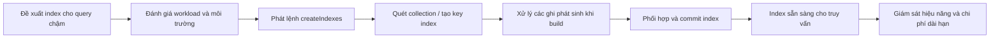
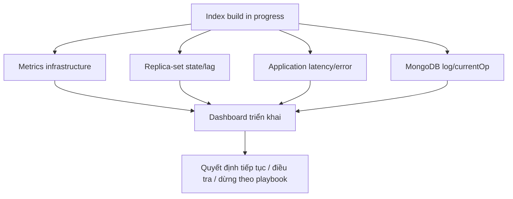

# Xây dựng index trên hệ thống đang hoạt động và theo dõi tiến trình trong MongoDB

> **Module:** Database Engine Document MongoDB  
> **Chương:** Index chuyên biệt

## 1. Bài toán thực tế: thêm index mà hệ thống vẫn phục vụ người dùng

Một ứng dụng thương mại điện tử đang chạy MongoDB có collection `orders` chứa hàng triệu document. API danh sách đơn hàng theo cửa hàng và thời điểm tạo trở nên chậm. Đội phát triển phát hiện truy vấn đang phải quét quá nhiều document và đề xuất index:

```javascript
{ tenantId: 1, createdAt: -1, _id: -1 }
```

Trên một database thử nghiệm nhỏ, `createIndex()` có thể hoàn thành gần như ngay lập tức. Nhưng trên hệ thống đang hoạt động, index build phải đọc dữ liệu, tạo cấu trúc index, xử lý thay đổi phát sinh trong khi xây dựng, phối hợp giữa các node và hoàn tất an toàn. Công việc này cạnh tranh CPU, I/O, RAM, dung lượng ổ đĩa và băng thông với lưu lượng sản xuất.

Vì vậy câu hỏi không chỉ là **“Cú pháp tạo index là gì?”** mà còn là:

- Khi tạo index, ứng dụng có tiếp tục đọc và ghi được không?
- Thao tác bắt đầu, đang chạy hay đã hoàn tất được nhận biết bằng cách nào?
- Làm sao theo dõi tiến độ mà không nhầm chỉ số gần đúng với phần trăm chính xác?
- Vì sao một index build có thể chờ replica set đủ điều kiện commit?
- Nếu bộ nhớ, ổ đĩa, replication lag hoặc độ trễ API tăng mạnh, đội vận hành nên làm gì?
- Sau khi tạo xong, làm sao biết query thực sự sử dụng index và lợi ích có xứng với chi phí duy trì?

**Mục tiêu:** nắm một quy trình thực hành từ lập kế hoạch → xây index → quan sát → xác nhận → vận hành hoặc rollback, có ví dụ trên MongoDB Shell và ứng dụng Java.

> Bài học trình bày nguyên tắc cho MongoDB Server hiện đại. Một số hành vi index build, lệnh quản trị và chỉ số quan sát phụ thuộc phiên bản MongoDB, topology (standalone, replica set, sharded cluster), phiên bản driver và quyền của tài khoản. Trước khi thao tác production, phải kiểm tra đúng tài liệu của phiên bản đang chạy.

## 2. Index build là gì và có những chi phí nào?

**Index build** là quá trình MongoDB tạo một cấu trúc index từ dữ liệu hiện có trong collection. Sau khi index được commit thành công, các thao tác ghi tiếp theo phải duy trì index cùng với dữ liệu.

Sơ đồ tổng quan:



Đây là mô hình khái niệm: MongoDB có các phase chi tiết hơn và cách tổ chức khác nhau giữa các phiên bản.

### 2.1. Các loại chi phí cần dự trù

| Tài nguyên hoặc tác động | Vì sao tăng khi build? | Hậu quả cần quan sát |
|---|---|---|
| **CPU** | Duyệt document, trích key, sắp xếp và dựng cấu trúc index | Query/write latency tăng, CPU tiến gần giới hạn |
| **I/O đọc** | Đọc nhiều document hiện có, có thể làm thay đổi working set trong cache | Storage latency tăng, cache hit giảm |
| **I/O ghi** | Ghi cấu trúc index và dữ liệu tạm; xử lý các thay đổi phát sinh | Disk queue lớn, đẩy lùi workload thường ngày |
| **RAM** | Dùng bộ nhớ cho các cấu trúc build/sort và bộ đệm | Áp lực memory, hoạt động tạm trên disk |
| **Disk space** | Index cuối cùng và dữ liệu tạm trong quá trình build | Thiếu dung lượng, thao tác lỗi hoặc hệ thống mất ổn định |
| **Replication** | Các thành viên replica set phải thực hiện công việc xây dựng/commit theo cơ chế của phiên bản | Secondary lag, chờ commit quorum |
| **Ứng dụng** | Tài nguyên bị cạnh tranh, khóa ngắn ở các phase quan trọng | p95/p99 latency tăng, timeout/retry |

Không có tỉ lệ cố định như “index luôn bằng 10% dữ liệu” hoặc “build luôn mất vài phút”. Kích thước index phụ thuộc số document, số key phát sinh, độ dài key, multikey array, loại index, phân bố dữ liệu và cơ chế lưu trữ. Thời gian build phụ thuộc phần cứng, dữ liệu, lượng ghi đồng thời và topology.

### 2.2. Index sau khi xây dựng vẫn có chi phí

Khi index đã tồn tại:

- Insert phải thêm entry vào index.
- Update field nằm trong key index có thể làm thay đổi các entry.
- Delete phải loại entry tương ứng.
- Index chiếm disk và phần working set có thể chiếm cache.
- Truy vấn mới có thêm một kế hoạch ứng viên mà query planner có thể lựa chọn.

Vì vậy, **thêm index là quyết định hiệu năng ở cấp workload**, không chỉ tối ưu một truy vấn đọc đơn lẻ.

## 3. “Online index build” có nghĩa gì?

Trên MongoDB Server hiện đại, index build được thiết kế để cho phép **các hoạt động đọc và ghi tiếp tục trong phần lớn quá trình xây dựng**. Cơ chế này thường được mô tả là *optimized / hybrid index build*.

Tuy nhiên, “online” **không có nghĩa tuyệt đối không chặn thao tác**:

1. MongoDB vẫn cần các thời điểm phối hợp/khóa ở một số phase để khởi tạo hoặc hoàn tất build.
2. Hoạt động build có thể tăng latency vì cạnh tranh CPU, memory, storage và replication.
3. Những thao tác schema hoặc quản trị có thể xung đột với hoạt động index build.
4. Tình huống hệ thống thiếu tài nguyên hoặc quá tải có thể gây timeout ở phía ứng dụng dù server cho phép concurrent reads/writes.

### 3.1. Không còn dùng mẹo background:true để “bật online”

Trong MongoDB phiên bản cũ từng có cách phân biệt **foreground** và **background** index builds. Với cơ chế index build tối ưu trong MongoDB 4.2 trở lên, tùy chọn `background` không còn mang ý nghĩa chuyển đổi foreground/background như trước và được server bỏ qua.

Tránh dùng:

```javascript
// Không dùng cờ này làm cam kết "sẽ không ảnh hưởng production".
db.orders.createIndex(
  { tenantId: 1, createdAt: -1 },
  { background: true }
);
```

Thay vào đó, hiểu cơ chế build của phiên bản server đang chạy, kiểm soát workload và giám sát tài nguyên/latency trong suốt triển khai.

### 3.2. Một số phase khái niệm của index build

Tùy version, các bước có thể gồm:

- Khởi tạo index build, thiết lập trạng thái và bắt đầu công việc.
- Quét collection hiện có để tạo các key cho index.
- Ghi nhận/xử lý thay đổi của document trong lúc scan và build.
- Hoàn thiện cấu trúc index, xử lý các thay đổi còn tồn đọng.
- Thực hiện kiểm tra ràng buộc cần thiết (ví dụ unique).
- Phối hợp commit với thành viên replica set khi topology yêu cầu.
- Công bố index ở trạng thái có thể sử dụng sau commit.

Không nên tự gán “phase 3/6 nghĩa là 50% thời gian” vì lượng công việc mỗi phase khác nhau. Một build có thể quét gần hết dữ liệu nhưng còn phải chờ quorum hoặc xử lý phần ghi phát sinh trước khi hoàn thành.

## 4. Lập kế hoạch trước khi tạo index trên hệ thống đang hoạt động

Cách an toàn là coi index build như một thay đổi hạ tầng dữ liệu có chủ sở hữu, phạm vi, điều kiện triển khai và kế hoạch quay lui.

### 4.1. Xác định truy vấn nào cần index

Ví dụ một API dùng:

```javascript
db.orders.find({
  tenantId: "shop-a",
  status: "PAID"
})
.sort({ createdAt: -1, _id: -1 })
.limit(20);
```

Một index ứng viên theo Equality → Sort:

```javascript
{ tenantId: 1, status: 1, createdAt: -1, _id: -1 }
```

Trước khi tạo index, cần biết:

- Bộ lọc, sort, projection và limit **thực tế**, không chỉ ví dụ từ code.
- Frequency, p50/p95/p99 latency và số request đồng thời.
- Quy mô collection, phân bố dữ liệu, tốc độ tăng trưởng.
- Các index hiện có có prefix/partial/collation tương đương không?
- Chi phí tăng ở các write operations có nằm trong ngưỡng cho phép không?
- Index có giới hạn tính duy nhất, TTL, partial filter, wildcard hoặc loại index chuyên biệt nào không?

Không tạo index chỉ vì thấy một field xuất hiện trong WHERE/filter. Nếu index mới gần như trùng một compound index đang có, có thể không cần thêm.

### 4.2. Kiểm tra tình trạng trước thời điểm build

| Hạng mục | Điều cần biết |
|---|---|
| MongoDB Server và feature compatibility | Phiên bản nào? Tài liệu/lệnh quản trị nào được hỗ trợ? |
| Topology | Standalone, replica set hay sharded cluster? |
| Sức khỏe replication | Các secondary có khỏe, đủ đồng bộ, có member đang bảo trì không? |
| Headroom CPU/RAM/I/O | Có đủ tài nguyên ngoài tải hiện tại không? |
| Free disk space | Còn dung lượng cho index cuối cùng **và** dữ liệu tạm không? |
| Lưu lượng ghi | Có campaign/batch import đang tăng tải không? |
| Backup/restore | Có bản sao lưu và quy trình khôi phục đáp ứng yêu cầu không? |
| Observability | Có dashboard/alert cho disk, CPU, latency, replication lag, lỗi server không? |
| Chủ sở hữu thay đổi | Ai thực thi, ai theo dõi, ai ra quyết định hủy/dời? |

Không đặt thời hạn index build dựa trên “số GB chia cho tốc độ ổ cứng”. Nhiều yếu tố khác như key generation, sorting, tài nguyên cạnh tranh và commit coordination quyết định thời gian.

### 4.3. Chuẩn bị cửa sổ triển khai và phương án phục hồi

Ngay cả khi index build hỗ trợ concurrent traffic, nên ưu tiên thời điểm ít tải cho collection lớn. Trước khi bắt đầu, thống nhất:

1. **Mục tiêu:** truy vấn nào sẽ nhanh hơn, cải thiện dự kiến và giới hạn tài nguyên.
2. **Ngưỡng dừng/điều tra:** ví dụ latency API tăng vượt SLO, replication lag tăng, disk gần ngưỡng nguy hiểm.
3. **Điểm kiểm tra:** trước build, trong build, ngay sau commit, sau vài giờ/ngày theo dõi.
4. **Kế hoạch rollback:** có thể hide index sau khi build để thử không dùng, hoặc drop khi đã xác nhận an toàn; biết rõ chi phí của từng thao tác.
5. **Truyền thông:** ai biết về thay đổi, dashboard nào đang được xem, ai có quyền thao tác.

Các ngưỡng cụ thể phải dựa trên SLO và sức chứa của hệ thống, không dùng các con số chung cho mọi ứng dụng.

## 5. Thực hành an toàn: dựng dataset và tạo index trong lab

> **Chỉ chạy trên môi trường học tập.** Các ví dụ dưới đây sử dụng database `index_build_lab` và collection `orders` riêng. Không sao chép lệnh tạo index vào production nếu chưa đánh giá tác động và có quy trình thay đổi.

### 5.1. Chuẩn bị collection

Mở `mongosh`:

```bash
mongosh "mongodb://127.0.0.1:27017"
```

Tạo dữ liệu mẫu:

```javascript
const lab = db.getSiblingDB("index_build_lab");
const orders = lab.getCollection("orders");

const docs = [];

for (let i = 1; i <= 3000; i++) {
  docs.push({
    _id: i,
    tenantId: "shop-" + (i % 10),
    status: i % 4 === 0 ? "PAID" : "NEW",
    createdAt: new Date(Date.UTC(2026, 0, 1) + i * 60000),
    total: (i % 250) + 1,
    note: "lab-order-" + i
  });
}

orders.insertMany(docs);

print("Documents:", orders.countDocuments({}));
```

Bộ dữ liệu chỉ có 3000 document nên index có thể được tạo rất nhanh, thậm chí không kịp thấy tiến trình qua lệnh giám sát. Khi muốn quan sát build lâu hơn, sử dụng bộ dữ liệu test lớn hơn trên máy/cluster được phép và có đủ tài nguyên; không cố tạo tải lớn trên production chỉ để thấy progress.

Vì `_id` là số từ 1 đến 3000, chạy lại `insertMany()` khi document đã tồn tại sẽ gặp duplicate key. Không dùng `dropDatabase()` để làm sạch nếu chưa chắc database là lab của riêng bạn.

### 5.2. Xem index hiện có

```javascript
printjson(orders.getIndexes());
```

Một collection thông thường có index mặc định trên `_id`. Danh sách còn tùy các index đã tạo trước đó.

### 5.3. Truy vấn cần tối ưu

```javascript
const filter = { tenantId: "shop-1", status: "PAID" };

const result = orders.find(filter, {
    _id: 1,
    tenantId: 1,
    status: 1,
    createdAt: 1
  })
  .sort({ createdAt: -1, _id: -1 })
  .limit(20)
  .toArray();

printjson(result);
```

Với bộ dữ liệu nhỏ, query có thể nhanh ngay cả khi chưa có index chuyên dụng. Hãy xem kế hoạch trước khi tạo index:

```javascript
printjson(
  orders.find(filter)
    .sort({ createdAt: -1, _id: -1 })
    .limit(20)
    .explain("executionStats")
);
```

### 5.4. Tạo compound index

```javascript
const name = orders.createIndex(
  { tenantId: 1, status: 1, createdAt: -1, _id: -1 },
  { name: "idx_tenant_status_created_id" }
);

print("Index:", name);
```

Trong `mongosh`, thao tác này thường trả kết quả **sau khi lệnh tạo index hoàn tất thành công**. Nếu build diễn ra lâu, lệnh có thể chưa trả prompt trong lúc server đang xử lý. Muốn quan sát tiến trình, cần **một phiên `mongosh` thứ hai** hoặc một kênh giám sát độc lập.

Đừng mặc định `createIndex()` sẽ trả một “job ID” rồi chạy bất đồng bộ ngay trong cùng phiên shell; hành vi của lệnh là đợi kết quả theo giao thức command.

### 5.5. Xác minh sau khi build

Sau khi lệnh hoàn tất:

```javascript
printjson(orders.getIndexes());
```

Và xem explain của **cùng truy vấn**:

```javascript
printjson(
  orders.find(filter)
    .sort({ createdAt: -1, _id: -1 })
    .limit(20)
    .explain("executionStats")
);
```

Kỳ vọng có thể thấy tên index mới trong kế hoạch có `IXSCAN` hoặc cấu trúc tương ứng của query engine. Tuy nhiên, query planner không bắt buộc chọn index mới nếu thấy phương án khác phù hợp hơn. Với bộ dữ liệu nhỏ, thời gian chạy trước/sau có thể gần như tương đương; đừng coi khác biệt mili giây đơn lẻ là bằng chứng đủ mạnh.

## 6. Quan sát một index build đang chạy bằng phiên thứ hai

Phần quan trọng nhất của vận hành là tách **phiên khởi tạo build** và **phiên theo dõi**.

```text
Terminal A                      Terminal B
mongosh                         mongosh
  |                                |
  | -- createIndexes ------------> MongoDB
  |       (đang chờ)               |
  |                                | -- $currentOp / currentOp -->
  |                                | <-- thông tin hoạt động hiện tại
  |                                | -- metrics / log ----------->
  | <-- createIndexes hoàn tất     |
  |                                | -- getIndexes / explain ---->
```

### 6.1. Phương pháp 1: db.currentOp()

Trên phiên shell giám sát, có quyền phù hợp, thử:

```javascript
const admin = db.getSiblingDB("admin");

const ops = admin.currentOp({
  "command.createIndexes": { $exists: true }
});

printjson(ops);
```

Tùy server version, thao tác index build có thể xuất hiện trong `inprog` hoặc dưới dạng công việc nội bộ. Nếu query trên không thấy kết quả, **không kết luận ngay rằng build đã hoàn tất**: lệnh có thể đã kết thúc, user không đủ quyền hoặc tiến trình được thể hiện qua trường/operation khác.

Có thể xem thông tin hoạt động đang chạy rồi tìm những record liên quan đến index:

```javascript
const current = admin.currentOp({ active: true });

for (const op of current.inprog || []) {
  if (
    (op.msg && /index/i.test(op.msg)) ||
    (op.desc && /index/i.test(op.desc)) ||
    (op.command && op.command.createIndexes)
  ) {
    printjson({
      opid: op.opid,
      desc: op.desc,
      msg: op.msg,
      secs_running: op.secs_running,
      progress: op.progress,
      command: op.command
    });
  }
}
```

Đây là **ví dụ lọc có tính quan sát**, không phải một API hứa sẽ hiển thị cùng các field ở mọi version. Một số hoạt động index build thực hiện ở thread/operation riêng; `msg`, `desc` và `progress` không cố định ở tất cả phase.

### 6.2. Phương pháp 2: aggregation $currentOp

MongoDB cũng cung cấp aggregation stage `$currentOp` để quan sát hoạt động ở mức server. Ví dụ trong database `admin`:

```javascript
db.getSiblingDB("admin").aggregate([
  {
    $currentOp: {
      allUsers: true,
      idleConnections: false
    }
  },
  {
    $match: {
      $or: [
        { "command.createIndexes": { $exists: true } },
        { msg: { $regex: "index", $options: "i" } },
        { desc: { $regex: "index", $options: "i" } }
      ]
    }
  },
  {
    $project: {
      opid: 1,
      desc: 1,
      msg: 1,
      secs_running: 1,
      microsecs_running: 1,
      progress: 1,
      command: 1
    }
  }
]).toArray();
```

Cú pháp và các trường cụ thể phụ thuộc version. Stage này có hạn chế về vị trí trong pipeline và quyền truy cập; ví dụ trên đặt nó ở đầu pipeline. Nếu giám sát qua `mongos` của sharded cluster, phạm vi hoạt động quan sát có thể khác với kết nối trực tiếp từng node. Khi điều tra build trên shard cụ thể, có thể cần xem node tương ứng.

### 6.3. Quyền xem hoạt động của người dùng khác

Tài khoản ứng dụng thông thường thường không được phép xem mọi hoạt động của mọi user. Các lệnh giám sát trên có thể cần quyền quản trị/monitor như `inprog` hoặc role phù hợp. Cấp quyền tối thiểu cho nhóm vận hành; không dùng tài khoản admin của production trực tiếp trong code ứng dụng để chỉ đọc tiến trình.

Nếu không đủ quyền, phương án đúng là dùng dashboard monitoring được phân quyền hoặc yêu cầu đội DBA cung cấp số liệu, **không** tắt xác thực hay cấp role rộng cho toàn bộ ứng dụng.

## 7. Diễn giải trường progress và thông tin index build

Trong output currentOp, đôi khi bạn thấy dạng:

```javascript
{
  opid: 12345,
  secs_running: 42,
  msg: "Index Build: scanning collection ...",
  progress: {
    done: 450000,
    total: 900000
  }
}
```

**Đây là một ví dụ mô phỏng hình dạng thông tin có thể xuất hiện**, không phải output bắt buộc của mọi MongoDB Server.

Nếu `progress.done` và `progress.total` có mặt và `total > 0`, bạn có thể tính phần trăm **của phase mà progress mô tả**:

```javascript
const progress = { done: 450000, total: 900000 };

const percent = progress.total > 0
  ? (100 * progress.done / progress.total)
  : null;

print(percent === null ? "N/A" : percent.toFixed(1) + "%");
```

Nhưng cần hiểu giới hạn:

- `50%` của phase quét document **không nhất thiết bằng 50% toàn bộ thời gian build**.
- `total` có thể thay đổi hoặc không phản ánh toàn bộ công việc cần xử lý.
- Một phase hoàn tất vẫn có thể còn các bước drain side writes, kiểm tra unique và chờ commit.
- Không phải mọi phiên bản/phase đều trả `progress`.
- Trên replica set, các member có thể tiến triển ở tốc độ khác nhau.

Do đó, **không xây dashboard “index build chắc chắn xong sau X phút” chỉ từ progress.done/total**. Nên kết hợp phase, thời gian chạy, tài nguyên, replication và kết quả command cuối cùng.

### 7.1. Nên ghi nhận gì trong bảng theo dõi?

| Thông tin | Mục đích |
|---|---|
| Database + collection + index name/spec | Xác định đúng build |
| Server host/member/shard | Biết node nào đang xử lý |
| Bắt đầu lúc nào, chạy bao lâu | Phát hiện kéo dài bất thường |
| Phase/message hiện tại nếu có | Phân biệt scan, drain, commit/chờ |
| Progress nếu server công bố | Quan sát xu hướng trong phase |
| CPU, I/O read/write, memory | Phát hiện cạnh tranh tài nguyên |
| Free disk/temp space | Ngăn lỗi do thiếu dung lượng |
| Replication lag/health | Phát hiện secondary không theo kịp |
| API latency, error/timeout | Xem tác động lên người dùng |
| Kết quả createIndexes cuối cùng | Xác nhận build đã hoàn tất hoặc thất bại |

### 7.2. Khi currentOp không có thông tin tiến trình

Các khả năng thường gặp:

1. Index build đã kết thúc rất nhanh.
2. Kết nối tới sai node hoặc sai cluster.
3. Tài khoản thiếu quyền xem operation.
4. Tên trường operation không giống điều kiện lọc.
5. Operation chưa đến phase có progress công bố.
6. Build đang chờ commit hoặc phase quản trị khác; dữ liệu không hiển thị dưới dạng bạn kỳ vọng.

Hãy kiểm tra trạng thái của phiên đã gọi `createIndex()`, xem log server và tình trạng replica set, cuối cùng dùng `getIndexes()` sau khi lệnh kết thúc. Không tự sửa các collection metadata nội bộ để “đánh dấu hoàn thành”.

## 8. Monitoring bằng log và dashboard

`currentOp` là ảnh chụp tại một thời điểm. Một hệ thống production còn cần **chuỗi thời gian** để thấy xu hướng trước, trong và sau index build.

### 8.1. Log MongoDB

MongoDB ghi thông tin liên quan đến index build vào server log, có thể bao gồm bắt đầu, phase, tiến độ, thời gian, commit hoặc lỗi. Nội dung message và component thay đổi theo server version.

Các công cụ thường dùng:

- Log MongoDB của từng process `mongod`.
- Giao diện monitoring nếu sử dụng MongoDB Atlas/Cloud Manager/Ops Manager.
- Hệ thống thu thập log tập trung của tổ chức.
- Dashboard node metrics và replication metrics.

Khi đọc log, xác định rõ **node/host, database, collection, tên index và mốc thời gian**. Không dựa vào một chuỗi log của primary để khẳng định mọi secondary đã hoàn tất.

### 8.2. Các metric nên đặt cạnh nhau



Ví dụ cảnh báo có ý nghĩa:

- CPU/IOPS/storage latency tăng đồng thời với p99 của API.
- Free disk giảm nhanh hơn mức đã dự trù.
- Secondary replication lag tiếp tục tăng.
- Một member mất kết nối hoặc thay đổi trạng thái trong lúc build.
- Build chạy dài hơn mức thường thấy và không có dấu hiệu tiến triển, cần điều tra phase.

Các metric phải được xem **cùng baseline** trước khi bắt đầu; ví dụ CPU 80% có thể là bình thường với một workload, nhưng ở workload khác là dấu hiệu bão hòa.

### 8.3. serverStatus và tính sẵn có của metric

`db.serverStatus()` cung cấp nhiều thống kê server. Các nhóm metric về index builds hoặc hoạt động liên quan có thể hiện diện khác nhau tùy phiên bản:

```javascript
const stats = db.getSiblingDB("admin").serverStatus();

printjson({
  host: stats.host,
  uptime: stats.uptime,
  opcounters: stats.opcounters,
  wiredTigerAvailable: Boolean(stats.wiredTiger)
});
```

Một số server có trường thống kê chuyên biệt liên quan tới index build, một số không. Không viết code giám sát phụ thuộc một field chưa xác nhận có trong version production. Ngoài ra, `serverStatus` là metric server rộng, không thay thế việc xem operation index cụ thể.

## 9. Index build trên replica set và commit quorum

Replica set phức tạp hơn standalone. Với cơ chế **simultaneous index builds** ở các phiên bản MongoDB hỗ trợ, primary khởi tạo index build; các secondary cùng tham gia xây index. Index cần đáp ứng điều kiện phối hợp/commit trước khi được công bố theo quy tắc của topology và version.

Một khái niệm quan trọng là **index build commit quorum**: số thành viên đủ điều kiện cần báo sẵn sàng trước khi primary commit build.

### 9.1. Commit quorum không phải write concern

**Commit quorum** của index build và **write concern** của các lệnh ghi tài liệu là hai cơ chế liên quan đến độ bền/tính phối hợp nhưng có ý nghĩa khác nhau.

| Khái niệm | Áp dụng cho | Mục tiêu |
|---|---|---|
| Write concern | Thao tác ghi dữ liệu/command | Xác định mức xác nhận cho write theo cấu hình |
| Index build commit quorum | Phối hợp các thành viên trong replica set khi index build | Xác định điều kiện đủ thành viên sẵn sàng trước khi commit index build |
| Read concern | Đọc dữ liệu | Xác định mức nhất quán/độ nhìn thấy dữ liệu |

Không nên tăng/giảm commit quorum như một cách tăng tốc mặc định. Thay đổi quorum có thể ảnh hưởng độ an toàn của việc commit index trên các thành viên và cần kiến thức topology.

### 9.2. Khi nào build chờ lâu?

Một số nguyên nhân:

- Secondary chậm hơn primary vì phần cứng/I/O hoặc workload.
- Replica set có member không khả dụng, đang bảo trì hoặc bị lag nặng.
- Build chưa hoàn tất các phase cần thiết trên một số member.
- Điều kiện commit quorum cấu hình chưa được đáp ứng.
- Có sự kiện election/stepdown hoặc thay đổi topology cần xử lý theo hành vi phiên bản.

Khi thấy build dừng ở giai đoạn chờ commit, không kết luận “MongoDB bị treo” chỉ từ việc `progress` không tăng. Kiểm tra trạng thái replica set và log của các member.

### 9.3. Xem sức khỏe replica set

Trong môi trường có quyền tương ứng:

```javascript
rs.status();
```

Từ output, quan tâm:

- Primary hiện tại.
- State của từng secondary.
- Health và thời gian replication.
- Các thành viên đang lag, down, recovering hoặc không sẵn sàng.

Lệnh `rs.status()` dùng khi kết nối đúng replica set; không chạy tùy tiện trên standalone và không suy ra từ một command lỗi rằng hệ thống chưa có index.

### 9.4. Cấu hình commitQuorum khi thực sự cần

Lệnh `createIndexes` hỗ trợ tùy chọn `commitQuorum` với các server/version/topology phù hợp. Dạng cú pháp minh họa:

```javascript
// Ví dụ quản trị replica set cho môi trường kiểm thử.
// Không chạy ở production nếu chưa đánh giá topology và tính an toàn.
db.getSiblingDB("index_build_lab").runCommand({
  createIndexes: "orders",
  indexes: [
    {
      key: { tenantId: 1, status: 1, createdAt: -1 },
      name: "idx_tenant_status_created"
    }
  ],
  commitQuorum: "votingMembers"
});
```

Không dùng ví dụ này trên standalone với giả định mọi server đều chấp nhận commitQuorum như nhau. Giá trị mặc định và các giới hạn của commit quorum phụ thuộc phiên bản. Nếu một member không thể tham gia, cần xử lý nguyên nhân và chỉ điều chỉnh quorum bằng runbook của DBA/SRE.

**Cảnh báo:** Giảm commit quorum hoặc can thiệp index build đang chờ quorum là thao tác quản trị có thể ảnh hưởng an toàn/khả dụng; không dùng như mẹo mặc định cho những lệnh “đang chạy lâu”.

## 10. Index build trên sharded cluster

Với MongoDB sharded cluster:

- Ứng dụng thường kết nối qua `mongos`.
- Dữ liệu collection nằm trên một hoặc nhiều shard.
- Việc tạo index cần xét cấu trúc sharding, định nghĩa index và khả năng/giới hạn của từng loại index trên sharded collection.
- Tình trạng index build có thể khác nhau giữa các shard và giữa các replica set của từng shard.

Do đó cần giám sát **toàn bộ các shard liên quan**, không chỉ một process.

### 10.1. Tránh hiểu nhầm khi query qua mongos

Một lệnh `createIndex()` chạy qua `mongos` có thể điều phối các thao tác phía shard. Lệnh `currentOp` ở một nơi có thể chỉ hiển thị một phần các hoạt động; để điều tra tiến độ cụ thể, DBA có thể cần kết nối tới `mongod` của shard liên quan hoặc dùng hệ thống monitoring tập trung.

Việc thấy một shard đã hoàn tất không tự khẳng định toàn cluster đã có index ở trạng thái yêu cầu.

### 10.2. Index unique có các ràng buộc riêng

Trên sharded collection, unique index phải tuân theo quy tắc liên quan tới shard key và kiểu index. Không tạo một unique index mới trên dữ liệu production trước khi xác nhận tính duy nhất của dữ liệu hiện có và các ràng buộc của sharded collection.

Nếu unique index build thất bại do duplicate key, không “sửa” bằng cách bỏ tùy chọn unique mà không xác nhận business rule. Cần xác định vì sao dữ liệu trùng và quy trình xử lý trùng hợp lệ.

## 11. Giới hạn tài nguyên và các rủi ro khi build

### 11.1. Memory cho index build

MongoDB giới hạn lượng bộ nhớ phục vụ index build theo cơ chế cấu hình và phiên bản. Khi bộ nhớ dành cho việc xây dựng/sort không đủ, hệ thống có thể dùng dữ liệu tạm trên disk. Vì vậy:

- Tăng một tham số memory không đảm bảo nhanh hơn, nếu bộ nhớ toàn node đã căng.
- Cấu hình memory quá lớn có thể gây tranh chấp RAM với cache, query và hệ điều hành.
- Với nhiều index builds chạy đồng thời, tổng nhu cầu tài nguyên có thể rất lớn.
- Nên theo dõi RSS/working set, page fault, swap (nếu có) và disk I/O.

Trên các phiên bản hỗ trợ, cấu hình quản trị như `maxIndexBuildMemoryUsageMegabytes` liên quan đến bộ nhớ build. Tuy nhiên, không tự thay tham số này trên production nếu chưa đọc tài liệu phiên bản và hiểu mức giới hạn/per-build concurrency.

### 11.2. Dung lượng ổ đĩa và dữ liệu tạm

Index build cần tạo cấu trúc mới và có thể dùng file tạm. Mức disk cần thiết không chỉ là kích thước index sau commit; lúc build còn có overhead và dữ liệu trung gian.

Trước khi chạy:

- Xem free disk và tốc độ tăng dữ liệu.
- Ước lượng kích thước index bằng môi trường staging có dữ liệu đại diện.
- Dự phòng cho trường hợp build kéo dài và khối lượng ghi ứng dụng vẫn tiếp tục.
- Giám sát ngưỡng free disk và tác động tới oplog/replication của topology.
- Không đợi đến khi disk gần đầy mới xây phương án khôi phục.

### 11.3. Index dạng multikey, text, wildcard, TTL, partial

Các loại index chuyên biệt có hành vi riêng:

| Loại index | Lưu ý khi build online |
|---|---|
| Compound B-tree | Lựa chọn theo filter/sort; cost phụ thuộc số field và độ dài key |
| Multikey | Array có thể tạo nhiều key cho mỗi document, làm index lớn |
| Text index | Phân tích/tokenize nội dung; chú ý quy tắc/language và tác động tài nguyên |
| Wildcard index | Có thể index nhiều đường dẫn field; phải dự trù key count |
| Partial index | Chỉ index document đáp ứng predicate; query phải tương thích để planner dùng |
| TTL index | Sau khi index hình thành, cơ chế TTL có thể bắt đầu xóa document đủ điều kiện |
| Unique index | Build có thể thất bại nếu dữ liệu hiện có vi phạm tính duy nhất |

**Đặc biệt với TTL index:** không coi nó chỉ là một tối ưu tìm kiếm vô hại. Tạo TTL index trên collection đang có dữ liệu cũ có thể dẫn tới lượng xóa đáng kể sau khi cơ chế TTL hoạt động. Phải khảo sát số document đủ điều kiện hết hạn và có kế hoạch vận hành trước khi bật.

### 11.4. Có nên xây nhiều index cùng lúc?

Xây nhiều index cùng thời điểm có thể giúp giảm tổng thời gian trên một workload nhất định, nhưng cũng có thể làm tăng cạnh tranh CPU/RAM/I/O. Khả năng xử lý đồng thời còn bị giới hạn bởi cấu hình và phiên bản MongoDB.

Ưu tiên:

1. Tính toán danh sách index cần thật sự.
2. Xác định thứ tự ưu tiên theo truy vấn/SLO.
3. Xem giới hạn concurrency của deployment.
4. Triển khai trong cửa sổ phù hợp, quan sát ảnh hưởng.
5. Không chạy hàng loạt `createIndex` trên các collection khổng lồ chỉ để “đỡ nhiều lần triển khai”.

## 12. Theo dõi tiến trình và phản ứng khi có sự cố

Có ba loại dấu hiệu rất khác nhau:

1. **Tiến độ tăng:** server tiếp tục scan/build.
2. **Không có progress nhưng hệ thống khỏe:** có thể đang chờ commit/quorum hoặc phase không công bố progress.
3. **Tài nguyên/ứng dụng suy giảm:** có thể cần can thiệp theo runbook ngay cả khi build vẫn tiến triển.

### 12.1. Bảng quyết định vận hành

| Quan sát | Cần điều tra | Hướng xử lý |
|---|---|---|
| CPU cao, p99 API tăng | Cạnh tranh tài nguyên do build hay workload khác? | Đối chiếu baseline, giảm tải không thiết yếu, cân nhắc dừng theo change plan |
| Free disk giảm nhanh | File tạm/index lớn hơn dự kiến? | Xác định nơi tăng disk; quyết định dừng có kiểm soát nếu sắp chạm ngưỡng |
| Progress scan đạt gần 100% nhưng command chưa trả | Drain/commit/quorum đang chờ? | Xem currentOp/log/replica state của các node |
| Secondary lag tăng | Secondary có đủ I/O và khỏe không? | Theo dõi toàn replica set, tránh thao tác quản trị khác gây tải |
| Duplicate key ở unique index | Dữ liệu trùng hoặc phát sinh ghi trùng | Xác minh dữ liệu, business rule và kế hoạch remediation |
| Build không còn trong currentOp | Đã xong, thất bại hay thiếu quyền/sai node? | Xem command kết thúc, log và getIndexes |
| Query vẫn chậm sau build | Planner không chọn index hoặc query có nút cổ chai khác | Chạy explain, so sánh keys/docs examined, SORT, projection |
| Write latency tăng sau khi build xong | Chi phí duy trì index mới | Xem workload write, cân nhắc hide/drop index nếu lợi ích không bù chi phí |

### 12.2. Có nên dùng killOp để hủy index build?

Không nên coi `db.killOp()` là phương án phổ quát để hủy index build. Cơ chế hủy/abort index build có những quy tắc riêng theo phiên bản, topology và pha của build; can thiệp sai có thể làm tình hình khó kiểm soát.

Trong production, quy trình khuyến nghị:

- Xác minh chính xác index, node, phase và tác động.
- Dùng **cơ chế được MongoDB hỗ trợ cho version/topology đó** (ví dụ thao tác drop/abort index build theo hướng dẫn chính thức, khi được hỗ trợ).
- Phối hợp với DBA/SRE để thực hiện theo runbook, có người theo dõi tài nguyên và replication.
- Ghi lại command đã chạy và kết quả thật của từng member.
- Sau khi hủy, xác minh index không ở trạng thái nửa vời theo API và log chính thức.

Không dùng Ctrl+C tại terminal rồi mặc định index build đã bị hủy phía server: ngắt client không phải bằng chứng chắc chắn về trạng thái operation.

### 12.3. Nếu lệnh client timeout

Một client có thể timeout hoặc mất kết nối trong lúc server đang thực thi. Tình huống này cần xử lý như **trạng thái không chắc chắn**, không lập tức gửi lại một loạt lệnh tạo index mới.

Thứ tự điều tra:

1. Kiểm tra kết nối tới đúng MongoDB deployment.
2. Xem `currentOp` và log liên quan.
3. Kiểm tra `getIndexes()` sau khi operation có vẻ đã kết thúc.
4. Xác định index đã được commit, đang build hay đã thất bại.
5. Chỉ chạy lại lệnh khi đã biết trạng thái và quy tắc idempotency của thao tác tương ứng.

Cùng một index key/spec/name đã tồn tại có thể được MongoDB xử lý theo semantics riêng của `createIndexes`; khác option hoặc tên có thể dẫn đến xung đột. Không cố tạo “một bản index thứ hai” để thay thế khi chưa rõ index đầu ở đâu.

## 13. Xác nhận index đã hoàn tất và được sử dụng

Chỉ việc lệnh tạo index hết chờ chưa đủ để chứng minh hiệu năng ứng dụng đã cải thiện.

### 13.1. Xác minh bằng getIndexes

```javascript
const lab = db.getSiblingDB("index_build_lab");
const orders = lab.getCollection("orders");

printjson(orders.getIndexes());
```

Kiểm tra:

- Tên index đúng.
- Key pattern đúng thứ tự và hướng.
- Các option như unique, partialFilterExpression, expireAfterSeconds, collation, hidden đúng mục đích.
- Index có sẵn trong metadata sau khi lệnh hoàn tất theo topology đang kiểm tra.

Không dựa vào một log “completed scan” để coi index đã commit trên mọi member.

### 13.2. Xác minh kế hoạch truy vấn

```javascript
const plan = orders.find({
    tenantId: "shop-1",
    status: "PAID"
  })
  .sort({ createdAt: -1, _id: -1 })
  .limit(20)
  .explain("executionStats");

printjson(plan);
```

Các thông tin hữu ích:

| Chỉ số/stage | Cần quan sát |
|---|---|
| `IXSCAN` | Truy vấn có dùng index scan không |
| `indexName` | Có phải index vừa tạo không |
| `COLLSCAN` | Có còn quét collection không |
| `SORT` | Có phải sort riêng hay dùng thứ tự index |
| `totalKeysExamined` | Số index keys được xem xét |
| `totalDocsExamined` | Số document thực sự được xem xét |
| `nReturned` | Số document trả về |
| `executionTimeMillis` | Chỉ số thời gian trong bối cảnh explain |

Chi tiết trường và cây plan có thể thay đổi giữa MongoDB classic engine và Slot-Based Execution (SBE). Một index tốt thường giảm số key/document cần duyệt và tránh sort không cần thiết, nhưng không đảm bảo mọi query lập tức dùng nó.

### 13.3. Quan sát việc dùng index bằng $indexStats

MongoDB có aggregation stage `$indexStats` để cung cấp thông tin truy cập index:

```javascript
orders.aggregate([
  { $indexStats: {} }
]).toArray();
```

Output có thể chứa thống kê truy cập index và thời điểm tính từ khi server/index khởi tạo. Một số chi tiết phụ thuộc version, restart và topology.

**Không dùng `$indexStats` như thước đo progress của index build**: đây là dữ liệu về index usage, thích hợp để xem index có được truy vấn sử dụng sau khi sẵn sàng hay không. Hãy theo dõi trong khoảng thời gian đủ dài và xét rằng workload có thể không đều theo giờ/ngày.

### 13.4. So sánh trước và sau

Lập bảng theo workload thực tế:

| Metric | Trước index | Sau index | Ghi chú |
|---|---|---|---|
| p95 latency endpoint | Đo baseline | Đo lại | Cùng lượng request/điều kiện tương đương |
| p99 latency endpoint | Đo baseline | Đo lại | Chú ý tail latency |
| Keys examined | Explain trước | Explain sau | Xem số key quét |
| Docs examined | Explain trước | Explain sau | Xem độ chọn lọc |
| Write throughput | Baseline | Đo lại | Index mới tạo thêm chi phí |
| Write p95/p99 | Baseline | Đo lại | Phát hiện hồi quy |
| Disk usage | Baseline | Đo lại | Index chiếm dung lượng |
| Cache/CPU/I/O | Baseline | Đo lại | Cần quan sát trong workload thực |

Không so sánh một query chạy ngay sau restart với query chạy trên cache đã warm rồi kết luận tác động của index.

## 14. Hidden index: thử kế hoạch truy vấn mà không drop ngay

Trên các phiên bản MongoDB hỗ trợ **hidden index**, có thể ẩn một index khỏi query planner để thử tác động lên kế hoạch truy vấn.

Ẩn index sau khi đã xây dựng:

```javascript
const lab = db.getSiblingDB("index_build_lab");

lab.runCommand({
  collMod: "orders",
  index: {
    name: "idx_tenant_status_created_id",
    hidden: true
  }
});
```

Sau khi index bị ẩn, query planner không chọn index đó cho truy vấn thông thường. Tuy nhiên:

- Index vẫn tồn tại và chiếm storage.
- Các thao tác ghi vẫn phải duy trì index ẩn.
- Không thể dùng hidden index để đo mức giảm write overhead nếu drop index.
- Không coi hidden index là cách dừng một build đang chạy; lệnh này áp dụng cho index hiện hữu và phụ thuộc quy tắc version.

Bật lại:

```javascript
lab.runCommand({
  collMod: "orders",
  index: {
    name: "idx_tenant_status_created_id",
    hidden: false
  }
});
```

Đây là công cụ hữu ích để so sánh query plans trước khi quyết định loại bỏ index. Nhưng thao tác thay đổi visibility cũng nên được quản lý như một deployment change trong production.

### 14.1. Khi nào drop index?

Có thể cân nhắc drop khi:

- Index không còn phục vụ workload quan trọng.
- Các truy vấn sau khi ẩn vẫn đạt SLO.
- Không có chức năng unique/TTL/partial hay ràng buộc nghiệp vụ nào phụ thuộc index đó.
- Chi phí duy trì và storage không xứng với lợi ích đọc.
- Đã có phương án tạo lại index nếu cần, kèm thời gian/tài nguyên triển khai.

Ví dụ trong **lab**:

```javascript
orders.dropIndex("idx_tenant_status_created_id");
```

Đây là thao tác thay đổi schema thực tế, không phải phần bắt buộc của việc đọc tiến trình. Trong production, chỉ chạy sau đánh giá dependency và phê duyệt nội bộ; tạo lại index lớn có thể tốn nhiều tài nguyên.

## 15. Ví dụ tích hợp Java Sync Driver

Ứng dụng Java có thể yêu cầu tạo index bằng MongoDB Sync Driver. Tuy nhiên, việc “lần nào khởi động service cũng createIndex” không phải chiến lược tối ưu cho collection lớn ở production. Nên quản lý thay đổi index bằng migration/deployment procedure, nơi có trách nhiệm theo dõi và kiểm soát thời điểm triển khai.

### 15.1. Tạo index trong Java

Ví dụ giả định dự án đã dùng dependency `org.mongodb:mongodb-driver-sync`:

```java
import com.mongodb.client.MongoClient;
import com.mongodb.client.MongoClients;
import com.mongodb.client.MongoCollection;
import com.mongodb.client.MongoDatabase;
import com.mongodb.client.model.IndexOptions;
import org.bson.Document;

import static com.mongodb.client.model.Indexes.ascending;
import static com.mongodb.client.model.Indexes.compoundIndex;
import static com.mongodb.client.model.Indexes.descending;

public class BuildIndexDemo {
    public static void main(String[] args) {
        String uri = System.getenv("MONGODB_URI");

        if (uri == null || uri.isBlank()) {
            uri = "mongodb://127.0.0.1:27017";
        }

        try (MongoClient client = MongoClients.create(uri)) {
            MongoDatabase database = client.getDatabase("index_build_lab");
            MongoCollection<Document> orders =
                    database.getCollection("orders");

            String indexName = orders.createIndex(
                    compoundIndex(
                            ascending("tenantId", "status"),
                            descending("createdAt", "_id")
                    ),
                    new IndexOptions().name("idx_tenant_status_created_id")
            );

            System.out.println("Index name: " + indexName);
        }
    }
}
```

Giải thích:

- `createIndex()` gửi yêu cầu tạo index qua driver.
- Phương thức có thể chờ cho đến khi server trả phản hồi.
- Lỗi từ server (ví dụ conflict index options, duplicate key với unique index, thiếu quyền, timeout) cần được bắt và xử lý theo ngữ cảnh.
- Trả về tên index không tự chứng minh hiệu năng query đã tốt; vẫn cần explain và chỉ số ứng dụng.
- Ở production, tránh đặt công việc build lâu vào startup readiness của mọi instance nếu không có cơ chế điều phối; nhiều instance cùng khởi động có thể tạo hành vi khó kiểm soát.

### 15.2. Đọc danh sách index sau khi build

```java
import com.mongodb.client.MongoCollection;
import org.bson.Document;

// Giả định orders là MongoCollection<Document> đã khởi tạo:
for (Document index : orders.listIndexes()) {
    System.out.println(index.toJson());
}
```

Code trên giúp lấy metadata index. Nó không phải API stream progress chi tiết cho một index build đang chạy.

### 15.3. Theo dõi từ process khác

Trong ứng dụng vận hành, thông thường dùng một process/dashboard giám sát có quyền monitor, tách khỏi service nghiệp vụ. Nếu cần truy vấn admin command, dùng đúng MongoDB Java Driver API được hỗ trợ, nhưng không nên cấp user ứng dụng quyền xem mọi operation chỉ để đo index build.

Một mẫu phân vai:

```text
Migration/deployment job
  └── createIndexes (được lên lịch, có owner)

Monitoring service / DBA
  ├── currentOp / server log
  ├── CPU, memory, disk, replication
  └── dashboard/alert

Application service
  ├── API latency/error
  ├── business queries
  └── không tự xây index lớn khi nhận request
```

Việc tách này giúp tránh để trạng thái phục vụ HTTP gắn chặt với một thao tác quản trị tốn thời gian.

## 16. Kịch bản triển khai trên một hệ thống đang hoạt động

Giả sử collection `orders` trên replica set có nhiều triệu document và API tra cứu theo tenant/status đang chậm.

### Giai đoạn A — Chuẩn bị

1. Thu thập một ngày làm việc hoặc khoảng thời gian đại diện của các chỉ số latency/CPU/I/O/replication.
2. Ghi rõ truy vấn mục tiêu và index candidate.
3. Kiểm tra danh sách index để tránh trùng lặp.
4. Kiểm tra tình trạng các member của replica set, backup, free disk và khung giờ ít tải.
5. Tạo/thử index trên môi trường staging có dữ liệu gần thực tế nếu khả thi.
6. Xác định dashboard, người vận hành, ngưỡng dừng và phương án quay lui.

### Giai đoạn B — Thực thi

1. Mở phiên quản trị có quyền `createIndex` hoặc quyền tương ứng.
2. Xác nhận đúng URI/cluster/database/collection.
3. Khởi chạy `createIndexes` với tên index rõ ràng.
4. Dùng phiên độc lập xem `$currentOp`/`currentOp`, log và dashboard.
5. Theo dõi các member replica set và tình trạng commit quorum.
6. Theo dõi p95/p99 latency và lỗi ứng dụng; tránh triển khai thay đổi lớn khác cùng lúc nếu có thể.

### Giai đoạn C — Xác nhận hoàn tất

1. Lệnh build trả về thành công; không chỉ nhìn progress.
2. Index xuất hiện với key pattern/option đúng qua `getIndexes()`.
3. Replica set/sharded cluster ở trạng thái khỏe, không còn build bất thường.
4. `explain("executionStats")` của query mục tiêu cho thấy kế hoạch phù hợp.
5. Đo latency/thông lượng theo cùng workload trước/sau.
6. Đo write overhead/disk và xem có hồi quy ngoài mục tiêu.

### Giai đoạn D — Theo dõi sau triển khai

1. Theo dõi ít nhất qua chu kỳ workload quan trọng của hệ thống.
2. Kiểm tra index usage bằng `$indexStats` hoặc monitoring phù hợp.
3. Nếu index không hữu ích, cân nhắc hide trước khi drop.
4. Cập nhật tài liệu index strategy/migration và số liệu thực tế.
5. Đóng change ticket khi cả lợi ích đọc lẫn chi phí ghi đều được chấp nhận.

## 17. Những tình huống cần phân biệt

| Tình huống | Không nên kết luận | Cách hiểu/kiểm tra đúng |
|---|---|---|
| `createIndex` chưa trả prompt | “MongoDB đang treo” | Xem currentOp, log, tài nguyên và commit quorum |
| currentOp không có progress | “Build chưa chạy” | Kiểm tra quyền, node, phase, log và trạng thái command |
| Progress scan 100% | “Index đã commit” | Còn có thể drain/constraint check/commit |
| API vẫn đọc/ghi được | “Build không ảnh hưởng hệ thống” | Xem p95/p99, I/O và lag |
| Index xuất hiện trong getIndexes | “Mọi query sẽ dùng nó” | Xem explain và workload thực |
| Query dùng IXSCAN | “Query chắc chắn tối ưu” | Xem keys/docs examined, sort và latency |
| Unique index build thất bại | “Chỉ cần chạy lại” | Tìm duplicate và nguyên nhân nghiệp vụ |
| Tạo TTL index thành công | “Chỉ có lợi cho query” | Kiểm tra tác động xóa dữ liệu hết hạn |
| Hide index | “Không còn tốn chi phí ghi” | Hidden index vẫn được duy trì |
| Client mất kết nối | “Build chắc chắn đã bị hủy” | Xác nhận từ server/log/metadata |
| Replica lag tăng | “Chỉ primary cần index” | Kiểm tra toàn bộ thành viên và quorum |
| Tạo index trên staging rất nhanh | “Production cũng vậy” | Dữ liệu, tài nguyên, write load và topology khác nhau |

## 18. Bài thực hành

Các bài tập dành cho môi trường lab; không phải hướng dẫn chạy thử trên production.

### Bài 1 — Thiết kế index theo truy vấn

Cho truy vấn:

```javascript
db.events.find({
  tenantId: "tenant-a",
  eventType: "PURCHASE",
  createdAt: { $gte: ISODate("2026-01-01T00:00:00Z") }
})
.sort({ createdAt: -1, _id: -1 })
.limit(50);
```

Hãy đề xuất một compound index, giải thích equality/range/sort và dự đoán rủi ro khi `eventType` phân bố rất lệch. Với truy vấn range trùng field sort `createdAt`, hãy cân nhắc cùng một field có thể vừa dùng điều kiện khoảng vừa phục vụ sắp xếp theo thứ tự index; không máy móc thêm lặp field hai lần vào key pattern.

### Bài 2 — Quan sát index build từ hai terminal

Trong lab:

1. Terminal A chạy `createIndex` trên collection đủ lớn để có thể thấy build.
2. Terminal B thử `db.currentOp()` hoặc `$currentOp`.
3. Ghi lại các trường `msg`, `desc`, `progress`, `secs_running` nếu chúng có mặt.
4. Sau khi lệnh kết thúc, dùng `getIndexes()` xác minh.

Nếu không kịp thấy operation vì lab quá nhỏ, ghi nhận **“build hoàn tất trước khi lấy mẫu”**. Không tự giả tạo progress hay tăng tải sản xuất.

### Bài 3 — Tách “progress phase” và “build complete”

Giả sử dashboard cho thấy:

```javascript
{
  msg: "Index Build: scanning collection",
  progress: { done: 900000, total: 900000 }
}
```

Trả lời:

- Vì sao không thể chỉ từ đó khẳng định index đã sẵn sàng?
- Những giai đoạn nào có thể còn tồn tại?
- Ngoài currentOp còn cần thông tin gì?

### Bài 4 — Đánh giá tài nguyên

Hệ thống giả định đang có:

- CPU trung bình cao vào giờ cao điểm.
- Free disk đủ cho hoạt động bình thường nhưng chưa tính index và file tạm.
- Một secondary có replication lag lớn.
- API đặt SLO p99 thấp.

Bạn sẽ chọn build ngay, dời lịch hay xử lý vấn đề trước? Nêu tối thiểu năm kiểm tra và tiêu chí cho phép triển khai. Không cần một con số thời gian cố định; mục tiêu là xây dựng **quy trình ra quyết định**.

### Bài 5 — Phân biệt hiệu năng truy vấn và chi phí ghi

Trên collection lab, tạo index và xem explain. Sau đó thảo luận:

- Truy vấn nào dùng index mới?
- Nếu chỉ có một report chạy một lần/tuần, index có đáng để duy trì?
- Nếu insert/update trên collection xảy ra liên tục, thêm index có thể tác động thế nào?
- Khi muốn thử bỏ index khỏi query planner nhưng chưa muốn mất cấu trúc index, hidden index giúp gì và **không** giúp gì?

### Bài 6 — Viết một runbook ngắn cho deployment

Soạn checklist gồm:

- Mục đích/owner.
- URI/topology/collection/index name.
- Tài liệu server version.
- Baseline workload, disk và replica status.
- Lệnh tạo index.
- Lệnh giám sát từ kết nối khác.
- Điều kiện tiếp tục/dừng.
- Xác minh hoàn tất.
- Phương án hide/drop khi phù hợp.
- Kế hoạch theo dõi sau triển khai.

Runbook có thể được dùng lại cho các thay đổi index khác, nhưng mọi lần phải cập nhật theo collection và loại index cụ thể.

## 19. Các nguyên tắc quan trọng nhất

1. **Index build online không có nghĩa không có tác động.** Hệ thống có thể tiếp tục đọc/ghi phần lớn thời gian nhưng vẫn chịu cạnh tranh tài nguyên và một số điểm phối hợp.
2. **Lập kế hoạch trước khi build:** query cần tối ưu, index trùng lặp, capacity, disk, replication, backup và SLO.
3. **Theo dõi bằng kết hợp nhiều nguồn:** currentOp/$currentOp, MongoDB logs, tài nguyên node, replication state và latency ứng dụng.
4. **Không coi progress phase là phần trăm hoàn tất của toàn bộ build.** Command và trạng thái index sau commit mới là bằng chứng cuối.
5. **Với replica set, quan tâm commit quorum và sức khỏe secondary;** với sharded cluster, quan tâm từng shard liên quan.
6. **Không sử dụng background:true như công tắc tối ưu production** trên MongoDB Server hiện đại.
7. **Không retry/hủy build mù quáng khi client timeout.** Xác định trạng thái thật trên server trước.
8. **Unique/TTL/multikey/partial index có rủi ro riêng**; phải dự trù tác động theo loại index.
9. **Sau commit, kiểm tra getIndexes + explain + metric ứng dụng.** Index tồn tại chưa đồng nghĩa query nhanh.
10. **Ẩn index chỉ để thử planner;** hidden index vẫn chiếm storage và chi phí duy trì khi ghi.

## 20. Tài liệu MongoDB chính thức

- [MongoDB Manual – Index Builds on Populated Collections](https://www.mongodb.com/docs/manual/core/index-creation/)
- [MongoDB Manual – Create Indexes](https://www.mongodb.com/docs/manual/reference/method/db.collection.createIndex/)
- [MongoDB Manual – createIndexes Command](https://www.mongodb.com/docs/manual/reference/command/createIndexes/)
- [MongoDB Manual – Index Build Process](https://www.mongodb.com/docs/manual/core/index-creation/#index-build-process)
- [MongoDB Manual – Commit Quorum](https://www.mongodb.com/docs/manual/core/index-creation/#index-builds-in-replicated-environments)
- [MongoDB Manual – $currentOp](https://www.mongodb.com/docs/manual/reference/operator/aggregation/currentOp/)
- [MongoDB Manual – db.currentOp()](https://www.mongodb.com/docs/manual/reference/method/db.currentOp/)
- [MongoDB Manual – Replica Set Status](https://www.mongodb.com/docs/manual/reference/method/rs.status/)
- [MongoDB Manual – db.collection.getIndexes()](https://www.mongodb.com/docs/manual/reference/method/db.collection.getIndexes/)
- [MongoDB Manual – $indexStats](https://www.mongodb.com/docs/manual/reference/operator/aggregation/indexStats/)
- [MongoDB Manual – Hidden Indexes](https://www.mongodb.com/docs/manual/core/index-hidden/)
- [MongoDB Manual – Explain Results](https://www.mongodb.com/docs/manual/reference/explain-results/)
- [MongoDB Manual – TTL Indexes](https://www.mongodb.com/docs/manual/core/index-ttl/)
- [MongoDB Java Sync Driver – Work with Indexes](https://www.mongodb.com/docs/drivers/java/sync/current/indexes/)

**Kết luận:** Tạo index trên hệ thống đang hoạt động là một quy trình thay đổi có đo lường, không chỉ là một câu lệnh. Quy trình tốt cần biết **vì sao cần index, hệ thống có đủ tài nguyên không, build hiện ở trạng thái nào, khi nào đã commit thật sự và lợi ích đọc có bù chi phí ghi/lưu trữ không**. Khi những câu hỏi này được trả lời bằng quan sát và kế hoạch vận hành rõ ràng, việc triển khai index mới sẽ có khả năng dự đoán và kiểm soát cao hơn.
