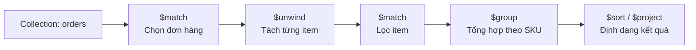

# Tách phần tử mảng bằng $unwind và xử lý null hoặc mảng rỗng trong MongoDB

> **Module:** Database Engine Document MongoDB  
> **Chương:** Aggregation cơ bản

## 1. $unwind dùng để làm gì?

MongoDB cho phép một document chứa **mảng (array)**. Đây là cách tự nhiên để biểu diễn danh sách hàng hóa trong đơn hàng, các vai trò của người dùng, các sự kiện, nhãn (tags) hoặc những đối tượng con thuộc cùng một thực thể. Khi phân tích dữ liệu, nhiều trường hợp cần biến **mỗi phần tử của mảng thành một dòng kết quả riêng**, thay vì tiếp tục xử lý nguyên một document có mảng.

Aggregation stage **`$unwind`** thực hiện việc này: với mỗi document đầu vào, nếu field được chỉ định chứa mảng gồm nhiều phần tử, MongoDB xuất ra một document cho từng phần tử, trong đó field mảng được thay bằng chính phần tử đang xét. Các field khác của document được giữ lại.

Ví dụ ban đầu:

```javascript
{
  _id: "ORD-001",
  customerId: "C01",
  items: [
    { sku: "PEN", quantity: 2 },
    { sku: "BOOK", quantity: 1 }
  ]
}
```

Sau stage:

```javascript
{ $unwind: "$items" }
```

sẽ tạo ra **hai document kết quả**:

```javascript
{
  _id: "ORD-001",
  customerId: "C01",
  items: { sku: "PEN", quantity: 2 }
}
{
  _id: "ORD-001",
  customerId: "C01",
  items: { sku: "BOOK", quantity: 1 }
}
```

Điểm cốt lõi:

- `$unwind` **nhân số dòng kết quả** theo số phần tử array.
- Đây là **biến đổi trong aggregation pipeline**, không tự cập nhật collection gốc.
- Các dòng đầu ra có thể cùng `_id` vì chúng xuất phát từ cùng một document gốc. Không coi chúng là các document lưu trữ mới với `_id` duy nhất.
- Với **array rỗng, null và field không tồn tại**, hành vi mặc định là **không xuất dòng nào**; có thể thay đổi bằng `preserveNullAndEmptyArrays`.
- Với **giá trị không phải array nhưng khác null và không thiếu**, MongoDB xử lý như một array một phần tử.

Bài học này tập trung vào chính các điểm trên, cách dùng `includeArrayIndex`, cách đếm đúng kết quả và tránh làm sai báo cáo khi cấu trúc dữ liệu không đồng nhất.

## 2. $unwind nằm ở đâu trong aggregation pipeline?

Aggregation pipeline là chuỗi các stage xử lý dòng document. Output của một stage trở thành input cho stage kế tiếp.



Ví dụ:

```javascript
db.orders.aggregate([
  { $match: { status: "PAID" } },
  { $unwind: "$items" },
  {
    $group: {
      _id: "$items.sku",
      totalQuantity: { $sum: "$items.quantity" }
    }
  },
  { $sort: { totalQuantity: -1 } }
]);
```

Ý nghĩa:

1. Chỉ đưa các đơn hàng đã thanh toán vào quá trình xử lý.
2. Tách mỗi phần tử `items` thành một dòng.
3. Gom các dòng theo SKU.
4. Cộng số lượng đã bán.
5. Sắp xếp SKU bán nhiều nhất.

Nếu bỏ `$unwind`, đường dẫn `$items.sku` trong nhiều tình huống sẽ đại diện cho dữ liệu mảng, không phải một giá trị SKU riêng biệt cho mỗi dòng. Muốn tổng hợp theo từng SKU, cần làm phẳng mức mảng đúng chỗ.

**Lưu ý:** `$unwind` chỉ xử lý đúng field path chỉ định trong một stage. Nó không tự đệ quy làm phẳng mọi mảng lồng nhau của document.

## 3. Hai cú pháp của $unwind

MongoDB hỗ trợ dạng ngắn và dạng đầy đủ.

### 3.1. Cú pháp ngắn: đường dẫn field

```javascript
{ $unwind: "$items" }
```

`"$items"` là **field path expression**, có dấu `$` để tham chiếu tới field `items` trong document.

Dạng này phù hợp khi:

- Field chứa mảng có dữ liệu và bạn **chỉ muốn giữ các document có ít nhất một phần tử**.
- Không cần chỉ số vị trí phần tử.
- Không cần giữ document có field null, thiếu hoặc mảng rỗng.

Đối với null, missing và empty array, cú pháp ngắn có cùng hiệu quả mặc định như cấu hình `preserveNullAndEmptyArrays: false`.

### 3.2. Cú pháp đầy đủ: document cấu hình

```javascript
{
  $unwind: {
    path: "$items",
    preserveNullAndEmptyArrays: true,
    includeArrayIndex: "itemIndex"
  }
}
```

Các tùy chọn:

| Trường | Kiểu | Vai trò |
|---|---|---|
| `path` | String field path | Field cần unwind, có tiền tố `$` |
| `preserveNullAndEmptyArrays` | Boolean | Có giữ lại document khi field null, thiếu hoặc array rỗng không; mặc định `false` |
| `includeArrayIndex` | String | Tên field mới chứa chỉ số phần tử của mảng trong output; không bắt đầu bằng ký tự `$` |

Ví dụ chỉ thêm vị trí nhưng không giữ các trường hợp rỗng:

```javascript
{
  $unwind: {
    path: "$items",
    includeArrayIndex: "itemIndex"
  }
}
```

Ví dụ giữ document rỗng nhưng không cần index:

```javascript
{
  $unwind: {
    path: "$items",
    preserveNullAndEmptyArrays: true
  }
}
```

**Cảnh báo:** `includeArrayIndex` thêm một field vào document đầu ra. Hãy chọn tên không xung đột với field sẵn có, chẳng hạn `unwindItemIndex`, nếu muốn tránh ghi đè thông tin hiện hữu trong kết quả pipeline.

## 4. Bộ dữ liệu thực hành xuyên suốt

Để hiểu đầy đủ hành vi của `$unwind`, tạo document đại diện cho các tình huống: array nhiều phần tử, array một phần tử, array rỗng, null, field thiếu và giá trị không phải array.

Mở MongoDB Shell với kết nối vào database thực hành:

```bash
mongosh "mongodb://127.0.0.1:27017"
```

Tạo database/collection riêng:

```javascript
const lab = db.getSiblingDB("aggregation_unwind_lab");
const orders = lab.getCollection("orders");

orders.insertMany([
  {
    _id: "O1",
    customerId: "C1",
    status: "PAID",
    items: [
      { sku: "PEN", quantity: 2, unitPrice: 100 },
      { sku: "BOOK", quantity: 1, unitPrice: 50 }
    ]
  },
  {
    _id: "O2",
    customerId: "C2",
    status: "DRAFT",
    items: []
  },
  {
    _id: "O3",
    customerId: "C3",
    status: "DRAFT",
    items: null
  },
  {
    _id: "O4",
    customerId: "C4",
    status: "NEW"
    // Field items không tồn tại.
  },
  {
    _id: "O5",
    customerId: "C1",
    status: "PAID",
    items: [
      { sku: "PEN", quantity: 3, unitPrice: 90 }
    ]
  },
  {
    _id: "O6",
    customerId: "C5",
    status: "PAID",
    items: { sku: "LEGACY", quantity: 1, unitPrice: 70 }
  },
  {
    _id: "O7",
    customerId: "C6",
    status: "DRAFT",
    items: "unknown"
  }
]);

print("Số đơn hàng gốc:", orders.countDocuments({}));
```

Kết quả là **7 document gốc**. Collection này dùng để học cách xử lý dữ liệu không đồng nhất; trong mô hình nghiệp vụ thực tế, `items` thường nên được đảm bảo luôn là một array đúng schema.

> **Phạm vi an toàn:** Các lệnh chỉ phù hợp với database thực hành của bạn. Nếu đã tạo các `_id` này, `insertMany()` có thể báo duplicate key. Hãy dùng database lab khác hoặc chuẩn bị lại dữ liệu theo quyền của bạn; không xóa collection production để chạy bài tập.

Bảng dữ liệu ban đầu:

| `_id` | Giá trị `items` | Loại dữ liệu | Số phần tử nếu là array |
|---|---|---|---:|
| `O1` | Hai object: PEN, BOOK | Array | 2 |
| `O2` | `[]` | Array rỗng | 0 |
| `O3` | `null` | Null | Không áp dụng |
| `O4` | Không có field `items` | Missing | Không áp dụng |
| `O5` | Một object: PEN | Array | 1 |
| `O6` | Một object LEGACY | Object, **không phải array** | Không áp dụng |
| `O7` | Chuỗi `"unknown"` | String, **không phải array** | Không áp dụng |

Những ví dụ về số dòng ở các mục sau giả định dữ liệu chưa bị sửa và không có document bổ sung.

## 5. $unwind mặc định: array rỗng, null và missing bị loại khỏi kết quả

Chạy:

```javascript
const defaultRows = orders.aggregate([
  { $unwind: "$items" },
  {
    $project: {
      _id: 1,
      customerId: 1,
      items: 1
    }
  },
  { $sort: { _id: 1, "items.sku": 1 } }
]).toArray();

printjson(defaultRows);
print("Số dòng sau unwind:", defaultRows.length);
```

Bạn sẽ nhận **5 dòng**:

| `_id` đầu ra | Field `items` sau unwind | Nguồn gốc |
|---|---|---|
| `O1` | `{ sku: "BOOK", quantity: 1, unitPrice: 50 }` | Phần tử thứ hai của O1 |
| `O1` | `{ sku: "PEN", quantity: 2, unitPrice: 100 }` | Phần tử thứ nhất của O1 |
| `O5` | `{ sku: "PEN", quantity: 3, unitPrice: 90 }` | Mảng một phần tử |
| `O6` | `{ sku: "LEGACY", quantity: 1, unitPrice: 70 }` | Object không phải array được coi là một phần tử |
| `O7` | `"unknown"` | String không phải array được coi là một phần tử |

Thứ tự hiển thị trong bảng được minh họa theo stage `$sort` của truy vấn. Nếu muốn giữ vị trí thực tế trong array, hãy dùng `includeArrayIndex`; chỉ số này không phải thứ tự sort ở bảng trên.

Tại sao số dòng là 5?

```text
O1: array 2 phần tử      → 2 dòng
O2: []                   → 0 dòng
O3: null                 → 0 dòng
O4: thiếu items          → 0 dòng
O5: array 1 phần tử      → 1 dòng
O6: object không phải [] → 1 dòng
O7: string không phải [] → 1 dòng
                            -------
Tổng                       5 dòng
```

**Mặc định, `$unwind` loại cả document khỏi output nếu field chỉ định là missing, null hoặc mảng rỗng.** Đây là hành vi đúng theo mặc định, không có nghĩa document bị xóa khỏi database.

Để đếm bằng aggregation:

```javascript
printjson(
  orders.aggregate([
    { $unwind: "$items" },
    { $count: "unwoundRows" }
  ]).toArray()
);

// [{ unwoundRows: 5 }] trên bộ dữ liệu này.
```

Lệnh `$count` đếm **dòng pipeline sau unwind**, không phải số document gốc. Trong trường hợp không có dòng đầu ra, stage `$count` có thể không trả document kết quả thay vì trả một document với số 0.

## 6. preserveNullAndEmptyArrays: giữ document khi mảng không có phần tử

Khi làm báo cáo, đôi khi cần giữ lại cả các đơn hàng **không có item**, chẳng hạn để tìm đơn rỗng hoặc đối soát tổng số đơn. Lúc này dùng cú pháp đầy đủ:

```javascript
const preservedRows = orders.aggregate([
  {
    $unwind: {
      path: "$items",
      preserveNullAndEmptyArrays: true
    }
  },
  { $sort: { _id: 1 } }
]).toArray();

printjson(preservedRows);
print("Số dòng:", preservedRows.length);
```

Kết quả trên bộ dữ liệu gốc có **8 dòng**.

| Document gốc | Số dòng sau khi preserve=true | Hành vi |
|---|---:|---|
| `O1` với 2 item | 2 | Vẫn tách thành hai dòng |
| `O2` với `[]` | 1 | Giữ document; field array rỗng không còn phần tử để đưa vào output |
| `O3` với `items: null` | 1 | Giữ document, giá trị null |
| `O4` thiếu `items` | 1 | Giữ document, field vẫn thiếu |
| `O5` với 1 item | 1 | Một dòng |
| `O6` với object | 1 | Object được xử lý như một phần tử |
| `O7` với string | 1 | String được xử lý như một phần tử |
| **Tổng** | **8** | |

```text
Không preserve:  2 + 0 + 0 + 0 + 1 + 1 + 1 = 5
Có preserve:    2 + 1 + 1 + 1 + 1 + 1 + 1 = 8
```

### 6.1. Một chi tiết rất quan trọng: empty array khác null và missing

Khi `preserveNullAndEmptyArrays: true`:

- **Mảng rỗng `[]`:** MongoDB có thể xuất document không còn field `items`, vì không có phần tử nào để thay vào field.
- **Field là `null`:** document vẫn có thể chứa `items: null`.
- **Field không tồn tại:** document được giữ lại mà vẫn thiếu `items`.

Sau unwind, nếu chỉ nhìn field `items` ở document đầu ra, trường hợp **array rỗng** có thể khó phân biệt với trường hợp **field thiếu**. Nếu phân tích cần biết nguyên nhân trước khi unwind, hãy tạo một field phân loại ở stage đứng trước.

Ví dụ:

```javascript
orders.aggregate([
  {
    $set: {
      originalItemsType: { $type: "$items" },
      originalItemsWasArray: { $isArray: "$items" }
    }
  },
  {
    $unwind: {
      path: "$items",
      preserveNullAndEmptyArrays: true
    }
  },
  {
    $project: {
      _id: 1,
      items: 1,
      originalItemsType: 1,
      originalItemsWasArray: 1
    }
  },
  { $sort: { _id: 1 } }
]);
```

Trước khi unwind:

- `$type` trên field thiếu trả chuỗi `"missing"` trong aggregation expression.
- `$type` trên `null` trả `"null"`.
- `$type` trên array trả `"array"`, kể cả array rỗng.
- `$isArray` trả `true` khi giá trị là array và `false` trong các trường hợp còn lại.

Kết hợp thêm `$size` **có điều kiện** nếu cần phân biệt array rỗng với array có phần tử.

### 6.2. Khi nào nên bật preserve?

| Nhu cầu | Nên dùng? | Lý do |
|---|---|---|
| Chỉ tính doanh thu từ từng item có dữ liệu | Thường không cần | Không cần những đơn không có item |
| Danh sách tất cả đơn hàng kèm item nếu có | **Có** | Không muốn mất các đơn chưa có item |
| Đối soát số đơn hàng được nhập | **Có**, nhưng cần cách đếm đúng | Giữ đơn rỗng để không bỏ sót |
| Phân tích số lượng từng item | Có thể không | Dòng preserve không đại diện một item thực |
| Mô phỏng left join sau `$lookup` | **Có** nếu muốn giữ bản ghi gốc | Giữ document dù không khớp phần được join |
| Cần biết missing khác empty | Phân loại **trước** unwind | Sau unwind thông tin nguồn có thể bị mất |

## 7. includeArrayIndex: biết phần tử nằm ở vị trí nào

Khi document chứa nhiều item, đôi lúc thứ tự ban đầu quan trọng: thứ tự dòng đơn hàng, thứ tự bước xử lý hoặc thứ tự câu trả lời khảo sát.

Dùng `includeArrayIndex`:

```javascript
const withIndex = orders.aggregate([
  { $match: { _id: { $in: ["O1", "O5", "O6", "O7"] } } },
  {
    $unwind: {
      path: "$items",
      includeArrayIndex: "lineIndex"
    }
  },
  {
    $project: {
      _id: 1,
      "items.sku": 1,
      items: 1,
      lineIndex: 1
    }
  },
  { $sort: { _id: 1, lineIndex: 1 } }
]).toArray();

printjson(withIndex);
```

Dạng kết quả đáng chú ý:

| Document | Field sau unwind | `lineIndex` |
|---|---|---:|
| `O1` | PEN | 0 |
| `O1` | BOOK | 1 |
| `O5` | PEN | 0 |
| `O6` | Object LEGACY không phải array | null |
| `O7` | String `"unknown"` không phải array | null |

Đối với phần tử trong array, chỉ số bắt đầu từ **0**, tương tự JavaScript/Java. MongoDB có thể biểu diễn chỉ số dưới kiểu số nguyên BSON tương ứng. Với giá trị không phải array nhưng được xem như một phần tử đơn, trường `lineIndex` là `null`, vì không có vị trí array thực sự.

**Không dựa vào `lineIndex = null` để suy ra chắc chắn field gốc là null**: nó còn có thể xuất hiện với scalar không phải array. Với document được giữ nhờ `preserveNullAndEmptyArrays`, field chỉ số có thể vắng mặt hoặc không biểu thị một vị trí hợp lệ; nếu cần phân biệt, hãy lưu kiểu/độ dài gốc trước khi unwind.

### 7.1. Vị trí array khác thứ tự output

`includeArrayIndex` ghi lại vị trí của phần tử trong **array gốc**, nhưng không thay thế sort ở các bước sau. Ví dụ:

```javascript
orders.aggregate([
  { $match: { _id: "O1" } },
  {
    $unwind: {
      path: "$items",
      includeArrayIndex: "lineIndex"
    }
  },
  { $sort: { "items.sku": 1 } },
  { $project: { _id: 1, lineIndex: 1, "items.sku": 1 } }
]);
```

Sort theo SKU có thể đưa BOOK đứng trước PEN, trong khi `lineIndex` của BOOK vẫn là 1. Đó là hành vi mong muốn: index gắn với nguồn, còn sort quyết định thứ tự báo cáo.

## 8. Hành vi với field không phải array: object hoặc scalar vẫn có thể đi qua

Một giả định sai phổ biến: “`$unwind` chỉ hoạt động nếu field là array; nếu field là object hoặc string thì MongoDB luôn ném lỗi”.

Trong nhiều trường hợp, với field **hiện diện, khác null và không phải array**, `$unwind` xử lý giá trị đó như một array một phần tử.

Trên bộ dữ liệu thực hành:

```javascript
printjson(
  orders.aggregate([
    { $match: { _id: { $in: ["O6", "O7"] } } },
    { $unwind: "$items" },
    { $project: { _id: 1, items: 1 } }
  ]).toArray()
);
```

Hai document vẫn được giữ:

- `O6.items` là một **object** có SKU LEGACY.
- `O7.items` là một **string** `"unknown"`.

Điều này giúp tương thích với một số dữ liệu lịch sử, nhưng cũng có thể che giấu lỗi schema. Nếu code phía sau luôn kỳ vọng `$items.sku`, document `O7` sẽ không có đường dẫn này; pipeline tổng hợp có thể bỏ qua nó hoặc đưa vào nhóm không mong muốn.

### 8.1. Chỉ xử lý document có items là array

Nếu hợp đồng dữ liệu yêu cầu `items` phải là array, kiểm tra trước:

```javascript
orders.aggregate([
  {
    $match: {
      items: { $type: "array" }
    }
  },
  { $unwind: "$items" },
  {
    $project: {
      _id: 1,
      items: 1
    }
  }
]);
```

Trên dữ liệu lab, bước match cho phép `O1`, `O2` và `O5` (đều có items là array); unwind mặc định loại `O2` rỗng. Kết quả là **3 dòng**: hai từ O1 và một từ O5.

**Phân biệt:** việc lọc bỏ giá trị sai schema trong báo cáo **không sửa dữ liệu lịch sử**. Nên xem nguyên nhân tồn tại của `O6` và `O7`, và cân nhắc schema validation tại collection/API/ETL.

### 8.2. Chuẩn hóa trước khi unwind

Nếu muốn thống nhất đầu vào để downstream không gặp object/string ngoài dự kiến:

```javascript
orders.aggregate([
  {
    $set: {
      normalizedItems: {
        $cond: [
          { $isArray: "$items" },
          "$items",
          []
        ]
      }
    }
  },
  {
    $unwind: {
      path: "$normalizedItems",
      preserveNullAndEmptyArrays: true
    }
  },
  {
    $project: {
      _id: 1,
      customerId: 1,
      normalizedItems: 1
    }
  }
]);
```

Ở đây:

- Nếu `items` là array, giữ nguyên mảng.
- Nếu `items` là null, missing, object đơn hoặc string, thay bằng array rỗng trong **kết quả pipeline**.
- Khi unwind với preserve=true, mỗi document không có phần tử vẫn tạo ra một dòng.

Đây là **chính sách chuẩn hóa được chọn cho báo cáo**, không phải quy tắc bắt buộc. Nó có thể làm mất khả năng phân biệt object legacy hợp lệ với dữ liệu lỗi, nên nếu cần kiểm toán, hãy lưu `originalItemsType` trước khi chuẩn hóa hoặc đưa document lỗi sang luồng kiểm tra.

## 9. Đếm chính xác document gốc và dòng item sau unwind

Đây là nguồn lỗi báo cáo rất phổ biến. Sau unwind, một document đơn hàng có thể xuất hiện nhiều lần. Nếu dùng `$sum: 1`, bạn đang đếm **dòng sau unwind**, không phải số đơn hàng duy nhất.

### 9.1. Đếm dòng từ mảng

```javascript
const totalRows = orders.aggregate([
  { $unwind: "$items" },
  { $count: "rows" }
]).toArray();

printjson(totalRows); // rows = 5
```

Số 5 bao gồm cả O6 object và O7 string, vì chúng được xem là singleton.

### 9.2. Đếm số đơn hàng duy nhất có dòng sau unwind

```javascript
orders.aggregate([
  { $unwind: "$items" },
  {
    $group: {
      _id: null,
      itemRows: { $sum: 1 },
      orderIds: { $addToSet: "$_id" }
    }
  },
  {
    $project: {
      _id: 0,
      itemRows: 1,
      ordersWithOutput: { $size: "$orderIds" }
    }
  }
]);
```

Với dữ liệu mẫu:

- `itemRows = 5`.
- `ordersWithOutput = 4`, là `O1`, `O5`, `O6`, `O7`.

Nếu nghiệp vụ muốn đếm **chỉ đơn có mảng item hợp lệ**, hãy lọc kiểu array trước khi unwind; kết quả sẽ là 2 document gốc (O1, O5) và 3 dòng item.

### 9.3. Đếm theo customer và tránh nhân số đơn hàng

```javascript
orders.aggregate([
  { $unwind: "$items" },
  {
    $group: {
      _id: "$customerId",
      outputRows: { $sum: 1 },
      orderIds: { $addToSet: "$_id" }
    }
  },
  {
    $project: {
      outputRows: 1,
      uniqueOrders: { $size: "$orderIds" }
    }
  },
  { $sort: { _id: 1 } }
]);
```

Đối với khách `C1`:

- O1 có 2 item → 2 dòng.
- O5 có 1 item → 1 dòng.
- Tổng **3 dòng item** nhưng chỉ **2 đơn hàng duy nhất**.

Nếu dashboard ghi “C1 có 3 đơn” vì dùng `$sum: 1` sau unwind, đó là sai số liệu nghiệp vụ. Hãy xác định rõ đơn vị đếm của mỗi metric: document gốc, item row, SKU duy nhất hay số lượng hàng hóa.

### 9.4. preserve=true làm thay đổi đơn vị đếm thế nào?

Sau:

```javascript
{
  $unwind: {
    path: "$items",
    preserveNullAndEmptyArrays: true
  }
}
```

cả đơn O2, O3 và O4 cũng tạo một dòng, dù **không có item thật**. Vì vậy:

- `$sum: 1` sau stage này không phải “số item”.
- `$count` sau stage này không phải “số document gốc” (O1 vẫn nhân hai dòng).
- Muốn đếm item hợp lệ, cần điều kiện nhận biết item là object đúng schema hoặc chuẩn hóa/đếm array trước khi unwind.
- Muốn đếm document gốc, dùng `countDocuments()` trên điều kiện gốc hoặc group theo `_id` sau unwind theo yêu cầu.

## 10. Tổng hợp doanh thu theo SKU bằng $unwind và $group

Một ứng dụng phổ biến của `$unwind` là gom các dòng hàng của nhiều đơn để tính tổng số lượng và thành tiền.

Trên bộ dữ liệu:

- O1: PEN số lượng 2, đơn giá 100; BOOK số lượng 1, đơn giá 50.
- O5: PEN số lượng 3, đơn giá 90.
- O6: LEGACY số lượng 1, đơn giá 70 (lưu dưới object thay vì array).
- O7: string `"unknown"`, không có SKU/quantity/unitPrice hợp lệ.

Pipeline minh họa:

```javascript
const revenue = orders.aggregate([
  { $unwind: "$items" },
  {
    $match: {
      "items.sku": { $type: "string" },
      "items.quantity": { $type: "number" },
      "items.unitPrice": { $type: "number" }
    }
  },
  {
    $group: {
      _id: "$items.sku",
      totalQuantity: { $sum: "$items.quantity" },
      lineRevenue: {
        $sum: {
          $multiply: [
            "$items.quantity",
            "$items.unitPrice"
          ]
        }
      },
      orderIds: { $addToSet: "$_id" }
    }
  },
  {
    $project: {
      _id: 0,
      sku: "$_id",
      totalQuantity: 1,
      lineRevenue: 1,
      ordersCount: { $size: "$orderIds" }
    }
  },
  { $sort: { sku: 1 } }
]).toArray();

printjson(revenue);
```

Các phép tính dự kiến:

| SKU | Total quantity | Line revenue | Orders count |
|---|---:|---:|---:|
| BOOK | 1 | 50 | 1 |
| LEGACY | 1 | 70 | 1 |
| PEN | 5 | 470 | 2 |

Giải thích PEN: `2 × 100 + 3 × 90 = 470`. Vì một phần tử đơn hàng được đưa thành một dòng riêng, `$group` dễ dàng cộng số lượng và doanh thu theo SKU.

**Những giới hạn cần hiểu:**

- Đây là bài tập số học đơn giản, chưa xét tiền tệ, thuế, chiết khấu, trả hàng và trạng thái thanh toán.
- Với dữ liệu tiền, cần chọn kiểu số/thang đo ổn định (ví dụ Decimal128 hoặc số đơn vị nhỏ nhất), không tùy tiện trộn string và số.
- Pipeline đã **chấp nhận O6** vì object LEGACY được unwind như singleton và có các field đúng kiểu. Nếu nghiệp vụ chỉ cho phép array, phải kiểm tra kiểu **trước** stage unwind.
- `$type: "number"` trong điều kiện query dùng để nhận các kiểu BSON số; nó không tự chứng minh giá trị tiền là đúng nghiệp vụ.

### 10.1. Chỉ lấy doanh thu từ array đúng schema

Thêm stage đầu:

```javascript
orders.aggregate([
  { $match: { items: { $type: "array" } } },
  { $unwind: "$items" },
  { $match: { "items.sku": { $type: "string" } } },
  {
    $group: {
      _id: "$items.sku",
      quantity: { $sum: "$items.quantity" }
    }
  }
]);
```

Trong bộ dữ liệu hiện tại, O6 và O7 không đi vào tổng hợp, còn O2 có array rỗng sẽ không tạo item row. Số lượng theo SKU sẽ chỉ còn PEN và BOOK.

Cách nào đúng phụ thuộc hợp đồng dữ liệu: **chấp nhận legacy singleton** hay **chỉ chấp nhận array hợp lệ** phải là quyết định có chủ đích.

## 11. $match trước và sau $unwind có thể cho kết quả khác nhau

Thứ tự stage là một phần ngữ nghĩa của aggregation.

Xét O1 có hai items: PEN và BOOK. Hai pipeline sau trông tương tự nhưng **không tương đương**.

### 11.1. Match field mảng trước unwind

```javascript
orders.aggregate([
  { $match: { "items.sku": "PEN" } },
  { $unwind: "$items" },
  { $project: { _id: 1, "items.sku": 1 } }
]);
```

`$match` trước unwind chọn **document gốc có ít nhất một item SKU PEN**. Vì O1 chứa PEN, O1 được đưa vào stage unwind rồi **cả PEN và BOOK đều được tách**. O5 cũng được đưa vào.

Kết quả từ O1 sẽ có cả dòng PEN và dòng BOOK. Nghĩa là filter đầu **chọn đơn hàng**, không giới hạn riêng các phần tử sau khi tách.

### 11.2. Match field sau unwind

```javascript
orders.aggregate([
  { $unwind: "$items" },
  { $match: { "items.sku": "PEN" } },
  { $project: { _id: 1, "items.sku": 1 } }
]);
```

Lúc này `items` trong từng dòng là **một object hoặc scalar**, nên điều kiện SKU áp vào phần tử đã tách. Dòng BOOK của O1 bị loại; chỉ còn các dòng PEN từ O1 và O5.

### 11.3. Kết hợp cả hai để hạn chế dữ liệu không cần thiết

```javascript
orders.aggregate([
  { $match: { status: "PAID", "items.sku": "PEN" } },
  { $unwind: "$items" },
  { $match: { "items.sku": "PEN" } },
  {
    $group: {
      _id: "$items.sku",
      totalQuantity: { $sum: "$items.quantity" }
    }
  }
]);
```

Stage đầu lọc các đơn hàng không liên quan; stage sau chọn đúng dòng item. Với truy vấn có index thích hợp trên các field được match, lọc sớm có thể giảm số document cần đưa qua unwind.

Tuy nhiên, không được đẩy một `$match` xuống trước unwind một cách máy móc nếu muốn giữ nguyên ngữ nghĩa chọn **từng phần tử**. Trình tối ưu aggregation của MongoDB có thể sắp xếp lại một số stage khi phép biến đổi là tương đương; khi phân tích hiệu năng, xem `explain` của pipeline thật.

## 12. Hệ quả về hiệu năng: fan-out làm tăng số dòng

Nếu một document có mảng 100 phần tử, `$unwind` có thể tạo 100 document trung gian. Nếu 100000 document đều có 100 phần tử:

```text
100000 document gốc × 100 phần tử
≈ 10.000.000 dòng sau $unwind
```

Đó là **fan-out** của aggregation.

Số dòng tăng khiến những stage phía sau như `$group`, `$sort`, `$lookup` hoặc `$project` phải xử lý nhiều phần tử hơn. Khi xử lý số lượng lớn, thời gian truy vấn và dung lượng bộ nhớ trung gian có thể tăng đáng kể.

### 12.1. Một ví dụ ước lượng

| Document đầu vào | Số item trung bình | Dòng sau unwind gần đúng |
|---:|---:|---:|
| 100 | 2 | 200 |
| 10000 | 5 | 50000 |
| 100000 | 20 | 2000000 |
| 1000000 | 50 | 50000000 |

Đây là phép nhân giả định các document đều có mảng đủ phần tử. Trên dữ liệu thật:

- Mảng rỗng/null/missing làm số dòng giảm với cấu hình mặc định.
- `preserveNullAndEmptyArrays: true` tạo một dòng cho mỗi document rỗng/null/missing.
- Scalar khác null có thể đóng góp một dòng dù không phải array.
- Stage `$match` trước/sau unwind có thể giảm số dòng.

Vì vậy, phải đo phân bố độ dài mảng và tập filter thực tế thay vì áp số trung bình bất kỳ.

### 12.2. Các cách giảm chi phí

1. **Lọc document không liên quan sớm:** ví dụ theo `tenantId`, trạng thái hoặc khoảng thời gian trước unwind.
2. **Chỉ lấy field cần thiết:** dùng projection phù hợp để không mang theo payload lớn qua từng dòng.
3. **Nếu chỉ cần một phần tử mảng, cân nhắc `$filter` trước unwind:** giảm fan-out khi có điều kiện rõ ràng.
4. **Nếu chỉ cần số phần tử, tránh unwind rồi count:** dùng `$size` kết hợp `$isArray` hoặc logic phù hợp.
5. **Nếu chỉ cần phần tử đầu, tránh tạo mọi dòng:** cân nhắc `$arrayElemAt` hoặc toán tử mảng.
6. **Đặt $group và $sort theo mục tiêu:** tránh sort nhiều triệu dòng khi có thể group/lọc trước một cách tương đương.
7. **Xem explain và metric thực tế:** chú ý số document được đọc, index, bộ nhớ của stage blocking và số dòng đầu ra.
8. **Xử lý theo chunk khi job xuất dữ liệu lớn:** driver cursor có thể đọc từng batch nhưng aggregation vẫn có các chi phí phía server.

### 12.3. Nếu chỉ cần đếm item, không cần $unwind

Ví dụ tính số item của từng đơn theo hợp đồng `items` là array:

```javascript
orders.aggregate([
  {
    $project: {
      _id: 1,
      itemCount: {
        $cond: [
          { $isArray: "$items" },
          { $size: "$items" },
          0
        ]
      }
    }
  },
  { $sort: { _id: 1 } }
]);
```

Kết quả có thể:

| Order | itemCount |
|---|---:|
| O1 | 2 |
| O2 | 0 |
| O3 | 0 |
| O4 | 0 |
| O5 | 1 |
| O6 | 0 |
| O7 | 0 |

Với O6 object, biểu thức trên đếm 0 vì nó **không phải array**; đó là chính sách rõ ràng theo hợp đồng dữ liệu. Nếu muốn chấp nhận object legacy như một item, cần thêm nhánh riêng.

**Lý do phải dùng `$isArray`:** áp dụng `$size` trực tiếp lên field không phải array có thể gây lỗi aggregation. Với dữ liệu linh hoạt, hãy kiểm tra kiểu trước.

### 12.4. Nếu chỉ cần SKU PEN, lọc array trước

Ví dụ `$filter` chỉ giữ những item object có SKU PEN, với đầu vào đã xác nhận là array:

```javascript
orders.aggregate([
  { $match: { items: { $type: "array" } } },
  {
    $set: {
      penItems: {
        $filter: {
          input: "$items",
          as: "item",
          cond: { $eq: ["$$item.sku", "PEN"] }
        }
      }
    }
  },
  { $unwind: "$penItems" },
  { $project: { _id: 1, penItems: 1 } }
]);
```

Ở đây `$filter` không tạo dòng mới mà tạo một array con; `$unwind` sau đó chỉ tách những phần tử thỏa điều kiện. Tùy MongoDB optimizer và workload, lợi ích có thể khác nhau; không mặc định cứ có `$filter` là nhanh hơn `$match` sau unwind. So sánh theo pipeline thực tế.

## 13. Mảng lồng nhau: cần $unwind nhiều lần

Một đơn hàng có item và mỗi item có nhiều tùy chọn:

```javascript
{
  _id: "O-NESTED",
  items: [
    {
      sku: "SHIRT",
      options: [
        { color: "red", size: "M" },
        { color: "blue", size: "L" }
      ]
    },
    {
      sku: "CAP",
      options: [
        { color: "black", size: "FREE" }
      ]
    }
  ]
}
```

Muốn một dòng cho mỗi **option**:

```javascript
db.orders.aggregate([
  { $match: { _id: "O-NESTED" } },
  { $unwind: "$items" },
  { $unwind: "$items.options" },
  {
    $project: {
      _id: 1,
      sku: "$items.sku",
      option: "$items.options"
    }
  }
]);
```

Bước đầu chuyển mỗi item thành một document; bước sau chuyển mỗi option thành một document. Với ví dụ, kết quả là 3 dòng option.

Nếu có item với `options: []`, bước unwind thứ hai mặc định sẽ loại dòng item đó. Nếu nghiệp vụ cần giữ item không có option, dùng:

```javascript
{
  $unwind: {
    path: "$items.options",
    preserveNullAndEmptyArrays: true
  }
}
```

### 13.1. Fan-out qua nhiều cấp

Với các array lồng nhau, số dòng có thể bằng tổng số phần tử tầng trong trên tất cả item, hoặc tăng rất mạnh nếu nhiều cấp nhân nhau. Khi pipeline dùng nhiều `$unwind`:

- Tự hỏi đang đếm **orders**, **items** hay **options**.
- Bảo toàn `_id` gốc và có thể thêm index vị trí từng cấp.
- Tính trước trường hợp array null/rỗng ở **mỗi cấp**.
- Tránh group theo nhầm cấp khiến nhân đôi metric.
- Giám sát memory và số dòng sau mỗi bước quan trọng.

### 13.2. Lưu chỉ số cả hai cấp

```javascript
db.orders.aggregate([
  { $match: { _id: "O-NESTED" } },
  {
    $unwind: {
      path: "$items",
      includeArrayIndex: "itemIndex"
    }
  },
  {
    $unwind: {
      path: "$items.options",
      includeArrayIndex: "optionIndex"
    }
  },
  {
    $project: {
      _id: 1,
      itemIndex: 1,
      optionIndex: 1,
      sku: "$items.sku",
      option: "$items.options"
    }
  }
]);
```

Đường dẫn `items.options` được unwind sau khi `items` đã là một object. Dữ liệu đầu ra có thể ghi lại vị trí của cả item và option.

## 14. $lookup + $unwind: liên hệ với left join và inner join

`$lookup` thường tạo một array kết quả join. Ví dụ collection `orders` có `customerId` và collection `customers` có `_id` tương ứng:

```javascript
db.orders.aggregate([
  {
    $lookup: {
      from: "customers",
      localField: "customerId",
      foreignField: "_id",
      as: "customer"
    }
  }
]);
```

Với `$lookup` dạng đơn giản, `customer` là array:

- Có một khách hàng khớp → array một phần tử.
- Không có khách hàng khớp → array rỗng.
- Có nhiều bản ghi khớp trên field không unique → có thể là nhiều phần tử.

Nếu dùng:

```javascript
{ $unwind: "$customer" }
```

những order có `customer: []` bị loại khỏi kết quả, gần với semantics **inner join** đối với nhánh không có matching row.

Nếu dùng:

```javascript
{
  $unwind: {
    path: "$customer",
    preserveNullAndEmptyArrays: true
  }
}
```

order không tìm thấy customer vẫn được giữ, gần với semantics **left outer join**.

Điều này rất quan trọng khi báo cáo cần hiển thị cả đơn hàng bị thiếu thông tin khách hàng, ví dụ để điều tra dữ liệu không nhất quán. Nếu mặc định bỏ dòng, thống kê có thể âm thầm mất các record không khớp join.

### 14.1. Chọn preserve theo yêu cầu nghiệp vụ

| Yêu cầu | Cách thường dùng |
|---|---|
| Chỉ lấy order có customer tương ứng | `$lookup` rồi `$unwind` mặc định |
| Giữ mọi order kể cả khi customer bị thiếu | `$lookup` rồi unwind với `preserveNullAndEmptyArrays: true` |
| Customer có thể có nhiều match | Kiểm tra fan-out và uniqueness ở dữ liệu nguồn |
| Cần mảng customer thay vì scalar | Không unwind, giữ array từ `$lookup` |

`$lookup` chỉ join trong phạm vi các quy tắc và cấu hình MongoDB hỗ trợ; ví dụ trên không tự tạo collection `customers`. Để chạy thực tế, cần có dữ liệu tương ứng và index trên key phù hợp.

## 15. Phân biệt null, missing, empty array và no match

Bốn khái niệm dễ bị gộp làm một:

| Trạng thái đầu vào | Ví dụ | `$unwind` mặc định | preserve=true |
|---|---|---:|---:|
| Array có 2 phần tử | `items: [a, b]` | 2 dòng | 2 dòng |
| Array có 1 phần tử | `items: [a]` | 1 dòng | 1 dòng |
| Array rỗng | `items: []` | 0 dòng | 1 dòng |
| Null | `items: null` | 0 dòng | 1 dòng |
| Field thiếu | Không có `items` | 0 dòng | 1 dòng |
| Object không phải array | `items: {sku: "A"}` | 1 dòng | 1 dòng |
| String không phải array | `items: "A"` | 1 dòng | 1 dòng |

Ở aggregation kết hợp `$lookup` và `$unwind`, “no match” thường được biểu diễn qua **array rỗng** do `$lookup` tạo. Tuy nhiên, null và missing trong collection nguồn là các trạng thái dữ liệu khác nhau, và không nên suy ra một trường hợp từ trường hợp còn lại.

### 15.1. Null không đồng nghĩa missing trong mọi truy vấn

MongoDB có cú pháp query `{ items: null }` thường khớp cả document có `items: null` lẫn document không có field `items`. Khi cần tách bạch:

```javascript
// Field không tồn tại:
orders.find({ items: { $exists: false } });

// Field tồn tại với BSON null:
orders.find({ items: { $type: "null" } });

// Field có kiểu array (bao gồm []):
orders.find({ items: { $type: "array" } });
```

Nếu muốn xác định mảng rỗng, cách dễ hiểu trong aggregation là kết hợp `$isArray` với `$size` có điều kiện. Không áp `$size` trực tiếp lên null/missing/scalar.

### 15.2. Lấy loại dữ liệu và số phần tử an toàn

```javascript
orders.aggregate([
  {
    $project: {
      _id: 1,
      itemsType: { $type: "$items" },
      isArray: { $isArray: "$items" },
      arrayLength: {
        $cond: [
          { $isArray: "$items" },
          { $size: "$items" },
          null
        ]
      }
    }
  },
  { $sort: { _id: 1 } }
]);
```

Bảng dự kiến:

| Order | itemsType | isArray | arrayLength |
|---|---|---|---:|
| O1 | array | true | 2 |
| O2 | array | true | 0 |
| O3 | null | false | null |
| O4 | missing | false | null |
| O5 | array | true | 1 |
| O6 | object | false | null |
| O7 | string | false | null |

Cách này đặc biệt hữu ích để khảo sát dữ liệu trước khi quyết định bật preserve hay chuẩn hóa.

## 16. $unwind không sửa dữ liệu gốc

Sau khi chạy:

```javascript
orders.aggregate([
  { $unwind: "$items" }
]);
```

document gốc O1 vẫn là:

```javascript
printjson(orders.findOne({ _id: "O1" }));
```

Nó vẫn chứa mảng `items` hai phần tử. Aggregation stage tạo **dòng kết quả trung gian**, không thực hiện update giống `$set`/`updateOne()`.

Chỉ khi pipeline hoặc ứng dụng dùng thao tác ghi riêng, ví dụ `$merge`/`$out` trong aggregation với các điều kiện tương ứng hoặc ghi kết quả qua driver, dữ liệu lưu trữ mới bị tác động. Phải phân biệt các trường hợp đó với việc chạy một pipeline đọc thông thường.

### 16.1. Vì sao output có trùng _id vẫn bình thường?

Ở output unwind, O1 tạo hai dòng mang `_id: "O1"`. Điều này **không vi phạm unique index của collection**, vì hai dòng chỉ là kết quả của pipeline, không phải hai document mới được insert.

Nhưng nếu đem từng dòng output insert nguyên vẹn vào một collection mới mà vẫn giữ `_id` cũ, thao tác ghi có thể gặp duplicate key. Nếu nghiệp vụ cần lưu mỗi item thành document riêng, phải thiết kế khóa định danh item duy nhất, chẳng hạn kết hợp orderId và lineIndex hoặc một ID item ổn định.

## 17. Group trở lại sau unwind: giữ đúng ý nghĩa mảng

Đôi khi pipeline cần lọc item rồi dựng lại cấu trúc mảng. Ví dụ giữ riêng item PEN:

```javascript
orders.aggregate([
  { $match: { items: { $type: "array" } } },
  { $unwind: "$items" },
  { $match: { "items.sku": "PEN" } },
  {
    $group: {
      _id: "$_id",
      customerId: { $first: "$customerId" },
      penItems: { $push: "$items" }
    }
  }
]);
```

Trên bộ dữ liệu mẫu, output gồm O1 và O5, mỗi document chứa array `penItems`.

**Giới hạn:**

- Những order không có item PEN bị loại, vì stage match sau unwind không còn dòng để group.
- `$push` gom các item theo thứ tự mà các document đi vào stage group; nếu thứ tự array gốc quan trọng, cần giữ `includeArrayIndex` và thiết kế sort/group phù hợp.
- `$group` là blocking stage và có thể dùng nhiều memory khi gom nhiều item.
- Dựng lại array không đảm bảo giữ mọi metadata hoặc kiểu dữ liệu ban đầu nếu pipeline đã loại các field đó.

Nếu yêu cầu chỉ lọc array nhưng muốn giữ nguyên mỗi document một lần, dùng `$filter` trực tiếp trên array thường đơn giản hơn tách rồi group lại.

## 18. Java Sync Driver: xây pipeline với Aggregates.unwind

MongoDB Java Sync Driver hỗ trợ các stage bằng builder API, trong đó có `Aggregates.unwind()` và `UnwindOptions`.

Ví dụ đọc toàn bộ output với preserve=true:

```java
import com.mongodb.client.MongoClient;
import com.mongodb.client.MongoClients;
import com.mongodb.client.MongoCollection;
import com.mongodb.client.MongoCursor;
import com.mongodb.client.model.Aggregates;
import com.mongodb.client.model.UnwindOptions;

import org.bson.Document;
import org.bson.conversions.Bson;

import java.util.Arrays;
import java.util.List;

public class UnwindExample {
    public static void main(String[] args) {
        String uri = System.getenv("MONGODB_URI");

        if (uri == null || uri.isBlank()) {
            uri = "mongodb://127.0.0.1:27017";
        }

        try (MongoClient client = MongoClients.create(uri)) {
            MongoCollection<Document> orders = client
                    .getDatabase("aggregation_unwind_lab")
                    .getCollection("orders");

            List<Bson> pipeline = Arrays.asList(
                    Aggregates.unwind(
                            "$items",
                            new UnwindOptions()
                                    .preserveNullAndEmptyArrays(true)
                                    .includeArrayIndex("lineIndex")
                    )
            );

            try (MongoCursor<Document> cursor =
                         orders.aggregate(pipeline)
                                 .batchSize(25)
                                 .iterator()) {
                while (cursor.hasNext()) {
                    Document row = cursor.next();
                    System.out.println(row.toJson());
                }
            }
        }
    }
}
```

Ở đây:

- `Aggregates.unwind("$items")` tương ứng `{ $unwind: "$items" }`.
- `UnwindOptions.preserveNullAndEmptyArrays(true)` giữ O2/O3/O4 trong output.
- `includeArrayIndex("lineIndex")` thêm chỉ số phần tử khi có vị trí array.
- `aggregate(pipeline)` gửi pipeline cho MongoDB Server thực thi.
- `batchSize(25)` điều chỉnh kích thước fetch của cursor kết quả; **không thay đổi số dòng mà unwind tạo**.
- `try-with-resources` giúp đóng cursor khi xử lý xong hoặc dừng sớm.

### 18.1. Unwind chỉ document đã lọc

```java
import com.mongodb.client.model.Aggregates;
import com.mongodb.client.model.UnwindOptions;
import org.bson.conversions.Bson;

import java.util.Arrays;
import java.util.List;

import static com.mongodb.client.model.Filters.eq;

List<Bson> pipeline = Arrays.asList(
        Aggregates.match(eq("customerId", "C1")),
        Aggregates.unwind(
                "$items",
                new UnwindOptions().includeArrayIndex("itemIndex")
        )
);
```

Với O1 và O5, pipeline trả tổng ba dòng item. Đặt `$match` theo `customerId` trước unwind thường hợp lý vì loại các document không liên quan trước khi nhân dòng. Trong hệ thống thực tế, index trên field filter có thể hỗ trợ stage match sớm.

### 18.2. Java ánh xạ document sau unwind

Trước unwind, `items` có thể là `List<Document>`; sau unwind, `items` thường là `Document` cho mỗi phần tử object. Nếu sử dụng cùng một POJO Java với field `List<Item> items` cho **cả đầu vào và kết quả sau unwind**, codec/mapping có thể không tương thích.

Hai chiến lược:

1. Dùng `Document` trong pipeline rồi ánh xạ output sang DTO riêng cho **một dòng item**.
2. Dùng stage `$project` để đưa kết quả về hình dạng rõ ràng, ví dụ `orderId`, `sku`, `quantity`, `lineIndex`, sau đó map sang Java record/POJO tương ứng.

Ví dụ projection:

```javascript
orders.aggregate([
  { $match: { items: { $type: "array" } } },
  {
    $unwind: {
      path: "$items",
      includeArrayIndex: "lineIndex"
    }
  },
  {
    $project: {
      _id: 0,
      orderId: "$_id",
      customerId: 1,
      sku: "$items.sku",
      quantity: "$items.quantity",
      lineIndex: 1
    }
  }
]);
```

Kết quả phù hợp hơn với DTO kiểu:

```java
public record OrderItemRow(
        String orderId,
        String customerId,
        String sku,
        Integer quantity,
        Long lineIndex
) {}
```

Kiểu Java cụ thể của chỉ số cần khớp codec/representation mà driver đang trả, và field có thể thiếu/null với một số tình huống preserve hoặc scalar. Đừng giả định mọi dòng output có `items.sku` hay `lineIndex` khác null.

## 19. Lỗi thường gặp và cách xử lý

| Hiện tượng | Nguyên nhân phổ biến | Hướng xử lý |
|---|---|---|
| Sau unwind mất các đơn chưa có item | `preserveNullAndEmptyArrays` mặc định `false` | Bật `true` nếu cần giữ đơn |
| Kết quả nhiều dòng hơn số order gốc | Một document có nhiều phần tử array | Xác định đang đếm item rows hay unique orders |
| Kết quả có scalar từ field được unwind | Giá trị không phải array, khác null được coi là singleton | Kiểm tra `$isArray` hoặc schema trước unwind |
| Báo cáo cộng nhầm số đơn hàng | Dùng `$sum: 1` sau unwind | Dùng distinct `_id` hoặc group đúng đơn vị |
| `$size` báo lỗi | Field là null, missing hoặc scalar | Dùng `$isArray` để bảo vệ |
| `$lookup` rồi unwind làm mất đơn không có customer | Array kết quả join rỗng | Dùng preserve=true nếu muốn left join |
| Thêm preserve xong đếm item tăng | Dòng preserve không biểu diễn item thật | Lọc/đếm item hợp lệ đúng schema |
| Cần thứ tự item ban đầu nhưng bị mất sau sort | Không lưu index của phần tử | Dùng `includeArrayIndex` và sort theo vị trí khi cần |
| Pipeline chậm sau unwind | Mảng dài gây fan-out lớn | Match sớm, project, filter phần tử, xem explain |
| Java codec lỗi sau unwind | Field array trở thành object/scalar | Dùng DTO output khác hoặc projection |
| Insert output sang collection khác bị trùng _id | Các dòng unwind giữ `_id` gốc | Thiết kế ID duy nhất cho item output |
| Không thấy item SKU PEN sau $match trước unwind | Match trên mảng chọn document chứ chưa lọc item row | Match sau unwind để lọc đúng phần tử |
| Không phân biệt được [] và missing sau unwind | Field array rỗng có thể bị bỏ trong output preserve | Lưu trạng thái kiểu/độ dài trước unwind |

### 19.1. Không dùng $unwind để sửa field items trong collection

`$unwind` là một aggregation stage. Nếu mục tiêu là **xóa phần tử khỏi array trong document gốc**, dùng update operator phù hợp như `$pull`, hoặc một quy trình update được kiểm soát. Nếu mục tiêu là **thêm phần tử**, dùng `$push`/`$addToSet` khi phù hợp. Không nhầm lệnh đọc biến đổi kết quả với lệnh update dữ liệu.

### 19.2. Không coi preserve=true là validation dữ liệu

`preserveNullAndEmptyArrays: true` chỉ nói “đừng làm biến mất document không có phần tử khi unwind”. Nó **không sửa** việc `items` là string hay object không đúng hợp đồng. Có thể cần MongoDB schema validation (`$jsonSchema`) hoặc validation ở ứng dụng để ngăn dữ liệu sai kiểu trong tương lai.

## 20. Bài thực hành

Mọi bài tập sử dụng database `aggregation_unwind_lab` đã tạo trong mục 4. Không cần thay đổi hay xóa dữ liệu gốc.

### Bài A — Dự đoán số dòng

Với 7 document gốc:

1. Chạy `{ $unwind: "$items" }`.
2. Chạy `{ $unwind: { path: "$items", preserveNullAndEmptyArrays: true } }`.
3. Đếm số dòng từ mỗi pipeline.
4. Giải thích từng document O1 đến O7 đóng góp bao nhiêu dòng.

Kết quả mong đợi:

- Mặc định: **5** dòng.
- preserve=true: **8** dòng.

### Bài B — Lưu vị trí phần tử

```javascript
orders.aggregate([
  { $match: { _id: "O1" } },
  {
    $unwind: {
      path: "$items",
      includeArrayIndex: "idx"
    }
  },
  { $project: { _id: 1, idx: 1, "items.sku": 1 } }
]);
```

Hãy giải thích vì sao PEN có `idx = 0` và BOOK có `idx = 1`. Sau đó thêm `$sort: { "items.sku": 1 }` và kiểm tra liệu chỉ số gốc có thay đổi không.

### Bài C — Phát hiện dữ liệu sai schema

Dùng:

```javascript
orders.aggregate([
  {
    $project: {
      _id: 1,
      itemsType: { $type: "$items" },
      isArray: { $isArray: "$items" }
    }
  }
]);
```

Xác định:

- Document nào là array rỗng?
- Document nào là null?
- Document nào thiếu field?
- Document nào có object hoặc string không phải array?

Sau đó viết pipeline chỉ unwind các document có `items` là array hợp lệ.

### Bài D — So sánh $match trước/sau

Với SKU PEN:

```javascript
const before = orders.aggregate([
  { $match: { "items.sku": "PEN" } },
  { $unwind: "$items" },
  { $project: { _id: 1, "items.sku": 1 } }
]).toArray();

const after = orders.aggregate([
  { $unwind: "$items" },
  { $match: { "items.sku": "PEN" } },
  { $project: { _id: 1, "items.sku": 1 } }
]).toArray();

printjson({ before, after });
```

Phân tích vì sao pipeline `before` chứa thêm dòng BOOK từ O1, còn pipeline `after` chỉ chứa PEN.

### Bài E — Đếm order khác đếm item

Viết aggregation thống kê theo `customerId`:

- Số dòng sau unwind.
- Số order gốc duy nhất góp dữ liệu.
- Tổng số lượng item hợp lệ.

Từ O1 và O5, khách C1 có **2 order** nhưng **3 item rows**; tổng quantity từ PEN và BOOK là **6** (2 + 1 + 3). Khi group cần bảo đảm không cộng nhầm trường dữ liệu của các dòng được preserve.

### Bài F — Thiết kế báo cáo vẫn hiển thị đơn rỗng

Yêu cầu: báo cáo hiển thị mọi order, kể cả O2, O3 và O4; nếu có item hợp lệ thì hiển thị từng item, nếu không có thì hiển thị một dòng ghi “không có item”.

Gợi ý:

1. Lưu trạng thái ban đầu bằng `$type`/`$isArray`.
2. Quyết định chính sách đối với O6/O7 không phải array.
3. Chuẩn hóa thành array nếu cần.
4. Unwind với `preserveNullAndEmptyArrays: true`.
5. Dùng `$project` tạo cột trạng thái/nhãn hiển thị.

Tài liệu hóa rõ “không có item” khác “dữ liệu items sai kiểu”; không âm thầm xem hai trường hợp là một nếu nghiệp vụ yêu cầu điều tra dữ liệu.

### Bài G — Giới hạn fan-out khi mảng lớn

Giả sử 50000 document, mỗi document chứa 200 sự kiện. Ước lượng số dòng sau unwind mặc định nếu không có mảng rỗng, sau đó đề xuất cách giảm tải nếu chỉ cần đếm sự kiện:

- Có cần unwind không, hay dùng `$size`?
- Có thể lọc theo tenant/time trước không?
- Có cần trường payload lớn trong output không?
- Nếu chỉ tìm một event type, `$filter` trước unwind có giúp giảm dòng không?
- Việc dùng cursor/batch size ở client có giải quyết được toàn bộ chi phí server không?

Mục tiêu là phân biệt **khối lượng trung gian trên server** với **cách client đọc kết quả**.

## 21. Nguyên tắc cần ghi nhớ

1. **`$unwind` tách một array thành nhiều dòng**, một dòng cho mỗi phần tử và giữ các field khác của document.
2. **Mặc định null, missing và array rỗng tạo 0 dòng**; bật `preserveNullAndEmptyArrays: true` để giữ lại mỗi document dạng này một dòng.
3. **Giá trị không phải array nhưng hiện diện và khác null** có thể được xử lý như array một phần tử. Hãy kiểm tra kiểu nếu schema cần nghiêm ngặt.
4. **`includeArrayIndex` lưu chỉ số vị trí phần tử**, bắt đầu từ 0 đối với phần tử array thực. Nó không thay thế sort.
5. **Sau unwind, số dòng không còn bằng số document gốc.** Mọi phép đếm/tổng hợp phải xác định đúng đơn vị.
6. **Đặt `$match` trước hay sau unwind có thể đổi ý nghĩa:** chọn document có chứa item khác với chọn chính item sau khi tách.
7. **preserve=true cần thiết cho những báo cáo muốn giữ document không có phần tử**, ví dụ sau `$lookup`.
8. **Unwind nhiều cấp có thể tạo fan-out rất lớn**; lọc sớm, projection, `$filter`, `$size` và kiểm soát memory theo workload.
9. **Aggregation không tự sửa dữ liệu trong collection gốc.** Nếu cần lưu kết quả, phải có thao tác ghi thích hợp.
10. **Chất lượng dữ liệu quan trọng:** không dùng khả năng unwind scalar làm lý do bỏ schema validation và kiểm soát input.

## 22. Tài liệu MongoDB chính thức

- [MongoDB Manual – $unwind (đầy đủ cú pháp và hành vi)](https://www.mongodb.com/docs/manual/reference/operator/aggregation/unwind/)
- [MongoDB Manual – Aggregation Pipeline](https://www.mongodb.com/docs/manual/core/aggregation-pipeline/)
- [MongoDB Manual – $match](https://www.mongodb.com/docs/manual/reference/operator/aggregation/match/)
- [MongoDB Manual – $group](https://www.mongodb.com/docs/manual/reference/operator/aggregation/group/)
- [MongoDB Manual – $project](https://www.mongodb.com/docs/manual/reference/operator/aggregation/project/)
- [MongoDB Manual – $lookup](https://www.mongodb.com/docs/manual/reference/operator/aggregation/lookup/)
- [MongoDB Manual – $isArray](https://www.mongodb.com/docs/manual/reference/operator/aggregation/isArray/)
- [MongoDB Manual – $size](https://www.mongodb.com/docs/manual/reference/operator/aggregation/size/)
- [MongoDB Manual – $filter](https://www.mongodb.com/docs/manual/reference/operator/aggregation/filter/)
- [MongoDB Manual – $type (aggregation)](https://www.mongodb.com/docs/manual/reference/operator/aggregation/type/)
- [MongoDB Java Sync Driver – Aggregation](https://www.mongodb.com/docs/drivers/java/sync/current/aggregation/)

**Kết luận:** `$unwind` rất hữu ích để chuyển mảng thành dòng dữ liệu phục vụ lọc, tổng hợp và join. Nhưng lựa chọn giữ hay loại **null/missing/array rỗng**, xử lý **scalar không phải array** và cách **đếm sau khi nhân dòng** là những quyết định quan trọng không kém cú pháp. Một pipeline đúng phải cho kết quả chính xác theo hợp đồng dữ liệu, không làm mất record ngoài ý muốn và không tạo chi phí trung gian không cần thiết.
