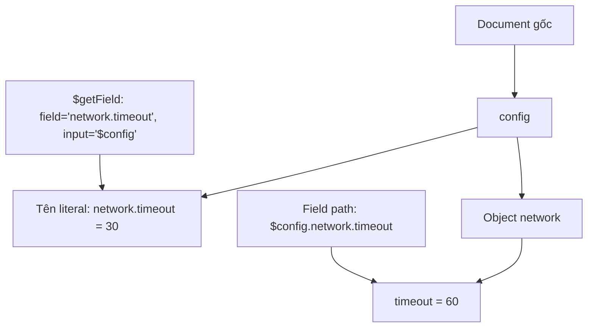

# Đọc ghi trường động bằng $getField và $setField theo phiên bản hỗ trợ

> **Module:** Database Engine Document MongoDB  
> **Chương:** Biểu thức aggregation

## 1. Vì sao cần đọc và ghi trường có tên động?

MongoDB lưu dữ liệu dạng document BSON. Thông thường các field có tên ổn định:

```javascript
{
  _id: 1,
  deviceId: "sensor-a",
  temperature: 28,
  humidity: 67
}
```

Truy cập một field có tên biết trước rất đơn giản:

```javascript
{
  $project: {
    deviceId: 1,
    temp: "$temperature"
  }
}
```

Nhưng trong dữ liệu cấu hình, telemetry, báo cáo hoặc dữ liệu từ hệ thống ngoài, tên field có thể:

- **Được quyết định lúc chạy**, dựa trên giá trị của một field khác, ví dụ `selectedKey: "cpu.user"`.
- **Chứa dấu chấm `.`** như `"cpu.user"`, trong khi dấu chấm của MongoDB thường biểu diễn đường dẫn đến field lồng nhau.
- **Bắt đầu bằng ký tự `$`** như `"$budget"`, trong khi chuỗi bắt đầu bằng `$` trong aggregation thường được hiểu là tham chiếu field hoặc biểu thức.
- Thay đổi theo nguồn dữ liệu, chẳng hạn `metrics` được nhận từ nhiều loại cảm biến.

Ví dụ:

```javascript
{
  _id: 1,
  selectedKey: "cpu.user",
  newValue: 81,
  metrics: {
    "cpu.user": 75,
    "$budget": 120,
    plain: 20
  }
}
```

Tài liệu này có hai field rất dễ bị nhầm:

- `metrics["cpu.user"]` là **một field duy nhất** có dấu chấm trong tên.
- `metrics.cpu.user` sẽ là **đường dẫn lồng nhau** `metrics → cpu → user`, không phải field trên.

Trên MongoDB Server có phiên bản phù hợp, hai aggregation expressions **`$getField`** và **`$setField`** giải quyết việc đọc/ghi field theo đúng tên literal, kể cả tên chứa dấu chấm hoặc dấu đô la.

Bài học giải thích cú pháp, phiên bản hỗ trợ, cách viết biểu thức động, trường hợp null/missing, cách dùng trong aggregation và update pipeline, cùng các phương án thay thế trên phiên bản cũ hơn.

## 2. Trước hết: phân biệt field name và field path

Với document:

```javascript
{
  _id: 100,
  config: {
    "network.timeout": 30,
    network: {
      timeout: 60
    }
  }
}
```

Hai giá trị có ý nghĩa hoàn toàn khác nhau:

| Cách gọi | Giá trị | Ý nghĩa |
|---|---:|---|
| Field literal `"network.timeout"` nằm trong `config` | 30 | Tên field có chứa dấu chấm |
| Đường dẫn `config.network.timeout` | 60 | Field `timeout` trong object `network` |
| Field literal `"config.network.timeout"` ở document gốc | Không có | Một tên field hoàn toàn khác |

Trong aggregation, biểu thức:

```javascript
"$config.network.timeout"
```

được hiểu là đường dẫn tới giá trị **60**, không phải field literal `"network.timeout"`.

Muốn đọc tên literal:

```javascript
{
  $getField: {
    input: "$config",
    field: "network.timeout"
  }
}
```

sẽ đọc **30**.

**Quy tắc quan trọng:** `$getField` và `$setField` thao tác với field **ở cấp trực tiếp của object `input`**, không tự diễn giải dấu chấm trong tên field thành đường dẫn lồng nhau.



## 3. Hỗ trợ theo phiên bản MongoDB Server

Đây là điểm quyết định khi thiết kế biểu thức. **Khả năng dùng một tên field cố định** và **khả năng tính tên field từ dữ liệu lúc chạy** không giống nhau.

| MongoDB Server | `$getField`, `$setField` | Giá trị của tham số `field` | Ghi chú |
|---|---|---|---|
| Trước **5.0** | Không hỗ trợ các expression này | Không áp dụng | Cân nhắc `$objectToArray`/`$arrayToObject` nếu phiên bản có hỗ trợ, hoặc xử lý ở ứng dụng |
| **5.0–7.0** | Có | Biểu thức phải cho ra **chuỗi hằng** (constant string); không chọn tên field tùy ý từ document lúc chạy | Đọc/ghi literal field như `"price.usd"` và `"$fee"` |
| **7.2 trở lên** | Có | Có thể dùng biểu thức hợp lệ cho ra **chuỗi**, bao gồm tham chiếu field/biểu thức tạo tên động | Ví dụ `field: "$selectedKey"` hoặc `field: { $concat: [...] }` |

Điểm đặc biệt được giới thiệu ở **MongoDB 7.2**: tham số `field` của `$getField`/`$setField` không còn bị giới hạn ở biểu thức chuỗi hằng như các bản trước; có thể là biểu thức xác định tên field tại thời điểm đánh giá document.

**Không nhầm phiên bản driver với phiên bản server:** Java driver có thể truyền BSON command chứa biểu thức nhưng MongoDB Server phải hỗ trợ operator và semantics tương ứng. MongoDB Atlas deployment hoặc các node trong cluster cũng phải đáp ứng yêu cầu version/feature compatibility trước khi bật một cú pháp mới.

### 3.1. Kiểm tra phiên bản đang kết nối

Trong `mongosh`:

```javascript
print("MongoDB Server version:", db.version());

printjson(
  db.getSiblingDB("admin").runCommand({ buildInfo: 1 }).version
);
```

Trong môi trường cluster/sharding, phiên bản của các thành viên liên quan và **featureCompatibilityVersion (FCV)** có thể ảnh hưởng quá trình nâng cấp tính năng. Đừng kiểm tra một connection rồi giả định mọi node ở toàn cluster đã ở cùng trạng thái.

Muốn xem FCV (cần quyền quản trị phù hợp):

```javascript
db.getSiblingDB("admin").runCommand({
  getParameter: 1,
  featureCompatibilityVersion: 1
});
```

Một số deployment, Atlas tier hoặc role không cho phép đọc tham số này. Khi thiếu quyền, dùng thông tin quản trị của deployment thay vì cấp quyền admin tràn lan cho ứng dụng.

### 3.2. Khi triển khai cho nhiều phiên bản cùng lúc

Có thể cần hỗ trợ cả MongoDB 6.0 và 7.2 trong giai đoạn chuyển đổi. Không gửi một biểu thức có `field: "$selectedKey"` cho máy chủ 6.0 rồi kỳ vọng nó có cùng ý nghĩa với 7.2.

Chiến lược phù hợp:

1. Xác định phiên bản MongoDB Server tối thiểu được hỗ trợ.
2. Nếu chỉ cần tên field **cố định**, dùng cú pháp `$getField`/`$setField` tương thích từ 5.0.
3. Nếu cần tên field **động hoàn toàn**, yêu cầu server 7.2+ hoặc dùng chiến lược thay thế với `$objectToArray`/`$arrayToObject`.
4. Viết integration test trên từng nhánh phiên bản triển khai.
5. Khi nâng cấp cluster, kiểm tra FCV và trạng thái thành viên trước khi sử dụng khả năng mới.

## 4. $getField: đọc field literal trong một object

`$getField` là **aggregation expression**, không phải một pipeline stage độc lập.

Hai dạng sử dụng thường gặp:

```javascript
// Dạng rút gọn: chọn field theo tên literal cố định
{ $getField: "fieldName" }

// Dạng đầy đủ: chỉ rõ object cần đọc
{
  $getField: {
    field: "fieldName",
    input: "$someObject"
  }
}
```

Trong dạng đầy đủ:

| Thuộc tính | Vai trò |
|---|---|
| `field` | Tên field cần đọc; chuỗi hằng trên MongoDB 5.0–7.0, biểu thức trả về string từ MongoDB 7.2 |
| `input` | Expression trả về object chứa field; nếu bỏ qua, dùng document hiện tại (`$$CURRENT`) |

Ví dụ document:

```javascript
{
  _id: 1,
  metrics: {
    "cpu.user": 75,
    plain: 20
  }
}
```

Đọc literal field `"cpu.user"`:

```javascript
db.readings.aggregate([
  {
    $project: {
      _id: 1,
      cpuUser: {
        $getField: {
          field: "cpu.user",
          input: "$metrics"
        }
      }
    }
  }
]);
```

Kết quả có `cpuUser: 75`.

Nếu chỉ dùng:

```javascript
{ $getField: "cpu.user" }
```

thì expression tìm field `"cpu.user"` ở **document hiện tại**, không mặc nhiên vào object `metrics`. Muốn đọc trong `metrics`, truyền `input: "$metrics"`.

### 4.1. input mặc định là $$CURRENT

Một expression không chỉ rõ input:

```javascript
{
  $project: {
    value: {
      $getField: "plain"
    }
  }
}
```

đọc field `plain` từ document hiện tại. Trong pipeline nhiều stage, `$$CURRENT` có thể đã là document sau khi biến đổi, không nhất thiết giống document gốc đọc từ collection. Khi muốn giảm nhập nhằng, chỉ rõ `input` là thực hành dễ hiểu hơn.

### 4.2. input có thể là kết quả của một biểu thức khác

Không nhất thiết phải là field path. Ví dụ:

```javascript
{
  $getField: {
    field: "rate",
    input: {
      $mergeObjects: [
        { rate: 10 },
        "$overrides"
      ]
    }
  }
}
```

Expression `input` tạo ra một object trung gian rồi `$getField` đọc field literal `rate` của object đó.

Nếu `$overrides` không phải object hợp lệ đối với `$mergeObjects`, có thể phát sinh lỗi. Khi nhận dữ liệu không đồng nhất, hãy kiểm tra kiểu hoặc chuẩn hóa đầu vào trước.

## 5. Đọc field có tên bắt đầu bằng dấu $

Đây là trường hợp thường gây lỗi cú pháp.

Giả sử:

```javascript
{
  _id: 1,
  metrics: {
    "$budget": 120
  }
}
```

Nếu bạn truyền:

```javascript
field: "$budget"
```

trong aggregation, chuỗi bắt đầu bằng `$` có thể được hiểu là **field path expression** thay vì tên field literal `"$budget"`. Muốn đọc chính key có ký tự đô la, hãy bọc nó bằng `$literal`:

```javascript
db.readings.aggregate([
  {
    $project: {
      _id: 1,
      budget: {
        $getField: {
          field: { $literal: "$budget" },
          input: "$metrics"
        }
      }
    }
  }
]);
```

Kết quả có `budget: 120`.

Phân biệt:

| Biểu thức trong `field` | Ý nghĩa |
|---|---|
| `"cpu.user"` | Chuỗi hằng, literal key `cpu.user` |
| `{ $literal: "$budget" }` | Literal key `$budget` |
| `"$selectedKey"` trên 7.2+ | Đọc giá trị field `selectedKey` rồi dùng chuỗi đó làm key cần tìm |
| `{ $concat: ["cpu", ".user"] }` trên 7.2+ | Tính tên key bằng expression, kết quả là `cpu.user` |

**Lưu ý:** Trong bảng, `field: "$selectedKey"` chỉ là dynamic key khi MongoDB Server hỗ trợ tính `field` bằng biểu thức, tức MongoDB 7.2+. Trên 5.0–7.0, đừng coi nó là cú pháp tương thích.

## 6. $setField: tạo, thay đổi hoặc loại bỏ một field

`$setField` là **aggregation expression** trả về **object mới** với field đã được chỉnh. Nó không phải pipeline stage độc lập và không phải update operator theo cú pháp `{$set: ...}` thông thường.

Cú pháp:

```javascript
{
  $setField: {
    field: "fieldName",
    input: "$someObject",
    value: <expression>
  }
}
```

Trong đó:

| Thuộc tính | Vai trò |
|---|---|
| `field` | Tên field literal hoặc dynamic expression theo version |
| `input` | Object cần chỉnh |
| `value` | Giá trị mới; có thể là expression hoặc `$$REMOVE` để xóa field |

Ví dụ tạo object mới từ `metrics` và ghi field `cpu.user`:

```javascript
db.readings.aggregate([
  {
    $project: {
      _id: 1,
      updatedMetrics: {
        $setField: {
          input: "$metrics",
          field: "cpu.user",
          value: 90
        }
      }
    }
  }
]);
```

Nếu `metrics` ban đầu là:

```javascript
{
  "cpu.user": 75,
  "$budget": 120,
  plain: 20
}
```

thì `updatedMetrics` trong kết quả pipeline có:

```javascript
{
  "cpu.user": 90,
  "$budget": 120,
  plain: 20
}
```

Các field khác được giữ nguyên. **Chỉ chạy aggregation như trên không cập nhật document gốc** trong collection.

### 6.1. Đặt field bắt đầu bằng $

Tương tự `$getField`, cần bọc key trong `$literal`:

```javascript
{
  $setField: {
    input: "$metrics",
    field: { $literal: "$budget" },
    value: 180
  }
}
```

Ở đây `"$budget"` là **tên key cần thay**. Trong khi đó, nếu muốn giá trị mới là một string bắt đầu bằng `$`, cũng phải tránh để nó bị hiểu thành field path expression:

```javascript
{
  $setField: {
    input: "$metrics",
    field: "note",
    value: { $literal: "$manual-review" }
  }
}
```

Kết quả có `note: "$manual-review"`.

### 6.2. Xóa field bằng $$REMOVE

`$setField` có thể xóa field khi `value` bằng biến hệ thống `$$REMOVE`:

```javascript
{
  $setField: {
    input: "$metrics",
    field: "plain",
    value: "$$REMOVE"
  }
}
```

Nếu field `plain` tồn tại, nó bị loại khỏi object kết quả; nếu không tồn tại, object không có field đó vẫn giữ trạng thái tương ứng.

MongoDB còn có **`$unsetField`** (được giới thiệu cùng nhóm operator trong MongoDB 5.0), tương đương cách diễn đạt ngắn hơn của việc dùng `$setField` với `$$REMOVE`:

```javascript
{
  $unsetField: {
    input: "$metrics",
    field: "plain"
  }
}
```

Lưu ý `$unsetField` ở đây là **aggregation expression**, không phải stage `$unset` hoặc update operator `$unset` có cú pháp khác.

### 6.3. Nếu field chưa có trong object

`$setField` với `value` thông thường có thể thêm key mới:

```javascript
{
  $setField: {
    input: "$metrics",
    field: "new.metric",
    value: 42
  }
}
```

Key được tạo là một tên **literal** `"new.metric"`, không tự tạo nested object `new: {metric: 42}`.

Với `value: "$$REMOVE"` thì không cần tạo field; thao tác nhằm loại bỏ field khỏi object kết quả.

## 7. Không hiểu nhầm dấu chấm là đường dẫn lồng nhau

Xét object:

```javascript
{
  metrics: {
    "location.zone": "north",
    location: {
      zone: "east"
    }
  }
}
```

Hai cập nhật là khác nhau.

**A. Sửa key literal `"location.zone"`:**

```javascript
{
  $setField: {
    input: "$metrics",
    field: "location.zone",
    value: "south"
  }
}
```

Kết quả:

```javascript
{
  "location.zone": "south",
  location: { zone: "east" }
}
```

**B. Sửa field lồng nhau `location.zone`:**

Nếu dùng update pipeline và đường dẫn thông thường, có thể dùng:

```javascript
db.readings.updateOne(
  { _id: 1 },
  [
    {
      $set: {
        "metrics.location.zone": "south"
      }
    }
  ]
);
```

Cách B nhắm đến nested path, **không** nhắm key literal có dấu chấm.

Trong trường hợp muốn dùng `$setField` cho nested object, phải xây từ bên trong ra ngoài: lấy object `location`, sửa field `zone` trong object đó, rồi đặt object `location` đã chỉnh vào `metrics`. Với input là một object, `$setField` không tự đi xuyên nhiều cấp.

### 7.1. Lồng nhiều $setField

Ví dụ dùng biểu thức nested object:

```javascript
{
  $setField: {
    input: "$metrics",
    field: "location",
    value: {
      $setField: {
        input: "$metrics.location",
        field: "zone",
        value: "south"
      }
    }
  }
}
```

Biểu thức này sửa `metrics.location.zone` **theo cấu trúc nested**. Nó không đụng tới key literal `"location.zone"` cùng cấp trong `metrics`.

Nếu `metrics.location` vắng mặt hoặc null, phải chọn chính sách tạo object mặc định phù hợp trước khi lồng `$setField`.

### 7.2. Lồng nhiều $getField

Đọc nested field bằng hai lần `$getField`:

```javascript
{
  $getField: {
    field: "zone",
    input: {
      $getField: {
        field: "location",
        input: "$metrics"
      }
    }
  }
}
```

Đường dẫn này là tương đương cách đọc `"$metrics.location.zone"` khi các cấp có cấu trúc phù hợp, nhưng giúp biểu diễn từng bước theo object.

## 8. Bộ dữ liệu thực hành đầy đủ

Mở `mongosh` kết nối MongoDB Server **5.0 trở lên** cho các ví dụ tên field cố định. Đối với dynamic expressions đọc tên key từ document, cần **7.2 trở lên**.

```bash
mongosh "mongodb://127.0.0.1:27017"
```

Tạo collection lab:

```javascript
const lab = db.getSiblingDB("aggregation_dynamic_field_lab");
const readings = lab.getCollection("readings");

readings.insertMany([
  {
    _id: 1,
    deviceId: "sensor-a",
    selectedKey: "cpu.user",
    newValue: 81,
    metrics: {
      "cpu.user": 75,
      "$budget": 120,
      plain: 20,
      location: { zone: "east" }
    }
  },
  {
    _id: 2,
    deviceId: "sensor-b",
    selectedKey: "$budget",
    newValue: 180,
    metrics: {
      "cpu.user": 60,
      "$budget": 150,
      plain: 40
    }
  },
  {
    _id: 3,
    deviceId: "sensor-c",
    selectedKey: "new.metric",
    newValue: 42,
    metrics: {}
  },
  {
    _id: 4,
    deviceId: "sensor-d",
    selectedKey: "cpu.user",
    newValue: 70,
    metrics: null
  },
  {
    _id: 5,
    deviceId: "sensor-e",
    selectedKey: "cpu.user",
    newValue: 65
    // Không có field metrics.
  },
  {
    _id: 6,
    deviceId: "sensor-f",
    selectedKey: "cpu.user",
    newValue: 99,
    metrics: "bad-schema"
  },
  {
    _id: 7,
    deviceId: "sensor-g",
    selectedKey: "cpu.user",
    newValue: 51,
    metrics: {
      "cpu.user": null
    }
  }
]);

print("Documents:", readings.countDocuments({}));
```

Bộ dữ liệu có **7 document** và cố ý chứa trường hợp field null, missing và sai kiểu để minh họa hành vi biểu thức.

> **Lưu ý dữ liệu lab:** chạy `insertMany()` một lần trên collection trống. Nếu dữ liệu đã tồn tại, có thể nhận duplicate key vì trùng `_id`. Dùng database lab khác để chạy lại; không xóa collection ứng dụng thật chỉ để thử ví dụ.

## 9. Ví dụ 1: đọc key cố định chứa dấu chấm (MongoDB 5.0+)

Chỉ chọn những document có `metrics` là object để không gặp trường hợp input sai kiểu:

```javascript
const constantRead = readings.aggregate([
  {
    $match: {
      metrics: { $type: "object" }
    }
  },
  {
    $project: {
      _id: 1,
      deviceId: 1,
      cpuUser: {
        $getField: {
          input: "$metrics",
          field: "cpu.user"
        }
      }
    }
  },
  { $sort: { _id: 1 } }
]).toArray();

printjson(constantRead);
```

Diễn giải trên dữ liệu mẫu:

| ID | Kết quả `cpuUser` | Lý do |
|---|---|---|
| 1 | 75 | Object có key `cpu.user` |
| 2 | 60 | Object có key `cpu.user` |
| 3 | Field không có | Object rỗng, key không tồn tại |
| 7 | null | Key tồn tại với giá trị BSON null |

Các document 4, 5 và 6 bị loại bằng `$match` để tập trung vào input object. Với document 3, khi key không tồn tại, `$getField` trả **missing**; trong kết quả `$project`, field đích có thể bị bỏ chứ không nhất thiết hiện ra `cpuUser: null`.

### 9.1. Đọc literal "$budget"

```javascript
readings.aggregate([
  { $match: { _id: 1 } },
  {
    $project: {
      _id: 1,
      budget: {
        $getField: {
          input: "$metrics",
          field: { $literal: "$budget" }
        }
      }
    }
  }
]);
```

Kết quả mong đợi:

```javascript
{ _id: 1, budget: 120 }
```

Ở MongoDB 5.0–7.0, hai ví dụ trên dùng field literal **hằng**, nên không cần tính năng dynamic-name của 7.2.

## 10. Ví dụ 2: đọc tên field động từ dữ liệu (MongoDB 7.2+)

Ở document 1, `selectedKey` là `"cpu.user"`. Ở document 2, nó là `"$budget"`. Ta muốn dùng **cùng một pipeline** để đọc đúng key của mỗi document mà không hardcode danh sách key.

```javascript
const dynamicRead = readings.aggregate([
  {
    $match: {
      metrics: { $type: "object" },
      selectedKey: { $type: "string" }
    }
  },
  {
    $project: {
      _id: 1,
      selectedKey: 1,
      selectedValue: {
        $getField: {
          input: "$metrics",
          field: "$selectedKey"
        }
      }
    }
  },
  { $sort: { _id: 1 } }
]).toArray();

printjson(dynamicRead);
```

Ở **MongoDB 7.2+**, expression `field: "$selectedKey"` đọc string từ field `selectedKey` của document rồi sử dụng nó làm key **literal** trong object `metrics`.

Kết quả theo dữ liệu lab:

| ID | `selectedKey` | `selectedValue` |
|---|---|---|
| 1 | `cpu.user` | 75 |
| 2 | `$budget` | 150 |
| 3 | `new.metric` | Missing, có thể không xuất hiện trong projection |
| 7 | `cpu.user` | null |

Điểm quan trọng: **giá trị** `"$budget"` lấy từ document là dữ liệu của biểu thức. Nó không bị parse lần thứ hai thành field path expression. Khác biệt nằm ở chỗ:

- `field: { $literal: "$budget" }`: yêu cầu cố định key `$budget`.
- `field: "$selectedKey"`: yêu cầu đọc chuỗi ở `selectedKey`, rồi dùng chuỗi đó làm key (7.2+).

### 10.1. Tạo tên field động bằng $concat

Ví dụ một document có `metricName: "cpu"` và `metricPart: "user"`:

```javascript
{
  $getField: {
    input: "$metrics",
    field: {
      $concat: [
        "$metricName",
        ".",
        "$metricPart"
      ]
    }
  }
}
```

MongoDB 7.2+ có thể tính `"cpu.user"` làm key nếu hai field đầu vào là string hợp lệ. Nếu một thành phần null/missing, `$concat` có thể cho null và tham số `field` không còn thỏa yêu cầu string. Cần validate hoặc cung cấp giá trị dự phòng có chủ đích.

### 10.2. Không dùng dynamic key cho input không được kiểm soát

Nếu key được lấy từ request của người dùng, cần giới hạn:

- Danh sách tên metric được truy cập.
- Kiểu và độ dài của key.
- Phân quyền theo tenant/role.
- Các field nhạy cảm không được đọc/ghi từ một API tổng quát.
- Số lượng key có thể tạo, tránh làm phình object/collection.

Khả năng tính tên field theo dữ liệu không có nghĩa bất kỳ client nào cũng được phép truy cập mọi field.

## 11. Ví dụ 3: ghi field cố định bằng $setField (MongoDB 5.0+)

### 11.1. Chỉ tạo object mới trong aggregation

```javascript
readings.aggregate([
  { $match: { _id: 1 } },
  {
    $project: {
      _id: 1,
      before: "$metrics",
      after: {
        $setField: {
          input: "$metrics",
          field: "cpu.user",
          value: 88
        }
      }
    }
  }
]);
```

Kết quả `after` có `"cpu.user": 88` thay vì 75. Field gốc `metrics` trong document lưu trữ **chưa bị sửa** vì đây chỉ là aggregation đọc.

### 11.2. Ghi thật qua update pipeline

Muốn thay đổi document trong collection, dùng `updateOne()` với một **aggregation pipeline update**:

```javascript
const writeResult = readings.updateOne(
  { _id: 1 },
  [
    {
      $set: {
        metrics: {
          $setField: {
            input: "$metrics",
            field: "cpu.user",
            value: 88
          }
        }
      }
    }
  ]
);

printjson(writeResult);
printjson(readings.findOne({ _id: 1 }));
```

Giải thích:

1. `updateOne()` nhận một **array các stage** nên đây là pipeline update.
2. Stage `$set` yêu cầu ghi lại field `metrics` ở document gốc.
3. Expression `$setField` trả object `metrics` mới với literal key `cpu.user` được cập nhật.
4. MongoDB ghi object đó làm giá trị `metrics` cho document có `_id: 1`.
5. Lệnh trả kết quả cập nhật bình thường, gồm `matchedCount` và `modifiedCount`.

**Không nhầm** biểu thức `$setField` với lệnh update dạng:

```javascript
// Cách này nhắm đường dẫn nested, không nhắm key literal "cpu.user":
readings.updateOne(
  { _id: 1 },
  { $set: { "metrics.cpu.user": 88 } }
);
```

Lệnh thứ hai có thể tạo một object nested `metrics.cpu.user`, làm cấu trúc document khác mong muốn.

### 11.3. $setField không phải một pipeline stage

Cú pháp sau **không đúng**:

```javascript
// Sai: $setField là expression, không phải stage độc lập.
db.readings.aggregate([
  { $setField: { field: "x", input: "$metrics", value: 1 } }
]);
```

Hãy nhúng nó vào stage hợp lệ như `$project`, `$set` hoặc `$replaceWith` tùy mục đích. Đối với ví dụ cập nhật, stage `$set` ở mục 11.2 là cách viết rõ ràng.

## 12. Ví dụ 4: ghi key động theo document (MongoDB 7.2+)

Giả sử muốn mỗi document tự quyết định field phải cập nhật dựa trên `selectedKey`, đồng thời lấy giá trị mới từ `newValue`.

Trước hết **không ghi** mà xem kết quả mô phỏng:

```javascript
readings.aggregate([
  {
    $match: {
      _id: { $in: [1, 2, 3] },
      metrics: { $type: "object" }
    }
  },
  {
    $project: {
      _id: 1,
      selectedKey: 1,
      before: "$metrics",
      after: {
        $setField: {
          input: "$metrics",
          field: "$selectedKey",
          value: "$newValue"
        }
      }
    }
  },
  { $sort: { _id: 1 } }
]);
```

Ở MongoDB 7.2+, `field: "$selectedKey"` là một expression, không phải tên field literal. Kết quả dự kiến:

| ID | Key được chọn | Trước | Sau |
|---|---|---:|---:|
| 1 | `cpu.user` | 75 | 81 |
| 2 | `$budget` | 150 | 180 |
| 3 | `new.metric` | Không có | 42 |

Muốn **ghi vào collection**:

```javascript
const updated = readings.updateMany(
  {
    _id: { $in: [1, 2, 3] },
    metrics: { $type: "object" },
    selectedKey: { $type: "string" }
  },
  [
    {
      $set: {
        metrics: {
          $setField: {
            input: "$metrics",
            field: "$selectedKey",
            value: "$newValue"
          }
        }
      }
    }
  ]
);

printjson(updated);
```

Lệnh trên ghi theo key động trên **mỗi document**. Vì document đầu có `cpu.user`, document thứ hai có `$budget`, document thứ ba cần key mới `new.metric`, pipeline không cần ba nhánh update riêng.

**Lưu ý thứ tự thực hành:** nếu bạn đã chạy lệnh ở mục 11.2, document 1 hiện có `cpu.user = 88`; lệnh dynamic update ở đây sẽ đổi tiếp thành 81. Các ví dụ giải thích giá trị “trước” ban đầu giả định bộ dữ liệu mới tạo và chưa chạy update trước đó.

### 12.1. Ghi giá trị từ biểu thức

`value` cũng có thể là aggregation expression:

```javascript
{
  $setField: {
    input: "$metrics",
    field: "$selectedKey",
    value: {
      $add: ["$newValue", 1]
    }
  }
}
```

Cần đảm bảo `newValue` là kiểu số; nếu là string hoặc dữ liệu sai, `$add` có thể báo lỗi hoặc cho semantics không mong muốn.

### 12.2. Xóa field theo tên động

Trong MongoDB 7.2+, có thể dùng:

```javascript
{
  $setField: {
    input: "$metrics",
    field: "$selectedKey",
    value: "$$REMOVE"
  }
}
```

Cách này xóa literal key mà `selectedKey` đang chỉ đến. Tương tự với `$unsetField` nếu phiên bản hỗ trợ dynamic expression của tham số `field`.

**Không gửi trực tiếp field do client cung cấp vào pipeline xóa** khi chưa kiểm tra quyền; nó có thể loại bỏ dữ liệu quan trọng.

## 13. Thực hành an toàn với input null, missing và kiểu sai

Đặc tính của `$getField` và `$setField` khi `input` không hợp lệ là điều bắt buộc phải hiểu:

| Trạng thái của `input` | `$getField` | `$setField` |
|---|---|---|
| Object có key | Trả giá trị key | Trả object mới sau khi đặt/xóa key |
| Object thiếu key | Trả **missing** | Thêm key nếu `value` là giá trị thường; xóa không tạo key |
| Input là `null` | Trả `null` | Trả `null` |
| Input missing/undefined | Trả `null` theo semantics của input | Trả `null` |
| Input là số, string, array hoặc kiểu không phải object được hỗ trợ | Báo lỗi thay vì tự coi như object | Báo lỗi thay vì tự coi như object |

Đặc biệt: **`$setField` không tự tạo object khi input đang null/missing.** Nếu muốn thêm field vào object mới, hãy cung cấp object mặc định.

### 13.1. Điều kiện hóa input trước khi đọc

Bộ dữ liệu lab có:

- ID 4: `metrics: null`.
- ID 5: không có `metrics`.
- ID 6: `metrics: "bad-schema"`.

Nếu yêu cầu chỉ đọc khi metrics là object, có thể dùng `$cond`:

```javascript
readings.aggregate([
  {
    $project: {
      _id: 1,
      safeValue: {
        $getField: {
          field: "cpu.user",
          input: {
            $cond: [
              { $eq: [{ $type: "$metrics" }, "object"] },
              "$metrics",
              {}
            ]
          }
        }
      }
    }
  },
  { $sort: { _id: 1 } }
]);
```

Đối với non-object, expression chọn object rỗng, vì vậy `$getField` cho kết quả missing thay vì lỗi. Khi muốn hiển thị null rõ ràng trong báo cáo, có thể bọc bằng `$ifNull`:

```javascript
{
  $ifNull: [
    {
      $getField: {
        input: {
          $cond: [
            { $eq: [{ $type: "$metrics" }, "object"] },
            "$metrics",
            {}
          ]
        },
        field: "cpu.user"
      }
    },
    null
  ]
}
```

Với `$ifNull`, missing và null được quy về null theo chính sách báo cáo. Nếu nghiệp vụ cần phân biệt **key không tồn tại** với **key có giá trị null**, cần biểu diễn trạng thái đó riêng thay vì dùng `$ifNull` để gộp.

### 13.2. Điều kiện hóa input trước khi ghi

Muốn tạo object mới nếu `metrics` là null/missing, nhưng không chấp nhận string:

```javascript
readings.aggregate([
  {
    $match: {
      _id: { $in: [4, 5] }
    }
  },
  {
    $project: {
      _id: 1,
      after: {
        $setField: {
          field: "cpu.user",
          input: { $ifNull: ["$metrics", {}] },
          value: 45
        }
      }
    }
  }
]);
```

Ở ID 4 và 5, `$ifNull` trả object rỗng, nên `$setField` tạo object có field literal `"cpu.user"`.

**Quan trọng:** `$ifNull` chỉ giải quyết null/missing, không chữa được trường hợp string như ID 6. Nếu muốn chuẩn hóa **mọi** non-object thành object rỗng, dùng `$cond` dựa trên `$type`, nhưng đây là một chính sách thay thế dữ liệu phải được nghiệp vụ chấp thuận, không nên âm thầm xóa thông tin legacy.

### 13.3. Phân biệt thiếu field và field có null

Ở ID 3, key `cpu.user` không tồn tại; ở ID 7, key tồn tại với `null`.

Một phép đọc có thể trả missing hoặc null, gây khác biệt khi projection/aggregate. Nếu cần biểu diễn trạng thái rõ ràng, đổi object thành mảng key/value:

```javascript
readings.aggregate([
  {
    $match: {
      _id: { $in: [3, 7] }
    }
  },
  {
    $project: {
      _id: 1,
      foundCpuKey: {
        $in: [
          "cpu.user",
          {
            $map: {
              input: { $objectToArray: "$metrics" },
              as: "kv",
              in: "$$kv.k"
            }
          }
        ]
      }
    }
  }
]);
```

Ở bộ dữ liệu này cả ID 3 và 7 đều có `metrics` là object, nên `$objectToArray` hợp lệ:

- ID 3: `foundCpuKey = false`.
- ID 7: `foundCpuKey = true`.

Điều này khác với việc đọc giá trị và dùng `$ifNull`, vì `null` là **giá trị có thật** của một key đã tồn tại.

## 14. Tương thích MongoDB 5.0–7.0: dynamic read bằng $objectToArray

Ở MongoDB 5.0–7.0, `$getField` có thể đọc key literal **cố định**, nhưng tên field từ `selectedKey` không phải constant string cho tham số `field`. Một cách xử lý là chuyển object thành array các cặp:

```javascript
{
  "cpu.user": 75,
  "$budget": 120
}
```

thành dạng logic:

```javascript
[
  { k: "cpu.user", v: 75 },
  { k: "$budget", v: 120 }
]
```

Operator **`$objectToArray`** trả một mảng gồm `k` (key) và `v` (value). Ta có thể lọc phần tử có `k == selectedKey` mà không dùng `$getField` động.

Ví dụ:

```javascript
readings.aggregate([
  {
    $match: {
      _id: { $in: [1, 2, 3] },
      metrics: { $type: "object" }
    }
  },
  {
    $project: {
      _id: 1,
      selectedKey: 1,
      matchedEntries: {
        $filter: {
          input: { $objectToArray: "$metrics" },
          as: "entry",
          cond: {
            $eq: ["$$entry.k", "$selectedKey"]
          }
        }
      }
    }
  }
]);
```

Trên bộ dữ liệu:

- ID 1: `matchedEntries` có phần tử `{ k: "cpu.user", v: 75 }`.
- ID 2: `{ k: "$budget", v: 150 }`.
- ID 3: array rỗng, vì key `new.metric` không tồn tại.

### 14.1. Lấy trực tiếp value của phần tử khớp

Có thể kết hợp `$first` và `$let`:

```javascript
readings.aggregate([
  {
    $match: {
      _id: { $in: [1, 2, 3] },
      metrics: { $type: "object" }
    }
  },
  {
    $project: {
      _id: 1,
      selectedValue: {
        $let: {
          vars: {
            entry: {
              $first: {
                $filter: {
                  input: { $objectToArray: "$metrics" },
                  as: "kv",
                  cond: { $eq: ["$$kv.k", "$selectedKey"] }
                }
              }
            }
          },
          in: "$$entry.v"
        }
      }
    }
  }
]);
```

Đây là một phương án **hỗ trợ tên key động mà không cần cú pháp `field` mới của 7.2**. Tuy nhiên, việc chuyển cả object thành array và lọc có chi phí; nó có thể không phù hợp với object rất lớn hoặc query gọi thường xuyên.

### 14.2. Hạn chế của cách chuyển object thành array

- Chỉ chuyển các field **cấp trực tiếp** của object đầu vào; không tự đệ quy mọi object lồng nhau.
- Cần đảm bảo input là object.
- Muốn phân biệt missing và null, xem số phần tử trong `matchedEntries` thay vì chỉ đọc value.
- Việc tính expression không đồng nghĩa tối ưu như truy vấn có index phù hợp; phải đo theo workload.
- Có thể dễ dàng dùng kết quả `{k,v}` cho bảng, nhưng code sẽ dài hơn `$getField` trên server 7.2+.

## 15. Tương thích MongoDB 5.0–7.0: dynamic write bằng $arrayToObject

Nếu server chưa hỗ trợ `$setField.field` là expression động, có thể xây object mới từ mảng cặp key/value.

Ý tưởng:

1. `$objectToArray` chuyển object cũ thành các cặp `{k,v}`.
2. `$filter` bỏ cặp có key trùng key cần cập nhật.
3. `$concatArrays` thêm một cặp mới `{k: selectedKey, v: newValue}`.
4. `$arrayToObject` ghép các cặp thành object.

Ví dụ **chỉ xem kết quả**:

```javascript
readings.aggregate([
  {
    $match: {
      _id: { $in: [1, 2, 3] },
      metrics: { $type: "object" },
      selectedKey: { $type: "string" }
    }
  },
  {
    $project: {
      _id: 1,
      selectedKey: 1,
      updatedMetrics: {
        $arrayToObject: {
          $concatArrays: [
            {
              $filter: {
                input: { $objectToArray: "$metrics" },
                as: "kv",
                cond: { $ne: ["$$kv.k", "$selectedKey"] }
              }
            },
            [
              { k: "$selectedKey", v: "$newValue" }
            ]
          ]
        }
      }
    }
  }
]);
```

Phương pháp này chấp nhận key động như `cpu.user`, `$budget` và `new.metric` vì key được mang dưới dạng **giá trị chuỗi trong field `k`**.

### 15.1. Ghi thật bằng update pipeline

Có thể đặt cùng expression vào stage `$set`:

```javascript
readings.updateMany(
  {
    _id: { $in: [1, 2, 3] },
    metrics: { $type: "object" },
    selectedKey: { $type: "string" }
  },
  [
    {
      $set: {
        metrics: {
          $arrayToObject: {
            $concatArrays: [
              {
                $filter: {
                  input: { $objectToArray: "$metrics" },
                  as: "kv",
                  cond: { $ne: ["$$kv.k", "$selectedKey"] }
                }
              },
              [
                { k: "$selectedKey", v: "$newValue" }
              ]
            ]
          }
        }
      }
    }
  ]
);
```

Với cùng dữ liệu đầu vào, đây là một cách ghi thay thế cho `$setField` động của MongoDB 7.2+. **Không chạy cả hai cách ghi lần lượt nếu muốn quan sát một thay đổi duy nhất**, vì chúng sẽ cùng thay dữ liệu.

### 15.2. Xóa key động trong phiên bản cũ

Muốn **xóa** key thay vì ghi giá trị mới, chỉ cần lọc cặp có key đó rồi chuyển ngược thành object:

```javascript
readings.aggregate([
  {
    $match: {
      _id: 2,
      metrics: { $type: "object" }
    }
  },
  {
    $project: {
      withoutSelectedKey: {
        $arrayToObject: {
          $filter: {
            input: { $objectToArray: "$metrics" },
            as: "kv",
            cond: { $ne: ["$$kv.k", "$selectedKey"] }
          }
        }
      }
    }
  }
]);
```

Nếu ID 2 chọn `$budget`, output sẽ không còn key literal `"$budget"`.

### 15.3. Đánh đổi của giải pháp fallback

| Tiêu chí | `$setField` động trên 7.2+ | `$objectToArray` + `$arrayToObject` |
|---|---|---|
| Độ rõ của biểu thức | Ngắn và trực tiếp | Dài hơn, phải lọc/ghép lại key/value |
| Cần MongoDB 7.2+ | Có, nếu `field` động | Không, nếu các toán tử thành phần được version hỗ trợ |
| Tên có dấu `.` hoặc `$` | Có thể truy cập literal | Có thể mang qua giá trị `k` |
| Xử lý object rất lớn | Tránh chuyển toàn bộ object thành mảng ở code biểu thức | Có thể phát sinh nhiều dữ liệu trung gian |
| Null/missing/sai kiểu | Phải có chính sách input | Phải có chính sách input |
| Dễ kiểm soát key có tồn tại không | `$getField` + logic riêng | Quan sát array match hoặc kiểm tra số cặp |
| Tính dễ bảo trì | Thường tốt hơn | Phức tạp hơn; cần test nhiều trường hợp |

Khi muốn tương thích phiên bản thấp, cần xác nhận chính xác version tối thiểu của từng operator được dùng, nhất là trên deployment rất cũ. Trong phạm vi MongoDB 5.0–7.0, các toán tử `$objectToArray`, `$filter`, `$first`, `$concatArrays` và `$arrayToObject` đều là công cụ aggregation quen thuộc.

## 16. $setField ở cấp document gốc bằng $replaceWith

Đôi khi cần chỉnh một field literal nằm ở **document gốc** chứ không phải trong object `metrics`.

Ví dụ document:

```javascript
{
  _id: 10,
  "audit.note": "old",
  name: "device-10"
}
```

Biểu thức:

```javascript
{
  $setField: {
    field: "audit.note",
    input: "$$ROOT",
    value: "reviewed"
  }
}
```

trả về toàn bộ document mới, vẫn có `_id` và `name` nhưng đổi literal key `"audit.note"`.

Trong aggregation, dùng `$replaceWith`:

```javascript
db.example.aggregate([
  {
    $replaceWith: {
      $setField: {
        input: "$$ROOT",
        field: "audit.note",
        value: "reviewed"
      }
    }
  }
]);
```

Ở ví dụ này `db.example` là collection giả định có document tương ứng, không phải collection lab đã tạo. `$$ROOT` tham chiếu document gốc của stage hiện tại; `$replaceWith` thay document chảy qua pipeline bằng object do `$setField` trả về.

Nếu muốn ghi vào collection gốc, có thể đặt biểu thức `$replaceWith` vào **update pipeline** trên server hỗ trợ:

```javascript
db.example.updateOne(
  { _id: 10 },
  [
    {
      $replaceWith: {
        $setField: {
          input: "$$ROOT",
          field: "audit.note",
          value: "reviewed"
        }
      }
    }
  ]
);
```

**Chú ý:** Không được vô ý loại bỏ `_id` hoặc thay `_id` thành giá trị khác trong replacement của document đang tồn tại. `$setField` ở trên giữ các field khác từ `$$ROOT`, nên phù hợp để sửa một key literal.

## 17. $getField/$setField và toán tử $set, $unset, $addFields khác nhau thế nào?

Có nhiều tên dễ nhầm:

| Cú pháp | Loại | Mục đích |
|---|---|---|
| `{$getField: ...}` | Aggregation expression | Đọc key literal/dynamic trong một object |
| `{$setField: ...}` | Aggregation expression | Trả object mới với key literal/dynamic được thêm/sửa/xóa |
| `{$unsetField: ...}` | Aggregation expression | Trả object mới bỏ key literal/dynamic |
| `{$set: {a: ...}}` trong pipeline | Aggregation stage | Thêm/đặt field trên document của pipeline |
| `{$addFields: {a: ...}}` | Aggregation stage | Tương đương cách viết stage thêm field |
| `{$unset: "a"}` trong pipeline | Aggregation stage | Loại field theo cú pháp stage |
| `{$set: {a: 1}}` trong update document | Update operator | Cập nhật field theo update semantics, khác cú pháp pipeline |
| `{$replaceWith: ...}` | Aggregation stage | Thay toàn bộ document trung gian bằng object expression |

Ví dụ hai cú pháp trông giống nhau:

```javascript
// Cập nhật theo update operator:
db.readings.updateOne(
  { _id: 1 },
  { $set: { "metrics.plain": 10 } }
);

// Cập nhật bằng aggregation pipeline:
db.readings.updateOne(
  { _id: 1 },
  [
    {
      $set: {
        metrics: {
          $setField: {
            input: "$metrics",
            field: "plain",
            value: 10
          }
        }
      }
    }
  ]
);
```

Với field thường `plain`, cả hai có thể đạt cùng kết quả. Nhưng khi tên field chứa dấu chấm literal, dùng `$setField` giúp tránh việc dấu chấm bị giải nghĩa thành nested path.

### 17.1. Bảo vệ biểu thức string trong update pipeline

Trong pipeline, nếu muốn lưu nguyên một chuỗi bắt đầu bằng `$`, dùng `$literal`. Ví dụ:

```javascript
db.readings.updateOne(
  { _id: 1 },
  [
    {
      $set: {
        comment: { $literal: "$needs-review" }
      }
    }
  ]
);
```

Không dùng `comment: "$needs-review"` nếu ý định là lưu nguyên chuỗi, vì nó có thể được hiểu là tham chiếu field.

## 18. Dynamic field không phải giải pháp thay cho data model tốt

Dù MongoDB cho phép key động, điều đó không có nghĩa mọi dữ liệu nên được biểu diễn bằng field name thay đổi vô hạn.

Hai mô hình sau có cùng ý tưởng lưu metric nhưng khác khả năng mở rộng và truy vấn.

### 18.1. Mô hình object với key động

```javascript
{
  deviceId: "sensor-a",
  metrics: {
    "cpu.user": 75,
    "cpu.system": 22,
    "$budget": 120
  }
}
```

Ưu điểm:

- Đọc một key đã biết có thể trực tiếp và gọn.
- Document gần với payload gốc của một số hệ thống.
- Không cần array object cho những metric cố định trong mỗi document.

Khó khăn:

- Key thay đổi theo nguồn khó chuẩn hóa hợp đồng.
- Query/filter/index theo metric động có thể phức tạp.
- Giá trị và kiểu khác nhau gây khó cho kiểm tra schema.
- Tên key không giới hạn có thể làm document lớn, khó quan sát và khó bảo trì.
- Field chứa `.`/`$` có những giới hạn với một số thao tác/index/export/tool tùy MongoDB version.

### 18.2. Mô hình array {name, value}

```javascript
{
  deviceId: "sensor-a",
  metrics: [
    { name: "cpu.user", value: 75 },
    { name: "cpu.system", value: 22 },
    { name: "$budget", value: 120 }
  ]
}
```

Ưu điểm:

- Tên metric nằm trong field `name` có cấu trúc thống nhất.
- Có thể lọc bằng `$elemMatch`, dùng multikey index theo thiết kế.
- Dễ gắn metadata như unit, source, timestamp cho từng metric.

Đánh đổi:

- Nhiều phần tử array; cần cân nhắc multikey, fan-out và update array.
- Tìm một metric theo tên có thể cần cú pháp riêng.
- Không nên dùng array nếu nghiệp vụ cần key nhanh, ổn định với số field ít và ít thay đổi.

**Quy tắc thiết kế:** Chọn dynamic object khi nó phù hợp dữ liệu và pattern truy vấn; không chọn chỉ vì `$getField`/`$setField` làm cú pháp dễ hơn.

### 18.3. An toàn khi cho phép key do người dùng quyết định

Không coi field name như một cách tự động cấp quyền. Nếu API cho phép:

```json
{
  "selectedKey": "salary",
  "newValue": 0
}
```

và ánh xạ thẳng thành một `$setField` trên object chứa các field nội bộ, người gọi có thể sửa thông tin không được phép. Server chỉ thực thi expression; **kiểm tra quyền phải được thực hiện tại ứng dụng**.

Các biện pháp:

1. Whitelist danh sách key cho phép theo vai trò và domain.
2. Kiểm tra key là string, đúng độ dài, đúng namespace/tiền tố được phép.
3. Giới hạn số lượng key khác nhau trong mỗi document.
4. Dùng validation/schema ở database và ứng dụng.
5. Kiểm tra quyền tenant trước khi đọc/ghi.
6. Audit những thay đổi có tác động lớn.
7. Không gộp toàn bộ dữ liệu nhạy cảm và các metric do client được quyền chỉnh vào cùng một map không kiểm soát.

## 19. Dynamic key và hiệu năng truy vấn

`$getField`/`$setField` là **expression**; chúng không tự tạo index và không đảm bảo truy vấn sẽ được index phục vụ hiệu quả.

Ví dụ lấy những document có literal key `cpu.user` lớn hơn 70:

```javascript
readings.aggregate([
  {
    $match: {
      $expr: {
        $gt: [
          {
            $getField: {
              input: "$metrics",
              field: "cpu.user"
            }
          },
          70
        ]
      }
    }
  }
]);
```

Điều kiện được biểu diễn bằng `$expr`. Khả năng sử dụng index phụ thuộc MongoDB version, loại index, cấu trúc field, planner và shape của expression; không mặc định nó có hiệu quả giống một điều kiện equality/range thông thường trên field cố định.

Một số điều cần cân nhắc:

- Nếu truy vấn theo một metric rất thường xuyên, có thể lưu một field chuẩn hóa cố định hoặc xây mô hình index khác.
- Trước khi tối ưu, dùng `explain("executionStats")` để xem `COLLSCAN`, `IXSCAN`, số key/document được xét và thời gian.
- `$objectToArray` trên object nhiều key tạo dữ liệu trung gian; tránh chạy cho mọi document nếu filter ban đầu có thể loại nhiều document.
- Với update pipeline dùng `$arrayToObject`, object có thể phải được tái tạo; hãy kiểm tra chi phí trên workload ghi lớn.
- Không sử dụng một đường dẫn dynamic tự do làm shard key hay điều kiện phân vùng mà chưa đánh giá giới hạn dữ liệu và MongoDB.

### 19.1. Tách filter thường khỏi expression đọc key động

Giả sử chỉ cần phân tích một tenant:

```javascript
db.readings.aggregate([
  { $match: { tenantId: "tenant-a" } },
  {
    $set: {
      chosenValue: {
        $getField: {
          input: "$metrics",
          field: "$selectedKey"
        }
      }
    }
  }
]);
```

Ví dụ yêu cầu MongoDB 7.2+ và collection phải có `tenantId` phù hợp. Một index theo tenant có thể giúp stage `$match` lọc sớm; sau đó expression chỉ chạy trên tập document còn lại. Trong dataset lab hiện tại chưa có `tenantId` nên pipeline minh họa ý tưởng tổ chức truy vấn, không phải ví dụ tính kết quả từ bộ dữ liệu 7 document.

### 19.2. Không mặc định key chứa dấu chấm được hỗ trợ như nested path

Index, update, JSON Schema, sharding và các công cụ xuất/nhập dữ liệu có giới hạn riêng đối với field name chứa `.` hoặc bắt đầu bằng `$`. Trước khi đặt chúng vào data model lâu dài, đọc **Field Names with Periods and Dollar Signs** trong tài liệu chính thức của phiên bản MongoDB đang dùng.

Khả năng **đọc/ghi bằng expression** không có nghĩa mọi chức năng quản trị đều xử lý các tên field đó giống field bình thường.

## 20. Dùng Java Sync Driver với $getField và $setField

MongoDB Java Sync Driver có thể gửi aggregation pipeline dưới dạng BSON `Document`. Cách này hữu ích ngay cả khi version driver chưa cung cấp builder chuyên dụng cho một expression mới: **server vẫn là nơi quyết định cú pháp có được hỗ trợ hay không**.

### 20.1. Đọc field cố định chứa dấu chấm

Ví dụ dùng `org.mongodb:mongodb-driver-sync`:

```java
import com.mongodb.client.MongoClient;
import com.mongodb.client.MongoClients;
import com.mongodb.client.MongoCollection;
import com.mongodb.client.MongoDatabase;

import org.bson.Document;
import org.bson.conversions.Bson;

import java.util.List;

public class GetFieldExample {
    public static void main(String[] args) {
        String uri = System.getenv("MONGODB_URI");
        if (uri == null || uri.isBlank()) {
            uri = "mongodb://127.0.0.1:27017";
        }

        try (MongoClient client = MongoClients.create(uri)) {
            MongoDatabase db = client.getDatabase("aggregation_dynamic_field_lab");
            MongoCollection<Document> readings = db.getCollection("readings");

            Bson project = new Document("$project",
                new Document("_id", 1).append(
                    "cpuUser",
                    new Document("$getField",
                        new Document("field", "cpu.user")
                            .append("input", "$metrics")
                    )
                )
            );

            for (Document result : readings.aggregate(List.of(
                    new Document("$match",
                        new Document("metrics",
                            new Document("$type", "object")
                        )
                    ),
                    project
            ))) {
                System.out.println(result.toJson());
            }
        }
    }
}
```

Lệnh này sử dụng `$getField` với **tên field hằng**, nên yêu cầu MongoDB Server 5.0 trở lên.

### 20.2. Đọc key động trên MongoDB 7.2+

Thay đoạn expression trong Java:

```java
Document dynamicGetField = new Document("$getField",
    new Document("field", "$selectedKey")
        .append("input", "$metrics")
);
```

Chú ý string `"$selectedKey"` là field path expression được server đánh giá ở mỗi document. Nó chỉ làm key động theo semantics mới khi MongoDB Server 7.2 trở lên.

Nếu muốn **literal key `"$budget"`** trong Java, dùng:

```java
Document literalBudget = new Document("$getField",
    new Document("field",
        new Document("$literal", "$budget")
    ).append("input", "$metrics")
);
```

### 20.3. Ghi key động bằng update pipeline trong Java

Ví dụ MongoDB 7.2+:

```java
import com.mongodb.client.MongoCollection;
import com.mongodb.client.result.UpdateResult;
import org.bson.Document;
import org.bson.conversions.Bson;

import java.util.List;

import static com.mongodb.client.model.Filters.eq;

// Giả định readings là MongoCollection<Document> đã khởi tạo:
Document setField = new Document("$setField",
    new Document("input", "$metrics")
        .append("field", "$selectedKey")
        .append("value", "$newValue")
);

Bson stage = new Document("$set",
    new Document("metrics", setField)
);

UpdateResult result = readings.updateOne(
    eq("_id", 2),
    List.of(stage)
);

if (result.wasAcknowledged()) {
    System.out.println("Matched: " + result.getMatchedCount());
    System.out.println("Modified: " + result.getModifiedCount());
}
```

Điểm quan trọng:

- Driver gửi **danh sách stage** cho update pipeline.
- `$setField` được đặt **bên trong** biểu thức giá trị của field `metrics`.
- `field: "$selectedKey"` yêu cầu server 7.2+.
- Bộ đếm `modifiedCount = 0` không có nghĩa không tìm thấy document: giá trị có thể đã đúng từ trước.
- Nếu `metrics` sai kiểu, server có thể từ chối expression; hãy validate trước khi ghi.

### 20.4. Chuẩn bị DTO và hạn chế input

Trong ứng dụng Java nhận dữ liệu từ API:

```java
import java.util.Set;

public record MetricUpdateRequest(
        String selectedKey,
        Number newValue
) {
    private static final Set<String> ALLOWED_KEYS =
        Set.of("cpu.user", "$budget", "plain");

    public void validate() {
        if (selectedKey == null || !ALLOWED_KEYS.contains(selectedKey)) {
            throw new IllegalArgumentException("Metric key is not allowed");
        }
        if (newValue == null) {
            throw new IllegalArgumentException("newValue is required");
        }
    }
}
```

Đây chỉ là ví dụ giới hạn **tập tên key**, không phải validation đầy đủ. Hệ thống thật còn cần kiểm tra loại metric, miền giá trị, đơn vị, quyền của user, tenant, concurrency và chính sách ghi audit.

## 21. Các lỗi và hiểu nhầm phổ biến

| Triệu chứng/nhận định | Nguyên nhân hoặc thực tế | Cách xử lý |
|---|---|---|
| MongoDB báo không biết `$getField` | Server quá cũ hoặc command không ở ngữ cảnh aggregation phù hợp | Xác minh server version; cần 5.0+ |
| `field: "$selectedKey"` không chạy trên MongoDB 6.0 | Dynamic field expression chưa được hỗ trợ | Dùng tên hằng hoặc fallback `$objectToArray` |
| Đọc `"cpu.user"` không ra giá trị qua `"$metrics.cpu.user"` | Dấu chấm bị hiểu là nested path | Dùng `$getField` với input object và literal key |
| Đọc `"$budget"` bị hiểu thành tham chiếu field | Thiếu `$literal` cho tên key hằng bắt đầu bằng `$` | Dùng `field: { $literal: "$budget" }` |
| `$getField` trả missing | Key không tồn tại trong object | Phân biệt với null, dùng `$ifNull` khi cần |
| `$setField` không tạo object khi input null | Input null/missing cho kết quả null | Cung cấp object mặc định nếu nghiệp vụ cho phép |
| Expression báo lỗi input không phải object | Field input là string/array/số | Validate schema hoặc kiểm tra `$type` trước |
| `$setField` không sửa document lưu trữ | Chỉ dùng trong aggregation đọc | Dùng update pipeline hoặc thao tác ghi khác khi cần |
| Ghi `metrics.cpu.user` tạo nested object | Dùng dot notation thay vì literal key | Nhúng `$setField` vào update pipeline |
| Đổi `$budget` theo value expression sai | Giá trị string bắt đầu `$` bị parse thành field path | Dùng `$literal` cho string muốn lưu nguyên |
| Query qua `$expr` chậm | Expression không tận dụng index như mong đợi | Kiểm tra explain, cân nhắc data model/index |
| Fallback `$objectToArray` mất phân biệt missing/null | Lấy value đầu tiên rồi dùng `$ifNull` | Kiểm tra mảng cặp khớp key |
| Driver Java gửi cú pháp mới nhưng server từ chối | Cú pháp do server version quyết định | Đổi pipeline theo version và integration test |
| Dùng key động trực tiếp từ client | Có thể đọc/ghi field ngoài quyền | Whitelist và xác thực/ủy quyền |

### 21.1. Cách đọc một lỗi runtime

Giả sử code báo lỗi trong stage `$getField`:

1. Xem kết nối đúng cluster và server version không.
2. Xác nhận biểu thức nằm trong stage hợp lệ như `$project` hoặc `$set`.
3. Kiểm tra `field` thực sự cho ra string hợp lệ.
4. Kiểm tra key bắt đầu `$` có cần `$literal` không.
5. Kiểm tra `input` có phải object/null/missing hay đang là scalar/array.
6. Kiểm tra document lỗi có một trường hợp schema khác các document còn lại không.
7. Thu gọn pipeline về một document lab, rồi mở rộng dần sang dữ liệu thực.

Không sửa dữ liệu production hàng loạt chỉ vì một expression bị lỗi; trước hết cần xác định rõ hợp đồng và trường hợp dữ liệu không phù hợp.

## 22. Bài thực hành tổng hợp

Dùng database `aggregation_dynamic_field_lab` với 7 document đã tạo trong mục 8. Chỉ những phần đánh dấu **MongoDB 7.2+** mới dùng tính năng tên field thực sự động.

### Bài A — Phân biệt field literal và nested path

Với:

```javascript
{
  metrics: {
    "network.timeout": 30,
    network: { timeout: 60 }
  }
}
```

Hãy viết hai expression để:

1. Lấy giá trị 30 từ key literal `"network.timeout"`.
2. Lấy giá trị 60 từ đường dẫn nested `metrics.network.timeout`.
3. Giải thích vì sao cả hai expression khác nhau dù cùng có dấu chấm.

Gợi ý: dùng `$getField` cho trường hợp literal; field path thông thường cho nested.

### Bài B — Đọc một key bắt đầu bằng $

Viết pipeline đọc `"$budget"` của ID 1 và ID 2:

```javascript
readings.aggregate([
  { $match: { _id: { $in: [1, 2] } } },
  {
    $project: {
      _id: 1,
      budget: {
        $getField: {
          input: "$metrics",
          field: { $literal: "$budget" }
        }
      }
    }
  }
]);
```

Giải thích vai trò của `$literal`. Đọc kết quả mong đợi lần lượt là 120 và 150 nếu chưa chạy update làm đổi dữ liệu.

### Bài C — Dynamic getField (7.2+)

```javascript
readings.aggregate([
  { $match: { _id: { $in: [1, 2, 3] } } },
  {
    $project: {
      _id: 1,
      key: "$selectedKey",
      value: {
        $getField: {
          field: "$selectedKey",
          input: "$metrics"
        }
      }
    }
  }
]);
```

Dự đoán giá trị của ID 1, 2 và 3. Với ID 3, thử dùng `$ifNull` để hiển thị một giá trị thay thế như `"NOT_FOUND"`, rồi nêu sự đánh đổi khi key có thật nhưng value null.

### Bài D — Dynamic setField (7.2+)

Tạo pipeline chỉ **mô phỏng** object mới bằng `$project`:

```javascript
readings.aggregate([
  { $match: { _id: { $in: [1, 2, 3] } } },
  {
    $project: {
      _id: 1,
      before: "$metrics",
      after: {
        $setField: {
          input: "$metrics",
          field: "$selectedKey",
          value: "$newValue"
        }
      }
    }
  }
]);
```

Giải thích tại sao ID 3 được thêm literal key `"new.metric"` chứ không phải nested `new.metric`.

Sau khi hiểu kết quả, chuyển thành update pipeline trên database lab của bạn nếu muốn thực hành ghi thật.

### Bài E — Xóa literal key

Viết hai cách xóa field `plain` trong `metrics`:

1. Dùng `$setField` với `value: "$$REMOVE"`.
2. Dùng `$unsetField`.

Nếu xóa field `"$budget"`, cần thay tham số `field` như thế nào? Giải thích tại sao phải dùng `$literal` cho key hằng bắt đầu bằng `$`.

### Bài F — Phân biệt input null/missing/sai kiểu

Với các document ID 4, 5, 6:

- Dùng `$type` để xác định kiểu `metrics`.
- Giải thích kết quả `$getField` khi input null hoặc missing.
- Giải thích vì sao input string ở ID 6 có thể gây lỗi.
- Dùng `$cond` tạo input object rỗng khi type không phải object.
- Viết chính sách dữ liệu: thay non-object thành object rỗng có được phép hay cần đưa document vào luồng xử lý lỗi?

### Bài G — Viết tương đương cho MongoDB 6.0

Giả định môi trường chỉ chạy MongoDB 6.0:

1. Viết pipeline đọc value theo `selectedKey` bằng `$objectToArray` + `$filter`.
2. Viết pipeline xây object mới với cặp `{k, v}` bằng `$arrayToObject`.
3. So sánh độ phức tạp với `$getField.field`/`$setField.field` động ở 7.2+.
4. Giải thích vì sao không thể đơn giản đổi mọi tên field động thành chuỗi `"$selectedKey"` trên 6.0.

### Bài H — Thiết kế API an toàn

Ứng dụng muốn nhận request:

```json
{
  "deviceId": "sensor-a",
  "metricName": "cpu.user",
  "value": 80
}
```

Hãy đề xuất:

- Những tên metric được phép ghi.
- Quy tắc loại giá trị, đơn vị và khoảng hợp lệ.
- Cách tìm document đúng tenant/device.
- Cách cập nhật trên MongoDB 7.2+.
- Cách tương thích nếu phải hỗ trợ MongoDB 6.0.
- Cách xử lý khi `metrics` không phải object.
- Cách kiểm tra kết quả và audit.
- Chỉ số nào cần theo dõi để phát hiện document phình lớn do quá nhiều key động.

## 23. Quy tắc ghi nhớ

1. **`$getField` đọc và `$setField` ghi field ở cấp trực tiếp của object `input`**, theo tên literal, không tự coi dấu chấm là nested path.
2. **MongoDB 5.0** giới thiệu nhóm biểu thức này; trên **5.0–7.0**, tham số `field` phải là biểu thức cho ra **chuỗi hằng**.
3. **MongoDB 7.2+** hỗ trợ `field` là biểu thức tính ra string **tại runtime**, ví dụ `"$selectedKey"`.
4. Nếu tên key hằng bắt đầu bằng `$`, dùng **`$literal`** để không bị hiểu là field path.
5. **`$setField` là expression**, không phải aggregation stage; muốn cập nhật collection thì nhúng nó trong **update pipeline** hoặc một cơ chế ghi hợp lệ.
6. **`$$REMOVE`** trong `$setField.value` giúp xóa key; `$unsetField` diễn đạt cùng ý định.
7. **Missing khác null**. Với input object thiếu key, `$getField` trả missing; input null/missing có hành vi riêng cần xử lý.
8. **Input sai kiểu có thể gây lỗi**; kiểm tra `$type` hoặc chuẩn hóa có chủ đích, không âm thầm bỏ dữ liệu lỗi.
9. Trên server chưa có dynamic field expression, dùng **`$objectToArray`, `$filter`, `$arrayToObject`** để thao tác key động bằng cặp tên/giá trị.
10. Dynamic field cần **kiểm soát quyền, schema, giới hạn key và hiệu năng**; khả năng biểu đạt không thay thế thiết kế data model và index tốt.

## 24. Tài liệu tham khảo chính thức

- [MongoDB Manual – $getField](https://www.mongodb.com/docs/manual/reference/operator/aggregation/getField/)
- [MongoDB Manual – $setField](https://www.mongodb.com/docs/manual/reference/operator/aggregation/setField/)
- [MongoDB Manual – $unsetField](https://www.mongodb.com/docs/manual/reference/operator/aggregation/unsetField/)
- [MongoDB Manual – $literal](https://www.mongodb.com/docs/manual/reference/operator/aggregation/literal/)
- [MongoDB Manual – $objectToArray](https://www.mongodb.com/docs/manual/reference/operator/aggregation/objectToArray/)
- [MongoDB Manual – $arrayToObject](https://www.mongodb.com/docs/manual/reference/operator/aggregation/arrayToObject/)
- [MongoDB Manual – $filter](https://www.mongodb.com/docs/manual/reference/operator/aggregation/filter/)
- [MongoDB Manual – $type (aggregation expression)](https://www.mongodb.com/docs/manual/reference/operator/aggregation/type/)
- [MongoDB Manual – $replaceWith](https://www.mongodb.com/docs/manual/reference/operator/aggregation/replaceWith/)
- [MongoDB Manual – Updates with Aggregation Pipeline](https://www.mongodb.com/docs/manual/tutorial/update-documents-with-aggregation-pipeline/)
- [MongoDB Manual – Field Names with Periods and Dollar Signs](https://www.mongodb.com/docs/manual/core/dot-dollar-considerations/)
- [MongoDB Manual – MongoDB 7.2 Release Notes](https://www.mongodb.com/docs/manual/release-notes/7.2/)
- [MongoDB Java Sync Driver – Aggregation](https://www.mongodb.com/docs/drivers/java/sync/current/aggregation/)

**Kết luận:** `$getField` và `$setField` giúp đọc/ghi trực tiếp một field theo **tên literal**, kể cả tên chứa `.` hoặc `$`. Với **MongoDB 7.2 trở lên**, tên field còn có thể được **tính từ biểu thức** trong từng document. Khi triển khai trên nhiều phiên bản, cần tách hai khả năng này, kiểm tra server version, xử lý input thiếu/sai kiểu và kiểm soát dữ liệu động về bảo mật cũng như hiệu năng.
