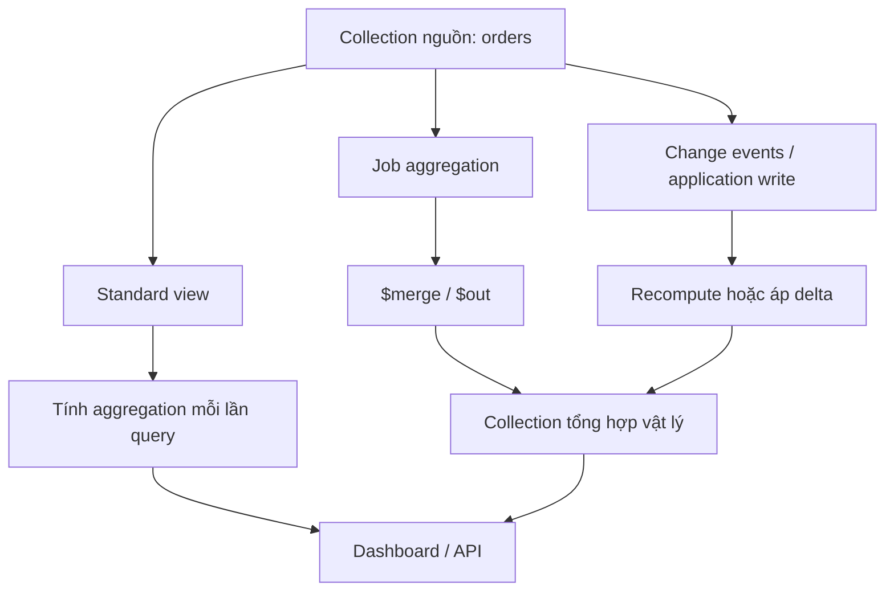
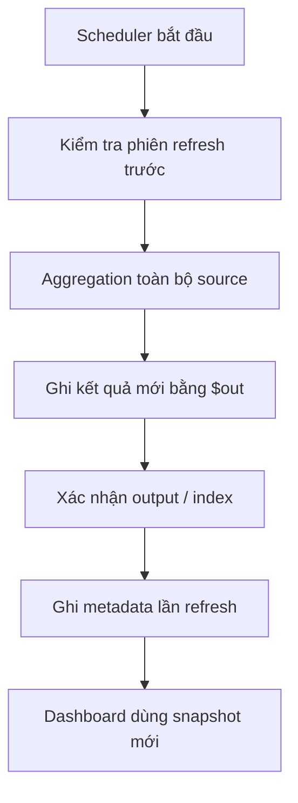
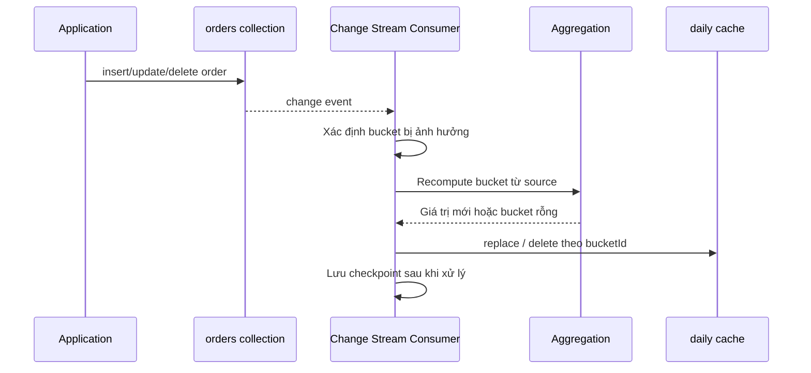

# View tổng hợp, dữ liệu tính sẵn và chiến lược cập nhật trong MongoDB

> **Module:** Database Engine Document MongoDB  
> **Chương:** Aggregation nâng cao

## 1. Bài toán: báo cáo tổng hợp được đọc liên tục

Giả sử hệ thống có collection `orders` chứa hàng triệu đơn hàng. Trang quản trị thường xuyên cần hiển thị:

- Doanh thu đơn đã thanh toán theo từng cửa hàng, từng ngày.
- Số đơn thành công trong ngày.
- Biểu đồ doanh thu 30 ngày gần nhất.
- Thống kê tổng hợp cho dashboard theo tenant.
- Bản báo cáo định kỳ mà không phải quét lại mọi đơn hàng mỗi lần tải trang.

Một truy vấn aggregation trực tiếp có thể viết:

```javascript
db.orders.aggregate([
  { $match: { status: "PAID" } },
  {
    $group: {
      _id: "$tenantId",
      paidOrders: { $sum: 1 },
      revenueCents: { $sum: "$totalCents" }
    }
  }
]);
```

Nó cho kết quả đúng theo dữ liệu được truy vấn tại thời điểm thực thi, nhưng nếu chạy liên tục trên lượng dữ liệu lớn, hệ thống phải lặp lại việc lọc, nhóm và cộng số. Trong những trường hợp như vậy, cần cân nhắc **view** và **dữ liệu tính sẵn** (*precomputed/materialized data*).

Có ba hướng chính:

1. **Standard view:** Lưu *định nghĩa truy vấn*, MongoDB tính kết quả mỗi khi đọc.
2. **On-demand materialized view:** Lưu *kết quả aggregation* vào một collection vật lý, thường dùng `$merge` hoặc `$out` để làm mới.
3. **Computed data do ứng dụng quản lý:** Ứng dụng hoặc pipeline sự kiện cập nhật các document tổng hợp sau khi dữ liệu nguồn thay đổi.

Điểm khó không nằm ở phép `$sum`, mà ở việc lựa chọn **khi nào tính lại**, **tính lại phạm vi nào**, **dữ liệu đến muộn hoặc bị sửa/xóa được xử lý ra sao** và **người đọc có thể chấp nhận dữ liệu cũ trong bao lâu**.

Sau bài học, bạn có thể:

- Phân biệt standard view và collection chứa kết quả tính sẵn.
- Tạo aggregation view bằng `createView()` và đọc như một collection chỉ đọc.
- Tạo dữ liệu tổng hợp vật lý bằng `$merge`/`$out` và xây index cho collection kết quả.
- Chọn full refresh, incremental refresh, refresh theo nhóm bị ảnh hưởng, event-driven update hoặc cập nhật đồng bộ.
- Xử lý các trường hợp đơn hàng bị hủy, thay đổi số tiền, chuyển ngày/cửa hàng và nhóm trở thành rỗng.
- Thiết kế checkpoint, idempotency, giám sát độ mới (*freshness*) và đối soát.
- Nhận diện đánh đổi giữa chi phí đọc, chi phí ghi, độ trễ và tính nhất quán.

## 2. Mô hình tư duy: tính khi đọc hay tính trước?

Có thể hình dung các lựa chọn như sau:



### 2.1. Bảng so sánh nhanh

| Tiêu chí | Standard view | Collection tổng hợp tính sẵn |
|---|---|---|
| Lưu dữ liệu kết quả | **Không**; lưu định nghĩa pipeline | **Có**; lưu document vật lý |
| Tính toán khi đọc | Có | Chủ yếu đọc dữ liệu đã tính |
| Độ mới của dữ liệu | Theo truy vấn đang thực thi và read concern | Phụ thuộc lịch/cơ chế refresh |
| Index trên kết quả | Không tạo index trực tiếp trên standard view | Có thể tạo index trên collection kết quả |
| Chi phí đọc lặp lại | Có thể cao nếu aggregation nặng | Thường thấp hơn khi kết quả nhỏ |
| Chi phí bảo trì | Tương đối đơn giản | Có job, đồng bộ, retry, kiểm tra tính đúng |
| Việc cập nhật trực tiếp view | Không được phép | Collection đích có thể được ghi bởi job hoặc ứng dụng |
| Khi source thay đổi | Lần đọc mới tính lại từ source | Cần làm mới kết quả đã lưu |
| Độ phức tạp vận hành | Thấp hơn | Cao hơn, nhất là incremental update |
| Phù hợp | Truy vấn vừa phải, cần dữ liệu mới | Dashboard đọc nhiều, tổng hợp tốn kém, chấp nhận cơ chế freshness |

**Điều cần nhớ:** Tên gọi “view” không đồng nghĩa với “kết quả đã được lưu”. Standard view của MongoDB là một *query definition*, còn materialized view thực chất là **collection chứa kết quả tính trước do một quy trình làm mới quản lý**.

## 3. Standard view: lưu định nghĩa pipeline, tính khi truy vấn

Một **standard view** trong MongoDB là đối tượng logic dựa trên collection hoặc view nguồn. Khi người dùng đọc view, MongoDB thực thi pipeline đã định nghĩa cùng phần truy vấn được phép bổ sung. View không lưu từng dòng kết quả như một collection riêng.

Ví dụ:

```javascript
db.createView(
  "paid_orders_view",
  "orders",
  [
    { $match: { status: "PAID" } },
    {
      $project: {
        tenantId: 1,
        createdAt: 1,
        totalCents: 1,
        status: 1
      }
    }
  ]
);
```

Sau đó truy vấn:

```javascript
db.paid_orders_view.find({
  tenantId: "shop-a"
}).sort({ createdAt: -1 }).limit(20);
```

Về ý tưởng, MongoDB áp dụng định nghĩa view và truy vấn thêm để tìm những đơn `PAID` của `shop-a`. Mỗi lần thực thi vẫn cần truy cập dữ liệu nguồn hoặc cấu trúc index phù hợp; **view không phải một cache kết quả**.

### 3.1. View có thể chứa $group không?

Có. Ví dụ tạo view tổng hợp doanh thu theo tenant:

```javascript
db.createView(
  "tenant_paid_totals_view",
  "orders",
  [
    { $match: { status: "PAID" } },
    {
      $group: {
        _id: "$tenantId",
        paidOrderCount: { $sum: 1 },
        revenueCents: { $sum: "$totalCents" }
      }
    }
  ]
);
```

Mỗi lần đọc:

```javascript
db.tenant_paid_totals_view.find();
```

MongoDB lại tính aggregation tương ứng trên dữ liệu nguồn. Không có document tổng hợp đã được lưu sẵn chỉ vì pipeline chứa `$group`.

### 3.2. Standard view có thể ghi trực tiếp không?

Không. Standard view là **read-only**. Những lệnh như `insertOne()`, `updateOne()` hoặc `deleteMany()` không phải cách thay đổi dữ liệu qua view.

Muốn sửa đơn hàng, cập nhật collection nguồn `orders`. Muốn thay đổi logic báo cáo, thay đổi định nghĩa view bằng cơ chế quản trị được MongoDB hỗ trợ, ví dụ `collMod` cho view, sau khi kiểm tra quyền và dependencies.

### 3.3. Standard view có index riêng không?

Không thể tạo index **trực tiếp trên standard view** như với một collection vật lý. Truy vấn view có thể hưởng lợi từ index trên **collection nguồn** nếu query planner tận dụng được filter/sort và các tối ưu pipeline tương ứng.

Ví dụ nếu view luôn lọc `status: "PAID"` và phần truy vấn thêm filter `tenantId` cùng sort theo `createdAt`, một index nguồn có thể hữu ích:

```javascript
db.orders.createIndex({
  status: 1,
  tenantId: 1,
  createdAt: -1
});
```

Nhưng một index tốt chỉ làm **phần truy vấn tương ứng** nhanh hơn. Nó không biến một aggregation nặng thành kết quả vật lý đã tính sẵn.

### 3.4. Những giới hạn cần biết

- View là đối tượng **read-only**.
- Pipeline định nghĩa standard view không dùng các stage ghi output như `$out`/`$merge` để biến view thành collection vật lý.
- View phụ thuộc vào collection/view nguồn; thay đổi schema hoặc xóa nguồn có thể làm view truy vấn không còn phù hợp.
- Phân quyền và khả năng xem dữ liệu qua view cần được thiết kế cẩn thận; không coi view tự động là biên giới bảo mật nếu chưa có role/authorization thích hợp.
- Không phải mọi stage/command đều được phép trong định nghĩa view; các giới hạn phụ thuộc phiên bản và ngữ cảnh.
- Khi aggregation có `$group`/`$sort` tốn tài nguyên, những chi phí đó vẫn phát sinh vào lúc đọc.

View thích hợp khi muốn **tái sử dụng logic tổng hợp** và tránh nhân bản pipeline ở nhiều API, không nhất thiết để giảm toàn bộ chi phí tính toán.

## 4. Materialized view: collection chứa kết quả tính sẵn

MongoDB hỗ trợ mô hình **on-demand materialized view** bằng cách thực thi aggregation trên collection nguồn rồi ghi kết quả vào collection khác, thường qua:

- **`$merge`:** ghi/merge/replace các document kết quả vào collection đích theo khóa xác định.
- **`$out`:** ghi toàn bộ kết quả sang collection đích và, khi đích tồn tại trong ngữ cảnh được hỗ trợ, thay thế kết quả collection đích sau khi tạo tập dữ liệu mới.

Ví dụ về logic:

```text
orders
  ↓ $match status = PAID
  ↓ $group theo tenant + ngày
  ↓ $sum order count và revenue
  ↓ $merge
daily_paid_sales_cache  ← API đọc kết quả tính sẵn
```

**Khác biệt với standard view:** collection `daily_paid_sales_cache` là nơi lưu **dữ liệu thật**, có thể truy vấn trực tiếp, xây index và giữ kết quả giữa các lần đọc.

**Trách nhiệm đi kèm:** Khi đơn hàng bị tạo/sửa/xóa/hủy, dữ liệu trong collection tổng hợp **không tự cập nhật ngay** chỉ vì đã từng chạy `$merge` hay `$out`. Bạn cần chủ động xây một chiến lược làm mới.

## 5. Dữ liệu thực hành: doanh thu theo ngày

Dùng MongoDB Server hiện đại hỗ trợ `$dateTrunc` (MongoDB 5.0+) và aggregation output stages. Mở `mongosh`:

```bash
mongosh "mongodb://127.0.0.1:27017"
```

Tạo database lab riêng:

```javascript
const lab = db.getSiblingDB("aggregation_views_lab");
const orders = lab.getCollection("orders");

orders.insertMany([
  {
    _id: "O1", tenantId: "shop-a", status: "PAID",
    createdAt: ISODate("2026-11-01T10:00:00Z"), totalCents: 10000
  },
  {
    _id: "O2", tenantId: "shop-a", status: "PAID",
    createdAt: ISODate("2026-11-01T14:00:00Z"), totalCents: 25000
  },
  {
    _id: "O3", tenantId: "shop-a", status: "NEW",
    createdAt: ISODate("2026-11-01T15:00:00Z"), totalCents: 7000
  },
  {
    _id: "O4", tenantId: "shop-a", status: "PAID",
    createdAt: ISODate("2026-11-02T09:00:00Z"), totalCents: 5000
  },
  {
    _id: "O5", tenantId: "shop-b", status: "PAID",
    createdAt: ISODate("2026-11-01T12:00:00Z"), totalCents: 12000
  },
  {
    _id: "O6", tenantId: "shop-b", status: "CANCELLED",
    createdAt: ISODate("2026-11-02T11:00:00Z"), totalCents: 9000
  },
  {
    _id: "O7", tenantId: "shop-b", status: "PAID",
    createdAt: ISODate("2026-11-02T13:00:00Z"), totalCents: 20000
  },
  {
    _id: "O8", tenantId: "shop-a", status: "PAID",
    createdAt: ISODate("2026-11-02T17:00:00Z"), totalCents: 15000
  },
  {
    _id: "O9", tenantId: "shop-a", status: "PAID",
    createdAt: ISODate("2026-11-03T08:00:00Z"), totalCents: 3000
  },
  {
    _id: "O10", tenantId: "shop-a", status: "CANCELLED",
    createdAt: ISODate("2026-11-03T16:00:00Z"), totalCents: 10000
  }
]);

print("Source orders:", orders.countDocuments({}));
```

Dữ liệu có **10 đơn hàng**, trong đó `PAID` mới được đưa vào báo cáo doanh thu. Giá trị `totalCents` là **đơn vị nhỏ nhất của loại tiền giả định** để ví dụ cộng số nguyên dễ theo dõi. Ứng dụng thực tế cần thống nhất loại tiền, quy tắc làm tròn, hoàn tiền và thuế; không thể cộng đơn vị của các loại tiền khác nhau vào một tổng không có nhãn.

> **Không chạy lệnh tạo mẫu này trên database production.** Nếu các `_id` đã tồn tại, `insertMany()` báo duplicate key. Hãy dùng database lab khác hoặc chuẩn bị dữ liệu trong môi trường riêng, không xóa dữ liệu của người khác để chạy lại.

### 5.1. Quy tắc tổng hợp nghiệp vụ

Ta định nghĩa:

- **Đơn hợp lệ:** `status = "PAID"`.
- **Ngày doanh thu:** ngày UTC từ `createdAt`.
- **Khóa nhóm:** `tenantId + ngày UTC`.
- **Số đơn:** cộng 1 cho mỗi đơn PAID.
- **Doanh thu:** cộng `totalCents` của đơn PAID.

Đây là **quy tắc minh họa**, không phải mô hình kế toán đầy đủ. Một hệ thống thanh toán thực tế có thể phải dùng `paidAt` thay vì `createdAt`, có trạng thái hoàn tiền/từng phần, nhiều loại tiền, các event điều chỉnh và định nghĩa chốt sổ.

Các nhóm kết quả kỳ vọng:

| Tenant | Ngày UTC | Số đơn PAID | Tổng `totalCents` |
|---|---|---:|---:|
| shop-a | 2026-11-01 | 2 | 35.000 |
| shop-a | 2026-11-02 | 2 | 20.000 |
| shop-a | 2026-11-03 | 1 | 3.000 |
| shop-b | 2026-11-01 | 1 | 12.000 |
| shop-b | 2026-11-02 | 1 | 20.000 |

Tổng cộng có **5 nhóm ngày/cửa hàng**.

## 6. Pipeline tổng hợp dùng chung

Ta dùng `$dateTrunc` để đưa các timestamp vào cùng mốc ngày UTC, sau đó `$group`.

```javascript
const dailyPipeline = [
  { $match: { status: "PAID" } },
  {
    $group: {
      _id: {
        tenantId: "$tenantId",
        day: {
          $dateTrunc: {
            date: "$createdAt",
            unit: "day",
            timezone: "UTC"
          }
        }
      },
      orderCount: { $sum: 1 },
      revenueCents: { $sum: "$totalCents" }
    }
  },
  { $sort: { "_id.tenantId": 1, "_id.day": 1 } }
];

printjson(orders.aggregate(dailyPipeline).toArray());
```

Kết quả mỗi dòng dạng:

```javascript
{
  _id: {
    tenantId: "shop-a",
    day: ISODate("2026-11-01T00:00:00.000Z")
  },
  orderCount: 2,
  revenueCents: 35000
}
```

### 6.1. Vì sao chọn _id là object gồm tenant và day?

Kết quả cần một **định danh ổn định** cho mỗi bucket. Dùng:

```javascript
_id: {
  tenantId: "$tenantId",
  day: { $dateTrunc: { date: "$createdAt", unit: "day", timezone: "UTC" } }
}
```

giúp mỗi tổ hợp `tenantId + day` có một khóa nhóm rõ ràng. Khi ghi bằng `$merge` trên `_id`, một bucket có thể được replace thay vì insert ra nhiều document trùng nghiệp vụ.

Đây là lựa chọn thiết kế cho bài. Ứng dụng thực tế cũng có thể dùng khóa chuỗi ổn định hoặc các field phẳng `tenantId`/`day` với unique index phù hợp. Dù chọn dạng nào, **khóa phải diễn đạt chính xác grain của dữ liệu**: một document đại diện cho cái gì?

### 6.2. $dateTrunc và múi giờ

Với `timezone: "UTC"`, ngày bắt đầu lúc 00:00 UTC. Nếu báo cáo của doanh nghiệp dùng ngày địa phương, chẳng hạn `"Asia/Ho_Chi_Minh"`, hãy chọn timezone đó nhất quán trong mọi lần tổng hợp và làm mới:

```javascript
{
  $dateTrunc: {
    date: "$createdAt",
    unit: "day",
    timezone: "Asia/Ho_Chi_Minh"
  }
}
```

Giá trị ngày được lưu dưới dạng BSON Date (thời điểm tuyệt đối), nên khi hiển thị có thể thấy timestamp UTC tương ứng với nửa đêm địa phương. Không trộn bucket UTC với bucket theo ngày địa phương trong cùng collection tổng hợp nếu không có field quy định timezone và cách định danh rõ ràng.

### 6.3. Dữ liệu đầu vào phải đủ chuẩn

Nếu document thiếu `createdAt`, `tenantId` hoặc có `totalCents` sai kiểu, aggregation có thể tạo bucket không mong muốn hoặc tổng tiền không chính xác.

Trước khi làm vật hóa, cần có schema/validation phù hợp:

- `tenantId` là định danh hợp lệ và không để trống.
- `createdAt` là BSON Date.
- `status` thuộc tập trạng thái được phép.
- `totalCents` có kiểu số thống nhất.
- Quy tắc xử lý refund/adjustment được xác định rõ.

Một cache được làm mới đều đặn vẫn có thể **luôn sai** nếu pipeline tính trên dữ liệu đầu vào sai hợp đồng.

## 7. Tạo standard view tổng hợp theo ngày

Từ pipeline chung, tạo standard view. Để giữ ví dụ dễ đọc, viết trực tiếp định nghĩa không kèm `$sort` cố định; client có thể tự sort output.

```javascript
lab.createView(
  "daily_paid_sales_live",
  "orders",
  [
    { $match: { status: "PAID" } },
    {
      $group: {
        _id: {
          tenantId: "$tenantId",
          day: {
            $dateTrunc: {
              date: "$createdAt",
              unit: "day",
              timezone: "UTC"
            }
          }
        },
        orderCount: { $sum: 1 },
        revenueCents: { $sum: "$totalCents" }
      }
    }
  ]
);
```

Đọc view:

```javascript
const liveView = lab.getCollection("daily_paid_sales_live");

printjson(
  liveView.find({ "_id.tenantId": "shop-a" })
    .sort({ "_id.day": 1 })
    .toArray()
);
```

**Điểm quan trọng:** Đây chỉ là một tên để gọi lại aggregation. Nếu O8 chuyển từ PAID sang CANCELLED, lần truy vấn view tiếp theo sẽ tính theo source mới và không còn tính O8, theo read concern/isolation của truy vấn.

### 7.1. View có bảo đảm một ảnh chụp nhất quán tuyệt đối không?

Không nên suy ra như vậy chỉ từ việc dùng view. View thực thi theo các quy tắc read concern, isolation và topology của MongoDB đang áp dụng. Khi có ghi liên tục, người đọc cần chọn mức nhất quán phù hợp nghiệp vụ; nếu yêu cầu snapshot rõ ràng, phải thiết kế read concern/transaction và giới hạn tương ứng.

### 7.2. Xem metadata view

```javascript
printjson(
  lab.getCollectionInfos({ name: "daily_paid_sales_live" })
);
```

Thông tin trả về giúp xác nhận đối tượng có loại view và definition tương ứng. Một view đã được tạo thì không “biến thành materialized” chỉ bằng cách đọc nó; phải xây collection kết quả riêng.

## 8. Tạo dữ liệu tính sẵn bằng $merge

`$merge` là một aggregation stage dùng để **ghi kết quả pipeline vào collection đích**. Với kết quả nhóm theo một khóa ổn định, cách dùng phổ biến là:

- Nếu bucket chưa tồn tại: **insert**.
- Nếu bucket đã tồn tại: **replace** toàn bộ document tổng hợp bằng giá trị mới.

Ví dụ:

```javascript
orders.aggregate([
  { $match: { status: "PAID" } },
  {
    $group: {
      _id: {
        tenantId: "$tenantId",
        day: {
          $dateTrunc: {
            date: "$createdAt",
            unit: "day",
            timezone: "UTC"
          }
        }
      },
      orderCount: { $sum: 1 },
      revenueCents: { $sum: "$totalCents" }
    }
  },
  {
    $merge: {
      into: "daily_paid_sales_cache",
      on: "_id",
      whenMatched: "replace",
      whenNotMatched: "insert"
    }
  }
]);
```

Pipeline này **ghi kết quả**; đừng mong nó trả lại mảng 5 bucket như một aggregation đọc thông thường. Đọc collection đích:

```javascript
const cache = lab.getCollection("daily_paid_sales_cache");

printjson(
  cache.find()
    .sort({ "_id.tenantId": 1, "_id.day": 1 })
    .toArray()
);
```

Với dữ liệu mẫu, collection cache chứa 5 document tổng hợp.

### 8.1. Ý nghĩa các tham số $merge

| Tham số | Vai trò | Trong ví dụ |
|---|---|---|
| `into` | Namespace đích: tên collection hoặc object chỉ định database/collection | `daily_paid_sales_cache` |
| `on` | Field dùng để xác định document đích tương ứng | `"_id"` |
| `whenMatched` | Làm gì khi đã có document trùng khóa `on` | `"replace"` |
| `whenNotMatched` | Làm gì khi chưa có document đích | `"insert"` |

Các chế độ `whenMatched` khác như `merge`, `keepExisting`, `fail` hoặc pipeline update có thể phù hợp ngữ cảnh khác. Với một **bucket tổng hợp lại từ đầu**, `replace` là lựa chọn rõ ràng vì `orderCount`/`revenueCents` đại diện **giá trị tuyệt đối mới**, không phải delta cần cộng tiếp.

### 8.2. Unique index và khóa $merge

Để `$merge` đối chiếu document đích theo `on`, collection đích phải đáp ứng yêu cầu index unique và ràng buộc về field `on` của MongoDB. Trong ví dụ dùng `on: "_id"`, index unique mặc định trên `_id` của collection đáp ứng bài toán.

Nếu dùng `on: ["tenantId", "day"]` với field phẳng, cần thiết kế **unique index tương ứng** và tuân thủ các quy tắc của phiên bản/topology, nhất là trên sharded collection. Không tạo key `on` tùy ý rồi giả định MongoDB sẽ tự đảm bảo không trùng.

### 8.3. $merge không có nghĩa làm mới toàn bộ collection

Giả sử hôm qua cache có bucket `shop-a / 2026-11-02`. Hôm nay không còn đơn PAID nào của bucket đó. Aggregation nguồn **không phát ra document cho bucket đó**, nên `$merge` **không tự xóa document cache cũ**.

Đây là khác biệt trọng yếu giữa:

- *Upsert các bucket được phát ra*: đúng với `$merge`.
- *Thay toàn bộ tập kết quả và loại mọi bucket biến mất*: cần chiến lược full replacement, xóa/bù bucket hoặc reconciliation riêng.

Nếu bỏ qua trường hợp bucket trở thành rỗng, dashboard có thể hiển thị doanh thu “ma” dù job refresh vẫn chạy thành công.

## 9. Tạo collection tính sẵn bằng $out

`$out` là một lựa chọn khác khi muốn **xây dựng lại toàn bộ tập kết quả**. Với môi trường được hỗ trợ, nó tạo tập kết quả đích và thay thế collection đích khi hoàn tất.

```javascript
orders.aggregate([
  { $match: { status: "PAID" } },
  {
    $group: {
      _id: {
        tenantId: "$tenantId",
        day: {
          $dateTrunc: {
            date: "$createdAt",
            unit: "day",
            timezone: "UTC"
          }
        }
      },
      orderCount: { $sum: 1 },
      revenueCents: { $sum: "$totalCents" }
    }
  },
  { $out: "daily_paid_sales_cache" }
]);
```

Sau đó:

```javascript
printjson(
  cache.find()
    .sort({ "_id.tenantId": 1, "_id.day": 1 })
    .toArray()
);
```

### 9.1. Khi nào $out dễ phù hợp hơn $merge?

- Tập kết quả tổng hợp không quá lớn so với khả năng xây lại.
- Có thể chấp nhận refresh định kỳ thay vì cập nhật từng thay đổi ngay.
- Cần loại các bucket **không còn tồn tại** trong kết quả nguồn.
- Muốn xây một snapshot đầy đủ cho báo cáo định kỳ.
- Output collection và topology đáp ứng ràng buộc của `$out`.

### 9.2. $out không có nghĩa không tốn chi phí

Full refresh có thể phải quét một phần lớn hoặc toàn bộ dữ liệu nguồn, tạo dữ liệu tạm, ghi nhiều document và xây/duy trì metadata/index tương ứng trong quá trình thay thế. Với collection lớn và tải ghi cao, chi phí có thể đáng kể.

Cần lưu ý:

- `$out` có các giới hạn về output collection và topology, đặc biệt với sharded output; kiểm tra tài liệu của server version.
- Việc thay thế collection đích có ảnh hưởng tới index, quyền và các hệ thống đang quan sát collection; phải xem hành vi cụ thể của phiên bản.
- Không dùng `$out` như một update nhỏ cho một bucket nếu ý định là giữ các bucket khác.
- Nếu yêu cầu cutover đặc biệt phức tạp, có thể cần collection staging và quy trình chuyển hướng ứng dụng đã thiết kế riêng.
- Trên môi trường production, full refresh là **một công việc vận hành**, không phải thao tác không đáng kể vì cú pháp ngắn.

### 9.3. So sánh $merge và $out

| Tiêu chí | $merge | $out |
|---|---|---|
| Cập nhật một phần kết quả | Phù hợp | Không phù hợp nếu muốn giữ các dòng khác |
| Có thể insert/replace nhóm theo khóa | Có | Không theo cơ chế upsert từng khóa |
| Bucket biến mất khỏi source | **Không tự xóa** bucket cũ | Full replacement loại nhóm không còn trong kết quả |
| Chi phí ghi khi chỉ vài nhóm đổi | Có thể thấp | Thường phải xây lại toàn bộ output |
| Đồng nhất toàn bộ snapshot | Phải thiết kế riêng khi merge nhiều khóa | Phù hợp hơn cho full snapshot trong phạm vi semantics hỗ trợ |
| Collection đích sharded | Có hỗ trợ với ràng buộc phù hợp | Có giới hạn/không dùng như output sharded thông thường |
| Dùng cho refresh định kỳ quy mô lớn | Có, nếu chia phạm vi và xử lý stale | Có thể tốn tài nguyên đáng kể |
| Cần quản lý tính đúng và freshness | Có | Có |

**Lựa chọn không dựa vào tốc độ tên operator** mà dựa vào semantics của việc làm mới: *chèn/cập nhật những nhóm được phát ra* hay *thay toàn bộ tập kết quả*.

## 10. Đánh đổi giữa tốc độ, độ mới và độ đúng

Một materialized collection có thể trả dashboard rất nhanh, nhưng “nhanh” không phải đặc tính duy nhất cần đo.

Ba thuộc tính quan trọng:

1. **Freshness:** Cache cập nhật chậm nhất bao lâu sau source?
2. **Correctness:** Khi job hoàn tất, con số có đúng định nghĩa và xử lý thay đổi đảo ngược không?
3. **Availability/latency:** Dashboard có đọc được ổn định với SLO mong muốn không?

Ví dụ một dashboard:

- Cần tải dưới vài trăm mili giây.
- Chấp nhận số liệu chậm 5 phút.
- Bắt buộc cuối ngày phải đối soát chính xác.

Một job làm mới mỗi 5 phút cộng với đối soát cuối ngày có thể hợp lý hơn việc cập nhật mỗi đơn ngay lập tức. Ngược lại, bảng số dư tài khoản hoặc hạn mức tín dụng có thể không được phép dùng một cache eventual consistency làm nguồn sự thật cho quyết định giao dịch.

### 10.1. Freshness phải có định nghĩa đo được

Thay vì yêu cầu “gần real-time”, nên định nghĩa:

- Cập nhật ít nhất một lần mỗi X phút.
- Phần lớn document nguồn được phản ánh trong Y giây/phút.
- Khi refresh lỗi, dashboard hiển thị dấu thời gian snapshot cuối cùng.
- Nếu snapshot quá cũ, API phải cảnh báo hoặc tạm không trả chỉ số dễ gây hiểu nhầm.

Nên thêm metadata như `computedAt`, `sourceWatermark` hoặc một collection `refresh_runs` để theo dõi. Các trường này phải phản ánh đúng thời điểm dữ liệu nguồn đã được bao phủ, **không phải chỉ là thời điểm server hiện tại lúc đọc cache**.

## 11. Chiến lược 1: full refresh theo lịch

**Full refresh** chạy aggregation từ nguồn và xây lại toàn bộ kết quả theo một chu kỳ, ví dụ mỗi đêm hoặc mỗi giờ.

Quy trình:



Ưu điểm:

- Logic đơn giản, dễ tái lập.
- Dễ lý luận khi một đơn bị sửa/hủy/xóa: lần refresh mới tính lại từ nguồn.
- Nhóm không còn dữ liệu sẽ biến mất trong kết quả full replacement.
- Ít phụ thuộc vào việc xử lý từng event chính xác.

Nhược điểm:

- Có thể đọc và tính lại lượng dữ liệu lớn dù chỉ một vài đơn thay đổi.
- Độ trễ freshness tối đa có thể gần bằng chu kỳ refresh cộng thời gian job.
- Một job lớn có thể cạnh tranh CPU/I/O với workload ứng dụng.
- Cần kiểm soát trùng lịch, retry và giám sát khi job chạy quá lâu.

### 11.1. Ví dụ minh họa với lệnh $out

```javascript
orders.aggregate([
  { $match: { status: "PAID" } },
  {
    $group: {
      _id: {
        tenantId: "$tenantId",
        day: {
          $dateTrunc: {
            date: "$createdAt",
            unit: "day",
            timezone: "UTC"
          }
        }
      },
      orderCount: { $sum: 1 },
      revenueCents: { $sum: "$totalCents" }
    }
  },
  { $out: "daily_paid_sales_cache" }
], { allowDiskUse: true });
```

`allowDiskUse` có thể hữu ích cho những stage aggregation cần bộ nhớ lớn khi server/version cho phép; nó **không** giải quyết mọi vấn đề hiệu năng hay làm cho full refresh không còn tốn tài nguyên.

### 11.2. Khi nào không nên full refresh liên tục?

Nếu collection nguồn có hàng trăm triệu record mà chỉ vài nghìn đơn/ngày thay đổi, quét lại toàn bộ mỗi phút có thể lãng phí. Nên cân nhắc incremental refresh hoặc kiến trúc kết hợp giữa dữ liệu lịch sử đã chốt và dữ liệu gần hiện tại.

## 12. Chiến lược 2: incremental refresh theo cửa sổ thời gian

**Incremental refresh** chỉ tính lại một phần dữ liệu, ví dụ hôm nay và vài ngày gần nhất, rồi `$merge` các bucket tương ứng vào cache.

Ví dụ các đơn PAID được tạo từ đầu ngày 2026-11-02 đến trước 2026-11-04:

```javascript
const from = ISODate("2026-11-02T00:00:00Z");
const until = ISODate("2026-11-04T00:00:00Z");

orders.aggregate([
  {
    $match: {
      status: "PAID",
      createdAt: { $gte: from, $lt: until }
    }
  },
  {
    $group: {
      _id: {
        tenantId: "$tenantId",
        day: {
          $dateTrunc: {
            date: "$createdAt",
            unit: "day",
            timezone: "UTC"
          }
        }
      },
      orderCount: { $sum: 1 },
      revenueCents: { $sum: "$totalCents" }
    }
  },
  {
    $merge: {
      into: "daily_paid_sales_cache",
      on: "_id",
      whenMatched: "replace",
      whenNotMatched: "insert"
    }
  }
]);
```

Cách này có thể tiết kiệm công việc so với full refresh nếu phần cửa sổ nhỏ và có index thích hợp trên source.

### 12.1. Khi incremental theo createdAt là chưa đủ

Giả sử một đơn được tạo từ **tháng trước** nhưng hôm nay mới chuyển trạng thái từ NEW sang PAID, hoặc hôm nay được sửa tổng tiền. Nếu job chỉ quét những đơn có `createdAt` trong 3 ngày gần đây, **đơn tháng trước sẽ không được tính lại**.

Ngược lại, nếu dùng `updatedAt` để chọn “document thay đổi gần đây” rồi chỉ `$group` trên những document đó, kết quả không còn là **tổng của toàn bộ bucket**; bạn chỉ tổng trên phần dữ liệu vừa thay đổi. Nếu ghi kết quả ấy bằng `whenMatched: "replace"`, số liệu sẽ bị thiếu.

**Quy tắc:** Nếu `$merge` dùng `replace`, giá trị của mỗi bucket phải được **tính lại từ toàn bộ các document nguồn hiện thuộc bucket**, không chỉ từ phần event mới thay đổi.

### 12.2. Incremental cần phân biệt “chọn bucket bị ảnh hưởng” và “tính bucket”

Quy trình an toàn hơn:

1. Tìm **những bucket cần làm mới** dựa trên cập nhật mới, lịch xử lý hoặc event.
2. Với từng bucket, truy vấn **toàn bộ source hiện tại thuộc bucket**.
3. Tính lại `orderCount`/`revenueCents` của bucket.
4. Ghi đè document tổng hợp theo khóa bucket.
5. Nếu bucket **không còn record hợp lệ**, xóa hoặc đặt giá trị 0 theo hợp đồng.
6. Ghi checkpoint/freshness sau khi làm mới thành công.

Đừng nhầm việc *phát hiện nhóm thay đổi* với việc *tính tổng chính xác của nhóm*.

### 12.3. Trường hợp đặc biệt: dữ liệu append-only

Nếu dữ liệu nguồn **chỉ thêm mới**, không update, không xóa, không thay đổi tenant/ngày/status, cập nhật dựa trên phần mới có thể đơn giản hơn. Tuy nhiên vẫn cần:

- Nhận diện record mới chính xác.
- Tránh xử lý cùng một record hai lần.
- Xử lý event bị gửi trùng/retry.
- Biết thời điểm checkpoint đáng tin cậy.
- Có đối soát định kỳ để tìm sai lệch tích lũy.

Append-only là một giả định của domain, không phải mặc định của collection MongoDB.

## 13. Một lỗi rất quan trọng: bucket về 0 không được $merge tự xóa

Thực hiện theo bộ dữ liệu lab **sau khi đã tạo cache ban đầu**.

### 13.1. Tình huống đầu tiên: một đơn bị hủy

Ngày 2026-11-02 của `shop-a` ban đầu có hai đơn PAID:

- O4: 5.000.
- O8: 15.000.

Cache lưu:

```javascript
{
  _id: {
    tenantId: "shop-a",
    day: ISODate("2026-11-02T00:00:00Z")
  },
  orderCount: 2,
  revenueCents: 20000
}
```

Bây giờ cập nhật nguồn:

```javascript
orders.updateOne(
  { _id: "O8", status: "PAID" },
  { $set: { status: "CANCELLED" } }
);
```

Standard view khi đọc lại sẽ thấy bucket này còn:

```text
orderCount = 1
revenueCents = 5000
```

Nhưng cache vật lý **vẫn là 2 và 20000** cho tới khi bạn refresh bucket đó.

### 13.2. Tình huống thứ hai: bucket không còn đơn PAID

Nếu tiếp tục hủy O4:

```javascript
orders.updateOne(
  { _id: "O4", status: "PAID" },
  { $set: { status: "CANCELLED" } }
);
```

Giờ bucket `shop-a / 2026-11-02` **không còn document PAID**.

Chạy lại toàn pipeline rồi `$merge`:

```javascript
orders.aggregate([
  { $match: { status: "PAID" } },
  {
    $group: {
      _id: {
        tenantId: "$tenantId",
        day: {
          $dateTrunc: {
            date: "$createdAt",
            unit: "day",
            timezone: "UTC"
          }
        }
      },
      orderCount: { $sum: 1 },
      revenueCents: { $sum: "$totalCents" }
    }
  },
  {
    $merge: {
      into: "daily_paid_sales_cache",
      on: "_id",
      whenMatched: "replace",
      whenNotMatched: "insert"
    }
  }
]);
```

**Cạm bẫy:** Aggregation không phát ra bucket này nữa; `$merge` chỉ upsert những document được phát ra, nên bucket cũ vẫn tồn tại trong cache với số liệu đã lỗi thời.

Muốn sửa cần một trong các cách:

- Full refresh bằng `$out` (nếu phù hợp).
- Recompute từng bucket và **delete** bucket khi không còn source hợp lệ.
- Giữ một danh sách tất cả bucket cần có, tạo kết quả 0 cho bucket vắng mặt rồi replace, theo hợp đồng hiển thị.
- So sánh tập khóa cache với tập khóa nguồn và xóa các khóa đã biến mất trong phạm vi an toàn.

**Đặc biệt:** Không suy ra `$merge` là “materialized view tự cập nhật đầy đủ”. Nó là một thao tác ghi kết quả, không tự giải bài toán vòng đời của các bucket.

## 14. Refresh một bucket bằng recompute-and-replace

Với dashboard theo tenant và ngày, một chiến lược dễ kiểm soát là:

1. Xác định bucket bị ảnh hưởng.
2. Đọc toàn bộ đơn PAID trong bucket.
3. Tính `orderCount` và `revenueCents` lại từ đầu.
4. Nếu có kết quả, `replaceOne(..., {upsert:true})` vào cache.
5. Nếu không có kết quả, `deleteOne()` bucket cache (hoặc lưu 0 theo hợp đồng).

Ví dụ hàm trong `mongosh` cho bucket ngày UTC:

```javascript
const lab = db.getSiblingDB("aggregation_views_lab");
const orders = lab.getCollection("orders");
const cache = lab.getCollection("daily_paid_sales_cache");

function refreshUtcDay(tenantId, year, month, day) {
  // month là 1..12; Date.UTC dùng month bắt đầu từ 0.
  const start = new Date(Date.UTC(year, month - 1, day));
  const end = new Date(Date.UTC(year, month - 1, day + 1));

  const bucketId = {
    tenantId: tenantId,
    day: start
  };

  const result = orders.aggregate([
    {
      $match: {
        tenantId: tenantId,
        status: "PAID",
        createdAt: { $gte: start, $lt: end }
      }
    },
    {
      $group: {
        _id: {
          tenantId: "$tenantId",
          day: {
            $dateTrunc: {
              date: "$createdAt",
              unit: "day",
              timezone: "UTC"
            }
          }
        },
        orderCount: { $sum: 1 },
        revenueCents: { $sum: "$totalCents" }
      }
    }
  ]).toArray();

  if (result.length > 0) {
    cache.replaceOne(
      { _id: bucketId },
      result[0],
      { upsert: true }
    );
    return { action: "replace", bucketId: bucketId };
  }

  cache.deleteOne({ _id: bucketId });
  return { action: "delete", bucketId: bucketId };
}

// Ví dụ: sau khi hủy O4 và O8, bucket này không còn đơn PAID.
printjson(refreshUtcDay("shop-a", 2026, 11, 2));
```

Hàm minh họa **tính lại giá trị tuyệt đối** chứ không cộng một delta đoán từ event. Khi bucket rỗng, nó xóa document cũ, tránh stale data.

### 14.1. Lưu ý về tính nguyên tử

Hàm trên **không phải một transaction** bao trùm việc đọc source, tính aggregation và ghi cache. Giữa lúc tính và ghi, một đơn mới có thể xuất hiện hoặc thay đổi; nếu nhiều worker cùng refresh bucket, worker tính trên dữ liệu cũ có thể ghi đè worker mới.

Trong hệ thống có đồng thời cao, cần có biện pháp như:

- Đảm bảo **một worker xử lý mỗi bucket** tại một thời điểm.
- Dùng lease/lock logic và phiên bản (*generation*) của refresh.
- Dùng watermark hoặc version để từ chối commit snapshot cũ.
- Dùng change stream/checkpoint để đảm bảo refresh tiếp theo bắt kịp thay đổi.
- Khi hợp đồng yêu cầu, cân nhắc transaction và cơ chế đồng bộ thích hợp theo giới hạn MongoDB.

Không tuyên bố “refresh từng bucket là atomic toàn bộ dữ liệu” chỉ vì `replaceOne()` tự nó atomic trên một document.

### 14.2. Cần xác định bucket cũ và mới

Nếu một đơn đổi:

- `tenantId` từ shop-a sang shop-b;
- `createdAt` từ ngày 01 sang ngày 02;
- `status` từ PAID sang CANCELLED;

thì có thể phải refresh **bucket cũ** và **bucket mới**. Chỉ xem document hiện tại chưa chắc biết bucket cũ nếu thông tin trước cập nhật đã bị mất.

Nên lưu thông tin trước/sau từ ứng dụng, event nghiệp vụ hoặc change stream pre-images (khi được bật/hỗ trợ) để xác định đầy đủ các bucket bị ảnh hưởng.

## 15. Chiến lược 3: event-driven refresh bằng Change Streams

MongoDB **change streams** cho phép ứng dụng quan sát thay đổi trên collection, database hoặc cluster trong topology/phiên bản được hỗ trợ, điển hình là replica set hoặc sharded cluster. Đây là một nguồn sự kiện để kích hoạt làm mới cache.



### 15.1. Ví dụ theo dõi thay đổi bằng mongosh

Ví dụ dành cho **replica set/sharded deployment**, không phải standalone thông thường:

```javascript
const stream = lab.getCollection("orders").watch(
  [
    {
      $match: {
        operationType: {
          $in: ["insert", "update", "replace", "delete"]
        }
      }
    }
  ],
  {
    fullDocument: "updateLookup"
  }
);

while (stream.hasNext()) {
  const event = stream.next();

  printjson({
    operationType: event.operationType,
    documentKey: event.documentKey,
    resumeToken: event._id,
    fullDocument: event.fullDocument
  });

  // Ứng dụng thực tế: xác định bucket cũ/mới, refresh rồi checkpoint.
}
```

Đây là vòng lặp đọc sự kiện **liên tục** để minh họa; chỉ chạy trong lab, có kế hoạch dừng/đóng cursor và không dùng trực tiếp làm worker production.

### 15.2. Change stream không tự đưa “dữ liệu trước” vào mọi event

Thông tin cần hiểu:

- Với insert, document mới thường đủ để xác định bucket mới.
- Với update, `updateDescription` chỉ mô tả phần thay đổi, không bảo đảm chứa toàn bộ trạng thái cũ.
- Với `fullDocument: "updateLookup"`, MongoDB có thể tra document hiện tại sau update; do concurrency, nó có thể phản ánh một trạng thái mới hơn thời điểm event.
- Với delete, event thường có `documentKey` nhưng không mặc nhiên có toàn bộ document đã xóa.
- **Pre-images** cần tính năng/cấu hình và vòng đời lưu trữ phù hợp nếu muốn đọc dữ liệu trước thay đổi trong những deployment hỗ trợ.

Do đó, khi một đơn chuyển tenant/ngày/status hoặc bị xóa, việc xác định bucket cũ có thể yêu cầu dữ liệu pre-image hoặc event nghiệp vụ có đủ before/after. Nếu không có thông tin đó, phải bổ sung reconciliation định kỳ thay vì đoán bucket.

### 15.3. Resume token và checkpoint

Mỗi change event có **resume token**. Consumer có thể lưu token để tiếp tục từ vị trí đã xử lý sau restart khi vẫn trong phạm vi có thể resume.

Quy trình nên theo thứ tự:

1. Nhận event.
2. Xác định mọi bucket liên quan.
3. Thực hiện cập nhật/recompute cache thành công.
4. **Sau đó** ghi checkpoint/resume token bền vững.
5. Khi restart, resume từ token đã commit.

Nếu checkpoint **trước** khi ghi cache, một crash có thể khiến event bị bỏ qua vĩnh viễn. Nếu ghi cache rồi crash **trước checkpoint**, event có thể được xử lý lại.

Chính vì vậy, cần **idempotency** hoặc cơ chế phối hợp transaction phù hợp. Recompute-and-replace theo khóa bucket thường dễ retry hơn cộng delta vô điều kiện.

### 15.4. Giới hạn việc resume

Change streams dựa trên khả năng lưu trữ lịch sử thay đổi/oplog trong deployment. Nếu consumer ngừng quá lâu hoặc token không còn khả dụng, việc resume có thể thất bại.

Phương án phục hồi:

- Chạy full reconciliation hoặc rebuild phần bị thiếu.
- Thiết lập lại checkpoint từ mốc phù hợp sau khi đã đồng bộ.
- Theo dõi lag của consumer so với tốc độ thay đổi của source.
- Không giả định change stream là kho lưu trữ event vĩnh viễn.

## 16. Chiến lược 4: cộng delta ngay khi ghi dữ liệu

Một số hệ thống chọn duy trì collection tổng hợp ngay trong luồng ghi ứng dụng.

Ví dụ thêm một đơn PAID trị giá 10000 cents và tăng:

```javascript
db.daily_paid_sales_cache.updateOne(
  {
    _id: {
      tenantId: "shop-a",
      day: ISODate("2026-11-01T00:00:00Z")
    }
  },
  {
    $inc: {
      orderCount: 1,
      revenueCents: 10000
    }
  },
  { upsert: true }
);
```

Ưu điểm:

- Không cần quét lại toàn bộ bucket khi mỗi đơn mới đến.
- Dữ liệu tổng hợp có thể được cập nhật với độ trễ thấp.
- Thao tác `$inc` trên một document đích là atomic ở cấp document.

Nhưng **đây cũng là chiến lược dễ tạo sai số nhất nếu thiếu cơ chế đảm bảo**.

### 16.1. Vì sao retry có thể cộng hai lần?

Giả sử client đã gửi `$inc: { revenueCents: 10000 }`, server ghi thành công nhưng client bị mất kết nối trước khi nhận phản hồi. Nếu ứng dụng tự gửi lại phép tăng như một thao tác nghiệp vụ mới mà không kiểm tra, tổng có thể bị tăng **hai lần**.

Các cơ chế retryable write của driver chỉ đảm bảo trong phạm vi được MongoDB hỗ trợ; không thay thế một chiến lược **deduplication của sự kiện nghiệp vụ** khi cùng event được phát lại, gửi trùng hoặc xử lý bởi nhiều consumer.

### 16.2. Phân biệt những thay đổi nguồn

| Thay đổi đơn hàng | Delta cần xét |
|---|---|
| NEW → PAID, total 10000 | +1 đơn, +10000 vào bucket đích |
| PAID → CANCELLED, total 10000 | -1 đơn, -10000 từ bucket cũ |
| PAID, total 10000 → 12000 | +2000 doanh thu vào cùng bucket |
| PAID chuyển từ ngày A sang B | Trừ toàn bộ ở A, cộng toàn bộ ở B |
| PAID chuyển từ tenant A sang B | Trừ bucket tenant A, cộng bucket tenant B |
| Xóa đơn PAID | Trừ ở bucket trước khi xóa |
| Event xử lý trùng | **Không** được cộng/trừ lần thứ hai |

Để tính delta đúng, ứng dụng phải biết **trạng thái trước và sau** hoặc event mang tính nghiệp vụ đã được xác định. Nếu bỏ sót một trường hợp, số liệu có thể sai tích lũy theo thời gian.

### 16.3. Các cách bảo đảm tốt hơn

Có thể cân nhắc:

- Event có **eventId duy nhất** và bảng/collection đánh dấu đã xử lý.
- Unique index trên eventId để ngăn ghi nhận trùng.
- Ghi nhận event marker và cập nhật counter trong một **transaction** khi cần atomic across documents và deployment hỗ trợ.
- Outbox pattern: ghi thay đổi nghiệp vụ cùng sự kiện phát ra trong phạm vi nhất quán phù hợp.
- Recompute/reconciliation định kỳ để sửa sai lệch.
- Thay vì cộng delta trong consumer, **recompute bucket từ source** để sự kiện trùng chỉ dẫn đến cùng kết quả cuối.

Nếu không thể bảo đảm những cơ chế này, đừng dùng counter tính sẵn làm nguồn duy nhất cho quyết định tài chính quan trọng.

## 17. Chiến lược 5: hybrid — lịch sử chốt sổ và dữ liệu nóng

Nhiều dashboard có mẫu dữ liệu đặc biệt:

- Những tháng cũ hiếm khi thay đổi.
- Vài ngày hoặc vài tuần gần nhất thay đổi liên tục.
- Người dùng muốn xem cả báo cáo lịch sử và dữ liệu mới.

Mô hình hybrid có thể:

1. **Tính sẵn dữ liệu lịch sử** đã chốt.
2. **Refresh thường xuyên** vùng ngày gần hiện tại.
3. **Recompute theo bucket** khi có điều chỉnh ngược về lịch sử.
4. Hợp nhất kết quả khi đọc mà không đếm trùng một khoảng thời gian.

Ví dụ:

```text
Đến hết tháng trước:
    cached finalized buckets

Từ đầu tháng hiện tại:
    gần real-time refresh hoặc live aggregation

Báo cáo:
    history cache + current-period results
```

### 17.1. Phải tránh trùng lặp ở ranh giới

Nếu cache đã chứa ngày 2026-11-01 và API lại chạy live aggregation cho khoảng bắt đầu 2026-11-01, cộng hai tập sẽ **đếm đôi doanh thu** ngày đó.

Cần định nghĩa một ranh giới:

- Phần cached bao gồm những ngày **trước** ngày cutover.
- Phần live bao gồm những ngày **từ** ngày cutover.
- Hai phần dùng cùng grain, timezone, loại tiền, status rule.
- Khi chuyển ranh giới, phải đảm bảo dữ liệu đã refresh đủ và các nhóm cũ được thay thế đúng.

### 17.2. Lịch sử không phải lúc nào bất biến

Hoàn tiền, chargeback, sửa dữ liệu, pháp lý hoặc các bút toán điều chỉnh có thể tác động đến kỳ đã chốt. Không tuyên bố “tháng cũ sẽ không đổi” nếu domain không đảm bảo. Cần chính sách backfill/reconciliation khi lịch sử thay đổi.

## 18. Chiến lược cập nhật theo yêu cầu freshness

Có thể chọn bằng bảng quyết định:

| Nhu cầu | Chiến lược thường hợp lý | Đánh đổi |
|---|---|---|
| Báo cáo nhỏ, cần phản ánh source ngay khi đọc | **Standard view** hoặc aggregation trực tiếp | Chi phí tính lặp lại |
| Báo cáo đọc rất nhiều, chấp nhận chậm theo giờ/ngày | **Full refresh** bằng `$out` | Tốn tài nguyên mỗi lần rebuild |
| Hầu hết dữ liệu chỉ thêm, thay đổi tập nhỏ | **Incremental refresh** | Cần kiểm soát phạm vi, checkpoint và idempotency |
| Trạng thái/giá trị nguồn sửa thường xuyên | **Recompute bucket bị ảnh hưởng** | Cần xác định bucket trước/sau và concurrency |
| Muốn cập nhật gần real-time, topology hỗ trợ | **Change stream + refresh** | Vận hành consumer, checkpoint, replay, lag |
| Cập nhật ngay trong transaction nghiệp vụ | **Write-time computed data** | Tăng chi phí ghi và độ phức tạp transaction |
| Lịch sử ổn định, dữ liệu mới biến động mạnh | **Hybrid** | Ranh giới dữ liệu và backfill phức tạp |

Không có một lựa chọn thắng mọi tình huống. Nên đặt yêu cầu correctness và freshness trước, sau đó tối ưu chi phí đọc/ghi.

## 19. Thiết kế index cho source và materialized collection

Standard view không có index riêng, nhưng collection nguồn và collection vật lý tính sẵn có thể có index.

### 19.1. Index trên source

Nếu job thường xuyên tính lại đơn PAID của một tenant trong khoảng ngày, một index ứng viên:

```javascript
orders.createIndex(
  { tenantId: 1, status: 1, createdAt: 1 },
  { name: "idx_refresh_tenant_status_date" }
);
```

Filter:

```javascript
{
  tenantId: "shop-a",
  status: "PAID",
  createdAt: {
    $gte: ISODate("2026-11-01T00:00:00Z"),
    $lt: ISODate("2026-11-02T00:00:00Z")
  }
}
```

có equality trên tenant/status và range theo ngày; index có thể giúp thu hẹp vùng cần quét.

Nhưng nếu full refresh phải đọc phần lớn collection, lợi ích index có thể không bằng một truy vấn rất chọn lọc. Index mới còn tăng chi phí ghi nguồn; hãy đo trong workload thật.

### 19.2. Index trên materialized collection

Trong ví dụ `_id` của cache là object:

```javascript
{
  _id: {
    tenantId: "shop-a",
    day: ISODate("2026-11-01T00:00:00Z")
  },
  orderCount: 2,
  revenueCents: 35000
}
```

Một API thường lọc theo field con của `_id` và sort theo ngày:

```javascript
cache.find({
  "_id.tenantId": "shop-a",
  "_id.day": {
    $gte: ISODate("2026-11-01T00:00:00Z"),
    $lt: ISODate("2026-12-01T00:00:00Z")
  }
}).sort({ "_id.day": 1 });
```

Có thể tạo index riêng:

```javascript
cache.createIndex(
  {
    "_id.tenantId": 1,
    "_id.day": 1
  },
  { name: "idx_cache_tenant_day" }
);
```

Index `_id` mặc định bảo đảm uniqueness của toàn object `_id`, nhưng **không tự đảm bảo** mọi truy vấn trên field con của `_id` đều có kế hoạch tốt. Cần xem explain cho query thực tế.

### 19.3. Không thêm index khi chưa biết query pattern

Một collection cache có vài nghìn bucket có thể không cần hàng chục index. Nếu refresh thay thế nhiều bucket thường xuyên, mỗi index bổ sung làm tăng chi phí ghi cache. Chọn ít index phục vụ đúng mẫu đọc quan trọng và đo hiệu năng.

## 20. Giảm chi phí aggregation nguồn

Một materialized pipeline có thể vẫn rất nặng. Nên hiểu các thao tác sau:

- `$match` sớm khi không làm thay đổi ngữ nghĩa.
- `$project` giữ field cần thiết nếu giảm payload trung gian có ý nghĩa.
- `$group` chỉ group theo đúng grain.
- `$dateTrunc` dùng timezone nhất quán.
- Tránh `$lookup` không cần thiết hoặc fan-out từ `$unwind` nếu source đã có field cần tính.
- Dùng index phù hợp với điều kiện lọc nguồn.
- Cân nhắc `allowDiskUse` cho các stage blocking có nhu cầu bộ nhớ lớn.
- Giới hạn phạm vi refresh theo bucket trong incremental strategy.
- Theo dõi tốc độ thay đổi source để không chạy nhiều job chồng lên nhau.

### 20.1. Explain pipeline nguồn

Trong `mongosh`:

```javascript
printjson(
  orders.explain("executionStats").aggregate([
    { $match: { status: "PAID" } },
    {
      $group: {
        _id: "$tenantId",
        revenueCents: { $sum: "$totalCents" }
      }
    }
  ])
);
```

Quan sát các chỉ số tương ứng với phiên bản MongoDB như số document/keys examined, kế hoạch index/collection scan, stage blocking và thời gian thực thi.

Kế hoạch có thể thay đổi giữa classic engine và Slot-Based Execution; đừng yêu cầu cây JSON phải giống tuyệt đối trên mọi phiên bản.

### 20.2. Không benchmark bằng 10 document lab

Dữ liệu bài học quá nhỏ để kết luận `$merge` hay `$out` nhanh hơn hoặc standard view chậm đến mức nào. Cần đo trên tập dữ liệu representative, kích thước document thực, phân bố tenant, tần suất đọc/ghi và topology tương tự production.

## 21. Độ nhất quán khi làm mới nhiều bucket

`$merge` ghi kết quả thành từng document; **không nên suy ra toàn bộ các bucket trở thành một snapshot nguyên tử đối với mọi client đọc**.

Giả sử job cập nhật 1000 bucket:

- Bucket 1 đã được thay.
- Bucket 2 đến 1000 vẫn là snapshot cũ.
- Dashboard chạy lúc này có thể đọc trộn giá trị mới/cũ.

Tính đúng của từng bucket không đồng nghĩa tính nhất quán của **toàn báo cáo**.

### 21.1. Phương án version/generation

Một cách thiết kế nâng cao là gắn mỗi đợt materialization với một `generationId`:

```javascript
{
  generationId: "run-2026-11-14-01",
  tenantId: "shop-a",
  day: ISODate("2026-11-01T00:00:00Z"),
  orderCount: 2,
  revenueCents: 35000
}
```

Quy trình:

1. Viết toàn bộ kết quả vào các document thuộc generation mới hoặc collection staging.
2. Kiểm tra kết quả đủ, đúng phạm vi và index sẵn sàng.
3. Cập nhật **con trỏ active generation** theo cơ chế đồng bộ đã thiết kế.
4. API luôn lọc theo generation active trong cùng request.
5. Xóa dữ liệu generation cũ sau khi không còn người đọc/phụ thuộc.

Thiết kế này giúp tránh trộn các bucket của nhiều lượt refresh khi ứng dụng đọc đúng generation. Nhưng nó tăng dung lượng, độ phức tạp, yêu cầu quản lý cutover/rollback và không tự giải quyết việc source thay đổi trong khi build. Phải xác định snapshot/watermark đầu vào của mỗi generation.

### 21.2. Không nhầm snapshot output với snapshot source

Giả sử job quét collection nguồn trong lúc đơn hàng liên tục thay đổi. Kết quả đầu ra có thể nhất quán theo semantics của phép đọc đã chọn, nhưng không được mặc định phản ánh cùng một ảnh chụp tuyệt đối nếu không có read concern/cơ chế snapshot tương ứng.

Nếu báo cáo yêu cầu chốt sổ chính xác tại một mốc, hãy thiết kế:

- Snapshot read/transaction trong giới hạn hỗ trợ khi phù hợp.
- Hoặc event-time watermark và vùng dữ liệu được đóng.
- Hoặc kết quả source có version/cutoff cố định.
- Và đối soát cuối cùng giữa source và materialized output.

## 22. Metadata refresh, idempotency và retry

Một collection nhỏ ghi thông tin job rất có ích:

```javascript
{
  _id: "daily_paid_sales_cache",
  lastSuccessfulRunId: "run-2026-11-14-01",
  lastSuccessfulAt: ISODate("2026-11-14T05:00:00Z"),
  sourceWatermark: ISODate("2026-11-14T04:59:00Z"),
  strategy: "full",
  status: "READY"
}
```

Đây là **ví dụ thiết kế metadata**, không phải document MongoDB tự tạo. Bạn cần chủ động quản lý các trường.

### 22.1. Ghi metadata khi nào?

Chỉ ghi `lastSuccessfulAt` sau khi:

1. Aggregation output đã được ghi thành công.
2. Các kiểm tra kỹ thuật/consistency cần thiết đã đạt.
3. Nếu có generation/cutover, active generation đã chuyển đúng.
4. Các bước cần thiết cho khả năng phục vụ đã hoàn tất.

Không cập nhật “last successful” ngay khi scheduler phát lệnh; nếu job thất bại, dashboard sẽ tưởng dữ liệu mới hơn thực tế.

### 22.2. Retry nên bảo toàn ý nghĩa

- **Full refresh** tính lại từ nguồn: thường có thể chạy lại sau lỗi theo runbook, nhưng cần kiểm soát chạy chồng và trạng thái output.
- **Recompute + replace** bucket: thường idempotent nếu cùng trạng thái source và cùng version/cutoff.
- **$merge replace** từ tổng tuyệt đối: chạy lại có thể cho cùng giá trị khi source không đổi; nếu source đổi, nó phản ánh trạng thái mới.
- **$inc delta**: không idempotent nếu không có cơ chế chống event trùng.
- **Delete stale bucket**: thường idempotent nếu chỉ xóa đúng khóa, nhưng có nguy cơ xóa snapshot mới nếu job cũ chạy sau job mới.

Một chiến lược production nên có run ID, trạng thái job, retry policy, giới hạn concurrency, checkpoint và công cụ khôi phục.

## 23. Tính đúng với đơn hủy, sửa, chuyển nhóm và xóa

Các phép tổng hợp theo ngày thường bị ảnh hưởng bởi những thay đổi không phải insert.

| Biến đổi nguồn | Bucket bị ảnh hưởng | Yêu cầu làm mới |
|---|---|---|
| Insert PAID ở ngày D | D | Tăng/recompute bucket D |
| Insert NEW ở ngày D | Có thể chưa ảnh hưởng doanh thu PAID | Không cộng vào PAID |
| NEW → PAID | Bucket ngày của order | Thêm đóng góp |
| PAID → CANCELLED | Bucket ngày của order | Rút đóng góp; có thể thành 0 |
| PAID thay totalCents | Cùng bucket | Cập nhật chênh lệch hoặc recompute |
| PAID thay createdAt từ D1 sang D2 | D1 và D2 | Loại ở D1, thêm ở D2 |
| PAID thay tenantId từ A sang B | Bucket tenant A và B | Loại ở A, thêm ở B |
| Delete PAID | Bucket cũ | Rút đóng góp hoặc recompute |
| Event đến trễ | Bucket quá khứ | Backfill/recompute bucket cũ |
| Refund sau chốt sổ | Tùy định nghĩa revenue | Cần mô hình điều chỉnh có chủ đích |

### 23.1. Đừng gộp thay đổi nghiệp vụ thành thao tác dữ liệu đơn giản

Một đơn đã thanh toán và được hoàn tiền sau vài ngày có thể được biểu diễn bằng status, refund event, ledger entry hoặc adjustment document. Tùy domain, **doanh thu** có thể tính theo thời gian thanh toán, ngày phát sinh hoàn tiền hay ngày kế toán chốt sổ.

Không để một cache kỹ thuật quyết định định nghĩa kế toán; phải có hợp đồng nghiệp vụ trước khi chọn pipeline và refresh strategy.

## 24. Đối soát và kiểm tra dữ liệu tính sẵn

Nếu một materialized cache phục vụ quyết định kinh doanh, cần có **reconciliation** giữa source và kết quả cache.

Ví dụ so sánh một bucket `shop-a / 2026-11-01`.

### 24.1. Đọc trực tiếp nguồn

```javascript
const dayStart = ISODate("2026-11-01T00:00:00Z");
const nextDay = ISODate("2026-11-02T00:00:00Z");

const sourceAggregate = orders.aggregate([
  {
    $match: {
      tenantId: "shop-a",
      status: "PAID",
      createdAt: { $gte: dayStart, $lt: nextDay }
    }
  },
  {
    $group: {
      _id: null,
      orderCount: { $sum: 1 },
      revenueCents: { $sum: "$totalCents" }
    }
  }
]).toArray();

printjson(sourceAggregate);
```

### 24.2. Đọc cache

```javascript
const cached = cache.findOne({
  _id: {
    tenantId: "shop-a",
    day: dayStart
  }
});

printjson(cached);
```

Nếu source trả rỗng, số đúng theo hợp đồng có thể là **0 hoặc không có bucket**; khi đối chiếu phải áp cùng quy tắc đó. Không chỉ so sánh các khóa cache đang tồn tại, vì như vậy sẽ bỏ sót các bucket mới chưa được tạo hoặc bucket cũ cần xóa.

### 24.3. Những điều cần so sánh

- Tập khóa bucket ở nguồn và cache.
- `orderCount` theo từng bucket.
- `revenueCents` theo từng bucket và toàn khoảng.
- Thời điểm source đã được bao phủ.
- Số lượng bucket mới/biến mất.
- Kết quả kiểm tra schema, dữ liệu thiếu hoặc sai kiểu.
- Tình trạng các job refresh trước, đặc biệt lỗi giữa chừng.

Các báo cáo có thể cho phép chênh lệch tạm thời trong thời gian job đang chạy. Phải định nghĩa **ngưỡng chấp nhận** và thời điểm đối soát, tránh cảnh báo giả trong cửa sổ làm mới bình thường.

## 25. Giám sát hệ thống materialized view

Một dashboard vận hành nên có tối thiểu:

| Chỉ số | Ý nghĩa |
|---|---|
| Last successful refresh | Lần gần nhất làm mới thành công |
| Refresh duration | Job có lâu hơn baseline không |
| Source watermark | Dữ liệu nguồn đã được phản ánh tới mốc nào |
| Freshness lag | Độ trễ giữa thay đổi nguồn và cache |
| Number of affected buckets | Có bất thường về phạm vi refresh không |
| Insert/replace/delete count | Xác định các loại thao tác trên cache |
| Error/retry/dead-letter count | Phát hiện sự kiện không được xử lý |
| Change stream consumer lag | Consumer có theo kịp source không |
| Cache query p95/p99 | Hiệu năng người đọc |
| Source query p95/p99 | Chi phí của refresh tác động tới source |
| Disk/index size | Chi phí lưu trữ dữ liệu tính sẵn |
| Reconciliation mismatch | Đo mức sai khác giữa cache và source |

### 25.1. Alert khi dữ liệu quá cũ

Ví dụ yêu cầu API không dùng snapshot có `sourceWatermark` trễ hơn 15 phút cho một màn hình nhạy cảm. Nếu quá ngưỡng:

- Hiển thị “Dữ liệu cập nhật đến…” rõ ràng.
- Hoặc chuyển sang live aggregation khi dung lượng và SLO cho phép.
- Hoặc báo lỗi phù hợp thay vì trình bày số sai như số liệu mới nhất.

Không nên chỉ thêm chữ “real-time” trong giao diện mà không có metric freshness đo được.

## 26. Cách dùng trong Java Sync Driver

MongoDB Java Sync Driver có thể tạo aggregation view thông qua command hoặc gửi pipeline có `$merge`/`$out`. Ví dụ sau tập trung vào thao tác materialization ở môi trường lab, không tự chạy scheduler.

### 26.1. Thực hiện $merge từ Java

Giả sử dự án dùng dependency `org.mongodb:mongodb-driver-sync`:

```java
import com.mongodb.client.MongoClient;
import com.mongodb.client.MongoClients;
import com.mongodb.client.MongoCollection;
import com.mongodb.client.MongoDatabase;

import org.bson.Document;
import org.bson.conversions.Bson;

import java.util.List;

public class RefreshDailySales {
    public static void main(String[] args) {
        String uri = System.getenv("MONGODB_URI");
        if (uri == null || uri.isBlank()) {
            uri = "mongodb://127.0.0.1:27017";
        }

        try (MongoClient client = MongoClients.create(uri)) {
            MongoDatabase database =
                    client.getDatabase("aggregation_views_lab");

            MongoCollection<Document> orders =
                    database.getCollection("orders");

            Bson match = new Document("$match",
                    new Document("status", "PAID"));

            Document trunc = new Document("$dateTrunc",
                    new Document("date", "$createdAt")
                            .append("unit", "day")
                            .append("timezone", "UTC"));

            Document groupId = new Document("tenantId", "$tenantId")
                    .append("day", trunc);

            Bson group = new Document("$group",
                    new Document("_id", groupId)
                            .append("orderCount", new Document("$sum", 1))
                            .append("revenueCents",
                                    new Document("$sum", "$totalCents")));

            Bson merge = new Document("$merge",
                    new Document("into", "daily_paid_sales_cache")
                            .append("on", "_id")
                            .append("whenMatched", "replace")
                            .append("whenNotMatched", "insert"));

            List<Bson> pipeline = List.of(match, group, merge);

            // Pipeline ghi output; toCollection() thực thi đến hết.
            orders.aggregate(pipeline)
                    .allowDiskUse(true)
                    .toCollection();

            System.out.println("Daily sales refresh completed.");
        }
    }
}
```

Lưu ý:

- `$dateTrunc` cần MongoDB Server hỗ trợ (5.0+).
- `toCollection()` là cách tiêu thụ aggregation output pipeline kết thúc bằng `$merge`/`$out` trong Sync Driver.
- Chỉ in “completed” khi command thực sự hoàn tất thành công. Trong chương trình thật, phải bắt exception, ghi trạng thái job và không cập nhật checkpoint khi thất bại.
- `$merge` vẫn không tự xóa bucket đã biến mất. Java code trên không thay thế cơ chế cleanup/reconciliation.
- Không đưa tác vụ aggregation dài vào HTTP request nếu SLO ứng dụng không cho phép.

### 26.2. Đọc collection tính sẵn từ Java

```java
import com.mongodb.client.MongoCollection;
import org.bson.Document;

import static com.mongodb.client.model.Filters.eq;
import static com.mongodb.client.model.Sorts.ascending;

// Giả định database đã có trong phạm vi try-with-resources.
MongoCollection<Document> cache =
        database.getCollection("daily_paid_sales_cache");

for (Document row : cache.find(eq("_id.tenantId", "shop-a"))
                         .sort(ascending("_id.day"))
                         .limit(30)) {
    System.out.println(row.toJson());
}
```

API đọc cache không cần tự chạy `$group`. Nhưng cách đọc này chỉ đúng theo **snapshot đã được cập nhật**; thời điểm refresh phải được công bố/giám sát riêng.

### 26.3. Tách trách nhiệm scheduler và API

Một mô hình triển khai:

```text
Scheduler / batch worker
  ├── quyết định phạm vi refresh
  ├── chạy aggregation
  ├── cập nhật cache
  ├── kiểm tra kết quả / xử lý stale
  └── ghi checkpoint và metric

API service
  ├── đọc cache theo tenant/day
  ├── kiểm tra freshness theo yêu cầu
  └── trả dữ liệu hoặc trạng thái snapshot

Monitoring
  ├── refresh errors / duration
  ├── lag / watermark
  └── reconciliation mismatches
```

Tách trách nhiệm giúp tránh việc mỗi API request lại kích hoạt một full refresh; tuy nhiên có thêm chi phí vận hành job và thiết kế freshness.

## 27. Các tình huống sai thường gặp

| Sai lầm | Vì sao sai | Cách xử lý |
|---|---|---|
| “View luôn giúp query nhanh hơn vì dữ liệu đã tính sẵn” | Standard view không lưu kết quả | Dùng materialized collection nếu muốn lưu kết quả |
| “Có thể tạo index trực tiếp trên standard view” | View không có index vật lý riêng | Index trên source hoặc materialized collection |
| “$merge cập nhật mọi bucket và xóa bucket không còn” | Chỉ xử lý document được pipeline phát ra | Xóa bucket stale, đặt 0 hoặc full $out |
| “Incremental $group chỉ trên record updatedAt mới rồi replace bucket” | Tổng của vài record mới không phải tổng cả bucket | Xác định bucket rồi recompute toàn bucket |
| “Một $inc tương đương xử lý event chính xác một lần” | Event có thể duplicate/replay | Dedup, idempotency hoặc transaction phù hợp |
| “Chỉ refresh bucket mới của order đã chuyển ngày/tenant” | Bucket cũ bị thừa đóng góp | Refresh cả bucket cũ và mới |
| “Delete change event luôn có fullDocument trước khi xóa” | Thường chỉ có key; pre-image cần hỗ trợ/cấu hình | Event nghiệp vụ, pre-image hoặc reconciliation |
| “Change stream có thể resume bất kể ngừng bao lâu” | Lịch sử thay đổi có giới hạn | Theo dõi lag, checkpoint, rebuild nếu mất lịch sử |
| “Job $merge xong là một snapshot toàn bảng nguyên tử” | Có thể đọc trộn bucket cũ/mới | Dùng generation/cutover hoặc chiến lược nhất quán khác |
| “Dùng createdAt để phát hiện mọi thay đổi” | Đơn cũ có thể bị sửa hôm nay | Theo dõi mutation/bucket bị ảnh hưởng |
| “View có thể insert/update như collection” | Standard view read-only | Cập nhật collection nguồn |
| “$out là lựa chọn tốt cho mọi cache trên shard” | Có ràng buộc output/topology | Đối chiếu tài liệu version, cân nhắc $merge |
| “Chỉ cần chạy refresh thành công, dữ liệu chắc chắn đúng” | Quy tắc nghiệp vụ/schema có thể sai | Reconciliation và kiểm tra logic |
| “Index mới không ảnh hưởng ghi” | Mọi index có chi phí duy trì | Theo dõi write latency/storage |
| “Dữ liệu cache là nguồn sự thật cho mọi nghiệp vụ” | Cache có thể stale và không đầy đủ | Tách source of truth, freshness và chính sách fallback |

### 27.1. Nhận diện kết quả stale

Nếu view trả doanh thu shop-a ngày 02 là 0 nhưng cache vẫn là 20.000, hãy xác định:

1. Job gần nhất hoàn tất khi nào?
2. Cache đã được refresh sau khi O4/O8 bị hủy chưa?
3. Job dùng `$merge` hay `$out`?
4. Nếu `$merge`, bucket không còn trong source có được xóa không?
5. Có nhiều worker/refresh generation ghi đè nhau không?
6. Có consumer lag hoặc event mất checkpoint không?
7. Quy tắc ngày UTC và status PAID có giống nhau giữa hai bên không?

Đừng ngay lập tức thêm một lệnh `$inc: -20000` bằng tay nếu chưa biết nguồn sai lệch; thao tác thủ công có thể làm sai hơn khi job tự động chạy lại.

## 28. Bài thực hành tổng hợp

Các bài sử dụng database `aggregation_views_lab` đã tạo ở mục 5. Nếu đã chạy các lệnh thay đổi status ở mục 13, kết quả sẽ khác bộ dữ liệu ban đầu. Khi làm các bài độc lập, hãy dùng một database lab mới hoặc ghi rõ trạng thái dữ liệu trước bài.

### Bài A — Phân biệt view và cache

1. Tạo standard view `daily_paid_sales_live` theo mục 7.
2. Tạo collection `daily_paid_sales_cache` bằng `$merge` theo mục 8.
3. Query cả hai, so sánh 5 bucket ban đầu.
4. Đổi O8 từ PAID sang CANCELLED.
5. Đọc lại cả hai mà **chưa refresh cache**.

**Câu hỏi:** Vì sao view thấy thay đổi còn cache chưa đổi? Khi nào việc chấp nhận cache stale là hợp lý?

### Bài B — Refresh nhóm không còn dữ liệu

1. Tiếp tục chuyển O4 sang CANCELLED.
2. Chạy lại pipeline `$merge` toàn bộ.
3. Kiểm tra bucket `shop-a / 2026-11-02`.
4. Gọi `refreshUtcDay("shop-a", 2026, 11, 2)`.
5. Kiểm tra bucket biến mất khỏi cache nếu không còn đơn PAID.

**Mục tiêu:** hiểu và xử lý đúng việc `$merge` không xóa những bucket không còn được emit.

### Bài C — So sánh $merge và $out

Với dữ liệu lab:

- Chạy `$merge` từ aggregation nhóm.
- Thay đổi dữ liệu nguồn để một bucket biến mất.
- Chạy `$merge` rồi quan sát stale.
- Chạy full refresh `$out` trên output collection thích hợp.
- Quan sát tập bucket được thay mới.

**Câu hỏi:** Tại sao `$out` phù hợp hơn cho full replacement, còn `$merge` phù hợp hơn khi chỉ một số bucket cần refresh?

### Bài D — Đề xuất index

API chủ yếu truy vấn:

```javascript
cache.find({
  "_id.tenantId": "shop-a",
  "_id.day": {
    $gte: ISODate("2026-11-01T00:00:00Z"),
    $lt: ISODate("2026-12-01T00:00:00Z")
  }
}).sort({ "_id.day": 1 });
```

Hãy đề xuất một index trên cache, một index ứng viên cho source refresh theo tenant/status/day và giải thích chi phí ghi khi duy trì chúng. Dùng `explain("executionStats")` trong lab để xem kế hoạch; không suy ra lợi ích production từ 10 document.

### Bài E — Thiết kế incremental refresh đúng

Giả sử một đơn PAID có:

```text
Trước:
  tenant = shop-a
  date = 2026-11-01
  total = 10000

Sau:
  tenant = shop-b
  date = 2026-11-02
  total = 12000
```

Liệt kê **hai bucket phải tính lại**, yêu cầu dữ liệu before/after và rủi ro nếu chỉ xử lý bucket mới. Sau đó mô tả cách recompute-and-replace.

### Bài F — Event xử lý trùng

Giả sử consumer nhận cùng sự kiện “đơn O11 PAID trị giá 5000” hai lần.

1. Nếu mỗi lần đều `$inc: { revenueCents: 5000 }`, tổng sai thế nào?
2. Nếu mỗi lần đều recompute bucket từ source rồi replace, kết quả có thể ổn định ra sao?
3. Cần điều kiện gì để recompute bucket không bị worker cũ ghi đè?
4. Chọn cách lưu resume token/checkpoint nào để không mất event sau crash?
5. Khi mất lịch sử change stream cần làm gì?

### Bài G — Xây metadata và cảnh báo freshness

Thiết kế collection `refresh_runs` hoặc metadata document cho `daily_paid_sales_cache` với:

- Run ID.
- Trạng thái running/failed/succeeded.
- StartedAt/finishedAt.
- Source watermark.
- Phạm vi ngày/tenant.
- Số bucket refresh/thêm/xóa.
- Chi tiết lỗi và số retry.
- Kết quả reconciliation.

Định nghĩa ngưỡng “stale” và cách API hiển thị khi dữ liệu đã quá cũ.

### Bài H — Quyết định kiến trúc

Có ba hệ thống:

1. Báo cáo được đọc vài lần mỗi ngày, source nhỏ, yêu cầu dữ liệu hiện tại.
2. Dashboard đọc hàng trăm lần mỗi giây, source lớn, chấp nhận chậm 5 phút.
3. Quyết định hạn mức giao dịch, không chấp nhận số dư sai ngay cả vài giây.

Hãy chọn standard view, materialized snapshot, event-driven refresh, write-time computation hoặc truy vấn source có tính nhất quán phù hợp. Giải thích vì sao không thể chọn materialized eventual-consistency cache như nguồn sự thật cho mọi quyết định.

## 29. Nguyên tắc cần ghi nhớ

1. **Standard view lưu định nghĩa pipeline, không lưu dòng kết quả;** tính toán thường diễn ra lúc đọc.
2. **Materialized view trong MongoDB thường là collection kết quả tính sẵn** do pipeline/job quản lý bằng `$merge` hoặc `$out`.
3. **`$merge` upsert các bucket được emit nhưng không tự xóa bucket biến mất.**
4. **`$out` phù hợp hơn cho full replacement**, nhưng phải xét giới hạn topology, tài nguyên và semantics của phiên bản.
5. **Incremental refresh phải tính đúng phạm vi bucket**, không dùng tổng của những record vừa thay đổi để replace tổng tuyệt đối của cả bucket.
6. **Change streams là nguồn kích hoạt, không phải bảo đảm dữ liệu cache đúng tự động**; cần before/after, checkpoint, replay và idempotency.
7. **Cộng delta có thể nhanh nhưng dễ sai khi retry, sửa/xóa hoặc chuyển bucket.**
8. **Recompute-and-replace** dễ lý luận hơn delta trong nhiều trường hợp, nhưng cần điều phối concurrency để không ghi đè snapshot mới.
9. **Thiết kế freshness rõ ràng:** chậm bao lâu, dashboard ghi mốc cập nhật nào, khi stale phải làm gì.
10. **Index cho source và cache khác nhau**; cả hai đều có chi phí ghi và phải được kiểm tra bằng query pattern thật.
11. **Phải đối soát dữ liệu tính sẵn với source**, nhất là khi phục vụ chỉ số tài chính hoặc quyết định kinh doanh.
12. **Không nhầm cache tối ưu hiệu năng với nguồn sự thật nghiệp vụ.** Chọn mức nhất quán theo mục đích sử dụng.

## 30. Tài liệu MongoDB chính thức

- [MongoDB Manual – Views](https://www.mongodb.com/docs/manual/core/views/)
- [MongoDB Manual – Create a View](https://www.mongodb.com/docs/manual/core/views/create-view/)
- [MongoDB Manual – db.createView()](https://www.mongodb.com/docs/manual/reference/method/db.createView/)
- [MongoDB Manual – On-Demand Materialized Views](https://www.mongodb.com/docs/manual/core/materialized-views/)
- [MongoDB Manual – $merge](https://www.mongodb.com/docs/manual/reference/operator/aggregation/merge/)
- [MongoDB Manual – $out](https://www.mongodb.com/docs/manual/reference/operator/aggregation/out/)
- [MongoDB Manual – $group](https://www.mongodb.com/docs/manual/reference/operator/aggregation/group/)
- [MongoDB Manual – $dateTrunc](https://www.mongodb.com/docs/manual/reference/operator/aggregation/dateTrunc/)
- [MongoDB Manual – Update Documents with Aggregation Pipeline](https://www.mongodb.com/docs/manual/tutorial/update-documents-with-aggregation-pipeline/)
- [MongoDB Manual – Change Streams](https://www.mongodb.com/docs/manual/changeStreams/)
- [MongoDB Manual – Change Stream Pre- and Post-Images](https://www.mongodb.com/docs/manual/changeStreams/#change-streams-with-document-pre--and-post-images)
- [MongoDB Manual – Explain Results](https://www.mongodb.com/docs/manual/reference/explain-results/)
- [MongoDB Java Sync Driver – Aggregation](https://www.mongodb.com/docs/drivers/java/sync/current/aggregation/)
- [MongoDB Java Sync Driver – Watch for Changes](https://www.mongodb.com/docs/drivers/java/sync/current/logging-monitoring/change-streams/)

**Kết luận:** View tổng hợp giúp chuẩn hóa cách truy vấn; dữ liệu tính sẵn giúp giảm chi phí đọc lặp lại. Đổi lại, hệ thống phải quản lý việc **làm mới, xóa bucket không còn hợp lệ, xử lý dữ liệu đến muộn, tránh cập nhật trùng, theo dõi freshness và đối soát**. Chỉ khi các bước đó được thiết kế rõ ràng, collection materialized mới là một lớp tối ưu đáng tin cậy thay vì một bản sao số liệu dễ trở nên lỗi thời.
