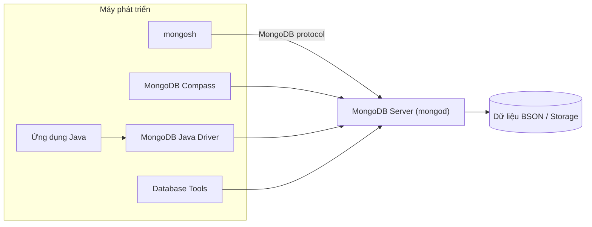

# Cài đặt MongoDB và kiểm tra phiên bản server, công cụ, driver

> **Module:** Database Engine Document MongoDB  
> **Chương:** Môi trường thực hành

## 1. Mục tiêu và bức tranh tổng thể

Trước khi thực hành truy vấn, lập chỉ mục hoặc thiết kế document, cần có một MongoDB Server đang chạy và một cách kết nối tới server đó. Bài này hướng dẫn dựng môi trường trên máy cá nhân bằng Docker hoặc cài trực tiếp trên Windows, Ubuntu, macOS; sau đó xác minh riêng phiên bản **server**, **MongoDB Shell**, **Database Tools** và **driver** được ứng dụng sử dụng.

Sau khi thực hành, bạn có thể:

- Chọn cách chạy MongoDB phù hợp với máy và giữ dữ liệu qua những lần khởi động lại.
- Kết nối tới MongoDB bằng `mongosh` hoặc MongoDB Compass và xác nhận server thực sự phản hồi.
- Phân biệt phiên bản binary `mongod`, phiên bản server đang được kết nối và phiên bản các công cụ bên ngoài.
- Thêm MongoDB Java Sync Driver vào dự án Maven/Gradle, xác minh phiên bản dependency và chạy một chương trình Java kiểm tra kết nối.
- Tự xác định nguyên nhân thường gặp khi lệnh không tồn tại, dịch vụ chưa chạy hoặc driver không kết nối được.

### 1.1. Những thành phần thường bị nhầm với nhau

| Thành phần | Vai trò | Cài ở đâu? | Cách kiểm tra |
|---|---|---|---|
| **MongoDB Server** (`mongod`) | Tiến trình lưu trữ, xử lý truy vấn và quản lý dữ liệu BSON | Máy chủ, container hoặc dịch vụ được quản lý | `mongod --version` kiểm tra binary; `db.version()` kiểm tra server đang kết nối |
| **MongoDB Shell** (`mongosh`) | Chương trình dòng lệnh để gửi lệnh tới server | Máy của người học hoặc container | `mongosh --version` |
| **MongoDB Database Tools** | Tiện ích sao lưu, phục hồi, nhập và xuất như `mongodump`, `mongorestore`, `mongoimport`, `mongoexport` | Có thể cài riêng | `mongodump --version` |
| **MongoDB Compass** | Ứng dụng giao diện đồ họa để kết nối, xem collection, truy vấn | Máy của người học | Mục **About** trong ứng dụng |
| **MongoDB Driver** | Thư viện Java, Node.js, Python… mà mã nguồn ứng dụng gọi để giao tiếp với server | Dependency của từng ứng dụng | Maven/Gradle/npm/pip, tùy ngôn ngữ |



Đây là **các thành phần có vòng đời phát hành riêng**. Ví dụ, server mang phiên bản `8.0.x`, shell có thể mang phiên bản `2.x`, Database Tools mang phiên bản `100.x` và Java driver mang phiên bản `5.x`. Không được kết luận môi trường lỗi chỉ vì bốn số phiên bản không giống nhau; cần đối chiếu **bảng tương thích** chính thức.

## 2. Chuẩn bị và chọn cách triển khai

Bạn cần một máy 64-bit được MongoDB hỗ trợ hoặc một Docker host phù hợp, quyền cài phần mềm, kết nối Internet để tải gói, và một terminal. Nếu sẽ dùng Java driver, chuẩn bị JDK và Maven hoặc Gradle; `java -version` và `mvn -version` / `gradle -version` giúp kiểm tra môi trường build.

| Phương án | Nên chọn khi | Điều cần biết |
|---|---|---|
| **Docker (đề xuất cho bài thực hành)** | Muốn cùng một lệnh trên Windows/macOS/Linux, dễ cô lập môi trường | Cần Docker Engine hoặc Docker Desktop; dữ liệu nên lưu trong Docker volume |
| **Cài trực tiếp** | Muốn học cách quản lý tiến trình, service, thư mục dữ liệu và file cấu hình của hệ điều hành | Mỗi hệ điều hành có quy trình và yêu cầu hỗ trợ riêng |
| **MongoDB Atlas** | Không muốn tự vận hành server trên máy | Server chạy trên cloud; vẫn cần shell/Compass/driver, tài khoản và cấu hình truy cập mạng |

Các ví dụ nhất quán bên dưới sử dụng **MongoDB Community 8.0** làm mốc thực hành. Đây là phiên bản **được chọn để hướng dẫn**, không phải khẳng định phiên bản mới nhất. Nếu chọn dòng khác, thay ký hiệu version tương ứng và đọc tài liệu đúng dòng trước khi cài. Không đồng thời chạy hai server cùng chiếm cổng `27017` trên host.

> **Ranh giới bảo mật:** Môi trường mẫu không bật xác thực chỉ phù hợp để học trên máy cá nhân và chỉ mở kết nối từ loopback (`127.0.0.1`). Không công khai cổng `27017` ra Internet, không dùng cấu hình này cho production. Triển khai thực tế cần xác thực, quyền tối thiểu, kiểm soát mạng và TLS phù hợp.

## 3. Cách A — Chạy MongoDB bằng Docker

Phương án này phù hợp nếu Docker đã được cài và đang hoạt động:

```bash
docker version
docker info
```

Nếu `docker info` không thể liên hệ Docker daemon, hãy khởi động Docker Desktop hoặc service Docker trước.

### 3.1. Tạo container và volume

Các lệnh chạy từ terminal của **máy host** (PowerShell, CMD, Terminal hoặc Bash):

```bash
docker pull mongo:8.0
docker run --name mongodb-lab -d -p 127.0.0.1:27017:27017 -v mongodb-lab-data:/data/db mongo:8.0
docker ps --filter "name=mongodb-lab"
```

Ý nghĩa:

- `mongo:8.0`: image MongoDB theo nhánh 8.0; số patch thực tế có thể thay đổi khi image được cập nhật.
- `mongodb-lab`: tên container để dùng trong các lệnh kiểm tra tiếp theo.
- `127.0.0.1:27017:27017`: chỉ publish cổng của container lên địa chỉ loopback của host. Dùng `mongodb://127.0.0.1:27017` để kết nối từ ứng dụng chạy trên **host**.
- `mongodb-lab-data:/data/db`: Docker named volume giúp dữ liệu tiếp tục tồn tại khi container được dừng hoặc tạo lại đúng volume.

Xem log khởi động:

```bash
docker logs --tail 40 mongodb-lab
```

Một container đang ở trạng thái `Up` là tín hiệu tốt nhưng **chưa chứng minh server sẵn sàng xử lý truy vấn**. Thử gửi lệnh `ping`:

```bash
docker exec mongodb-lab mongosh --quiet --eval "db.adminCommand({ ping: 1 })"
```

Kết quả có trường `ok: 1` chứng tỏ MongoDB Server trong container phản hồi. Nếu vừa khởi động xong mà lệnh lỗi, đọc log để xem server có hoàn tất khởi tạo hay không.

### 3.2. Kiểm tra phiên bản trong container

```bash
docker exec mongodb-lab mongod --version
docker exec mongodb-lab mongosh --version
docker exec mongodb-lab mongosh --quiet --eval "db.version()"
docker exec mongodb-lab mongosh --quiet --eval "db.adminCommand({ buildInfo: 1 }).version"
```

Hai lệnh đầu đọc phiên bản **executable bên trong container**; hai lệnh sau hỏi **server mà shell đang kết nối**. Khi thử từ máy host, cài `mongosh` trên host rồi thực hiện:

```bash
mongosh "mongodb://127.0.0.1:27017" --quiet --eval "db.version()"
```

Không bắt buộc cài `mongosh` trên host nếu chỉ dùng `docker exec`; tuy vậy host shell hữu ích để kết nối cả local server và MongoDB Atlas.

### 3.3. Dừng, chạy lại và lưu ý về dữ liệu

```bash
docker stop mongodb-lab
docker start mongodb-lab
docker ps --filter "name=mongodb-lab"
```

Dừng container không xóa volume `mongodb-lab-data`. Nếu thay container, gắn **đúng volume cũ** thì dữ liệu vẫn nằm ở đó. Không xóa volume khi còn dữ liệu cần giữ. Nếu cổng `27017` của host đã bận, đổi **cổng bên trái** trong ánh xạ, ví dụ `127.0.0.1:27018:27017`, rồi dùng URI `mongodb://127.0.0.1:27018`.

## 4. Cách B — Cài MongoDB trực tiếp trên hệ điều hành

Chọn **một** tiểu mục phù hợp với máy. Hướng dẫn dưới đây là ví dụ cho phiên bản 8.0, kèm đường dẫn tài liệu chính thức để xác minh yêu cầu hệ điều hành và cập nhật cách cài.

### 4.1. Windows

Hướng dẫn này phù hợp cho Windows 11 64-bit hoặc Windows Server thuộc danh sách được MongoDB 8.0 hỗ trợ.

1. Tải **MongoDB Community Server**, chọn phiên bản `8.0`, nền tảng Windows và gói `msi` từ [MongoDB Download Center](https://www.mongodb.com/try/download/community).
2. Chạy MSI. Với máy thực hành thông thường, chọn **Complete** và **Install MongoD as a Service**. Ghi nhớ tên service (mặc định `MongoDB`).
3. Có thể cài **MongoDB Compass** trong wizard nếu muốn dùng giao diện đồ họa.
4. Cài **MongoDB Shell (mongosh) riêng**: MSI của server trên Windows không tự cài `mongosh`. Tải từ [MongoDB Shell](https://www.mongodb.com/try/download/shell) rồi mở cửa sổ terminal mới.
5. Nếu cần `mongodump`, `mongoimport`…, kiểm tra trước; thiếu thì tải [Database Tools](https://www.mongodb.com/try/download/database-tools).

Trong **PowerShell**, kiểm tra service:

```powershell
Get-Service -Name MongoDB
```

Nếu service ở trạng thái `Stopped`, khởi động bằng PowerShell có quyền quản trị:

```powershell
Start-Service -Name MongoDB
```

Sau khi cài, mở terminal mới và kiểm tra:

```powershell
Get-Command mongod -ErrorAction SilentlyContinue
Get-Command mongosh -ErrorAction SilentlyContinue
mongosh --version
mongosh "mongodb://127.0.0.1:27017" --quiet --eval "db.version()"
```

Nếu `Get-Command mongod` trống nhưng service vẫn chạy, có thể thư mục `bin` của server chưa nằm trong `PATH`; thử gọi trực tiếp executable theo đường dẫn cài đặt, ví dụ `C:\Program Files\MongoDB\Server\8.0\bin\mongod.exe`. Thư mục thực tế phụ thuộc lựa chọn trong MSI. Cần phân biệt lỗi `PATH` với lỗi server chưa khởi động.

Tài liệu: [Install MongoDB Community on Windows](https://www.mongodb.com/docs/v8.0/tutorial/install-mongodb-on-windows/).

### 4.2. Ubuntu Linux

Ví dụ dưới đây áp dụng cho bản Ubuntu LTS **được MongoDB 8.0 hỗ trợ** (như 20.04, 22.04, 24.04 trên kiến trúc phù hợp). Sử dụng repository `mongodb-org` chính thức; tránh nhầm với gói `mongodb` không do MongoDB duy trì trong repository Ubuntu.

Xác định bản Ubuntu:

```bash
cat /etc/os-release
uname -m
```

Cài tiện ích, nhập khóa ký gói:

```bash
sudo apt-get update
sudo apt-get install -y curl gnupg
curl -fsSL https://pgp.mongodb.com/server-8.0.asc | sudo gpg --dearmor -o /usr/share/keyrings/mongodb-server-8.0.gpg
```

Thêm repository dựa trên `VERSION_CODENAME` của Ubuntu hiện tại:

```bash
. /etc/os-release
echo "deb [ arch=amd64,arm64 signed-by=/usr/share/keyrings/mongodb-server-8.0.gpg ] https://repo.mongodb.org/apt/ubuntu $VERSION_CODENAME/mongodb-org/8.0 multiverse" | sudo tee /etc/apt/sources.list.d/mongodb-org-8.0.list
sudo apt-get update
sudo apt-get install -y mongodb-org
```

Chỉ thực hiện khi `VERSION_CODENAME` khớp bản phát hành được MongoDB hỗ trợ; nếu sử dụng distro khác, chọn tài liệu tương ứng. Khởi động và xem trạng thái:

```bash
sudo systemctl start mongod
sudo systemctl status mongod
mongod --version
mongosh --version
mongosh "mongodb://127.0.0.1:27017" --quiet --eval "db.adminCommand({ ping: 1 })"
```

Thông thường cấu hình nằm ở `/etc/mongod.conf`, dữ liệu ở `/var/lib/mongodb` và log ở `/var/log/mongodb/mongod.log`. Có thể dùng `sudo journalctl -u mongod -n 50 --no-pager` để đọc log service khi khởi động lỗi. Nếu muốn khởi động service cùng hệ thống, sử dụng `sudo systemctl enable mongod`.

Tài liệu: [Install MongoDB Community on Ubuntu](https://www.mongodb.com/docs/v8.0/tutorial/install-mongodb-on-ubuntu/).

### 4.3. macOS

Trên macOS đáp ứng điều kiện hỗ trợ của MongoDB 8.0 (theo tài liệu 8.0: macOS 15 trở lên, Intel 64-bit phù hợp hoặc Apple Silicon), chuẩn bị [Homebrew](https://brew.sh/). Sau đó:

```bash
brew tap mongodb/brew
brew trust mongodb/brew
brew update
brew install mongodb-community@8.0
brew services start mongodb-community@8.0
```

Xem trạng thái và phiên bản:

```bash
brew services list
mongod --version
mongosh --version
mongosh "mongodb://127.0.0.1:27017" --quiet --eval "db.version()"
```

Homebrew cũng cài MongoDB Database Tools theo gói MongoDB Community tương ứng. Cấu hình của Homebrew thường nằm trong thư mục `etc` dưới `brew --prefix`; vị trí cụ thể có thể khác giữa Apple Silicon và Intel.

Tài liệu: [Install MongoDB Community on macOS](https://www.mongodb.com/docs/v8.0/tutorial/install-mongodb-on-os-x/).

### 4.4. Nếu dùng MongoDB Atlas

Atlas chạy MongoDB Server trên cloud. Trên máy phát triển, bạn chỉ cần cài client thích hợp (`mongosh`, Compass, Java driver…), tạo deployment và cấu hình tài khoản database cùng đường truy cập mạng trong Atlas.

Từ Atlas, sao chép connection string được cung cấp và chọn **Connect with MongoDB Shell** hoặc **Connect your application**. Ví dụ định dạng:

```text
mongodb+srv://<cluster-host>/<database>?retryWrites=true&w=majority
```

Host ở đây là ví dụ ký hiệu; dùng host được Atlas cấp. Nên để ứng dụng đọc credentials/URI từ biến môi trường hoặc secret manager thay vì commit chúng vào mã nguồn, tài liệu hay Git. Một kết nối Atlas thành công không có nghĩa máy local đã cài `mongod`: server nằm trên cluster từ xa.

## 5. Kiểm tra phiên bản đúng lớp

Một lỗi chẩn đoán phổ biến là chạy `mongod --version` rồi cho rằng đã biết phiên bản server mà ứng dụng đang truy cập. Lệnh đó chỉ đọc phiên bản binary được tìm thấy tại **máy đang gõ lệnh**. Nếu ứng dụng nối tới Docker, Atlas hoặc máy chủ khác, cần hỏi chính kết nối đó.

### 5.1. Version của binary server

```bash
mongod --version
```

Đầu ra có dòng dạng `db version v8.0.x` cùng thông tin build. Nếu dùng Docker, chạy lệnh qua `docker exec mongodb-lab mongod --version`. Không cần khởi động server để chạy `mongod --version`.

### 5.2. Version của server hiện đang kết nối

Từ terminal trên máy có `mongosh`:

```bash
mongosh "mongodb://127.0.0.1:27017" --quiet --eval "db.version()"
mongosh "mongodb://127.0.0.1:27017/admin" --quiet --eval "db.adminCommand({ buildInfo: 1 }).version"
mongosh "mongodb://127.0.0.1:27017/admin" --quiet --eval "db.adminCommand({ ping: 1 })"
```

- `db.version()`: hỏi phiên bản của MongoDB Server ở endpoint đang kết nối.
- `buildInfo.version`: lấy thông tin version từ lệnh server `buildInfo` (có thể bị giới hạn bởi chính sách/quyền của môi trường quản lý).
- `ping`: xác minh server có phản hồi; với user/password được bật, lệnh cần kết nối hợp lệ.

Trong phiên `mongosh` tương tác, có thể chạy:

```javascript
db.version()
db.adminCommand({ buildInfo: 1 })
db.adminCommand({ ping: 1 })
```

Muốn ghi nhận đang kết nối đâu, xem URI đã dùng, tên host, cổng và cơ chế kết nối (local, container, Atlas). Không dùng riêng chuỗi version để chứng minh bạn đang làm việc trên đúng database.

### 5.3. Version của shell và công cụ quản trị

Các lệnh sau chạy ở **terminal hệ điều hành**, không chạy trong prompt `mongosh`:

```bash
mongosh --version
mongodump --version
mongorestore --version
mongoimport --version
mongoexport --version
```

Nếu một công cụ báo `command not found` / `is not recognized`, có hai khả năng chính: **chưa cài** hoặc **chưa thêm thư mục executable vào `PATH`**. Kiểm tra đường dẫn executable bằng `Get-Command mongodump` trên PowerShell hoặc `command -v mongodump` trên Linux/macOS.

Từ MongoDB 4.4, **MongoDB Database Tools được phát hành riêng** và mang nhánh version `100.x`, không cần khớp `8.0.x` của server. Kiểm tra tài liệu tương thích cho phiên bản Tools bạn thực sự có. Lệnh `mongo` thuộc shell cũ; với quy trình mới, sử dụng `mongosh`.

Tài liệu: [MongoDB Shell](https://www.mongodb.com/docs/mongodb-shell/) và [MongoDB Database Tools](https://www.mongodb.com/docs/database-tools/).

### 5.4. Version MongoDB Compass

Mở Compass, vào **About** (vị trí menu thay đổi theo hệ điều hành hoặc phiên bản) để đọc phiên bản ứng dụng. Trên màn hình kết nối, dùng URI `mongodb://127.0.0.1:27017`, nhấn **Connect** rồi xem database/collection sau khi kết nối. Version của Compass là version **GUI client**, độc lập với version của server. Nếu Compass không kết nối nhưng `mongosh` kết nối được, hãy đối chiếu URI, authentication và TLS trước khi nghi ngờ MongoDB Server.

## 6. Thực hành kết nối và thao tác dữ liệu đầu tiên

Trước khi thử với Java, hãy xác nhận server vừa cài thực sự có khả năng ghi/đọc document. Ví dụ này dùng server local, không bật authentication. Mở shell:

```bash
mongosh "mongodb://127.0.0.1:27017"
```

Trong shell, chạy lần lượt:

```javascript
use mongo_lab

db.environment_check.updateOne(
  { _id: "installation-smoke-test" },
  {
    $set: {
      component: "MongoDB Server",
      message: "Connection and write succeeded",
      checkedAt: new Date()
    }
  },
  { upsert: true }
)

db.environment_check.findOne({ _id: "installation-smoke-test" })

db.environment_check.deleteOne({ _id: "installation-smoke-test" })
```

Lệnh `updateOne(..., { upsert: true })` thêm hoặc cập nhật document kiểm tra, `findOne` đọc lại, `deleteOne` dọn đúng document kiểm tra đó. Nếu thấy kết quả truy vấn mang `_id` vừa tạo, đường truyền, quyền ghi/đọc và truy vấn cơ bản đều hoạt động. Khi thoát `mongosh`, gõ `exit`.

**Lưu ý:** tên database `mongo_lab` và collection `environment_check` dành cho lab; không thử các lệnh ghi/xóa trong một cluster production khi chưa có quyền và dữ liệu kiểm soát.

## 7. Cài và kiểm tra MongoDB driver cho ứng dụng Java

Driver là **thư viện nằm trong ứng dụng**, không phải một tiến trình MongoDB và không được cài tự động chỉ vì có `mongod` hoặc `mongosh`. Với ứng dụng Java đồng bộ, ví dụ dùng artifact **`org.mongodb:mongodb-driver-sync`**. Để có ví dụ có thể tái lập, bài sử dụng phiên bản `5.13.0`; khi tạo dự án mới, hãy kiểm tra phiên bản đang được hỗ trợ và bảng tương thích trước khi nâng.

### 7.1. Maven

Thêm dependency vào `pom.xml`:

```xml
<dependencies>
    <dependency>
        <groupId>org.mongodb</groupId>
        <artifactId>mongodb-driver-sync</artifactId>
        <version>5.13.0</version>
    </dependency>
</dependencies>
```

Nếu `pom.xml` đã có khối `<dependencies>`, chỉ thêm một thẻ `<dependency>` tương ứng vào khối hiện có.

Kiểm tra phiên bản thực sự được Maven resolve:

```bash
mvn dependency:tree -Dincludes=org.mongodb
```

Tìm dòng `org.mongodb:mongodb-driver-sync:jar:5.13.0` (hoặc version dự án đã khai báo/quản lý). Driver còn kéo theo các dependency cần thiết như `mongodb-driver-core` và `bson`; cần quan sát phiên bản **đã resolve** thay vì chỉ đọc `pom.xml` nếu dự án dùng dependency management.

### 7.2. Gradle

Nếu dự án dùng Gradle Groovy DSL (`build.gradle`):

```groovy
dependencies {
    implementation 'org.mongodb:mongodb-driver-sync:5.13.0'
}
```

Nếu dùng Gradle Kotlin DSL (`build.gradle.kts`):

```kotlin
dependencies {
    implementation("org.mongodb:mongodb-driver-sync:5.13.0")
}
```

Xem dependency thực tế trên runtime classpath:

```bash
./gradlew dependencyInsight --dependency mongodb-driver-sync --configuration runtimeClasspath
```

Trên Windows, thay `./gradlew` bằng `.\gradlew.bat` nếu dùng PowerShell. Khi dự án dùng Spring Boot BOM hoặc version catalog, quản lý version từ một nguồn thống nhất; `dependencyInsight` giúp xác nhận bản đã được chọn sau khi Gradle giải quyết xung đột phiên bản.

### 7.3. Java smoke test: hỏi version server bằng driver

Ví dụ dưới đây dùng Java 17+ và MongoDB Java Sync Driver 5.13.0. Tạo lớp `CheckMongoEnvironment.java` trong source set Java của dự án đã có dependency:

```java
import com.mongodb.client.MongoClient;
import com.mongodb.client.MongoClients;
import org.bson.Document;

public class CheckMongoEnvironment {
    public static void main(String[] args) {
        String uri = System.getenv("MONGODB_URI");
        if (uri == null || uri.isBlank()) {
            uri = "mongodb://127.0.0.1:27017";
        }

        try (MongoClient client = MongoClients.create(uri)) {
            Document ping = client.getDatabase("admin")
                    .runCommand(new Document("ping", 1));

            Document buildInfo = client.getDatabase("admin")
                    .runCommand(new Document("buildInfo", 1));

            System.out.println("ping.ok = " + ping.get("ok"));
            System.out.println("server.version = " + buildInfo.getString("version"));
        }
    }
}
```

Để kết nối vào môi trường khác, đặt biến `MONGODB_URI` trên **tiến trình chạy ứng dụng** bằng URI do môi trường đó cung cấp. Không đưa password thật trực tiếp vào mã nguồn. Nếu `ping` trả `ok = 1.0` (hoặc giá trị số tương đương) và in được version, driver đã có trên classpath và ứng dụng đã thực hiện truy vấn server thành công.

Lệnh Maven/Gradle ở hai mục trước xác nhận **version của driver**; `server.version` in bởi chương trình Java xác nhận **version của server đang kết nối**. Hai con số giải đáp hai câu hỏi khác nhau. Nếu tài khoản không được phép gọi `buildInfo`, vẫn có thể dùng `ping` làm kiểm tra kết nối và kiểm tra server version bằng công cụ được cấp quyền riêng.

### 7.4. Driver ở các ngôn ngữ khác

Nếu ứng dụng không dùng Java, cách kiểm tra cũng theo nguyên tắc tương tự:

```bash
# Python: chạy sau khi đã cài pymongo vào đúng Python environment
python -m pip show pymongo

# Node.js: chạy trong thư mục dự án đã cài mongodb package
npm ls mongodb
```

Đây là version thư viện client trong đúng environment/dự án. Khi dùng virtual environment, container ứng dụng hoặc dependency lock file, cần chạy lệnh **trong đúng môi trường thực thi**, vì phiên bản package cài toàn hệ thống có thể khác phiên bản mà ứng dụng thực sự tải.

Tài liệu: [MongoDB Java Sync Driver](https://www.mongodb.com/docs/drivers/java/sync/current/) và [Client Library Compatibility](https://www.mongodb.com/docs/drivers/compatibility/?driver-language=java&java-driver-framework=java-sync).

## 8. Kiểm tra tương thích trước khi nâng cấp

Cần phân biệt ba loại câu hỏi:

1. **Có cài đúng phiên bản mong muốn không?** Kiểm tra package manager, binary hoặc dependency resolver.
2. **Server mong muốn có thực sự chạy và nhận kết nối không?** Dùng `ping` / `db.version()` qua URI cụ thể.
3. **Phiên bản driver/tool đó có hỗ trợ server và runtime của mình không?** So sánh với tài liệu compatibility chính thức, rồi thử kết nối tối thiểu.

Không suy ra tương thích chỉ từ việc các số major giống nhau. Java Sync Driver `5.x` và Server `8.x` là hai dòng version khác nhau. Bảng tương thích của MongoDB phân biệt mức hỗ trợ đầy đủ, hỗ trợ một phần và không tương thích; còn cần xét cả phiên bản JDK, hệ điều hành, kiến trúc CPU, driver framework và các tính năng được ứng dụng sử dụng.

Đối với ứng dụng Java trong dự án nhiều module, nên ghi lại **bộ phiên bản thực tế** theo cấu trúc sau để dễ tái tạo môi trường:

| Hạng mục cần ghi | Lệnh hoặc nguồn xác minh | Giá trị ghi vào nhật ký cá nhân |
|---|---|---|
| OS / kiến trúc | `uname -m`, About Windows/macOS | Tên OS, release, CPU |
| Server được kết nối | `mongosh <URI> --eval "db.version()"` | Ví dụ `8.0.x` |
| Server binary cục bộ | `mongod --version` / `docker exec ...` | Ví dụ `8.0.x` |
| Shell | `mongosh --version` | Ví dụ `2.x` |
| Database Tools | `mongodump --version` | Ví dụ `100.x` |
| Java driver | `mvn dependency:tree` / `gradlew dependencyInsight` | Ví dụ `5.13.0` |
| Java runtime | `java -version` | Ví dụ `21.x` |
| URI đích (không chứa secret) | Cấu hình ứng dụng | Local/Atlas, host, port, db |

Trong tài liệu/lịch sử lỗi, **che username, password, token và connection string có secret** trước khi chia sẻ.

## 9. Những lỗi cài đặt và kết nối thường gặp

| Triệu chứng | Cách xác định nguyên nhân | Hướng xử lý |
|---|---|---|
| `mongosh: command not found` hoặc PowerShell không nhận `mongosh` | Chưa cài shell riêng hoặc `PATH` chưa cập nhật | Cài `mongosh`, mở terminal mới, kiểm tra vị trí executable |
| `mongod --version` chạy được nhưng kết nối `ECONNREFUSED 127.0.0.1:27017` | Binary có trên máy nhưng service/container chưa chạy hoặc lắng nghe cổng khác | Xem `systemctl status mongod`, `Get-Service MongoDB` hoặc `docker ps`; xem log và URI |
| Docker báo cổng `27017` đã được sử dụng | Một tiến trình/container đã chiếm cổng host | Xác định service đang dùng cổng; dùng cổng host khác như `27018` nếu phù hợp |
| `Authentication failed` | Sai credential, `authSource` hoặc role; endpoint bật xác thực | Dùng đúng tài khoản, database xác thực và cơ chế của deployment; không tắt auth để né lỗi ở môi trường thật |
| `mongodump` không tồn tại dù `mongosh` chạy được | Database Tools là bộ cài khác hoặc chưa trong `PATH` | Cài Tools phù hợp nền tảng, kiểm tra `mongodump --version` |
| Compass kết nối được nhưng Java báo timeout | URI, DNS, TLS, network policy, proxy hoặc environment của hai ứng dụng khác nhau | So sánh URI không lộ secret; kiểm tra kết nối từ đúng máy/container chạy Java |
| `MongoTimeoutException` / server selection timeout | Client không tìm thấy server có thể dùng trong thời gian quy định | Kiểm tra service, host/port, Docker network, Atlas IP access list và DNS |
| Driver lỗi protocol / API sau khi nâng server | Có thể driver quá cũ hoặc chỉ hỗ trợ một phần tính năng server mới | Kiểm tra compatibility matrix và version dependency đã resolve, sau đó nâng theo hướng dẫn |
| `Permission denied` khi chạy service | Quyền truy cập data/log directory hoặc quyền service account sai | Đọc log và bảo đảm user chạy `mongod` có quyền trên thư mục dữ liệu/log |

**Đọc lỗi theo lớp:** lệnh không tồn tại → cài đặt/`PATH`; không kết nối TCP → tiến trình/network; kết nối được nhưng xác thực lỗi → credential/role; kết nối thành công nhưng chương trình lỗi → dependency/API/quyền thao tác. Cách phân lớp này tránh nhầm lỗi của shell hoặc Java driver với lỗi của database engine.

## 10. Bài thực hành tổng hợp

Giả sử bạn có Docker và một dự án Java dùng Maven hoặc Gradle:

1. Tạo container `mongodb-lab` với image `mongo:8.0` và named volume, rồi dùng `docker exec` kiểm tra `ping` và `db.version()`.
2. Kết nối bằng `mongosh` từ host (hoặc từ container), tạo document kiểm tra trong `mongo_lab.environment_check`, đọc lại và xóa document đó.
3. Ghi version của server, shell và Database Tools nếu đã cài. Nếu công cụ nào chưa có, phân biệt rõ “chưa cài” với “server lỗi”.
4. Thêm `mongodb-driver-sync` vào dự án, xem version dependency được resolve bằng Maven/Gradle và chạy `CheckMongoEnvironment` để thấy `ping.ok` cùng `server.version`.
5. Dừng rồi khởi động lại container và kết nối lại. Việc dừng/chạy không tự xóa dữ liệu trong named volume.

Khi tất cả các thao tác trên thực hiện được, bạn đã có môi trường đủ để học về document, collection, CRUD, query, index và các tính năng của MongoDB ở những bài tiếp theo.

## 11. Tài liệu chính thức

- [MongoDB Community Server — Download](https://www.mongodb.com/try/download/community)
- [Cài MongoDB 8.0 trên Windows](https://www.mongodb.com/docs/v8.0/tutorial/install-mongodb-on-windows/)
- [Cài MongoDB 8.0 trên Ubuntu](https://www.mongodb.com/docs/v8.0/tutorial/install-mongodb-on-ubuntu/)
- [Cài MongoDB 8.0 trên macOS](https://www.mongodb.com/docs/v8.0/tutorial/install-mongodb-on-os-x/)
- [Cài và cập nhật MongoDB Shell](https://www.mongodb.com/docs/mongodb-shell/install/)
- [MongoDB Database Tools — Installation](https://www.mongodb.com/docs/database-tools/installation/)
- [MongoDB Java Sync Driver](https://www.mongodb.com/docs/drivers/java/sync/current/)
- [Driver/Server compatibility matrix](https://www.mongodb.com/docs/drivers/compatibility/?driver-language=java&java-driver-framework=java-sync)

Các trang cài đặt có hướng dẫn riêng cho từng release. Khi chuyển sang MongoDB Server phiên bản khác, chọn lại đúng phiên bản tài liệu rồi xác minh khả năng hỗ trợ OS, kiến trúc, công cụ và driver trước khi thực hiện.
