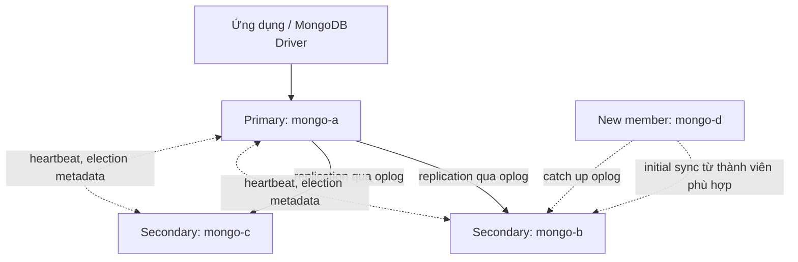
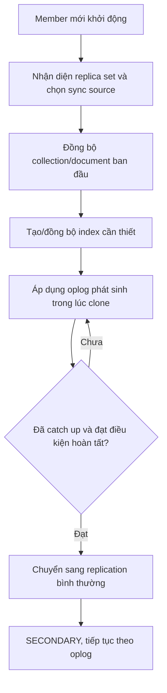
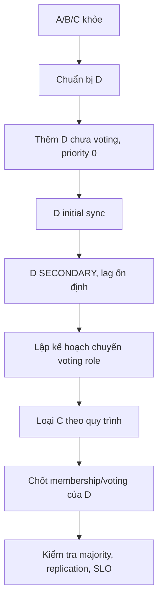

# Initial sync và bổ sung hoặc thay thế thành viên trong MongoDB Replica Set

> **Module:** Database Engine Document MongoDB  
> **Chương:** Replica set

## 1. Mục tiêu bài học

Một MongoDB replica set lưu nhiều bản sao của dữ liệu trên các tiến trình `mongod`, nhằm hỗ trợ khả năng chịu lỗi và cơ chế bầu chọn primary. Khi muốn thêm một máy vào replica set, máy đó **không tự nhiên có toàn bộ dữ liệu** của các thành viên đang chạy. Nó phải được đồng bộ để trở thành một thành viên sẵn sàng phục vụ theo vai trò được cấu hình.

Quá trình xây dựng dữ liệu ban đầu trên một thành viên mới được gọi là **initial sync**. Đây là khâu cốt lõi khi:

- Mở rộng replica set để tăng khả năng sẵn sàng hoặc thêm bản sao đọc.
- Đưa một secondary mới vào cluster.
- Thay thế máy chủ bị hỏng hoặc cần nâng cấp phần cứng.
- Khôi phục một thành viên có dữ liệu không còn theo kịp oplog.
- Tái tạo dữ liệu của secondary trong môi trường được phép và có kế hoạch kiểm soát.

Bài học này trình bày cách initial sync vận hành, điều kiện để đồng bộ thành công, tác động lên primary/secondary, cách thêm hoặc thay thế member, đọc trạng thái, phòng tránh mất quorum và xử lý các sự cố thông thường.

Sau khi học, bạn có thể:

1. Giải thích mối quan hệ giữa **primary, secondary, oplog, initial sync và steady-state replication**.
2. Nhận diện các trạng thái như `STARTUP2`, `RECOVERING`, `SECONDARY` và `PRIMARY`.
3. Biết một thành viên mới lấy dữ liệu từ đâu và vì sao **oplog window** quan trọng.
4. Dùng `rs.add()`, `rs.status()`, `rs.conf()`, `rs.remove()` và `rs.reconfig()` đúng mục đích.
5. Lập kế hoạch thêm member mà không vô tình phá khả năng duy trì majority.
6. Chọn quy trình thay thế secondary đang hoạt động, secondary đã hỏng hoặc primary.
7. Theo dõi initial sync qua trạng thái member, replication lag, tài nguyên và log server.
8. Phân biệt **hoàn tất initial sync** với **đạt mức nhất quán và sẵn sàng cho nghiệp vụ**.

> **Phạm vi:** Các ví dụ thao tác trực tiếp với replica set tự quản lý, chủ yếu trên MongoDB Server hiện đại. MongoDB Atlas có workflow quản trị riêng; không dùng tùy tiện các lệnh đổi thành viên trực tiếp trên cluster do Atlas quản lý. Một số biểu hiện về tiến trình, sync source và cấu hình phụ thuộc phiên bản MongoDB.

## 2. Ôn lại: replica set hoạt động ra sao?

Một replica set gồm các thành viên có chung tên replica set. Trong cấu hình thường gặp:

- **Primary** chấp nhận các thao tác ghi thông thường từ ứng dụng.
- **Secondary** sao chép và áp dụng các thao tác từ luồng oplog của thành viên nguồn.
- Các thành viên đủ điều kiện **vote** tham gia bầu chọn primary.
- Một số thành viên có thể có `priority: 0` để không được bầu làm primary.
- Một **arbiter** có thể tham gia bỏ phiếu nhưng **không giữ dữ liệu người dùng**; arbiter không phải secondary phục vụ mục tiêu sao lưu hoặc initial sync dữ liệu.

Sơ đồ đơn giản:



Trong thực tế, secondary có thể chọn **sync source** là một member khác phù hợp, không nhất thiết luôn lấy trực tiếp từ primary. Điều đó giúp phân phối tải replication tùy topology và khả năng của member.

### 2.1. Oplog là gì?

**Oplog** (*operations log*) là một collection đặc biệt trong database `local`, thường là `local.oplog.rs`, ghi nhận các thao tác cần được các thành viên khác tái hiện theo cơ chế replication. Đây là cơ chế nền tảng để secondary theo kịp primary.

Hình dung:

```text
Primary đang có dữ liệu ở T0
    |
    +-- T1: insert order A
    +-- T2: update order B
    +-- T3: delete order C

Secondary đang ở T1
    |
    +-- đọc và áp dụng tiếp T2, T3 từ oplog
    |
    +-- đến thời điểm mới hơn
```

Secondary không cần tải lại toàn bộ collection mỗi lần primary có một update. Sau khi đã có dữ liệu ban đầu, nó thường tiếp tục bằng **steady-state replication** qua oplog.

### 2.2. Initial sync khác steady-state replication

| Tiêu chí | Initial sync | Steady-state replication |
|---|---|---|
| Mục tiêu | Xây dựng bản dữ liệu đầy đủ ban đầu trên member | Duy trì member theo kịp thay đổi liên tục |
| Nguồn dữ liệu | Dữ liệu collection/index và lịch sử thay đổi cần thiết | Các entry oplog tiếp theo |
| Khi xảy ra | Member mới/trống hoặc phải đồng bộ lại từ đầu | Sau khi đồng bộ thành công |
| Chi phí | Thường cao: clone dữ liệu, index, I/O và mạng | Phụ thuộc khối lượng ghi phát sinh |
| Trạng thái | Có thể thấy STARTUP2/RECOVERING và progress đặc thù | SECONDARY nếu hoạt động bình thường |
| Rủi ro chính | Oplog window không đủ, nguồn thay đổi, thiếu disk, mất kết nối | Lag quá xa, oplog cũ bị xóa trước khi áp dụng |

**Ý quan trọng:** Member đang chạy initial sync **chưa được coi là một secondary đã sẵn sàng** chỉ vì tiến trình `mongod` đã khởi động và port đã mở.

## 3. Khi nào cần initial sync?

Một member chưa có bộ dữ liệu hợp lệ cần initial sync để đi vào replica set như một thành viên giữ dữ liệu.

Những trường hợp phổ biến:

### 3.1. Thêm một member hoàn toàn mới

Bạn khởi động `mongod` mới với:

- Tên replica set đúng.
- Thư mục dữ liệu riêng, trống và hợp lệ cho quá trình đồng bộ.
- Cấu hình mạng, xác thực nội bộ và TLS tương thích.
- Phiên bản MongoDB được topology hiện tại hỗ trợ.

Sau đó một người quản trị từ primary thêm host này vào cấu hình replica set. Member mới thực hiện initial sync.

### 3.2. Thay thế member hỏng

Một secondary bị mất disk, không thể khôi phục dữ liệu đáng tin cậy. Người vận hành chuẩn bị máy thay thế, đưa máy vào cấu hình replica set, để nó tạo bản sao mới từ member khỏe.

Không được hiểu “thay thế” chỉ là đổi địa chỉ IP/hostname trong application connection string. **Membership và dữ liệu của node mới phải được xử lý trong replica set**.

### 3.3. Member bị trễ quá xa

Secondary bị tắt quá lâu hoặc không theo kịp primary. Nếu các oplog entry cần thiết đã bị loại khỏi cửa sổ lưu giữ, secondary không còn đủ lịch sử để tiếp tục replication bình thường.

Trong trường hợp này, có thể phải **resync từ đầu** theo quy trình phù hợp: chuẩn bị lại dữ liệu của member và chạy initial sync. Không tự xóa dbpath trước khi xác nhận nguyên nhân và có kế hoạch phục hồi.

### 3.4. Thành viên chỉ tạm ngắt kết nối không nhất thiết cần initial sync

Nếu secondary ngừng một thời gian ngắn nhưng các entry oplog cần thiết vẫn còn, nó có thể tiếp tục replication khi kết nối lại. Không phải mọi lần restart hoặc network flap đều dẫn tới initial sync.

Phân biệt đúng hai trường hợp giúp tránh tải dữ liệu nhiều terabyte không cần thiết.

## 4. Các bước khái niệm của initial sync

MongoDB Server có thể sử dụng những phương thức initial sync khác nhau tùy phiên bản, edition và tính năng deployment. Phương thức thường gặp là **logical initial sync**: đọc dữ liệu từ một sync source, tạo dữ liệu/index ở member mới và áp dụng các thay đổi phát sinh trong quá trình sao chép.

Một quy trình khái niệm:



Sơ đồ trên nhằm giải thích **phần dữ liệu nền và phần thay đổi tiếp diễn**. Thứ tự chi tiết, các phase log và cơ chế copy/index có thể khác theo phiên bản; không lấy sơ đồ này làm mô tả giao thức từng byte.

### 4.1. Chọn sync source

Member cần một sync source có dữ liệu và oplog phù hợp để phục vụ đồng bộ. Một member có thể chọn secondary khác thay vì primary, miễn thỏa các điều kiện replication.

Từ góc độ vận hành, cần lưu ý:

- Sync source phải có khả năng phục vụ khối lượng đọc dữ liệu lớn.
- Khi quá nhiều member mới cùng sync từ một node, node đó có thể quá tải.
- Sự thay đổi topology có thể làm member chọn sync source khác.
- Không giả định initial sync luôn tải dữ liệu trực tiếp từ primary.

### 4.2. Clone dữ liệu hiện có

Member mới cần có các collection và document tương ứng tại thời điểm đồng bộ, cùng metadata và index theo cơ chế của server.

Tải clone thường liên quan đến:

- Disk read tại sync source.
- Network giữa source và new member.
- Disk write ở new member.
- CPU để xử lý BSON, index và storage engine.
- Mức tải ứng dụng đang đồng thời đọc/ghi trên cùng cluster.

Nếu source là secondary phục vụ nhiều request đọc, initial sync có thể làm tăng latency của các request đó.

### 4.3. Những thay đổi trong lúc clone không được bỏ sót

Một quá trình clone mất hàng giờ không thể đóng băng mọi ghi của ứng dụng. Trong thời gian đó, primary có thể tiếp tục nhận insert/update/delete, tạo ra các entry oplog mới.

Member mới phải theo kịp những thay đổi có liên quan sau mốc đồng bộ thích hợp. Vì vậy **có bản sao collection trông đầy đủ chưa đồng nghĩa initial sync đã hoàn tất**.

### 4.4. Chuyển sang steady state

Khi quá trình initial sync hoàn tất theo điều kiện của server, member chuyển sang trạng thái phù hợp để tiếp tục đọc và áp dụng oplog như một secondary bình thường.

Trên một số phiên bản bạn có thể quan sát các trạng thái trung gian như `STARTUP2` hoặc `RECOVERING`. Chỉ khi member đã đạt `SECONDARY` và có sức khỏe replication phù hợp mới nên xem nó là thành viên dữ liệu đã sẵn sàng theo mục đích triển khai.

### 4.5. Các biến thể của initial sync

Một số phiên bản/edition/deployment hỗ trợ cơ chế **file-copy-based initial sync** hoặc các tối ưu khác bên cạnh logical initial sync. Không nên tự khẳng định cluster của mình đang sử dụng phương thức nào chỉ từ từ khóa “initial sync”.

Khi lập kế hoạch vận hành, hãy đối chiếu:

- MongoDB Server version/edition.
- Storage engine.
- Loại deployment được quản lý hay tự quản lý.
- Tính năng và phương thức initial sync đang thực sự được hỗ trợ.
- Giới hạn điều kiện sử dụng và công cụ monitoring của phương thức đó.

Dù triển khai bằng phương thức nào, mục tiêu chung vẫn là có **bản sao dữ liệu nhất quán đủ điều kiện replication và tiếp tục theo kịp thay đổi**.

## 5. Oplog window: điều kiện sống còn của initial sync

Một member mới clone dữ liệu trong khi các thao tác ghi vẫn tiếp tục. Muốn bắt kịp thay đổi phát sinh trong thời gian clone, nó phải còn truy cập được **đủ lịch sử oplog**.

**Oplog window** là khoảng thời gian lịch sử thay đổi còn được giữ trong oplog. Đây là một đại lượng thay đổi theo dung lượng oplog và tốc độ ghi.

Hình dung:

```text
Thời gian → 

T0             T1                     T2
|--------------|----------------------|
Initial sync   Clone dữ liệu         Catch up

Oplog cần thiết từ mốc phù hợp ─────►
Nếu entry cũ đã bị loại trước khi new member áp dụng:
    Initial sync có thể thất bại và phải khởi động lại.
```

### 5.1. Ví dụ về cửa sổ lưu giữ

Giả sử công việc đồng bộ cần áp dụng những thay đổi bắt đầu từ 08:00. Trong quá trình clone, workload ghi rất cao khiến oplog chỉ còn các entry từ 09:00 trở đi trước khi secondary xử lý xong.

Member không thể suy ra mọi thay đổi từ 08:00 đến 09:00 bằng cách chỉ lấy những entry còn lại. Nếu không có phương án khôi phục lịch sử phù hợp, initial sync có thể phải chạy lại.

Điều này cho thấy initial sync **không chỉ phụ thuộc vào kích thước data** mà còn phụ thuộc tốc độ ghi nguồn và sức chứa oplog.

### 5.2. Theo dõi oplog

Trong `mongosh` trên member phù hợp, có quyền cần thiết:

```javascript
rs.printReplicationInfo();
```

Lệnh tiện ích này thường cung cấp thông tin dung lượng oplog và khoảng thời gian mà oplog hiện bao phủ. Tên trường/output có thể khác nhau theo phiên bản.

Có thể xem thống kê collection oplog khi có quyền:

```javascript
db.getSiblingDB("local").getCollection("oplog.rs").stats();
```

Không chỉnh sửa trực tiếp `local.oplog.rs`. Đó là dữ liệu hệ thống do MongoDB quản lý.

### 5.3. Khi nào nên cân nhắc điều chỉnh oplog?

Nếu workload ghi cao và cửa sổ oplog quá ngắn so với thời gian replica member có thể offline/đồng bộ, cần đánh giá:

- Dung lượng oplog hiện tại và disk free.
- Tốc độ sinh oplog theo giờ cao điểm.
- Thời gian member mới clone và catch up trên dữ liệu đại diện.
- Thời gian bảo trì dự kiến.
- Các cơ chế retention/giới hạn bổ sung tùy phiên bản.
- Tác động tới storage và backup.

MongoDB có lệnh/cơ chế quản trị oplog size trên các phiên bản hỗ trợ, nhưng đây là **thay đổi production cần runbook**, không phải thao tác mặc định phải chạy trước mọi `rs.add()`.

### 5.4. Các dấu hiệu member không theo kịp

- Replication lag tiếp tục tăng.
- Member vẫn ở giai đoạn catch-up rất lâu.
- Log cho thấy thiếu oplog entry cần thiết, sync source không phù hợp hoặc initial sync bị restart.
- Tốc độ thay đổi nguồn lớn hơn khả năng sao chép và áp dụng.
- Network/disk trên member mới bị bão hòa.

Đừng coi một chỉ số `lag = 0` xuất hiện ngắn hạn là chứng minh node hoàn toàn khỏe; phải kiểm tra cả trạng thái, lỗi, thời gian ổn định và read/write concern liên quan.

## 6. Điều kiện trước khi thêm thành viên mới

Trước khi phát lệnh `rs.add()` trên production, cần kiểm tra nhiều lớp.

### 6.1. Topology và quorum

| Câu hỏi | Vì sao quan trọng |
|---|---|
| Replica set hiện có bao nhiêu voting member? | Majority thay đổi khi cấu hình số phiếu đổi |
| Member nào là primary? | Lệnh thay đổi cấu hình thường được thực hiện trên primary |
| Có member đang down/RECOVERING không? | Có thể không đủ majority hoặc không có nguồn sync khỏe |
| Các secondary có replication lag lớn không? | Có thể ảnh hưởng khả năng phục hồi và catch up |
| Có thay đổi membership khác đang diễn ra không? | Tránh thay đổi đồng thời gây xung đột và mất ổn định |
| Member mới có `votes`/`priority` thế nào? | Quyết định tác động đến election/quorum |
| Cluster có trải qua nhiều availability zone không? | Cần phân bố khả năng chịu lỗi hợp lý |

Một replica set có thể có tối đa nhiều member dữ liệu, nhưng **tối đa 7 voting members** theo giới hạn thông thường của MongoDB replica set. Không thêm quá nhiều voter chỉ vì muốn có thêm bản sao đọc.

### 6.2. Hostname và mạng

Member mới phải có địa chỉ mà các member khác **và các client phù hợp** truy cập được theo cách topology công bố.

Kiểm tra:

- DNS hostname ổn định và phân giải được từ các máy trong replica set.
- Port mongod đúng, firewall cho phép các luồng cần thiết.
- Không dùng `localhost` để cấu hình replica set chạy trên nhiều máy thực.
- Các địa chỉ được khai báo trong `rs.conf()` tương thích với hostname/TLS certificate.
- Time synchronization và hạ tầng mạng đủ ổn định.

Với MongoDB Server hiện đại, cần chú ý các kiểm tra liên quan **hostname thay vì cấu hình IP trực tiếp**, đặc biệt trong môi trường multi-host/split-horizon. Trong lab một máy, `localhost` là tình huống khác với một replica set nhiều máy thật.

### 6.3. Security

Nếu replica set dùng:

- Keyfile authentication giữa các member.
- X.509 internal authentication.
- TLS/SSL cho kết nối nội bộ/ứng dụng.
- Authentication và authorization của người vận hành.

thì member mới phải được cấu hình tương thích. Không tắt xác thực/TLS trên production chỉ để “cho node join được”.

Ví dụ một máy mới có cùng `replSetName` nhưng thiếu keyfile đúng hoặc certificate không hợp lệ có thể không giao tiếp được với những member còn lại. Đây là lỗi cấu hình, không phải lỗi mà xóa dữ liệu có thể giải quyết.

### 6.4. Dung lượng và hiệu năng

Member mới cần:

- Disk chứa dữ liệu hiện tại **và khả năng tăng trưởng**.
- Dung lượng cho index, oplog, journal và metadata.
- CPU/RAM đủ cho clone và áp dụng oplog.
- Network throughput đủ để hoàn tất đồng bộ trước khi thiếu lịch sử oplog.
- Disk IOPS đủ để vừa ghi dữ liệu vừa build index.
- Monitoring cho tài nguyên và log.

Sync source cũng phải đủ dư địa CPU/I/O/network để phục vụ clone mà không làm ảnh hưởng mạnh đến production.

### 6.5. Phiên bản phần mềm

Không thêm một `mongod` với phiên bản tùy ý vào cluster. MongoDB có các quy tắc **upgrade/downgrade, wire compatibility và feature compatibility version**; một member mới phải chạy version tương thích với replica set tại thời điểm đó.

Trước khi thay phần cứng hoặc cài mới, xác nhận đúng phiên bản binary và cấu hình storage engine được deployment hỗ trợ.

## 7. Phân biệt votes, priority và các vai trò member

Một member có thể giữ dữ liệu nhưng không tham gia bỏ phiếu hay không được bầu làm primary.

| Cấu hình | Ý nghĩa |
|---|---|
| `votes: 1, priority: 1` | Member có thể bỏ phiếu và có thể được bầu làm primary khi đủ điều kiện |
| `votes: 1, priority: 0` | Member có phiếu nhưng **không được bầu làm primary** |
| `votes: 0, priority: 0` | Member dữ liệu không bỏ phiếu và không thể thành primary |
| `hidden: true, priority: 0` | Member ẩn trong lựa chọn secondary đọc thông thường, không được bầu làm primary |
| Arbiter | Member bỏ phiếu nhưng không giữ dữ liệu, không phục vụ initial sync dữ liệu |

Một số ràng buộc:

- Member **không bỏ phiếu** phải có `priority: 0`.
- Không tăng số voter mà không tính lại majority.
- Member mới đang initial sync chưa thể coi là một bản sao sẵn sàng chỉ vì cấu hình nó có `votes: 1`.
- MongoDB phiên bản hiện đại có cơ chế xử lý member mới trong quá trình bổ sung để hạn chế ảnh hưởng quorum trước khi initial sync hoàn tất; không tự can thiệp các field nội bộ như `newlyAdded`.

### 7.1. Ví dụ thêm secondary chưa muốn bầu chọn

Trong một số tình huống cần đồng bộ xong rồi mới quyết định vai trò:

```javascript
rs.add({
  host: "mongo-d.example.net:27017",
  votes: 0,
  priority: 0
});
```

Member D vẫn giữ dữ liệu sau initial sync, nhưng chưa đóng góp phiếu bầu. Khi đã đồng bộ và có quyết định topology, DBA có thể cân nhắc cấu hình lại `votes`/`priority`.

**Không mặc định** phải thêm mọi member theo `votes: 0`. Lựa chọn này dựa vào mục tiêu mở rộng, yêu cầu majority và chiến lược điều chỉnh cấu hình.

## 8. Ví dụ thực hành: dựng replica set trên một máy

Phần này dùng **một máy thực hành**, nhiều tiến trình `mongod` và các port khác nhau. Đây không phải cấu hình production có tính chịu lỗi máy chủ: khi máy vật lý dừng, cả replica set đều dừng.

> **An toàn:** Các lệnh dưới đây dùng `--bind_ip localhost`, không bật xác thực để giảm độ phức tạp lab. Không triển khai kiểu này trên máy mở mạng hoặc hệ thống production. Khi vận hành thật phải dùng authentication, TLS và cấu hình mạng phù hợp.

### 8.1. Chuẩn bị thư mục

Ví dụ máy Windows với PowerShell:

```powershell
New-Item -ItemType Directory -Force "C:\mongo-rs-lab\rs1"
New-Item -ItemType Directory -Force "C:\mongo-rs-lab\rs2"
New-Item -ItemType Directory -Force "C:\mongo-rs-lab\rs3"
```

Mỗi tiến trình phải dùng **dbpath riêng**. Không trỏ hai `mongod` đang chạy vào cùng một thư mục dữ liệu.

### 8.2. Khởi động member đầu tiên

Terminal 1:

```powershell
mongod --replSet rsTraining --port 27101 --dbpath "C:\mongo-rs-lab\rs1" --bind_ip localhost
```

Terminal 2:

```powershell
mongod --replSet rsTraining --port 27102 --dbpath "C:\mongo-rs-lab\rs2" --bind_ip localhost
```

Terminal 3:

```powershell
mongod --replSet rsTraining --port 27103 --dbpath "C:\mongo-rs-lab\rs3" --bind_ip localhost
```

Giữ các cửa sổ `mongod` đang chạy. Các process dùng chung tên replica set `rsTraining` nhưng mỗi process có port và dbpath độc lập.

### 8.3. Khởi tạo replica set với một thành viên

Mở Terminal 4:

```powershell
mongosh "mongodb://localhost:27101/?directConnection=true"
```

Trong shell:

```javascript
rs.initiate({
  _id: "rsTraining",
  members: [
    { _id: 0, host: "localhost:27101" }
  ]
});
```

Kiểm tra:

```javascript
rs.status();
db.hello().isWritablePrimary;
```

Chờ cho node đầu được bầu làm primary theo cơ chế election của lab. `isWritablePrimary` trở thành true trên primary hiện tại. Nếu kết nối trước khi election hoàn tất, hãy quan sát lại trạng thái; không coi sự chờ đợi này là lỗi ngay lập tức.

**Lưu ý:** Trong MongoDB driver và nhiều command, địa chỉ member phải dùng đúng hostname đã khai báo trong replica set. Lab trên dùng cùng hostname `localhost` cho cả ba tiến trình vì chúng chạy trên **một máy**.

### 8.4. Tạo dữ liệu nguồn trước khi thêm secondary

Trong shell kết nối primary:

```javascript
const lab = db.getSiblingDB("replica_initial_sync_lab");
const events = lab.getCollection("events");

const documents = Array.from({ length: 10000 }, (_, i) => ({
  _id: i + 1,
  tenantId: "tenant-" + (i % 20),
  eventType: i % 3 === 0 ? "PURCHASE" : "VIEW",
  createdAt: new Date(Date.UTC(2026, 0, 1) + i * 1000),
  payload: "demo-" + (i + 1)
}));

events.insertMany(documents);
events.createIndex({ tenantId: 1, createdAt: -1 });

print("Count:", events.countDocuments({}));
```

Tạo trước dữ liệu và index để new member phải đồng bộ chúng. Bộ dữ liệu 10000 document khá nhỏ nên initial sync có thể hoàn tất nhanh đến mức khó quan sát progress chi tiết.

### 8.5. Thêm secondary thứ hai bằng rs.add()

Trong shell **đang kết nối primary**:

```javascript
rs.add("localhost:27102");
```

Đây là bước yêu cầu replica set thêm tiến trình đã khởi động trên port 27102 vào membership. Node mới có dbpath trống và sẽ thực hiện initial sync.

Quan sát:

```javascript
rs.status();
```

Trong một thời điểm có thể thấy node mới ở `STARTUP2` hoặc trạng thái trung gian; sau khi hoàn tất và ổn định, nó có thể trở thành `SECONDARY`.

### 8.6. Thêm secondary thứ ba

Sau khi member thứ hai hoạt động khỏe:

```javascript
rs.add("localhost:27103");
```

Kiểm tra cấu hình:

```javascript
rs.conf();
```

Khi cả ba member hoàn tất đồng bộ và khỏe, lab có một replica set gồm ba tiến trình giữ dữ liệu, trong đó thường có một primary và hai secondary.

**Không đồng nhất demo trên một máy với production 3-node thật:** số process là ba nhưng chỉ có một failure domain vật lý.

### 8.7. Kiểm tra dữ liệu trên secondary

Từ cửa sổ khác:

```powershell
mongosh "mongodb://localhost:27102/?directConnection=true"
```

Trong `mongosh` trên secondary, sử dụng read preference phù hợp khi đọc:

```javascript
db.getMongo().setReadPref("secondary");

const lab = db.getSiblingDB("replica_initial_sync_lab");

print("Secondary count:", lab.events.countDocuments({}));
printjson(lab.events.getIndexes());
```

Nếu initial sync đã xong và member theo kịp, số document sẽ phản ánh dữ liệu source tương ứng theo thời điểm truy vấn. Với workload liên tục, đọc secondary có thể thấy dữ liệu trễ so với primary; đừng dùng phép so sánh số document tại hai thời điểm khác nhau làm bằng chứng tuyệt đối của sự nhất quán.

**Không chạy các thao tác ghi bình thường trực tiếp trên secondary** để “sửa” dữ liệu thiếu. Hãy điều tra replication và chỉ ghi qua primary theo cơ chế MongoDB hỗ trợ.

## 9. Theo dõi tiến trình initial sync

Trong production, cần giám sát cả **thành viên mới** và **các thành viên đang phục vụ đồng bộ**.

### 9.1. Quan sát trạng thái từ primary

```javascript
const status = rs.status();

printjson(
  status.members.map(member => ({
    name: member.name,
    stateStr: member.stateStr,
    health: member.health,
    optimeDate: member.optimeDate,
    syncSourceHost: member.syncSourceHost
  }))
);
```

Các trường `syncSourceHost`/`optimeDate` có thể không xuất hiện trong mọi trạng thái/phiên bản. Đây là ví dụ đọc thông tin nếu có, không phải hợp đồng rằng tất cả field phải khác null.

Những state quan trọng:

| State | Ý nghĩa khái quát |
|---|---|
| `STARTUP` | Member đang khởi động |
| `STARTUP2` | Có thể đang chuẩn bị/thực hiện initial sync |
| `RECOVERING` | Chưa sẵn sàng phục vụ như secondary thông thường; có thể đang bắt kịp |
| `SECONDARY` | Member dữ liệu ở vai trò secondary, tiếp tục replication |
| `PRIMARY` | Member giữ vai trò primary |
| `ARBITER` | Member bỏ phiếu nhưng không chứa dữ liệu người dùng |
| `DOWN` hoặc `health: 0` trong quan sát khác | Thành viên không liên lạc được theo góc nhìn của node đang quan sát |

**Không dùng state một mình làm bằng chứng đầy đủ.** Một secondary có thể ở state SECONDARY nhưng vẫn có lag đáng kể.

### 9.2. Quan sát trực tiếp member đang sync

Kết nối tới host/port của node mới với `directConnection=true`:

```powershell
mongosh "mongodb://localhost:27102/?directConnection=true"
```

Trong shell của member mới:

```javascript
db.getSiblingDB("admin").runCommand({
  replSetGetStatus: 1
});
```

Output của `replSetGetStatus` có thể chứa các mục liên quan đến trạng thái initial sync, tiến độ collection/index hay thời gian đã chạy, tùy server version và phase. Một số phiên bản cung cấp thông tin qua trường như `initialSyncStatus`.

Nếu output không có cùng một field progress như ví dụ trên mạng, điều đó **không tự chứng minh member bị lỗi**. Hãy xem cả log, state và metric hạ tầng.

### 9.3. Log mongod là nguồn quan sát quan trọng

Trên member đang initial sync, xem log:

- Bắt đầu initial sync, lựa chọn sync source.
- Clone database/collection/index.
- Các đợt áp dụng oplog, catch up.
- Retry, mất kết nối, lỗi collection/index.
- Thiếu disk, network error, authentication/TLS error.
- Hoàn tất initial sync hoặc điều kiện khiến nó phải bắt đầu lại.

Không phụ thuộc một chuỗi log cụ thể như `"initial sync 50%"` vì message và cấu trúc log thay đổi theo version.

### 9.4. Theo dõi replication lag

Từ primary:

```javascript
rs.printSecondaryReplicationInfo();
```

Đây là tiện ích giúp xem thông tin replication của secondary trong các môi trường hỗ trợ. Nếu command không có, trường output khác hoặc không được phép dùng, thay bằng `rs.status()`/log và hệ thống monitoring của deployment.

Lưu ý:

- Lag phản ánh mức trễ so với mốc replication quan sát được, không phải toàn bộ tiến độ initial sync.
- Với workload ghi không đều, một số phép tính lag theo thời gian có thể khó diễn giải.
- Một member được coi là đủ điều kiện phục vụ ứng dụng còn tùy read concern, read preference, độ trễ cho phép và tình trạng hiện tại.

### 9.5. Dashboard nên có gì?

| Nhóm | Chỉ số |
|---|---|
| Member mới | State, health, uptime, initial sync progress nếu có |
| Replication | Sync source, optime, lag, oplog window |
| Network | Throughput giữa sync source và member mới, lỗi kết nối |
| Disk | Free space, đọc/ghi, IOPS, latency, temp files |
| Memory/CPU | Sử dụng RAM, CPU, áp lực cache |
| Member nguồn | CPU, disk read, p95/p99 của workload đọc/ghi |
| Ứng dụng | Error rate, timeout, latency, throughput |
| Replica set | Primary, election, số voting member khỏe, majority |
| Log | Retry, fail/restart initial sync, lỗi keyfile/TLS |
| Kết quả cuối | Member thành SECONDARY, replication ổn định, data/index phù hợp |

**Progress của một phase không phải phần trăm thời gian hoàn tất toàn bộ.** Tương tự như index build, initial sync có thể dành nhiều công sức cho catch up hoặc xử lý sự cố sau khi clone dữ liệu chính gần xong.

## 10. Bổ sung member trên production: quy trình có kiểm soát

Ví dụ replica set có:

- `mongo-a.example.net:27017` — PRIMARY.
- `mongo-b.example.net:27017` — SECONDARY.
- `mongo-c.example.net:27017` — SECONDARY.

Bạn muốn thêm `mongo-d.example.net:27017`.

### Bước 1 — Kiểm tra sức khỏe trước thay đổi

Từ primary:

```javascript
rs.status();
rs.conf();
rs.printReplicationInfo();
```

Xác nhận:

- Primary ổn định và có majority.
- Secondary còn lại khỏe, lag chấp nhận được.
- Oplog window đủ cho kế hoạch đồng bộ.
- Không có thay đổi member/reconfig đang chạy.
- Disk, CPU, mạng có headroom.
- Kết nối vào đúng replica set và đúng environment.

### Bước 2 — Chuẩn bị member D

Cấu hình `mongod` mới:

- `replSetName` khớp.
- Hostname đúng DNS và có thể được peer truy cập.
- Cấu hình TLS/keyfile/internal auth tương thích.
- DB path riêng, phù hợp với initial sync mới.
- Disk và resources đủ.
- MongoDB binary tương thích.
- Monitoring và log được bật đúng chính sách.

Không đưa một thư mục dữ liệu sao chép tùy ý từ node đang hoạt động vào production rồi giả định MongoDB sẽ tự công nhận nó là consistent.

### Bước 3 — Thêm member

Nếu muốn thêm node giữ dữ liệu nhưng không tác động ngay đến voting majority:

```javascript
rs.add({
  host: "mongo-d.example.net:27017",
  priority: 0,
  votes: 0
});
```

Nếu mục tiêu là một voting secondary theo cấu hình mặc định, có thể dùng:

```javascript
rs.add("mongo-d.example.net:27017");
```

**Chỉ chọn một trong hai phương án** theo kế hoạch topology. Không thêm cùng một host hai lần hoặc cố dùng các biến thể lệnh khi chưa xác định cấu hình hiện hữu.

### Bước 4 — Theo dõi initial sync

Quan sát:

- `rs.status()` từ primary.
- `replSetGetStatus`/log từ member mới.
- Tình trạng sync source.
- Oplog window, replication lag.
- Network/disk/CPU và latency ứng dụng.

Không thay đổi nhiều thứ cùng lúc: ví dụ nâng cấp binary, thay topology voting và build hàng loạt index lớn song song sẽ làm khó chẩn đoán khi có vấn đề.

### Bước 5 — Xác nhận member khỏe

Member mới nên đạt trạng thái `SECONDARY`, tiếp tục replication ổn định và có dữ liệu/index theo mong đợi.

Với một vài dữ liệu kiểm chứng không nhạy cảm, có thể so sánh count và index. Nhưng nhớ:

- Count từ primary và secondary có thể khác trong lúc còn lag.
- Đọc secondary theo default read concern có thể thấy thay đổi với độ trễ.
- Không nhất thiết phải quét toàn collection để “so sánh mọi document” trên production.
- Mong đợi độ nhất quán phải được xác định bởi read/write concern và SLO nghiệp vụ.

### Bước 6 — Điều chỉnh vai trò nếu cần

Nếu D được thêm bằng `votes:0, priority:0`, khi đủ điều kiện có thể cấu hình lại để trở thành member voting/được bầu theo kế hoạch quorum.

Ví dụ **minh họa thao tác có kiểm soát**:

```javascript
const config = rs.conf();

const member = config.members.find(
  m => m.host === "mongo-d.example.net:27017"
);

if (!member) {
  throw new Error("Member D not found");
}

member.votes = 1;
member.priority = 1;

// Chỉ chạy sau khi DBA xác nhận topology/quorum an toàn.
rs.reconfig(config);
```

Không coi đoạn trên là lệnh bắt buộc sau initial sync. Nó làm thay đổi số voter, majority và khả năng election; với những cấu hình lớn có thể chạm giới hạn voting members.

## 11. Majority và rủi ro thay đổi số member

**Majority** là số phiếu cần đạt để hình thành/duy trì điều kiện bầu chọn và các cam kết có liên quan, tính trên số voting members theo quy tắc MongoDB.

Ví dụ thông thường:

| Số voting member | Majority |
|---:|---:|
| 1 | 1 |
| 2 | 2 |
| 3 | 2 |
| 4 | 3 |
| 5 | 3 |
| 6 | 4 |
| 7 | 4 |

Công thức đơn giản cho đa số phiếu là:

\[
\text{majority}=\left\lfloor\frac{\text{voting members}}{2}\right\rfloor+1
\]

Tuy nhiên, các chi tiết write concern, tính sẵn sàng của data-bearing members và cấu hình arbiter có những quy tắc riêng; **không lấy bảng majority làm công thức duy nhất suy ra khả năng đáp ứng mọi write concern**.

### 11.1. Vì sao thêm một voter có thể tăng rủi ro tạm thời?

Nếu một replica set có 3 voter, majority là 2. Khi thêm voter thứ tư, majority thành 3 theo cấu hình phiếu ổn định. Nếu member mới chưa đồng bộ hoặc một member cũ đã down, khả năng duy trì majority có thể thay đổi theo cách bạn không mong muốn.

MongoDB phiên bản hiện đại có cơ chế quản lý member mới để tránh thay đổi biểu quyết quá sớm khi node chưa initial sync xong, nhưng người vận hành vẫn phải:

1. Hiểu trạng thái thực sự của mỗi voting member.
2. Chọn thời điểm thay đổi cấu hình.
3. Không trông chờ member đang initial sync phục vụ quorum/tính bền vững như một secondary khỏe.
4. Đánh giá cả primary election và write concern của ứng dụng.

### 11.2. Không reconfig nhiều voter cùng lúc

Các phiên bản MongoDB hiện đại giới hạn các thao tác thay đổi voting configuration theo quy tắc nhất định; thông lệ an toàn là **chỉ thêm hoặc bỏ một voting member mỗi lần**, chờ cấu hình được áp dụng/ổn định rồi mới làm bước tiếp theo.

Không dồn nhiều thay đổi phiếu bầu vào một cấu hình lớn chỉ để “đỡ số lệnh”. Với production, hãy đối chiếu tài liệu `rs.reconfig()` và workflow được hỗ trợ cho server version đang chạy.

### 11.3. Không dùng force reconfig như thao tác thường quy

`rs.reconfig(config, { force: true })` là công cụ phục hồi cho một số tình huống đặc biệt, **không phải cách bình thường để vượt qua lỗi majority**.

Reconfiguration cưỡng ép có thể mang rủi ro nghiêm trọng đối với tính nhất quán và rollback của dữ liệu, đặc biệt trong tình huống mất nhiều member. Chỉ dùng theo quy trình phục hồi chính thức và sau khi hiểu đầy đủ trạng thái oplog, dữ liệu và yêu cầu write concern.

## 12. Thay thế secondary còn khỏe: cách làm từng bước

Trường hợp: replica set 3 member A/B/C, tất cả đang khỏe. C đang là secondary và cần thay bằng máy D do nâng cấp phần cứng.

Một cách giảm thời gian mất bản sao là **thêm D, đồng bộ, rồi mới loại C**, khi topology và dung lượng cho phép.



**Điểm mấu chốt:** Giữ C cho đến khi D đã có bản sao dữ liệu. Nếu loại C quá sớm, replica set có thể giảm khả năng chịu lỗi trong suốt thời gian D đang clone.

### 12.1. Bước 1 — Thêm D chưa voting

Trên primary:

```javascript
rs.add({
  host: "mongo-d.example.net:27017",
  votes: 0,
  priority: 0
});
```

Việc thêm D theo cách này không làm tăng số voter ngay từ đầu. Nó giúp chuẩn bị bản sao dữ liệu mới trước khi thay đổi quorum.

### 12.2. Bước 2 — Chờ và xác nhận D đã đồng bộ

```javascript
rs.status();
```

Kiểm tra D:

- Trạng thái SECONDARY.
- Health tốt.
- Replication lag trong ngưỡng.
- Dữ liệu/index được đồng bộ theo mong đợi.
- Không có lỗi retry initial sync kéo dài.
- Tài nguyên ổn định.

Đừng chỉ nhìn thấy D trong `rs.conf()` rồi cho rằng đã sẵn sàng.

### 12.3. Bước 3 — Chuyển membership của C sang D

Cách chuyển đổi cụ thể cần phù hợp phiên bản và quorum. Về mặt khái niệm:

1. D đã sẵn sàng làm data-bearing secondary.
2. Thực hiện từng thay đổi membership/vote theo runbook.
3. Loại C hoặc giảm/bỏ vote của C theo kế hoạch.
4. Chuyển D sang vai trò voting/electable nếu yêu cầu.
5. Xác minh majority và sức khỏe sau **mỗi bước**.

Ví dụ loại C:

```javascript
rs.remove("mongo-c.example.net:27017");
```

Khi đã đánh giá topology và muốn D trở thành voter, có thể dùng một lần reconfig riêng như minh họa mục 10. Không chạy liên tiếp mọi lệnh khi chưa đợi reconfiguration trước được áp dụng thành công.

**Lưu ý quan trọng:** Khoảng thời gian tạm còn 2 voter sau khi bỏ C (và trước khi D được nâng thành voter) có majority 2; nếu một voter còn lại thất bại, replica set có thể không giữ được khả năng ghi. Lên lịch cutover ngắn, monitor sát và chọn thứ tự thay đổi dựa trên thực tế topology/phiên bản để giảm rủi ro.

### 12.4. Bước 4 — Dừng C sau khi đã loại khỏi replica set

Sau khi C không còn là member và đã xác nhận ứng dụng/monitoring không còn phụ thuộc:

- Dừng process mongod trên C theo quy trình.
- Không tái sử dụng data directory đó cho một replica set khác khi chưa có kế hoạch dữ liệu rõ ràng.
- Không tự xóa disk/data nếu retention, backup hoặc forensic yêu cầu giữ lại.
- Cập nhật inventory, dashboard, alert, backup scope, mạng và tài liệu vận hành.

Thao tác `rs.remove()` **không xóa mọi dữ liệu vật lý trên máy C** và không tự dừng process OS của C.

## 13. Thay thế secondary bị hỏng hoặc không truy cập được

Trường hợp: A primary, B secondary, C secondary nhưng C bị hỏng disk hoặc offline lâu. Bạn muốn đưa D vào thay.

### 13.1. Trước tiên xác nhận điều kiện majority

Nếu A/B còn khỏe và C không sẵn sàng, một replica set 3 voter thông thường vẫn có majority 2/3. Tuy nhiên, khả năng chịu lỗi đã bị giảm; nếu mất thêm A hoặc B, cluster có thể mất khả năng có primary.

Do đó, thay thế member bị hỏng là công việc **ưu tiên phục hồi khả năng chịu lỗi**, nhưng không có nghĩa có thể bỏ qua checklist tài nguyên và đồng bộ.

### 13.2. Chuẩn bị D

- Dùng hostname và dbpath riêng nếu là máy mới.
- Cấu hình auth/TLS/version đúng.
- Đảm bảo đủ disk và mạng.
- Nếu định dùng hostname của C, xác nhận C đã dừng hẳn và không tồn tại xung đột DNS/process.
- Không chạy đồng thời một node cũ và mới với cùng danh tính host:port trong replica config.

### 13.3. Chuyển đổi cấu hình theo runbook

Một cách tiếp cận có kiểm soát là thêm D ở dạng non-voting để đồng bộ, nếu version/topology và giới hạn số member cho phép:

```javascript
rs.add({
  host: "mongo-d.example.net:27017",
  votes: 0,
  priority: 0
});
```

Sau khi D khỏe, xử lý loại C và đưa D vào vai trò dự kiến từng bước. Nếu không thể thêm do giới hạn cấu hình hoặc tình trạng cluster, cần quy trình phục hồi riêng của DBA; không mặc định mọi cluster đều cho phép thêm non-voting trước.

### 13.4. Có thể tái sử dụng đúng hostname C không?

Có những quy trình sửa/thay server giữ nguyên hostname/port. Tuy nhiên phải phân biệt:

- **Process cũ đã dừng hoàn toàn** hay chưa?
- Data directory cũ còn hợp lệ và consistent hay đã mất?
- DNS/IP của hostname đã trỏ đến máy mới chưa?
- TLS certificate và các identity nội bộ đã được cấu hình tương thích chưa?
- Replica set config có member C ở host đó hay không?

Nếu cấu hình member vẫn giữ nguyên hostname và máy thay thế dùng dbpath trống, initial sync có thể diễn ra theo cơ chế member tái tham gia; nhưng **không coi việc thay máy cùng tên là không cần điều tra trạng thái membership và data**.

Khi thiếu chắc chắn, ưu tiên phương án replacement có hostname mới theo hướng dẫn chính thức và runbook của hệ thống.

## 14. Thay thế primary: cần thêm bước election có kiểm soát

Thay primary khác với thay secondary vì primary đang xử lý lưu lượng ghi.

Ví dụ A PRIMARY, B/C SECONDARY; muốn thay A bằng D.

Một quy trình tổng quan:

1. Đảm bảo B/C khỏe, dữ liệu theo kịp, có đủ member đủ điều kiện trở thành primary.
2. Chuẩn bị và thêm D, chờ initial sync hoàn tất.
3. Đánh giá write concern, read preference, failover và replication.
4. Chuyển vai trò primary khỏi A theo quy trình bảo trì được hỗ trợ.
5. Xác nhận có primary mới khỏe.
6. Thực hiện thay đổi membership để loại A từng bước.
7. Điều chỉnh vote/priority của D theo topology đích, kiểm tra mọi member.
8. Theo dõi latency, election, rollback và ứng dụng sau cutover.

### 14.1. Chủ động step down primary

Trong một số maintenance window, DBA có thể dùng:

```javascript
rs.stepDown(60);
```

Đây là ví dụ yêu cầu primary từ bỏ vai trò trong khoảng thời gian theo semantics lệnh/phiên bản. Nó có thể khiến client bị ngắt kết nối đến primary cũ và phát sinh election; không chạy tùy tiện trên production.

Trước stepdown:

- Đảm bảo có secondary đủ điều kiện bầu primary mới.
- Kiểm tra majority và độ trễ replication.
- Ứng dụng cần dùng connection string replica set và driver có retry/failover phù hợp.
- Chuẩn bị giám sát lỗi ghi/thời gian election.
- Xác định SLO chấp nhận gián đoạn ngắn khi chuyển primary.

Sau stepdown:

```javascript
rs.status();
```

Xác minh primary mới. Không chỉ suy ra từ kết quả trả về của lệnh stepdown vì kết nối client có thể bị ngắt đúng lúc chuyển vai trò.

### 14.2. Không đặt priority để “ép” election mù quáng

Thay đổi `priority` có ảnh hưởng tới lựa chọn primary và tính ổn định. Những lần reconfig liên tiếp để ép một host trở thành primary có thể gây election hoặc gián đoạn không cần thiết.

Nếu mục tiêu chỉ là thay phần cứng, điều quan trọng là **có primary sẵn sàng và có bản sao dữ liệu đủ điều kiện**, không phải nhất thiết giữ một hostname nào làm primary.

## 15. Xử lý member bị trễ đến mức không thể bắt kịp oplog

Giả sử C offline nhiều ngày. Sau khi bật lại, C báo không còn đủ oplog cần thiết để tiếp tục replication.

### 15.1. Đừng lập tức xóa dữ liệu

Trước khi reset một member:

- Xác nhận đó thật sự là member cần resync, không phải primary.
- Xác nhận replica set khác còn bản sao khỏe và đáp ứng write concern.
- Kiểm tra log nói gì: thiếu oplog, dữ liệu hỏng, network hay auth?
- Xem các bản backup/snapshot có thể cần giữ.
- Xác nhận replica set config và vai trò của member.
- Lập kế hoạch disk/network cho initial sync mới.

Xóa nhầm dbpath của primary hoặc secondary cuối cùng còn dữ liệu có thể dẫn đến mất dữ liệu nghiêm trọng.

### 15.2. Các hướng phục hồi

- **Resync hoàn toàn:** chuẩn bị lại một data directory phù hợp cho member đó và để MongoDB thực hiện initial sync.
- **Thay member:** thêm host mới, đồng bộ, rồi loại member lỗi theo quy trình.
- **Khôi phục từ snapshot/backup:** chỉ khi tuân thủ thủ tục MongoDB hỗ trợ và bảo đảm tính nhất quán của backup, cấu hình replSet, oplog/replication metadata phù hợp.

Không copy nóng thư mục WiredTiger của một `mongod` đang chạy rồi mở trên máy khác và coi đó là secondary hợp lệ. Snapshot filesystem/backup-based method đòi hỏi các điều kiện riêng để đảm bảo consistent.

### 15.3. Initial sync có thể phải bắt đầu lại

Nếu trong lúc initial sync gặp lỗi nghiêm trọng như thiếu lịch sử oplog hoặc vấn đề clone không thể tiếp tục, server có thể thử lại theo chính sách của phiên bản hoặc kết thúc với lỗi cần can thiệp.

Khi log cho thấy initial sync lặp nhiều lần, đừng chỉ tăng timeout client. Hãy kiểm tra:

- Sync source có đủ oplog không.
- Tốc độ tạo oplog so với tốc độ clone.
- Member mới có đang dùng disk/network quá chậm không.
- Có thay đổi topology, election, source không ổn định không.
- Có lỗi authentication/TLS hay data/index build không.
- Có đủ disk/free inode/tài nguyên không.

## 16. Thay đổi cấu hình bằng rs.reconfig: hiểu phạm vi

`rs.reconfig()` thay thế cấu hình replica set bằng cấu hình bạn cung cấp. Đây là một thao tác quản trị có thể ảnh hưởng election, membership và write concern.

Ví dụ xem cấu hình:

```javascript
const cfg = rs.conf();

printjson(
  cfg.members.map(m => ({
    _id: m._id,
    host: m.host,
    votes: m.votes,
    priority: m.priority,
    hidden: m.hidden
  }))
);
```

Nếu cần thay đổi một member, nên bắt đầu từ `rs.conf()` hiện tại và chỉ sửa các field được chủ đích, không tự dựng cấu hình mới chỉ gồm vài field rồi vô ý mất settings.

### 16.1. Thay đổi priority/votes có chủ đích

Ví dụ một member đang `votes: 0, priority: 0` đã initial sync hoàn tất; muốn nó có phiếu nhưng chưa muốn nó làm primary:

```javascript
const cfg = rs.conf();
const m = cfg.members.find(
  item => item.host === "mongo-d.example.net:27017"
);

if (!m) {
  throw new Error("Target member was not found");
}

m.votes = 1;
m.priority = 0;

// Chỉ gọi sau khi đánh giá quorum và giới hạn version.
rs.reconfig(cfg);
```

Về sau, nếu muốn D được bầu primary, có thể cân nhắc đổi `priority` > 0 bằng một bước change riêng khi phù hợp.

### 16.2. Những điều không làm

- Không tự sửa file cấu hình membership nội bộ trên disk để thay rs.reconfig.
- Không đổi `_id` thành viên tùy tiện.
- Không gán hai member trùng host:port.
- Không thêm hơn giới hạn voting member.
- Không đặt `priority > 0` trên non-voting member.
- Không dùng `force: true` chỉ để vượt lỗi bình thường.
- Không reconfig nhiều lần không đợi majority/replication ổn định.

Một số lệnh có thể tạm thời bị từ chối do đang có reconfiguration khác, write concern chờ hoặc không đủ quorum. Hãy đọc lỗi từ server và giải quyết trạng thái thật.

## 17. Hidden, delayed và arbiter: vai trò liên quan initial sync

### 17.1. Hidden secondary

Một member có `hidden: true` và `priority: 0` vẫn giữ dữ liệu và vẫn phải initial sync khi mới thêm. Nó thường được dùng cho một số workload chuyên biệt hoặc cách bố trí dữ liệu không muốn driver tự chọn làm secondary đọc bình thường.

Hidden secondary **không** có nghĩa “ẩn khỏi replication” hoặc không cần sao chép dữ liệu.

Ví dụ cấu hình minh họa:

```javascript
rs.add({
  host: "mongo-analytics.example.net:27017",
  priority: 0,
  hidden: true,
  votes: 0
});
```

Tùy mục tiêu hệ thống, hidden member có thể có phiếu hoặc không theo ràng buộc của MongoDB. Đừng chọn `votes` chỉ dựa vào từ “hidden”.

### 17.2. Delayed secondary

Delayed secondary áp dụng thay đổi với một khoảng delay cấu hình, phục vụ một số nhu cầu khôi phục/lưu giữ lịch sử. Nó vẫn là data-bearing secondary và vẫn cần dữ liệu ban đầu.

Một delayed secondary không phải lời giải thay thế backup hoàn chỉnh. Lag có chủ đích, retention oplog, failure domain và khả năng khôi phục cần được thiết kế riêng.

### 17.3. Arbiter

Arbiter tham gia bỏ phiếu nhưng không chứa dữ liệu ứng dụng, không tạo bản sao backup và không chạy initial sync các collection người dùng như một secondary dữ liệu.

**Không thêm arbiter để “tăng số bản sao dữ liệu”.** Việc có arbiter có thể ảnh hưởng semantics majority write concern, độ bền và rủi ro trong một số cấu hình. Trong nhiều tình huống, một data-bearing secondary thích hợp hơn nếu khả năng hạ tầng cho phép.

## 18. Index và initial sync

Một secondary mới cần trạng thái dữ liệu **và cấu trúc index phù hợp** để phục vụ replication và truy vấn. Logical initial sync thường bao gồm quá trình xây dựng/đồng bộ index cần thiết.

Các điểm cần nhớ:

- Index của collection lớn có thể làm initial sync tốn thời gian đáng kể.
- Multikey/wildcard/text index có thể tạo nhiều index entries.
- Một số index có unique constraint phải nhất quán với dữ liệu nguồn.
- Index build cạnh tranh disk/CPU với clone và apply oplog.
- Tác động phải được theo dõi ở member mới và sync source.

### 18.1. Có thể bỏ index để sync nhanh hơn không?

Không nên tự ý xóa hoặc vô hiệu hóa index cần thiết trên production để “làm initial sync nhanh”. Một số cấu hình thành viên/index có quy tắc và giới hạn riêng, nhưng đó không phải mẹo chung cho mọi replica set.

Nếu index gây chậm, hãy điều tra loại index, version, phần cứng, dung lượng RAM/disk và cơ chế build phù hợp. Không phá unique constraints hay dữ liệu nghiệp vụ để rút ngắn đồng bộ.

## 19. Read/write concern sau khi thêm member

Khi member mới hoàn thành initial sync, replica set có thêm bản sao dữ liệu. Nhưng việc ứng dụng có thể đọc từ secondary hay ghi thành công còn phụ thuộc:

- **Read preference:** primary/secondary/secondaryPreferred… quyết định node được chọn để đọc.
- **Read concern:** mức nhất quán của dữ liệu đọc.
- **Write concern:** mức xác nhận khi ghi, ví dụ `w: "majority"` trong các ngữ cảnh phù hợp.
- **Replication lag:** secondary có thể chưa nhận hoặc chưa áp dụng một số thay đổi mới nhất.
- **Election và availability:** primary có thể thay đổi khi một member lỗi.

Ví dụ connection string ứng dụng với replica set (hostname minh họa):

```text
mongodb://mongo-a.example.net:27017,mongo-b.example.net:27017,mongo-c.example.net:27017/?replicaSet=rsProduction
```

Driver hiện đại có cơ chế khám phá thành viên replica set từ topology được quảng bá. Tuy nhiên, mọi hostname quảng bá phải có thể được client phân giải/kết nối; không thể chữa lỗi DNS bằng cách đơn giản thêm IP vào seed list.

### 19.1. Secondary đọc dữ liệu trễ

Nếu API đọc với `secondaryPreferred` để giảm tải primary, sau một write nó có thể đọc từ secondary chưa theo kịp tùy read concern và yêu cầu consistency.

Không cho rằng “đã thêm member D” đồng nghĩa mọi request đọc D sẽ lập tức thấy write vừa được xác nhận ở primary. Yêu cầu read-your-writes/causal consistency cần được thiết kế ở driver/session và workload phù hợp.

### 19.2. Không sửa secondary bằng write trực tiếp

Nếu secondary đếm ít document hơn primary:

- Có thể nó đang catch up.
- Có thể ứng dụng đọc tại thời điểm khác nhau.
- Có thể query có read concern khác.
- Có thể initial sync chưa hoàn thành.
- Hoặc có sự cố replication cần điều tra.

Không mở một kết nối trực tiếp rồi cố ghi thêm document vào secondary để số count bằng primary. Cách đó trái với mô hình replication bình thường và có thể gây hỏng consistency.

## 20. Java Sync Driver: kết nối và quan sát membership

MongoDB Java Sync Driver giúp ứng dụng kết nối replica set bằng seed list và tên replica set. Trong môi trường thực tế, mật khẩu/TLS nên được quản lý qua cấu hình an toàn, không hardcode vào source.

### 20.1. Kết nối replica set từ Java

Ví dụ trên lab một máy:

```java
import com.mongodb.client.MongoClient;
import com.mongodb.client.MongoClients;
import com.mongodb.client.MongoCollection;
import com.mongodb.client.MongoDatabase;
import org.bson.Document;

public class ReplicaSetReadExample {
    public static void main(String[] args) {
        String uri = "mongodb://localhost:27101,localhost:27102,"
                + "localhost:27103/?replicaSet=rsTraining";

        try (MongoClient client = MongoClients.create(uri)) {
            MongoDatabase db = client.getDatabase("replica_initial_sync_lab");
            MongoCollection<Document> events = db.getCollection("events");

            System.out.println("Event count: " + events.countDocuments());
        }
    }
}
```

Driver sẽ sử dụng topology phù hợp với replica set và read preference mặc định. Đây là ví dụ **kết nối sau khi replica set đã sẵn sàng**, không phải cách tạo member mới.

### 20.2. Đọc từ secondary có chủ đích

```java
import com.mongodb.ReadPreference;
import com.mongodb.client.MongoCollection;
import org.bson.Document;

// Giả định db đã được tạo từ MongoClient phù hợp:
MongoCollection<Document> events = db.getCollection("events")
        .withReadPreference(ReadPreference.secondaryPreferred());

long count = events.countDocuments();
System.out.println("Secondary-preferred count: " + count);
```

`secondaryPreferred()` ưu tiên secondary phù hợp khi có, nhưng có thể dùng primary nếu không có secondary được chọn. Nếu business rule bắt buộc đọc một secondary hoặc bắt buộc dữ liệu mới nhất, cần xem read preference/read concern/session phù hợp thay vì giả định hành vi mặc định thỏa mọi yêu cầu.

### 20.3. Truy vấn trạng thái qua admin command

Ví dụ **chỉ cho công cụ vận hành có quyền phù hợp**, không dùng account API thường ngày:

```java
import com.mongodb.client.MongoClient;
import com.mongodb.client.MongoClients;
import org.bson.Document;

public class ReplicaSetStatusExample {
    public static void main(String[] args) {
        String uri = System.getenv("MONGODB_ADMIN_URI");

        if (uri == null || uri.isBlank()) {
            throw new IllegalArgumentException("MONGODB_ADMIN_URI is required");
        }

        try (MongoClient client = MongoClients.create(uri)) {
            Document status = client.getDatabase("admin")
                    .runCommand(new Document("replSetGetStatus", 1));

            System.out.println(status.toJson());
        }
    }
}
```

Đoạn này đọc thông tin replica set; **không** thực hiện `rs.add()`, `rs.remove()` hoặc `reconfig`. Phân quyền monitoring riêng giúp tránh cấp quyền quản trị cao cho toàn bộ service.

### 20.4. Vì sao application startup không nên tự rs.add()?

Membership là quyết định topology của cluster:

- Thay số voter ảnh hưởng majority.
- Thêm member có chi phí initial sync lớn.
- Nhiều instance ứng dụng cùng khởi động có thể đưa ra yêu cầu quản trị trùng nhau.
- Ứng dụng không nhất thiết biết tình trạng mọi member/backup.
- Cần change window, logging, audit và người chịu trách nhiệm.

Vì vậy, thêm/thay member thường thuộc công việc DBA/SRE hoặc nền tảng quản trị MongoDB, không đặt trong đường đi phục vụ request của ứng dụng.

## 21. Những lỗi thường gặp khi thêm member

| Hiện tượng | Nguyên nhân có thể | Hướng xử lý |
|---|---|---|
| `rs.add()` bị từ chối | Không kết nối primary, thiếu quyền, config đang reconfig | Xác nhận role, primary, config và thông báo lỗi |
| Member mới không xuất hiện khỏe | Sai hostname/port/firewall hoặc process chưa chạy | Kiểm tra DNS, TCP, log, `rs.status()` |
| `STARTUP2` quá lâu | Clone/index build chậm hoặc resource bottleneck | Theo dõi progress/log/disk/network |
| Member cứ restart initial sync | Oplog không đủ, sync source không ổn định hoặc lỗi clone | Kiểm tra oplog window, sync source, log |
| Authentication error giữa các member | Keyfile/X.509/TLS cấu hình không khớp | Sửa security config đúng chuẩn, không tắt bảo mật |
| Secondary có data ít hơn primary | Đang initial sync/catch up hoặc lag | Đợi/quan sát replication, không ghi trực tiếp |
| Replication lag không giảm | Disk/network/CPU chậm, oplog sinh quá nhanh | Đo throughput, workload và window |
| Cluster mất khả năng có primary sau reconfig | Majority/votes thay đổi không an toàn | Phục hồi theo runbook, tránh force tùy tiện |
| New member chiếm nhiều disk | Clone dữ liệu, index, journal/oplog | Tính capacity và free disk trước |
| Ứng dụng không kết nối member mới | Hostname quảng bá không resolve/TLS không khớp | Sửa DNS, certificate và replica config theo quy trình |
| Thêm arbiter nhưng không có bản sao mới | Arbiter không giữ user data | Dùng data-bearing secondary nếu cần bản sao |
| Đã remove C nhưng process C vẫn chạy | `rs.remove()` chỉ đổi membership | Dừng/decommission process riêng sau khi xác nhận |
| Client timeout trong lúc thao tác | Network, election hoặc admin command chờ | Xác định server state trước khi retry |
| Thay primary dẫn đến lỗi ghi tạm thời | Stepdown/election và retry của client | Theo dõi election, dùng driver URI và retry logic phù hợp |

## 22. Phân tích các tình huống khó

### 22.1. Initial sync đã clone gần hết nhưng oplog window quá ngắn

Một node D đồng bộ 800 GB từ B trong nhiều giờ. Trong cùng thời gian, ứng dụng sinh oplog rất nhanh. D cần áp dụng entry từ đầu quá trình clone nhưng entry đó đã không còn được giữ.

**Vấn đề không đơn giản là “còn 1% dữ liệu cần copy”.** Clone 99% không thể bỏ qua 1% lịch sử thay đổi.

Hướng xử lý:

1. Xem log D và B/primary.
2. Đo oplog window, tốc độ ghi, tài nguyên và throughput đồng bộ.
3. Đánh giá cách tăng khả năng hoàn tất initial sync theo quy trình được hỗ trợ (thời điểm ít ghi, năng lực máy/mạng, oplog retention/capacity).
4. Chỉ khởi động lại initial sync khi đã điều chỉnh điều kiện gốc; nếu không nó có thể lặp cùng thất bại.

### 22.2. Secondary mới khỏe nhưng tăng latency trên sync source

D initial sync từ B. B vốn đang phục vụ nhiều truy vấn đọc với read preference secondary. Khi D clone dữ liệu, disk read của B tăng và p99 API tăng.

Hướng xử lý:

- Xác nhận B đúng là sync source.
- Đối chiếu latency trước/sau với CPU, network và disk I/O.
- Tạm giảm workload đọc không thiết yếu nếu có thể.
- Cân nhắc thời điểm sync, phân phối tải hoặc điều chỉnh hạ tầng theo lựa chọn MongoDB hỗ trợ.
- Không mặc định chuyển sync source thủ công là luôn tốt: lựa chọn nguồn còn phụ thuộc data freshness, oplog và topology.

### 22.3. Thay member bị hỏng khi chỉ còn hai voter khỏe

Trong replica set A/B/C, C down. A/B còn majority 2/3. Thêm D để thay C nhưng phải tải dữ liệu nhiều giờ.

Rủi ro:

- Trong thời gian D chưa sẵn sàng, nếu A hoặc B down tiếp, replica set có thể không duy trì primary.
- Nếu reconfig sai số voter, có thể làm majority thay đổi bất lợi.
- Nếu sync source là một trong hai node còn khỏe, tải initial sync có thể làm tăng nguy cơ quá tải.

Do đó cần ưu tiên bảo vệ A/B và theo dõi sát quorum trong giai đoạn phục hồi, không cố thực hiện nhiều deployment độc lập.

### 22.4. Đã thêm D nhưng D bị chọn làm primary quá sớm?

Nếu D đang initial sync, nó chưa ở trạng thái có thể làm primary. Sau khi đồng bộ xong, nếu cấu hình cho phép (votes/priority phù hợp), nó có thể trở thành ứng viên election theo các điều kiện khác.

Khi thay phần cứng hoặc thêm node chuyên đọc, dùng `priority: 0` để ngăn việc được bầu primary, nếu đó là mục tiêu thiết kế. Không mặc định mọi secondary mới cần được electable.

### 22.5. Dữ liệu trên secondary khác primary do lag có phải lỗi?

Không nhất thiết. Replica set replication là một quá trình tiến triển theo thời gian. Một secondary có thể chưa thấy write mới nhất nếu ứng dụng đọc nó ngay sau ghi. Khi cần tính nhất quán mạnh hơn, thiết kế read concern, write concern và session/causal consistency phù hợp.

**Dữ liệu khác nhau do lag** và **dữ liệu không thể khôi phục vì oplog thiếu** là hai vấn đề rất khác nhau. Cần dùng status/log để phân biệt.

## 23. Quy trình vận hành chuẩn khi thay member

Một runbook thực tế có thể chia thành bốn giai đoạn.

### Giai đoạn A — Chuẩn bị

1. Xác định member nào thêm/thay, lý do và người chịu trách nhiệm.
2. Lưu snapshot thông tin `rs.conf()`, `rs.status()` theo chính sách tổ chức.
3. Kiểm tra backup, recovery objective và dữ liệu cần giữ.
4. Đánh giá majority, data-bearing member, election và write concern.
5. Đánh giá phiên bản, FCV và tương thích cấu hình.
6. Kiểm tra DNS/TLS/keyfile/firewall/port.
7. Đảm bảo nguồn sync và member mới có đủ tài nguyên.
8. Kiểm tra oplog window và thời điểm workload ghi cao.
9. Xác định rollback/abort/recovery plan và ngưỡng cảnh báo.
10. Chốt cửa sổ triển khai phù hợp.

### Giai đoạn B — Thực hiện

1. Khởi động new `mongod` với cấu hình đúng.
2. Từ primary, thêm member bằng `rs.add()` với votes/priority phù hợp.
3. Không thực hiện thêm một reconfig khác ngay nếu trạng thái chưa ổn định.
4. Theo dõi initial sync từ node mới và sức khỏe sync source.
5. Phản ứng theo runbook nếu có lỗi disk/network/oplog/auth.

### Giai đoạn C — Xác minh

1. Member đạt trạng thái SECONDARY.
2. Member tiếp tục replicate và lag nằm trong ngưỡng cho phép.
3. Dữ liệu/index có tính nhất quán theo phương pháp kiểm chứng được phép.
4. Replica set có primary khỏe và majority theo topology đích.
5. API latency/error/write concern không hồi quy bất thường.
6. Không còn lỗi initial sync retry hoặc disk pressure.

### Giai đoạn D — Chuyển đổi và hoàn tất

1. Nếu thay member cũ, thực hiện từng bước reconfiguration/removal có kiểm soát.
2. Xác minh lại `rs.conf()` và `rs.status()` sau mỗi thay đổi.
3. Chỉ dừng/decommission member cũ khi không còn cần nó và có đủ bản sao.
4. Điều chỉnh monitoring, backup, DNS, inventory và tài liệu topology.
5. Theo dõi sau thay đổi qua một chu kỳ workload phù hợp.
6. Ghi lại mốc thành công, mọi sai lệch và bài học vận hành.

## 24. Bài thực hành

Thực hiện trên replica set lab ở mục 8. Không chạy các bài yêu cầu thêm/bỏ member trên production nếu chưa có quyền và kế hoạch bảo trì.

### Bài A — Phân biệt initial sync và replication bình thường

Giải thích quy trình của hai tình huống:

1. Node N mới có dbpath trống được thêm vào replica set có dữ liệu 10000 document.
2. Node S đã có dữ liệu, offline 30 giây rồi kết nối lại và oplog vẫn còn đầy đủ.

Tình huống nào cần clone từ đầu? Tình huống nào có thể chỉ tiếp tục áp dụng oplog? Những điều kiện nào khiến S có thể phải initial sync lại?

### Bài B — Quan sát trạng thái khi thêm node

Trên lab:

1. Khởi động rs1 và tạo replica set một member.
2. Tạo dữ liệu nguồn.
3. Khởi động rs2 có cùng replSetName, dbpath riêng.
4. Từ primary chạy `rs.add("localhost:27102")`.
5. Quan sát `rs.status()` và log rs2.
6. Khi rs2 thành SECONDARY, đọc count và index.
7. Ghi nhận các state đã thấy và giải thích vì sao một số phase có thể kết thúc quá nhanh để bắt được.

### Bài C — Tính majority

Với các cấu hình 3, 4 và 5 voting member, tính majority. Giả sử một voter down, còn bao nhiêu lỗi tiếp theo cluster có thể chịu được trước khi mất majority? Lưu ý câu trả lời về majority **không thay thế** phân tích data durability/write concern.

### Bài D — Thêm D không đổi quorum ngay

Replica set có A/B/C voting và đều khỏe. Muốn thêm D chỉ làm secondary chuyên phân tích, không được làm primary và chưa cần quyền vote.

Viết cú pháp `rs.add({...})` cho D, giải thích `votes: 0` và `priority: 0`. Khi D initial sync hoàn tất, nó có thể phục vụ mục đích nào? Khi muốn D trở thành voter cần thêm bước nào?

### Bài E — Thay secondary C bằng D

Cho:

```text
A = PRIMARY
B = SECONDARY
C = SECONDARY, cần thay vì nâng cấp máy
D = máy mới, chưa có dữ liệu
```

Hãy đề xuất thứ tự:

1. Preflight.
2. Thêm D.
3. Theo dõi initial sync.
4. Kiểm tra D SECONDARY.
5. Thay đổi voting membership của C/D.
6. Loại và decommission C.
7. Kiểm tra topology sau thay.

Nêu ít nhất hai rủi ro nếu bỏ C trước khi D có dữ liệu.

### Bài F — Sự cố oplog window

Giả sử:

- Oplog chứa lịch sử còn 2 giờ.
- Một initial sync cần áp dụng thay đổi từ mốc 5 giờ trước.
- Workload ghi liên tục và entry cần thiết đã bị loại.

Giải thích vì sao clone dữ liệu chưa đủ, tại sao initial sync có thể restart và những loại kiểm tra tài nguyên/oplog cần thực hiện trước khi retry.

### Bài G — Mất primary

A đang là PRIMARY và cần bảo trì. B/C khỏe.

Giải thích:

- Vì sao cần kiểm tra khả năng bầu primary mới trước.
- Tác dụng và rủi ro của `rs.stepDown(60)`.
- Vì sao driver nên dùng URI replica set thay vì chỉ trỏ tới một host.
- Những metric nào cần theo dõi trong lúc election.
- Vì sao không được xóa dữ liệu A chỉ vì A vừa step down.

### Bài H — Kiểm tra kết nối Java

Viết hoặc chạy ví dụ Java Sync Driver:

1. Kết nối bằng seed list ba node và `replicaSet=rsTraining`.
2. Đếm document trong collection `events`.
3. Thử `secondaryPreferred()` để hiểu read preference.
4. Dùng tool riêng có quyền monitor lấy `replSetGetStatus`.
5. Giải thích vì sao API service không nên tự `rs.reconfig()`.

### Bài I — Phân tích runbook

Một nhóm định thay secondary production nhưng:

- Không biết oplog window.
- Disk của member mới gần đầy.
- Sync source đang có CPU cao.
- Một secondary khác đã lag.
- Chưa có dashboard theo dõi membership.

Nên triển khai ngay hay xử lý điều kiện trước? Lập danh sách preflight và tiêu chí cho phép bắt đầu, không cần đoán thời gian hoàn thành.

## 25. Những nguyên tắc cần nhớ

1. **Initial sync xây bản dữ liệu ban đầu của member mới**; sau khi xong, member duy trì dữ liệu bằng replication bình thường qua oplog.
2. **Initial sync không chỉ là copy collection**: nó phải đưa member tới trạng thái nhất quán và bắt kịp những thay đổi phát sinh.
3. **Oplog window là điều kiện then chốt**. Nếu lịch sử cần thiết bị loại trước khi member áp dụng, initial sync có thể thất bại hoặc phải bắt đầu lại.
4. **Không mặc định sync source là primary**; có thể là secondary khác phù hợp.
5. **Thấy member trong rs.conf() không có nghĩa member đã sẵn sàng**. Cần kiểm tra state, health, lag, log và dữ liệu/index theo yêu cầu.
6. **Thêm hoặc thay voter ảnh hưởng majority**. Chỉ thay từng bước có kiểm soát, đặc biệt trên cluster đã mất member.
7. **votes và priority có ý nghĩa khác nhau**; non-voting secondary vẫn có dữ liệu, arbiter thì không.
8. **Thay member khỏe nên cân nhắc thêm node mới và sync xong trước khi loại node cũ**, khi topology cho phép.
9. **Thay primary cần tính đến election và gián đoạn ghi**, không chỉ thay hostname.
10. **Không xóa dbpath, force reconfig hay copy file dữ liệu tùy ý** để chữa lỗi initial sync mà chưa biết trạng thái cluster.
11. **Giám sát cả member mới, sync source và ứng dụng**; clone có thể làm tăng latency production.
12. **Tách quyền quản trị replica set khỏi ứng dụng**. Membership là công việc DBA/SRE hoặc nền tảng quản lý.
13. **Đọc secondary có thể trễ**; hãy thiết kế read/write concern theo yêu cầu nhất quán của nghiệp vụ.
14. **Mỗi bước hoàn tất phải được xác minh lại** bằng trạng thái replica set và điều kiện sẵn sàng thực tế.

## 26. Tài liệu MongoDB chính thức

- [MongoDB Manual – Replica Set Data Synchronization](https://www.mongodb.com/docs/manual/core/replica-set-sync/)
- [MongoDB Manual – Replica Set Oplog](https://www.mongodb.com/docs/manual/core/replica-set-oplog/)
- [MongoDB Manual – Add Members to a Replica Set](https://www.mongodb.com/docs/manual/tutorial/expand-replica-set/)
- [MongoDB Manual – Replace a Replica Set Member](https://www.mongodb.com/docs/manual/tutorial/replace-replica-set-member/)
- [MongoDB Manual – Remove Members from Replica Set](https://www.mongodb.com/docs/manual/tutorial/remove-replica-set-member/)
- [MongoDB Manual – Resync a Member of a Replica Set](https://www.mongodb.com/docs/manual/tutorial/resync-replica-set-member/)
- [MongoDB Manual – rs.add()](https://www.mongodb.com/docs/manual/reference/method/rs.add/)
- [MongoDB Manual – rs.remove()](https://www.mongodb.com/docs/manual/reference/method/rs.remove/)
- [MongoDB Manual – rs.reconfig()](https://www.mongodb.com/docs/manual/reference/method/rs.reconfig/)
- [MongoDB Manual – rs.status()](https://www.mongodb.com/docs/manual/reference/method/rs.status/)
- [MongoDB Manual – replSetGetStatus](https://www.mongodb.com/docs/manual/reference/command/replSetGetStatus/)
- [MongoDB Manual – Replica Set Elections](https://www.mongodb.com/docs/manual/core/replica-set-elections/)
- [MongoDB Manual – Replica Set Member Configuration](https://www.mongodb.com/docs/manual/reference/replica-configuration/)
- [MongoDB Manual – Read Preference](https://www.mongodb.com/docs/manual/core/read-preference/)
- [MongoDB Manual – Write Concern](https://www.mongodb.com/docs/manual/reference/write-concern/)
- [MongoDB Java Sync Driver – Connect to MongoDB](https://www.mongodb.com/docs/drivers/java/sync/current/connection/)

**Kết luận:** Thêm hoặc thay một thành viên replica set là quy trình đưa một bản sao dữ liệu mới vào hệ thống mà vẫn bảo toàn **quorum, khả năng ghi và tính nhất quán**. Initial sync cần dữ liệu nguồn, nguồn oplog đầy đủ và đủ tài nguyên; vận hành an toàn cần đi theo chuỗi **kiểm tra topology → chuẩn bị member → thêm cấu hình → theo dõi initial sync → xác nhận SECONDARY → điều chỉnh membership → giám sát sau cutover**. Khi giữ được các nguyên tắc đó, việc thay thế member trở thành một thay đổi có thể quan sát và kiểm soát thay vì một phép thử rủi ro trên production.
