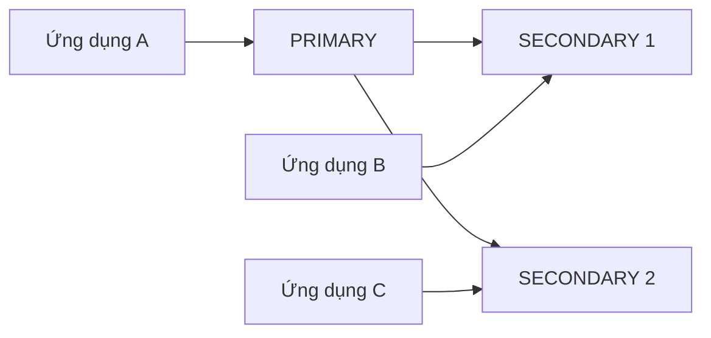
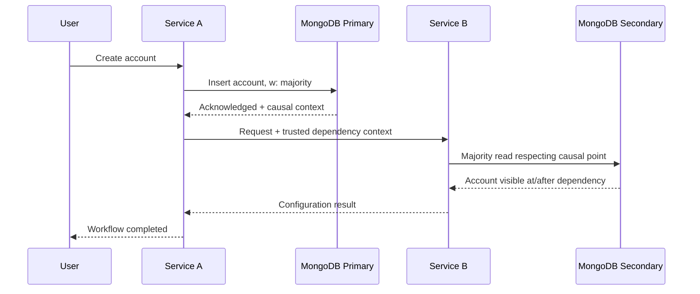

# Logical session, causal consistency và thứ tự thao tác có quan hệ nhân quả trong MongoDB

> **Module:** Database Engine Document MongoDB  
> **Chương:** Nhất quán đọc ghi

## 1. Bài toán: tại sao vừa ghi thành công mà đọc lại chưa thấy?

Giả sử một ứng dụng mạng xã hội dùng MongoDB replica set. Người dùng vừa đăng một ghi chú:

```javascript
db.notes.insertOne({
  _id: "N-100",
  authorId: "alice",
  content: "Ghi chú mới",
  createdAt: new Date()
});
```

Lệnh ghi được primary xử lý thành công. Ngay sau đó ứng dụng chuyển sang trang danh sách và **đọc từ secondary** để giảm tải primary.

Một secondary có thể chưa áp dụng thao tác mới nhất, vì replication có độ trễ. Kết quả: người dùng vừa thấy thông báo đăng bài thành công nhưng danh sách lại không có bài vừa đăng. Hiện tượng này không nhất thiết có nghĩa bản ghi đã mất; có thể ứng dụng đã đọc từ một bản sao đang đi sau.

Những tình huống tương tự xuất hiện trong nhiều nghiệp vụ:

- Tạo đơn hàng, rồi mở chi tiết đơn ngay sau khi tạo.
- Đổi thông tin hồ sơ, rồi tải lại thông tin từ một secondary.
- Ghi trạng thái thanh toán, rồi đọc trạng thái để quyết định bước tiếp theo.
- Đọc một cấu hình mới, sau đó ghi một bản ghi **phụ thuộc** vào cấu hình đã đọc.
- Một dịch vụ cập nhật trạng thái, dịch vụ khác phải quan sát thay đổi ấy trước khi tiếp tục.

MongoDB cung cấp **logical sessions** và **causal consistency** để thể hiện mối liên hệ giữa các thao tác có quan hệ nhân quả. Với read/write concern phù hợp và việc sử dụng session đúng cách, hệ thống có thể bảo đảm các thao tác trong cùng chuỗi nhân quả không bị quan sát như thể chúng xảy ra ngược thứ tự.

**Điểm cần phân biệt:** causal consistency không yêu cầu mọi client luôn nhìn thấy dữ liệu mới nhất tại cùng thời điểm. Nó chủ yếu duy trì các quan hệ **“A đã xảy ra trước B, nên B phải tôn trọng kết quả/thứ tự của A”**.

Sau bài học, bạn sẽ:

1. Hiểu logical session, session ID và mối liên hệ với driver.
2. Phân biệt `operationTime`, `clusterTime` và đồng hồ vật lý.
3. Giải thích bốn bảo đảm của causal consistency.
4. Biết vì sao `readConcern: "majority"` và `writeConcern: "majority"` là điều kiện quan trọng cho các bảo đảm đầy đủ.
5. Dùng explicit session với `mongosh` và MongoDB Java Sync Driver.
6. Nhận diện thao tác có quan hệ nhân quả và thao tác độc lập/concurrent.
7. Hiểu cách thứ tự được duy trì khi đọc từ secondary hoặc khi xảy ra failover.
8. Phân biệt session, causal consistency, transaction, snapshot isolation và linearizability.
9. Tránh chia sẻ session sai cách giữa các luồng và các dịch vụ.
10. Thiết kế kiểm thử, quan sát và xử lý lỗi phù hợp cho hệ thống phân tán.

## 2. Replica set, replication lag và góc nhìn khác nhau của client

Trong một replica set đơn giản:



Primary chấp nhận các ghi thông thường và secondary áp dụng thao tác thông qua replication. Một thay đổi có thể xuất hiện trên primary trước khi trở nên khả dụng trên các secondary.

Xem diễn biến minh họa:

| Thời điểm | Primary | Secondary 1 | Secondary 2 |
|---|---|---|---|
| T0 | Có profile phiên bản v1 | v1 | v1 |
| T1 | Ghi profile v2 | v1 | v1 |
| T2 | v2 | v2 | v1 |
| T3 | v2 | v2 | v2 |

Nếu ứng dụng đọc ở T2:

- Từ primary: có thể thấy v2.
- Từ secondary 1: có thể thấy v2.
- Từ secondary 2: có thể vẫn thấy v1.

Bảng này chỉ minh họa **độ trễ replication**; những gì client thực sự được phép thấy còn phụ thuộc read concern, write concern, read preference, trạng thái commit và cách dùng session.

### 2.1. Read preference khác read concern

**Read preference** cho driver biết nên đọc từ loại member nào:

- `primary`: ưu tiên/định tuyến đọc tới primary.
- `secondary`: chỉ chọn secondary đủ điều kiện.
- `secondaryPreferred`: ưu tiên secondary, có thể fallback primary.
- Các chế độ khác như `primaryPreferred` hoặc `nearest` có quy tắc lựa chọn riêng.

**Read concern** xác định mức độ nhất quán của dữ liệu đọc, chẳng hạn `local`, `majority`, `snapshot` hoặc `linearizable` trong các ngữ cảnh được hỗ trợ.

Hai cấu hình giải quyết hai câu hỏi khác nhau:

| Cấu hình | Câu hỏi |
|---|---|
| Read preference | Đọc từ **node nào**? |
| Read concern | Đọc dữ liệu theo **mức nhất quán nào**? |
| Write concern | Khi ghi, cần **mức xác nhận nào** mới được coi là thành công? |
| Causal session | Các thao tác có quan hệ với nhau phải giữ **thứ tự phụ thuộc nào**? |

Không thể bảo đảm read-your-writes từ secondary chỉ bằng cách đặt `readPreference: secondary`.

### 2.2. Majority committed không đồng nghĩa “mới nhất ở mọi node”

Một bản ghi được xác nhận bằng `writeConcern: "majority"` đã được chấp nhận theo quy tắc majority của replica set. Nhưng một secondary được chọn có thể vẫn ở trạng thái áp dụng chậm so với một thao tác majority-committed nào đó.

Đọc với `readConcern: "majority"` bảo đảm đọc dữ liệu đã đạt điều kiện majority commit tương ứng, **không tự gắn thời điểm đọc vào thao tác mà một client cụ thể vừa ghi**.

Đó là lý do causal session quan trọng: nó liên kết lần đọc tiếp theo với một mốc nhân quả đã quan sát hoặc đã tạo ra trước đó.

## 3. Logical session là gì?

Một **logical session** là ngữ cảnh được MongoDB driver và server dùng để liên kết các thao tác với cùng một chuỗi làm việc. Session không phải một TCP connection vật lý và cũng không phải một transaction theo mặc định.

Ví dụ một request:

```text
Người dùng tạo đơn
    │
    ├─ insert order
    ├─ đọc order vừa tạo
    └─ cập nhật trạng thái tiếp theo
         ↑
    Cùng logical session
```

Driver thường quản lý session và gắn thông tin session vào command gửi tới MongoDB Server.

### 3.1. Session ID (lsid)

Trong command gửi tới server, logical session thường được nhận diện bằng trường **`lsid`** (*logical session identifier*). Có thể nhìn thấy trường này trong command monitoring hoặc log tùy ngữ cảnh:

```javascript
{
  find: "orders",
  filter: { _id: "O-100" },
  lsid: {
    id: UUID("...")
  }
}
```

Đây chỉ là **hình dạng minh họa**, không phải yêu cầu ứng dụng tự tạo BSON command và gửi session ID thủ công. Driver sẽ quản lý session, token và metadata giao thức.

`lsid` giúp liên kết thao tác với session, nhưng **không phải chứng chỉ xác thực hoặc quyền truy cập dữ liệu**. MongoDB vẫn kiểm tra authentication/authorization theo user, role và command.

### 3.2. Session không giữ một connection cố định

Trong replica set, driver có thể định tuyến các thao tác trong cùng session tới những node khác nhau tùy loại thao tác và read preference.

Ví dụ:

- Ghi → primary.
- Đọc với `secondaryPreferred` → secondary.
- Sau failover → primary mới.

Để giữ quan hệ nhân quả, driver chuyển ngữ cảnh liên quan đến logical clock/session qua các command; **không cần dùng mãi một socket**.

Một session cũng không đồng nghĩa server giữ một bản sao riêng của tất cả document cho nó.

### 3.3. Explicit và implicit session

**Implicit session:** driver có thể tự quản lý session cho những operation đơn lẻ. Ứng dụng thường không trực tiếp điều khiển việc tái sử dụng cùng ngữ cảnh nhân quả qua nhiều operation.

**Explicit session:** ứng dụng tạo một `ClientSession` rõ ràng và truyền cùng session vào các thao tác liên quan.

Đối với một workflow cần chắc chắn `insert → read → update` có quan hệ nhân quả, explicit session là cách diễn đạt rõ ràng.

Trong Java:

```java
try (ClientSession session = mongoClient.startSession()) {
    collection.insertOne(session, document);
    Document readBack = collection.find(session, filter).first();
}
```

Hai thao tác đều được truyền đối tượng `session`. Nếu bỏ session ở lần đọc, chương trình có thể vô tình tạo ra một operation độc lập với causal context của lần ghi.

### 3.4. Vòng đời và timeout

Client nên đóng explicit session khi xong việc. Driver có thể tái sử dụng tài nguyên session theo cơ chế nội bộ.

Logical session có thời hạn theo cấu hình server và hoạt động của nó. Các tài liệu MongoDB thường nói tới thời hạn session mặc định theo phút (thường 30 phút khi không hoạt động trong cấu hình phổ biến), nhưng chi tiết phụ thuộc phiên bản/deployment và cách driver duy trì session.

Không giữ một `ClientSession` sống vô hạn cho mọi người dùng. Không lưu đối tượng session Java vào database để dùng lại sau khi process restart.

## 4. Causal consistency: “nếu B phụ thuộc A, B phải thấy A”

Trong một hệ thống phân tán, quan hệ **happens-before** mô tả những thao tác đã có mối liên hệ nhân quả.

Ví dụ:

1. Người dùng đăng một bài viết A.
2. Ứng dụng nhận xác nhận ghi A.
3. Người dùng mở màn hình chi tiết bài A.
4. Màn hình đọc dữ liệu cần thấy A đã được tạo.

Có quan hệ:

```text
Write(A)  ──────causes──────>  Read(A)
```

Nếu lần đọc được phục vụ bởi secondary lag mà không dùng cơ chế giữ causal ordering, người dùng có thể quan sát trạng thái đi ngược trải nghiệm của chính mình.

**Causal consistency** yêu cầu những thao tác liên quan được quan sát theo thứ tự tương thích với quan hệ nhân quả của chúng.

### 4.1. Một ví dụ dễ hiểu

Người dùng A thực hiện:

```text
(1) Cập nhật địa chỉ giao hàng mới
              │
              ▼
(2) Đọc lại địa chỉ để xác nhận
              │
              ▼
(3) Tạo đơn hàng dựa trên địa chỉ đã thấy
```

Trong luồng này:

- (2) phụ thuộc (1): cần **read-your-writes**.
- (3) phụ thuộc (2): cần **writes-follow-reads**.
- Nếu có các lần đọc sau, chúng không nên quay lại quan sát trạng thái cũ hơn trạng thái đã thấy theo chuỗi nhân quả.

### 4.2. Causal consistency không sắp xếp tất cả thao tác

Hai người dùng không trao đổi với nhau và cùng tạo hai bài viết độc lập:

```text
Client A: Write(A)  ─────>
Client B:       Write(B) ─────>
```

Nếu không có một quan hệ nguyên nhân giữa hai thao tác, causal consistency **không bắt buộc mọi client đồng ý về cùng một thứ tự toàn cục** của A và B.

Đây là khác biệt với linearizability hoặc một số mô hình serialization mạnh hơn. Causal consistency là một mô hình **thứ tự từng phần** (*partial order*) dựa trên quan hệ nhân quả.

## 5. Bốn bảo đảm của causal consistency

MongoDB mô tả các causal consistency guarantees thường dùng gồm:

1. **Read your writes.**
2. **Monotonic reads.**
3. **Monotonic writes.**
4. **Writes follow reads.**

Để có những bảo đảm đầy đủ theo tài liệu MongoDB, các thao tác trong causally consistent session cần dùng **majority read concern** và **majority write concern** theo yêu cầu áp dụng.

### 5.1. Read your writes — đọc thấy ghi của chính mình

```text
Session S:
    Write(profile = v2)
         ↓
    Read(profile)  → không quay lại v1
```

Ví dụ:

- Ghi cập nhật profile với `w: "majority"`.
- Đọc profile với `readConcern: "majority"`, cùng session.
- Driver đưa quan hệ nhân quả của lần ghi vào lần đọc; nếu secondary được chọn chưa tới mốc cần thiết, lần đọc không được trả trạng thái cũ hơn mốc nhân quả đó theo semantics được hỗ trợ.

**Cẩn trọng:** Điều này không bảo đảm document không thể bị một client khác thay đổi sau đó. Nếu người khác đã ghi profile v3 hợp lệ, lần đọc có thể thấy v3. Bảo đảm nhấn mạnh việc không quan sát một trạng thái *đi lùi* trước ghi mà session của bạn đã thực hiện.

### 5.2. Monotonic reads — các lần đọc không đi lùi

```text
Session S:
    Read(account v5)
         ↓
    Read(account)  → không quay về v3 hoặc v4
```

Ví dụ lần đầu đọc từ secondary đã bắt kịp, lần sau driver chọn secondary khác đang trễ. Causal session giữ một ngưỡng thời gian logic để không trả dữ liệu theo mốc cũ hơn quan hệ đã quan sát.

Không suy ra giá trị của một field **chỉ được tăng**: một ghi hợp lệ sau đó có thể giảm giá trị theo nghiệp vụ. “Monotonic reads” nói về thứ tự quan sát phiên bản/thao tác, không phải tính đơn điệu của các giá trị số.

### 5.3. Monotonic writes — ghi theo thứ tự session

```text
Session S:
    Write(status = "APPROVED")
         ↓
    Write(audit = "Approved by Alice")
```

Ghi sau có quan hệ với ghi trước trong cùng session, không được bị coi là xảy ra trước thao tác đã tạo nền tảng nhân quả cho nó.

Bảo đảm này **không biến nhiều ghi thành một transaction**. Nếu ghi thứ hai thất bại, ghi thứ nhất vẫn có thể đã commit.

### 5.4. Writes follow reads — ghi sau tôn trọng dữ liệu đã đọc

```text
Session S:
    Read(policyVersion = 7)
         ↓
    Write(decision based on version 7)
```

Ghi phía sau không được đặt vào một lịch sử nhân quả trước trạng thái đã được đọc.

Tuy nhiên, causal consistency **không tự chống mất cập nhật**. Nếu hai client cùng đọc policy v7 và cùng ghi dựa trên v7, cần thêm điều kiện cập nhật theo version, unique constraint hoặc transaction nếu nghiệp vụ yêu cầu.

### 5.5. Bảng tổng hợp

| Bảo đảm | Mối liên hệ | Ngăn quan sát gì? | Không tự bảo đảm gì? |
|---|---|---|---|
| Read your writes | Write → Read | Đọc lại trạng thái trước ghi đã xác nhận | Chống ghi đè bởi client khác |
| Monotonic reads | Read → Read | Đọc từ mốc nhân quả cũ hơn lần trước | Giá trị field chỉ tăng theo số |
| Monotonic writes | Write → Write | Ghi sau bị sắp trước ghi trước trong chuỗi | Atomic nhiều document |
| Writes follow reads | Read → Write | Ghi xảy ra trước trạng thái mà nó phụ thuộc | Tránh race giữa hai writer |

## 6. Điều kiện quan trọng: majority read concern và majority write concern

Đây là phần thường bị bỏ qua khi chỉ bật `causallyConsistent(true)`.

Một explicit session có thể được đánh dấu causal, nhưng **để dựa vào đầy đủ bốn bảo đảm causal consistency của MongoDB**, bạn cần thực hiện các đọc với `readConcern: "majority"` và các ghi với `writeConcern: "majority"`, theo các yêu cầu áp dụng cho những thao tác có quan hệ.

### 6.1. Write concern majority

Ví dụ lệnh ghi:

```javascript
db.notes.insertOne(
  { _id: "N-101", content: "Hello" },
  { writeConcern: { w: "majority", wtimeout: 10000 } }
);
```

`w: "majority"` yêu cầu xác nhận theo majority các thành viên data-bearing/voting tương ứng với cấu hình replica set. Chi tiết số node phải xác nhận có thể phụ thuộc topology và cấu hình (đặc biệt khi có arbiter).

Ý nghĩa chính: ghi đã được xác nhận ở mức majority theo cơ chế MongoDB, giảm nguy cơ rollback so với ghi chỉ được primary nhận rồi primary mất khả năng hoạt động.

`wtimeout` không có nghĩa “MongoDB sẽ hủy ghi nếu quá thời gian”: timeout khi đợi write concern có thể để lại trạng thái ghi **không chắc chắn với client**, dù thao tác đã được áp dụng. Với thao tác quan trọng, cần xử lý retry/idempotency thay vì gửi bù tùy tiện.

### 6.2. Read concern majority

Ví dụ qua command:

```javascript
db.runCommand({
  find: "notes",
  filter: { _id: "N-101" },
  readConcern: { level: "majority" }
});
```

Read concern majority giới hạn dữ liệu đọc theo trạng thái đã majority-committed mà node có thể phục vụ. Tuy nhiên nếu một secondary chưa bắt kịp lần ghi mới, đọc majority **độc lập** có thể vẫn thấy trạng thái cũ.

Causal session kết hợp đồng hồ logic và causal ordering giúp yêu cầu lần đọc sau đáp ứng mốc nhân quả đã biết.

### 6.3. Nếu chỉ dùng w:1 và readConcern local?

Trong nhiều thử nghiệm đơn giản, đọc có thể vẫn thấy ghi vừa thực hiện. Nhưng nếu ghi chỉ được primary xác nhận rồi bị rollback khi có failover, việc dựa vào bốn bảo đảm causal consistency đầy đủ sẽ không còn cơ sở như khi dùng majority read/write concerns.

Không viết tài liệu nghiệp vụ rằng “bật causal session là đủ để dữ liệu sẽ không bao giờ bị mất” khi ứng dụng vẫn đang dùng concern không phù hợp.

### 6.4. Causal consistency không thay thế quorum

Nếu majority của replica set không khả dụng, một ghi `w: "majority"` có thể phải chờ hoặc bị timeout. Causal consistency không tạo ra node mới hay phép màu để vượt qua lỗi mạng/quorum.

Các lựa chọn về availability, latency và consistency phải phù hợp với SLA nghiệp vụ. Cố đổi sang `w:1` chỉ để “có phản hồi nhanh” có thể làm mất bảo đảm mà workflow đang dựa vào.

## 7. operationTime, clusterTime và đồng hồ logic

MongoDB dùng metadata thời gian logic để diễn đạt tiến trình và quan hệ giữa các operation. Hai khái niệm liên quan là:

- **`operationTime`:** mốc thời gian logic gắn với một thao tác đã được quan sát/thực hiện.
- **`clusterTime`:** thông tin đồng hồ logic của cluster, được truyền giữa các command/nodes theo giao thức.

Trong driver, session có thể giữ hoặc được cập nhật các mốc này sau khi nhận phản hồi từ server.

### 7.1. Đây không phải giờ UTC trên đồng hồ máy chủ

Ví dụ hai timestamp:

```text
UTC wall clock: 2026-11-14T12:00:01Z
Logical operation time: Timestamp(1794657601, 7)
```

Ví dụ chỉ để phân biệt dạng dữ liệu; không dùng một giá trị tự tạo như vậy để thao tác production.

MongoDB BSON Timestamp có thành phần thời gian và phần tăng theo logic oplog/cluster; nó **không phải một đồng hồ wall-clock chính xác dùng để đo độ trễ millisecond**.

Không tính “thời gian chờ causal” bằng cách trừ hai `operationTime` như trừ hai Date. Để đo latency thực, dùng timer/metric ở ứng dụng và server.

### 7.2. Quan hệ giữa operationTime và afterClusterTime

Trong một causally consistent session, khi client đã quan sát thao tác tại mốc logic T, các lần đọc liên quan tiếp theo có thể gửi ràng buộc kiểu:

```javascript
readConcern: {
  level: "majority",
  afterClusterTime: Timestamp(/* T */)
}
```

Đây là **hình thức minh họa cơ chế**, không phải lệnh bạn phải tự dựng trong ứng dụng. Driver thường tự quản lý mốc causal và thêm ràng buộc thích hợp vào command.

Ý nghĩa: **đừng phục vụ lần đọc ở trạng thái có mốc cần thiết cũ hơn T**. Nếu secondary chưa bắt kịp, server có thể phải chờ cho tới khi điều kiện thỏa, hoặc trả lỗi/timeout nếu không thể hoàn thành trong giới hạn của operation.

### 7.3. clusterTime là ngữ cảnh chung của cluster

Driver có thể truyền `$clusterTime` trên các command để đồng bộ thông tin thời gian logic. Đây là metadata giao thức, không phải giá trị tùy ý để ứng dụng đặt thành “giờ hiện tại”.

Những đặc điểm cần nhớ:

- `clusterTime` không phải mã session và không đại diện duy nhất cho một transaction.
- `operationTime` và `clusterTime` liên quan nhưng không đồng nghĩa.
- Các thao tác có quan hệ nhân quả cần được truyền mốc phù hợp giữa các bước.
- Driver sử dụng metadata này; ứng dụng thường **không sửa trực tiếp** trên từng BSON command.
- Trong kiến trúc phân tán nhiều service, causal context không tự đi theo một HTTP request trừ khi bạn thiết kế truyền/chuyển ngữ cảnh có kiểm soát.

### 7.4. Một ví dụ trục thời gian

```text
Client Session S          PRIMARY              SECONDARY
       |                    |                     |
       |--- write A ------->|                     |
       |<-- ack majority ---|                     |
       |   operationTime=T1 |                     |
       |                    |------ replicate --->|
       |--- read A (secondary, causal context T1)--|
       |                    |                     |
       |                    |   nếu còn lag: chờ   |
       |<------------------- document A -----------|
       |                    |                     |
```

Đây là cách lý giải read-your-writes: client không nhận một kết quả từ secondary đi trước phần replication cần thiết của thao tác đã hoàn tất trong cùng causal chain.

## 8. Causal ordering là thứ tự từng phần, không phải mọi thứ cùng một hàng

Xét ba operation:

- A: user đổi địa chỉ.
- B: user tạo đơn dựa trên địa chỉ đó.
- C: user khác thay avatar của họ.

Có quan hệ:

```text
A ─────> B

C  (độc lập)
```

Causal consistency yêu cầu B phải tôn trọng A. Nhưng C không có quan hệ với A/B; hệ thống không bắt buộc tất cả client thống nhất C đứng trước hay sau A/B.

### 8.1. Các nguồn tạo ra quan hệ nhân quả

Một quan hệ có thể đến từ:

1. **Program order:** cùng một chương trình thực hiện A xong rồi B.
2. **Read-from:** B đọc một kết quả do A tạo ra.
3. **Message passing:** service X gửi event/response về A, service Y dùng kết quả đó để thực hiện B.
4. **Transitivity:** nếu A trước B và B trước C, thì A cũng trước C.

Nhưng số thứ tự thời gian của máy hoặc log application riêng lẻ không phải lúc nào chứng minh được quan hệ nhân quả giữa hai request độc lập.

### 8.2. Causal consistency không ngăn mọi bất thường concurrency

Giả sử hai client độc lập đọc số tồn kho 1:

```text
Client A: Read(stock=1)         Client B: Read(stock=1)
Client A: Write(stock=0)        Client B: Write(stock=0)
```

Causal session riêng của A và B không tự phát hiện hai khách đã mua cùng một đơn vị hàng.

Để tránh bán quá số lượng, cần **atomic conditional update**, ví dụ:

```javascript
db.products.updateOne(
  { _id: "P1", stock: { $gte: 1 } },
  { $inc: { stock: -1 } }
);
```

Sau đó kiểm tra `matchedCount`. Đây là một yêu cầu concurrency control khác với bảo đảm quan hệ nhân quả trong việc đọc/ghi của một session.

## 9. Chuẩn bị lab: replica set có secondary

Để nhìn thấy lợi ích của đọc causal từ secondary, nên thực hành trên **replica set có ít nhất một secondary** khỏe. Trên standalone hoặc môi trường chỉ có primary, các ví dụ vẫn minh họa API session nhưng không thể tái hiện đầy đủ tình huống đọc từ replica đang trễ.

Điều kiện lab:

- MongoDB Server hỗ trợ logical sessions và các read/write concerns nêu trên.
- Replica set hoạt động, primary/secondary khỏe.
- Người dùng có quyền đọc và ghi database lab.
- URI client có `replicaSet=...` khi truy cập replica set và hostname đúng topology.
- Không thay đổi read/write concern production chỉ để chạy ví dụ.

Kết nối bằng `mongosh`:

```bash
mongosh "mongodb://mongo-a.example.net:27017,mongo-b.example.net:27017,mongo-c.example.net:27017/?replicaSet=rsTraining"
```

Các hostname trong ví dụ là **placeholder cho lab**. Bạn phải thay bằng host thực tế của deployment được phép sử dụng.

### 9.1. Tạo dữ liệu trong database riêng

```javascript
const lab = db.getSiblingDB("causal_session_lab");

lab.getCollection("notes").createIndex({
  authorId: 1,
  createdAt: -1
});

printjson(lab.getCollectionInfos({ name: "notes" }));
```

Không cần dữ liệu lớn để hiểu causal consistency. Bài học tập trung vào **mối quan hệ giữa các operation**, không phải benchmark throughput.

## 10. Sử dụng explicit session trong mongosh

Trong `mongosh`, tạo session từ connection hiện tại:

```javascript
const session = db.getMongo().startSession({
  causalConsistency: true
});
```

Lấy database được ràng buộc với session:

```javascript
const sdb = session.getDatabase("causal_session_lab");
```

**Quan trọng:** Để các operation ở cùng causal chain, chúng phải thực sự chạy thông qua session-bound handle như `sdb`. Nếu sau đó vô tình gọi `db.getSiblingDB("causal_session_lab")` trên connection thông thường, bạn có thể thực hiện một operation không gắn vào explicit session vừa tạo.

### 10.1. Ví dụ write majority rồi read majority

Ví dụ trọn vẹn:

```javascript
const session = db.getMongo().startSession({
  causalConsistency: true
});

try {
  const sdb = session.getDatabase("causal_session_lab");
  const id = "N-" + Date.now();

  const writeResult = sdb.runCommand({
    insert: "notes",
    documents: [
      {
        _id: id,
        authorId: "alice",
        content: "Được tạo trong causal session",
        createdAt: new Date()
      }
    ],
    writeConcern: {
      w: "majority",
      wtimeout: 10000
    }
  });

  if (writeResult.ok !== 1) {
    throw new Error("Insert failed: " + tojson(writeResult));
  }

  const readResult = sdb.runCommand({
    find: "notes",
    filter: { _id: id },
    readConcern: { level: "majority" },
    batchSize: 5
  });

  if (readResult.ok !== 1) {
    throw new Error("Find failed: " + tojson(readResult));
  }

  printjson(readResult.cursor.firstBatch);
} finally {
  session.endSession();
}
```

Pipeline thao tác:

1. Tạo explicit causal session.
2. Ghi một document với majority write concern.
3. Chạy lệnh đọc với majority read concern bằng chính session-bound database.
4. Driver/mongosh quản lý causal context.
5. Kết thúc session trong `finally`.

**Giới hạn minh họa:** Read preference trong ví dụ chưa yêu cầu secondary, nên lần đọc thường theo default primary. Ví dụ cho thấy cách truyền session và concerns; để quan sát hiệu quả khi đọc một secondary trễ, dùng Java Sync Driver ở phần tiếp theo hoặc cấu hình read preference tương ứng cho phiên lab.

### 10.2. Không nhầm endSession với rollback

`session.endSession()` giải phóng ngữ cảnh client/session. Nó **không hoàn tác** những thao tác ghi đã commit.

Nếu bạn muốn nhiều ghi hoặc nhiều collection cùng commit/rollback như một đơn vị, đó là **transaction**, không phải hành vi của việc kết thúc session.

### 10.3. Không dùng kết quả lab nhanh để phủ nhận causal ordering

Trong replica set nhỏ và network nhanh, secondary có thể theo kịp gần như ngay lập tức; có thể bạn không thấy lần đọc nào thiếu dữ liệu ngay cả khi bỏ session.

Việc “thử 5 lần đều thấy dữ liệu mới” không chứng minh ứng dụng sẽ luôn có read-your-writes khi latency tăng, failover diễn ra hoặc driver chọn một secondary khác. Hãy dựa vào contract của driver/server và kiểm thử trong môi trường kiểm soát.

## 11. MongoDB Java Sync Driver: cấu hình causal session chuẩn

Trong Java, MongoDB Sync Driver có các API:

- `MongoClient.startSession(...)`: tạo explicit session.
- `ClientSessionOptions.builder().causallyConsistent(true).build()`: yêu cầu causal consistency.
- Các overload như `insertOne(session, document)` và `find(session, filter)`: gắn operation vào session.
- `ReadConcern.MAJORITY` và `WriteConcern.MAJORITY`: định nghĩa concern.
- `ReadPreference.secondary()`: thử đọc từ secondary để quan sát replication semantics.

### 11.1. Ví dụ Java đầy đủ: ghi primary, đọc secondary

Ví dụ dùng dependency `org.mongodb:mongodb-driver-sync`:

```java
import com.mongodb.ClientSessionOptions;
import com.mongodb.ReadConcern;
import com.mongodb.ReadPreference;
import com.mongodb.WriteConcern;
import com.mongodb.client.ClientSession;
import com.mongodb.client.MongoClient;
import com.mongodb.client.MongoClients;
import com.mongodb.client.MongoCollection;
import com.mongodb.client.MongoDatabase;
import org.bson.Document;

import java.time.Instant;

import static com.mongodb.client.model.Filters.eq;

public final class CausalSessionExample {

    public static void main(String[] args) {
        String uri = System.getenv("MONGODB_URI");
        if (uri == null || uri.isBlank()) {
            throw new IllegalArgumentException("Set MONGODB_URI for replica set");
        }

        try (MongoClient client = MongoClients.create(uri)) {
            MongoDatabase database =
                    client.getDatabase("causal_session_lab");

            MongoCollection<Document> writer = database
                    .getCollection("notes")
                    .withWriteConcern(WriteConcern.MAJORITY);

            MongoCollection<Document> secondaryReader = database
                    .getCollection("notes")
                    .withReadPreference(ReadPreference.secondary())
                    .withReadConcern(ReadConcern.MAJORITY);

            ClientSessionOptions options = ClientSessionOptions.builder()
                    .causallyConsistent(true)
                    .build();

            try (ClientSession session = client.startSession(options)) {
                String id = "java-" + Instant.now().toEpochMilli();

                Document newNote = new Document("_id", id)
                        .append("authorId", "alice")
                        .append("content", "Created in a causal session")
                        .append("createdAt", java.util.Date.from(Instant.now()));

                writer.insertOne(session, newNote);

                Document observed = secondaryReader
                        .find(session, eq("_id", id))
                        .first();

                if (observed == null) {
                    throw new IllegalStateException(
                            "Expected note not observed in causal chain"
                    );
                }

                System.out.println(observed.toJson());
            }
        }
    }
}
```

Ý nghĩa:

1. `writer` ghi với `WriteConcern.MAJORITY`.
2. `secondaryReader` yêu cầu một secondary và `ReadConcern.MAJORITY`.
3. Cả insert và find đều nhận **cùng `ClientSession`**.
4. Driver quản lý causal context từ write sang read.
5. Read từ secondary có thể phải chờ nếu node được chọn chưa đáp ứng mốc nhân quả.
6. `try-with-resources` đóng session và client khi hoàn tất.

**Điều kiện chạy:** Replica set phải có secondary phù hợp. Nếu không có secondary, read preference `secondary()` có thể khiến lệnh thất bại vì không chọn được server, không phải vì causal consistency bị vi phạm. Nếu muốn ứng dụng fallback sang primary, có thể xem xét `secondaryPreferred()`; nhưng test dùng `secondary()` để làm rõ ngữ cảnh.

### 11.2. Vì sao phải truyền session ở từng operation?

Hãy so sánh:

```java
writer.insertOne(session, newNote);

// Sai ý định cho workflow causal: không truyền session.
Document disconnected = secondaryReader
        .find(eq("_id", id))
        .first();
```

Lần đọc thứ hai không còn gắn với explicit session. Dù driver có tạo implicit session cho nó, implicit session đó không tự kế thừa causal context của thao tác trước theo cách bạn đang muốn diễn đạt.

Cách đúng:

```java
writer.insertOne(session, newNote);

Document connected = secondaryReader
        .find(session, eq("_id", id))
        .first();
```

### 11.3. Tách read concern và write concern ở đâu?

Có thể cấu hình concern ở:

- URI/connection settings theo khả năng driver.
- `MongoDatabase.withReadConcern(...)` / `withWriteConcern(...)`.
- `MongoCollection.withReadConcern(...)` / `withWriteConcern(...)`.
- Một số API operation có option riêng phù hợp.

Với Java, cấu hình trên collection cho ví dụ rất rõ: cùng tên collection nhưng hai handle khác nhau với concerns/read preference tương ứng.

**Không dựa vào default** khi nghiệp vụ yêu cầu bảo đảm majority rõ ràng. Deployment khác nhau có thể có defaults khác nhau hoặc được DBA thay đổi.

## 12. Session và sự an toàn khi dùng đa luồng

MongoDB Java Sync Driver `ClientSession` **không phải đối tượng để các thread thao tác đồng thời tùy ý**. Một session diễn đạt chuỗi operation có thứ tự; nếu hai thread dùng cùng session concurrently, ý nghĩa nhân quả và thao tác driver có thể trở nên không xác định hoặc vi phạm contract API.

### 12.1. Ví dụ anti-pattern

```java
ClientSession session = client.startSession();

// Không dùng như mẫu chuẩn:
threadPool.submit(() -> collection.insertOne(session, docA));
threadPool.submit(() -> collection.insertOne(session, docB));
```

Hai operation không có một thứ tự tuần tự rõ ràng do application quy định, trong khi session cần được sử dụng đúng semantics của driver.

### 12.2. Cách làm an toàn hơn

- Nếu hai operation có quan hệ nhân quả: **chạy tuần tự** với cùng session.
- Nếu hai operation độc lập: dùng **hai session riêng** hoặc để driver quản lý implicit sessions.
- Nếu operation cần hợp nhất kết quả rồi phụ thuộc vào cả hai: chờ cả hai hoàn tất, sau đó thiết kế cơ chế truyền causal context thích hợp.
- Không dùng một singleton `ClientSession` cho toàn bộ ứng dụng web.
- Không đưa cùng session vào nhiều request HTTP đồng thời mà không có cơ chế tuần tự hóa và scope rõ ràng.

### 12.3. Session scope nên gắn với workflow

Một lựa chọn thực tế:

```text
HTTP request "Create and verify order"
  └── ClientSession S
      ├── insert order (majority)
      ├── read order (majority)
      └── close S
```

Nhưng nếu workflow trải qua nhiều request hoặc nhiều service, cần thiết kế cách chuyển tiếp causal context; không thể giả định session Java object vẫn sống và phù hợp qua mọi request.

## 13. operationTime và clusterTime trong Java

Java driver cho phép đọc và nâng mốc logical time trong session bằng API tương ứng. Những method thường gặp gồm:

- `session.getOperationTime()`.
- `session.getClusterTime()`.
- `session.advanceOperationTime(...)`.
- `session.advanceClusterTime(...)`.

Ví dụ quan sát sau một thao tác:

```java
import org.bson.BsonDocument;
import org.bson.BsonTimestamp;

BsonTimestamp operationTime = session.getOperationTime();
BsonDocument clusterTime = session.getClusterTime();

System.out.println("Operation time: " + operationTime);
System.out.println("Cluster time: " + clusterTime);
```

Một hoặc cả hai giá trị có thể là null khi session chưa nhận đủ thông tin từ command hoặc trong ngữ cảnh driver/server tương ứng. Không tự chế timestamp để làm cho một read “mới hơn”.

### 13.1. Đưa causal context vào một session khác

Khi có yêu cầu truyền quan hệ nhân quả từ một workflow sang workflow khác, cơ chế ở mức API có thể gồm:

```java
// Producer đã hoàn tất một operation có liên quan.
BsonTimestamp knownOperationTime = producerSession.getOperationTime();
BsonDocument knownClusterTime = producerSession.getClusterTime();

// Consumer tạo session riêng và nhận ngữ cảnh đã được xác thực.
try (ClientSession consumerSession = client.startSession(
        ClientSessionOptions.builder().causallyConsistent(true).build()
)) {
    if (knownClusterTime != null) {
        consumerSession.advanceClusterTime(knownClusterTime);
    }

    if (knownOperationTime != null) {
        consumerSession.advanceOperationTime(knownOperationTime);
    }

    // Sau đó chạy các thao tác majority read/write có quan hệ
    // bằng consumerSession, không chạy song song trên session này.
}
```

Đây là minh họa **API causal context** giữa hai session trong cùng chương trình. Khi truyền qua ranh giới service/process, còn phải giải quyết BSON serialization, xác thực nguồn, phiên bản driver/server, nguy cơ giả mạo metadata và quyền truy cập; không gửi raw session ID hoặc blob logical clock tùy tiện từ client công khai vào MongoDB.

### 13.2. Vì sao không chỉ truyền wall-clock timestamp?

Một message như:

```json
{
  "createdAt": "2026-11-14T10:00:00Z"
}
```

không tự đủ để MongoDB hiểu quan hệ causal của một thao tác đã majority-committed. Đồng hồ máy có sai số, clock skew và độ phân giải khác với BSON logical timestamps.

Nếu cần tạo mối liên hệ giữa service X và Y, hãy dùng một giao thức dựa trên causal metadata/transaction/event được thiết kế đúng, không thay bằng so sánh ngày giờ HTTP.

## 14. Causal consistency xuyên qua nhiều dịch vụ

Giả sử:

- Service A tạo một tài khoản.
- Service A gọi service B để khởi tạo cấu hình dựa trên tài khoản vừa tạo.
- Service B đọc MongoDB từ secondary.
- B phải thấy tài khoản đã được tạo trước khi cấu hình nó.



Để bảo đảm hợp lý, service A và B phải có một cách chuyển tiếp **dependency context** và sử dụng nó khi B đọc. Hai service dùng hai session độc lập mà không chuyển bất kỳ thông tin nào thì không tự động cùng một causal chain chỉ vì chúng đều dùng MongoDB.

### 14.1. Các chiến lược thiết kế

| Tình huống | Lựa chọn |
|---|---|
| Cùng request trong một process | Một explicit session và gọi các operation tuần tự |
| Các request độc lập, không có quan hệ | Session riêng, không cần ép thứ tự |
| Request sau phụ thuộc request trước | Truyền context đã xác thực hoặc buộc đọc theo cơ chế đủ mạnh |
| Event bất đồng bộ từ service A sang B | Mang event ID, dependency/version và cơ chế xử lý thứ tự/dedup |
| Nghiệp vụ cần nhất quán tức thời cho quyết định nhạy cảm | Xem xét transaction, primary/linearizable read hoặc thiết kế khác phù hợp |
| Có thể chấp nhận eventual consistency | Không nhất thiết phải duy trì causal chain xuyên mọi service |

### 14.2. Causal context không phải thay thế phân quyền

Nếu service B được yêu cầu đọc dữ liệu của tenant khác, việc nhận một operationTime cao từ A **không cấp quyền** cho B truy cập dữ liệu đó. Phải kiểm tra tenant, user và role độc lập.

Không đặt raw `lsid`, credential hoặc metadata đồng hồ MongoDB vào URL public nếu không có lý do rõ ràng và biện pháp bảo vệ phù hợp.

### 14.3. Idempotency và thứ tự nghiệp vụ

Causal consistency nói về thứ tự quan sát operations. Nó **không bảo đảm mỗi message chỉ được xử lý đúng một lần**.

Nếu service A gửi event "Create invoice" hai lần vì retry, service B vẫn có thể tạo hai hóa đơn trừ khi có:

- ID nghiệp vụ duy nhất.
- Unique index/ràng buộc.
- Kiểm tra event đã xử lý.
- Transaction hoặc atomic conditional write phù hợp.
- Chiến lược retry idempotent.

Causal session và idempotency là hai yêu cầu bổ sung cho nhau.

## 15. Quan hệ giữa causal consistency và transactions

Đây là hai khái niệm khác phạm vi.

### 15.1. Một session không phải một transaction

```javascript
// Cùng session, nhưng KHÔNG tự tạo atomicity nhiều operation.
sessionDb.orders.insertOne(orderA);
sessionDb.audit.insertOne(auditA);
```

Nếu insert audit thất bại sau khi insert order thành công, document order có thể vẫn đã được ghi. Causal consistency không rollback cả hai thao tác.

### 15.2. Transaction dùng session nhưng bổ sung atomic commit/abort

Trong Java:

```java
try (ClientSession session = client.startSession()) {
    session.startTransaction();

    try {
        orders.insertOne(session, orderDocument);
        audit.insertOne(session, auditDocument);

        session.commitTransaction();
    } catch (RuntimeException error) {
        session.abortTransaction();
        throw error;
    }
}
```

Đoạn này minh họa cấu trúc transaction. Trong production cần xử lý retry theo loại lỗi, commit có kết quả không chắc chắn, transaction options (read/write concern), timeout và các giới hạn MongoDB.

**Khác biệt cốt lõi:**

- Causal consistency: bảo đảm **quan hệ thứ tự và quan sát** của một chuỗi thao tác khi dùng concerns phù hợp.
- Transaction: cho phép một nhóm thao tác được **commit/abort như một đơn vị**, theo các giới hạn và isolation semantics được hỗ trợ.

Bạn có thể cần cả hai hoặc chỉ một trong hai tùy workflow.

### 15.3. Snapshot isolation khác causal ordering

Read concern `snapshot` trong các ngữ cảnh được hỗ trợ tạo cái nhìn nhất quán theo một thời điểm snapshot. Causal consistency giữ mối quan hệ *sau khi đã quan sát A, B không được đi trước A*.

Một snapshot có thể là một thời điểm nhất quán nhưng **không mới nhất**. Một causal read có thể đòi hỏi mốc tối thiểu nhưng **không phải một snapshot toàn cục của mọi collection được giữ xuyên nhiều operation**.

Không sử dụng hai từ “snapshot” và “causal” thay thế cho nhau.

## 16. Causal consistency so với linearizability và strong consistency

Nhiều người thấy session có causal consistency và gọi đó là “strongly consistent”. Cách nói này quá rộng và dễ dẫn tới thiết kế sai.

| Mô hình/tính chất | Trọng tâm | Điều không nên suy ra |
|---|---|---|
| Eventual consistency | Các bản sao có thể hội tụ khi không còn thay đổi và hệ thống khỏe | Người dùng luôn thấy ghi của mình ngay |
| Causal consistency | Bảo toàn thứ tự của các thao tác có quan hệ nhân quả | Tất cả client thấy một thứ tự toàn cục |
| Read concern majority | Đọc dữ liệu majority-committed theo semantics được hỗ trợ | Read luôn là bản mới nhất tại thời điểm hiện tại |
| Snapshot isolation | Nhóm đọc/transaction theo một snapshot nhất quán | Tránh mọi kiểu write skew/business race |
| Linearizable read | Với điều kiện hỗ trợ, đọc theo thứ tự thời gian thực mạnh hơn trên dữ liệu phù hợp | Mọi truy vấn đa document tự trở thành transaction |
| Transaction | Atomic commit/abort của các thao tác trong phạm vi transaction | Tự giải quyết mọi race nghiệp vụ không có kiểm soát |

MongoDB có read concern `linearizable` cho những tình huống được hỗ trợ và có các điều kiện về read preference/majority write concern; nó là khái niệm riêng với causal consistency. Chọn mức nhất quán dựa trên yêu cầu nghiệp vụ và overhead/availability, không theo tên nghe “mạnh” hơn.

### 16.1. Vì sao không chọn mức mạnh nhất cho tất cả?

Mức nhất quán mạnh hơn có thể gây:

- Thời gian chờ replication/commit dài hơn.
- Lỗi/timeout khi thiếu majority hoặc node không khả dụng.
- Hạn chế về topology và loại operation.
- Chi phí tài nguyên khác nhau.

Ngược lại, chọn mức quá yếu có thể khiến workflow sai. Mục tiêu là **đúng yêu cầu nghiệp vụ với chi phí chấp nhận được**, không phải tối đa mọi cấu hình.

## 17. Causal consistency khi failover

Replica set có thể bầu primary mới khi primary hiện tại không còn khả dụng.

Ví dụ:

```text
T0: A = PRIMARY, B/C = SECONDARY
T1: Client ghi X với w: majority, được xác nhận
T2: A bị mất kết nối
T3: B được bầu PRIMARY
T4: Client đọc X bằng cùng causal session, r: majority
```

Khi ghi X đã được xác nhận majority và causal context được giữ đúng, lần đọc tiếp theo cần tôn trọng quan hệ với ghi X. Driver có thể khám phá topology mới và gửi thao tác tới member phù hợp.

Nhưng cần phân biệt:

- **Ghi majority-acknowledged:** có cơ sở bảo đảm mạnh hơn trước failover.
- **Ghi w:1 mới chỉ được primary cũ xác nhận:** có nguy cơ rollback, không thể dựa vào đó để hứa read-your-writes lâu dài sau election.
- **Operation đang chạy khi network fail:** client có thể không biết ghi đã commit hay chưa. Cần kiểm tra idempotency và cơ chế retry.
- **Không đủ majority:** thao tác mới có thể phải chờ hoặc thất bại; causal consistency không tự khôi phục cluster.

### 17.1. Retryable writes và causal consistency bổ sung nhau

Driver có thể hỗ trợ **retryable writes** trên cấu hình tương ứng. Retryable writes xử lý một số lỗi mạng/primary chuyển đổi cho write operation được hỗ trợ, có liên hệ với logical sessions.

Causal consistency giải quyết **quan hệ thứ tự thao tác**, không phải cùng một mục tiêu với retryable writes. Không nhầm “bật retryWrites=true” thành “mọi lần đọc đều có causal ordering”.

### 17.2. Thời gian chờ khi secondary chưa bắt kịp

Nếu một read yêu cầu mốc causal mới hơn mốc secondary có thể phục vụ, nó có thể:

- Chờ để secondary bắt kịp.
- Thực thi thành công sau khi điều kiện được thỏa.
- Timeout hoặc trả lỗi nếu không đạt điều kiện trong giới hạn.
- Gặp lỗi server selection nếu không có secondary phù hợp.

Đây là một **đánh đổi latency để giữ correctness**. Ứng dụng phải có timeout, retry và thông báo lỗi có chủ đích, không âm thầm bỏ causal requirements chỉ để giảm thời gian chờ.

## 18. Một session vẫn cần quản lý ranh giới workflow

Giả sử một HTTP endpoint mở session để insert order, trả response rồi kết thúc session. Vài giây sau, client gửi HTTP request mới tới instance ứng dụng khác để đọc order.

Về phía ứng dụng:

```text
Request 1 → Pod A → Session S1 → insert order
Request 2 → Pod B → Session S2 → read order
```

S1 và S2 là hai session khác nhau. S2 **không tự biết** operationTime của S1.

Các lựa chọn:

1. Đối với thao tác “đọc ngay sau ghi” quan trọng, có thể chuyển workflow vào cùng server-side request/session.
2. Có thể đọc primary với concern phù hợp nếu semantics nghiệp vụ cho phép.
3. Có thể thiết kế truyền causal context giữa request/service qua cơ chế an toàn và được hỗ trợ.
4. Có thể trả kết quả tạo thành công ngay trong response để client không cần truy vấn đọc lại.
5. Có thể chấp nhận eventual consistency và hiển thị trạng thái “đang đồng bộ” nếu sản phẩm cho phép.

Không phải mọi endpoint đều cần một explicit session dài hạn. Cần thiết kế theo **mối quan hệ giữa các thao tác**, không theo số lượng HTTP request một cách máy móc.

## 19. Causal consistency và pagination, aggregation, change streams

Logical session có thể liên quan tới nhiều loại operation đọc/ghi, nhưng mỗi API có quy tắc riêng.

### 19.1. Pagination với nhiều request

Người dùng xem trang 1 rồi trang 2 của danh sách. Causal session có thể giúp tránh đọc ngược trước những thao tác người dùng đã quan sát theo quan hệ nhân quả.

Nhưng causal consistency **không cố định toàn bộ tập dữ liệu** giữa hai trang:

- Có document mới được insert.
- Có document cũ bị delete.
- Giá trị sort có thể thay đổi.
- Offset pagination có thể gặp trùng hoặc thiếu khi dữ liệu biến động.

Nếu cần một snapshot ổn định xuyên nhiều trang, phải thiết kế riêng bằng snapshot semantics, version, keyset pagination và các giới hạn tương ứng; không coi causal session là snapshot cursor toàn dataset.

### 19.2. Aggregation

Khi chạy aggregation bằng Java driver, có overload nhận session:

```java
try (ClientSession session = client.startSession(
        ClientSessionOptions.builder().causallyConsistent(true).build()
)) {
    List<Document> results = collection
            .withReadConcern(ReadConcern.MAJORITY)
            .aggregate(session, pipeline)
            .into(new ArrayList<>());
}
```

Pipeline có thể gồm `$match`, `$project`, `$group`; read concern và session sẽ được áp dụng theo khả năng hỗ trợ của operation/deployment.

**Không suy ra** tất cả aggregation có stage ghi `$merge`/`$out` đều có cùng các quy tắc session/read concern như một aggregation chỉ đọc. Cần xem giới hạn từng command, version và topology trước khi dựa vào guarantees.

### 19.3. Change streams

Change streams dùng logical sessions trong cơ chế driver và dựa trên những metadata liên quan tới lịch sử thay đổi. Nhưng:

- Resume token của change stream **không phải** session ID.
- Resume sau crash là bài toán checkpoint/history retention.
- Causal consistency không đảm bảo subscriber xử lý mỗi event đúng một lần.
- Consumer cần idempotency, xử lý resume token và thứ tự ứng dụng đúng nghiệp vụ.

Đừng dùng riêng causal session để thay một kiến trúc event processing có xử lý retry/dedup.

## 20. Thực hành thứ tự “đọc rồi ghi” (writes-follow-reads)

Giả sử collection `policies` có một document:

```javascript
{
  _id: "checkout-policy",
  version: 7,
  maxDiscountPercent: 15
}
```

Một workflow:

1. Đọc policy v7 theo majority trong session S.
2. Tính kết quả duyệt giảm giá dựa trên policy đã đọc.
3. Ghi decision cũng trong session S với majority write concern.

Ví dụ Java:

```java
try (ClientSession session = client.startSession(
        ClientSessionOptions.builder().causallyConsistent(true).build()
)) {
    MongoCollection<Document> policies = database
            .getCollection("policies")
            .withReadConcern(ReadConcern.MAJORITY);

    MongoCollection<Document> decisions = database
            .getCollection("decisions")
            .withWriteConcern(WriteConcern.MAJORITY);

    Document policy = policies
            .find(session, eq("_id", "checkout-policy"))
            .first();

    if (policy == null) {
        throw new IllegalStateException("Policy not found");
    }

    Integer version = policy.getInteger("version");

    decisions.insertOne(session,
            new Document("_id", "decision-100")
                    .append("policyVersion", version)
                    .append("status", "APPROVED"));
}
```

Đây là ví dụ về việc **ghi sau có quan hệ nhân quả với dữ liệu vừa đọc**.

### 20.1. Bẫy nghiệp vụ: policy có thể thay đổi sau khi đọc

Client khác có thể đổi policy sang v8 giữa hai operation. Causal consistency không bắt buộc quyết định phải dựa trên **policy mới nhất tại thời điểm ghi**.

Nếu nghiệp vụ yêu cầu “chỉ chấp thuận khi policy vẫn là v7”, cần kiểm tra version trong update điều kiện hoặc đưa đọc/ghi vào transaction phù hợp.

Một mẫu optimistic concurrency:

```javascript
db.policies.updateOne(
  { _id: "checkout-policy", version: 7 },
  {
    $set: { lastDecision: "APPROVED" },
    $inc: { version: 1 }
  }
);
```

Kiểm tra `matchedCount` để biết precondition còn đúng. Đây là cơ chế bổ sung; dùng causal session đơn lẻ không thay cho kiểm soát version.

## 21. Một demo đối chiếu có và không có session

Giả sử ứng dụng thực hiện:

**Luồng A — không chuyển causal context:**

```text
1. Insert (w:majority) tại primary.
2. Request độc lập mới đọc (r:majority) từ secondary.
3. Secondary có thể chưa tới mốc ghi.
4. Có thể thấy dữ liệu cũ hoặc chưa thấy document.
```

**Luồng B — cùng explicit causal session:**

```text
1. Insert (w:majority) tại primary, session S.
2. Read (r:majority) từ secondary, session S.
3. Server/driver giữ mốc causal của insert.
4. Read không trả trạng thái cũ hơn mốc phụ thuộc;
   có thể chờ cho đến khi secondary bắt kịp hoặc lỗi/timeout.
```

Sự khác nhau không nhất thiết dễ thấy bằng một test ngắn vì secondary thường rất nhanh. Một test đúng nên quan sát:

- Command thực sự gắn `lsid` hay không.
- Concern đúng trên từng operation.
- Read preference đúng.
- Có mốc afterClusterTime/causal metadata phù hợp trong command được hỗ trợ.
- Thời gian đọc khi secondary lag.
- Kết quả khi majority không khả dụng.

Không cố tạo network partition trên production để chứng minh một tính chất đã được driver/server quy định.

## 22. Theo dõi và debug logical session

Khi điều tra lỗi causal workflow, cần xem **chuỗi các operation**, không chỉ một query chậm riêng lẻ.

### 22.1. Thông tin nên thu thập

| Thông tin | Mục tiêu |
|---|---|
| Workflow/request correlation ID | Ghép log của cùng nghiệp vụ |
| Session được truyền vào operation hay không | Phát hiện mất ngữ cảnh |
| Read/write concern thực tế | Xác nhận majority requirements |
| Read preference và server được chọn | Biết read từ primary/secondary nào |
| Operation type và thứ tự | Phân biệt Write → Read hoặc Read → Write |
| Result/exception của write | Ghi đã được xác nhận hay chưa |
| Command latency | Phát hiện read phải chờ replica catch up |
| Replication lag, election, majority health | Tìm nguyên nhân chờ/timeout |
| OperationTime/clusterTime khi cần và an toàn | Xác minh mốc logic đang tiến triển |
| Server version, driver version | Giải thích API/semantics khác nhau |

### 22.2. Command monitoring của Java Driver

MongoDB Java Driver hỗ trợ **command monitoring** để quan sát các command gửi tới server. Trong môi trường được phép, có thể dùng listener để ghi thông tin như tên command, server address và latency.

Tuy nhiên:

- Command raw có thể chứa query filter, dữ liệu nhạy cảm, session metadata và authentication-related information.
- Không bật logging toàn bộ BSON command ở production mà không có chính sách bảo vệ.
- Driver có thể redaction/suppress thông tin tùy loại command.
- Đừng dựa vào hình dạng `lsid` hiển thị để làm session token nghiệp vụ.
- Cần liên kết với request ID của ứng dụng để phân tích chính xác.

### 22.3. Một checklist gỡ lỗi

Nếu người dùng nói “tôi đã tạo đơn thành công nhưng đọc lại từ secondary chưa thấy”:

1. Write có thực sự thành công không hay đã timeout chờ `w: "majority"`?
2. Read đang chọn server nào?
3. Read concern có đặt `majority` không?
4. Read và write có dùng **cùng explicit session** hay causal context đã được truyền đúng không?
5. Lần read có tạo implicit session mới tách khỏi lần write không?
6. Có hai request/pod/service khác nhau không?
7. Secondary có replication lag hoặc lỗi?
8. Có election/failover giữa hai bước không?
9. Có client khác sửa/xóa document sau write không?
10. Có lỗi filter, tenantId, read preference hoặc query projection không?
11. Có transaction đang mở mà dữ liệu chưa commit không?
12. Có timeout/retry che giấu kết quả operation ban đầu không?

Đừng quy mọi lỗi “không tìm thấy document” thành lỗi causal consistency khi query filter hoặc authorization cũng có thể làm kết quả trống.

## 23. Những giới hạn quan trọng của causal sessions

| Giới hạn | Cách hiểu đúng |
|---|---|
| Không phải transaction | Nhiều operation không tự commit/rollback như một đơn vị |
| Không có global total order | Chỉ tôn trọng các quan hệ nhân quả, không áp thứ tự cho mọi client độc lập |
| Không tự truyền giữa HTTP requests | Phải giữ hoặc truyền dependency context phù hợp |
| Không tự chống lost update | Cần conditional update, version, unique constraint hoặc transaction |
| Không tự bảo đảm exactly-once | Cần dedup, retry idempotent và cơ chế event processing |
| Không thay đổi topology replication | Secondary vẫn có thể lag; read causal có thể chờ |
| Không bảo đảm availability khi majority mất | Ghi/đọc có thể timeout hoặc lỗi |
| Không biến majority read thành latest read | Majority read độc lập vẫn có thể chậm hơn trạng thái mới nhất |
| Không dùng session đồng thời vô kiểm soát | Driver ClientSession cần sử dụng theo contract, thường tuần tự |
| Không thay thế read concern snapshot | Session không tự khóa một snapshot qua mọi operation |
| Không thay thế ứng dụng authorization | Causal metadata không cấp quyền truy cập |
| Không tự quyết định consistency nghiệp vụ | Các invariants phải được mô hình hóa, kiểm soát và kiểm thử riêng |

## 24. Câu hỏi thực hành: xác định thao tác nào có quan hệ nhân quả

Xem những chuỗi sau.

### Tình huống A — Đăng bài rồi đọc lại

```text
Client A:
    Write(post P)
    Read(post P)
```

Có quan hệ `Write → Read`. Bảo đảm chủ yếu: **read-your-writes**.

### Tình huống B — Đọc profile từ hai secondary

```text
Client A:
    Read(profile v5) từ secondary 1
    Read(profile) từ secondary 2
```

Có quan hệ `Read → Read`. Bảo đảm chủ yếu: **monotonic reads**. Session không yêu cầu hai secondary trả cùng đúng v5 nếu có ghi hợp lệ mới hơn, mà yêu cầu không đi lùi về trạng thái trước mốc đã quan sát.

### Tình huống C — Ghi hai bước audit

```text
Client A:
    Write(order status = PAID)
    Write(audit event = payment-approved)
```

Có quan hệ `Write → Write`. Bảo đảm chủ yếu: **monotonic writes**. Nếu cần hai ghi atomic, phải dùng transaction hoặc data model khác.

### Tình huống D — Đọc quy tắc rồi ghi quyết định

```text
Client A:
    Read(rule version = 9)
    Write(decision based on version 9)
```

Có quan hệ `Read → Write`. Bảo đảm chủ yếu: **writes-follow-reads**. Nếu rule có thể thay đổi và quyết định chỉ hợp lệ khi rule vẫn là version 9, cần optimistic concurrency/transaction.

### Tình huống E — Hai khách tạo hai bài độc lập

```text
Client A: Write(P)
Client B: Write(Q)
```

Nếu không có trao đổi giữa A/B và hai operation không phụ thuộc nhau, causal consistency không xác lập một thứ tự tuyệt đối P trước Q hay Q trước P chỉ dựa vào chính khái niệm causal.

## 25. Bài thực hành tổng hợp

Những bài sau dành cho replica set lab; không thay đổi cấu hình mạng hoặc ngắt secondary production chỉ để tạo replication lag.

### Bài 1 — Tạo explicit session

Trong `mongosh`:

1. Tạo session có `causalConsistency: true`.
2. Gắn session vào database `causal_session_lab`.
3. Insert document với `writeConcern: "majority"`.
4. Đọc document với `readConcern: "majority"` bằng cùng session.
5. Kết thúc session trong `finally`.

**Câu hỏi:** Điều gì có thể khác nếu lần read không dùng session-bound database?

### Bài 2 — Java Sync Driver đọc secondary

Dùng ví dụ Java ở mục 11:

1. Kết nối tới replica set có secondary.
2. Tạo collection writer với `WriteConcern.MAJORITY`.
3. Tạo reader với `ReadPreference.secondary()` và `ReadConcern.MAJORITY`.
4. Dùng cùng `ClientSession` trong insert/find.
5. Quan sát kết quả khi replica khỏe.

**Câu hỏi:** Tại sao một lỗi `MongoTimeoutException` vì không tìm thấy secondary không có nghĩa dữ liệu đã bị mất?

### Bài 3 — Nhận diện bốn bảo đảm

Điền vào bảng:

| Chuỗi thao tác | Bảo đảm thích hợp |
|---|---|
| Insert X → đọc X | Read your writes |
| Read v4 → read lại | Monotonic reads |
| Write A → write B cùng session | Monotonic writes |
| Read rule → write decision | Writes follow reads |

Với mỗi dòng, giải thích một bất thường mà session giúp tránh và một bất thường mà session **không tự giải quyết**.

### Bài 4 — Majority concern

Giả sử hệ thống dùng `w:1` cho lần ghi và `readConcern: "local"` cho lần đọc:

- Khi primary fail trước khi write được replicate tới majority, chuyện gì có thể xảy ra?
- Vì sao chỉ bật `causallyConsistent(true)` chưa đủ để dựa vào bốn bảo đảm đầy đủ?
- Nếu majority không khả dụng, điều gì có thể xảy ra với một write `w: "majority"`?
- Tại sao tăng timeout không khôi phục được một replica set đang mất quorum?

### Bài 5 — Hai service khác nhau

Service A ghi một account, service B đọc từ secondary để tạo profile.

Hãy thiết kế:

- Causal relationship nào cần được giữ?
- Có thể dùng một session trong cùng process không?
- Nếu khác process, dependency context được chuyển bằng cách nào cho an toàn?
- Service B phải dùng concerns nào?
- Nếu event bị gửi trùng, cơ chế nào ngăn tạo profile hai lần?

### Bài 6 — Session và optimistic concurrency

Hai user cùng đọc `stock = 1` trong hai session độc lập. Cả hai muốn mua một sản phẩm.

- Causal consistency có ngăn bán hai lần không?
- Vì sao `updateOne({ stock: { $gte: 1 } }, { $inc: { stock: -1 } })` có thể là giải pháp phù hợp?
- Khi nào cần transaction đa collection?
- Tại sao phải kiểm tra `matchedCount`?

### Bài 7 — Phân biệt causal và snapshot

Một API đọc danh sách qua nhiều trang:

- Trang 1 đọc lúc 10:00.
- Có document mới được thêm lúc 10:01.
- Trang 2 đọc lúc 10:02.

Causal session có bảo đảm hai trang thuộc cùng một snapshot không? Nếu không, bạn sẽ dùng thiết kế nào để giữ ổn định pagination/snapshot theo yêu cầu sản phẩm?

### Bài 8 — Gỡ lỗi phiên production

Bạn nhận report: “Sau khi cập nhật profile, API trả profile cũ trong khoảng 2 giây”.

Viết runbook kiểm tra:

1. Write concern của update.
2. Read concern của API đọc.
3. Read preference.
4. Có dùng cùng session/context không.
5. Replica lag và topology.
6. Trace/correlation ID qua nhiều service.
7. Timeout, retry, và các thao tác ghi khác.
8. Kết luận nguyên nhân và đề xuất thay đổi phù hợp SLO.

Không mặc định lỗi nằm ở MongoDB; cache ngoài database, CDN hoặc ứng dụng cũng có thể trả dữ liệu cũ.

## 26. Quy trình thiết kế một workflow causal an toàn

Một quy trình ngắn để áp dụng:

### Bước 1 — Vẽ quan hệ phụ thuộc

Ví dụ:

```text
A: create account
    ↓
B: read account
    ↓
C: create profile with accountId
```

Xác định B thật sự phụ thuộc A, và C phụ thuộc kết quả B.

### Bước 2 — Định nghĩa consistency contract

Cần trả lời:

- Người dùng có phải luôn thấy ghi của chính mình?
- Có cần đọc một snapshot cố định không?
- Có cần atomic commit nhiều collection không?
- Có thể chờ secondary bắt kịp trong bao lâu?
- Khi majority mất, hệ thống nên lỗi hay cho phép degraded semantics?
- Ghi có thể bị retry/trùng không?

### Bước 3 — Chọn API MongoDB

Với workflow tuần tự chỉ cần causal ordering:

- Explicit `ClientSession`.
- `causallyConsistent(true)`.
- Majority write concern.
- Majority read concern.
- Truyền session vào **mọi** operation liên quan.
- Read preference theo yêu cầu, có xử lý trường hợp secondary không sẵn sàng.

Nếu cần atomic nhiều operation, xem transaction. Nếu cần chống race, xem conditional update/version. Nếu chỉ cần eventual consistency, không thêm session chỉ vì đây là tính năng sẵn có.

### Bước 4 — Tổ chức scope và lifecycle

- Mở session khi bắt đầu workflow.
- Chạy operations có quan hệ theo thứ tự rõ ràng.
- Không cho nhiều thread dùng cùng session đồng thời.
- Đóng session đúng lúc.
- Với workflow xuyên service, thiết kế truyền context an toàn thay vì lưu/chiếm dụng một session object lâu dài.

### Bước 5 — Kiểm thử và giám sát

- Kiểm thử primary/secondary khỏe.
- Kiểm thử khi secondary lag trong môi trường kiểm soát.
- Kiểm thử failover và majority unavailability nếu có test cluster phù hợp.
- Theo dõi timeout, replication lag và server selection.
- Kiểm tra các operation đều mang đúng session/concern.
- Đánh giá p95/p99 latency và tác động tới UX.
- Phân biệt timeout “không biết đã ghi hay chưa” với “chắc chắn ghi không thành công”.

## 27. Tài liệu tham khảo chính thức

- [MongoDB Manual – Causal Consistency and Read and Write Concerns](https://www.mongodb.com/docs/manual/core/causal-consistency-read-write-concerns/)
- [MongoDB Manual – Client Sessions](https://www.mongodb.com/docs/manual/reference/server-sessions/)
- [MongoDB Manual – Read Concern](https://www.mongodb.com/docs/manual/reference/read-concern/)
- [MongoDB Manual – Read Concern "majority"](https://www.mongodb.com/docs/manual/reference/read-concern-majority/)
- [MongoDB Manual – Write Concern](https://www.mongodb.com/docs/manual/reference/write-concern/)
- [MongoDB Manual – Read Preference](https://www.mongodb.com/docs/manual/core/read-preference/)
- [MongoDB Manual – Replica Set Data Synchronization](https://www.mongodb.com/docs/manual/core/replica-set-sync/)
- [MongoDB Manual – Transactions](https://www.mongodb.com/docs/manual/core/transactions/)
- [MongoDB Manual – Read Concern "snapshot"](https://www.mongodb.com/docs/manual/reference/read-concern-snapshot/)
- [MongoDB Manual – Read Concern "linearizable"](https://www.mongodb.com/docs/manual/reference/read-concern-linearizable/)
- [MongoDB Manual – Retryable Writes](https://www.mongodb.com/docs/manual/core/retryable-writes/)
- [MongoDB Java Sync Driver – Transactions and Sessions](https://www.mongodb.com/docs/drivers/java/sync/current/crud/transactions/)
- [MongoDB Java Sync Driver – Read and Write Concern](https://www.mongodb.com/docs/drivers/java/sync/current/connection/specify-connection-options/)

## 28. Tóm lược nguyên tắc cần ghi nhớ

1. **Logical session là ngữ cảnh thao tác của client/driver**, không phải kết nối TCP cố định và không tự biến chuỗi lệnh thành transaction.
2. **Causal consistency bảo toàn quan hệ nhân quả**, không áp đặt một thứ tự toàn cục cho mọi thao tác độc lập.
3. Bốn bảo đảm là **read-your-writes, monotonic reads, monotonic writes và writes-follow-reads**.
4. Để dựa vào các bảo đảm causal consistency đầy đủ trong MongoDB, cần dùng **majority read concern và majority write concern** theo quy tắc áp dụng.
5. **operationTime/clusterTime là đồng hồ logic**, không phải wall-clock và không phải session ID.
6. Driver thường tự gắn causal metadata/afterClusterTime; ứng dụng không cần tự tạo mốc timestamp tùy ý.
7. **Secondary có thể lag**; causal read có thể chờ hoặc timeout thay vì trả trạng thái cũ hơn mốc phụ thuộc.
8. **Explicit session phải được truyền vào mọi operation liên quan**; một operation không truyền session không tự kế thừa ngữ cảnh nhân quả.
9. **Không chia sẻ cùng ClientSession giữa các thread concurrently.** Dùng session tuần tự hoặc session riêng cho các tác vụ độc lập.
10. **Causal consistency không thay transaction, optimistic concurrency, unique constraint, idempotency hoặc authorization.**
11. **Hai request/service độc lập không tự cùng một causal chain**; phải giữ/chuyển dependency context khi có yêu cầu.
12. **Thiết kế theo workflow và SLA**: giữ correctness mong muốn, chấp nhận chi phí chờ replication phù hợp và quan sát các lỗi thực tế.

**Kết luận:** Logical sessions giúp MongoDB driver ghi nhận mối quan hệ giữa các thao tác. Khi bật causal consistency và sử dụng read/write concerns phù hợp, hệ thống có thể bảo vệ trải nghiệm **“tôi vừa ghi, thao tác sau phải tôn trọng điều đó”** ngay cả khi đọc từ các thành viên replica set khác nhau. Giá trị của cơ chế này nằm ở việc bảo toàn đúng **thứ tự phụ thuộc**, không phải ở lời hứa rằng mọi client ở mọi thời điểm đều nhìn thấy cùng một trạng thái hoặc rằng các thao tác tự trở thành transaction.
