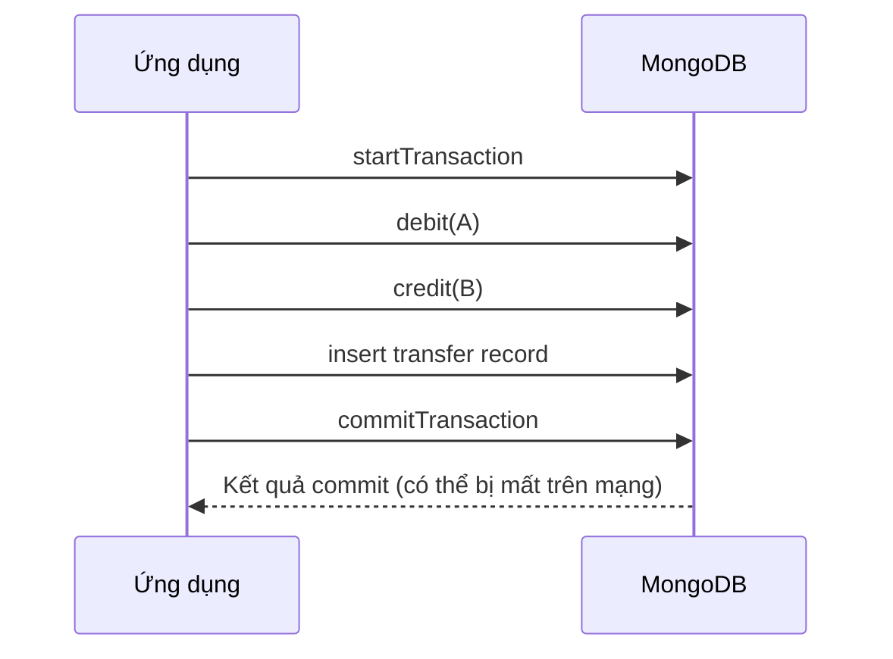
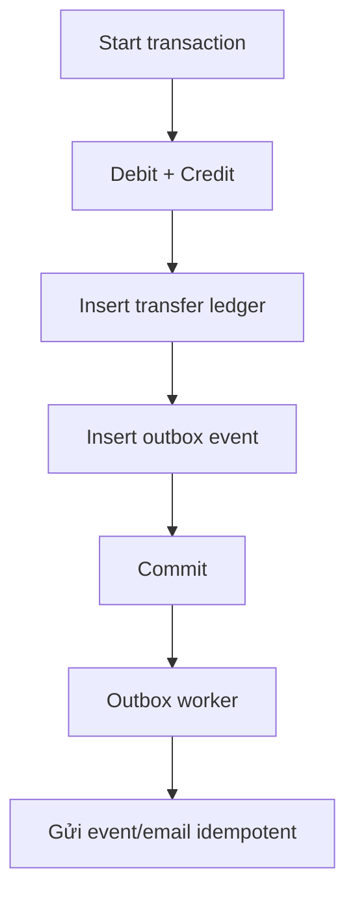

# Kiểm chứng toàn vẹn dữ liệu khi giao dịch thất bại hoặc ứng dụng mất kết nối trong MongoDB

> **Module:** Database Engine Document MongoDB  
> **Chương:** Giao dịch

## 1. Bài toán thực tế: ứng dụng báo lỗi, dữ liệu có bị ghi một nửa không?

Một dịch vụ ví điện tử dùng MongoDB lưu hai tài khoản:

```javascript
{
  _id: "A",
  owner: "alice",
  balanceCents: NumberLong("100000")
}
{
  _id: "B",
  owner: "bob",
  balanceCents: NumberLong("50000")
}
```

Người dùng yêu cầu chuyển **20.000 đơn vị nhỏ nhất của tiền tệ** từ A sang B. Nghiệp vụ có ít nhất ba thao tác dữ liệu:

1. Trừ 20.000 khỏi A.
2. Cộng 20.000 vào B.
3. Lưu bản ghi chuyển tiền với một `transferId` duy nhất.

Nếu thực hiện thành ba lệnh độc lập không có giao dịch nhiều document, ứng dụng có thể bị ngắt sau bước 1. Kết quả A mất tiền nhưng B chưa nhận được: dữ liệu không thỏa bất biến của một chuyển tiền nội bộ.

MongoDB hỗ trợ **multi-document transactions** để các thay đổi được commit/abort như một đơn vị. Nhưng một câu hỏi khác vẫn tồn tại: **khi client bị timeout hoặc mất kết nối lúc commit, client có biết giao dịch đã thành công hay chưa không?**

Cần tách ba khái niệm:

- **Tính nguyên tử của dữ liệu:** MongoDB bảo đảm các thay đổi trong transaction commit hoặc không commit theo semantics hỗ trợ.
- **Kết quả client quan sát:** client có thể nhận thành công, lỗi xác định hoặc trạng thái **không biết commit đã thành công hay chưa**.
- **Tính đúng nghiệp vụ khi retry:** application không được tạo hai lần chuyển tiền vì xử lý một yêu cầu bị timeout hai lần.

Bài này hướng dẫn cách **kiểm chứng và khôi phục tính toàn vẹn** trong cả ba trường hợp, bằng transaction, khóa idempotency, kiểm tra bất biến, đọc nhất quán, xử lý error labels, log và đối soát.

Sau bài học, bạn có thể:

1. Phân biệt **abort chắc chắn** với **unknown commit result**.
2. Hiểu ý nghĩa của `TransientTransactionError` và `UnknownTransactionCommitResult`.
3. Giải thích vì sao mất kết nối sau khi gửi `commitTransaction` **không có nghĩa rollback**.
4. Thiết kế transaction có ràng buộc số dư và bản ghi nghiệp vụ chống trùng.
5. Dùng `mongosh` và MongoDB Java Sync Driver để thử commit/abort trong lab.
6. Kiểm tra số dư bằng một phép đọc snapshot phù hợp, thay vì đọc nhiều document tại các thời điểm khác nhau rồi kết luận nhầm.
7. Chọn đúng chiến lược retry transaction hoặc retry commit.
8. Phân biệt atomicity của MongoDB với exactly-once ở cấp nghiệp vụ.
9. Kiểm chứng hệ thống sau timeout, failover hoặc khởi động lại service.
10. Xây dựng runbook điều tra một giao dịch có kết quả chưa xác định.

## 2. Định nghĩa tính toàn vẹn trước khi viết code

Không thể kiểm chứng một trạng thái là đúng nếu chưa xác định **bất biến dữ liệu** (*data invariants*).

Với ví dụ chuyển tiền A → B, giả định:

- Đơn vị lưu trữ là số nguyên **cents**, tránh tính toán tiền bằng binary floating point.
- Giao dịch chỉ chuyển nội bộ, **không phát sinh phí**, không nạp tiền hoặc rút tiền từ bên ngoài.
- Hai tài khoản A và B tồn tại.
- Số tiền chuyển `amountCents > 0`.
- Không cho phép số dư âm.
- Mỗi yêu cầu nghiệp vụ có `transferId` duy nhất.
- Nếu giao dịch đã được ghi nhận thành công, phải có đúng một bản ghi transfer.
- Các phép ghi số dư và bản ghi transfer được commit trong **cùng một MongoDB transaction**.

Khi đó một chuyển tiền đúng phải thỏa:

\[
A_{\text{sau}} = A_{\text{trước}} - \text{amount}
\]

\[
B_{\text{sau}} = B_{\text{trước}} + \text{amount}
\]

\[
A_{\text{sau}} + B_{\text{sau}} = A_{\text{trước}} + B_{\text{trước}}
\]

Với giá trị ban đầu:

```text
Trước chuyển:
    A = 100000
    B =  50000
    Tổng = 150000

Chuyển 20000 thành công:
    A =  80000
    B =  70000
    Tổng = 150000

Giao dịch bị abort:
    A = 100000
    B =  50000
    Tổng = 150000
```

Trong bài học, tổng 150.000 chỉ là bất biến cho **hai tài khoản mẫu khi không có thay đổi bên ngoài**. Hệ thống ví thật có nhiều loại giao dịch, phí, nạp/rút, hoàn tiền và ledger; không được áp một công thức đơn giản lên toàn hệ thống mà chưa có hợp đồng kế toán.

### 2.1. Vì sao tổng không đổi chưa đủ?

Xét một trạng thái sai:

```text
A =  60000
B =  90000
Tổng = 150000
```

Tổng vẫn đúng, nhưng thực tế chuyển **40.000** thay vì 20.000. Có thể một yêu cầu đã bị thực hiện hai lần.

Vì vậy phải kiểm tra **đồng thời**:

- Tổng số dư theo bất biến.
- Số dư từng tài khoản hoặc biến động được phép.
- Bản ghi transfer theo `transferId`.
- Số lần nghiệp vụ được áp dụng.
- Tính nhất quán của trạng thái transfer với biến động số dư.

**Atomicity không tự bảo đảm idempotency.** Hai transaction hoàn toàn atomic vẫn có thể cùng thực hiện một chuyển tiền nghiệp vụ nếu bạn không chống trùng.

## 3. ACID: transaction bảo vệ điều gì?

MongoDB có tính atomic ở cấp một document đối với những thao tác ghi phù hợp. Khi cần một nhóm thao tác trên nhiều document/collection cùng commit hoặc cùng abort, ta dùng **multi-document transaction** trên deployment hỗ trợ.

Bốn thuộc tính ACID:

| Thuộc tính | Ý nghĩa trong ví dụ | Điều cần hiểu |
|---|---|---|
| **Atomicity** | Trừ A, cộng B và ghi transfer cùng commit hoặc cùng không commit | Không cho phép một trạng thái *đã commit* chỉ có nửa chuyển tiền |
| **Consistency** | Dữ liệu sau commit phải thỏa ràng buộc nghiệp vụ | MongoDB không tự biết quy tắc “số dư không âm”; code/filter/constraint phải thực thi |
| **Isolation** | Các thao tác đồng thời được quan sát theo quy tắc isolation của transaction | Không đồng nghĩa mọi race nghiệp vụ tự biến mất |
| **Durability** | Kết quả commit được duy trì theo bảo đảm của write concern và deployment | Cần hiểu majority và rủi ro rollback nếu dùng concern yếu |

### 3.1. Một transaction không phải lệnh đơn

Để bảo vệ chuyển tiền, không đủ chỉ viết:

```javascript
db.accounts.updateOne(
  { _id: "A" },
  { $inc: { balanceCents: -20000 } }
);

db.accounts.updateOne(
  { _id: "B" },
  { $inc: { balanceCents: 20000 } }
);
```

Hai lệnh trên là hai thao tác độc lập; một lệnh có thể thành công trong khi lệnh kia lỗi. Một ứng dụng gọi chúng liên tiếp **không tự tạo transaction**.

Cần mở `ClientSession`, bắt đầu transaction, truyền session vào từng thao tác liên quan, rồi commit/abort đúng cách.

### 3.2. Transaction thành công không đồng nghĩa response luôn tới client

Ngay cả khi tất cả document được commit trên server, kết nối có thể rớt trước khi client nhận thông báo thành công. Vì thế không được đồng nhất:

```text
"Ứng dụng nhận timeout"
             =
"MongoDB chắc chắn đã rollback"
```

Đẳng thức trên **sai**.

## 4. Bốn điểm thất bại cần phân biệt

Hình dung transaction:



Có thể gặp bốn kịch bản.

### 4.1. Thất bại trước khi bắt đầu transaction

Ví dụ validation phát hiện `amountCents <= 0` hoặc account không tồn tại trước khi gọi server. Không có transaction chứa các ghi nghiệp vụ nào đã chạy.

Kiểm chứng: không có thay đổi dự kiến từ **request đó**. Nếu request có khả năng đã được xử lý trước lần này (retry từ bên ngoài), vẫn phải kiểm tra `transferId` để tránh xử lý trùng.

### 4.2. Thất bại khi đang thực hiện transaction, chưa gửi commit thành công

Ví dụ lệnh trừ A chạy trong transaction, rồi thao tác cộng B gặp lỗi hoặc ứng dụng quyết định abort.

Nếu transaction **không commit**, các thay đổi thuộc transaction không trở thành dữ liệu đã commit. Ứng dụng nên gọi `abortTransaction()` khi có thể và đóng session.

Tuy nhiên, nếu kết nối bị mất, việc client không gọi được abort ngay **không chứng minh transaction đã được server giải phóng tức thì**. Server có cơ chế giới hạn thời gian sống/cleanup cho transaction chưa kết thúc; khi điều tra phải kiểm tra trạng thái và hệ thống, không dựa riêng vào disconnect.

### 4.3. Lỗi trong lúc commit nhưng kết quả có thể đã xác định

Có những lỗi mà driver/server có thể xác định transaction không thể commit thành công theo ngữ nghĩa lỗi. Tùy error label, thao tác có thể cần retry **toàn bộ transaction** hoặc xử lý lỗi nghiệp vụ.

Không có một câu lệnh “cứ gặp mọi MongoException thì chạy lại toàn bộ nghiệp vụ” an toàn cho mọi trường hợp.

### 4.4. Mất kết nối hoặc timeout sau khi gửi commit: kết quả chưa xác định

Đây là trường hợp khó nhất:

```text
Client                   Network                   MongoDB
  |---- commitTransaction --->|----------------------->|
  |                           |                        |
  |                           |     Server commit OK   |
  |                           |<------ response -------|
  |<------ X mất gói ----------|                        |
  |
  +-- Client thấy timeout
      nhưng giao dịch có thể ĐÃ COMMIT
```

Cũng có thể server chưa commit vì lỗi khác. **Client không đủ dữ kiện kết luận thành công hay thất bại chỉ từ timeout**.

MongoDB driver có thể gắn error label **`UnknownTransactionCommitResult`** để phân biệt tình huống kết quả commit không rõ. Khi còn giữ ngữ cảnh transaction phù hợp, hướng xử lý là retry **commit của cùng transaction**, không chạy lại toàn bộ phần trừ/cộng tiền ngay lập tức.

Nếu process đã chết, session context không còn có thể dùng để retry commit trực tiếp, ứng dụng cần **đối soát bằng transferId và trạng thái đã được majority-committed**, hoặc điều phối recovery theo cơ chế phù hợp.

## 5. Ma trận trạng thái: dữ liệu và kết quả phía ứng dụng

| Điều ứng dụng thấy | Trạng thái server có thể xảy ra | Hướng xử lý |
|---|---|---|
| Validation thất bại trước write | Chưa có transaction nghiệp vụ | Trả lỗi input; nếu là retry, vẫn xác nhận idempotency key |
| Callback transaction ném lỗi, abort được xác nhận | Transaction đã abort | Có thể trả lỗi nghiệp vụ; không tạo bút toán nửa vời |
| Driver báo `TransientTransactionError` trong phase thực thi | Transaction cần được chạy lại theo cơ chế retry | Retry **toàn bộ transaction** theo policy, tránh side effect ngoài DB |
| Commit được xác nhận thành công | Transaction commit theo write concern yêu cầu | Trả kết quả thành công, không thực thi lại cùng transfer |
| Commit trả `UnknownTransactionCommitResult` | Có thể commit hoặc chưa commit | Retry **commit của cùng transaction** nếu còn session/context |
| Client timeout và process đã restart | Trạng thái chưa chắc chắn với client | Đối soát transferId, kiểm tra invariants, recovery idempotent |
| Có bản ghi transfer nhưng số dư không tương ứng | Có thể lỗi thiết kế, ghi ngoài transaction hoặc dữ liệu bị sửa sau đó | Điều tra, không tự trừ/cộng bù không có chứng cứ |
| Không thấy transfer ngay sau timeout | Chưa đủ kết luận đã abort, nhất là khi pending/chưa quan sát được mốc commit | Chờ/đối soát có giới hạn, kiểm soát retry qua unique key |

**Tư duy quan trọng:** Kết quả dữ liệu trên server và mức độ hiểu biết của client là hai trục khác nhau. Atomicity bảo vệ tính toàn vẹn khi transaction được giải quyết; idempotency và recovery xử lý sự không chắc chắn của client.

## 6. Điều kiện để thực hành transaction

Multi-document transactions cần deployment MongoDB hỗ trợ:

- Replica set (MongoDB 4.0+).
- Sharded cluster (MongoDB 4.2+ với các điều kiện/tính năng phiên bản phù hợp).
- Driver có hỗ trợ sessions và transactions.
- Tài khoản đủ quyền đối với các collection.
- Cấu hình read/write concern phù hợp.

Các ví dụ sau phù hợp với **replica set lab hoặc môi trường thử nghiệm riêng**. Không chạy lệnh chuyển tiền, xóa database hay fault injection trên production để kiểm tra giả thuyết.

### 6.1. Vì sao standalone không phải môi trường phù hợp?

Một `mongod` chạy ở chế độ standalone thông thường không đáp ứng đầy đủ cơ chế multi-document transaction của replica set. Nếu lab chỉ có một process, có thể cấu hình nó làm **single-node replica set** để học transactions thay vì coi nó là standalone.

Một single-node replica set giúp thử cú pháp commit/abort, nhưng không tái hiện đúng trường hợp majority giữa nhiều node, replication lag và failover của hệ thống thực.

### 6.2. Kiểm tra topology

Trong `mongosh`:

```javascript
printjson(db.hello());
```

Trên replica set có thể thấy các thông tin về set name, role và members. Cần kết nối tới primary phù hợp để thực hiện giao dịch có ghi.

Đối với môi trường Atlas, sử dụng cluster và quyền mà tài khoản thử nghiệm được cấp. Không thay cấu hình replica set của managed deployment bằng lệnh admin không được hỗ trợ.

## 7. Chuẩn bị bộ dữ liệu lab

Mở `mongosh` kết nối tới replica set được phép dùng:

```bash
mongosh "mongodb://localhost:27101,localhost:27102,localhost:27103/?replicaSet=rsTraining"
```

URI là ví dụ. Thay host, port và tên replica set theo lab của bạn.

Tạo dữ liệu trong database riêng:

```javascript
const lab = db.getSiblingDB("transaction_integrity_lab");
const accounts = lab.getCollection("accounts");
const transfers = lab.getCollection("transfers");

accounts.insertMany([
  {
    _id: "A",
    owner: "alice",
    balanceCents: NumberLong("100000")
  },
  {
    _id: "B",
    owner: "bob",
    balanceCents: NumberLong("50000")
  }
]);

transfers.createIndex(
  { requestedBy: 1, createdAt: -1 },
  { name: "idx_transfers_requester_date" }
);

printjson(accounts.find().sort({ _id: 1 }).toArray());
```

Index unique mặc định trên `_id` của collection `transfers` sẽ được dùng để bảo vệ **một transferId chỉ có một bản ghi đã commit**.

> **Lưu ý:** Chạy đoạn tạo dữ liệu một lần trên collection lab mới. Nếu chạy lại `insertMany()` với A/B đã tồn tại, MongoDB sẽ báo duplicate key. Không dùng `dropDatabase()` trên database không thuộc môi trường thử nghiệm của bạn.

### 7.1. Tại sao dùng NumberLong?

`NumberLong("100000")` biểu diễn số nguyên BSON 64-bit. Với tiền, dùng một kiểu nhất quán tránh cộng/trừ sai do số thực nhị phân.

Trong Java, sử dụng `long` hoặc một chiến lược `Decimal128` được thiết kế theo yêu cầu nghiệp vụ. Cần kiểm tra overflow và tính tương thích khi tổng giá trị có thể vượt phạm vi kiểu số.

### 7.2. Khóa chống trùng ở cấp nghiệp vụ

Mỗi lần người dùng chủ động tạo chuyển tiền mới có một `transferId` riêng, ví dụ:

```javascript
{
  _id: "T-001",
  from: "A",
  to: "B",
  amountCents: NumberLong("20000"),
  state: "APPLIED",
  createdAt: ISODate("2026-11-14T00:00:00Z")
}
```

Khi ứng dụng retry **cùng yêu cầu** sau timeout, nó phải dùng lại **chính transferId**, không tự tạo ID mới.

Nếu retry tạo một UUID khác, unique index không thể biết hai request thật ra là cùng một chuyển tiền.

## 8. Transaction thành công bằng mongosh

Ta thực hiện A → B, số tiền 20.000 trong cùng một explicit session.

### 8.1. Code transaction

```javascript
const session = db.getMongo().startSession();
const sdb = session.getDatabase("transaction_integrity_lab");
const sAccounts = sdb.getCollection("accounts");
const sTransfers = sdb.getCollection("transfers");

const transferId = "T-001";
const amountCents = NumberLong("20000");

try {
  session.startTransaction({
    readConcern: { level: "snapshot" },
    writeConcern: { w: "majority" },
    readPreference: { mode: "primary" }
  });

  sTransfers.insertOne({
    _id: transferId,
    from: "A",
    to: "B",
    amountCents: amountCents,
    state: "APPLIED",
    createdAt: new Date()
  });

  const debit = sAccounts.updateOne(
    {
      _id: "A",
      balanceCents: { $gte: amountCents }
    },
    {
      $inc: { balanceCents: NumberLong("-20000") }
    }
  );

  if (debit.matchedCount !== 1) {
    throw new Error("Source account missing or insufficient funds");
  }

  const credit = sAccounts.updateOne(
    { _id: "B" },
    { $inc: { balanceCents: amountCents } }
  );

  if (credit.matchedCount !== 1) {
    throw new Error("Destination account missing");
  }

  session.commitTransaction();
  print("Transaction commit acknowledged.");
} catch (e) {
  // Ví dụ didactic: nếu lỗi xuất hiện gần/ở commit thì
  // không được suy ra abort chắc chắn chỉ từ catch.
  print("Transaction requires classification: " + e.message);

  try {
    session.abortTransaction();
  } catch (abortError) {
    print("Abort also needs interpretation: " + abortError.message);
  }

  throw e;
} finally {
  session.endSession();
}
```

Ví dụ trên mô tả **đường đi thành công** và hành vi abort best-effort. Phần `catch` **không phải bộ xử lý production hoàn chỉnh** cho lỗi commit chưa xác định: nếu `commitTransaction()` đã gửi tới server và kết quả không rõ, việc gọi abort sau đó không đủ để biến nó thành rollback. Phần xử lý đúng error label và retry được trình bày ở các mục tiếp theo.

### 8.2. Kết quả kỳ vọng

Khi commit được xác nhận:

```javascript
printjson(
  lab.accounts.find().sort({ _id: 1 }).toArray()
);

printjson(
  lab.transfers.findOne({ _id: "T-001" })
);
```

Số dư:

```text
A =  80000
B =  70000
Tổng = 150000
transfer T-001 = APPLIED
```

Cả ba thay đổi cùng nằm trong transaction. Một giao dịch có commit được xác nhận không được xuất hiện dưới dạng “A bị trừ nhưng B chưa được cộng” như **trạng thái đã commit** của collection.

### 8.3. Vì sao insert transfer trong cùng transaction?

Nếu bạn ghi transfer record **sau** commit:

```text
Transaction trừ A + cộng B → commit thành công
Ứng dụng bị crash trước insert transfer record
```

Khi khởi động lại, ứng dụng không thấy transferId và có thể nghĩ chưa thực hiện chuyển tiền, rồi trừ/cộng lần nữa.

Đặt **transfer record và biến động số dư trong một transaction** giúp chúng cùng có một trạng thái commit/abort, tạo cơ sở tốt hơn cho recovery idempotent.

## 9. Kiểm chứng sau commit: đừng chỉ đọc một tài khoản

Một phép kiểm tra yếu:

```javascript
printjson(lab.accounts.findOne({ _id: "A" }));
```

Nếu A còn 80.000, ta chỉ biết A đã được thay đổi tại mốc đọc. Chưa biết B, bản ghi transfer và các thay đổi concurrent khác.

Kiểm chứng tối thiểu phải hỏi:

1. A có giảm đúng số tiền?
2. B có tăng đúng số tiền?
3. Tổng trước/sau có bảo toàn không?
4. Có đúng một transferId trong sổ ghi nhận?
5. Transfer record có đúng from/to/amount không?
6. Việc đọc dùng cơ chế nhất quán phù hợp không?

### 9.1. Trường hợp lab không có ghi đồng thời

Khi chắc chắn chỉ một transaction được thực hiện, có thể đọc các document sau commit rồi so sánh số liệu như trên. Đây là bài tập xác nhận kết quả đơn giản, **không chứng minh một thiết kế đối soát luôn đúng khi production có concurrent writes**.

### 9.2. Khi có ghi đồng thời, cần ảnh chụp nhất quán

Nếu đọc A rồi B bằng hai query rời nhau trong khi các transfer khác tiếp tục commit, hai số dư có thể thuộc **hai thời điểm khác nhau**.

Ví dụ:

```text
T1: đọc A = 80000
T2: transfer khác A→B commit 10000
T3: đọc B = 80000

Ghép A(T1) + B(T3) = 160000 → kết luận sai
```

Thực tế không có giao dịch nào tạo ra tổng 160.000; phép kiểm tra đã dùng dữ liệu không cùng snapshot.

Để kiểm chứng bất biến xuyên nhiều document trong một hệ thống đang ghi, nên dùng **read-only transaction với readConcern snapshot** (khi được hỗ trợ và phù hợp), hoặc một cơ chế snapshot/cutoff tương đương. Hạn chế phạm vi snapshot và thời gian transaction để không tạo áp lực tài nguyên.

### 9.3. Ví dụ đọc snapshot trong mongosh

```javascript
const readSession = db.getMongo().startSession();
const readDb = readSession.getDatabase("transaction_integrity_lab");

try {
  readSession.startTransaction({
    readConcern: { level: "snapshot" },
    writeConcern: { w: "majority" },
    readPreference: { mode: "primary" }
  });

  const pair = readDb.accounts.find({
    _id: { $in: ["A", "B"] }
  }).sort({ _id: 1 }).toArray();

  const transfer = readDb.transfers.findOne({ _id: "T-001" });

  printjson({ pair, transfer });

  readSession.commitTransaction();
} catch (e) {
  try {
    readSession.abortTransaction();
  } catch (_) {}

  throw e;
} finally {
  readSession.endSession();
}
```

Với code này, A và B được quan sát trong một transaction có snapshot read concern. Tuy nhiên, **snapshot không thay cho đối chiếu nghiệp vụ**: nếu A và B có thêm các loại ghi hợp lệ khác, công thức tổng phải bao gồm các luồng đó.

## 10. Kiểm chứng giao dịch bị abort có chủ đích

Đây là cách mô phỏng lỗi an toàn trong lab: cố tình abort sau khi thực hiện một số update, rồi kiểm tra dữ liệu ngoài transaction.

### 10.1. Thực hiện thay đổi và abort

Giả sử đã có transaction T-001 thành công. Ta thử một transfer khác T-002 nhưng **không commit**:

```javascript
const session = db.getMongo().startSession();
const sdb = session.getDatabase("transaction_integrity_lab");

try {
  session.startTransaction({
    readConcern: { level: "snapshot" },
    writeConcern: { w: "majority" }
  });

  sdb.accounts.updateOne(
    { _id: "A", balanceCents: { $gte: NumberLong("10000") } },
    { $inc: { balanceCents: NumberLong("-10000") } }
  );

  sdb.accounts.updateOne(
    { _id: "B" },
    { $inc: { balanceCents: NumberLong("10000") } }
  );

  sdb.transfers.insertOne({
    _id: "T-002",
    from: "A",
    to: "B",
    amountCents: NumberLong("10000"),
    state: "APPLIED",
    createdAt: new Date()
  });

  // Chủ động hủy để mô phỏng giao dịch chưa đạt commit.
  session.abortTransaction();
  print("T-002 aborted intentionally.");
} finally {
  session.endSession();
}
```

Ở đây không có lệnh `commitTransaction()`. Việc abort được xác nhận giúp kiểm tra tính nguyên tử trong điều kiện đơn giản.

### 10.2. Xác minh sau abort

```javascript
printjson(
  lab.accounts.find().sort({ _id: 1 }).toArray()
);

printjson(
  lab.transfers.findOne({ _id: "T-002" })
);
```

Nếu chỉ có T-001 thành công trước đó:

```text
A = 80000
B = 70000
T-002 không tồn tại trong transfer ledger
```

Các thay đổi của T-002 đã bị hủy. Điều này minh họa nguyên tử của transaction: thao tác update đã chạy **bên trong transaction** không đồng nghĩa đã trở thành dữ liệu commit.

**Không nhầm** với tình huống client gửi commit rồi mất kết nối: ở đó không thể kết luận chắc chắn abort từ việc không nhận được response.

## 11. Lỗi nghiệp vụ và lỗi hạ tầng: xử lý khác nhau

Không phải mọi exception trong transaction đều nên retry.

### 11.1. Lỗi nghiệp vụ có kết quả xác định

Ví dụ:

- A không đủ tiền.
- Tài khoản B không tồn tại.
- Số tiền bằng 0 hoặc âm.
- transferId đã được xử lý với payload khác.
- Người dùng không có quyền thực hiện chuyển tiền.

Đây là lỗi theo quy tắc ứng dụng. Không retry vô hạn một yêu cầu thiếu tiền; cần abort và trả kết quả rõ ràng.

### 11.2. Lỗi có tính tạm thời

Ví dụ:

- Write conflict với transaction khác.
- Primary thay đổi trong lúc thao tác.
- Một số lỗi network/server có error label phù hợp.

MongoDB driver có thể đánh dấu **`TransientTransactionError`** trên exception. Tùy loại thao tác và vị trí lỗi, driver cho biết có thể thử lại **toàn bộ transaction**.

### 11.3. Lỗi kết quả commit chưa rõ

Ví dụ:

- Server đã commit nhưng response bị mất.
- Network timeout gần thời điểm commit.
- Không nhận được xác nhận commit theo cơ chế giao thức.

Driver có thể dùng label **`UnknownTransactionCommitResult`**. Cách xử lý khác: **retry commit cho cùng transaction**, thay vì tự chạy lại các update.

### 11.4. Bảng quyết định nhanh

| Loại lỗi | Ý nghĩa | Việc thường nên làm |
|---|---|---|
| Insufficient funds | Điều kiện nghiệp vụ không đạt | Abort, không retry cùng yêu cầu như thể lỗi mạng |
| Duplicate transferId | Yêu cầu có thể đã xử lý hoặc ID trùng payload | Đối chiếu ledger/payload; không tự ghi lần hai |
| `TransientTransactionError` ở phần body | Transaction gặp lỗi có thể retry | Retry transaction body theo policy có giới hạn |
| `UnknownTransactionCommitResult` ở commit | Client không biết kết quả commit | Retry **commit cùng transaction** nếu còn context |
| Client process crash | Không còn vòng xử lý cũ | Recovery theo idempotency key và truy vấn trạng thái đáng tin |
| Majority không khả dụng | Commit/read có thể chờ hoặc timeout | Giám sát topology; không bỏ concern tùy tiện |
| Transaction lifetime exceeded | Transaction tồn tại quá lâu | Thu gọn transaction, điều tra locks/resource |
| Vi phạm unique index | Conflict dữ liệu/khóa nghiệp vụ | Phân loại duplicate thật, không retry vô hạn |

**Chú ý:** Không phải lỗi nào cũng mang một trong hai label trên. Một số lỗi được xác định bằng code, trạng thái server hoặc contract driver. Hãy viết error handler dựa trên driver API và tài liệu phiên bản, không chỉ dựa trên chuỗi message chứa từ “timeout”.

## 12. TransientTransactionError: retry toàn bộ transaction

Khi lỗi tạm thời xảy ra **trước khi commit được giải quyết**, transaction có thể phải chạy lại từ đầu.

Hình minh họa:

```text
Attempt #1
    startTransaction
    insert transfer
    debit A
    write conflict
    abort / transaction failed

Attempt #2
    startTransaction
    insert transfer
    debit A
    credit B
    commit
```

Vì attempt #1 không commit, attempt #2 có thể được chạy lại an toàn **nếu callback chỉ thực hiện những thao tác phù hợp với retry và không gây side effect ngoài transaction**.

### 12.1. Vì sao body có thể chạy nhiều lần?

Các driver hỗ trợ callback transaction API thường có logic thử lại khi gặp lỗi có thể retry. Điều đó có nghĩa đoạn code bên trong callback có thể được gọi nhiều lần trong một lần yêu cầu nghiệp vụ.

Không được viết:

```java
session.withTransaction(() -> {
    accounts.updateOne(session, debitFilter, debitUpdate);
    emailService.sendTransferSucceededEmail(); // Không an toàn!
    accounts.updateOne(session, creditFilter, creditUpdate);
    return null;
});
```

Nếu body bị retry sau khi email đã gửi, người dùng có thể nhận email nhiều lần, hoặc nhận thông báo thành công trong khi transaction cuối cùng thất bại.

**Quy tắc:** Tránh side effect không thể rollback như gửi email, gọi cổng thanh toán hoặc publish event bên ngoài **trong callback transaction có thể retry**.

### 12.2. Transactional outbox

Một thiết kế tốt:

1. Trong transaction, thay đổi accounts.
2. Trong cùng transaction, ghi transfer ledger.
3. Trong cùng transaction, ghi outbox event với ID duy nhất.
4. Commit.
5. Worker ngoài transaction đọc outbox đã commit rồi gửi thông báo hoặc event.
6. Worker đánh dấu tiến độ với dedup/idempotency riêng.



Outbox giúp gắn ý định phát event với trạng thái dữ liệu commit. Nó không tự tạo exactly-once ở hệ thống bên ngoài; consumer/sender vẫn cần xử lý duplicate.

## 13. UnknownTransactionCommitResult: retry commit, không retry nghiệp vụ bừa bãi

Một transaction đã gửi commit và bị lỗi mạng có thể ở trạng thái:

- Đã commit thành công.
- Chưa commit thành công.
- Kết quả chưa thể xác định từ phía client hiện tại.

Hành động nguy hiểm:

```text
commit timeout
    ↓
Tạo transferId MỚI
    ↓
Trừ A thêm lần nữa
```

Nếu lần đầu thật ra đã commit, hành động này tạo ra một chuyển tiền kép.

### 13.1. Khi vẫn giữ session và transaction context

Khi driver báo `UnknownTransactionCommitResult` trong tình huống được hỗ trợ, hướng xử lý chuẩn là thử lại **`commitTransaction` của chính transaction đó**.

Việc retry commit cùng transaction khác với tạo một transaction mới thực hiện lại debit/credit. Driver/server có cơ chế nhận diện transaction trong logical session để xử lý retry commit theo semantics tương ứng.

### 13.2. Khi ứng dụng mất process hoặc mất session context

Nếu process chết, không còn callback stack và `ClientSession` ban đầu:

1. Giữ nguyên `transferId` của yêu cầu.
2. Không tự kết luận thất bại do client thiếu response.
3. Đọc transfer ledger với consistency phù hợp.
4. Nếu có bản ghi transfer `APPLIED` đã commit với payload khớp, đánh dấu yêu cầu **đã thực hiện**, không debit lại.
5. Nếu chưa có, không kết luận ngay “chưa từng commit” khi có transaction vẫn đang in flight hoặc truy vấn chưa ở mức nhất quán phù hợp.
6. Thực hiện recovery/retry bằng một **idempotency protocol** được kiểm soát (unique ID, xử lý duplicate, chỉ một worker giữ ownership theo yêu cầu).
7. Đối soát các số dư và event theo dữ liệu đã commit.

### 13.3. Vì sao “findOne không thấy transfer” chưa đủ làm bằng chứng tuyệt đối?

Có một cửa sổ thời gian:

```text
T1: client gửi commit
T2: client mất kết nối
T3: recovery service đọc ledger
T4: transaction cũ vừa hoàn tất commit
```

Ở T3, việc không thấy bản ghi chưa chắc chứng minh transaction sẽ không commit tại T4. Do đó **không tạo transfer ID khác** và tránh retry không có cơ chế chống trùng.

Một giao thức dùng unique `transferId` khiến nhiều attempt cạnh tranh cùng một khóa; một attempt đã commit không thể bị ghi nhận thêm lần thứ hai dưới cùng khóa theo semantics unique index, miễn nghiệp vụ tuân thủ đầy đủ transaction boundary.

## 14. Java Sync Driver: dùng withTransaction()

MongoDB Java Sync Driver có API callback `ClientSession.withTransaction()` để điều phối start/commit/abort và xử lý các lỗi transaction có thể retry theo khả năng driver.

Ví dụ dưới đây dùng:

- Collection `accounts` và `transfers`.
- `transferId` làm `_id` của transfer, được unique index mặc định bảo vệ.
- Một transaction ghi transfer record, debit A, credit B.
- `readConcern: snapshot` và `writeConcern: majority`.
- Read preference primary.

### 14.1. Ví dụ Java hoàn chỉnh

```java
import com.mongodb.ReadConcern;
import com.mongodb.ReadPreference;
import com.mongodb.TransactionOptions;
import com.mongodb.WriteConcern;
import com.mongodb.client.ClientSession;
import com.mongodb.client.MongoClient;
import com.mongodb.client.MongoClients;
import com.mongodb.client.MongoCollection;
import com.mongodb.client.MongoDatabase;
import com.mongodb.client.result.UpdateResult;
import org.bson.Document;

import java.time.Instant;
import java.util.Date;

import static com.mongodb.client.model.Filters.and;
import static com.mongodb.client.model.Filters.eq;
import static com.mongodb.client.model.Filters.gte;
import static com.mongodb.client.model.Updates.inc;

public final class TransferTransactionExample {

    public static void main(String[] args) {
        String uri = System.getenv("MONGODB_URI");
        if (uri == null || uri.isBlank()) {
            throw new IllegalArgumentException("MONGODB_URI is required");
        }

        String transferId = "T-JAVA-001";
        String fromId = "A";
        String toId = "B";
        long amount = 20000L;

        if (amount <= 0 || fromId.equals(toId)) {
            throw new IllegalArgumentException("Invalid transfer");
        }

        try (MongoClient client = MongoClients.create(uri)) {
            MongoDatabase database =
                    client.getDatabase("transaction_integrity_lab");

            MongoCollection<Document> accounts =
                    database.getCollection("accounts");

            MongoCollection<Document> transfers =
                    database.getCollection("transfers");

            TransactionOptions options = TransactionOptions.builder()
                    .readPreference(ReadPreference.primary())
                    .readConcern(ReadConcern.SNAPSHOT)
                    .writeConcern(WriteConcern.MAJORITY)
                    .build();

            try (ClientSession session = client.startSession()) {
                session.withTransaction(() -> {
                    // Unique _id ngăn cùng transferId được commit hai lần.
                    transfers.insertOne(
                            session,
                            new Document("_id", transferId)
                                    .append("from", fromId)
                                    .append("to", toId)
                                    .append("amountCents", amount)
                                    .append("state", "APPLIED")
                                    .append("createdAt",
                                            Date.from(Instant.now()))
                    );

                    UpdateResult debit = accounts.updateOne(
                            session,
                            and(
                                    eq("_id", fromId),
                                    gte("balanceCents", amount)
                            ),
                            inc("balanceCents", -amount)
                    );

                    if (debit.getMatchedCount() != 1) {
                        throw new IllegalStateException(
                                "Insufficient funds or source missing"
                        );
                    }

                    UpdateResult credit = accounts.updateOne(
                            session,
                            eq("_id", toId),
                            inc("balanceCents", amount)
                    );

                    if (credit.getMatchedCount() != 1) {
                        throw new IllegalStateException(
                                "Destination account missing"
                        );
                    }

                    return null;
                }, options);
            }

            System.out.println(
                    "Transfer commit was acknowledged: " + transferId
            );
        }
    }
}
```

**Quan trọng:** Dữ liệu lab ban đầu có A=100000, B=50000. Nếu trước đó đã chạy T-001 thành công, rồi chạy T-JAVA-001, số dư sẽ thay đổi **lần nữa** vì đó là một chuyển tiền nghiệp vụ khác. Đừng cộng cả hai ví dụ rồi kỳ vọng số dư vẫn bằng 80000/70000.

### 14.2. Transaction options áp dụng ở mức nào?

`readConcern: SNAPSHOT` xác định semantics đọc của transaction trong phạm vi hỗ trợ. `writeConcern: MAJORITY` có ý nghĩa khi **commit transaction**; không yêu cầu đặt riêng write concern trên từng update bên trong cùng transaction.

Các thao tác trong callback cần dùng **cùng `ClientSession`**. Nếu bỏ tham số session trên một thao tác:

```java
// LỖI NGHIÊM TRỌNG VỀ RANH GIỚI TRANSACTION:
accounts.updateOne(eq("_id", fromId), inc("balanceCents", -amount));
```

thao tác đó chạy ngoài transaction đang được mở và có thể commit độc lập, phá mục tiêu atomic nhiều document.

### 14.3. Vì sao kiểm tra matchedCount?

Trong ví dụ debit:

```java
gte("balanceCents", amount)
```

ngăn số dư xuống âm nếu không đủ tiền. Sau đó:

```java
if (debit.getMatchedCount() != 1) {
    throw new IllegalStateException(...);
}
```

Nếu không có tài khoản hoặc không đủ tiền, transaction body ném lỗi và không đi đến commit thành công. Đây là cách biểu diễn ràng buộc nghiệp vụ trong điều kiện update.

**Lưu ý về concurrency:** Nếu các transaction khác cùng sửa tài khoản, MongoDB có thể phát hiện write conflict khiến một attempt thất bại và được retry theo error label. Hãy kết hợp filter điều kiện, transaction và retry policy thay vì đọc số dư bằng lệnh ngoài transaction rồi tự trừ theo giá trị cũ.

### 14.4. withTransaction() không tự giải quyết mọi tình huống

Mặc dù callback API hỗ trợ retry theo những lỗi MongoDB quy định, ứng dụng vẫn phải giải quyết:

- Idempotency giữa các HTTP request/retry nghiệp vụ.
- Xử lý duplicate transferId.
- Timeout ở tầng API, load balancer hoặc message queue.
- Ứng dụng crash sau commit nhưng trước khi response tới user.
- Side effects ngoài MongoDB.
- Lỗi không thể retry hoặc retry vượt giới hạn.
- Giới hạn tài nguyên và thời gian transaction.
- Kiểm chứng, đối soát và alert khi dữ liệu không thỏa invariant.

Không coi `withTransaction()` như lời hứa “chuyển tiền exactly once dưới mọi loại crash”.

## 15. Phân loại lỗi MongoDB trong Java

MongoDB exception có thể cung cấp **error labels**. Phân loại theo label thay vì chỉ so sánh chuỗi exception message.

Ví dụ hàm kiểm tra:

```java
import com.mongodb.MongoException;

public final class TransactionErrorLabels {
    public static void describe(MongoException error) {
        if (error.hasErrorLabel(
                MongoException.UNKNOWN_TRANSACTION_COMMIT_RESULT_LABEL)) {
            System.err.println("Commit result is uncertain.");
        }

        if (error.hasErrorLabel(
                MongoException.TRANSIENT_TRANSACTION_ERROR_LABEL)) {
            System.err.println("Transaction may be retried.");
        }
    }
}
```

Tên hằng và API có thể thay đổi theo phiên bản driver; dùng phiên bản dependency đang triển khai và tài liệu chính thức tương ứng. Nếu không có hằng trong phiên bản cụ thể, driver cũng cung cấp cơ chế kiểm tra label theo string được hỗ trợ, ví dụ `hasErrorLabel("UnknownTransactionCommitResult")`.

### 15.1. Bảng diễn giải lỗi

| Error label | Giai đoạn thường liên quan | Định hướng |
|---|---|---|
| `TransientTransactionError` | Trong body transaction hoặc những trường hợp transaction cần chạy lại | Retry toàn bộ transaction có kiểm soát |
| `UnknownTransactionCommitResult` | Kết quả commit không rõ | Retry commit của cùng transaction, không khởi động lại debit/credit ngay |
| Không có label trên | Có thể là lỗi nghiệp vụ, duplicate key, giới hạn, cấu hình hoặc trường hợp khác | Đọc code/exception và quy tắc operation trước khi quyết định |

Không biến error label thành một hàm “nếu bất kỳ label nào có mặt thì lặp vô hạn”. Cần giới hạn retry, quan sát latency, circuit breaker khi phù hợp và escalation cho các lỗi kéo dài.

### 15.2. Khi nào phải tự triển khai retry?

Nếu dùng **core transaction API** như `startTransaction()`, `commitTransaction()` và `abortTransaction()` trực tiếp, bạn thường phải thiết kế vòng retry transaction/commit theo quy tắc driver.

Nếu dùng **callback API `withTransaction()`**, driver có xử lý retry các trường hợp được hỗ trợ. Đừng bọc callback trong một vòng retry nghiệp vụ vô hạn bên ngoài mà không có idempotency key.

Có thể vẫn cần retry ở tầng ứng dụng đối với các lỗi điều phối, nhưng phải phân biệt:

- Retry một thao tác commit cùng transaction.
- Retry một transaction attempt chưa commit.
- Retry một **yêu cầu nghiệp vụ** sau khi không biết attempt trước đã commit hay chưa.

Ba trường hợp có ranh giới và yêu cầu bảo vệ khác nhau.

## 16. Kiểm chứng khi ứng dụng crash trước commit

Giả sử:

```text
T1: startTransaction
T2: debit A
T3: credit B
T4: insert transfer T-003
T5: process crash — chưa gửi commit
```

Theo mô hình transaction, khi không có commit thành công, các thay đổi trên không trở thành dữ liệu đã commit. Tuy vậy:

- Server có thể giữ transaction đang mở trong một khoảng thời gian cho tới khi cleanup/timeout/abort.
- Client đã chết không thể gửi abort một cách chắc chắn.
- Trạng thái của giao dịch phải được giải quyết bởi server.
- Recovery process không nên đoán trạng thái dựa trên việc “lệnh cuối cùng được log là insert”.

**Trong lab**, có thể mô phỏng đường đi này bằng `abortTransaction()` thay vì thật sự kill process; đó là thử nghiệm atomic abort an toàn và xác định.

### 16.1. Sau crash, kiểm tra những gì?

1. Trạng thái replica set và tình trạng primary.
2. Có transfer record đã commit với cùng transferId không.
3. Số dư và các invariant liên quan tại snapshot đọc phù hợp.
4. Log ứng dụng: attempt đã bước vào commit hay chưa?
5. Log server và metric transaction nếu cần; không mặc định mọi trạng thái có thể được truy xuất lại chỉ từ log.
6. Có request retry đang xử lý cùng transferId không.
7. Có event/outbox đã được commit hay chưa.

Đừng dựa vào một log application được ghi **trước commit** như bằng chứng cuối cùng. Log đó chỉ cho biết ứng dụng **đã cố gắng** thực hiện thao tác.

## 17. Kiểm chứng khi ứng dụng crash trong/sau commit

Đây là quy trình recovery quan trọng nhất.

### 17.1. Không phản hồi “giao dịch thất bại” ngay khi timeout

Nếu client mất kết nối trong lúc commit, phản hồi phù hợp có thể là:

```text
Đã nhận yêu cầu. Trạng thái giao dịch đang được xác minh.
Mã giao dịch: T-004.
```

Không thông báo chắc chắn “đã thất bại” khi chưa có chứng cứ rollback/abort, và cũng không thông báo chắc chắn “thành công” nếu commit chưa được xác nhận.

### 17.2. Recovery bằng transferId

Một worker có thể:

1. Nhận `transferId` T-004.
2. Đọc transfer record với read concern phù hợp (thường majority) từ nguồn đáng tin.
3. Nếu tồn tại `state: "APPLIED"` và payload khớp, coi nghiệp vụ đã được thực hiện và trả kết quả idempotent.
4. Nếu tồn tại với payload khác, trả lỗi **idempotency key conflict**.
5. Nếu chưa tồn tại, xác định có attempt in flight/khả năng commit trễ không; điều phối retry theo giao thức đã thiết kế.
6. Khi bắt đầu attempt mới, vẫn dùng **T-004** chứ không cấp T-005 cho cùng yêu cầu.
7. Đối soát số dư và bản ghi chuyển tiền trong quá trình phát hiện sai lệch.

### 17.3. Vì sao unique key là mấu chốt?

Giả sử attempt ban đầu đang commit T-004, đồng thời recovery worker thử transaction mới cũng insert T-004.

Với unique index trên `transfers._id`, hai transaction không thể cùng commit hai bản ghi T-004 hợp lệ theo cùng một khóa. Nếu mỗi transaction **luôn ghi record T-004 cùng debit/credit**, khóa duy nhất giúp một request nghiệp vụ không trở thành hai transfer đã commit.

Điều kiện bắt buộc:

- Mọi code path thực hiện transfer đều dùng cùng invariant/transaction boundary.
- Không có đường ghi debit/credit **ngoài transaction**.
- Cùng yêu cầu luôn dùng cùng transferId.
- Nếu transferId tồn tại, phải xác minh payload chứ không chỉ kiểm tra hiện diện.
- Duplicate key phải được diễn giải như sự kiện đối soát, không như lý do tự đổi ID.

### 17.4. Một trạng thái “not found” vẫn có thể cần chờ

Ngay sau timeout, server/replica set có thể đang giải quyết commit. Đọc một lần không thấy record không đủ để kết luận an toàn rằng lần trước chưa commit.

Một giao thức recovery production có thể kết hợp:

- Trạng thái request/ownership có thời hạn.
- Worker xử lý đúng một yêu cầu nghiệp vụ theo ID.
- Timeout chờ kết quả và retry có backoff.
- Unique constraint ngăn commit kép.
- Truy vấn majority khi đối soát.
- Cơ chế xử lý unknown cuối cùng: tiếp tục chờ hoặc chuyển manual review.

Không có một lệnh `findOne()` duy nhất bảo đảm giải quyết mọi trường hợp network partition.

## 18. Đọc dữ liệu nhất quán khi đối soát

Đọc dữ liệu từ nhiều collection/tài khoản riêng lẻ ở các thời điểm khác nhau có thể tạo ra một tổ hợp giá trị **chưa từng tồn tại** như một trạng thái commit toàn cục.

### 18.1. Sai lầm: kiểm chứng trên các read rời

```javascript
const a = lab.accounts.findOne({ _id: "A" });
const b = lab.accounts.findOne({ _id: "B" });
const t = lab.transfers.findOne({ _id: "T-004" });
```

Nếu hệ thống tiếp tục nhận transfer, ba query có thể thấy ba thời điểm khác nhau. Một phép cộng tổng từ đó có thể đưa đến false alarm.

### 18.2. Tốt hơn: snapshot read transaction

Dùng một session/transaction đọc:

```javascript
const session = db.getMongo().startSession();
const sdb = session.getDatabase("transaction_integrity_lab");

try {
  session.startTransaction({
    readConcern: { level: "snapshot" },
    writeConcern: { w: "majority" }
  });

  const a = sdb.accounts.findOne({ _id: "A" });
  const b = sdb.accounts.findOne({ _id: "B" });
  const t = sdb.transfers.findOne({ _id: "T-004" });

  printjson({ a, b, transfer: t });

  session.commitTransaction();
} finally {
  session.endSession();
}
```

Đây là ví dụ đường đi thành công của phép đọc. Trong code production, vẫn cần xử lý exception và abort ở nhánh lỗi.

Read concern snapshot cung cấp một góc nhìn nhất quán theo semantics được hỗ trợ. Khi cần bảo đảm snapshot dựa trên dữ liệu majority committed, phải xem xét write concern/transaction commit và điều kiện MongoDB tương ứng.

### 18.3. Khi nào chỉ cần majority read?

Nếu chỉ cần xác minh một transfer record sau khi commit đã được xác nhận và không cần ghép nhiều document thành một invariant, read concern majority có thể đủ cho bài toán đó.

Nếu phải so tổng nhiều document trong lúc có concurrent writes, đọc snapshot/cutoff là cách phù hợp hơn. Chọn mức nhất quán theo phạm vi bất biến cần kiểm chứng.

### 18.4. Cẩn trọng với sharded cluster

Trong sharded deployment, transaction có thể bao gồm nhiều shard. Các thao tác đọc ngoài transaction với concern yếu có thể quan sát các thay đổi theo thời điểm khả dụng khác nhau giữa các shard; đừng hứa mỗi chuỗi read `local` độc lập sẽ luôn nhìn thấy cùng một thời điểm toàn cluster.

Nếu nghiệp vụ cần đối soát toàn cục theo một snapshot, phải sử dụng read concern/cơ chế hỗ trợ tương ứng và hiểu giới hạn phiên bản/topology.

## 19. Transaction là atomic, nhưng ứng dụng vẫn có thể vi phạm invariant

Một transaction giúp commit đồng bộ các ghi, nhưng không tự biết logic nghiệp vụ nào là đúng.

### 19.1. Thiếu điều kiện số dư

Ví dụ:

```javascript
db.accounts.updateOne(
  { _id: "A" },
  { $inc: { balanceCents: NumberLong("-200000") } }
);
```

Nếu A chỉ có 100000, lệnh có thể làm balance âm khi không có validation/filter. Thực hiện bên trong transaction không làm nó “sai rồi tự rollback”; MongoDB có thể commit nếu code không ném lỗi và không vi phạm database constraint.

Cần filter như:

```javascript
{
  _id: "A",
  balanceCents: { $gte: NumberLong("200000") }
}
```

và kiểm tra `matchedCount`.

### 19.2. Thiếu destination

Nếu update B không match document nào mà code vẫn commit, có thể trừ A mà không cộng B, **dù transaction vẫn atomic** đối với những ghi đã thực sự được thực hiện.

Atomicity bảo đảm những thao tác được transaction commit cùng nhau; nó không bảo đảm tất cả thao tác mong muốn đã tìm được document. Vì vậy kiểm tra `matchedCount` của từng bước là bắt buộc.

### 19.3. Logic outside transaction

Nếu audit record ghi ngoài transaction còn debit/credit ghi bên trong, sau abort có thể còn audit “transfer success” nhưng không có chuyển tiền. Hoặc ngược lại.

Hãy liệt kê tất cả document/collection cần tham gia invariant, rồi đảm bảo **mọi ghi cần atomic đều truyền cùng session** và nằm trong transaction boundary phù hợp.

### 19.4. Nhiều transaction riêng vẫn có thể sai nghiệp vụ

Giả sử hai request với transferId khác nhau nhưng thực chất là retry của cùng một hành động. Mỗi transaction đều atomic; vẫn có thể tạo hai transfer.

Cần idempotency key ổn định từ request nguồn, không chỉ dựa vào ACID.

## 20. Transaction retry có thể gây lặp side effects ngoài MongoDB

Đây là một bẫy phổ biến khi ứng dụng gọi nhiều hệ thống:

```text
MongoDB transaction body:
    debit A
    call Payment Provider
    credit B
    send email
    commit MongoDB
```

Nếu body phải retry, lệnh gọi Payment Provider/email có thể bị thực hiện lại mặc dù MongoDB transaction attempt đầu bị abort.

**MongoDB transaction không thể rollback thao tác đã thực hiện trên một service bên ngoài** nếu không có một giao thức phân tán khác.

Các lựa chọn:

- **Transactional outbox:** ghi event trong transaction, consumer publish sau commit.
- **Idempotency key với provider bên ngoài:** provider nhận cùng key cho cùng request.
- **Saga/compensation:** khi không thể có atomic transaction xuyên các hệ thống, thiết kế các bước và hoàn tác nghiệp vụ rõ ràng.
- **State machine:** trạng thái `PENDING / APPLIED / FAILED / REVIEW_REQUIRED` được chuyển theo quy tắc chặt chẽ.
- **Reconciliation:** đối soát giữa database và provider/ledger.

Không hứa exactly-once end-to-end chỉ bằng cách bọc thao tác MongoDB trong `withTransaction()`.

## 21. Audit và ledger: bằng chứng mạnh hơn một thông báo HTTP

Nếu hệ thống quản lý tiền, nên có một nguồn dữ liệu kiểm toán đáng tin, ví dụ transfer ledger với:

```javascript
{
  _id: "T-100",
  requestedBy: "user-42",
  from: "A",
  to: "B",
  amountCents: NumberLong("20000"),
  state: "APPLIED",
  createdAt: ISODate("2026-11-14T00:00:00Z"),
  requestHash: "hash-of-canonical-business-payload"
}
```

Ý nghĩa:

- `_id` là idempotency key.
- `from`/`to`/`amountCents` xác định nghiệp vụ.
- `requestHash` giúp phát hiện cùng ID nhưng payload khác.
- `state` và timestamp hỗ trợ truy vết.
- Transaction nên bảo đảm bản ghi `APPLIED` không xuất hiện độc lập với biến động số dư mà nó mô tả.

**Không để state "APPLIED" trong một collection ngoài transaction rồi cập nhật số dư ở transaction khác** nếu định dùng state ấy như bằng chứng transaction đã commit.

### 21.1. Ledger append-only và số dư dẫn xuất

Một hệ thống nâng cao có thể dùng ledger bất biến (append-only) và tính số dư từ các bút toán. Trong mô hình đó, invariant có thể là “tổng debit và credit theo bút toán bằng 0” và balance cache phải đối soát với ledger.

Đó là một kiến trúc khác với ví dụ hai field balance, nhưng nguyên tắc kiểm chứng vẫn giống:

1. Xác định source of truth.
2. Ghi các bút toán liên quan atomically theo phạm vi hỗ trợ.
3. Dùng idempotency key.
4. Khi có unknown commit result, kiểm tra bút toán đã commit.
5. Reconcile cache và derived state định kỳ.

Không dùng một bảng balance mutable duy nhất làm bằng chứng kế toán nếu yêu cầu audit cao và không có ledger đáng tin.

### 21.2. Không sửa số dư bằng tay khi thấy timeout

Nếu UI báo timeout, việc một nhân viên chạy:

```javascript
// KHÔNG làm việc này nếu chưa xác minh transaction thực sự đã commit:
db.accounts.updateOne(
  { _id: "A" },
  { $inc: { balanceCents: NumberLong("20000") } }
);
```

có thể tạo lỗi mới: nếu transaction ban đầu đã abort thì thao tác trên cộng dư tiền; nếu nó đã commit và B đã nhận tiền, việc “hoàn tác” chỉ một phía sẽ phá invariant.

Recovery phải dựa trên dữ liệu đã commit, audit trail, quy tắc nghiệp vụ và thao tác điều chỉnh có ID riêng, không dựa trên trực giác từ HTTP error.

## 22. Cách nhìn trạng thái transaction đang chạy

Khi điều tra một transaction chờ lâu hoặc có dấu hiệu treo, DBA/SRE có thể xem:

- `db.currentOp()` hoặc `$currentOp` trong phạm vi quyền.
- MongoDB server logs.
- Replica set status và replication lag.
- Transaction metrics trong `serverStatus()` khi được phiên bản hỗ trợ.
- Command monitoring của driver, có redaction phù hợp.
- Latency/timeout trên application và network.

Ví dụ lấy thống kê server tổng quát trong lab:

```javascript
const stats = db.getSiblingDB("admin").serverStatus();

printjson({
  host: stats.host,
  transactions: stats.transactions,
  opcounters: stats.opcounters
});
```

Các trường `transactions` hoặc cấu trúc con phụ thuộc server version. Chúng là chỉ số vận hành, **không phải API kết luận trạng thái của mọi transferId nghiệp vụ**.

### 22.1. Cảnh báo về currentOp

Một transaction không xuất hiện trong `currentOp` tại thời điểm truy vấn không tự chứng minh nó đã abort hay commit.

Có thể:

- Transaction đã kết thúc.
- Operation không còn active.
- Bạn đang xem sai node.
- Tài khoản thiếu quyền.
- Server/driver sử dụng trạng thái/phase không hiển thị như điều kiện lọc.
- Application request đã hoàn tất nhưng bạn chưa quan sát kết quả.

Để kết luận nghiệp vụ, cần đối soát dữ liệu và transaction ledger, không chỉ xem active operations.

### 22.2. Giữ thông tin quan sát cần thiết

Các trường log nên có:

| Nhóm | Thông tin |
|---|---|
| Business | transferId, requestId, from/to (đã ẩn thông tin nhạy cảm nếu cần), amount |
| Transaction | attempt number, phase (STARTED / BODY / COMMITTING / DONE) |
| Driver | exception class, error code, error labels |
| Cluster | cluster ID/host, primary election/version nếu ảnh hưởng |
| Timing | bắt đầu, gửi commit, response/timeout, retry count |
| Recovery | ledger check result, snapshot invariant, final classification |
| Audit | operator/process đã quyết định retry/compensate |

Không log password, URI có credential hoặc toàn bộ dữ liệu người dùng một cách không cần thiết.

## 23. Transaction lifetime và tài nguyên

Transaction giữ snapshot và tài nguyên liên quan trong quá trình thực thi. Transaction dài có thể ảnh hưởng:

- WiredTiger cache/old versions.
- Lock contention và write conflicts.
- Oplog/storage pressure.
- Replication và checkpoint.
- Timeout và giới hạn lifetime.
- Hiệu năng truy vấn khác.

MongoDB có cấu hình liên quan tới giới hạn thời gian transaction, ví dụ `transactionLifetimeLimitSeconds` trên những phiên bản phù hợp. Giá trị mặc định trong nhiều deployment là khoảng một phút, nhưng không nên giả định cứng cho mọi môi trường.

### 23.1. Không gọi API ngoài trong lúc giữ transaction

Một anti-pattern:

```text
start transaction
   ├── update accounts
   ├── gọi HTTP tới hệ thống khác, chờ 20 giây
   ├── chờ người dùng xác nhận OTP
   └── commit
```

Nếu transaction giữ tài nguyên trong suốt thời gian đợi mạng/người dùng, rủi ro timeout và write conflict tăng.

Thay vào đó:

1. Thu thập và xác nhận thông tin nghiệp vụ trước.
2. Giữ transaction chỉ cho các thao tác MongoDB cần atomic.
3. Commit nhanh.
4. Thực hiện side effect ngoài qua outbox/workflow riêng.
5. Nếu quy trình nhiều bước kéo dài, thiết kế state machine/saga thay vì transaction mở lâu.

### 23.2. Retry không nên tạo vòng lặp vô hạn

Nếu cluster mất majority hoặc network partition kéo dài, retry liên tục có thể làm quá tải cluster đang gặp sự cố.

Retry policy nên có:

- Giới hạn số attempt hoặc deadline.
- Exponential backoff/jitter khi phù hợp.
- Phân loại lỗi thật.
- Cảnh báo nếu lỗi vượt ngưỡng.
- Recovery bằng idempotency key.
- Thông báo trạng thái chưa xác định cho client khi cần.

## 24. Fault injection an toàn trong môi trường thử nghiệm

Muốn kiểm chứng hệ thống khi transaction thất bại, cần thử các trường hợp có thể kiểm soát và quan sát.

### 24.1. Thử nghiệm 1 — Abort có chủ đích

- Tạo hai tài khoản lab với số dư xác định.
- Bắt đầu transaction, debit và credit.
- Gọi `abortTransaction()`.
- Đọc snapshot và xác nhận số dư/transfer ledger không thay đổi.

Đây là bài test atomicity cơ bản, không cần kill server.

### 24.2. Thử nghiệm 2 — Lỗi điều kiện nghiệp vụ

- Tạo request chuyển 200000 từ A chỉ có 100000.
- Filter debit yêu cầu `balanceCents >= amount`.
- Kiểm tra `matchedCount = 0`.
- Ném exception, abort.
- Kiểm chứng B không tăng và không có transfer record APPLIED.

### 24.3. Thử nghiệm 3 — Duplicate transferId

- Tạo transfer T-010 và commit thành công.
- Gửi lại cùng transferId T-010 cùng payload.
- Unique index ngăn việc tạo bản ghi thứ hai.
- Đối soát transfer cũ và trả kết quả idempotent; không trừ/cộng lần nữa.

Phải phân biệt **retry cùng request** với **một chuyển tiền mới cố tình có nội dung giống nhau**. Yêu cầu mới phải có ID nghiệp vụ khác.

### 24.4. Thử nghiệm 4 — Timeout ở client sau commit

Trong integration test, có thể tạo một lớp lỗi giả lập để ứng dụng **không nhận được kết quả** mặc dù một giao dịch lab đã commit.

Mục tiêu kiểm tra recovery logic:

1. Hệ thống giữ transferId.
2. Response tới client được mô phỏng là timeout.
3. Client gửi lại cùng transferId.
4. Server đối soát ledger đã commit.
5. Số dư không bị thay đổi lần hai.

Không cần thật sự phá kết nối hoặc kill primary production. Trong test có thể dùng fault-injection framework, fake transport hoặc thành phần proxy test được phép, nhưng phải ghi rõ vị trí lỗi được mô phỏng.

### 24.5. Thử nghiệm 5 — Failover trong lab riêng

Nếu có **replica set test nhiều node** với quyền vận hành:

- Chuẩn bị dữ liệu và transaction fixture.
- Chủ động thử stepdown/failover theo quy trình test.
- Kiểm tra driver xử lý labels/retries.
- Đối soát trạng thái sau khi election hoàn tất.
- Đảm bảo unique transferId không cho phép chuyển tiền kép.

Không thực hiện stepdown, network partition hoặc kill mongod production chỉ để chạy bài học.

## 25. Bảng kết quả mong đợi cho các test

| Test | Trạng thái dữ liệu cuối cùng | Transfer ledger | Kết luận |
|---|---|---|---|
| Commit T-001 thành công | A giảm, B tăng đúng amount | T-001 APPLIED đúng một lần | Hợp lệ |
| Abort T-002 | A/B không đổi so với trước T-002 | Không có T-002 | Hợp lệ |
| Insufficient funds | Không debit/credit | Không có transfer APPLIED | Hợp lệ |
| Retry cùng transferId đã commit | Không trừ/cộng thêm | Vẫn một record ID đó | Hợp lệ |
| Timeout sau commit đã thành công | Số dư đã thay đổi một lần | Record tồn tại | Recovery trả kết quả đã hoàn tất |
| Timeout trước commit rồi abort | Số dư không đổi | Record không tồn tại | Recovery có thể xử lý theo protocol idempotent |
| Hai request độc lập cùng ID nhưng payload khác | Không được coi là cùng nghiệp vụ | Payload conflict | Trả lỗi/cảnh báo |
| Transfer record có nhưng chỉ một account đổi | Vi phạm invariant hoặc lẫn kết quả đọc không đồng thời | Cần điều tra | Không được công nhận thành công nếu kiểm chứng thấy sai |

Bảng chỉ có ý nghĩa khi test chạy trong môi trường kiểm soát hoặc dùng cơ chế đọc nhất quán. Nếu có transaction nghiệp vụ khác chạy xen vào, số dư mong đợi cần tính theo tất cả giao dịch hợp lệ chứ không so đơn giản với fixture ban đầu.

## 26. Giao thức idempotency cho endpoint chuyển tiền

Một API có thể nhận:

```json
{
  "transferId": "T-101",
  "from": "A",
  "to": "B",
  "amountCents": 20000
}
```

Thiết kế xử lý:

### 26.1. Bước nhận request

- Xác thực người dùng, tenant, quyền tài khoản.
- Validate amount và account IDs.
- Chuẩn hóa payload để so sánh khi retry.
- Yêu cầu transferId ổn định cho cùng ý định nghiệp vụ.
- Tìm ledger theo transferId với concern phù hợp khi cần.

### 26.2. Nếu transferId đã APPLIED

- So sánh from/to/amount/requestHash.
- Nếu khớp, trả kết quả **đã xử lý**.
- Nếu khác, trả lỗi ID bị tái sử dụng cho payload khác.
- Không chạy lại debit/credit.

### 26.3. Nếu chưa có transfer record

- Không mặc định một attempt cũ chắc chắn đã abort nếu vừa xảy ra unknown commit.
- Điều phối ownership của request nếu hệ thống có nhiều worker.
- Chạy transaction mới với cùng transferId và unique key.
- Nếu gặp duplicate key, **đối soát** record thay vì tự tạo ID khác.
- Nếu commit result không rõ, chuyển sang trạng thái xác minh/recovery.

### 26.4. API trả gì khi chưa biết commit?

Có thể chọn một response biểu diễn trạng thái **PENDING_VERIFICATION**, kèm transferId để client tra cứu về sau.

Ví dụ:

```json
{
  "transferId": "T-101",
  "status": "PENDING_VERIFICATION",
  "message": "The transaction outcome is being verified."
}
```

Không nên tự trả `FAILED` ngay sau timeout không chắc chắn. Client cần được hướng dẫn **không phát sinh transferId mới cho cùng ý định**.

### 26.5. Giới hạn của unique index

Unique transferId bảo vệ một chiều quan trọng, nhưng nếu một code path khác bỏ qua transfer record hoặc dùng transaction sai boundary, invariant vẫn có thể bị phá.

Ngoài unique constraint, cần:

- Contract rõ giữa các service.
- Kiểm thử các code path.
- Reconciliation tự động.
- Alert cho sai lệch.
- Audit trail cho các hành động điều chỉnh.
- Quy trình xử lý thủ công khi dữ liệu bất thường.

## 27. Kiểm chứng qua reconciliation định kỳ

Một reconciliation job có thể chạy theo lịch hoặc khi phát hiện trạng thái không chắc chắn.

Các loại kiểm tra:

1. **Ledger uniqueness:** transferId không xuất hiện hai lần.
2. **Payload consistency:** transfer record có đúng nguồn/đích/số tiền so với request gốc.
3. **Balance invariant:** tổng debit/credit theo accounting rule được bảo toàn.
4. **Orphan detection:** transfer APPLIED nhưng thiếu bút toán liên quan, hoặc ngược lại.
5. **Pending timeout:** request ở trạng thái chưa xác định quá lâu.
6. **Outbox consistency:** event phản ánh transaction đã commit.
7. **Snapshot consistency:** phép đối soát không trộn nhiều thời điểm khác nhau.
8. **Recovery audit:** mọi quyết định retry/compensate có người/tiến trình chịu trách nhiệm.

### 27.1. Đối soát không có nghĩa tự sửa mọi sai lệch

Một job phát hiện:

```text
transferId = T-300
ledger = APPLIED
account A debit = 20000
account B credit = 0
```

Nếu đây là sai lệch thật theo một snapshot đáng tin, cần điều tra nguyên nhân:

- Có thao tác ghi ngoài transaction không?
- Có bug logic kiểm tra matchedCount không?
- Có event xử lý trùng hoặc compensation sai không?
- Có hệ thống ngoài nào ghi vào account trực tiếp không?
- Có cache đọc dữ liệu cũ không?

Không tự cộng B thêm 20000 chỉ vì một dòng báo cáo cho thấy thiếu, trừ khi runbook và source of truth xác định rõ cách điều chỉnh và tạo bút toán bù có audit.

### 27.2. Gắn reconciliation với mốc dữ liệu

Nếu cần đối soát một kỳ có nhiều concurrent writes, hãy xác định cutoff/watermark hoặc snapshot rõ ràng.

Một phép đọc A lúc 10:00 và B lúc 10:01 có thể đưa ra false alarm dù MongoDB transactions hoạt động đúng. Đây là lỗi **phương pháp kiểm chứng**, không phải lỗi atomicity.

## 28. Tính nhất quán trên replica set và sharded cluster

### 28.1. Replica set

Một transaction majority-committed giúp kết quả bền vững hơn qua failover so với chỉ xác nhận từ primary, theo semantics của deployment.

Nhưng:

- Secondary có thể lag.
- Read concern local/đọc thiếu causal context có thể không phù hợp để kiểm chứng ngay.
- Đọc các document tại những thời điểm khác nhau không tạo snapshot chung.
- Khi primary thay đổi, client có thể thấy timeout hoặc lỗi server selection trước khi driver kết nối được primary mới.

Để kiểm chứng, chọn read concern và topology phù hợp. Với transaction multi-document read, snapshot thường dễ lý luận hơn nhiều phép đọc rời.

### 28.2. Sharded cluster

Transaction có thể bao gồm nhiều shard; MongoDB điều phối commit phân tán theo cơ chế được hỗ trợ.

Những điểm phải cân nhắc:

- Latency và độ phức tạp có thể cao hơn transaction chỉ trên một shard.
- Thay đổi trạng thái network/shard có thể làm tăng lỗi cần retry.
- Đọc ngoài transaction với consistency yếu có thể nhìn thấy trạng thái từ các shard không cùng một thời điểm.
- Các giới hạn về DDL, sharding, transaction lifetime và read/write concerns phụ thuộc server version.

Không cố giảm transaction chỉ vì “qua shard nên chậm” nếu nghiệp vụ cần atomicity; thay vào đó đánh giá data model, locality của shard key và phạm vi invariant.

### 28.3. Khi cần sự nhất quán mạnh hơn một transaction?

Multi-document transaction bảo vệ các ghi trong MongoDB. Nếu nghiệp vụ kết hợp ngân hàng ngoài, message broker, cache Redis hoặc service thứ ba, cần cơ chế nhất quán vượt ra ngoài MongoDB như outbox/saga/reconciliation.

MongoDB không thể tự rollback một khoản thanh toán đã được cổng thanh toán ngoài xác nhận.

## 29. Những nhầm lẫn nguy hiểm

| Nhận định | Vì sao sai | Cách nghĩ đúng |
|---|---|---|
| “App timeout nên giao dịch chắc chắn rollback” | Commit có thể đã xảy ra, response bị mất | Cần phân loại unknown result và đối soát |
| “Không nhận response OK thì cứ chạy lại transfer với ID mới” | Có thể chuyển tiền hai lần | Giữ transferId, dùng idempotency |
| “Một session tự tạo transaction” | Session chỉ là ngữ cảnh | Phải start transaction và truyền session |
| “withTransaction bảo đảm exactly-once mọi thứ” | Callback có thể retry; external side effects không rollback | Dùng outbox, dedup, idempotency |
| “$inc atomic là đủ cho chuyển tiền giữa hai document” | Mỗi update chỉ atomic ở cấp document | Dùng multi-document transaction |
| “Ghi transfer record ngoài transaction vẫn ổn” | Có thể commit số dư nhưng không có ledger | Ledger và balance phải nằm cùng transaction nếu là invariant |
| “Commit majority nghĩa là đọc secondary nào cũng thấy ngay” | Secondary có thể trễ | Dùng read concern/snapshot/causal mechanism phù hợp |
| “Đọc A rồi B là một snapshot” | Hai phép đọc có thể thấy hai thời điểm khác nhau | Dùng snapshot read transaction khi cần |
| “Có transfer record thì payload nào cùng ID cũng được” | Có thể là ID conflict | So sánh payload/request hash |
| “Không thấy transfer = chắc chắn chưa commit” | Commit cũ có thể đang pending/đến sau | Điều phối retry, unique key và recovery |
| “Một transaction tự đảm bảo số dư không âm” | Server không tự biết business rule | Conditional update và matchedCount |
| “Tất cả lỗi đều retry cùng cách” | Lỗi nghiệp vụ, transient và commit unknown khác nhau | Phân loại error code/label |
| “Abort khi catch sẽ hoàn tác commit đã thành công” | Commit đã thành công không thể bị rollback bằng abort | Giải quyết trạng thái commit và bút toán bù khi cần |
| “Log Started/Commit Sent là bằng chứng đã commit” | Log chỉ cho biết bước ứng dụng đã làm | Kiểm tra kết quả commit và dữ liệu majority-committed |
| “DB transaction rollback được email/payment API” | Hệ thống ngoài nằm ngoài MongoDB | Outbox/saga/idempotency |
| “Reconciliation chỉ cần sum hai tài khoản” | Tổng có thể đúng dù transfer lặp | Kiểm cả ledger, payload, số lần áp dụng |

## 30. Bài thực hành

Mọi bài tập sử dụng database `transaction_integrity_lab` hoặc một database lab mới. **Không được thử kill primary, xóa dữ liệu hoặc can thiệp network production.**

### Bài A — Commit đúng và kiểm tra invariant

1. Tạo A=100000 và B=50000 trong lab.
2. Ghi T-A chuyển 20000 từ A sang B trong transaction.
3. Commit.
4. Đọc snapshot chứa A, B và T-A.
5. Kiểm tra A=80000, B=70000, tổng 150000, T-A tồn tại.
6. Giải thích tại sao chỉ thấy `matchedCount = 1` ở debit chưa chứng minh chuyển tiền thành công.

### Bài B — Abort giữa giao dịch

1. Tạo transaction T-B.
2. Thực hiện debit A.
3. Tạo một lỗi có chủ đích **trước commit**.
4. Gọi abort.
5. Đọc số dư và ledger.
6. Chỉ ra vì sao dữ liệu đã thực thi trong transaction không xuất hiện trong trạng thái commit.

### Bài C — Lỗi thiếu tài khoản đích

Giả sử A có đủ tiền nhưng tài khoản Z không tồn tại.

- Transaction trừ A, rồi `updateOne()` Z có `matchedCount = 0`.
- Code nên xử lý thế nào?
- Nếu code bỏ qua `matchedCount` và commit, invariant có bị phá không?
- Atomicity của MongoDB có tự biết đây là lỗi nghiệp vụ không?

### Bài D — Retry với cùng ID

1. Commit T-C chuyển 10000 từ A sang B.
2. Gửi lại yêu cầu **cùng** T-C.
3. Unique index trên transferId phản ứng thế nào?
4. Đối soát payload và trả kết quả idempotent.
5. Tính tổng số lần A thực sự bị trừ.

### Bài E — UnknownTransactionCommitResult

Giả sử driver gửi commit cho T-D, server đã commit, nhưng response mất.

Trả lời:

1. Client có nên đánh dấu T-D thất bại ngay không?
2. Nếu session còn, nên retry **commit** hay toàn bộ body?
3. Nếu process đã restart, cần kiểm tra bản ghi nào?
4. Nếu chưa thấy T-D ngay, vì sao không tự cấp ID mới?
5. Cơ chế nào giúp bảo đảm một transferId không áp dụng hai lần?

### Bài F — Snapshot và false alarm

Giả sử:

```text
T1: A=80000, B=70000
T2: ứng dụng đọc A=80000
T3: transfer khác A→B 10000 commit
T4: ứng dụng đọc B=80000
```

Tính tổng nếu ghép hai kết quả rời. Vì sao phép kiểm tra báo sai? Đề xuất một phương án đọc nhất quán để đối soát nhiều document trong lúc hệ thống tiếp tục ghi.

### Bài G — Error labels

Giải thích sự khác nhau giữa:

- `TransientTransactionError`.
- `UnknownTransactionCommitResult`.
- Duplicate key error của transferId.
- Insufficient funds.

Với từng loại, nêu nên retry toàn transaction, retry commit, đối soát hay trả lỗi nghiệp vụ.

### Bài H — Outbox

Thiết kế thay đổi trạng thái sau chuyển tiền:

- MongoDB accounts/transfer ledger.
- Event `TransferApplied`.
- Email/SMS thông báo.
- Worker có thể restart.
- Message broker có thể gửi event trùng.

Hãy đề xuất transactional outbox và consumer idempotent. Giải thích vì sao gửi email trong `withTransaction` callback có thể tạo thông báo trùng.

### Bài I — Runbook sau sự cố mất kết nối

Một API ghi nhận 200 request chuyển tiền bị timeout khi primary election.

Hãy lập runbook:

1. Thu thập requestId/transferId.
2. Phân loại kết quả commit đã xác định và chưa xác định.
3. Kiểm tra topology/majority/replication.
4. Đối soát transfer ledger.
5. Kiểm tra snapshot các bất biến.
6. Chỉ retry khi có cơ chế chống trùng.
7. Ghi audit mọi bước recovery.
8. Escalate những case không thể kết luận tự động.
9. Xem lỗi có ảnh hưởng external provider/outbox không.
10. Báo cáo trạng thái theo ID thay vì dựa vào HTTP timeout ban đầu.

## 31. Runbook kiểm chứng khi transaction có kết quả không chắc chắn

Một quy trình áp dụng cho production có thể được chia thành các pha.

### Pha 1 — Thu nhận sự cố

- Xác định thời điểm và phạm vi request bị ảnh hưởng.
- Xác định database/cluster và topology.
- Thu thập transferId, requestId và payload đã chuẩn hóa.
- Xác định lỗi xảy ra ở BODY, COMMIT, AFTER_COMMIT hay chưa rõ.
- Thu error code và error labels từ driver.
- Không tuyên bố thất bại cho những request chưa rõ kết quả.

### Pha 2 — Ổn định nền tảng

- Kiểm tra primary, majority, replication lag và election.
- Xác định network partition, DNS hoặc timeout tầng ứng dụng.
- Không giảm write concern để ép xử lý nếu nghiệp vụ cần majority.
- Không mở nhiều retry workers cùng ghi một transferId mà thiếu coordination.
- Giới hạn tải retry để cluster có khả năng hồi phục.

### Pha 3 — Đối soát dữ liệu

- Đọc transfer ledger bằng một chính sách nhất quán.
- Xác minh payload và trạng thái đã commit.
- Kiểm tra số dư/ledger invariants bằng snapshot/cutoff phù hợp.
- Phát hiện transfer APPLIED nhưng thiếu bút toán hoặc số dư sai.
- Phân biệt lỗi ghi thật với kết quả đọc không cùng thời điểm.

### Pha 4 — Phục hồi có kiểm soát

- Nếu đã commit: trả thành công idempotent, không ghi lại.
- Nếu chưa commit và trạng thái đã được xác nhận: xử lý retry cùng transferId theo policy.
- Nếu vẫn chưa rõ: giữ trạng thái chờ và tiếp tục đối soát/backoff.
- Nếu sai lệch thật: mở incident, xác định source of truth, dùng bút toán điều chỉnh có audit theo runbook.
- Nếu event/email thiếu: phục hồi từ outbox, không tự gửi lại không kiểm soát.

### Pha 5 — Hoàn tất

- Ghi kết luận theo từng transferId.
- Đảm bảo không có số dư âm hoặc trùng ledger theo invariant.
- Kiểm tra các thay đổi đã được phản ánh trong dashboard và đối soát.
- Theo dõi transaction error/timeout/unknown-result rate.
- Cập nhật retry budget, alert và fault-injection tests.
- Phân tích nguyên nhân gốc, ví dụ failover, network, session misuse hoặc bug ngoài transaction.

## 32. Nguyên tắc cần ghi nhớ

1. **Atomicity bảo vệ trạng thái đã commit**, nhưng không có nghĩa ứng dụng luôn nhận được kết quả commit.
2. **Mất kết nối lúc commit có thể để lại unknown result**. Không đồng nhất timeout với rollback.
3. **`TransientTransactionError` và `UnknownTransactionCommitResult` cần các kiểu retry khác nhau**: toàn transaction so với commit cùng transaction.
4. **Một request nghiệp vụ phải giữ cùng idempotency key khi retry**; không tự sinh ID mới sau timeout.
5. **Đặt transfer ledger và các thay đổi số dư trong cùng transaction** để có bằng chứng commit/abort nhất quán.
6. **Unique index là ràng buộc quan trọng nhưng chưa đủ** nếu các code path khác bỏ qua transaction boundary.
7. **Kiểm tra matchedCount và các business invariants**, vì transaction không tự biết “thiếu tiền” hay “thiếu account đích” là điều kiện phải abort.
8. **Đọc snapshot khi kiểm tra nhiều document dưới concurrent writes**; phép cộng của những lần đọc rời không chứng minh invariant bị phá.
9. **Commit với write concern phù hợp**, thường majority đối với nghiệp vụ nhạy cảm; đừng giảm concern chỉ để che timeout.
10. **Không thực hiện side effects ngoài MongoDB trong callback transaction có thể retry**. Dùng outbox/idempotency/saga khi cần.
11. **Nếu process crash, recovery phải dựa trên dữ liệu commit và transferId**, không dựa riêng vào log ứng dụng.
12. **Đối soát và audit là một phần của correctness** trong hệ thống tài chính hoặc workflow nhiều service.
13. **Không fault inject production** để học transaction semantics; dùng test cluster và mô phỏng lỗi có kiểm soát.
14. **Tách “DB atomic” khỏi “exactly-once nghiệp vụ”**. Cả hai đều cần được thiết kế và kiểm chứng.

## 33. Tài liệu MongoDB chính thức

- [MongoDB Manual – Transactions](https://www.mongodb.com/docs/manual/core/transactions/)
- [MongoDB Manual – Transactions Production Considerations](https://www.mongodb.com/docs/manual/core/transactions-production-consideration/)
- [MongoDB Manual – Transactions and Read/Write Concern](https://www.mongodb.com/docs/manual/core/transactions/#transactions-and-read-concern)
- [MongoDB Manual – Session.startTransaction()](https://www.mongodb.com/docs/manual/reference/method/Session.startTransaction/)
- [MongoDB Manual – Session.commitTransaction()](https://www.mongodb.com/docs/manual/reference/method/Session.commitTransaction/)
- [MongoDB Manual – Session.abortTransaction()](https://www.mongodb.com/docs/manual/reference/method/Session.abortTransaction/)
- [MongoDB Manual – Retry Transactions](https://www.mongodb.com/docs/manual/core/transactions-in-applications/)
- [MongoDB Manual – Retryable Writes](https://www.mongodb.com/docs/manual/core/retryable-writes/)
- [MongoDB Manual – Read Concern "snapshot"](https://www.mongodb.com/docs/manual/reference/read-concern-snapshot/)
- [MongoDB Manual – Write Concern](https://www.mongodb.com/docs/manual/reference/write-concern/)
- [MongoDB Manual – Atomicity and Transactions](https://www.mongodb.com/docs/manual/core/write-operations-atomicity/)
- [MongoDB Java Sync Driver – Transactions](https://www.mongodb.com/docs/drivers/java/sync/current/crud/transactions/)
- [MongoDB Java Sync Driver – Data Consistency](https://www.mongodb.com/docs/drivers/java/sync/current/connection/specify-connection-options/)

**Kết luận:** Khi một transaction thất bại hoặc ứng dụng mất kết nối, câu hỏi quan trọng không chỉ là “lệnh có báo lỗi không?” mà là **“Dữ liệu nào đã được commit, business invariant có được giữ, và retry có thể thực hiện cùng yêu cầu nhiều lần không?”**. Một thiết kế đáng tin cậy kết hợp transaction atomic, unique idempotency key, xử lý đúng error labels, đọc snapshot để đối soát, outbox cho side effects và quy trình recovery khi commit chưa rõ kết quả. Nhờ đó, lỗi mạng hoặc failover không tự biến thành một lần trừ tiền thứ hai hoặc một trạng thái dữ liệu chỉ hoàn tất một nửa.
