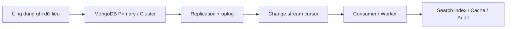
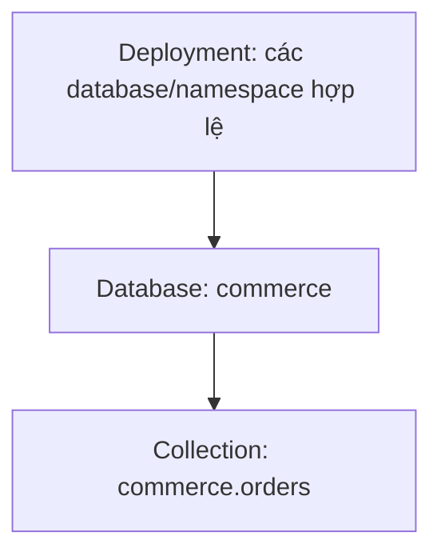
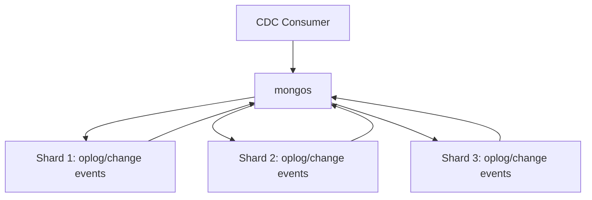

# Theo dõi collection, database hoặc deployment theo phạm vi hỗ trợ bằng Change Streams trong MongoDB

> **Module:** Database Engine Document MongoDB  
> **Chương:** Change stream

## 1. Bài toán: phát hiện thay đổi dữ liệu mà không liên tục polling

Một hệ thống thương mại điện tử sử dụng MongoDB lưu các collection:

- `orders`: đơn hàng.
- `payments`: giao dịch thanh toán.
- `customers`: thông tin khách hàng.
- `inventory`: tồn kho.

Khi đơn hàng chuyển trạng thái từ `NEW` sang `PAID`, nhiều thành phần có thể cần biết:

1. Worker tạo phiếu xuất kho.
2. Dịch vụ thông báo cập nhật trạng thái.
3. Dịch vụ tìm kiếm cập nhật tài liệu index.
4. Dashboard nhận sự kiện để cập nhật số liệu.
5. Hệ thống audit ghi nhận một thay đổi đã xảy ra.

Một phương án đơn giản là định kỳ gọi:

```javascript
db.orders.find({
  updatedAt: { $gt: lastCheckTime }
});
```

Tuy nhiên, **polling theo updatedAt** có nhiều vấn đề: phát sinh query lặp lại, có độ trễ theo chu kỳ, dễ bỏ sót nếu ứng dụng quên cập nhật `updatedAt`, khó nhận biết delete và phức tạp khi timestamp trùng/clock lệch.

MongoDB cung cấp **Change Streams** để ứng dụng đăng ký nhận luồng sự kiện thay đổi từ database. Thay vì quét liên tục collection, ứng dụng mở **change stream cursor** và nhận các event theo cơ chế mà MongoDB hỗ trợ.

Nhưng không phải mọi ứng dụng đều cần theo dõi cùng một phạm vi. Có ba mức thường gặp:

1. **Collection-level:** chỉ theo dõi một collection.
2. **Database-level:** theo dõi các collection đủ điều kiện trong một database.
3. **Deployment-level:** theo dõi các namespace đủ điều kiện trên toàn replica set hoặc sharded cluster.

Mỗi mức có API, quyền truy cập, phạm vi sự kiện và hệ quả vận hành khác nhau.

**Mục tiêu bài học:** lựa chọn đúng phạm vi `watch()`, biết cách mở stream, lọc event, quản lý token và xử lý các giới hạn, không nhầm một Change Stream với message broker lưu trữ sự kiện vô thời hạn.

## 2. Change Stream là gì?

Change Stream là một cơ chế đọc **các thay đổi đã được MongoDB ghi nhận và đủ điều kiện phát ra**, dưới dạng những document sự kiện.

Một event minh họa:

```javascript
{
  _id: { _data: "..." },
  operationType: "insert",
  clusterTime: Timestamp(1794600000, 1),
  ns: {
    db: "commerce",
    coll: "orders"
  },
  documentKey: {
    _id: "O-101"
  },
  fullDocument: {
    _id: "O-101",
    customerId: "C-1",
    status: "NEW",
    totalCents: 120000
  }
}
```

Các trường cần nhớ:

| Trường | Ý nghĩa |
|---|---|
| `_id` | **Resume token** của change event; phải coi là giá trị opaque |
| `operationType` | Loại thay đổi: `insert`, `update`, `replace`, `delete` hoặc loại sự kiện phù hợp khác |
| `clusterTime` | Mốc thời gian logic của event, không phải giờ wall-clock dùng tính latency tuyệt đối |
| `ns.db` | Database chứa namespace thay đổi |
| `ns.coll` | Collection chứa namespace thay đổi, nếu event có collection cụ thể |
| `documentKey` | Khóa nhận diện document đã thay đổi, thường bao gồm `_id` |
| `fullDocument` | Nội dung document với những trường hợp/option mà MongoDB hỗ trợ |
| `updateDescription` | Mô tả các field thay đổi trong một event `update` |

Một stream là **cursor sống lâu**: ứng dụng mở cursor rồi nhận event khi dữ liệu đổi, có thể phải chờ nếu hiện chưa có event.



Sơ đồ chỉ thể hiện luồng khái niệm. Ở sharded cluster, MongoDB xử lý stream qua các shard và thành phần định tuyến; không đơn giản là một consumer đọc trực tiếp một oplog duy nhất.

### 2.1. Change Stream khác polling và khác message queue

| Đặc điểm | Change Stream | Polling collection | Message broker |
|---|---|---|---|
| Cách phát hiện | Cursor đọc luồng thay đổi MongoDB | Query định kỳ | Publisher gửi event vào broker |
| Có phát hiện delete | Có, qua event phù hợp | Cần cơ chế riêng | Phụ thuộc event publisher |
| Lưu lịch sử vô hạn | **Không** | Không | Phụ thuộc retention của broker |
| Checkpoint | Resume token | Timestamp/ID do ứng dụng thiết kế | Offset/ack của broker |
| Event là nghiệp vụ hoàn chỉnh | Không phải lúc nào | Không phải lúc nào | Có thể có, nếu publisher thiết kế |
| Dùng cho tích hợp gần thời gian thực | Có | Có, nhưng thường tốn query | Có |
| Xử lý retry/idempotency | Ứng dụng vẫn phải làm | Ứng dụng vẫn phải làm | Consumer vẫn phải làm |

Change Stream cho biết **database đã thay đổi gì**. Nó không tự chuyển một update kỹ thuật thành event nghiệp vụ đầy đủ như `OrderPaid` nếu ứng dụng chưa thiết kế dữ liệu hoặc thông điệp phù hợp.

## 3. Điều kiện hỗ trợ: không phải mọi MongoDB đều watch được

### 3.1. Topology

Change Streams được thiết kế cho:

- **Replica set** với MongoDB Server có hỗ trợ Change Streams.
- **Sharded cluster** với các phiên bản và điều kiện hỗ trợ tương ứng.
- Các deployment do nhà cung cấp quản lý, chẳng hạn MongoDB Atlas, khi tier/tính năng/cấu hình hiện tại hỗ trợ.

**Standalone `mongod` thông thường không hỗ trợ Change Streams theo cách replica set hỗ trợ.** Trên máy học tập, có thể khởi động một **single-node replica set** để thực hành API, nhưng nó không giúp mô phỏng đầy đủ failover và phân tán tải của một deployment nhiều node.

Cơ chế Change Streams gắn với lịch sử replication và **majority-committed changes**. Những thao tác chưa đủ điều kiện commit theo semantics của deployment có thể chưa được phát cho consumer.

### 3.2. Server version

Một mốc quan trọng:

- Change Streams cho **collection** xuất hiện trong MongoDB **3.6** trên topology hỗ trợ.
- Theo dõi ở phạm vi **database** và **deployment** có sẵn trên MongoDB **4.0 trở lên** theo phạm vi và các giới hạn của phiên bản.
- Một số tính năng nâng cao, chẳng hạn **pre-/post-images**, **expanded DDL events** hoặc các option resume, yêu cầu phiên bản server mới hơn.

Vì vậy, cú pháp `watch()` có thể trông giống nhau nhưng **tập operation types và options được phép** không nhất thiết giống nhau giữa các phiên bản.

Khi viết code dùng `MongoClient.watch()` trên cluster cũ hoặc deployment managed đặc biệt, hãy kiểm tra tài liệu của server version và tính năng nhà cung cấp.

### 3.3. Storage, namespace và các giới hạn khác

Change Streams không phải công cụ tùy ý quan sát mọi nội dung hệ thống:

- Các **view thông thường** không phải target thay đổi trực tiếp như collection vật lý.
- Những **system collections** và namespace nội bộ có giới hạn riêng.
- Các database nội bộ như `admin`, `local`, `config` có các giới hạn về việc theo dõi trực tiếp hoặc sự kiện được phát; không coi deployment-level stream là quyền truy cập không giới hạn vào toàn bộ metadata nội bộ.
- Những loại collection đặc biệt, bao gồm time series, có điều kiện/tập sự kiện phụ thuộc MongoDB version.
- Người dùng cần **quyền `changeStream` và quyền đọc phù hợp** theo tài nguyên/phạm vi.
- Một số option chỉ có hiệu lực khi pre-images hoặc tính năng tương ứng đã được bật.
- Change Stream cursor có thể bị ảnh hưởng khi collection/database bị drop hoặc rename.

**Bài học tập trung vào dữ liệu ứng dụng trong collection thường**, để làm rõ phạm vi. Khi áp dụng trên time series, system namespace hoặc deployment managed, kiểm tra tài liệu hiện hành của loại deployment đó.

### 3.4. Kiểm tra sơ bộ deployment

Trong `mongosh`:

```javascript
print("Server version:", db.version());
printjson(db.hello());
```

Trên replica set, `hello` thường cho biết tên replica set và role. Với sharded cluster, hãy kết nối qua `mongos` theo topology được hỗ trợ. Không suy ra toàn bộ cluster đã ở cùng phiên bản chỉ từ một member duy nhất nếu đang thực hiện rolling upgrade.

Đối với Atlas hoặc dịch vụ managed, dùng thông tin cluster/tier/feature từ nền tảng quản trị thay vì thay đổi cấu hình nội bộ chỉ để bật watch.

## 4. Ba phạm vi watch(): bảng phân biệt

Có thể biểu diễn bằng ba vòng phạm vi:



| Tiêu chí | Collection-level | Database-level | Deployment-level |
|---|---|---|---|
| `mongosh` | `db.orders.watch()` | `db.watch()` | `db.getMongo().watch()` |
| Java Sync Driver | `MongoCollection.watch()` | `MongoDatabase.watch()` | `MongoClient.watch()` |
| Phạm vi | Một collection được chọn | Các collection phù hợp trong một database | Các namespace phù hợp toàn deployment |
| Có nhận event collection khác cùng database? | Không | Có | Có |
| Có nhận event database khác? | Không | Không | Có |
| Ý nghĩa trường `ns` | Thường biết trước collection | Cần xem `ns.coll` để định tuyến | Cần xem `ns.db` và `ns.coll` |
| Lượng event tiềm năng | Thấp nhất nếu chỉ quan tâm một collection | Cao hơn | Có thể cao nhất |
| Quyền cần cấp | Hẹp nhất nếu nghiệp vụ cho phép | Theo database | Rộng hơn, theo cluster/deployment |
| Phù hợp | Worker xử lý đơn hàng | Consumer một domain/database | CDC platform/observability nhiều database |
| Rủi ro | Bỏ sót collection khác nếu domain cần | Vô tình tiêu thụ event không liên quan | Tốn tải và tăng phạm vi dữ liệu có thể quan sát |

**Nguyên tắc:** Chọn **phạm vi hẹp nhất đủ cho yêu cầu**. Không mở deployment-level watch chỉ vì dùng một API được cho là “mạnh hơn”.

### 4.1. Một tình huống cụ thể

Giả sử deployment có:

```text
Deployment rsCommerce
├── commerce
│   ├── orders
│   ├── payments
│   └── customers
├── logistics
│   ├── shipments
│   └── warehouses
└── analytics
    ├── daily_sales
    └── metrics
```

Lúc đó:

- `commerce.orders.watch()` chỉ theo dõi `commerce.orders`.
- `commerce.watch()` có thể theo dõi `orders`, `payments` và `customers` cùng các collection đủ điều kiện khác trong database đó.
- `Mongo.watch()` có thể theo dõi cả `commerce`, `logistics` và `analytics` theo phạm vi/tập namespace được hỗ trợ.

Một event được phát ở scope rộng **không có nghĩa nó nên được xử lý**. Consumer cần lọc và định tuyến theo `ns`, `operationType` và mục đích nghiệp vụ.

## 5. Chuẩn bị môi trường lab

Ví dụ dùng database `change_stream_scope_lab`.

### 5.1. Kết nối replica set lab

Ví dụ:

```bash
mongosh "mongodb://localhost:27101,localhost:27102,localhost:27103/?replicaSet=rsTraining"
```

Nếu bạn chỉ có một node lab, nó cần chạy dưới dạng single-node replica set phù hợp, không phải standalone `mongod`.

Để thực hành watch, tốt nhất mở **hai cửa sổ terminal**:

- **Terminal A** mở change stream rồi chờ sự kiện.
- **Terminal B** ghi dữ liệu để tạo event.

Nếu chạy một vòng `while (stream.hasNext())` trên cùng shell, nó sẽ chờ lâu khi không có event và không tự cho bạn nhập lệnh insert trong lúc đó.

### 5.2. Tạo collection lab và dữ liệu ban đầu

Trong Terminal B, dùng database riêng:

```javascript
const lab = db.getSiblingDB("change_stream_scope_lab");

lab.createCollection("orders");
lab.createCollection("payments");
lab.createCollection("customers");

lab.orders.insertOne({
  _id: "O-001",
  customerId: "C-001",
  status: "NEW",
  totalCents: 25000,
  createdAt: new Date()
});

lab.customers.insertOne({
  _id: "C-001",
  displayName: "Alice"
});

print("Collections prepared.");
```

Những thao tác tạo dữ liệu này xảy ra **trước khi mở stream** nếu bạn làm đúng thứ tự trên. Thông thường, stream mới không tự phát lại toàn bộ lịch sử quá khứ trừ khi bạn yêu cầu bắt đầu/resume từ mốc hợp lệ.

> **An toàn:** Dùng database lab riêng. Không xóa/rename collection production để quan sát Change Streams. Nếu collection hoặc document đã tồn tại, các lệnh tạo có thể báo lỗi; dùng dữ liệu lab mới thay vì phá dữ liệu người khác.

### 5.3. Tạo thay đổi sau khi watch đã sẵn sàng

Dùng Terminal B sau khi Terminal A bắt đầu watch:

```javascript
const lab = db.getSiblingDB("change_stream_scope_lab");

lab.orders.insertOne({
  _id: "O-002",
  customerId: "C-001",
  status: "NEW",
  totalCents: 50000,
  createdAt: new Date()
});

lab.orders.updateOne(
  { _id: "O-002" },
  {
    $set: {
      status: "PAID",
      paidAt: new Date()
    }
  }
);

lab.payments.insertOne({
  _id: "P-002",
  orderId: "O-002",
  status: "AUTHORIZED",
  amountCents: 50000
});

lab.customers.updateOne(
  { _id: "C-001" },
  { $set: { displayName: "Alice Nguyễn" } }
);

lab.orders.deleteOne({ _id: "O-002" });
```

Kết quả watch sẽ khác nhau tùy phạm vi được chọn ở các phần sau.

## 6. Collection-level: theo dõi một collection bằng collection.watch()

Đây là phạm vi dễ bắt đầu và thường phù hợp nhất cho một worker xử lý đúng một loại document.

Trong Terminal A:

```javascript
const lab = db.getSiblingDB("change_stream_scope_lab");
const stream = lab.orders.watch();

try {
  while (stream.hasNext()) {
    const event = stream.next();

    printjson({
      operationType: event.operationType,
      ns: event.ns,
      documentKey: event.documentKey,
      clusterTime: event.clusterTime
    });
  }
} finally {
  stream.close();
}
```

Sau khi watch được mở, tạo các thay đổi ở Terminal B.

### 6.1. Event nào sẽ được nhìn thấy?

Trong ví dụ:

- Insert O-002 trong `orders` → có thể tạo event `insert`.
- Update O-002 → event `update`.
- Delete O-002 → event `delete`.
- Insert `payments.P-002` → **không thuộc collection orders**.
- Update `customers.C-001` → **không thuộc collection orders**.

Đó là semantics chính của scope collection.

Một cách lọc chỉ những loại thay đổi mong muốn:

```javascript
const stream = lab.orders.watch([
  {
    $match: {
      operationType: {
        $in: ["insert", "update", "replace", "delete"]
      }
    }
  }
]);
```

`$match` ở đây lọc **change event** sau khi MongoDB tạo event, không phải query `orders.find()` trả các document hiện tại.

### 6.2. Collection.watch() không phải find()

So sánh:

```javascript
// Chụp một phần trạng thái hiện có:
lab.orders.find({ status: "PAID" });

// Theo dõi những thay đổi phát sinh:
lab.orders.watch([
  { $match: { operationType: "update" } }
]);
```

`find()` trả document thỏa điều kiện hiện tại. `watch()` trả **lịch sử thay đổi từ vị trí bắt đầu hợp lệ của stream** và tiếp tục chờ các thay đổi mới.

Muốn xây một search index hoặc cache từ đầu, thường cần:

1. **Initial snapshot/backfill** của dữ liệu hiện có.
2. **Change Stream** để bắt các thay đổi tiếp theo.
3. Một protocol đồng bộ mốc snapshot với stream để không mất sự kiện giữa hai bước.

Chỉ gọi `watch()` không tự đưa mọi document cũ vào consumer.

### 6.3. Khi nào collection scope là lựa chọn tốt?

- Worker duy nhất cần biết `orders` thay đổi.
- Service làm cache của một collection.
- Đồng bộ một loại document sang search index.
- Domain có ranh giới collection rõ ràng.
- Muốn cấp quyền đọc/change stream ở phạm vi hẹp.

Không cần nâng lên database/deployment watch khi mọi event ngoài `orders` đều bị bỏ qua.

## 7. Database-level: theo dõi nhiều collection trong cùng database

Nếu một workflow cần quan sát cả đơn hàng, thanh toán và khách hàng trong cùng database, có thể mở stream tại database:

```javascript
const lab = db.getSiblingDB("change_stream_scope_lab");

const stream = lab.watch();

try {
  while (stream.hasNext()) {
    const event = stream.next();

    printjson({
      operationType: event.operationType,
      namespace: event.ns,
      documentKey: event.documentKey
    });
  }
} finally {
  stream.close();
}
```

Với thao tác ở Terminal B, stream database có thể nhận event CRUD từ:

- `change_stream_scope_lab.orders`.
- `change_stream_scope_lab.payments`.
- `change_stream_scope_lab.customers`.

Không nhận event từ một database ứng dụng khác chỉ vì nó nằm trong cùng replica set.

### 7.1. Lọc theo collection trong database stream

Có thể giới hạn event cần xử lý:

```javascript
const stream = lab.watch([
  {
    $match: {
      "ns.coll": {
        $in: ["orders", "payments"]
      },
      operationType: {
        $in: ["insert", "update", "replace", "delete"]
      }
    }
  }
]);
```

Điều này tạo **một database-level stream** nhưng pipeline chỉ đưa tới consumer những event khớp collection và loại operation. Nó có thể hữu ích khi một worker cần cả orders và payments.

**Lưu ý:** Lọc stream **không thay thế authorization**. Một service có khả năng mở database-level watch thường cần quyền rộng hơn một service chỉ được xem một collection, dù pipeline sau đó lọc phần lớn event.

### 7.2. Dùng ns.coll để định tuyến

Một worker có thể xử lý theo loại collection:

```javascript
function handleDatabaseEvent(event) {
  const collectionName = event.ns && event.ns.coll;

  if (collectionName === "orders") {
    print("Order event:", event.operationType);
    return;
  }

  if (collectionName === "payments") {
    print("Payment event:", event.operationType);
    return;
  }

  print("Ignored collection:", collectionName);
}
```

Khi dùng stream phạm vi rộng, trường `ns.coll` không nên được bỏ qua. Một event `delete` trên `payments` và một event `delete` trên `orders` có thể có `documentKey._id` trùng chuỗi nhưng **khác ý nghĩa**.

### 7.3. Database-level watch có thay thế được hai collection streams?

Có thể, nếu:

- Worker có cùng SLA/retention/retry cho các loại event.
- Cùng một thành phần chịu trách nhiệm xử lý.
- Không muốn quản lý nhiều cursor.
- Khối lượng sự kiện của database ở mức có thể tiêu thụ.

Nhưng nếu `orders` và `payments` có chính sách bảo mật hoặc criticality rất khác nhau, hai collection streams có thể dễ cô lập lỗi/tải và quyền truy cập hơn.

Không có quy tắc “một stream luôn nhanh hơn hai stream” áp dụng mọi workload. Cần đo tài nguyên MongoDB và consumer.

## 8. Deployment-level: theo dõi nhiều database bằng Mongo.watch()

Khi một CDC platform cần quan sát nhiều database ứng dụng trong cùng deployment, có thể mở stream ở cấp deployment:

```javascript
const conn = db.getMongo();
const stream = conn.watch();

try {
  while (stream.hasNext()) {
    const event = stream.next();

    printjson({
      operationType: event.operationType,
      namespace: event.ns,
      documentKey: event.documentKey
    });
  }
} finally {
  stream.close();
}
```

Với Java Sync Driver, phương thức tương ứng là `MongoClient.watch()`, trình bày ở phần sau.

### 8.1. Scope deployment thực sự bao gồm gì?

Một deployment-level stream có thể nhận thay đổi từ **các database và collection đủ điều kiện** trên replica set/sharded cluster theo version và quyền. Nó không đồng nghĩa truy cập mọi namespace nội bộ, view và system collection.

Một platform CDC có thể muốn:

```text
commerce.orders
commerce.payments
logistics.shipments
identity.profiles
```

từ cùng cluster. Deployment-level watch cho phép dùng một entrypoint và filter/route theo `ns.db` + `ns.coll`.

### 8.2. Lọc theo database và collection

Ví dụ chỉ quan tâm `commerce.orders` và `logistics.shipments`:

```javascript
const stream = db.getMongo().watch([
  {
    $match: {
      $or: [
        {
          "ns.db": "commerce",
          "ns.coll": "orders"
        },
        {
          "ns.db": "logistics",
          "ns.coll": "shipments"
        }
      ],
      operationType: {
        $in: ["insert", "update", "replace", "delete"]
      }
    }
  }
]);
```

Đây là ví dụ filter namespace; nó không yêu cầu các database `commerce`/`logistics` tồn tại trong lab đã tạo. Trên lab, thay bằng tên database phù hợp.

### 8.3. Vì sao deployment scope có rủi ro lớn hơn?

- Có thể nhận nhiều event không liên quan.
- Tăng tài nguyên server/cursor và throughput network/consumer.
- Một lỗi consumer có thể ảnh hưởng nhiều domain.
- Quyền change stream cấp rộng hơn, không phù hợp nguyên tắc least privilege cho nhiều service.
- Khó giữ SLA khác nhau cho từng collection.
- Phải xử lý khả năng database/collection được tạo, rename hoặc drop theo semantics sự kiện hỗ trợ.
- Ở sharded cluster, luồng tổng hợp nhiều shard có chi phí và quy tắc ordering riêng.

**Nguyên tắc:** Chỉ dùng deployment-level watch cho thành phần có trách nhiệm quan sát nhiều database, ví dụ CDC infrastructure được cấp quyền rõ ràng. Worker phục vụ riêng `orders` nên ưu tiên collection scope.

## 9. So sánh bằng một bài thực nghiệm

Giả sử mở ba stream khác nhau ở ba cửa sổ/consumer:

1. `change_stream_scope_lab.orders.watch()`.
2. `change_stream_scope_lab.watch()`.
3. `db.getMongo().watch()`.

Sau đó chạy:

```javascript
const lab = db.getSiblingDB("change_stream_scope_lab");

lab.orders.insertOne({
  _id: "O-100",
  status: "NEW"
});

lab.payments.insertOne({
  _id: "P-100",
  orderId: "O-100",
  status: "CREATED"
});

db.getSiblingDB("another_lab").getCollection("logs").insertOne({
  _id: "L-100",
  message: "Something changed"
});
```

Dự đoán:

| Sự kiện | Collection watch orders | Database watch lab | Deployment watch |
|---|---|---|---|
| Insert `change_stream_scope_lab.orders` | Có | Có | Có |
| Insert `change_stream_scope_lab.payments` | Không | Có | Có |
| Insert `another_lab.logs` | Không | Không | Có nếu namespace đủ điều kiện |
| Update `change_stream_scope_lab.customers` | Không | Có | Có |
| Delete `another_lab.logs` | Không | Không | Có nếu namespace đủ điều kiện |

Bảng giả định các stream đã mở **trước khi thao tác diễn ra**, không có pipeline lọc bỏ event và deployment hỗ trợ scope tương ứng.

### 9.1. Vì sao bắt đầu watch trước write?

Một stream mới thường khởi đầu ở vị trí do server/driver xác định khi stream được mở. Nó không mặc định replay toàn bộ lịch sử trước đó.

Nếu tạo event rồi mới mở watch và không dùng resume token/mốc bắt đầu hợp lệ, bạn có thể không thấy event đã xảy ra trước đó. Điều này không phải lỗi của CRUD; đó là vấn đề **vị trí bắt đầu của stream**.

## 10. Bên trong event: insert, update, replace, delete

Consumer phải hiểu khác biệt giữa các loại operation.

### 10.1. Insert

Với:

```javascript
lab.orders.insertOne({
  _id: "O-200",
  status: "NEW",
  totalCents: 25000
});
```

Một event thường có:

```javascript
{
  operationType: "insert",
  ns: { db: "change_stream_scope_lab", coll: "orders" },
  documentKey: { _id: "O-200" },
  fullDocument: {
    _id: "O-200",
    status: "NEW",
    totalCents: 25000
  },
  _id: { /* opaque resume token */ }
}
```

`fullDocument` thường được cung cấp cho event insert. Đây là tài liệu event minh họa; trường metadata khác tùy server/version/option.

### 10.2. Update

Với:

```javascript
lab.orders.updateOne(
  { _id: "O-200" },
  {
    $set: { status: "PAID" },
    $unset: { obsoleteField: "" }
  }
);
```

Event `update` thường có:

```javascript
{
  operationType: "update",
  documentKey: { _id: "O-200" },
  updateDescription: {
    updatedFields: {
      status: "PAID"
    },
    removedFields: ["obsoleteField"]
  }
}
```

Một update event không mặc nhiên chứa đầy đủ document như insert. Nếu consumer cần trạng thái mới của toàn document, xem `fullDocument: "updateLookup"` hoặc các option post-image được hỗ trợ.

### 10.3. Replace

Với:

```javascript
lab.orders.replaceOne(
  { _id: "O-200" },
  {
    _id: "O-200",
    status: "SHIPPED",
    totalCents: 25000
  }
);
```

Event có thể là `replace` và có `fullDocument` đại diện cho nội dung thay thế.

Không mã hóa business logic bằng giả định rằng mọi biến động của field `status` đều phát ra event `update`. Thao tác `replaceOne()` có thể tạo operation type khác.

### 10.4. Delete

Với:

```javascript
lab.orders.deleteOne({ _id: "O-200" });
```

Delete event thường chứa `documentKey` để xác định document bị xóa, **không mặc nhiên kèm toàn bộ document trước khi xóa**.

Nếu consumer cần tenantId, customerId hay trạng thái trước delete mà các giá trị đó không nằm trong document key, có thể cần:

- Change stream pre-images được bật và hỗ trợ.
- Event nghiệp vụ/outbox có đủ thông tin.
- Một lookup/cache liên kết đang lưu thông tin trước delete.
- Hoặc một thiết kế khác tránh hard delete không có dữ liệu truy vết.

### 10.5. Thay đổi không tạo event

Không phải mỗi câu lệnh update đều tạo event có ý nghĩa. Ví dụ update đặt field về đúng giá trị hiện có có thể không gây thay đổi dữ liệu thực tế theo cách tạo một event quan sát được. Ngoài ra, một update không match document nào sẽ không tạo event CRUD cho document không tồn tại.

Không dùng số command gửi đi làm số event bắt buộc phải nhận.

## 11. fullDocument: "updateLookup" và giới hạn dữ liệu sau update

Khi cần toàn bộ document sau update, có thể mở:

```javascript
const stream = lab.orders.watch(
  [
    {
      $match: {
        operationType: {
          $in: ["insert", "update", "replace"]
        }
      }
    }
  ],
  {
    fullDocument: "updateLookup"
  }
);
```

Với event update, server có thể lookup document hiện tại để trả `fullDocument`.

**Nhưng cần ghi nhớ:** `updateLookup` **không bảo đảm ảnh chụp chính xác ngay tại thời điểm của event update** nếu có thay đổi khác xảy ra sau đó. Nó có thể phản ánh một trạng thái mới hơn, hoặc document không còn tồn tại khi lookup diễn ra.

Ví dụ:

```text
T1: update status NEW → PAID
T2: update status PAID → SHIPPED
T3: change stream lookup document cho event T1

fullDocument của event T1 có thể phản ánh SHIPPED,
không nhất thiết là trạng thái PAID đúng sau T1.
```

Vì vậy:

- Nếu cần biết **field nào đổi ở event T1**, xem `updateDescription`.
- Nếu cần trạng thái **sau event đúng mốc đó**, xem post-images khi version/tính năng hỗ trợ và đã cấu hình.
- Nếu chỉ cần đồng bộ cache về **trạng thái mới nhất**, `updateLookup` có thể hợp lý tùy yêu cầu.
- Không coi `fullDocument: "updateLookup"` là snapshot bất biến của event.

### 11.1. fullDocument null có thể có ý nghĩa gì?

Nếu document bị xóa trước khi lookup hoàn tất hoặc không thể lấy theo điều kiện hiện tại, `fullDocument` có thể không chứa document như bạn mong muốn. Consumer phải xử lý trường hợp null/missing, thay vì dereference mà không kiểm tra.

## 12. Pre-images và post-images: khi cần biết trước/sau một thay đổi

Các phiên bản MongoDB hiện đại hỗ trợ **change stream pre- and post-images** cho những tình huống được bật cấu hình phù hợp, đáng chú ý từ MongoDB **6.0**.

- **Pre-image:** document trước thao tác thay đổi.
- **Post-image:** document sau thao tác thay đổi.
- **updateDescription:** chỉ mô tả phần thay đổi, không đồng nghĩa có đủ trạng thái cũ.

Ví dụ ứng dụng chuyển đơn từ tenant A sang tenant B:

```text
Trước:
  tenantId = "A"
  status = "PAID"

Sau:
  tenantId = "B"
  status = "PAID"
```

Consumer cập nhật báo cáo theo tenant phải biết cả bucket cũ và bucket mới. Nếu chỉ có `fullDocument` hiện tại, nó có thể không biết cần trừ doanh thu khỏi tenant A.

### 12.1. Bật lưu pre/post images cho collection (phiên bản phù hợp)

Ví dụ trên MongoDB Server hỗ trợ:

```javascript
db.getSiblingDB("change_stream_scope_lab").runCommand({
  collMod: "orders",
  changeStreamPreAndPostImages: {
    enabled: true
  }
});
```

Đây là thao tác thay đổi cấu hình collection, cần quyền quản trị phù hợp và phải cân nhắc tác động lưu trữ. Chỉ thực hiện trong lab hoặc production theo runbook. Không phải mọi deployment/version hỗ trợ cùng cấu hình.

### 12.2. Yêu cầu pre-image khi mở stream

Ví dụ:

```javascript
const stream = lab.orders.watch(
  [],
  {
    fullDocumentBeforeChange: "whenAvailable"
  }
);
```

Các giá trị option được hỗ trợ có thể gồm:

- `"whenAvailable"`: trả pre-image nếu khả dụng, không yêu cầu mọi event phải có.
- `"required"`: yêu cầu pre-image, có thể báo lỗi khi không có pre-image phù hợp.

Các lựa chọn cho post-image cũng phụ thuộc version và options. Cần đọc tài liệu chính xác của MongoDB Server đang dùng.

### 12.3. Lưu ý quan trọng về retention

- Bật pre/post images **không tái tạo ảnh trước/sau cho các event quá khứ** đã xảy ra trước khi bật.
- Retention và cleanup có giới hạn; không mặc định images được giữ mãi mãi.
- Image có thể mất khi lịch sử cần thiết không còn khả dụng.
- Images làm tăng chi phí lưu trữ/I/O và có thể chứa dữ liệu nhạy cảm.
- Quyền đọc event/image cần tương thích với chính sách dữ liệu.
- Nếu một workflow bắt buộc có pre-image để tính delta, phải có kế hoạch xử lý khi image thiếu.

## 13. Resume token: tiếp tục stream sau restart

Một worker thường không chạy mãi mà không bị restart. Nó có thể:

- Được deploy lại.
- Crash.
- Mất kết nối.
- Bị timeout.
- Gặp election/failover.
- Bị dừng để bảo trì.

Change Stream hỗ trợ tiếp tục từ vị trí đã đọc bằng **resume token**.

### 13.1. Token nằm ở đâu?

Trong một change event:

```javascript
{
  _id: {
    _data: "..."
  },
  operationType: "insert",
  ...
}
```

Ở đây **`event._id` là resume token**, không phải ID của document đã thay đổi.

Trong khi đó:

```javascript
event.documentKey._id
```

mới thường là ID của document nguồn.

**Đây là hai giá trị hoàn toàn khác nhau.**

### 13.2. Resume từ token

Ví dụ minh họa:

```javascript
const savedToken = /* BSON resume token lưu từ event trước */;

const stream = lab.orders.watch(
  [],
  {
    resumeAfter: savedToken
  }
);
```

Khi triển khai thực tế, token cần được lưu đúng dạng BSON để dùng lại. Không tự nối chuỗi `_data`, không dùng `Date.now()` thay token và không sửa các byte trong token.

### 13.3. Thứ tự checkpoint đúng

Một luồng xử lý đơn giản:

```text
Nhận event E
    ↓
Xử lý E idempotent
    ↓
Ghi kết quả thành công
    ↓
Lưu resume token E
    ↓
Đọc event tiếp theo
```

Nếu lưu token **trước khi xử lý event**, rồi worker crash, lần khởi động sau có thể bỏ qua E mà chưa làm công việc cần thiết.

Nếu xử lý E rồi crash **trước khi lưu token**, lần sau E có thể được nhận lại. Vì vậy consumer phải có **idempotency/deduplication** hoặc một cơ chế checkpoint và side effect được phối hợp nhất quán.

### 13.4. Token có thể hết khả năng resume

Change Streams phụ thuộc vào lịch sử thay đổi có sẵn trên MongoDB. Nếu worker dừng quá lâu, các oplog entry cần thiết có thể không còn trong cửa sổ lưu giữ.

Khi đó resume từ token cũ có thể thất bại. Không nên retry mãi cùng một token không còn hiệu lực.

Cần:

1. Phát hiện lỗi resume không thể phục hồi.
2. Đánh giá khoảng dữ liệu bị bỏ lỡ.
3. Thực hiện full reconciliation/backfill.
4. Thiết lập lại mốc bắt đầu/checkpoint đúng sau khi đồng bộ.
5. Theo dõi lag và thời gian retention để giảm rủi ro tái diễn.

### 13.5. Không lưu mỗi clusterTime thay cho resume token

`clusterTime` là logical timestamp; resume token mang thông tin vị trí stream được server tạo ra. Hai thứ không tương đương.

MongoDB còn hỗ trợ các lựa chọn khởi đầu như `startAtOperationTime` hoặc `startAfter` trong những phiên bản/tình huống phù hợp. Đó là các cơ chế riêng; không thay `resumeAfter` bằng một timestamp đoán từ đồng hồ ứng dụng.

## 14. resumeAfter, startAfter và startAtOperationTime

Ba option này dễ bị nhầm.

| Option | Ý nghĩa | Trường hợp thường dùng |
|---|---|---|
| `resumeAfter` | Bắt đầu sau một resume token hợp lệ | Worker restart tiếp tục sau event đã xử lý |
| `startAfter` | Bắt đầu sau token, kể cả tình huống cần tiếp tục sau invalidate theo hỗ trợ | Mở stream mới sau collection rename/drop hoặc lifecycle phù hợp |
| `startAtOperationTime` | Bắt đầu theo mốc thời gian logic được hỗ trợ | Khởi động CDC/backfill với mốc logic do hệ thống quản lý |

Không dùng đồng thời các option bắt đầu loại trừ nhau trong cùng một stream.

### 14.1. Vì sao resumeAfter không dùng được sau invalidate?

Với **collection stream**, các thao tác như drop hoặc rename có thể phát event `invalidate` khiến stream trở nên không còn hợp lệ theo namespace cũ.

Sau invalidate, `resumeAfter` không phải cách được hỗ trợ để tiếp tục stream đó. Khi cần tạo stream mới sau một event invalidate và version hỗ trợ, có thể dùng **`startAfter`** theo tài liệu.

Tuy nhiên, không coi `startAfter` là cách tự động “theo collection mới đổi tên” mà không thiết kế lại namespace. Sau rename/drop, mục tiêu watch ban đầu có thể không còn là collection mà ứng dụng muốn theo dõi.

### 14.2. Một cursor có thể không sinh event nào

Stream không hoạt động cũng có thể có resume state được driver/server cập nhật qua các batch rỗng trong những phiên bản phù hợp. Một số API cursor hỗ trợ lấy resume token mới nhất, không chỉ token của event cuối cùng.

Không nên tự phát sinh một token “giả” để ghi checkpoint trong lúc idle.

### 14.3. Token gắn với phạm vi và pipeline

Một token được tạo từ một stream có ngữ cảnh về cluster, namespace và thời gian. Không tự giả định có thể lấy token của `orders.watch()` và sử dụng tùy ý cho một `MongoClient.watch()` với pipeline khác, nhất là sau khi thay namespace hoặc thay cấu hình lớn.

Khi đổi scope hoặc thay đổi filter có thể bỏ qua sự kiện, cần lập kế hoạch migration checkpoint/backfill, không chỉ copy token cũ.

## 15. Drop, rename và invalidate khác nhau theo phạm vi watch

Lệnh quản trị collection/database có thể ảnh hưởng trực tiếp đến vòng đời stream.

### 15.1. Collection-level

Ví dụ đang watch `commerce.orders`. Sau đó collection `orders` bị drop hoặc rename.

Các thao tác này thường làm collection-level change stream nhận sự kiện lifecycle thích hợp và **invalidate**. Cursor không thể tiếp tục vô hạn như thể namespace ban đầu không thay đổi.

### 15.2. Database-level

Nếu chỉ một collection trong database bị drop, database-level stream có phạm vi rộng hơn và có thể tiếp tục nhận event cho các collection khác theo semantics phiên bản.

Nếu **database đang được watch** bị drop, database-level stream có thể bị invalidate.

### 15.3. Deployment-level

Một stream ở cấp deployment bao phủ nhiều namespace đủ điều kiện. Việc drop/rename một collection không nhất thiết có nghĩa toàn bộ stream của mọi database phải ngừng; nhưng consumer vẫn phải xử lý các event lifecycle được cung cấp và thay đổi namespace theo phiên bản hỗ trợ.

### 15.4. Vì sao không hardcode một quy tắc chung?

Một số event chỉ xuất hiện khi bật option **expanded events** hoặc dùng server version nhất định. Trường `ns` và `operationType` của event DDL cũng có thể khác event CRUD thông thường.

**Quy tắc vận hành:**

- Với collection stream, chuẩn bị nhánh xử lý invalidate.
- Với database/deployment stream, xử lý thay đổi namespace đúng scope.
- Không xóa checkpoint ngay khi thấy `drop` mà chưa xác định mục tiêu recovery.
- Khi rename, cập nhật routing/ACL/collection name theo thiết kế nghiệp vụ.
- Không coi một stream đã invalidate có thể tiếp tục bằng `next()` mãi mãi.

## 16. Expanded events: phát hiện thay đổi DDL khi phiên bản hỗ trợ

Ngoài CRUD, MongoDB phiên bản hiện đại có thể cung cấp những event cho thay đổi schema/namespace, ví dụ thao tác tạo collection, index hoặc thay đổi metadata trong ngữ cảnh cho phép.

Một số sự kiện mở rộng chỉ được phát khi bật option **`showExpandedEvents`** trên những phiên bản hỗ trợ (đáng chú ý MongoDB 6.0+).

Ví dụ hình thức:

```javascript
const stream = lab.watch(
  [],
  {
    showExpandedEvents: true
  }
);
```

**Không giả định mọi server hoặc mọi deployment managed đều chấp nhận option trên.** Kiểm tra version và namespace support trước.

### 16.1. Tại sao DDL event hữu ích?

Một CDC platform theo dõi database động có thể cần biết:

- Collection mới được tạo.
- Collection bị drop.
- Collection đổi tên.
- Index được tạo/bỏ nếu event tương ứng được hỗ trợ.
- Một số thay đổi collection options.

Tuy nhiên, consumer chính chỉ cần đồng bộ document thường nên lọc đúng `insert/update/replace/delete` để không đưa DDL event vào handler dành cho document.

### 16.2. DDL không đồng nghĩa audit đầy đủ

Change Streams không thay thế toàn bộ hệ thống audit MongoDB, đặc biệt đối với security configuration, người đăng nhập, permission changes hoặc mọi lệnh quản trị nội bộ. Nếu cần audit truy cập hoặc thay đổi cấu hình bảo mật, dùng cơ chế audit chuyên dụng được deployment hỗ trợ.

## 17. Change Streams trên sharded cluster

Một sharded cluster có thể lưu document trên nhiều shard. Ứng dụng thường kết nối qua **`mongos`** để chạy query và Change Stream ở scope phù hợp.



Sơ đồ là khái niệm định tuyến/ghép stream, không phải mô tả chính xác mọi cấu trúc cursor nội bộ.

### 17.1. Tại sao nên kết nối qua mongos?

Khi cần theo dõi collection/database trên toàn sharded cluster, `mongos` cung cấp entrypoint cho cluster. Kết nối thẳng vào một shard member và mở stream thường **không thể thay thế** theo dõi mọi shard của namespace.

Một deployment-level stream được mở trên sharded cluster phải xem xét:

- Merge/ordering của những thay đổi giữa các shard theo semantics server.
- Thời gian chờ để bảo đảm không bỏ qua các thay đổi hợp lệ.
- Tài nguyên của `mongos`/shards.
- Việc thay đổi shard membership và di chuyển dữ liệu.
- Resume token của stream sau failover hoặc topology change.

### 17.2. Thứ tự sự kiện không phải thứ tự “business global” tùy ý

Change Streams cung cấp một luồng event theo những bảo đảm và điều kiện của MongoDB, nhưng ứng dụng không nên tự coi:

- Mọi event từ nhiều service có cùng thứ tự wall-clock chính xác.
- Một thay đổi document là một event nghiệp vụ đầy đủ.
- Hai event ở shard khác nhau có quan hệ nhân quả chỉ vì chúng được in trước/sau trong log consumer.
- Một batch event luôn đại diện một transaction ứng dụng.

Nếu nghiệp vụ cần sắp xếp theo sequence riêng cho order, nên có event version/sequence hoặc state machine phù hợp.

### 17.3. Shard key và documentKey

Trên sharded collection, `documentKey` có thể chứa những thông tin khóa giúp xác định document theo quy tắc server và sharding. Không mặc định chỉ có `_id` trong mọi topology.

Dùng `event.getDocumentKey()` hoặc BSON tương đương và xử lý đúng schema thực tế của stream.

### 17.4. Pre/post images và transaction qua shard

Khi một transaction phân tán cập nhật nhiều collection/shard, Change Streams có thể phát các event tương ứng với thao tác commit. Consumer phải quyết định liệu xử lý từng event độc lập đã đủ hay cần gom theo một transaction/business event.

Nếu yêu cầu “tất cả hoặc không” ở hệ thống downstream, một loạt event CRUD riêng biệt **không tự tạo atomicity ở downstream**. Có thể cần outbox/business event hoặc staging và commit marker.

## 18. Bảo mật và phân quyền theo scope

Mở stream ở phạm vi rộng là một quyết định security, không chỉ là chọn method.

### 18.1. Nguyên tắc least privilege

Một consumer chỉ đồng bộ `commerce.orders` thường nên có quyền tương ứng với collection đó, thay vì cấp quyền toàn cluster.

Các quyền cần xét bao gồm:

- Quyền `changeStream` trên resource thích hợp.
- Quyền đọc/`find` theo phạm vi yêu cầu.
- Quyền đọc pre/post images nếu option/triển khai đòi hỏi quyền hoặc cơ chế riêng.
- Quyền trên target namespace khi dùng database/deployment scope.
- Quyền ghi collection checkpoint/outbox riêng nếu consumer lưu tiến độ.

Các role built-in và cách cấp quyền chính xác có thể thay đổi theo version/deployment; nên kiểm tra tài liệu access control và policy tổ chức.

### 18.2. Filter không là biên giới bảo mật

Ví dụ:

```javascript
db.getMongo().watch([
  { $match: { "ns.db": "commerce" } }
]);
```

Pipeline filter event về commerce, nhưng service có thể đã được cấp một quyền watch rộng. Nếu code bị thay đổi hoặc lỗi, quyền đó có thể cho phép quan sát nhiều namespace hơn.

**Bảo mật phải nằm ở quyền của database/role và ranh giới service**, không chỉ ở một `$match` mà chính service tự sửa được.

### 18.3. Multi-tenant

Giả sử nhiều tenant chia sẻ collection `orders`, mỗi document có `tenantId`.

- Collection-level watch vẫn có thể nhận event của nhiều tenant.
- Lọc `fullDocument.tenantId` có thể không ổn định cho delete hoặc một số update không có `fullDocument`.
- Nếu cần route theo tenant, nên đảm bảo metadata đáng tin trong documentKey/event hoặc một cơ chế tra cứu an toàn phù hợp.
- Không cấp cho consumer không đáng tin một stream có khả năng lộ dữ liệu tenant khác rồi hy vọng filter application luôn chính xác.
- Khi tenantId có thể thay đổi, cần hiểu tenant cũ và mới để cập nhật projection/downstream đúng.

## 19. Java Sync Driver: ba API watch() tương ứng

Java Sync Driver có các API trực tiếp trên ba đối tượng:

- `MongoCollection.watch()`.
- `MongoDatabase.watch()`.
- `MongoClient.watch()`.

Cả ba thường trả một dạng `ChangeStreamIterable` với event được biểu diễn qua `ChangeStreamDocument<T>` khi dùng mặc định.

### 19.1. Ví dụ đầy đủ: watch một collection

```java
import com.mongodb.client.ChangeStreamIterable;
import com.mongodb.client.MongoChangeStreamCursor;
import com.mongodb.client.MongoClient;
import com.mongodb.client.MongoClients;
import com.mongodb.client.MongoCollection;
import com.mongodb.client.MongoDatabase;

import com.mongodb.client.model.changestream.ChangeStreamDocument;
import com.mongodb.client.model.changestream.FullDocument;

import org.bson.Document;

public final class CollectionWatchExample {

    public static void main(String[] args) {
        String uri = System.getenv("MONGODB_URI");
        if (uri == null || uri.isBlank()) {
            throw new IllegalArgumentException("MONGODB_URI is required");
        }

        try (MongoClient client = MongoClients.create(uri)) {
            MongoDatabase database =
                    client.getDatabase("change_stream_scope_lab");

            MongoCollection<Document> orders =
                    database.getCollection("orders");

            ChangeStreamIterable<Document> iterable = orders
                    .watch()
                    .fullDocument(FullDocument.UPDATE_LOOKUP);

            try (MongoChangeStreamCursor<ChangeStreamDocument<Document>>
                         cursor = iterable.cursor()) {

                while (!Thread.currentThread().isInterrupted()
                        && cursor.hasNext()) {

                    ChangeStreamDocument<Document> event = cursor.next();

                    System.out.println(
                            "op=" + event.getOperationType()
                                    + ", ns=" + event.getNamespace()
                                    + ", key=" + event.getDocumentKey()
                    );

                    Document after = event.getFullDocument();
                    if (after != null) {
                        System.out.println(after.toJson());
                    }
                }
            }
        }
    }
}
```

Ở đây:

1. `orders.watch()` chỉ theo dõi collection `orders`.
2. `fullDocument(UPDATE_LOOKUP)` yêu cầu lookup post-update khi phù hợp.
3. Cursor được đóng bằng `try-with-resources`.
4. `hasNext()` có thể **block** khi chưa có event.
5. `getDocumentKey()` là khóa document, không phải resume token.
6. Không dùng code này để khẳng định có thể chạy một vòng `while(true)` production mà không có retry/checkpoint/monitoring.

### 19.2. Watch toàn database

Chỉ thay entrypoint:

```java
MongoDatabase database =
        client.getDatabase("change_stream_scope_lab");

ChangeStreamIterable<Document> changes = database.watch();

try (MongoChangeStreamCursor<ChangeStreamDocument<Document>>
             cursor = changes.cursor()) {

    while (cursor.hasNext()) {
        ChangeStreamDocument<Document> event = cursor.next();

        System.out.println(
                event.getNamespace() + " : " + event.getOperationType()
        );
    }
}
```

Kết quả có thể đến từ `orders`, `payments`, `customers` và các collection đủ điều kiện khác trong database.

### 19.3. Watch toàn deployment

Ở mức `MongoClient`:

```java
ChangeStreamIterable<Document> changes = client.watch();

try (MongoChangeStreamCursor<ChangeStreamDocument<Document>>
             cursor = changes.cursor()) {

    while (cursor.hasNext()) {
        ChangeStreamDocument<Document> event = cursor.next();

        System.out.println(
                event.getNamespace() + " : " + event.getOperationType()
        );
    }
}
```

**Khác biệt quan trọng:** `client.watch()` không chỉ theo dõi database mà bạn đã gọi `client.getDatabase(...)` ở một đoạn code khác. Nó dùng phạm vi deployment được MongoDB hỗ trợ cho kết nối đó.

### 19.4. Lọc CRUD bằng pipeline Java

```java
import com.mongodb.client.model.Aggregates;
import com.mongodb.client.model.Filters;
import org.bson.conversions.Bson;

import java.util.List;

List<Bson> pipeline = List.of(
    Aggregates.match(
        Filters.in(
            "operationType",
            "insert",
            "update",
            "replace",
            "delete"
        )
    )
);

// Có thể dùng với collection.watch(pipeline),
// database.watch(pipeline) hoặc client.watch(pipeline)
// tùy scope mong muốn và server hỗ trợ.
ChangeStreamIterable<Document> changes =
        database.watch(pipeline);
```

Pipeline là các stage xử lý **event documents**; những filter thông thường như `operationType`, `ns.db` và `ns.coll` có thể giúp giảm lượng dữ liệu đến consumer.

### 19.5. Không trộn ChangeStreamDocument với document nguồn

Trong Java:

- `ChangeStreamDocument<Document> event`: đối tượng **sự kiện thay đổi**.
- `event.getFullDocument()`: document nguồn khi MongoDB cung cấp.
- `event.getDocumentKey()`: key của document nguồn.
- `event.getResumeToken()`: token của stream.

Nếu bạn chỉ lưu `getDocumentKey()` làm checkpoint rồi gọi `resumeAfter(...)`, đó là sai loại dữ liệu. Resume token cần được lấy từ field/token do driver cung cấp.

## 20. Java: checkpoint và resume token

Một worker thực tế cần khởi động lại từ tiến độ đã ghi.

### 20.1. Ví dụ lưu token trong collection checkpoint

Một document thiết kế đơn giản:

```javascript
{
  _id: "orders-cdc-worker",
  scope: "change_stream_scope_lab.orders",
  token: { _data: "..." },
  updatedAt: ISODate("2026-11-14T05:00:00Z")
}
```

Trong Java, token là `BsonDocument` và có thể lưu dạng BSON phù hợp vào collection; không serialize/deserialize theo cách làm mất type metadata.

Ví dụ khung logic:

```java
import org.bson.BsonDocument;
import com.mongodb.client.MongoCollection;
import com.mongodb.client.model.UpdateOptions;

import static com.mongodb.client.model.Filters.eq;
import static com.mongodb.client.model.Updates.combine;
import static com.mongodb.client.model.Updates.set;

void saveCheckpoint(
        MongoCollection<Document> checkpoints,
        String workerId,
        BsonDocument token) {

    checkpoints.updateOne(
        eq("_id", workerId),
        combine(
            set("resumeToken", token),
            set("updatedAt", new java.util.Date())
        ),
        new UpdateOptions().upsert(true)
    );
}
```

Mã trên minh họa cách ghi checkpoint, không phải consumer hoàn chỉnh. Nếu checkpoint nằm ở database khác hoặc dùng replica set khác, cần chọn consistency/durability và cách lưu token phù hợp.

### 20.2. Resume từ token đã lưu

```java
BsonDocument token = /* load token hợp lệ từ checkpoint */;

ChangeStreamIterable<Document> changes = orders
        .watch()
        .resumeAfter(token);
```

Không chọn token dựa trên `event.getClusterTime()` hoặc nội dung document key.

### 20.3. Đảm bảo thứ tự xử lý và checkpoint

Pseudo-flow:

```text
cursor.next()
    ↓
processEvent(event)  // idempotent
    ↓
commit side effect
    ↓
saveCheckpoint(event.resumeToken)
    ↓
next event
```

Nếu xử lý song song, **không checkpoint vượt qua một event trước đó vẫn chưa được xử lý thành công**. Ví dụ event 5 xong trước event 4, lưu token 5 có thể khiến event 4 bị bỏ qua sau crash.

Có thể áp dụng:

- Một worker tuần tự cho một partition.
- Bảng trạng thái xử lý/sequence.
- Watermark “highest contiguous processed”.
- Partition theo documentKey khi business semantics cho phép.
- Transaction khi side effect và checkpoint cùng nằm trong MongoDB và có thể commit atomically.

Không chia stream ra nhiều thread rồi checkpoint theo event hoàn tất nhanh nhất.

### 20.4. Lưu tiến độ với khi không có event

Khi stream idle, driver và server có thể cung cấp resume token cập nhật qua các batch, tùy phiên bản/API. Điều này giúp giữ vị trí stream ngay cả khi không có event hữu ích.

Trong Java, một số API cursor có `getResumeToken()` để lấy token hiện tại. Đối với code cụ thể, kiểm tra API của driver version đang sử dụng. Không tự tạo token từ đồng hồ hoặc namespace.

## 21. Phân biệt lỗi retryable và lỗi cần rebuild

Một consumer Change Stream có thể gặp:

- Lỗi mạng tạm thời.
- MongoDB primary election.
- Server selection timeout.
- Một số lỗi resumable được driver xử lý/tái mở stream theo hỗ trợ.
- Token không còn khả dụng do thiếu lịch sử.
- Stream invalidated khi namespace bị drop/rename.
- Lỗi quyền/authentication.
- Lỗi pipeline không hợp lệ hoặc unsupported options.

### 21.1. Đừng retry vô hạn cùng một lỗi cấu hình

Nếu server báo không hỗ trợ `showExpandedEvents` hoặc user không có quyền `changeStream`, mở lại cursor hàng nghìn lần không giải quyết được vấn đề.

Phân loại:

| Lỗi | Hướng xử lý |
|---|---|
| Network transient | Retry/backoff theo driver và runbook |
| Failover ngắn | Resume/reselect server khi được hỗ trợ |
| Resume token quá cũ | Rebuild/reconcile, thiết lập checkpoint mới |
| Collection stream invalidated | Xử lý lifecycle, mở stream mới theo scope/version |
| Unauthorized | Sửa role/credential theo chính sách |
| Unsupported topology | Chạy trên replica set/sharded cluster hợp lệ |
| Unsupported option | Kiểm tra server version và fallback |
| Consumer xử lý event lỗi | Dead-letter/retry theo event, không checkpoint qua event lỗi |
| Downstream không khả dụng | Backpressure, queue hoặc dừng an toàn; kiểm soát lag |

### 21.2. Khi cursor đóng, phải hiểu lý do

Một stream có thể đóng vì lỗi hoặc invalidate. Không được coi việc `hasNext() == false` hoặc cursor closed là “đã xử lý hết mọi event mãi mãi”.

Change Stream thường được thiết kế như **dịch vụ chạy liên tục**. Hệ thống phải có vòng đời restart, checkpoint, observability và phương án ngừng an toàn.

## 22. Change Stream và initial load: tránh bỏ sót giữa snapshot và watch

Một CDC pipeline mới được triển khai thường cần sao chép dữ liệu hiện có vào hệ thống downstream.

Nếu làm:

```text
1. Đọc toàn bộ collection để backfill.
2. Mất vài giờ.
3. Sau đó mới mở watch.
```

thì những thay đổi xảy ra giữa lúc backfill bắt đầu và lúc watch được mở có thể bị bỏ sót.

Nếu làm ngược lại:

```text
1. Mở watch.
2. Backfill collection.
3. Bắt event trùng với document đã backfill.
```

thì consumer phải xử lý duplicate/ordering và đồng bộ mốc snapshot với stream.

Một protocol production cần:

1. Thiết lập **điểm bắt đầu stream** đáng tin.
2. Lưu checkpoint ban đầu.
3. Thực hiện backfill với snapshot/cutoff phù hợp.
4. Áp dụng các change events từ điểm bắt đầu, có idempotency và thứ tự đúng.
5. Chuyển sang steady-state CDC sau khi bắt kịp.
6. Đối soát nguồn và downstream trước khi tuyên bố hoàn tất.

**Không có một lời giải chung** chỉ với `watch()` và `find()` mà tự bảo đảm không mất sự kiện trong mọi trường hợp concurrency. Nếu cần hệ thống CDC quy mô lớn, nên dùng connector/framework có quy trình snapshot/stream đồng bộ đã được kiểm thử.

## 23. Phân tách namespace và idempotency key

Khi dùng database/deployment stream, không nên chỉ dùng `documentKey._id` làm khóa duy nhất cho downstream.

Giả sử:

```text
commerce.orders._id = "123"
commerce.payments._id = "123"
logistics.shipments._id = "123"
```

Ba document khác nhau nhưng cùng `_id`. Consumer cần xác định namespace.

Một khóa tài nguyên downstream có thể gồm:

```text
deploymentId + database + collection + documentKey
```

Một khóa để deduplicate **event** có thể dùng resume token hoặc event identity được thiết kế an toàn:

```text
streamIdentity + resumeToken
```

Hai khóa phục vụ hai mục đích:

- **Document identity**: tìm bản ghi cần update/delete.
- **Event identity**: phát hiện một event bị replay.

Đừng đánh đồng hai loại, và đừng giải mã resume token để tự suy ra thứ tự hoặc namespace; nó là dữ liệu opaque.

### 23.1. Dùng trạng thái hiện tại hay áp delta?

Nếu consumer đồng bộ search index về **trạng thái mới nhất**, có thể upsert toàn bộ document theo ID và delete khi có delete event.

Nếu consumer duy trì counter theo delta, event replay có thể làm số liệu tăng hai lần. Khi đó cần dedup event hoặc recompute từ nguồn và bảo đảm thứ tự.

Nếu updateLookup trả trạng thái mới hơn event, delta tính từ `fullDocument` có thể sai. Hãy dựa vào semantics chính xác của event, pre/post-images hoặc business event phù hợp.

## 24. Monitoring và capacity planning theo scope

### 24.1. Các chỉ số cơ bản

| Metric | Lý do theo dõi |
|---|---|
| Số cursor đang mở | Phát hiện leak và số lượng consumer quá lớn |
| Event throughput | Số event/giây theo collection/database |
| Bytes/second | Ước tính chi phí network và BSON payload |
| Consumer processing latency | Worker mất bao lâu cho một event |
| Event-to-processing lag | Độ trễ từ commit của source tới downstream |
| Checkpoint age | Lần cuối có checkpoint đáng tin |
| Resume errors | Token cũ/không hợp lệ hoặc lỗi restart |
| Oplog window | Khả năng resume sau downtime |
| Downstream error rate | Worker có bị kẹt do sink lỗi không |
| Backlog / queue depth | Consumer có theo kịp workload không |
| FullDocument lookup cost | Mức tăng truy vấn đọc khi dùng updateLookup |
| Pre/post-image storage | Chi phí hình ảnh trước/sau thay đổi |
| Memory/CPU của mongos và shards | Quan trọng với deployment stream trên sharded cluster |

Không lấy `clusterTime` như một mốc wall-clock tuyệt đối để tính event-to-processing latency. Nếu event có trường thời gian thực phù hợp theo phiên bản hoặc dữ liệu nguồn có timestamp đáng tin, dùng nó cùng đồng hồ được giám sát thích hợp.

### 24.2. Deployment watch thường nặng hơn

Một stream toàn deployment có thể nhận nhiều event hơn một collection stream. Nó còn có thể cần router xử lý sự kiện từ nhiều shard.

Tuy nhiên, **mở một stream rộng không nhất thiết luôn tốt hơn hay luôn tệ hơn nhiều stream hẹp**. Phải đo:

- Tần suất thay đổi từng collection.
- Số cursor và connection.
- Filter pipeline.
- Tài nguyên router/shard.
- Dung lượng event và tùy chọn fullDocument.
- Tốc độ xử lý downstream.
- Quản trị quyền và failure isolation.

### 24.3. Batch size và max await time

Change Stream cursor có các option điều khiển cách lấy batch và thời gian chờ:

- `batchSize`: giới hạn số event trong batch theo semantics driver/server.
- `maxAwaitTimeMS`: thời gian server có thể chờ khi hiện chưa có event phù hợp trong lệnh lấy batch.

Ví dụ:

```javascript
const stream = lab.orders.watch(
  [],
  {
    batchSize: 100,
    maxAwaitTimeMS: 1000
  }
);
```

Đây là cấu hình minh họa; mức hỗ trợ/tên option phụ thuộc `mongosh`/driver version.

**Không nhầm:**

- Batch size lớn không làm MongoDB phát sinh thêm event.
- Max await time không phải guarantee event sẽ tới trong đúng 1 giây.
- Cursor read batch nhỏ không giải quyết được consumer chậm xử lý event hoặc oplog window quá ngắn.

### 24.4. Không giữ cursor vô hạn mà không có cơ chế dừng

Ứng dụng production cần:

- Cancel/close khi shutdown.
- Retry và resume khi mất kết nối.
- Graceful shutdown sau khi checkpoint.
- Giới hạn memory/queue và backpressure.
- Cơ chế health check phân biệt “đang idle hợp lệ” với “worker đã chết”.
- Alert khi checkpoint/lag vượt ngưỡng.

## 25. Các lỗi thiết kế thường gặp

| Sai lầm | Hậu quả | Cách khắc phục |
|---|---|---|
| Dùng `watch()` trên standalone | Command không được hỗ trợ | Dùng replica set/sharded cluster |
| Watch collection nhưng mong nhận event collection khác | Bỏ sót event vì sai scope | Dùng database/deployment scope hoặc nhiều collection streams |
| Dùng deployment watch cho service chỉ cần một collection | Quyền/tải không cần thiết | Chọn collection-level |
| Không kiểm tra `ns` trên database/deployment stream | Xử lý nhầm event cùng `_id` ở namespace khác | Route bằng database + collection |
| Tưởng `watch()` trả mọi document hiện có | Thiếu dữ liệu cũ | Backfill/snapshot có checkpoint |
| Lưu `documentKey._id` làm resume token | Không thể resume đúng | Lưu `event._id`/driver resume token |
| Lưu checkpoint trước khi xử lý | Mất event khi crash | Commit side effect trước checkpoint, có idempotency |
| Xử lý rồi checkpoint nhưng không idempotent | Replay làm xử lý hai lần | Dedup/idempotency hoặc transaction phối hợp |
| Retry mãi với token quá cũ | Không thể tiến lên | Reconcile/rebuild và chọn mốc mới |
| Chỉ đọc `fullDocument` ở event update | Có thể null hoặc mới hơn event | Kiểm tra updateDescription hoặc pre/post-image |
| Giả định delete có fullDocument | Không có dữ liệu để xóa theo tenant hoặc apply delta | Dùng documentKey, pre-image hoặc outbox |
| Không xử lý drop/rename | Stream invalidate hoặc routing sai | Xử lý lifecycle và restart/migrate scope |
| Dùng `$match` làm security boundary | Service vẫn có quyền scope rộng | Dùng authorization/least privilege |
| Cho nhiều thread xử lý rồi checkpoint event mới nhất | Có thể bỏ qua event cũ chưa xử lý | Checkpoint theo vị trí liên tục đã hoàn tất |
| Không theo dõi oplog window | Consumer downtime dài không resume được | Monitor lag, retention và backfill plan |
| Dùng `change stream` như transaction xuyên các hệ thống | Sink có thể áp một phần event | Outbox, idempotency, reconciliation |
| Chạy fullDocument updateLookup cho mọi event không cần thiết | Tăng chi phí đọc, có race | Chỉ dùng khi cần, đánh giá post-image |
| Không xử lý schema version của event | Consumer lỗi khi document thay đổi | Versioning, validation, fallback |
| Thay scope nhưng copy nguyên checkpoint token | Resume không còn đúng context | Lập kế hoạch migration/backfill |
| Coi idle stream là lỗi | Restart loop vô ích | Health check hiểu cơ chế cursor chờ |
| Coi mọi event là business event duy nhất | Có thể retry, update nhiều lần, hoặc thay đổi kỹ thuật | Đặt business event/ID riêng |

## 26. Ví dụ kiến trúc: ba consumer với scope khác nhau

### 26.1. Worker đồng bộ search index của đơn hàng

**Mục tiêu:** mỗi thay đổi trên `commerce.orders` cập nhật search index.

Scope:

```javascript
db.getSiblingDB("commerce").orders.watch([
  {
    $match: {
      operationType: {
        $in: ["insert", "update", "replace", "delete"]
      }
    }
  }
]);
```

Thiết kế:

- Collection-level.
- Dùng documentKey làm ID index.
- Với update, chọn strategy dùng updateDescription, lookup hoặc re-fetch phù hợp.
- Checkpoint token sau khi index đã cập nhật idempotent.
- Nếu token hết hiệu lực, reindex và đối soát.

Không cần biết event `logistics.shipments`.

### 26.2. Worker quản lý order-payment consistency

**Mục tiêu:** theo dõi `orders` và `payments` trong cùng database commerce.

Scope:

```javascript
db.getSiblingDB("commerce").watch([
  {
    $match: {
      "ns.coll": { $in: ["orders", "payments"] },
      operationType: {
        $in: ["insert", "update", "replace", "delete"]
      }
    }
  }
]);
```

Thiết kế:

- Database-level.
- Route handler theo `ns.coll`.
- Không suy ra một sự kiện update order nghĩa là payment đã tồn tại.
- Nếu cần một workflow liên quan hai collection, dùng business state machine hoặc outbox.
- Phân quyền theo database và giám sát consumer phù hợp.

### 26.3. CDC platform cho nhiều team

**Mục tiêu:** đồng bộ từ nhiều database của cluster tới event processing platform.

Scope:

```javascript
db.getMongo().watch([
  {
    $match: {
      $or: [
        { "ns.db": "commerce" },
        { "ns.db": "logistics" },
        { "ns.db": "identity" }
      ],
      operationType: {
        $in: ["insert", "update", "replace", "delete"]
      }
    }
  }
]);
```

Thiết kế:

- Deployment-level.
- Tài khoản chuyên dụng, quyền và audit phù hợp.
- Namespace routing, schema registry, dead-letter, checkpoint.
- Có chiến lược snapshot/backfill cho từng collection.
- Hạn chế việc một source chậm hoặc lỗi kéo toàn bộ consumer.
- Có retention và recovery runbook cho event đã quá cũ.
- Không giả định deployment watch tự tạo đúng event nghiệp vụ cho từng domain.

## 27. Bài tập thực hành

Những bài dưới đây dùng replica set lab được phép. Các thao tác drop/rename chỉ thực hiện trên collection lab có thể tạo lại.

### Bài A — Dự đoán sự kiện theo scope

Cho:

```text
shop.orders: insert O1
shop.payments: insert P1
crm.customers: update C1
shop.orders: delete O1
```

Hãy điền xem event nào xuất hiện trong:

1. `db.getSiblingDB("shop").orders.watch()`.
2. `db.getSiblingDB("shop").watch()`.
3. `db.getMongo().watch()`.

Giải thích vì sao một stream không thấy `crm.customers` không nhất thiết bị lỗi.

### Bài B — Dùng hai terminal

1. Mở collection stream trên `change_stream_scope_lab.orders`.
2. Trong terminal khác, insert một order mới.
3. Update status từ NEW → PAID.
4. Delete order.
5. Quan sát `operationType`, `documentKey` và `ns`.
6. Thêm một payment và xem collection stream có nhận hay không.

### Bài C — Database watch có filter

Viết pipeline chỉ nhận:

- Insert từ `orders`.
- Update từ `payments`.

Gợi ý dùng `$or` với cặp `ns.coll` + `operationType`; không dùng hai điều kiện tách rời nếu chúng làm filter rộng hơn mong muốn.

```javascript
const pipeline = [
  {
    $match: {
      $or: [
        { "ns.coll": "orders", operationType: "insert" },
        { "ns.coll": "payments", operationType: "update" }
      ]
    }
  }
];

const stream = db
  .getSiblingDB("change_stream_scope_lab")
  .watch(pipeline);
```

### Bài D — Deployment watch

1. Mở deployment stream trong lab hỗ trợ.
2. Tạo event ở `change_stream_scope_lab.orders`.
3. Tạo event ở `another_lab.logs`.
4. Quan sát `ns.db`/`ns.coll`.
5. Thêm filter chỉ giữ database `change_stream_scope_lab`.
6. Giải thích chi phí và rủi ro bảo mật của deployment scope.

### Bài E — Phân biệt resume token và document ID

Với event:

```javascript
{
  _id: { _data: "opaque" },
  documentKey: { _id: "O-123" },
  operationType: "insert"
}
```

Trả lời:

- Giá trị nào là resume token?
- Giá trị nào xác định order?
- Có nên ghép chuỗi từ `_data` để sort token?
- Vì sao checkpoint phải lưu BSON đúng loại?

### Bài F — Lỗi crash sau khi xử lý event

Worker nhận event E:

1. Đã cập nhật search index.
2. Chưa lưu resume token.
3. Process crash.
4. Restart và nhận lại E.

Hãy mô tả cách upsert/delete idempotent ngăn việc E gây tác động sai, và vì sao “chỉ cần lưu token trước khi index” là nguy hiểm.

### Bài G — Delete event thiếu thông tin

Worker cần trừ doanh thu khỏi bucket theo tenant sau khi một order PAID bị xóa, nhưng delete event chỉ có `documentKey`.

Nêu ít nhất ba giải pháp:

- Pre-image.
- Outbox/domain event đủ before state.
- Recompute bucket từ source với cách nhận biết bucket cũ.
- Hoặc thiết kế soft delete/ledger theo domain.

Giải thích vì sao `fullDocument: "updateLookup"` không giải quyết trực tiếp việc truy xuất document đã xóa.

### Bài H — Initial snapshot và CDC

Tập dữ liệu 10 triệu document. Backfill mất hai giờ, trong lúc đó có hàng trăm nghìn update.

Thiết kế quy trình:

1. Lấy/thiết lập mốc stream.
2. Backfill theo snapshot/cutoff.
3. Consume/replay event.
4. Deduplicate và giữ thứ tự đúng.
5. Xác minh downstream khớp source.
6. Chuyển sang steady-state.
7. Recovery khi resume token không còn hiệu lực.

Đừng đề xuất “backfill trước rồi mở watch sau” mà không xử lý khoảng mất dữ liệu.

### Bài I — Thay collection đang watch

Trong lab:

1. Mở `orders.watch()`.
2. Drop hoặc rename collection test theo quyền.
3. Quan sát event lifecycle và trạng thái cursor.
4. Giải thích `invalidate`.
5. Phân biệt `resumeAfter` và `startAfter`.
6. Đề xuất cách ứng dụng chọn namespace mới an toàn sau rename.

### Bài J — Java ba phạm vi

Viết hoặc sửa code Java Sync Driver để:

- Một service dùng `MongoCollection.watch()` cho orders.
- Một service dùng `MongoDatabase.watch()` cho commerce.
- Một platform dùng `MongoClient.watch()` cho deployment.

Thêm `$match` appropriate, `try-with-resources`, log namespace và phương án lưu token. Giải thích vì sao không nhất thiết share cùng một `ClientSession` giữa nhiều consumer.

### Bài K — Runbook lỗi resume

Consumer offline hai ngày, khi restart không thể resume từ token cũ.

Hãy lập kế hoạch:

- Xác định lỗi liên quan oplog window.
- Kiểm tra source và checkpoint.
- Tạm dừng side effect có nguy cơ sai.
- Reconcile/backfill dữ liệu bị bỏ lỡ.
- Tạo điểm resume mới đúng.
- Giám sát lag/retention để ngăn lặp lại.

### Bài L — Thiết kế permission

Ba thành phần cần dữ liệu khác nhau:

- Indexer chỉ đọc `commerce.orders`.
- Billing auditor cần `commerce.orders` và `commerce.payments`.
- CDC platform cần nhiều database.

Chọn scope watch tối thiểu cho mỗi thành phần, quyền phù hợp và cách bảo vệ dữ liệu tenant. Giải thích vì sao pipeline `$match` không thay thế permission cấp MongoDB.

## 28. Quy trình thiết kế Change Stream theo phạm vi

Một checklist áp dụng thực tế:

### Bước 1 — Xác định nguồn sự kiện

- Một collection hay nhiều collection?
- Nhiều collection có nằm trong một database không?
- Có cần nhiều database trong cùng cluster không?
- Những namespace nào bị giới hạn hoặc thuộc hệ thống?
- Có DDL/rename/drop cần theo dõi không?

### Bước 2 — Xác minh hỗ trợ

- MongoDB Server version.
- Replica set hoặc sharded cluster.
- Managed deployment/tier.
- Quyền `changeStream` và quyền đọc.
- Pre/post-image và expanded events nếu cần.
- Topology dùng `mongos` khi áp dụng.

### Bước 3 — Chọn API

- Một collection → `collection.watch()`.
- Một database → `db.watch()` hoặc `MongoDatabase.watch()`.
- Nhiều database trong deployment → `Mongo.watch()` hoặc `MongoClient.watch()`.

Chỉ mở scope rộng khi cần.

### Bước 4 — Xác định semantics của event

- Handler nhận những operation types nào?
- Cần `fullDocument` hay `updateDescription`?
- Có cần pre-image cho delete/move group không?
- Có cần DDL events không?
- Namespace và document identity được chuẩn hóa thế nào?
- Business event nào cần được xây từ CRUD event?

### Bước 5 — Xây recovery

- Lưu resume token ở đâu?
- Checkpoint sau side effect theo thứ tự nào?
- Có idempotency không?
- Nếu token hết hiệu lực, rebuild ra sao?
- Nếu collection bị invalidate, chuyển sang scope/namespace nào?
- Nếu consumer bị crash hoặc downstream chậm, hệ thống phản ứng thế nào?

### Bước 6 — Giám sát và bảo mật

- Lag, oplog window, checkpoint age.
- Throughput, queue depth, p95 xử lý event.
- Cursor leak, retry, resume failure.
- Quyền tối thiểu, redaction, tenant boundary.
- Alert cho trạng thái stalled dù cursor chưa đóng.
- Kiểm thử restart/failover/drop trong lab.

## 29. Câu hỏi thường gặp

### Có thể mở Change Stream trên collection chưa có dữ liệu không?

Collection có thể trống mà vẫn được watch trong phạm vi hỗ trợ. Một stream không cần hiện có event mới hoạt động. Khi mở stream trước các thao tác ghi, consumer có thể nhận những thay đổi tiếp theo.

Câu hỏi riêng là **collection chưa tồn tại** và hành vi event create/namespace lifecycle; điều này cần xem phiên bản, scope và cách tạo stream, không nên suy ra chỉ từ trường hợp collection trống.

### Database watch có tự động bao phủ các collection được tạo sau khi stream mở không?

Với phạm vi database và các namespace đủ điều kiện, stream theo dõi thay đổi trong database theo cơ chế của server, không phải một snapshot cố định của danh sách tên collection tại lúc bắt đầu. Tuy nhiên, việc **nhìn thấy event tạo collection** như một DDL event riêng tùy thuộc version/options. Đừng đánh đồng “theo dõi được các CRUD event của collection mới” với “luôn nhận mọi loại DDL event”.

### Deployment watch có nghĩa nhìn thấy mọi secret trong mọi database không?

Không. Các namespace có hạn chế và security role vẫn áp dụng. Nhưng nếu tài khoản service có quyền watch diện rộng, **phạm vi dữ liệu ứng dụng có thể quan sát rộng hơn**, vì vậy cần tuân thủ least privilege.

### Có thể dùng Change Stream thay backup không?

Không. Change Streams không lưu bản copy đầy đủ của database và không đảm bảo lịch sử có thể resume mãi mãi. Backup/snapshot/restore vẫn là cơ chế khác.

### Có thể xem Change Stream là exactly-once delivery không?

Không nên. Consumer có thể nhận lại event khi retry/resume, nhất là nếu side effect đã xong nhưng token chưa checkpoint. Hãy thiết kế at-least-once/idempotency ở application hoặc cơ chế transactional phối hợp.

### Vì sao stream không trả event dù tôi vừa update?

Có thể:

- Stream mở **sau** thao tác.
- Update không match document nào.
- Update không làm thay đổi dữ liệu cần phát event.
- Pipeline `$match` lọc bỏ event.
- Bạn watch nhầm database/collection.
- Bạn kết nối nhầm deployment.
- Read/commit của event chưa đạt điều kiện để phát.
- Consumer đang block hoặc bị lỗi.
- Có vấn đề permission/topology.
- Bạn nghĩ event là `update` nhưng thực tế là `replace`.

Kiểm tra lần lượt trước khi kết luận MongoDB mất event.

### Có nên dùng Change Streams cho trigger gửi email thanh toán?

Có thể dùng để phát hiện thay đổi, nhưng không nên gửi email ngay trong logic không idempotent chỉ dựa trên việc nhận một event `status: "PAID"`. Nếu sự kiện bị replay hoặc status được cập nhật nhiều lần, người dùng có thể nhận nhiều email.

Dùng business event/outbox với eventId, consumer dedup và trạng thái nghiệp vụ rõ ràng thường an toàn hơn.

## 30. Những nguyên tắc cần nhớ

1. **Collection-level** chỉ theo dõi một collection, thường là lựa chọn mặc định tốt khi service quan tâm một loại document.
2. **Database-level** theo dõi nhiều collection đủ điều kiện trong cùng database; cần dùng `ns.coll` để định tuyến.
3. **Deployment-level** theo dõi các namespace đủ điều kiện trên toàn replica set/sharded cluster; cần dùng cả `ns.db` lẫn `ns.coll`.
4. APIs tương ứng là `collection.watch()`, `db.watch()`, `Mongo.watch()` trong `mongosh` và `MongoCollection/MongoDatabase/MongoClient.watch()` trong Java.
5. Change Streams cần **topology MongoDB hỗ trợ** và quyền phù hợp; standalone thông thường không đáp ứng.
6. Stream trả **sự kiện thay đổi**, không phải danh sách mọi document hiện tại. Muốn đồng bộ từ đầu cần initial snapshot/backfill.
7. **`event._id` là resume token**, còn `documentKey._id` là định danh document; tuyệt đối không nhầm.
8. Checkpoint **sau khi** xử lý event thành công; xử lý replay bằng idempotency hoặc cơ chế phối hợp.
9. **Oplog có retention hữu hạn**; token cũ có thể không resume được, khi đó phải reconcile/rebuild.
10. Collection bị drop/rename có thể **invalidate** stream; `startAfter` có vai trò khác `resumeAfter` trong những trường hợp hỗ trợ.
11. `fullDocument: "updateLookup"` không bảo đảm là post-image đúng thời điểm event. Pre/post-images cần version/cấu hình riêng.
12. `$match` lọc event không thay thế quyền truy cập. Scope rộng cần bảo mật và giám sát chặt hơn.
13. Change Stream **không tự bảo đảm exactly-once**, không thay transaction giữa MongoDB và hệ thống ngoài và không thay backup.
14. Chọn scope, pipeline, checkpoint và SLA dựa vào **nhu cầu của consumer**, không dựa vào việc method nào có vẻ bao quát hơn.

## 31. Tài liệu MongoDB chính thức

- [MongoDB Manual – Change Streams](https://www.mongodb.com/docs/manual/changeStreams/)
- [MongoDB Manual – Change Streams Introduction](https://www.mongodb.com/docs/manual/changeStreams/#change-streams)
- [MongoDB Manual – Change Events](https://www.mongodb.com/docs/manual/reference/change-events/)
- [MongoDB Manual – db.collection.watch()](https://www.mongodb.com/docs/manual/reference/method/db.collection.watch/)
- [MongoDB Manual – db.watch()](https://www.mongodb.com/docs/manual/reference/method/db.watch/)
- [MongoDB Manual – Mongo.watch()](https://www.mongodb.com/docs/manual/reference/method/Mongo.watch/)
- [MongoDB Manual – Change Streams Resume](https://www.mongodb.com/docs/manual/changeStreams/#resume-a-change-stream)
- [MongoDB Manual – Change Stream Pre- and Post-Images](https://www.mongodb.com/docs/manual/changeStreams/#change-streams-with-document-pre--and-post-images)
- [MongoDB Manual – Change Stream Pipeline Restrictions](https://www.mongodb.com/docs/manual/changeStreams/#modify-change-stream-output)
- [MongoDB Manual – Replica Set Oplog](https://www.mongodb.com/docs/manual/core/replica-set-oplog/)
- [MongoDB Manual – Change Stream Access Control](https://www.mongodb.com/docs/manual/changeStreams/#access-control)
- [MongoDB Java Sync Driver – Watch for Changes](https://www.mongodb.com/docs/drivers/java/sync/current/logging-monitoring/change-streams/)
- [MongoDB Java Sync Driver – Change Streams API](https://www.mongodb.com/docs/drivers/java/sync/current/monitoring-and-logging/change-streams/)

**Kết luận:** Change Streams cho phép ứng dụng theo dõi các thay đổi MongoDB theo đúng **phạm vi cần quan sát**: một collection, một database hay toàn deployment. Việc chọn scope quyết định lượng event, cách định tuyến theo namespace, yêu cầu quyền và chi phí vận hành. Một hệ thống CDC đáng tin không dừng ở lệnh `watch()`; nó cần **resume token, checkpoint sau xử lý, idempotency, xử lý drop/rename, khả năng backfill và giám sát oplog/consumer lag**. Khi các thành phần đó được thiết kế đúng, Change Streams trở thành nền tảng hữu ích cho đồng bộ dữ liệu và xử lý sự kiện gần thời gian thực mà không phải polling liên tục.
