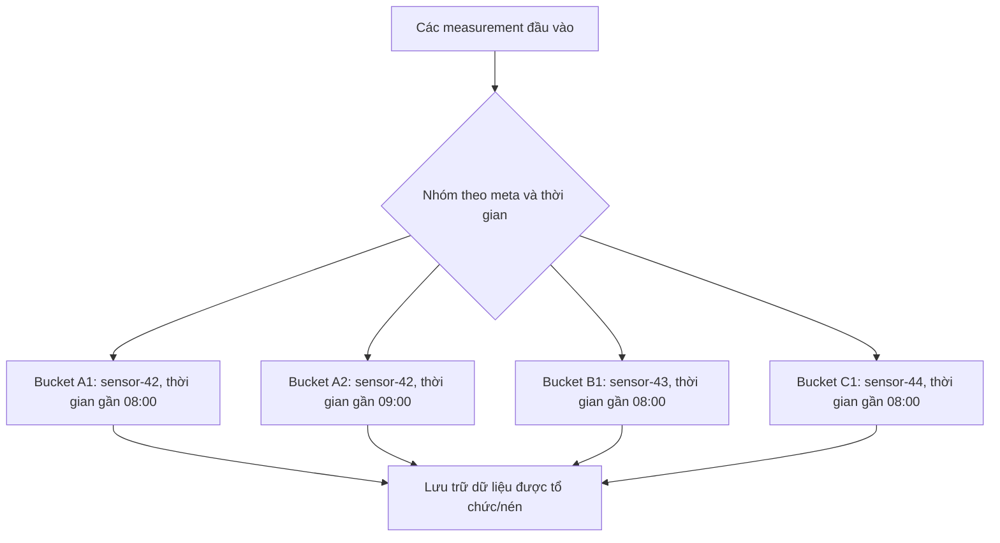
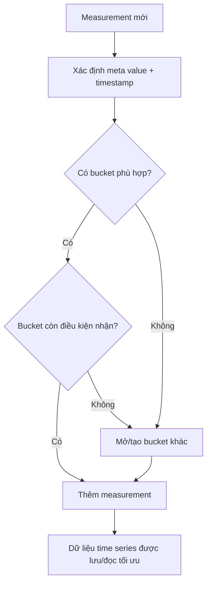

# Tổ chức bucket và ảnh hưởng của metadata có nhiều giá trị khác nhau trong MongoDB Time Series

> **Module:** Database Engine Document MongoDB  
> **Chương:** Chuỗi thời gian

## 1. Vấn đề cần giải quyết

Giả sử một hệ thống IoT nhận số đo nhiệt độ của hàng nghìn thiết bị. Mỗi vài giây, một thiết bị gửi một document:

```javascript
{
  ts: ISODate("2026-11-14T08:00:00Z"),
  meta: {
    tenantId: "factory-01",
    sensorId: "sensor-42"
  },
  temperatureC: 28.6,
  humidityPct: 65
}
```

Một MongoDB **time series collection** được thiết kế để lưu hiệu quả các bản ghi có trục thời gian. Dưới góc nhìn của ứng dụng, mỗi document là một **measurement** tại một thời điểm. MongoDB có thể lưu nhiều measurement trong các **bucket nội bộ**, thay vì tổ chức toàn bộ dữ liệu như một tập record độc lập của collection thông thường.

Mô hình bucket rất nhạy với lựa chọn **`metaField`**. Nếu metadata ổn định và nhiều điểm đo của cùng một nguồn tới gần nhau về thời gian, MongoDB có cơ hội gom chúng vào những bucket tương đối đầy. Nếu mỗi measurement mang metadata khác biệt, chẳng hạn thêm `requestId` duy nhất vào `meta`, dữ liệu có thể bị chia thành nhiều bucket nhỏ, làm mất một phần lợi ích nén và đọc/ghi theo nhóm.

Hai phương án sau nhìn qua đều hợp lý:

**Phương án A – metadata ổn định**

```javascript
{
  ts: ISODate("2026-11-14T08:00:00Z"),
  meta: { tenantId: "factory-01", sensorId: "sensor-42" },
  requestId: "req-001",
  temperatureC: 28.6
}
```

**Phương án B – đưa requestId vào metadata**

```javascript
{
  ts: ISODate("2026-11-14T08:00:00Z"),
  meta: {
    tenantId: "factory-01",
    sensorId: "sensor-42",
    requestId: "req-001"
  },
  temperatureC: 28.6
}
```

Ở phương án B, `requestId` khác nhau trên từng bản ghi, nên **giá trị meta không còn giống nhau giữa các measurement** của cùng một sensor. Đây là trường hợp cardinality cao do thiết kế metadata, thường tạo nhiều bucket thưa.

Bài học sẽ làm rõ:

1. Time series bucket được tạo, mở, đóng và đọc như thế nào.
2. `timeField`, `metaField`, measurement và series khác nhau ra sao.
3. **Metadata cardinality** là gì; tác động tới số bucket và bộ nhớ bucket catalog.
4. Vì sao metadata thay đổi thường xuyên gây bucket fragmentation, giảm compression, tăng index/storage overhead.
5. Khi nào cardinality cao là tự nhiên và có thể chấp nhận.
6. Cách chọn metadata sao cho vừa **định danh series ổn định** vừa hỗ trợ query.
7. Cách chọn granularity/time span nhưng không dùng granularity để che vấn đề metadata.
8. Cách đo với `collStats`, `serverStatus().bucketCatalog` và `explain()`.
9. Thí nghiệm `mongosh` so sánh hai cách thiết kế.
10. Cách tạo/query time series collection bằng MongoDB Java Sync Driver.

## 2. Các khái niệm cơ bản

### 2.1. Measurement

**Measurement** là một document ghi nhận dữ liệu tại một thời điểm.

Ví dụ:

```javascript
{
  ts: ISODate("2026-11-14T08:00:00Z"),
  meta: { sensorId: "S-1" },
  temperatureC: 24.7,
  batteryPct: 91
}
```

Ở đây:

- `ts` là thời gian xảy ra hoặc được ghi nhận.
- `meta` định danh chuỗi đo, chẳng hạn cảm biến.
- `temperatureC` và `batteryPct` là các giá trị đo.

Một sensor gửi 1 measurement mỗi phút sẽ tạo 60 measurement trong một giờ, nếu không mất dữ liệu.

### 2.2. timeField

`timeField` là tên field chứa mốc thời gian **BSON Date** của measurement.

Khi tạo collection:

```javascript
db.createCollection("sensor_readings", {
  timeseries: {
    timeField: "ts",
    metaField: "meta",
    granularity: "seconds"
  }
});
```

MongoDB biết rằng các document sẽ được tổ chức dựa trên field `ts`. Giá trị `ts` cần là kiểu ngày hợp lệ, không phải một chuỗi ISO ngẫu nhiên hoặc Unix timestamp dạng số.

### 2.3. metaField

`metaField` là field mang **metadata định danh nguồn hoặc một nhóm measurement có ý nghĩa**.

Nó có thể là một scalar:

```javascript
meta: "sensor-42"
```

hoặc một object:

```javascript
meta: {
  tenantId: "factory-01",
  sensorId: "sensor-42",
  metricType: "environment"
}
```

Metadata lý tưởng:

- Không đổi hoặc hiếm khi đổi giữa các measurement cùng series.
- Có ý nghĩa để phân biệt các nguồn/series thực.
- Chứa những thuộc tính thường được dùng để lọc query.
- Không mang ID duy nhất của từng measurement nếu ID ấy không định danh series.

**Cần phân biệt:** tên field cấu hình `metaField: "meta"` được cố định khi tạo collection; **giá trị** của `meta` ở các document có thể khác nhau. Chính sự khác nhau giữa các giá trị `meta` tác động tới cách MongoDB nhóm bucket.

### 2.4. Series

Một **series** là dòng measurement có chung đặc tính định danh ổn định, ví dụ:

```text
Series A: factory-01 / sensor-42
    08:00 → 28.6 °C
    08:01 → 28.7 °C
    08:02 → 28.6 °C

Series B: factory-01 / sensor-43
    08:00 → 31.2 °C
    08:01 → 31.0 °C
    08:02 → 31.1 °C
```

Khi `metaField` dùng để định danh sensor, Series A và B thường có **giá trị meta khác nhau** và được tổ chức vào các bucket tương ứng với series và các khoảng thời gian.

### 2.5. Bucket

**Bucket** là một đơn vị lưu trữ nội bộ có thể chứa nhiều measurement được MongoDB gom dựa trên:

1. Giá trị `metaField` **giống nhau**.
2. Giá trị thời gian `timeField` **gần nhau**, nằm trong những giới hạn bucketing.

Đây là cách hiểu quan trọng nhất của bài học. Bucket không đơn thuần là “mọi measurement cùng giờ” và cũng không phải “mọi measurement cùng sensor trong suốt nhiều năm”.

## 3. Cấu trúc logic của bucket

Giả sử ba sensor cùng gửi số đo liên tục.



Một bucket nội bộ có thông tin về metadata, khoảng thời gian và dữ liệu measurements theo định dạng được MongoDB tối ưu. Ứng dụng không cần tự tạo bucket document.

Khi chạy:

```javascript
db.sensor_readings.find({
  "meta.sensorId": "sensor-42",
  ts: {
    $gte: ISODate("2026-11-14T08:00:00Z"),
    $lt: ISODate("2026-11-14T09:00:00Z")
  }
});
```

MongoDB trả về **measurement documents** tương ứng với query, không yêu cầu ứng dụng đọc/giải mã bucket thủ công.

### 3.1. Bucket là chi tiết lưu trữ, không phải API nghiệp vụ

Không thiết kế ứng dụng theo giả định:

- Một bucket luôn bằng đúng 1 giờ.
- Một bucket luôn có đúng 1000 measurement.
- Một meta chỉ có đúng một bucket.
- Số bucket bằng chính xác số sensor.
- Bucket không thay đổi khi server/version thay đổi.

MongoDB có thể tạo bucket mới khi meta khác, thời gian không phù hợp, bucket đạt giới hạn dung lượng/số điểm, có áp lực bộ nhớ hoặc các điều kiện nội bộ khác.

### 3.2. Một series có thể cần nhiều bucket

Ngay cả khi `meta` không đổi, 100.000 measurements từ cùng sensor vẫn không nằm mãi trong một bucket. Khi bucket đạt giới hạn hoặc khoảng thời gian phù hợp thay đổi, MongoDB tạo các bucket tiếp theo cho cùng series.

Vì vậy:

\[
\text{số bucket} \neq \text{số meta khác nhau}
\]

Một cách nghĩ đúng hơn là:

\[
\text{số bucket}
\approx
\sum_{\text{series}}
\text{số bucket cần thiết cho thời gian, dung lượng, số điểm và trạng thái ghi của series}
\]

Đây là mô hình tư duy, **không phải công thức để dự đoán chính xác số bucket của MongoDB**.

## 4. MongoDB tổ chức bucket khi insert

Khi một measurement mới được insert:

1. MongoDB đọc giá trị metadata và thời gian của nó.
2. Kiểm tra xem có bucket đang phù hợp với metadata và khoảng thời gian đó không.
3. Nếu có và bucket còn thỏa giới hạn, server có thể đưa measurement vào bucket đó.
4. Nếu không, server mở/tạo bucket mới.
5. Các bucket được đóng/archived/reopened tùy giới hạn và cơ chế của server.
6. Khi query, server có thể tận dụng metadata/time ranges để giảm số bucket cần đọc, rồi trả measurement documents.



### 4.1. Điều kiện tạo bucket mới

Một bucket mới có thể cần khi:

- Giá trị metadata không khớp với bucket phù hợp đang tồn tại.
- Timestamp nằm ngoài các khoảng thời gian bucket hiện có thể nhận.
- Bucket đã đạt giới hạn số measurement hoặc kích thước.
- Có áp lực bộ nhớ hoặc các điều kiện khác khiến bucket trước đó được đóng.
- Các yếu tố về schema và thao tác đồng thời tạo tình huống buộc server đổi bucket.

Chi tiết state transition trong bộ **bucket catalog** phụ thuộc phiên bản MongoDB và workload. Không tự xây logic ứng dụng phụ thuộc vào số bucket chính xác sau mỗi insert.

### 4.2. Giới hạn bucket

Tài liệu MongoDB các phiên bản hiện hành mô tả ngưỡng tối đa phổ biến: **1000 measurements hoặc 125 KiB dữ liệu trên một bucket, tùy điều kiện nào đạt trước**. Với metadata có cardinality cao, server còn có thể áp ngưỡng thấp hơn để điều chỉnh working set theo bộ nhớ. Những ngưỡng và cơ chế cụ thể phải được kiểm tra lại theo MongoDB Server version đang dùng.

**Không hiểu sai:** 1000 chỉ là một **giới hạn trên**, không phải mục tiêu số measurement mà server cam kết sẽ đưa vào mọi bucket.

Một bucket chỉ có 2 measurement vẫn có thể hợp lệ nhưng thường kém hiệu quả hơn bucket tương đối đầy, đặc biệt khi có hàng triệu bucket tương tự.

### 4.3. Vì sao bucket đầy thường hữu ích?

Với nhiều measurement cùng series:

- Metadata và thông tin bucket có thể được dùng chung giữa nhiều measurement.
- Các giá trị thời gian/số đo gần nhau thường có đặc tính thuận lợi để nén.
- MongoDB có cơ hội xử lý nhiều measurement trong cùng đơn vị lưu trữ.
- Một query theo meta/time có thể bỏ qua những bucket ngoài phạm vi.
- Số đơn vị lưu trữ/index cần quản lý trên cùng lượng dữ liệu có thể thấp hơn.

Tỷ lệ nén **không chỉ** phụ thuộc vào số measurement/bucket: còn tùy schema, field order, loại dữ liệu, mức dao động của số đo, kích thước document và phiên bản server.

## 5. Metadata cardinality là gì?

**Cardinality của metadata** là số lượng **giá trị `metaField` khác nhau** trong một tập measurement, với phạm vi và khoảng thời gian được xét rõ ràng.

Ví dụ:

```text
10000 measurements
- sensor-1: 5000 measurements
- sensor-2: 3000 measurements
- sensor-3: 2000 measurements

Cardinality(meta) = 3
```

Ngược lại:

```text
10000 measurements
- mỗi measurement có một requestId khác nhau
- requestId nằm trong meta

Cardinality(meta) có thể lên tới 10000
```

Khi đưa thêm các field vào meta object, số tổ hợp giá trị có thể tăng mạnh.

### 5.1. Cardinality tăng theo tổ hợp giá trị

Giả sử metadata có:

- 100 tenant.
- Mỗi tenant 100 sensor.
- Mỗi sensor có 5 loại sensor channel được lưu thành series riêng.

Nếu mọi tổ hợp thực sự xuất hiện:

\[
C_{\mathrm{meta}} = 100 \times 100 \times 5 = 50{,}000
\]

Nếu thêm `firmwareBuild` thay đổi 10 lần cho mỗi sensor/channel và được gắn trực tiếp vào meta trong cùng khoảng lịch sử:

\[
C_{\mathrm{meta}} \leq 50{,}000 \times 10 = 500{,}000
\]

Đây là **giới hạn dựa trên giả định tổ hợp**. Cardinality thực tế bằng số tổ hợp xuất hiện, không nhất thiết là tích của tất cả tập giá trị lý thuyết.

### 5.2. Tổng cardinality và cardinality đang hoạt động khác nhau

Một collection lưu 5 năm có thể chứa hàng triệu sensor ID **đã ngừng gửi dữ liệu**. Điều đó khác với một hệ thống có hàng triệu sensor **cùng gửi dữ liệu trong một phút**.

Hai đại lượng hữu ích:

- **Historical cardinality:** số meta values khác nhau trong toàn bộ lịch sử.
- **Active cardinality:** số meta values thực sự phát sinh measurement trong một cửa sổ gần hiện tại.

Số series đang hoạt động cùng lúc có liên hệ lớn tới áp lực quản lý các **open buckets**; historical cardinality ảnh hưởng tới số buckets/index/storage tích lũy.

Không chỉ nhìn `countDistinct(meta)` toàn bộ collection rồi suy ra bộ nhớ hiện tại chắc chắn thiếu.

### 5.3. Mật độ measurement theo series cũng quan trọng

Hai hệ thống cùng 100.000 meta values nhưng khác:

**Hệ thống A**

```text
Mỗi sensor gửi 1 measurement/giây
100000 sensor hoạt động liên tục
```

**Hệ thống B**

```text
Mỗi sensor gửi 1 measurement/tháng
100000 sensor thỉnh thoảng mới xuất hiện
```

Cả hai có số meta values tương tự trong phạm vi lịch sử, nhưng rất khác về ingestion rate, working set, độ đầy bucket, thời gian sống của buckets và query pattern.

Để đánh giá thiết kế, cần xem **cardinality + ingest rate mỗi series + thời gian dữ liệu đến + shape của measurement**, không chỉ một con số duy nhất.

## 6. Metadata có nhiều giá trị khác nhau ảnh hưởng thế nào?

### 6.1. Nhiều bucket hơn

Vì bucket cần gom measurements có metadata giống nhau, nhiều meta values tạo nhiều nhóm không thể trộn với nhau.

Ví dụ 3000 measurement trong cùng cửa sổ thời gian:

| Thiết kế | Số meta values | Điểm mỗi meta (trung bình) | Hệ quả dự kiến |
|---|---:|---:|---|
| Mỗi sensor có meta ổn định, 3 sensor | 3 | 1000 | Có cơ hội có các bucket tương đối đầy |
| 30 sensor | 30 | 100 | Nhiều nhóm hơn, bucket có thể thưa hơn |
| Mỗi measurement có requestId trong meta | 3000 | 1 | Rất nhiều nhóm, thường có bucket chỉ một điểm |

**Lưu ý:** số bucket vật lý thực tế còn bị giới hạn bởi time span, size, open/close/reopen và các cơ chế khác. Bảng không khẳng định bucket counts đúng bằng cardinality ở mọi thời điểm.

### 6.2. Bucket thưa và compression kém

Một bucket chứa 1–2 measurement thường không có nhiều điểm để amortize metadata/overhead hoặc tận dụng sự tương đồng giữa các điểm đo. Tỷ lệ giữa dữ liệu có ích và overhead bucket có thể xấu hơn.

Nếu mỗi message được đưa vào một series riêng bằng `meta.requestId`, hệ thống vẫn nhận đủ measurement nhưng **đánh mất cơ hội gom điểm của cùng sensor**.

Kết quả thường thấy:

- Disk usage tăng so với thiết kế meta ổn định.
- Compression ratio giảm.
- Số bucket và cấu trúc liên quan nhiều hơn.
- Query quét phạm vi thời gian rộng có thể phải xử lý nhiều bucket.
- Hiệu quả batch/append giảm.

Mức tác động cần được **benchmark với data thực**; không có một hệ số “tăng cardinality 10 lần thì disk tăng đúng 10 lần” áp dụng mọi workload.

### 6.3. Áp lực bucket catalog

MongoDB có **bucket catalog** trong bộ nhớ, theo dõi các bucket đang được quản lý để điều phối insert và tối ưu hiệu năng.

Nó có thể giữ thông tin như:

- Giá trị meta của bucket.
- Khoảng thời gian bucket đang bao phủ.
- Số measurement và dung lượng.
- Writer đang hoạt động và trạng thái ghi.
- Thông tin phục vụ quyết định mở/đóng/reopen bucket.

Khi nhiều series được ghi xen kẽ, có thể tồn tại nhiều bucket đang mở hoặc được quản lý, làm tăng áp lực memory và công việc phối hợp.

### 6.4. Đóng/mở bucket thường xuyên

Nếu active cardinality cao và memory budget hữu hạn, MongoDB có thể đóng, archive hoặc xử lý lại buckets theo cơ chế của phiên bản để kiểm soát bộ nhớ.

Khi dữ liệu tiếp tục đến cho series đó, server có thể cần tìm/tái mở bucket phù hợp hoặc tạo bucket mới.

Đây là lý do một workload có throughput không quá lớn nhưng **quá nhiều series rải rác** vẫn có thể gây overhead đáng kể.

### 6.5. Query efficiency giảm

Một query:

```javascript
db.sensor_readings.find({
  "meta.sensorId": "S-42",
  ts: { $gte: from, $lt: to }
});
```

có thể được MongoDB tối ưu bằng các điều kiện meta/time để thu hẹp vùng bucket cần xét.

Nhưng nếu `meta` mang thêm nhiều trường biến thiên liên tục, dữ liệu của cùng sensor bị phân mảnh thành nhiều nhóm meta, dẫn tới nhiều bucket cần quản lý và có thể giảm hiệu quả lọc/đọc.

Query có sử dụng index nào, bao nhiêu bucket/measurement được xét, có scan hay không đều phải xem `explain()` trên phiên bản đang dùng.

### 6.6. Tăng độ phức tạp của index và sharding

Nếu một field biến động cao được nhúng vào meta:

- Các truy vấn theo toàn bộ meta object khó hơn.
- Số giá trị/key khác nhau có thể tăng.
- Query filters thường chỉ dùng một vài phần của meta nhưng bucket lại bị chia theo mọi phần.
- Lựa chọn shard key theo meta có thể bị ảnh hưởng bởi cardinality và phân bố ghi.

**Không đồng nghĩa cardinality cao luôn xấu cho sharding**: một shard key cần đủ khả năng phân bố dữ liệu. Vấn đề là **đưa metadata biến thiên không có ý nghĩa định danh series vào bucket key**, chứ không phải tìm cách giảm số series hợp lệ xuống mức thấp nhất bằng mọi giá.

## 7. Ví dụ lựa chọn metadata tốt và xấu

### 7.1. Tốt: sensorId ổn định

```javascript
{
  ts: ISODate("2026-11-14T08:00:00Z"),
  meta: {
    tenantId: "factory-1",
    sensorId: "S-42"
  },
  temperatureC: 28.1,
  humidityPct: 66
}
```

Nếu sensor gửi liên tục, nhiều measurement có cùng `meta`. Đây là thiết kế phù hợp cho việc nhóm theo series sensor.

### 7.2. Xấu: đưa timestamp vào metadata

```javascript
{
  ts: ISODate("2026-11-14T08:00:00Z"),
  meta: {
    sensorId: "S-42",
    timestampKey: "2026-11-14T08:00:00Z"
  },
  temperatureC: 28.1
}
```

Nếu `timestampKey` khác trên mọi sample, meta khác trên mọi sample dù `sensorId` không đổi.

**Đúng hơn:** để timestamp ở `timeField: "ts"`, không lặp nó vào meta chỉ để định danh measurement.

### 7.3. Xấu: requestId hoặc traceId duy nhất

```javascript
{
  ts: ISODate("2026-11-14T08:00:00Z"),
  meta: {
    sensorId: "S-42",
    requestId: "req-9f27..."
  },
  temperatureC: 28.1
}
```

`requestId` phục vụ truy vết **một lần gửi**, không định danh series. Đưa nó thành measurement field:

```javascript
{
  ts: ISODate("2026-11-14T08:00:00Z"),
  meta: { sensorId: "S-42" },
  requestId: "req-9f27...",
  temperatureC: 28.1
}
```

Việc requestId nằm ở ngoài meta không có nghĩa query theo requestId luôn tối ưu; nó chỉ tránh làm nổ cardinality của **bucket grouping key**.

### 7.4. Cần cân nhắc: firmwareVersion

```javascript
meta: {
  sensorId: "S-42",
  firmwareVersion: "3.4.1"
}
```

Nếu firmware thay đổi từ 3.4.1 sang 3.4.2, meta thay đổi, các measurement thuộc hai phiên bản không còn đủ điều kiện nằm trong cùng bucket theo meta.

Điều đó có thể chấp nhận nếu firmwareVersion **thực sự là một chiều định danh series**, được lọc thường xuyên và thay đổi hiếm. Nhưng nếu firmwareVersion liên tục đổi trong giai đoạn test hoặc mỗi message gắn build hash khác nhau, có thể tạo nhiều bucket thưa.

Các lựa chọn:

- Giữ `sensorId` trong meta, đưa `firmwareVersion` thành measurement field.
- Tạo một collection lịch sử cấu hình thiết bị nếu phiên bản firmware là metadata thay đổi theo thời gian cần tra cứu riêng.
- Đưa firmware vào meta **chỉ khi** có query pattern và cadence thay đổi chứng minh nó phù hợp.

### 7.5. Cần cân nhắc: location

Với cảm biến cố định trong nhà máy:

```javascript
meta: {
  sensorId: "S-42",
  siteId: "plant-hcm"
}
```

Nếu `siteId` gần như không đổi và thường dùng lọc, nó có thể là metadata tốt.

Với GPS của xe di chuyển:

```javascript
meta: {
  vehicleId: "truck-1",
  latitude: 10.762622,
  longitude: 106.660172
}
```

Vĩ độ/kinh độ đổi gần như liên tục; đặt vào meta tạo rất nhiều giá trị khác nhau.

Thông thường nên chọn:

```javascript
{
  ts: ISODate("2026-11-14T08:00:00Z"),
  meta: { vehicleId: "truck-1" },
  latitude: 10.762622,
  longitude: 106.660172,
  speedKmh: 42
}
```

Nếu query chủ yếu lọc theo vùng địa lý, có thể cần thiết kế geo/index hoặc data model khác; **không tự kết luận mọi location đều phải nằm trong meta**.

### 7.6. Cực kỳ xấu: UUID của từng measurement

```javascript
meta: {
  sensorId: "S-42",
  measurementId: UUID("...")
}
```

Nếu mỗi measurement có một UUID mới, cardinality có thể tiến gần số measurement. Trong tình huống này `meta` không còn là nhãn series mà thành khóa của từng điểm dữ liệu.

## 8. Nhưng metadata quá ít cũng có vấn đề

Không nên áp dụng sai quy tắc “meta càng ít giá trị càng tốt”.

Ví dụ:

```javascript
meta: {
  tenantId: "factory-1"
}
```

nếu factory-1 có 100.000 sensors và mỗi document mang `sensorId` ở ngoài meta.

Điều này có thể gây:

- Nhiều sensor khác nhau bị xếp vào cùng nhóm metadata khi timestamp gần nhau.
- Một query theo sensorId khó tận dụng đúng lợi thế định danh series qua meta.
- Dữ liệu không còn được phân vùng hiệu quả theo nguồn đo.
- Các bucket có thể chứa nhiều nguồn có phân bố measurement không tương đồng.
- Một thiết kế index/sharding không phù hợp với query chủ yếu theo sensor.

Vì vậy cần cân bằng:

\[
\text{metadata tốt}
\approx
\text{định danh series ổn định}
+
\text{thuộc tính lọc hữu ích}
-
\text{chiều biến động không cần thiết}
\]

Không có một giá trị cardinality lý tưởng áp dụng cho mọi hệ thống.

### 8.1. Ví dụ quyết định metadata

| Field | Thay đổi theo sample? | Dùng để định danh/lọc series? | Gợi ý |
|---|---|---|---|
| tenantId | Hiếm | Có | Thường phù hợp trong meta |
| sensorId | Hiếm | Có | Thường rất phù hợp |
| metricType | Tùy mô hình | Có nếu mỗi metric là series riêng | Cân nhắc đưa vào meta |
| siteId cố định | Hiếm | Có | Có thể đưa vào meta |
| firmwareVersion | Thỉnh thoảng | Tùy query | Cân nhắc kỹ |
| gpsLatitude/gpsLongitude di động | Rất thường xuyên | Không ổn định | Thường là measurement |
| temperatureC | Mỗi sample | Là số đo | Không đưa vào meta |
| requestId | Mỗi request | Không | Không đưa vào meta |
| timestamp | Mỗi sample | Là trục thời gian | Thuộc timeField |
| traceId | Mỗi event | Không | Không đưa vào meta |
| status động | Thường xuyên | Tùy domain | Thường là measurement |
| deviceModel | Hiếm | Có thể | Chọn theo query pattern |

## 9. Khi meta là object: phải nhất quán về giá trị và kiểu

MongoDB cho phép meta là object, nhưng sự phân nhóm phụ thuộc **giá trị metadata**, không chỉ sự hiện diện của vài field quen thuộc.

Hai document sau có meta khác nhau:

```javascript
// 1
meta: { tenantId: "t1", sensorId: "S-1" }

// 2
meta: { tenantId: "t1", sensorId: "S-1", region: "south" }
```

Nếu một ETL service thêm `region` vào metà còn service khác không thêm, cùng sensor có thể bị chia thành các nhóm bucket khác nhau.

### 9.1. Số và chuỗi là các kiểu khác nhau

```javascript
meta: { sensorId: 42 }
```

và:

```javascript
meta: { sensorId: "42" }
```

không nên coi là cùng một định danh ổn định. Chuẩn hóa kiểu ID và casing trước khi insert.

### 9.2. Chuẩn hóa object shape

Nếu meta object đại diện cho tenant, sensor và metric type, định nghĩa một schema nhất quán:

```javascript
meta: {
  tenantId: "t1",
  sensorId: "S-42",
  metricType: "climate"
}
```

Không lúc thì thêm `firmware`, lúc thì bỏ `metricType`, lúc lại đổi `tenantId` sang số, trừ khi đó là thay đổi có chủ đích và được migration quản lý.

### 9.3. Thứ tự field trong object

BSON giữ thứ tự field trong document; MongoDB có thể tổ chức lại metadata object khi lưu trữ. Truy vấn so sánh toàn bộ object có thể gặp vấn đề do thứ tự field và cách biểu diễn.

**Thực hành tốt:** lọc theo các subfield scalar rõ ràng:

```javascript
db.sensor_readings.find({
  "meta.tenantId": "factory-1",
  "meta.sensorId": "S-42"
});
```

thay vì dựa hoàn toàn vào so sánh nguyên object:

```javascript
db.sensor_readings.find({
  meta: { sensorId: "S-42", tenantId: "factory-1" }
});
```

Thêm nữa, giữ schema và thứ tự field **nhất quán** từ driver khi có thể là điều hữu ích cho khả năng nén; đừng dựa vào việc server sẽ tự sửa mọi khác biệt giữa dữ liệu nguồn.

### 9.4. Mảng trong meta

Một array như:

```javascript
meta: {
  sensorId: "S-42",
  labels: ["cold-chain", "warehouse"]
}
```

có thứ tự phần tử. Nếu lần sau đổi thành:

```javascript
meta: {
  sensorId: "S-42",
  labels: ["warehouse", "cold-chain"]
}
```

thì không nên mặc định chúng được xem như cùng một metadata value. Tài liệu MongoDB cảnh báo dùng array làm metadata có thể có hành vi không mong đợi do equality phụ thuộc thứ tự.

Nếu labels chỉ là tag phục vụ tìm kiếm và thường được sửa/đổi thứ tự, nên cân nhắc đưa chúng vào measurement hoặc một collection metadata riêng thay vì làm khóa gom bucket.

## 10. Bucket catalog: quan sát áp lực do cardinality cao

**Bucket catalog** là cấu trúc bộ nhớ nội bộ MongoDB sử dụng để quản lý các bucket và điều phối ghi time-series.

Một số chỉ số có thể xuất hiện trong kết quả `serverStatus` trên các phiên bản MongoDB hỗ trợ:

- `numBuckets`.
- `numOpenBuckets`.
- `numIdleBuckets`.
- `memoryUsage`.
- `numBucketInserts`.
- `numBucketUpdates`.
- `numBucketsOpenedDueToMetadata`.
- `numBucketsClosedDueToCount`.
- `numBucketsClosedDueToSize`.
- `numBucketsClosedDueToTimeForward` / `numBucketsClosedDueToTimeBackward`.
- `numBucketsClosedDueToMemoryThreshold`.
- `numBucketsReopened`.
- Các metric khác tùy version và storage engine.

### 10.1. Ví dụ đọc chỉ số

Trên instance có quyền monitor thích hợp:

```javascript
const admin = db.getSiblingDB("admin");
const server = admin.serverStatus();

printjson(server.bucketCatalog);
```

Không phải mọi version đều trả đủ các field trong bảng; nếu `bucketCatalog` thiếu hoặc tên metric khác, cần kiểm tra docs của version đó.

### 10.2. Diễn giải một vài metric

| Metric | Cách hiểu |
|---|---|
| `numOpenBuckets` | Số bucket đang mở ở thời điểm quan sát, trong phạm vi metric |
| `memoryUsage` | Bộ nhớ bucket catalog đang sử dụng theo định nghĩa server |
| `numBucketsOpenedDueToMetadata` | Sự kiện mở bucket vì metadata cần bucket khác, theo thống kê của phiên bản |
| `numBucketsClosedDueToCount` | Bucket bị đóng do đạt giới hạn số measurement |
| `numBucketsClosedDueToSize` | Bucket bị đóng do giới hạn dung lượng |
| `numBucketsClosedDueToMemoryThreshold` | Tín hiệu bucket bị đóng vì áp lực ngưỡng bộ nhớ |
| `numBucketsClosedDueToTimeForward` | Bucket không còn phù hợp về thời gian hướng tới |
| `numBucketsReopened` | Server tái mở bucket theo cơ chế được hỗ trợ |

**Điều rất quan trọng:** Một số chỉ số là **counter tích lũy** từ khi process chạy, không phải tốc độ tức thời. Muốn tính số sự kiện mỗi phút, cần lấy chênh lệch giữa hai thời điểm trong cùng chu kỳ process và tránh tính sai sau restart/reset.

### 10.3. Metric toàn server không phải luôn riêng từng collection

`serverStatus().bucketCatalog` thường là thông tin ở phạm vi server/process, **không tự động tách cho riêng collection sensor_readings**.

Nếu test nhiều workload cùng lúc, số liệu bị pha trộn. Một thí nghiệm A/B muốn suy ra quan hệ nhân quả cần môi trường cô lập và quy trình đo trước/sau phù hợp.

### 10.4. Số bucket nhiều không tự là lỗi

Nếu có hàng triệu sensor hợp lệ với ingest liên tục, nhiều buckets là hệ quả tự nhiên. Cần xem:

- Có đủ tài nguyên và throughput không.
- Bucket packing/compression có phù hợp workload không.
- Query latency có đạt SLO không.
- Có memory pressure/close-reopen quá mức không.
- Meta có bị biến thiên vô ích hay không.

Một số lượng bucket cao **do nhiều series thực** khác với số lượng bucket cao **do nhét requestId vào meta**.

## 11. Thí nghiệm A/B trong mongosh

Mục tiêu: tạo cùng tập measurement với **hai cách chọn meta**:

- **Good:** meta ổn định theo `tenantId + sensorId`.
- **Bad:** meta thêm `eventId` duy nhất theo từng sample.

Dữ liệu thời gian, sensor, nhiệt độ và số lượng bản ghi giống nhau giữa hai collection.

### 11.1. Tạo hai time series collections

Yêu cầu MongoDB 5.0+ với feature compatibility version phù hợp.

Trong `mongosh` kết nối database lab:

```javascript
const lab = db.getSiblingDB("ts_bucket_cardinality_lab");

lab.createCollection("readings_good", {
  timeseries: {
    timeField: "ts",
    metaField: "meta",
    granularity: "seconds"
  }
});

lab.createCollection("readings_bad", {
  timeseries: {
    timeField: "ts",
    metaField: "meta",
    granularity: "seconds"
  }
});
```

**Chạy một lần trong database trống.** Nếu collection đã tồn tại, câu lệnh `createCollection` sẽ báo lỗi; không dùng `dropDatabase()` trên môi trường ngoài lab để chạy lại.

### 11.2. Tạo bộ dữ liệu giống nhau về measurements

Ta mô phỏng:

- 3 sensor.
- Mỗi sensor 600 measurements.
- Mỗi measurement cách nhau 1 phút.
- Tổng 1800 measurements.
- Mỗi sample có `eventId` duy nhất.

```javascript
const good = lab.getCollection("readings_good");
const bad = lab.getCollection("readings_bad");

const start = ISODate("2026-11-14T00:00:00.000Z");
const goodDocs = [];
const badDocs = [];

for (let sensor = 1; sensor <= 3; sensor++) {
  const sensorId = "S-" + sensor;

  for (let n = 0; n < 600; n++) {
    const ts = new Date(start.getTime() + n * 60 * 1000);
    const eventId = sensorId + "-" + n;
    const value = 20 + sensor + (n % 20) / 10;

    goodDocs.push({
      ts: ts,
      meta: {
        tenantId: "factory-1",
        sensorId: sensorId
      },
      eventId: eventId,
      temperatureC: value
    });

    badDocs.push({
      ts: ts,
      meta: {
        tenantId: "factory-1",
        sensorId: sensorId,
        eventId: eventId
      },
      eventId: eventId,
      temperatureC: value
    });
  }
}

good.insertMany(goodDocs, { ordered: true });
bad.insertMany(badDocs, { ordered: true });

print("Good documents:", good.countDocuments({}));
print("Bad documents:", bad.countDocuments({}));
```

Cả hai có **1800 logical measurements**. Các phép đếm không nói được chính xác số bucket.

### 11.3. Tính cardinality trong lab

Đếm số meta values qua aggregation:

```javascript
function countMetaValues(coll) {
  const result = coll.aggregate([
    { $group: { _id: "$meta" } },
    { $count: "cardinality" }
  ]).toArray();

  return result.length === 0 ? 0 : result[0].cardinality;
}

print("Good meta cardinality:", countMetaValues(good));
print("Bad meta cardinality:", countMetaValues(bad));
```

Với dữ liệu lab:

- `readings_good` có **3** giá trị `meta` (tương ứng 3 sensor).
- `readings_bad` có **1800** giá trị `meta` (mỗi sample có một eventId khác nhau).

Con số này là cardinality **logic của meta trên dữ liệu đã tạo**, không phải bucket count đo từ storage.

### 11.4. Xem kích thước logic và storage

```javascript
const goodStats = good.stats();
const badStats = bad.stats();

printjson({
  good: {
    count: goodStats.count,
    size: goodStats.size,
    storageSize: goodStats.storageSize,
    totalIndexSize: goodStats.totalIndexSize
  },
  bad: {
    count: badStats.count,
    size: badStats.size,
    storageSize: badStats.storageSize,
    totalIndexSize: badStats.totalIndexSize
  }
});
```

Ý nghĩa tham khảo:

- `count` là số measurement được thống kê theo cách MongoDB trình bày cho collection.
- `size`, `storageSize` và `totalIndexSize` là những chỉ số có ngữ nghĩa phụ thuộc collection type/version/storage engine.
- Dùng cùng server/version và cùng phương thức đo để so sánh.

**Không suy ra tỷ lệ nén chỉ từ `storageSize / count` trong một lần thử 1800 document**: mẫu quá nhỏ, file allocation/cache/index có thể làm nhiễu mạnh. Các bộ số đo với kích thước representative sẽ đáng tin hơn.

### 11.5. Quan sát bucket catalog trong lab

```javascript
const bucketStats = lab.getSiblingDB("admin").serverStatus().bucketCatalog;

printjson(bucketStats);
```

Nếu database user không có quyền serverStatus hoặc server version không cung cấp trường, hãy dùng monitoring được quản trị cấp quyền phù hợp; **không cần quyền admin để chứng minh cardinality logic**.

Nếu muốn so sánh số lần mở/đóng bucket giữa hai workload, nên thực hiện từng workload **tách biệt** và đo counters trước/sau, thay vì insert cả good/bad rồi lấy một snapshot tổng hợp.

### 11.6. Những kết luận hợp lý từ lab

Những điều bạn có thể khẳng định từ dữ liệu mẫu:

1. Hai collection có số measurement bằng nhau.
2. Cách chọn `meta` tạo cardinality logic khác nhau: 3 so với 1800.
3. MongoDB không thể gom hai measurement có meta khác nhau vào cùng bucket theo điều kiện bucketing.
4. Phương án `readings_bad` có nguy cơ tạo nhiều bucket thưa hơn.

Điều **không** nên khẳng định khi chưa đo:

- “MongoDB chắc chắn có chính xác 3 bucket ở good”.
- “Bad chắc chắn có đúng 1800 bucket vật lý”.
- “Bad tốn RAM gấp 600 lần”.
- “Bad đọc chậm gấp 600 lần”.

Các số đo thực tế còn phụ thuộc thời gian, kích thước document, khả năng nén, giới hạn bucket, trạng thái bộ nhớ và MongoDB version.

## 12. Mô hình ước lượng mật độ bucket

Một phép ước lượng sơ bộ trước khi benchmark:

Gọi:

- \(N\): tổng số measurements trong cửa sổ đang xét.
- \(C\): số meta values thực sự xuất hiện trong cửa sổ.
- \(\bar n=N/C\): số measurements trung bình cho mỗi meta value.

Nếu:

\[
N=1{,}800,\quad C=3
\]

thì:

\[
\bar n = 600
\]

Nếu:

\[
N=1{,}800,\quad C=1{,}800
\]

thì:

\[
\bar n = 1
\]

\(\bar n\) không phải số measurement/bucket, vì một series có thể trải qua nhiều khoảng thời gian hoặc chạm các giới hạn bucket trước đó.

Nhưng khi \(\bar n\) chỉ bằng 1 trong khoảng thời gian hoạt động, gần như không có cơ hội nhóm nhiều measurement cho cùng meta value trong cửa sổ ấy.

### 12.1. Thêm chiều thời gian

Một chỉ số hữu ích hơn là:

\[
\bar n_{\mathrm{series,window}}
=
\frac{\text{measurements trong một khoảng thời gian}}
     {\text{meta values hoạt động trong khoảng đó}}
\]

Ví dụ cùng 1800 measurements:

- Nếu chúng nằm trong 10 phút và chỉ có 3 sensor, mật độ theo series cao.
- Nếu chúng trải rộng 10 năm và mỗi sensor gửi một lần mỗi tháng, mật độ trong mỗi bucket time window thấp.

Do đó chỉ đo cardinality trên toàn lịch sử vẫn chưa đủ.

### 12.2. Độ lệch phân bố

Hai tập dữ liệu cùng \(N\) và \(C\) có thể khác:

- Tập 1: mọi series có 100 measurements.
- Tập 2: một series có 9900 measurements, 99 series còn lại mỗi series 1 measurement.

Trung bình che đi sự khác biệt. Nên đo phân vị/độ lệch của **measurements per series per time window** và số series hoạt động đồng thời.

## 13. Granularity giúp gì và không giúp gì?

Khi tạo time series collection, MongoDB có tham số `granularity`:

```javascript
db.createCollection("readings_minutes", {
  timeseries: {
    timeField: "ts",
    metaField: "meta",
    granularity: "minutes"
  }
});
```

Các giá trị thường dùng:

- `"seconds"`.
- `"minutes"`.
- `"hours"`.

Ý tưởng: chọn mức granularity phù hợp với **nhịp measurement của từng series** và truy vấn dự kiến. Nó ảnh hưởng tới các giới hạn thời gian của bucket.

### 13.1. Granularity không phải đơn vị làm tròn số đo

Nếu `granularity: "minutes"`, điều đó **không tự làm tròn `ts`** thành đầu phút trong document ứng dụng hoặc xóa những mốc giây của measurement.

Đây là một tham số tổ chức bucket theo thời gian, không phải aggregation `$dateTrunc`.

### 13.2. Không chữa được metadata khác nhau

Giả sử mỗi sample có một requestId trong meta:

```javascript
meta: {
  sensorId: "S-42",
  requestId: "req-unique-on-every-sample"
}
```

Đổi granularity từ seconds sang hours **không khiến hai meta values khác nhau trở thành bằng nhau**. MongoDB vẫn cần giữ ranh giới metadata.

Vì vậy phải xử lý **chọn metaField** trước khi kỳ vọng tuning granularity giải quyết bucket fragmentation.

### 13.3. Cửa sổ bucket lớn hơn cũng không phải luôn tốt hơn

Một cửa sổ quá lớn có thể:

- Tạo bucket với khoảng thời gian bao phủ rộng, ảnh hưởng một số query theo time range.
- Có nhiều measurement hơn nhưng vẫn bị giới hạn bởi size/count.
- Làm thay đổi trade-off giữa packing và pruning.
- Không phù hợp khi dữ liệu đến muộn hoặc có nhịp rất thưa.

Cần đo trên query pattern và ingestion data thật.

### 13.4. Custom bucket span và rounding

Trên MongoDB **6.3+**, có tùy chọn `bucketMaxSpanSeconds` và `bucketRoundingSeconds` thay cho `granularity` trong những cấu hình được hỗ trợ:

```javascript
db.createCollection("readings_custom_span", {
  timeseries: {
    timeField: "ts",
    metaField: "meta",
    bucketMaxSpanSeconds: 300,
    bucketRoundingSeconds: 300
  }
});
```

Hai tham số này phải tuân thủ quy tắc về giá trị và tính bằng nhau của MongoDB version. Không khai báo `granularity` cùng với cặp custom parameters trong cấu hình như trên.

**Lưu ý vận hành:** khi sửa granularity/bucket parameters bằng `collMod` theo tính năng hỗ trợ, MongoDB có giới hạn về **chỉ tăng, không giảm** khoảng thời gian bucket. Không thay đổi trên production mà chưa đọc tài liệu version và thử migration.

## 14. Index trên metadata và thời gian

Một lợi ích của time series collection là query có thể được tối ưu theo meta và time.

### 14.1. Query mẫu tốt

```javascript
const from = ISODate("2026-11-14T08:00:00Z");
const until = ISODate("2026-11-14T09:00:00Z");

db.sensor_readings.find({
  "meta.tenantId": "factory-1",
  "meta.sensorId": "S-42",
  ts: { $gte: from, $lt: until }
}).sort({ ts: 1 });
```

Có ràng buộc series ổn định và time range rõ ràng, giúp query planner có cơ hội giảm số bucket cần xử lý.

### 14.2. Index mặc định và phiên bản

Từ **MongoDB 6.3**, time series collection mới có `metaField` và `timeField` được MongoDB tạo compound index mặc định theo cơ chế của phiên bản.

**Không giả định mọi time series collection ở mọi phiên bản đều có cùng index mặc định.** Kiểm tra:

```javascript
db.sensor_readings.getIndexes();
```

Nếu query chủ yếu lọc theo các subfield metadata, có thể xem xét index phù hợp:

```javascript
db.sensor_readings.createIndex({
  "meta.tenantId": 1,
  "meta.sensorId": 1,
  ts: 1
});
```

Không thêm index chỉ vì nó xuất hiện trong ví dụ. Index tiêu tốn storage và làm tăng chi phí ghi; query planner có thể đã dùng một index khác tốt hơn.

### 14.3. Explain trên time series

```javascript
db.sensor_readings.find({
  "meta.sensorId": "S-42",
  ts: {
    $gte: ISODate("2026-11-14T08:00:00Z"),
    $lt: ISODate("2026-11-14T09:00:00Z")
  }
}).explain("executionStats");
```

Quan sát theo phiên bản:

- Số tài liệu/index keys đã xét.
- Có index scan hay collection scan.
- Các stage/plan liên quan bucket và unpacking measurements.
- Thời gian query và số result.
- Có filter nào được đẩy xuống mức bucket không.

Không hardcode một tên stage như `$_internalUnpackBucket` là bắt buộc xuất hiện y hệt trên mọi MongoDB version.

### 14.4. Query đo đạc khác query metadata

Ví dụ:

```javascript
db.sensor_readings.find({
  temperatureC: { $gte: 35 }
});
```

Query chỉ lọc theo số đo mà không có meta/time range có thể phải xét nhiều bucket hơn. Nếu nghiệp vụ yêu cầu thường xuyên tìm “mọi sensor trên toàn bộ lịch sử vượt 35°C”, cần cân nhắc:

- Query theo một cửa sổ thời gian hợp lý.
- Index được MongoDB hỗ trợ cho time series trong version của bạn.
- Summary/alert collection được tính sẵn.
- Data model bổ sung cho truy vấn theo giá trị đo.

Không nhét `temperatureC` vào meta chỉ để “tối ưu query”, vì nó thay đổi trên từng sample và có thể phá bucket grouping.

## 15. MetaField trong môi trường nhiều tenant

Một hệ thống nhiều tenant thường muốn:

- Truy vấn dữ liệu theo tenant.
- Tránh đọc nhầm dữ liệu tenant khác.
- Phân bố workload hợp lý.
- Lưu series ổn định theo sensor/device.

Thiết kế meta hợp lý có thể là:

```javascript
meta: {
  tenantId: "tenant-a",
  deviceId: "device-1001"
}
```

Nếu ID thiết bị chỉ unique trong tenant thì dùng cả hai field làm một identity logic là hợp lý.

### 15.1. Không đặt trường nhạy cảm hay dữ liệu quá biến động vào meta

Ví dụ:

```javascript
meta: {
  tenantId: "tenant-a",
  deviceId: "device-1001",
  sessionToken: "very-dynamic-sensitive-token"
}
```

Cách này vừa tăng cardinality vừa có thể mang dữ liệu nhạy cảm vào metadata không cần thiết.

Không dùng meta object như một túi chứa mọi context của request. Chỉ đưa thuộc tính thực sự giúp **định danh series** và hỗ trợ truy vấn ổn định.

### 15.2. Quản lý tenant mới

Khi một tenant có thêm sensor, số meta values tăng là hoàn toàn tự nhiên. Đây không phải lỗi thiết kế nếu mỗi sensor gửi đủ dữ liệu và query thường theo tenant/sensor.

Nên capacity plan dựa trên:

- Số tenant.
- Số sensor/tenant.
- Tần suất đo trung bình và cao điểm.
- Active series đồng thời.
- Kích thước measurement.
- Thời gian retention.
- Phân bố tenant lớn/nhỏ.

### 15.3. Multi-tenant security khác với bucketing

Thêm `tenantId` vào meta **không tự tạo quyền truy cập tenant**. Ứng dụng vẫn phải lọc và kiểm tra authorization, có thể dùng cơ chế role/tenant isolation của hệ thống.

Chọn `meta.tenantId` tốt cho storage/query không có nghĩa người dùng được phép gửi bất kỳ tenantId nào trong request.

## 16. Metadata thay đổi: giữ lịch sử đúng cách

Một thiết bị có thể đổi:

- Tên hiển thị.
- Khu vực lắp đặt.
- Firmware.
- Owner/team.
- Trạng thái active/inactive.
- Nhóm cảnh báo.

Có ba hướng thiết kế phổ biến.

### 16.1. Chỉ giữ định danh bất biến trong meta

```javascript
{
  ts: ISODate("2026-11-14T08:00:00Z"),
  meta: { deviceId: "D-1" },
  temperatureC: 28.2
}
```

Thông tin cấu hình thiết bị lưu ở collection riêng:

```javascript
{
  _id: "D-1",
  displayName: "Freezer A",
  siteId: "HCM-1",
  firmware: "2.3.7"
}
```

Ưu điểm: series không bị chia thành nhiều meta values vì tên hiển thị hoặc firmware thay đổi.

Đánh đổi: nếu muốn phân tích “dữ liệu theo site **tại thời điểm lịch sử**”, chỉ join với cấu hình hiện tại có thể sai. Cần lịch sử metadata có hiệu lực theo thời gian hoặc lưu thuộc tính cần thiết trên measurement.

### 16.2. Lưu thuộc tính biến động ở measurement

```javascript
{
  ts: ISODate("2026-11-14T08:00:00Z"),
  meta: { deviceId: "D-1" },
  firmware: "2.3.7",
  location: { lat: 10.76, lon: 106.66 },
  temperatureC: 28.2
}
```

Ưu điểm:

- Giá trị phản ánh **trạng thái tại thời điểm đo**.
- Không làm tăng cardinality của meta.
- Dễ tổng hợp theo thời gian nếu query đủ rõ.

Đánh đổi: lặp lại thông tin trong nhiều measurements và có thể cần thêm index/data model cho query theo các thuộc tính này.

### 16.3. Cố ý chia series khi một chiều thực sự thay đổi ý nghĩa

Ví dụ cùng device có hai kênh độc lập `"temperature"` và `"pressure"`, mỗi kênh có nhịp đo khác nhau và query thường phân biệt theo metric type.

Có thể chọn:

```javascript
meta: {
  deviceId: "D-1",
  channel: "temperature"
}
```

Điều này tạo nhiều series **có chủ đích**, không phải cardinality vô ích. Nếu một kênh định danh đúng dòng measurement, tách bucket theo channel có thể đáng giá.

## 17. Metadata field không thể đổi tùy ý sau khi tạo collection

Khi tạo time series collection:

```javascript
db.createCollection("readings", {
  timeseries: {
    timeField: "ts",
    metaField: "meta"
  }
});
```

Tên cấu hình `timeField` và `metaField` được thiết lập lúc tạo collection; không thể tùy ý chuyển `metaField` từ `"meta"` thành `"tags"` trên cùng collection về sau.

Điều này khác việc **giá trị** của `meta` trong document thay đổi (có các giới hạn thao tác update theo version).

Nếu đã tạo một collection dùng metadata quá chi tiết, hướng sửa bền vững thường là:

1. Thiết kế schema meta mới.
2. Tạo **time series collection mới** với cấu hình phù hợp.
3. Backfill/migrate dữ liệu sang collection mới.
4. Đảm bảo ứng dụng ghi mới theo schema mới.
5. Đối soát count, time ranges, sensor identity và các số đo.
6. Cutover đường đọc.
7. Decommission collection cũ theo kế hoạch retention/rollback.

Không dùng một lệnh `collMod` giả định có thể đổi trực tiếp `metaField` mà không migration.

### 17.1. Cập nhật time series document có hạn chế

Time series collection không hỗ trợ mọi kiểu update/delete/transaction như collection thường, và khả năng cụ thể phụ thuộc server version.

Tài liệu hiện hành nêu nhiều hạn chế như:

- Update chỉ được match và sửa các field thuộc `metaField` theo điều kiện hỗ trợ.
- Không dùng mọi kiểu update document body.
- Một số thao tác transaction/write và index có giới hạn riêng.
- Không tạo unique index trên time series collection theo cơ chế thông thường.

Vì vậy không chọn “sửa meta của hàng tỷ measurement tại chỗ” như phương án mặc định để đổi grouping. Hãy xem migration/backfill và các giới hạn của server đang chạy.

## 18. Dữ liệu đến muộn và out-of-order measurements

Một sensor có thể offline rồi gửi bù dữ liệu của hôm qua. MongoDB phải tìm bucket phù hợp theo metadata và timestamp, thay vì chỉ append vào bucket mới nhất.

Ví dụ:

```javascript
{
  ts: ISODate("2026-11-13T20:00:00Z"),
  meta: { sensorId: "S-42" },
  temperatureC: 27.4
}
```

được insert khi hệ thống đã nhận measurements ngày 14.

Tác động tiềm năng:

- Bucket của khoảng thời gian cũ có thể đã đóng.
- Server cần tìm/tái mở hoặc tạo bucket khác theo cơ chế hỗ trợ.
- Compression/packing có thể khác so với dữ liệu đến theo thứ tự.
- Ingestion performance có thể giảm khi nhiều dữ liệu đến rất lệch thời gian.

**Không giải quyết out-of-order bằng cách đưa cả timestamp vào meta.** Cách đó làm tăng cardinality và thường còn chia nhỏ bucket mạnh hơn.

### 18.1. Xác định thời gian nào là timeField

Nếu device có:

- `observedAt`: thời điểm cảm biến thật sự đo.
- `ingestedAt`: thời điểm server nhận.

Cần xác định trục thời gian mà nghiệp vụ muốn phân tích:

```javascript
{
  observedAt: ISODate("2026-11-13T20:00:00Z"),
  ingestedAt: ISODate("2026-11-14T08:00:00Z"),
  meta: { sensorId: "S-42" },
  temperatureC: 27.4
}
```

Nếu báo cáo xem nhiệt độ theo thời điểm xảy ra thực, `observedAt` thường là timeField. Nếu workload chủ yếu phân tích tốc độ nhận event, có thể cần một mô hình ingestion-time khác.

Chọn trục thời gian là quyết định nghiệp vụ, không phải chỉ để tối ưu bucket density.

## 19. Retention và TTL có giúp giải quyết metadata cardinality không?

Time series collection có thể được tạo với TTL, ví dụ:

```javascript
db.createCollection("readings_retained", {
  timeseries: {
    timeField: "ts",
    metaField: "meta",
    granularity: "seconds"
  },
  expireAfterSeconds: 86400 * 30
});
```

Nó đặt chính sách giữ measurement theo thời gian (ở đây minh họa 30 ngày). TTL có thể giúp giới hạn dung lượng dữ liệu lịch sử.

Nhưng TTL **không làm các giá trị meta khác nhau có thể chia chung bucket**. Nếu một requestId unique được đưa vào meta, trong 30 ngày retention hệ thống vẫn có thể tạo vô số bucket thưa.

### 19.1. TTL không xóa từng measurement đúng từng mili giây

Với time series, việc expire liên quan tới tổ chức bucket và cơ chế cleanup; không nên kỳ vọng một measurement biến mất chính xác ở nanosecond khi đạt TTL.

Đối với yêu cầu compliance hoặc retention cứng, cần hiểu chính xác semantics của phiên bản MongoDB và cơ chế xóa/bảo mật của hệ thống.

## 20. Java Sync Driver: tạo time series collection và insert dữ liệu

MongoDB Java Sync Driver có thể dùng lệnh tạo collection với `timeseries`. Ví dụ dưới đây dùng `runCommand` để thể hiện BSON cấu hình rõ ràng, không phụ thuộc một convenience builder ở version driver nhất định.

### 20.1. Tạo collection

Ví dụ dependency `org.mongodb:mongodb-driver-sync` và MongoDB Server hỗ trợ time series:

```java
import com.mongodb.client.MongoClient;
import com.mongodb.client.MongoClients;
import com.mongodb.client.MongoDatabase;
import org.bson.Document;

public final class CreateTimeSeriesExample {
    public static void main(String[] args) {
        String uri = System.getenv("MONGODB_URI");
        if (uri == null || uri.isBlank()) {
            uri = "mongodb://127.0.0.1:27017";
        }

        try (MongoClient client = MongoClients.create(uri)) {
            MongoDatabase database =
                    client.getDatabase("ts_bucket_cardinality_java_lab");

            Document options = new Document("timeField", "ts")
                    .append("metaField", "meta")
                    .append("granularity", "seconds");

            Document create = new Document("create", "sensor_readings")
                    .append("timeseries", options);

            database.runCommand(create);
            System.out.println("Time series collection created.");
        }
    }
}
```

Lệnh chỉ chạy trên database lab khi collection chưa tồn tại. Không đặt cùng namespace tạo mới nhiều lần không có xử lý lỗi.

### 20.2. Insert nhiều measurement cùng meta

```java
import com.mongodb.client.MongoCollection;
import org.bson.Document;

import java.time.Instant;
import java.util.ArrayList;
import java.util.Date;
import java.util.List;

// Giả định database đã được tạo bằng MongoClient phù hợp.
MongoCollection<Document> readings =
        database.getCollection("sensor_readings");

List<Document> batch = new ArrayList<>();
Instant start = Instant.parse("2026-11-14T08:00:00Z");

for (int minute = 0; minute < 60; minute++) {
    Document metadata = new Document("tenantId", "factory-1")
            .append("sensorId", "S-42");

    batch.add(
            new Document("ts", Date.from(start.plusSeconds(minute * 60L)))
                    .append("meta", metadata)
                    .append("eventId", "S-42-" + minute)
                    .append("temperatureC", 25.0 + (minute % 10) / 10.0)
    );
}

readings.insertMany(batch);
```

Tại đây:

- `meta` có cùng tenantId/sensorId trên toàn batch.
- `eventId` thay đổi nhưng nằm **ngoài meta**.
- `ts` tăng theo từng phút.
- MongoDB có cơ hội gom các measurement vào bucket phù hợp dựa trên meta/time.

### 20.3. Query theo meta và time

```java
import com.mongodb.client.MongoCollection;
import org.bson.Document;

import java.time.Instant;
import java.util.Date;

import static com.mongodb.client.model.Filters.and;
import static com.mongodb.client.model.Filters.eq;
import static com.mongodb.client.model.Filters.gte;
import static com.mongodb.client.model.Filters.lt;
import static com.mongodb.client.model.Sorts.ascending;

Date from = Date.from(Instant.parse("2026-11-14T08:00:00Z"));
Date until = Date.from(Instant.parse("2026-11-14T09:00:00Z"));

for (Document row : readings.find(and(
        eq("meta.tenantId", "factory-1"),
        eq("meta.sensorId", "S-42"),
        gte("ts", from),
        lt("ts", until)
)).sort(ascending("ts"))) {
    System.out.println(row.toJson());
}
```

### 20.4. Tránh metadata biến động từ Java

Sai:

```java
Document meta = new Document("sensorId", sensorId)
        .append("eventId", eventId);
```

Nếu `eventId` mới trên mỗi sample, meta value đổi liên tục.

Đúng cho thiết kế dựa trên sensor ổn định:

```java
Document meta = new Document("tenantId", tenantId)
        .append("sensorId", sensorId);

Document reading = new Document("ts", timestamp)
        .append("meta", meta)
        .append("eventId", eventId)
        .append("value", measurementValue);
```

Khi driver nhận dữ liệu từ API, cần chuẩn hóa meta object, loại biến động không cần thiết và kiểm tra tenant permission trước khi insert.

## 21. Time series collections và sharding

Sharding giúp phân bố dữ liệu lên nhiều shard, nhưng nó không tự sửa một schema metadata được chọn sai.

Tài liệu MongoDB khuyến nghị cân nhắc **`metaField`** làm cơ sở phân bố time series data. Một metadata ổn định và có đủ phân bố có thể hỗ trợ shard key tốt hơn.

### 21.1. Đừng chọn shard key chỉ theo timeField một cách máy móc

Nếu shard key chỉ dựa trên thời gian tăng đều, workload insert mới có thể tập trung vào một vùng key/chunk.

Các phiên bản MongoDB hiện đại có giới hạn riêng cho time series shard keys. Đáng chú ý, từ **MongoDB 8.0**, shard key chứa `timeField` cho time series collection được ghi nhận là **deprecated**; cần tham khảo tài liệu version trước khi thiết kế mới.

### 21.2. Cardinality phù hợp với bucketing và sharding không phải một khái niệm

Một `meta` có 100.000 sensor IDs có thể là lựa chọn tốt:

- Mỗi sensor là một series thật.
- Query thường dùng sensorId.
- Phân bố sensor IDs và lượng dữ liệu giữa các shard có thể hợp lý.

Ngược lại, `meta` có 100 triệu UUID request riêng lẻ có thể cung cấp nhiều giá trị để shard, nhưng gây hại bucketing và không khớp mô hình query.

**Cardinality cao hợp lý** không đồng nghĩa **cardinality cao vô ích**.

### 21.3. Cần quan sát phân bố ghi

Trong cluster sharded:

- Sensor lớn và nhỏ có thể có ingest rate rất khác.
- Một vài “hot sensors” có thể chiếm phần lớn write throughput.
- Hash/range shard key có những trade-off.
- TenantId-only có thể tạo hot tenants nếu phân bố dữ liệu không đều.
- Kết hợp tenantId/sensorId có thể cải thiện phân tán nhưng phải đánh giá query shape và version support.

Đừng chọn shard key chỉ từ số lượng giá trị meta khác nhau; cần dữ liệu throughput và truy vấn thực tế.

## 22. Cách đo hiệu quả thiết kế metadata

Một kế hoạch benchmark có thể gồm ba phần.

### 22.1. Chỉ số dữ liệu đầu vào

Ghi lại:

- Số measurements/giây.
- Số meta values lịch sử.
- Số active meta values theo phút/giờ.
- Measurements per active series trong cùng cửa sổ.
- Kích thước trung bình và phân vị document.
- Tỷ lệ dữ liệu out-of-order/đến muộn.
- Tỷ lệ measurement có schema khác nhau.
- Số tenant, sensor, metric channel và phân bố hot/cold.

### 22.2. Chỉ số server

Theo phiên bản/hệ thống monitoring:

- `bucketCatalog.numOpenBuckets`.
- `bucketCatalog.memoryUsage`.
- Bucket opened/closed counters và tốc độ thay đổi.
- Storage size, data size, index size.
- CPU, WiredTiger cache, disk IOPS/latency.
- Write throughput, write p95/p99.
- Replication lag và cache pressure.
- Query p95/p99, documents/keys examined.
- Số bucket được plan/query phải unpack nếu metrics có hiển thị.

### 22.3. Chỉ số hiệu năng ứng dụng

Một benchmark chỉ đo `insertMany()` vài nghìn document chưa đủ. Cần kiểm tra:

1. Write-heavy ingestion.
2. Query một sensor trong khoảng thời gian ngắn.
3. Query nhiều sensor cùng tenant.
4. Aggregation theo phút/giờ/ngày.
5. Query vượt các khoảng timestamp rộng.
6. Backfill dữ liệu cũ.
7. TTL/retention và tốc độ xóa.
8. Load hỗn hợp read/write.

Một metaField tối ưu ingestion nhưng khiến các query sản phẩm phổ biến quá chậm vẫn chưa phải thiết kế tốt.

## 23. Tính cardinality theo thời gian bằng aggregation

### 23.1. Đếm số meta values trong một ngày

Trên collection good:

```javascript
const dayFrom = ISODate("2026-11-14T00:00:00Z");
const dayUntil = ISODate("2026-11-15T00:00:00Z");

db.readings_good.aggregate([
  {
    $match: {
      ts: { $gte: dayFrom, $lt: dayUntil }
    }
  },
  {
    $group: {
      _id: "$meta"
    }
  },
  {
    $count: "activeMetaValues"
  }
]);
```

Nếu có số lượng meta values rất lớn, phép group có thể tốn bộ nhớ/tài nguyên; nên chạy trong môi trường thử nghiệm hoặc theo kế hoạch observability, không biến một aggregation toàn lịch sử nặng thành health-check mỗi giây.

### 23.2. Phân bố số measurement theo meta

```javascript
db.readings_good.aggregate([
  {
    $group: {
      _id: "$meta",
      measurements: { $sum: 1 },
      firstTs: { $min: "$ts" },
      lastTs: { $max: "$ts" }
    }
  },
  { $sort: { measurements: -1 } },
  { $limit: 20 }
]);
```

Cho biết series nào “nóng” nhất. Dùng kết quả để xác định phần lớn measurements thuộc vài series hay được trải đều.

### 23.3. Đếm active series theo giờ

Ví dụ đơn giản:

```javascript
db.readings_good.aggregate([
  {
    $group: {
      _id: {
        hour: {
          $dateTrunc: {
            date: "$ts",
            unit: "hour",
            timezone: "UTC"
          }
        },
        meta: "$meta"
      },
      measurements: { $sum: 1 }
    }
  },
  {
    $group: {
      _id: "$_id.hour",
      activeSeries: { $sum: 1 },
      totalMeasurements: { $sum: "$measurements" }
    }
  },
  { $sort: { _id: 1 } }
]);
```

`$dateTrunc` có trên MongoDB 5.0+. Pipeline mô tả cardinality đang hoạt động theo giờ, tốt hơn nhiều so với một con số lịch sử khi đánh giá bucket catalog pressure.

### 23.4. Tính mật độ trung bình cho từng giờ

Có thể bổ sung một stage:

```javascript
{
  $addFields: {
    avgMeasurementsPerActiveSeries: {
      $cond: [
        { $gt: ["$activeSeries", 0] },
        { $divide: ["$totalMeasurements", "$activeSeries"] },
        0
      ]
    }
  }
}
```

Stage này đặt sau group thứ hai ở ví dụ trên. Đây là **mật độ theo series theo giờ**, không phải mật độ chính xác của mỗi bucket.

## 24. Những trường hợp schema đặc biệt

### 24.1. Thiếu metaField

`metaField` là tham số tùy chọn khi tạo collection. Khi thiết kế collection **không có metaField**, MongoDB tổ chức theo thời gian và các điều kiện bucketing khác, nhưng không có dimension meta để nhóm/prune theo sensor một cách trực tiếp như ví dụ.

Nếu đã chọn `metaField: "meta"` nhưng một số measurement thiếu `meta` hoặc có `meta: null`, cần kiểm tra semantics và bảo đảm schema nhất quán. Không coi missing, null, empty object và object chuẩn đều là cùng một series.

### 24.2. Dữ liệu nhiều metric trong một measurement

Ví dụ:

```javascript
{
  ts: ISODate("2026-11-14T08:00:00Z"),
  meta: { sensorId: "S-42" },
  temperatureC: 24.1,
  humidityPct: 60,
  pressureHpa: 1011
}
```

Có thể lưu nhiều metrics cùng timestamp trong một measurement. Nếu hệ thống thực sự lấy các metrics cùng lúc, thiết kế này có thể giảm số measurements và giữ schema gọn.

Ngược lại, nếu nhiệt độ gửi mỗi giây nhưng áp suất chỉ có một lần mỗi giờ, bạn có thể muốn tách measurement hoặc series theo channel. Quyết định dựa vào tính đồng bộ của số đo và query pattern, không chỉ số lượng field.

### 24.3. Metadata rất lớn

Nếu `meta` là object chứa hàng chục KB cấu hình lặp lại, dù cardinality thấp vẫn có thể tạo overhead và làm schema khó quản lý.

Thường chỉ giữ ID/label ổn định ngắn gọn trong meta; chi tiết cấu hình lớn ở collection riêng hoặc hệ thống metadata thích hợp.

### 24.4. Nested measurement fields không đồng nhất

Ví dụ mỗi measurement có cấu trúc metric khác nhau hoặc thứ tự nested field khác nhau:

```javascript
// A
{ metrics: { temperature: 25.1, humidity: 62 } }

// B
{ metrics: { humidity: 63, temperature: 25.2 } }
```

Có thể ảnh hưởng hiệu quả nén và query. Duy trì schema/field order nhất quán khi có thể, nhưng không hy sinh tính đúng mô hình nghiệp vụ chỉ để cải thiện compression.

### 24.5. _id và uniqueness

Time series collection không giống collection thường ở mọi quy tắc index. Chẳng hạn MongoDB không tự tạo index unique trên `_id` theo cùng cách của standard collection, và không hỗ trợ unique index thông thường trong nhiều phiên bản hiện hành.

Vì vậy đừng dựa vào ý tưởng “mỗi measurement có _id unique là server tự dedup” nếu chưa kiểm tra semantics time series của phiên bản. Đối với ingestion có thể retry và không được nhân đôi, cân nhắc một cơ chế idempotency bên ngoài, thiết kế key/order hoặc staging theo yêu cầu.

Đưa unique ID vào `meta` để “dedup” là một phương án sai mục đích và có thể làm cardinality bùng nổ.

## 25. Các nhầm lẫn thường gặp

| Nhận định | Vì sao chưa đúng | Cách hiểu đúng |
|---|---|---|
| “Một sensor = một bucket” | Bucket còn giới hạn thời gian, số điểm, kích thước | Một sensor thường có nhiều bucket theo thời gian |
| “Một bucket luôn có 1000 measurements” | 1000 là giới hạn trên thường gặp | Bucket có thể đóng sớm và rất thưa |
| “Granularity: hours sẽ gom được mọi meta khác nhau” | Không đổi điều kiện meta equality | Meta khác thì không chung bucket tương ứng |
| “Thêm requestId vào meta giúp tìm event nhanh hơn” | Có thể nổ số meta values/buckets | Để requestId ngoài meta và thiết kế query riêng |
| “Cardinality cao luôn xấu” | Có thể là nhiều series hợp lệ | Xem active cardinality, ingest rate và query |
| “Cardinality thấp nhất luôn tốt” | Có thể trộn sensor khác nhau, mất pruning | Chọn đúng series identity |
| “metaField là mọi metadata của document” | Nó là nhãn dùng để nhóm series | Không nhét toàn bộ request context |
| “FirmwareVersion không đổi nên luôn ổn” | Có thể đổi theo từng đợt/hằng giờ | Đánh giá cadence và query |
| “Mảng tags có cùng phần tử là cùng meta” | Thứ tự array có thể ảnh hưởng equality | Chuẩn hóa hoặc đưa ngoài meta |
| “Metadata chỉ cần cùng sensorId” | Các subfield khác của meta vẫn có thể khác | Cần schema meta ổn định |
| “Bucket catalog metric là riêng collection” | serverStatus thường ở phạm vi process | Đo cô lập workload và hiểu scope |
| “StorageSize trên 1800 docs đủ đánh giá nén production” | Mẫu nhỏ và nhiễu do allocation/index | Benchmark với dữ liệu đại diện |
| “Time series có unique _id index giống collection thường” | Không phải mặc định | Xem index/uniqueness limitations |
| “Cứ sửa metaField bằng collMod là xong” | Tên metaField thiết lập khi tạo | Thiết kế migration sang collection mới |
| “TTL sẽ chữa cardinality cao” | TTL chỉ giới hạn retention | Phải sửa schema metadata |
| “Tăng số shard tự làm bucket đầy hơn” | Bucketing vẫn phụ thuộc meta/time | Sửa meta trước, shard để scale |
| “Data đến muộn là dữ liệu không hợp lệ” | Có thể hợp lệ về nghiệp vụ | Hỗ trợ out-of-order theo chính sách |
| “Đưa temperatureC vào meta để filter được nhanh” | Giá trị đo đổi liên tục | Giữ metrics ở measurement, thiết kế query phù hợp |
| “meta object equality và field order không bao giờ liên quan” | BSON/object có đặc tính thứ tự | Query scalar subfield, chuẩn hóa shape |

## 26. Runbook khi thấy storage hoặc write latency tăng

Giả sử sau khi thêm field `requestId` vào meta, production xuất hiện:

- Storage tăng nhanh.
- Insert latency p99 tăng.
- Bucket catalog memoryUsage tăng.
- Bucket close/reopen counters thay đổi.
- Query theo sensorId chậm hơn.

Một quy trình điều tra:

### Bước 1 — Xác định thay đổi

- Có deploy nào thay schema meta không?
- Có sensor/tenant mới tăng đột biến không?
- Có thay đổi ingest rate/measurement size không?
- Có thay granularity, index hoặc MongoDB version không?
- Có dữ liệu đến muộn/tái gửi hàng loạt không?

### Bước 2 — Đo cardinality

- Số meta values toàn lịch sử.
- Số active series theo cửa sổ 5 phút/1 giờ.
- Measurements per meta value.
- Phân bố hot/cold series.
- Tỷ lệ meta mới trên tổng measurement.

Nếu số active series tăng đột biến gần với số measurement, điều tra các field metadata biến thiên.

### Bước 3 — Đo bucket/storage

- Bucket catalog memoryUsage/open buckets.
- Tốc độ mở/đóng/reopen bucket.
- Collection storage/index size.
- Insert throughput/latency.
- Mức sử dụng WiredTiger cache, disk IOPS.
- Query explain với filter meta/time representative.

### Bước 4 — Đề xuất thay đổi

Nếu nguyên nhân là `requestId` trong meta:

1. Đưa requestId sang measurement field trong schema mới.
2. Giữ series identity ổn định.
3. Tạo collection mới nếu phải thay cấu hình/meta shape trên quy mô lớn.
4. Lập kế hoạch migration và backfill.
5. Đối soát dữ liệu, query và retention.
6. Thực hiện cutover với rollback plan.

Không sửa hàng loạt document bằng update trực tiếp mà chưa kiểm tra giới hạn time series update.

### Bước 5 — Kiểm chứng bằng số liệu

So sánh trước/sau:

- Active cardinality.
- Average measurements per active series.
- Storage size cho cùng lượng dữ liệu.
- Bucket catalog pressure.
- Write p95/p99.
- Query p95/p99 và explain.
- Correctness của measurement/time/tenant data.

Nếu storage tốt hơn nhưng query nghiệp vụ quan trọng bị chậm đáng kể, cần điều chỉnh index hoặc data model; không coi một chỉ số tối ưu là đủ.

## 27. Bài tập thực hành

Dùng `ts_bucket_cardinality_lab` ở mục 11 hoặc một database lab khác.

### Bài A — Phân loại field

Cho document:

```javascript
{
  ts: ISODate("2026-11-14T08:00:00Z"),
  tenantId: "t1",
  sensorId: "S-1",
  firmware: "2.8.0",
  requestId: "r-123",
  latitude: 10.76,
  longitude: 106.66,
  temperatureC: 28.4
}
```

Hãy đề xuất:

- `timeField`.
- `metaField` object.
- Các measurement fields.
- Field cần đưa sang collection metadata riêng.

Giải thích vì sao GPS của thiết bị di động không nên trở thành phần định danh series theo từng sample.

### Bài B — Dự đoán cardinality

Một tenant có 200 sensor. Mỗi sensor gửi 1000 điểm/ngày.

**Thiết kế 1:**

```javascript
meta: { tenantId: "t1", sensorId: "S-n" }
```

**Thiết kế 2:**

```javascript
meta: { tenantId: "t1", sensorId: "S-n", eventId: "unique" }
```

Ước tính số meta values trong một ngày ở hai thiết kế. Giải thích tại sao không được kết luận số bucket thực tế bằng đúng hai kết quả đó.

### Bài C — So sánh Good/Bad

1. Tạo `readings_good` và `readings_bad`.
2. Insert 1800 measurement theo code.
3. Đếm cardinality.
4. Quan sát `stats()`.
5. Chạy query theo sensor/time range.
6. Giải thích sự khác nhau của bucket opportunities.
7. Nêu những yếu tố khiến 1800 docs chưa đủ benchmark.

### Bài D — Tính active cardinality

Viết aggregation trả:

- Số meta values khác nhau mỗi giờ.
- Tổng measurements mỗi giờ.
- Mật độ measurements/series/hour.
- Top 10 series có nhiều sample nhất.

Giải thích vì sao active cardinality quan trọng hơn toàn bộ historical cardinality đối với áp lực open buckets.

### Bài E — Metadata thay đổi

Một sensor có:

```text
08:00 firmware = 1.0
08:01 firmware = 1.0
08:02 firmware = 1.1
08:03 firmware = 1.1
```

Nếu firmware nằm trong meta, có bao nhiêu meta values khác nhau? Nếu nằm ngoài meta, có gì thay đổi? Khi nào cố ý giữ firmware trong meta là hợp lý?

### Bài F — Đọc bucket catalog

Trong môi trường có quyền:

```javascript
db.getSiblingDB("admin").serverStatus().bucketCatalog;
```

Giải thích vai trò của `numOpenBuckets`, `memoryUsage`, `numBucketsClosedDueToCount` và `numBucketsClosedDueToMemoryThreshold`.

Tại sao một snapshot counters chưa đủ để kết luận xu hướng theo phút?

### Bài G — Chọn granularity

Ba sensor:

1. Sensor nhiệt độ gửi mỗi 2 giây.
2. Đồng hồ điện gửi mỗi 15 phút.
3. Báo cáo kế toán gửi mỗi ngày.

Đề xuất granularity hoặc custom span phù hợp để benchmark, rồi giải thích vì sao đổi granularity không chữa được metadata chứa UUID duy nhất.

### Bài H — Lịch sử location

Một xe tải di chuyển qua 1000 tọa độ trong một giờ. Tạo document mẫu theo cách:

- `meta: { vehicleId }`.
- `latitude`/`longitude` là measurement fields.

Hãy giải thích hệ quả nếu đưa lat/lon vào meta, và nêu một mô hình hỗ trợ query theo geospatial region mà vẫn cân nhắc bucketing.

### Bài I — Multi-tenant scale

Có 100 tenant, mỗi tenant 5000 sensor, mỗi sensor gửi 1 sample/5 phút.

Hãy ước lượng:

- Số series logic.
- Tổng samples/giờ.
- Series hoạt động đồng thời nếu tất cả sensor gửi đều.
- Điều kiện cần theo dõi để capacity plan bucket catalog.

Giải thích vì sao số series lớn không tự động đồng nghĩa schema sai.

### Bài J — Migration

Collection hiện tại có:

```javascript
meta: {
  sensorId: "S-42",
  requestId: "req-unique"
}
```

Hãy thiết kế migration để chuyển sang:

```javascript
meta: {
  sensorId: "S-42"
},
requestId: "req-unique"
```

Bao gồm tạo collection mới, backfill, dual-write/cutover có kiểm soát, đối soát count/time ranges, query, monitoring, rollback plan và TTL của collection cũ.

### Bài K — Java Sync Driver

1. Tạo collection `sensor_readings` với `timeField: "ts"` và `metaField: "meta"`.
2. Insert 60 measurements cùng meta.
3. Query theo `meta.sensorId` và time range.
4. Thử tạo phiên bản khác đưa eventId vào meta ở lab riêng.
5. So sánh cardinality và giải thích tác động dự kiến.

### Bài L — Thiết kế schema từ truy vấn

Ứng dụng có ba query chủ đạo:

- Đọc 1 giờ mới nhất của một sensor.
- So sánh 50 sensor trong cùng một tenant.
- Tìm toàn bộ sensor từng vượt 60°C trong 30 ngày.

Hãy đề xuất meta, index ứng viên, aggregation/summary collection nếu cần, và đánh đổi giữa bucket pruning với query theo measurement value.

## 28. Quy tắc thiết kế thực hành

Khi chọn metaField, hãy tự hỏi:

1. **Series thật được định danh bởi những gì?** Sensor ID, thiết bị, tenant, kênh đo?
2. **Thuộc tính ấy có đổi theo từng measurement không?**
3. **Đổi meta có đang phân chia một series thực thành nhiều series giả?**
4. **Ứng dụng query theo thuộc tính nào thường xuyên nhất?**
5. **Có metadata nào biến thiên cao nhưng không dùng cho filter không?**
6. **Số active meta values trong một time window là bao nhiêu?**
7. **Mỗi series có bao nhiêu measurement trong bucket window dự kiến?**
8. **Dữ liệu có đến theo thứ tự hay thường backfill/out-of-order?**
9. **Meta object có schema/kiểu/thứ tự field ổn định không?**
10. **Đã xem bucket catalog và explain trên workload đại diện chưa?**
11. **Có cần sharding và shard key theo meta không?**
12. **Retention, migration và dữ liệu lịch sử xử lý thế nào?**

Câu trả lời thường dẫn tới một meta object **nhỏ, ổn định, có ý nghĩa định danh series**, thay vì một object chứa mọi thông tin của request.

## 29. Những điểm cần ghi nhớ

1. MongoDB time series tổ chức measurements thành **buckets** theo **metaField giống nhau** và **thời gian gần nhau**.
2. `timeField` là BSON Date; `metaField` nên biểu diễn nhãn series ổn định.
3. **Cardinality** là số meta values khác nhau; thêm các field biến thiên vào meta có thể làm cardinality tăng rất nhanh.
4. Metadata chứa `requestId`, `traceId`, timestamp hoặc GPS thay đổi liên tục thường tạo nhiều **sparse buckets**.
5. Sparse buckets có thể giảm compression, tăng storage/index overhead và gây áp lực bucket catalog.
6. Bucket còn giới hạn về thời gian, size, số measurement và bộ nhớ; **không có quan hệ một-một giữa meta và bucket**.
7. **Active cardinality** và **measurements per series/time window** là các chỉ số quan trọng, không chỉ historical cardinality.
8. Cardinality cao **không mặc định xấu** nếu nó phản ánh nhiều series thật với workload phù hợp.
9. Meta quá thô có thể trộn nhiều sensor và làm giảm khả năng lọc theo series.
10. `granularity` điều chỉnh bucketing theo thời gian, **không giúp gom meta values khác nhau**.
11. Query nên lọc theo metadata scalar subfields và time range khi có thể.
12. Dùng `serverStatus().bucketCatalog`, collection stats và `explain()` để quan sát, không đoán số bucket từ số document.
13. Tên `timeField`/`metaField` được xác định khi tạo collection; sửa chiến lược lớn thường cần migration.
14. Chú ý giới hạn time series updates, indexes, transactions và sharding theo MongoDB version.
15. Đưa metadata **ổn định và có ích cho truy vấn** vào meta; đưa các giá trị đo và ID của từng event ra ngoài meta.

## 30. Tài liệu MongoDB chính thức

- [MongoDB Manual – Time Series Collections](https://www.mongodb.com/docs/manual/core/timeseries-collections/)
- [MongoDB Manual – About Time Series Data and Bucketing](https://www.mongodb.com/docs/manual/core/timeseries/timeseries-bucketing/)
- [MongoDB Manual – Time Series Collection Considerations](https://www.mongodb.com/docs/manual/core/timeseries/timeseries-considerations/)
- [MongoDB Manual – Time Series Best Practices](https://www.mongodb.com/docs/manual/core/timeseries/timeseries-best-practices/)
- [MongoDB Manual – Create and Query Time Series Collections](https://www.mongodb.com/docs/manual/core/timeseries/timeseries-procedures/)
- [MongoDB Manual – Time Series Collection Limitations](https://www.mongodb.com/docs/manual/core/timeseries/timeseries-limitations/)
- [MongoDB Manual – Set Granularity for Time Series Data](https://www.mongodb.com/docs/manual/core/timeseries/timeseries-granularity/)
- [MongoDB Manual – serverStatus and bucketCatalog Metrics](https://www.mongodb.com/docs/manual/reference/command/serverStatus/)
- [MongoDB Manual – Time Series Indexes](https://www.mongodb.com/docs/manual/core/timeseries/timeseries-index/)
- [MongoDB Manual – Time Series Sharding](https://www.mongodb.com/docs/manual/core/timeseries/timeseries-shard-collection/)
- [MongoDB Java Sync Driver – Time Series Collections](https://www.mongodb.com/docs/drivers/java/sync/current/data-formats/time-series/)

**Kết luận:** Với MongoDB Time Series, `metaField` không phải nơi chứa mọi metadata tiện tay có được; nó là một phần của **khóa tổ chức bucket**. Một metadata ổn định giúp measurements cùng series có cơ hội được lưu trong các bucket đầy và dễ lọc theo thời gian. Khi metadata biến thiên liên tục, cardinality tăng, bucket bị chia nhỏ, làm giảm hiệu quả nén và tăng chi phí bộ nhớ/đọc ghi. Thiết kế tốt cần nhìn đồng thời **định danh series, active cardinality, mật độ measurement, granularity, query pattern và số liệu vận hành thực tế** thay vì tìm một con số cardinality thấp nhất bằng mọi giá.
