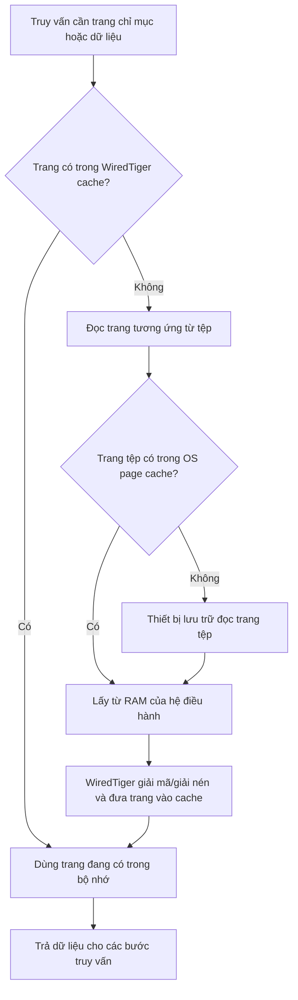

# Bộ nhớ đệm WiredTiger, bộ nhớ hệ điều hành và tập dữ liệu thường dùng

## 1. Vì sao MongoDB cần nhiều lớp bộ nhớ đệm?

Một cơ sở dữ liệu có thể lưu hàng trăm gigabyte hoặc nhiều terabyte dữ liệu trên đĩa, nhưng tại một thời điểm ứng dụng chỉ truy cập một phần trong số đó. Nếu mọi truy vấn đều phải đọc từ thiết bị lưu trữ, độ trễ và số thao tác I/O sẽ tăng mạnh. MongoDB sử dụng **WiredTiger** làm storage engine mặc định trong các phiên bản hiện đại; WiredTiger quản lý các trang dữ liệu trong bộ nhớ để phục vụ đọc, cập nhật và duy trì trạng thái cần ghi xuống bộ lưu trữ. Đồng thời, hệ điều hành có bộ nhớ đệm riêng cho các trang của tệp dữ liệu.

Hai lớp đệm này có nhiệm vụ khác nhau:

- **WiredTiger internal cache** chứa các trang dữ liệu và chỉ mục mà storage engine đang làm việc, thường dưới dạng đã giải nén, kèm các thay đổi và cấu trúc quản lý phiên bản.
- **Operating system filesystem/page cache** giữ nội dung các trang tệp vừa đọc hoặc ghi ở cấp hệ điều hành; đối với các tệp WiredTiger có nén, nội dung được đệm ở lớp này thường là các trang lưu trữ đã nén.

Ngoài ra còn có bộ nhớ dành cho tiến trình `mongod`, truy vấn đang chạy, kết nối, replication, journal, các dịch vụ hệ điều hành và ứng dụng khác. Vì thế, câu hỏi “MongoDB chiếm bao nhiêu RAM?” cần phân biệt **kích thước WiredTiger cache**, **RAM thực sự dùng bởi tiến trình** và **RAM hệ điều hành có thể thu hồi từ filesystem cache**.

> Ý chính: **Database size không phải working set; WiredTiger cache không phải toàn bộ RAM của MongoDB; và bộ nhớ hệ điều hành đang được dùng làm cache không tự động có nghĩa là thiếu RAM.**

## 2. Ba khái niệm cần phân biệt

| Khái niệm | Chứa gì? | Ai quản lý? | Khi nào hữu ích? |
| --- | --- | --- | --- |
| WiredTiger cache | Trang dữ liệu/chỉ mục đã đưa vào storage engine, trạng thái dirty, metadata và cấu trúc liên quan. | WiredTiger bên trong `mongod`. | Đọc và sửa các trang đang hoạt động mà không phải nạp lại từ tệp. |
| Filesystem/page cache | Trang của tệp dữ liệu được hệ điều hành giữ trong RAM; thường là dữ liệu trên đĩa ở dạng nén. | Hệ điều hành. | Tránh I/O vật lý khi WiredTiger cần nạp lại trang từ tệp. |
| Working set | Phần dữ liệu và chỉ mục được workload truy cập thường xuyên trong một khoảng thời gian xác định. | Là tính chất của workload, không phải một vùng cấp phát cố định. | Ước lượng yêu cầu bộ nhớ và xác định nguyên nhân trễ do đọc đĩa. |

Một bộ nhớ khác dễ gây nhầm lẫn là **query plan cache**: nơi MongoDB có thể lưu thông tin kế hoạch truy vấn để tái sử dụng. Plan cache không phải kho lưu bản sao kết quả truy vấn và không tương đương với WiredTiger cache. Tương tự, bộ nhớ mà phép `sort`, `$group` hoặc các bước aggregation sử dụng không mặc nhiên được tính là dung lượng WiredTiger cache.

## 3. Đường đi của dữ liệu khi đọc

Xét truy vấn tra cứu một đơn hàng theo chỉ mục:

```javascript
db.orders.findOne({ orderCode: "ORD-2026-0101" });
```

Ở mức khái niệm, quá trình tìm trang cần thiết diễn ra như sau:



Đây là mô hình khái quát để hiểu cache, không phải cam kết mọi thao tác đọc đều đi qua chính xác từng bước này. Một truy vấn có thể cần nhiều trang chỉ mục và nhiều trang dữ liệu; WiredTiger còn có các đường thực thi và cơ chế nạp trang khác nhau tùy trường hợp.

Ba tình huống đáng chú ý:

1. **WiredTiger cache hit:** trang đang hiện diện trong cache của storage engine. Không cần đọc lại trang đó từ tệp; đây thường là tình huống tốt nhất cho truy cập lặp lại.
2. **WiredTiger miss nhưng OS page-cache hit:** WiredTiger phải xử lý/nạp lại trang, nhưng dữ liệu trên tệp đã nằm trong RAM của hệ điều hành, nên tránh được đọc vật lý từ thiết bị lưu trữ.
3. **Miss ở cả hai lớp:** phải đọc trang từ ổ đĩa hoặc thiết bị lưu trữ từ xa. Độ trễ thường cao hơn, đặc biệt khi truy cập ngẫu nhiên hoặc I/O đang bị nghẽn.

Cache hit ở filesystem không làm cho việc nạp dữ liệu vào WiredTiger hoàn toàn miễn phí: vẫn có chi phí sao chép, giải nén và dựng cấu trúc trong bộ nhớ. Ngược lại, việc tệp được hệ điều hành cache không có nghĩa trang đó đang nằm trong WiredTiger cache.

### Ví dụ: truy vấn lặp lại và truy vấn quét rộng

Giả sử collection `orders` có 20 triệu đơn hàng, nhưng API chủ yếu đọc đơn mới của 5.000 khách hàng hoạt động trong tuần. Những trang chỉ mục và document liên quan có thể được truy cập lặp đi lặp lại và trở nên “nóng”. Một tập dữ liệu tổng thể lớn vẫn có thể hoạt động tốt với RAM vừa phải nếu phần nóng nhỏ và truy vấn có chỉ mục phù hợp.

Trái lại, truy vấn báo cáo quét toàn bộ dữ liệu cũ có thể đưa vào cache nhiều trang ít được dùng lại. Nếu việc quét này làm các trang nóng bị đẩy ra, sau đó các request thông thường phải nạp lại dữ liệu. Đây là một dạng **cache pollution**: truy cập phân tích làm giảm hiệu quả của bộ nhớ đệm dành cho luồng giao dịch.

## 4. WiredTiger cache hoạt động như thế nào?

WiredTiger tổ chức dữ liệu và chỉ mục qua các cấu trúc trang trong cây tìm kiếm. Những trang được truy cập có thể được đưa vào cache để thực hiện tìm kiếm, cập nhật và quản lý phiên bản mà không cần liên tục đọc/ghi trực tiếp từng thay đổi ra ổ đĩa.

### 4.1. Trang clean và trang dirty

**Clean page** là trang mà trạng thái trong cache không chứa thay đổi chưa được phản ánh vào dạng lưu trữ tương ứng. Khi không còn cần thiết và có thể loại khỏi cache, WiredTiger thường không cần ghi lại nội dung clean page.

**Dirty page** chứa thay đổi đang ở bộ nhớ chưa được đưa đầy đủ vào các trang tệp dữ liệu. Trước khi giải phóng một trang dirty trong trường hợp cần ghi, WiredTiger có thể phải hòa giải nội dung trang (*reconciliation*) và thực hiện thao tác ghi phù hợp. Hoạt động ghi của WiredTiger còn liên quan tới checkpoint, cơ chế phiên bản và journal; không nên đồng nhất dirty page với “ghi đã mất an toàn”.

```text
Đọc trang -> trang trong WiredTiger cache
             |
             +-- Chỉ đọc ------------------> clean, có thể bị loại khi phù hợp
             |
             +-- Cập nhật dữ liệu ---------> dirty, cần xử lý ghi/phiên bản
                                             |
                                             +--> checkpoint hoặc eviction
                                             +--> duy trì các phiên bản cần thiết
```

**Journal** và **checkpoint** phục vụ các mục tiêu liên quan nhưng khác nhau. Journal hỗ trợ khôi phục các thay đổi đã được ghi nhận theo chính sách durability khi có sự cố; checkpoint tạo mốc trạng thái nhất quán trên tệp dữ liệu. Một document đã được xác nhận bền vững theo write concern phù hợp không nhất thiết phải có mọi trang dữ liệu của nó đã được checkpoint vào tệp. Đồng thời, một trang bị đẩy khỏi cache không có nghĩa toàn bộ cơ sở dữ liệu vừa được checkpoint.

### 4.2. Eviction: tạo chỗ cho trang mới

Cache có giới hạn dung lượng, nên WiredTiger cần **eviction** để thay thế những trang ít còn cần sử dụng. Khi mức sử dụng tăng, các luồng nền đánh giá và loại những trang đủ điều kiện. Trong tình huống áp lực lớn, các luồng ứng dụng có thể phải tham gia công việc eviction, khiến truy vấn hoặc thao tác ghi chậm lại.

Eviction không chỉ đơn giản là xóa một entry như cache key–value:

- Một trang có thể chứa nhiều record, bản cập nhật và thông tin phục vụ truy cập đồng thời.
- Trang dirty có thể đòi hỏi thao tác ghi hoặc hòa giải phiên bản trước khi giải phóng.
- Một số trang hoặc phiên bản còn được transaction, cursor hay hoạt động khác tham chiếu và không thể loại bỏ ngay.
- Nếu tốc độ tạo trang dirty hoặc tốc độ nạp trang mới lớn hơn khả năng eviction duy trì, ứng dụng có thể phải chờ hoặc tham gia eviction.

Các **ngưỡng cache/eviction** tồn tại và có thể được cấu hình trong những bối cảnh nhất định, nhưng giá trị và cách diễn giải thay đổi theo phiên bản/cấu hình. Không nên tối ưu bằng cách sao chép một con số ngưỡng từ bài viết khác mà chưa quan sát workload thực tế.

### 4.3. History store và transaction kéo dài

MongoDB/WiredTiger phải hỗ trợ nhiều phiên bản dữ liệu trong một số tình huống đọc/ghi đồng thời. WiredTiger có cơ chế lưu lịch sử phiên bản (*history store*) để các thao tác cần snapshot cũ vẫn có thể đọc dữ liệu phù hợp. Transaction hoặc reader tồn tại quá lâu có thể giữ lại những phiên bản không còn cần cho workload thông thường, làm tăng áp lực cache, dữ liệu lịch sử và công việc dọn dẹp.

Ví dụ, một giao dịch mở rồi chờ thao tác mạng rất lâu trong khi nhiều bản ghi tiếp tục được cập nhật có thể tạo áp lực không cần thiết. Thiết kế tốt nên tránh để transaction tồn tại trong thời gian dài, chia nhỏ các công việc lớn khi có thể và quan sát chỉ số liên quan tới transaction cùng eviction.

## 5. Filesystem cache: tại sao MongoDB không dùng hết RAM cho WiredTiger?

Đối với WiredTiger, hệ điều hành vẫn có vai trò quan trọng trong việc giữ các trang tệp dữ liệu. Một trang đã rời WiredTiger cache có thể còn nằm trong page cache của hệ điều hành. Nếu trang được truy cập lại, hệ điều hành có thể phục vụ yêu cầu đọc mà không đụng đến I/O vật lý.

Vì vậy, **tăng kích thước WiredTiger cache không phải lúc nào cũng tốt hơn**. Cấp nhiều RAM hơn cho WiredTiger có thể làm giảm dung lượng khả dụng cho filesystem cache và các thành phần khác. Trên máy thiếu bộ nhớ, hệ điều hành có thể phải reclaim dữ liệu cached thường xuyên, swap hoặc thậm chí kích hoạt cơ chế kết thúc tiến trình khi không còn đủ nguồn lực.

Ở Linux, cột “used memory” trong các công cụ hệ thống thường bao gồm cả bộ nhớ cache có thể thu hồi. Cần xem thêm `MemAvailable`, trạng thái swap, memory pressure và dấu hiệu lỗi cấp phát. Chỉ nhìn RAM `free` thấp không đủ để kết luận MongoDB đang rò rỉ bộ nhớ.

### Phân biệt hai dạng “trang”

*Trang WiredTiger* là đơn vị logic/storage engine sử dụng để quản lý dữ liệu và chỉ mục trong B-tree; *trang bộ nhớ của OS* là đơn vị quản lý bộ nhớ ảo và I/O của hệ điều hành, ví dụ các trang 4 KiB trên nhiều cấu hình Linux. Hai khái niệm không nhất thiết có cùng kích thước hoặc ranh giới.

WiredTiger có thể giữ bản biểu diễn đã giải nén của trang dữ liệu, trong khi filesystem cache giữ các block/tệp tương ứng theo định dạng trên đĩa. Không nên lấy tổng dung lượng file nén rồi suy ra trực tiếp bao nhiêu RAM WiredTiger cần để giữ mọi dữ liệu “nóng”. Dung lượng trong cache còn phụ thuộc vào index, metadata, mức cập nhật và cấu trúc trang.

## 6. Kích thước WiredTiger cache và ngân sách RAM

Ở các bản MongoDB hiện đại, bộ nhớ cache mặc định của WiredTiger thường được xác định từ RAM khả dụng cho tiến trình hoặc giới hạn bộ nhớ được nhận diện, dành một phần đáng kể cho các thành phần khác. Với nhiều bản MongoDB thông dụng, quy tắc mặc định được mô tả theo dạng:

```text
WiredTiger cache mặc định ~= max(50% x (RAM - 1 GiB), 256 MiB)
```

**Công thức trên mang tính định hướng theo phiên bản**: hành vi phát hiện RAM trong container, quy tắc mặc định và các giới hạn thực tế cần được kiểm tra theo bản MongoDB đang chạy. Khi vận hành, hãy đọc cấu hình và giá trị cache thực sự được báo cáo từ instance, thay vì suy luận bằng công thức duy nhất.

Ví dụ, một máy dành riêng 16 GiB RAM có thể có cache mặc định khoảng 7,5 GiB theo quy tắc trên. Phần RAM còn lại **không đơn thuần là “RAM lãng phí”**: nó phục vụ filesystem cache, tiến trình `mongod` ngoài WiredTiger cache, hệ điều hành và bộ nhớ phát sinh bởi workload.

Một ngân sách minh họa có thể biểu diễn như sau:

```text
RAM khả dụng trong máy/container
  |-- WiredTiger cache (mức giới hạn cấu hình)
  |-- Bộ nhớ khác của mongod: kết nối, truy vấn, replication, metadata, ...
  |-- Filesystem/page cache của hệ điều hành (có thể thu hồi)
  |-- Hệ điều hành và tiến trình khác
  `-- Khoảng dự phòng cho đỉnh tải
```

Đây là **phân loại mục đích sử dụng**, không phải công thức cộng các số đo RSS với cache hệ điều hành một cách máy móc: công cụ đo ở các tầng có thể có phần giao nhau, và mức tiêu thụ thay đổi theo thời gian.

### 6.1. Cấu hình kích thước khi cần

Một cách khai báo trong `mongod.conf`:

```yaml
storage:
  wiredTiger:
    engineConfig:
      cacheSizeGB: 6
```

Ví dụ này chỉ thể hiện cú pháp cấp khoảng 6 GiB cho cache; **không phải khuyến nghị chung rằng mọi server nên dùng 6 GiB**. Lý do thay đổi cấu hình phải bắt nguồn từ giới hạn RAM, số tiến trình dùng chung máy và chỉ số hiệu năng. Một cache được đặt quá lớn có thể khiến hệ điều hành còn quá ít bộ nhớ; một cache quá nhỏ có thể làm nạp trang và eviction diễn ra liên tục.

### 6.2. Triển khai trong container

Một container có giới hạn RAM nhỏ hơn RAM máy chủ vật lý. Không nên tính cache dựa trên bộ nhớ của host nếu tiến trình bị giới hạn bởi cgroup. Kiểm tra bản MongoDB có nhận diện giới hạn bộ nhớ container như mong đợi hay không, và kiểm tra cả `memory limit`, `memory usage`, sự kiện OOM/restart và mức sử dụng của các sidecar.

Ví dụ, nếu một pod/container được cấp 8 GiB nhưng cache bị cấu hình gần 8 GiB, phần bộ nhớ còn lại có thể không đủ cho kết nối, aggregation và filesystem cache; workload đang bình thường vẫn có thể gặp OOM khi đỉnh tải xuất hiện. Cần để dự phòng và đo theo tải thực, không chỉ theo trạng thái khi mới khởi động.

## 7. Working set: tập dữ liệu “nóng” thật sự là gì?

**Working set** là tập các trang dữ liệu và chỉ mục mà một workload cần truy cập trong một khoảng thời gian quan sát. Đây không phải cấu hình của MongoDB, cũng không phải `db.stats().dataSize` hoặc kích thước collection tính bằng byte.

Ví dụ, một hệ thống có:

- 400 GiB dữ liệu đơn hàng từ nhiều năm.
- 60 GiB chỉ mục trên toàn bộ dữ liệu.
- 90% request trong một ngày chỉ tra cứu đơn hàng gần đây và một số tài khoản hoạt động.
- Một báo cáo tổng hợp hàng đêm đọc nhiều tháng lịch sử.

Workload ban ngày có thể cần working set tương đối nhỏ so với 460 GiB dữ liệu và index tổng thể. Ngược lại, báo cáo hàng đêm có thể kéo nhiều trang lạnh vào cache, làm thay đổi working set trong khoảng thời gian đó. Không thể chỉ dùng tổng kích thước cơ sở dữ liệu để phán đoán lượng RAM bắt buộc.

### 7.1. Working set phụ thuộc khoảng thời gian

Cùng một hệ thống có thể có:

| Khoảng quan sát | Dạng dữ liệu thường xuyên truy cập | Hệ quả |
| --- | --- | --- |
| Vài giây | ID đơn hàng hoặc người dùng truy cập lặp lại. | Tập nóng nhỏ, có thể được giữ lại dễ dàng. |
| Vài phút | Đơn, sản phẩm, giỏ hàng trong một đợt khuyến mãi. | Nhiều key khác nhau; mức churn của cache tăng. |
| Một ngày | Dữ liệu vận hành và các báo cáo định kỳ. | Tập trang cần truy cập có thể lớn hơn đáng kể. |
| Hàng tuần/tháng | Quét lịch sử hoặc phân tích toàn bộ. | Nhiều trang lạnh, dễ gây cạnh tranh với cache phục vụ API. |

Do đó, câu “working set vừa RAM” chưa đầy đủ nếu không nêu **workload nào**, **khoảng thời gian nào**, **độ trễ yêu cầu bao nhiêu** và **cấp độ cache nào được xét**.

### 7.2. Chỉ mục là một phần của working set

Truy vấn theo chỉ mục không có nghĩa dữ liệu cần dùng chỉ nằm trong một entry index. MongoDB có thể phải đọc các trang cây chỉ mục, rồi truy cập những trang dữ liệu chứa document tương ứng. Các truy vấn được đáp ứng hoàn toàn bằng index (*covered query*, trong điều kiện phù hợp) có thể tránh một phần việc đọc document.

Ví dụ:

```javascript
db.orders.createIndex({ customerId: 1, status: 1, createdAt: -1 });

db.orders.find(
  { customerId: "C104", status: "PAID" },
  { _id: 0, customerId: 1, status: 1, createdAt: 1 }
).sort({ createdAt: -1 }).limit(20);
```

Truy vấn có thể tận dụng compound index cho điều kiện lọc, thứ tự sắp xếp và các field chiếu, tùy kế hoạch thực tế. Nếu bổ sung trường không có trong index, ví dụ `shippingAddress`, engine có thể phải truy cập trang document. Việc thiết kế chỉ mục phù hợp giúp giảm cả số trang phải chạm và khả năng đọc dữ liệu lạnh từ storage.

### 7.3. Cache thrashing xảy ra khi nào?

**Cache thrashing** là trạng thái trang được nạp vào rồi sớm bị đẩy ra, sau đó lại cần nạp vì workload tiếp tục truy cập chúng. Các dấu hiệu thường gồm I/O đọc tăng, số trang nạp vào cache tăng nhanh, eviction hoạt động nặng và độ trễ truy vấn xấu đi. Trên hệ thống có nhiều trang dirty hoặc phiên bản bị giữ, eviction càng có thể khó giữ nhịp.

Ví dụ: một workload truy cập ngẫu nhiên 30 GiB trang hoạt động trong khi WiredTiger cache khoảng 6 GiB, OS page cache cũng chịu tải từ tiến trình khác. Nếu khả năng tái sử dụng trang trong thời gian ngắn thấp, phần lớn truy vấn có thể trả chi phí nạp trang lặp lại. Tăng cache **có thể** giúp, nhưng trước hết cần xem liệu query scan, index thiếu hoặc mô hình truy cập không hiệu quả đang tạo ra working set lớn giả tạo.

## 8. Quan hệ giữa dung lượng dữ liệu, chỉ mục, RAM và latency

Hãy xét ba hệ thống giả định:

| Tình huống | Dữ liệu trên đĩa | Truy cập chủ yếu | Điều đáng đo |
| --- | --- | --- | --- |
| A — API tra cứu theo ID | 2 TiB | Vài triệu record mới và các index tương ứng. | Phần trang nóng có vừa cache không, p95/p99 latency có ổn định không. |
| B — Báo cáo quét rộng | 80 GiB | Quét gần hết collection mỗi lần báo cáo. | Lượng trang đọc, mức đọc vật lý, tác động đến cache của API khác. |
| C — Ghi đồng thời cao | 120 GiB | Nhiều cập nhật lặp lại trên các document và index. | Dirty pages, eviction, write I/O, checkpoint, xung đột ghi. |

Hệ A có tổng dung lượng lớn nhất nhưng có thể hoạt động tốt nếu vùng nóng nhỏ; hệ B nhỏ hơn vẫn có thể gặp nghẽn I/O; hệ C có thể chịu áp lực từ tốc độ tạo dirty data dù phần đọc không lớn. Không có quy tắc “cơ sở dữ liệu nhỏ hơn RAM thì nhanh, lớn hơn RAM thì chậm” áp dụng cho mọi workload.

Tương tự, dữ liệu nén tốt trên đĩa không đảm bảo phù hợp cache của WiredTiger. Working set trong RAM có thể lớn hơn kích thước nén của những trang tương ứng. Phải đo độ trễ và chỉ số cache theo truy vấn thực tế.

## 9. Đọc chỉ số WiredTiger cache trong MongoDB

`serverStatus` cung cấp các thống kê của tiến trình; trong các cấu hình dùng WiredTiger, có thể xem mục `wiredTiger.cache` từ `mongosh`:

```javascript
const wt = db.serverStatus().wiredTiger.cache;

printjson({
  maximumBytes: wt["maximum bytes configured"],
  currentBytes: wt["bytes currently in the cache"],
  dirtyBytes: wt["tracked dirty bytes in the cache"],
  pagesReadIntoCache: wt["pages read into cache"],
  pagesWrittenFromCache: wt["pages written from cache"]
});
```

Tên trường và sự sẵn có của từng chỉ số có thể thay đổi giữa các bản MongoDB/WiredTiger. Khi triển khai dashboard, phải kiểm tra dữ liệu thực được trả về, bổ sung xử lý trường không tồn tại và ghi lại phiên bản sử dụng.

### Cách diễn giải các nhóm chỉ số

| Nhóm | Giúp trả lời câu hỏi gì? | Lưu ý diễn giải |
| --- | --- | --- |
| Cache current/maximum bytes | Cache đang sử dụng bao nhiêu so với mức giới hạn? | Cache gần đầy thường là trạng thái bình thường của cơ chế cache. |
| Dirty bytes hoặc dirty percentage | Có bao nhiêu dữ liệu sửa đổi đang chờ quá trình xử lý ghi? | Phải đối chiếu với tốc độ ghi, checkpoint và eviction. |
| Pages read into cache | Engine đang nạp trang mới với tần suất nào? | Chỉ số tích lũy; cần lấy chênh lệch giữa hai mốc thời gian. |
| Pages written from cache | Engine đang ghi trang với tốc độ nào? | Không đồng nghĩa trực tiếp với tổng số document được ứng dụng cập nhật. |
| Eviction activity/blocked reads | Cache có gặp áp lực giải phóng trang không? | Cần xem các chỉ số eviction cụ thể của phiên bản và thời gian chờ liên quan. |
| Concurrent operations / transaction age | Có tác vụ giữ tài nguyên quá lâu không? | Reader/transaction dài có thể cản trở giải phóng phiên bản và trang. |

**Không suy luận tỷ lệ cache hit** đơn giản bằng cách lấy một counter “pages read” chia cho số request API. Một request có thể chạm nhiều trang; cấu trúc đọc trước, nhiều kiểu trang và các đường I/O khác nhau làm các tỷ lệ tự chế dễ sai. Muốn đánh giá cache, cần kết hợp tốc độ nạp trang, thông số eviction, I/O vật lý và độ trễ ứng dụng theo thời gian.

### Ví dụ đo thay đổi qua hai thời điểm

Giả sử công cụ monitoring chụp hai mẫu của `pages read into cache` cách nhau 60 giây:

```text
12:00:00  pages read into cache = 1,240,000
12:01:00  pages read into cache = 1,246,600

Tốc độ nạp trung bình = (1,246,600 - 1,240,000) / 60
                     = 110 trang/giây
```

Con số 110 trang/giây **không tự chứng minh có nghẽn**. Cần đối chiếu cùng khoảng thời gian với lượng request, kích thước trang, I/O của hệ điều hành, cache eviction và p95/p99 độ trễ. Một đợt nạp cache khi vừa khởi động có thể bình thường; cùng tần suất đó kéo dài trong đỉnh tải với I/O vật lý cao và latency tăng có thể là dấu hiệu working set không vừa bộ nhớ.

## 10. Quan sát bộ nhớ hệ điều hành

Trên Linux, có thể bắt đầu từ các lệnh hệ thống thông dụng:

```bash
free -h
vmstat 1
```

`free -h` cho cái nhìn tổng quan về RAM và phần bộ nhớ có thể cấp phát (`available`); `vmstat 1` cho thấy biến động theo giây như swap in/out, mức CPU và một số hoạt động I/O. Khi điều tra sâu hơn, có thể dùng công cụ theo dõi I/O thiết bị như `iostat -x 1`, thông số cgroup/container, process RSS và dashboard giám sát của môi trường triển khai.

Các dấu hiệu cần nhìn **theo nhóm**:

- `MemAvailable` giảm kéo dài đến mức rất thấp, swap in/out hoặc memory pressure tăng.
- Tốc độ đọc thiết bị và độ trễ I/O tăng đúng lúc API chậm.
- Lượng trang WiredTiger nạp vào cache tăng cùng với eviction và các luồng ứng dụng phải tham gia eviction.
- Process RSS, bộ nhớ của container và lượng kết nối/truy vấn tăng đến gần giới hạn.
- Tiến trình bị OOM/restart, hoặc kernel/container ghi nhận hoạt động reclaim nghiêm trọng.

Một dashboard có thể hiển thị `mongod` RSS cao hơn cấu hình WiredTiger cache. Điều đó không tự chứng minh rò rỉ RAM: process còn nhiều bộ nhớ khác ngoài cache và cách các allocator trả lại trang cho hệ điều hành cũng ảnh hưởng RSS. Ngược lại, chỉ thấy WiredTiger cache chưa đầy không đủ để kết luận máy không thiếu RAM nếu aggregation, kết nối hoặc tiến trình khác đang tiêu thụ nhiều bộ nhớ.

> Khi monitor trên container/Kubernetes, hãy đọc đồng thời **memory limit**, mức tiêu thụ container và các chỉ số nội bộ `mongod`. Số RAM host có thể lớn hơn nhiều so với giới hạn cgroup thực tế.

## 11. Hiệu năng truy vấn và working set có quan hệ hai chiều

Một truy vấn thiếu chỉ mục có thể biến yêu cầu chỉ cần vài document thành thao tác đọc hàng triệu document, làm phình working set và đẩy các trang hữu ích ra khỏi cache. Vì vậy, trước khi tăng RAM hãy xem đường truy vấn.

Ví dụ truy vấn danh sách đơn của khách hàng:

```javascript
db.orders.find(
  { customerId: "C104", status: "PAID" }
).sort({ createdAt: -1 }).limit(20);

db.orders.find(
  { customerId: "C104", status: "PAID" }
).sort({ createdAt: -1 }).limit(20).explain("executionStats");
```

Các trường `nReturned`, `totalKeysExamined`, `totalDocsExamined` và kế hoạch như `IXSCAN`/`COLLSCAN` giúp xác định có đang đọc quá nhiều khóa/document không. Một chỉ mục phù hợp với filter và sort thường giúp giảm lượng trang cần nạp, qua đó giảm áp lực lên cả WiredTiger cache lẫn filesystem cache.

```javascript
db.orders.createIndex({
  customerId: 1,
  status: 1,
  createdAt: -1
});
```

Không nên tạo index chỉ vì thấy một truy vấn: mỗi index chiếm dung lượng, làm tăng khối lượng duy trì khi ghi và có working set riêng. Cần cân nhắc tần suất truy vấn, tính chọn lọc, cách sort, chi phí index và tốc độ ghi trước khi triển khai.

### Các cách giảm áp lực cache từ thiết kế ứng dụng

1. Chỉ truy vấn những document và trường cần thiết; áp dụng projection khi phù hợp.
2. Dùng chỉ mục dựa trên filter/sort thật, theo dõi `docsExamined` và plan thực tế.
3. Tránh quét dữ liệu lịch sử trên replica phục vụ API nhạy độ trễ nếu workload có thể tách hợp lý; chú ý tính nhất quán khi đọc từ secondary.
4. Phân trang theo khóa ổn định ở những luồng có độ sâu lớn, tránh offset sâu không cần thiết.
5. Lưu trữ/archival dữ liệu lạnh theo yêu cầu nghiệp vụ; phân biệt nhu cầu truy cập tức thời với lưu giữ dài hạn.
6. Với analytics nặng, cân nhắc hệ thống tổng hợp hoặc bộ lưu trữ dành riêng thay vì bắt workload OLTP quét toàn dữ liệu.

**Projection không luôn đồng nghĩa với ít I/O hơn**: nếu truy vấn vẫn phải đọc toàn document từ tệp, bỏ vài field khi trả kết quả chỉ giảm dữ liệu trả về. Lợi ích rõ hơn khi truy vấn đủ điều kiện được index cover hoặc khi cắt giảm khối lượng xử lý/truyền tải đáng kể.

## 12. Ba kiểu áp lực bộ nhớ phổ biến

### 12.1. Đọc ngẫu nhiên trên vùng dữ liệu lớn

**Triệu chứng:** tốc độ nạp trang tăng, I/O đọc ngẫu nhiên tăng, p95/p99 tăng; nhiều request phải chờ trang từ storage.

**Nguyên nhân có thể:** working set lớn hơn khả năng giữ cache, index thiếu/không hiệu quả, truy vấn quét rộng, hoặc tác vụ nền đưa nhiều trang lạnh vào cache.

**Hướng xử lý:** kiểm tra `explain`, đo đường truy vấn, giảm quét không cần thiết, tối ưu index và mô hình dữ liệu. Sau đó mới đánh giá tăng RAM hoặc đổi loại thiết bị lưu trữ nếu workload thực sự cần tập nóng lớn.

### 12.2. Ghi nhiều và dirty-page pressure

**Triệu chứng:** dirty bytes tăng, eviction/checkpoint hoạt động mạnh, ghi chậm hoặc request phải tham gia eviction.

**Nguyên nhân có thể:** workload update/insert quá nhanh so với khả năng ghi của storage, nhiều index phải cập nhật, document lớn hoặc các transaction giữ phiên bản quá lâu.

**Hướng xử lý:** quan sát write IOPS/latency, batch hợp lý, tối ưu index và cấu trúc document; loại bỏ transaction không cần thiết kéo dài. Xem xét năng lực storage, replication và checkpoint trước khi đơn thuần tăng cache.

### 12.3. Hệ điều hành hoặc container thiếu RAM

**Triệu chứng:** swap/reclaim tăng mạnh, memory limit bị vượt, OOM, tiến trình restart; độ trễ dao động dù chỉ số WiredTiger cache nhìn có vẻ bình thường.

**Nguyên nhân có thể:** cache được cấu hình quá lớn so với limit thực, nhiều tiến trình chung máy, aggregation hay connection tăng đột biến hoặc bộ nhớ ngoài WiredTiger cache không được dự phòng.

**Hướng xử lý:** kiểm tra giới hạn container, đo process/container memory, giảm cache nếu cần để trả RAM cho OS và các thành phần khác, hoặc tăng ngân sách RAM khi đã xác định được nhu cầu. Phải quan sát sau thay đổi vì giảm cache quá mức có thể làm I/O đọc tăng.

## 13. Tình huống thực tế: MongoDB báo RAM cao, có cần tăng hoặc giảm cache?

Giả sử một máy 32 GiB chạy riêng `mongod`, lưu 300 GiB dữ liệu và index. Monitoring cho thấy:

```text
RAM vật lý                 : 32 GiB
WiredTiger cache cấu hình : khoảng 15,5 GiB
Dung lượng DB + index      : 300 GiB
Độ trễ API p95            : 35 ms (bình thường)
I/O đọc vật lý            : thấp, ổn định
Swap/OOM                  : không có
```

Việc database lớn hơn RAM nhiều lần hoặc WiredTiger cache thường gần mức giới hạn **không tự nó là vấn đề**. Nếu API đáp ứng yêu cầu và hệ thống không bị memory pressure, chưa có cơ sở thay đổi cache. Cần giữ monitoring và kiểm thử cho đợt tải cao.

Một tuần sau, tác vụ báo cáo mới chạy mỗi giờ và quan sát thấy:

```text
Trong 10 phút chạy báo cáo:
- Tốc độ đọc trang vào WiredTiger cache tăng mạnh
- I/O đọc vật lý tăng
- p95 API tăng từ 35 ms lên 280 ms
- Sau báo cáo, API vẫn chậm vài phút trước khi ổn định
```

Giả thuyết hợp lý là tác vụ báo cáo đã quét nhiều trang ít được tái sử dụng và cạnh tranh cache với API. Cần kiểm tra `explain`, phân biệt đọc từ secondary với primary và đo tác động của từng phương án: tối ưu pipeline/index; chạy báo cáo trên hệ thống tách riêng; tiền tổng hợp dữ liệu; hoặc tăng năng lực máy nếu nhu cầu thực sự đòi hỏi. **Tăng kích thước WiredTiger cache ngay** có thể chỉ đẩy vấn đề sang thiếu filesystem cache hoặc OS RAM.

Một tình huống khác: cache chỉ dùng 8 GiB trong khi pod giới hạn 12 GiB, nhưng pod bị OOM khi chạy aggregation lớn. Ở đây vấn đề có thể nằm ở bộ nhớ ngoài WiredTiger cache; tăng cache là hướng điều chỉnh ngược. Phải khảo sát aggregation, yêu cầu memory limit và mức sử dụng tiến trình trước.

## 14. Từ hiện tượng đến phép đo cần làm

| Hiện tượng | Kiểm tra trước | Điều không nên vội kết luận |
| --- | --- | --- |
| Cache WiredTiger thường 90–100% giới hạn | Độ trễ API, eviction, read I/O, swap và xu hướng thay đổi. | “Cache gần đầy chắc chắn là lỗi.” |
| `mongod` dùng RAM nhiều hơn cache đã cấu hình | Process RSS, connection, aggregation, bộ nhớ ngoài cache. | “MongoDB đã vượt cache nên bị leak.” |
| `free` báo RAM còn ít | `MemAvailable`, filesystem cache, memory pressure. | “Hệ điều hành hết RAM.” |
| Query chậm sau khởi động | Tốc độ nạp trang, read I/O, query plan, quá trình warm-up. | “Mọi truy vấn đều đã bị chậm vĩnh viễn.” |
| Eviction tăng nhanh | Dirty bytes, pages read, số reader/transaction dài, I/O latency. | “Chỉ cần tăng cache là xong.” |
| Nhiều I/O đọc | `explain`, index, scan, working set, filesystem hit. | “Dung lượng DB quá lớn là nguyên nhân duy nhất.” |
| Ghi chậm dù CPU chưa cao | Dirty pages, checkpoint/eviction, ổ đĩa, index, replication. | “CPU thấp tức là storage không nghẽn.” |
| Container bị OOM | cgroup limit, RSS, cache cấu hình, query memory, sidecar. | “Chỉ có WiredTiger cache dùng RAM.” |

## 15. Chiến lược điều chỉnh an toàn

Một trình tự điều tra hữu ích:

**Bước 1 — Xác định mục tiêu.** Ví dụ p95 đọc dưới 100 ms tại 1.000 request/giây, không OOM trong đỉnh tải, độ trễ ghi được xác nhận dưới ngưỡng nghiệp vụ. Không tối ưu “cache usage thấp” như một mục tiêu tự thân.

**Bước 2 — Ghi nhận baseline.** Thu thập phiên bản MongoDB, RAM/container limit, WiredTiger cache hiện tại, tỷ lệ đọc/ghi, query patterns, read/write IOPS, latency, eviction, dirty bytes và số transaction kéo dài. Các số liệu cần có cùng mốc thời gian.

**Bước 3 — Loại bỏ nguồn tạo I/O không cần thiết.** Tìm COLLSCAN, sort không dùng index, quét lịch sử không phục vụ API, projection/aggregation quá lớn và thói quen đọc quá nhiều document. Đánh giá các thay đổi này trước vì chúng có thể giảm working set mà không cần thêm RAM.

**Bước 4 — Chọn một thay đổi có giả thuyết rõ ràng.** Chẳng hạn tăng RAM khi working set cần thiết lớn, giảm WiredTiger cache khi container còn quá ít RAM cho các thành phần khác, hoặc chuyển báo cáo sang hệ thống riêng nếu nó thường xuyên làm cache của API mất ổn định.

**Bước 5 — Đo lại trên workload tương đương.** So sánh p95/p99, read/write IOPS, số trang nạp, eviction pressure, dirty bytes, RSS/memory limit và rủi ro OOM. Một thay đổi hữu ích phải cải thiện mục tiêu ứng dụng, không chỉ làm đẹp một đường biểu đồ cache.

**Bước 6 — Lưu lại điều kiện áp dụng.** Ghi nhận phiên bản, cache setting, số lượng index, giới hạn bộ nhớ, mô hình truy cập và ngưỡng cần cảnh báo. Khi workload hoặc mô hình dữ liệu thay đổi, đánh giá lại quyết định cũ.

## 16. Các ngộ nhận thường gặp

| Ngộ nhận | Cách hiểu đúng |
| --- | --- |
| “MongoDB dùng cache riêng nên OS page cache không quan trọng.” | Cả hai lớp đều ảnh hưởng chi phí đọc và cạnh tranh ngân sách RAM. |
| “Đặt WiredTiger cache bằng toàn bộ RAM sẽ nhanh nhất.” | `mongod` và hệ điều hành còn cần RAM ngoài cache; cấu hình quá lớn gây memory pressure. |
| “WiredTiger cache đầy nghĩa là sắp crash.” | Cache được thiết kế để sử dụng dung lượng được cấp và eviction theo nhu cầu; phải quan sát dấu hiệu áp lực thực. |
| “DB 1 TiB cần ít nhất 1 TiB RAM.” | Chỉ phần được truy cập thường xuyên cần ưu tiên trong RAM; nhiều dữ liệu có thể lạnh. |
| “Database nhỏ hơn RAM thì luôn nhanh.” | Query thiếu index, scan, contention, checkpoint và tải ghi vẫn có thể gây trễ. |
| “Cache miss luôn dẫn đến đọc ổ đĩa vật lý.” | Trang có thể đã nằm trong filesystem cache của OS. |
| “Chỉ mục chỉ chiếm đĩa, không ảnh hưởng RAM.” | Các trang index cũng là một phần của working set và có thể chiếm cache. |
| “`mongod` RSS lớn hơn cache size là memory leak.” | Tiến trình còn nhiều bộ nhớ ngoài cache; cần phân tích các thành phần và xu hướng thực tế. |
| “Tăng cache khắc phục mọi truy vấn chậm.” | Query plan kém và workload quét rộng có thể tiếp tục tạo I/O ngay cả với cache lớn hơn. |
| “WiredTiger cache với journal là một thứ.” | Cache quản lý trang đang làm việc; journal/checkpoint đảm nhận các vai trò về ghi và khôi phục khác nhau. |

## 17. Tự vận dụng: chọn hướng xử lý theo workload

### Bài toán 1 — Chỉ số cache gần đầy

**Dữ kiện:** WiredTiger cache dùng 95% dung lượng cấu hình; không swap; read I/O thấp; latency API bình thường.

**Hướng phân tích:** chưa có dấu hiệu đủ mạnh để thay đổi cache. Cache giữ dữ liệu được dùng gần đây là mục đích của nó. Tiếp tục giám sát eviction và độ trễ trong giờ cao điểm.

### Bài toán 2 — API chậm sau tác vụ phân tích

**Dữ kiện:** job báo cáo chạy 5 phút, làm read I/O và `pages read into cache` tăng; API trở nên chậm rồi phục hồi.

**Hướng phân tích:** tìm query scan, phạm vi dữ liệu của job và mức cạnh tranh cache. Ưu tiên tối ưu truy vấn, tiền tổng hợp hoặc tách workload trước khi tăng cache.

### Bài toán 3 — Pod thường bị OOM

**Dữ kiện:** pod có memory limit 8 GiB; WiredTiger cache được cấu hình 7 GiB; workload có aggregation và nhiều connection.

**Hướng phân tích:** cache lấy phần rất lớn của ngân sách; cần thêm RAM cho các thành phần ngoài cache hoặc giảm cache và đo lại. Kiểm tra các phép aggregation lớn và số connection trước khi tăng limit.

### Bài toán 4 — Truy vấn theo ID nhanh, danh sách tìm kiếm chậm

**Dữ kiện:** tải sản phẩm theo `_id` rất nhanh, còn danh sách lọc theo nhiều trường thường xuyên COLLSCAN dù RAM còn trống.

**Hướng phân tích:** vấn đề chính có thể ở access pattern/index, không phải dung lượng RAM. Xem `explain("executionStats")`, xác định bộ filter/sort phổ biến rồi thiết kế index phù hợp và đánh giá độ trễ trước/sau.

## 18. Kết nối ba lớp để đưa ra quyết định

Có thể hình dung bộ nhớ MongoDB theo một chuỗi câu hỏi:

```text
Workload đọc/ghi gì, thường xuyên đến đâu?
          |
          v
Những trang dữ liệu và index nào tạo thành working set?
          |
          v
WiredTiger cache có giữ được phần nóng cần thiết?
          |
          +-- Có --> Có nghẽn do query plan, ghi, lock, CPU hay network không?
          |
          +-- Không --> Các trang bị nạp lại có còn trong OS page cache?
                               |
                               +-- Có --> Chi phí nạp/giải nén/eviction thế nào?
                               |
                               +-- Không --> Thiết bị lưu trữ có đủ IOPS/throughput?
          |
          v
RAM còn đủ cho OS, query, connection và các tiến trình khác không?
          |
          v
Đo latency và tài nguyên sau mỗi thay đổi
```

Lựa chọn hiệu quả không phải lúc nào cũng là tăng `cacheSizeGB`. Nhiều hệ thống được cải thiện nhiều hơn nhờ giảm số trang phải đọc, chọn index chính xác, hạn chế quét dữ liệu lạnh, tách báo cáo nặng và tránh transaction kéo dài. WiredTiger cache, OS filesystem cache và working set chỉ có ý nghĩa khi được xét **cùng nhau, trong bối cảnh workload và giới hạn RAM thực của hệ thống**.
