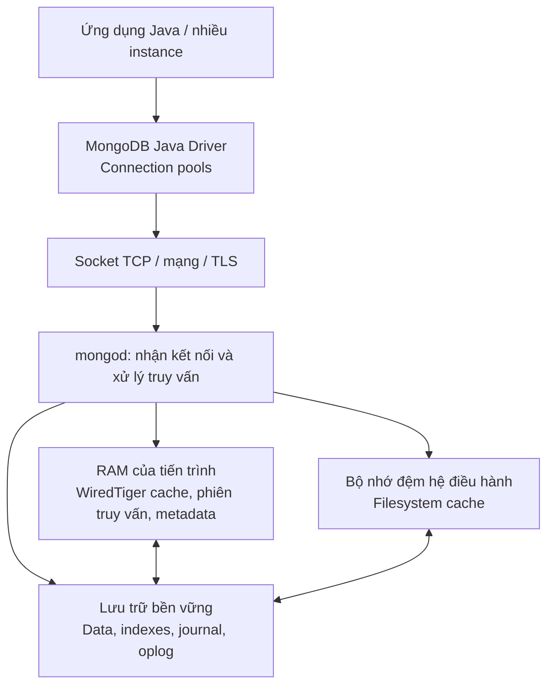
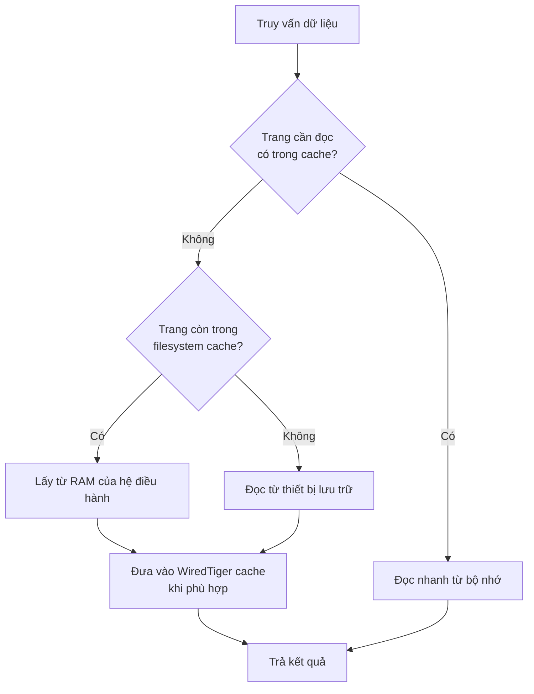
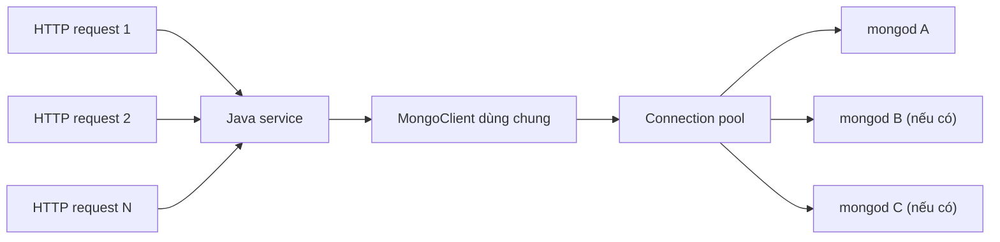

# Giới hạn tài nguyên: RAM, ổ đĩa, kết nối và dung lượng lưu trữ

> **Module:** Database Engine Document MongoDB  
> **Chương:** Kiến trúc MongoDB

MongoDB không hoạt động độc lập với tài nguyên máy chủ. Mỗi thao tác đọc, ghi, truy vấn, sắp xếp hoặc tạo chỉ mục đều sử dụng một phần **RAM**, **CPU**, **ổ đĩa**, **băng thông mạng** và **kết nối**. Hiểu đúng giới hạn của từng lớp giúp lựa chọn cấu hình, ước lượng khả năng mở rộng và xử lý sự cố mà không vội kết luận “MongoDB chậm”.

Bài này tập trung vào bốn khía cạnh có liên quan chặt chẽ: bộ nhớ, khả năng phục vụ I/O của ổ đĩa, số lượng kết nối và sức chứa lưu trữ. Các ví dụ sử dụng MongoDB Server với storage engine WiredTiger; những con số về mặc định, giới hạn cấu hình và metric cụ thể cần đối chiếu với phiên bản MongoDB đang chạy.

## 1. Tài nguyên nằm ở những lớp nào?

Trong một ứng dụng Java kết nối MongoDB, tài nguyên được tiêu thụ ở nhiều lớp:



Một hệ thống có thể gặp giới hạn trước ở bất kỳ lớp nào. Chẳng hạn:

- **RAM thiếu** khiến dữ liệu thường truy cập không còn ở cache; server phải đọc từ ổ đĩa nhiều hơn.
- **Ổ đĩa có dung lượng trống nhưng IOPS thấp** vẫn khiến truy vấn hoặc ghi bị chậm.
- **Connection pool bão hòa** khiến request ứng dụng chờ mượn kết nối, dù CPU server chưa sử dụng hết.
- **Ổ đĩa gần đầy** có thể chặn ghi, tạo index, mở rộng journal hoặc duy trì oplog; hiệu năng tốt trước đó không loại trừ nguy cơ hết dung lượng.

Do đó, nên theo dõi đồng thời **mức sử dụng (usage)**, **khả năng phục vụ (capacity/throughput)** và **độ trễ (latency)**.

| Tài nguyên | Giới hạn cần phân biệt | Triệu chứng phổ biến |
|---|---|---|
| RAM | Tổng RAM host/container; WiredTiger cache; bộ nhớ của truy vấn và tiến trình khác | Cache miss, đọc đĩa nhiều, swap, OOM, truy vấn thất thường |
| Ổ đĩa | IOPS, throughput, latency, queue depth, độ bền và filesystem | Độ trễ đọc/ghi tăng, hàng đợi I/O dài, checkpoint chậm |
| Kết nối | Số socket server nhận được, giới hạn OS, số pool và kích thước pool ở ứng dụng | Timeout khi lấy connection, connection refused, tăng connection churn |
| Dung lượng | Giới hạn từng document, dữ liệu, index, journal, oplog, file tạm, khả năng tăng trưởng | Hết không gian, tạo index thất bại, không ghi thêm được |

## 2. RAM: WiredTiger cache không phải toàn bộ bộ nhớ MongoDB

### 2.1. MongoDB dùng RAM cho những việc gì?

Ở phiên bản MongoDB phổ biến dùng **WiredTiger**, RAM được chia cho nhiều nhu cầu:

1. **WiredTiger internal cache:** giữ trang dữ liệu và index thường truy cập; bao gồm dữ liệu sạch và dữ liệu đang sửa đổi.
2. **Filesystem cache của hệ điều hành:** giữ các trang file gần đây, hỗ trợ đọc file nhanh hơn; phần này nằm ngoài WiredTiger internal cache.
3. **Bộ nhớ phục vụ truy vấn và thao tác:** ví dụ aggregation, sort, hash join, xử lý batch, cursor, transaction.
4. **Metadata và hạ tầng tiến trình:** thread, connection, network buffer, bộ nhớ dùng bởi thư viện và các thành phần chạy cùng host.
5. **Bộ nhớ của các dịch vụ khác:** agent giám sát, backup, Docker, Java app hoặc ứng dụng khác nếu đặt chung máy.

Vì vậy, đặt cấu hình WiredTiger cache bằng đúng tổng RAM là quyết định không hợp lý: hệ điều hành và các thành phần còn lại cũng cần bộ nhớ.

### 2.2. Working set quyết định hiệu quả cache

**Working set** là phần dữ liệu và index được truy cập thường xuyên trong một khoảng thời gian nhất định. Ví dụ hệ thống có 2 TB dữ liệu lịch sử nhưng chỉ liên tục tra cứu 30 GB dữ liệu gần nhất. Trong nhiều workload, một phần working set ở cache đã mang lại hiệu quả cao; không phải mọi byte của database đều cần nằm trong RAM.

Đường đi của một lần đọc có thể hình dung:



Đây là sơ đồ khái niệm; cách WiredTiger và OS cache tương tác thực tế còn phụ thuộc page, file, cơ chế đọc, eviction và workload.

Nếu working set lớn hơn bộ nhớ hữu ích, MongoDB có thể vẫn vận hành bình thường nhưng phải thực hiện nhiều I/O. Trường hợp dữ liệu lớn không tự động có nghĩa cần tăng RAM; trước tiên xem truy vấn có dùng index đúng hay đang quét quá nhiều document.

### 2.3. Kích thước WiredTiger cache

WiredTiger tự chọn kích thước cache mặc định dựa trên bộ nhớ khả dụng theo quy tắc của phiên bản MongoDB. Ở nhiều bản phát hành, cấu hình mặc định xấp xỉ **50% phần RAM còn lại sau khi trừ 1 GiB**, có mức tối thiểu cho hệ thống nhỏ; container có giới hạn bộ nhớ có thể ảnh hưởng cách MongoDB xác định RAM. Không áp dụng công thức này cứng nhắc cho mọi phiên bản hoặc môi trường.

Có thể chủ động cấu hình, chẳng hạn:

```yaml
# mongod.conf — ví dụ minh họa, không dùng nếu chưa biết ngân sách RAM
storage:
  wiredTiger:
    engineConfig:
      cacheSizeGB: 2
```

Hoặc khởi động bằng tùy chọn `--wiredTigerCacheSizeGB 2`. Tham số này đặt **WiredTiger cache**, không phải giới hạn RAM tối đa của cả tiến trình `mongod`. Khi tăng cache, phải giữ dư bộ nhớ cho hệ điều hành, filesystem cache và truy vấn.

**Đặc biệt với Docker/Kubernetes:** luôn xét cả giới hạn RAM của container/pod và RAM của node. Nếu cấu hình container quá chật, có thể bị hệ thống chấm dứt vì **OOMKilled** dù chỉ số của WiredTiger cache còn dưới mức được cấu hình.

### 2.4. Cache pressure, eviction và dirty pages

WiredTiger cần lấy chỗ cho trang mới. Khi cache đầy, nó **evict** (đưa ra khỏi cache) các trang phù hợp; trang bị sửa đổi cần được đồng bộ theo cơ chế lưu trữ trước khi có thể giải phóng. Một ít eviction là hoạt động bình thường. Điều cần chú ý là eviction kéo dài đi kèm tăng đọc/ghi đĩa, tăng thời gian truy vấn và thiếu bộ nhớ.

Một số dấu hiệu hữu ích:

- Tỷ lệ đọc từ đĩa tăng dù lượng request không tăng tương ứng.
- Cache chứa nhiều trang dirty, eviction khó theo kịp tốc độ ghi.
- Query/aggregation giữ nhiều bộ nhớ trong lúc workload đồng thời tăng.
- Máy bắt đầu swap mạnh hoặc container bị OOM.
- Resident memory cao **đơn lẻ** không đủ kết luận có memory leak; MongoDB chủ động tận dụng cache.

Cần xem xu hướng trong cùng thời điểm, thay vì suy ra nguyên nhân từ một snapshot.

### 2.5. Bộ nhớ dùng cho sort và aggregation

Bên cạnh cache, những truy vấn không có index phù hợp có thể cần giữ nhiều dữ liệu trung gian để sắp xếp hoặc nhóm. Ví dụ:

```javascript
db.orders.find({ customerId: "C001" })
  .sort({ createdAt: -1 })
  .limit(20)
  .explain("executionStats")
```

Nếu có index `{ customerId: 1, createdAt: -1 }`, engine có thể lấy kết quả theo thứ tự đã được index hỗ trợ thay vì sắp xếp khối lượng lớn trong bộ nhớ:

```javascript
db.orders.createIndex({ customerId: 1, createdAt: -1 })
```

Tạo index trên collection lớn có chi phí CPU, I/O, dung lượng và thời gian; ví dụ trên chỉ nên chạy trong database thực hành. Dùng `explain("executionStats")` để quan sát kế hoạch thực thi, số document/index key được duyệt và giai đoạn sort.

Với aggregation, một số stage có giới hạn bộ nhớ riêng. Tùy phiên bản, pipeline và tùy chọn, engine có thể sử dụng ổ đĩa tạm khi vượt giới hạn (disk spilling), ví dụ dùng `allowDiskUse`. Điều này **không xóa chi phí**: nó chuyển một phần áp lực RAM thành áp lực I/O và dung lượng tạm. Không nên xem `allowDiskUse` là cách thay thế index hoặc thiết kế truy vấn.

## 3. Ổ đĩa: tốc độ phục vụ khác với số GB còn trống

Hai ổ đĩa đều còn 500 GB có thể cho hiệu năng MongoDB hoàn toàn khác nhau.

- **IOPS** (I/O operations per second): số thao tác đọc/ghi nhỏ mà thiết bị xử lý được mỗi giây.
- **Throughput**: lượng dữ liệu đọc/ghi mỗi giây, thường tính MB/s.
- **Latency**: thời gian thực hiện mỗi I/O, đặc biệt quan trọng với truy vấn random read.
- **Queue depth**: số yêu cầu I/O đang chờ hoặc đang được xử lý.
- **Độ bền và độ ổn định**: ảnh hưởng việc ghi dữ liệu, journal, checkpoint, replication và khả năng phục hồi.

MongoDB có workload thường xuyên đụng tới index và document nhỏ, nên nhiều trường hợp **random I/O** và tail latency có ý nghĩa hơn chỉ số MB/s tối đa được quảng cáo.

### 3.1. Những thành phần ghi xuống đĩa

Với WiredTiger, vùng lưu trữ có thể chứa:

| Thành phần | Chức năng | Hệ quả khi tính dung lượng và I/O |
|---|---|---|
| Collection data files | Lưu trữ document trên đĩa (có thể nén) | Tăng theo số lượng và kích thước document |
| Index files | Dùng để tìm kiếm, lọc và sắp xếp | Mỗi index tiêu thụ dung lượng và làm tăng chi phí ghi |
| Journal | Hỗ trợ độ bền và phục hồi sau sự cố | Ghi I/O độc lập với việc ứng dụng thấy thao tác hoàn tất |
| Oplog trong replica set | Ghi lại các thao tác để phục vụ replication | Mỗi replica-set member cần ngân sách cho oplog |
| Temporary / spill files | Dữ liệu trung gian của sort/aggregation hoặc thao tác khác | Có thể tăng đột biến khi workload đổi |
| Free space / internal allocation | Không gian đã cấp phát nhưng chưa dùng cho dữ liệu live | Không luôn được trả ngay về filesystem khi xóa document |

Đọc và ghi cũng chịu ảnh hưởng của checkpoint, compaction, replication, backup và xây dựng index. Một đợt backup hoặc index build đúng giờ cao điểm có thể khiến độ trễ thay đổi dù dữ liệu ứng dụng không tăng mạnh.

### 3.2. Chọn thiết bị và filesystem

Đối với server production, ưu tiên SSD/NVMe hoặc dịch vụ lưu trữ có latency và IOPS được bảo đảm theo nhu cầu. Một số hệ điều hành/filesystem có cấu hình phù hợp hơn với MongoDB; ví dụ trên Linux, cần chọn filesystem đáp ứng khuyến nghị của phiên bản MongoDB và cấu hình phù hợp với WiredTiger.

Điểm cần kiểm tra:

- Thiết bị có còn **headroom IOPS/throughput** khi cao điểm không?
- Log, journal, filesystem và data path có nằm trên một thiết bị đang bão hòa không?
- Có giới hạn throughput hoặc IOPS của ổ cloud/volume/tier không?
- Nếu dùng container, volume có trỏ tới persistent storage phù hợp không?
- Thời gian phục hồi và khả năng backup/restore có đáp ứng yêu cầu không?

**Không nên chọn storage chỉ từ dung lượng.** Một volume nhỏ với I/O đủ nhanh có thể tốt hơn volume lớn nhưng phải xử lý quá nhiều read/write đồng thời. Trong cloud, mức IOPS và throughput thường phụ thuộc loại volume, cấu hình và giới hạn tài khoản/tier.

### 3.3. Kiểm tra ở hệ điều hành

Trên Linux với MongoDB cài trực tiếp:

```bash
df -h /var/lib/mongodb
df -i /var/lib/mongodb
free -h
vmstat 1
iostat -xz 1
```

- `df -h`: dung lượng còn trống của filesystem.
- `df -i`: inode còn trống; đặc biệt hữu ích khi filesystem chứa nhiều file nhỏ.
- `free -h` và `vmstat 1`: nhìn tổng quan RAM, swap và hoạt động hệ thống.
- `iostat -xz 1`: quan sát độ bận, queue và latency I/O; tiện ích `iostat` thường cần cài gói `sysstat`.

Với Docker, ví dụ container có tên `mongodb-lab`:

```bash
docker stats --no-stream mongodb-lab
docker exec mongodb-lab df -h /data/db
```

`docker stats` phản ánh tài nguyên container theo khả năng thống kê của Docker; `df` trong container không thay thế giám sát volume/host/cloud storage. Trên Windows, có thể dùng **Task Manager**, **Resource Monitor**, **Performance Monitor** hoặc các công cụ giám sát ổ đĩa tương đương.

## 4. Kết nối: server socket và client connection pool là hai giới hạn khác nhau

### 4.1. Một kết nối tiêu tốn những gì?

Một kết nối tới MongoDB thường tương ứng với một socket TCP (có thể qua TLS). Server và client cần duy trì trạng thái, buffer và tài nguyên hệ điều hành. Tạo hoặc đóng kết nối quá thường xuyên còn có chi phí bắt tay, xác thực và thiết lập TLS.

MongoDB có cấu hình giới hạn số lượng kết nối đến server, nhưng con số khả dụng thực tế còn phụ thuộc **file descriptor/socket limit, RAM, OS, cấu hình mạng, proxy, mongos hoặc dịch vụ cloud**. Khi vượt ngưỡng, kết nối mới có thể bị từ chối hoặc chờ, ngay cả khi query đơn giản.

### 4.2. Connection pool ở Java driver

MongoDB Java Driver dùng **connection pool** để tái sử dụng kết nối giữa các request. Một ứng dụng thường tạo một `MongoClient` dùng chung cho vòng đời ứng dụng, thay vì tạo mới client mỗi lần gọi API.



Trong replica set hoặc sharded topology, driver có thể quản lý kết nối riêng tới nhiều server. Vì vậy, **max pool size của một client không phải tổng số connection tuyệt đối của cả hệ thống**.

Ví dụ cấu hình một connection string cho ứng dụng Java:

```text
mongodb://127.0.0.1:27017/?maxPoolSize=30&minPoolSize=0&waitQueueTimeoutMS=3000
```

- `maxPoolSize=30`: giới hạn số connection dùng trong pool của driver tới một server theo cơ chế pooling của driver.
- `minPoolSize=0`: không yêu cầu pool giữ tối thiểu một số connection nhất định.
- `waitQueueTimeoutMS=3000`: giới hạn thời gian một thao tác chờ mượn connection khả dụng từ pool, tính theo mili giây.

Các tùy chọn trên chỉ là **ví dụ**; cần chọn theo mức đồng thời, độ trễ truy vấn, topology, số instance và mức tối đa server chấp nhận. Không có một cấu hình pool đúng cho mọi ứng dụng.

Một lớp Java tối giản:

```java
import com.mongodb.client.MongoClient;
import com.mongodb.client.MongoClients;
import org.bson.Document;

public final class MongoConnectionExample {
    private MongoConnectionExample() {}

    public static void main(String[] args) {
        String uri = System.getenv("MONGODB_URI");
        if (uri == null || uri.isBlank()) {
            uri = "mongodb://127.0.0.1:27017/"
                    + "?maxPoolSize=30&minPoolSize=0&waitQueueTimeoutMS=3000";
        }

        try (MongoClient client = MongoClients.create(uri)) {
            Document ping = client.getDatabase("admin")
                    .runCommand(new Document("ping", 1));
            System.out.println(ping.toJson());
        }
    }
}
```

Ứng dụng thực tế nên tạo `MongoClient` một lần khi khởi động và đóng khi shutdown; ví dụ `try-with-resources` phù hợp vì chương trình trên chỉ chạy một lần. Với Spring, có thể quản lý client bằng bean và vòng đời ứng dụng.

### 4.3. Ước lượng tổng connection

Giả sử một hệ thống triển khai:

- 20 Java application instances;
- Mỗi instance có pool với `maxPoolSize=50`;
- Các instance kết nối tới topology gồm ba thành viên.

Nếu mỗi instance có thể mở gần đủ pool tới từng thành viên, số socket tiềm năng có thể lớn hơn nhiều so với `20 × 50 = 1.000`. Cách lấy **20 × 3 × 50 = 3.000** chỉ là minh họa về mức trần đơn giản; số thực tế phụ thuộc vai trò server, thao tác, cơ chế giám sát và hành vi driver, nên phải đo bằng metric thực.

Cũng cần lưu ý: tăng số connection không đồng nghĩa tăng throughput vô hạn. Khi ổ đĩa hoặc CPU đã bão hòa, thêm nhiều request chạy đồng thời có thể làm hàng đợi và độ trễ **tệ hơn**.

### 4.4. Metric kết nối của MongoDB Server

Trong `mongosh` đã kết nối tới server mà bạn được phép giám sát:

```javascript
const connections = db.serverStatus().connections;

printjson({
  current: connections.current,
  available: connections.available,
  totalCreated: connections.totalCreated,
  active: connections.active
});
```

Cách hiểu:

| Metric | Ý nghĩa khi đọc |
|---|---|
| `current` | Số connection hiện được giữ ở server |
| `available` | Số connection còn có thể nhận theo giới hạn áp dụng |
| `totalCreated` | Bộ đếm tích lũy các connection đã tạo từ khi server bắt đầu; không phải số connection đang mở |
| `active` (nếu có) | Connection đang thực hiện công việc tại thời điểm quan sát; có thể không xuất hiện ở mọi phiên bản/tình huống |

Ví dụ, `current` tăng nhanh cùng `totalCreated` tăng đột biến có thể gợi ý ứng dụng đang liên tục tạo client hoặc kết nối bị reset. `current` cao nhưng ổn định và độ trễ thấp có thể đơn giản là pooling hoạt động bình thường.

Muốn xác định server đang đặt giới hạn nào, kiểm tra **cấu hình `net.maxIncomingConnections`**, giới hạn file descriptor và cấu hình dịch vụ của host. Trên môi trường managed như Atlas, đọc thông số tier, metric và tài liệu do nhà cung cấp công bố. Không tự tăng server connection limit khi chưa hiểu hạn mức RAM và OS.

## 5. Dung lượng lưu trữ: dữ liệu logic khác với dung lượng vật lý

### 5.1. Một document không thể lớn tùy ý

MongoDB có giới hạn **16 MiB cho một BSON document**. Đây là giới hạn của *mỗi document*, không phải tổng kích thước database. Document chứa mảng tăng liên tục, lịch sử dài hoặc file nhúng có thể chạm trần này ngay cả khi ổ đĩa còn rất nhiều chỗ.

Nếu cần lưu một file lớn hơn giới hạn BSON document, MongoDB cung cấp **GridFS** để chia nội dung thành các chunk và lưu metadata riêng; cũng có thể chọn object storage nếu kiến trúc sản phẩm phù hợp.

Một thiết kế tốt thường chia dữ liệu lớn theo đúng ranh giới truy vấn và thay đổi: document dùng cho thông tin cần đọc cùng nhau, collection khác dùng cho dữ liệu tăng trưởng không giới hạn. Tránh việc lạm dụng một document chứa toàn bộ lịch sử hoặc mọi sự kiện của một người dùng.

### 5.2. Các cách đo kích thước

MongoDB có nhiều chỉ số “size” nhưng chúng không đồng nghĩa:

| Khái niệm | Ý nghĩa cơ bản | Lưu ý |
|---|---|---|
| **Logical data size** | Tổng kích thước BSON ước tính của document | Khác với số byte đã nén/cấp phát trên đĩa |
| **Storage size** | Kích thước lưu trữ mà engine đã cấp phát cho dữ liệu collection | Có thể chịu ảnh hưởng nén, phân mảnh và vùng đã cấp phát |
| **Total index size** | Dung lượng được cấp cho index | Thêm index giúp đọc nhanh hơn nhưng có chi phí lưu trữ/ghi |
| **Filesystem used/free** | Thực tế filesystem/volume đang dùng/còn trống | Bao gồm file khác, journal, log, dữ liệu ngoài database |
| **Oplog/journal/temp** | Những thành phần bổ sung ngoài dữ liệu live | Phải cộng vào kế hoạch dung lượng và peak workload |

Ví dụ truy vấn trong `mongosh`, khi collection `orders` đã tồn tại:

```javascript
use shop

// Số liệu mức database, quy đổi đơn vị về MiB.
db.runCommand({ dbStats: 1, scale: 1024 * 1024 })

// Số liệu của collection orders, quy đổi về MiB.
db.runCommand({ collStats: "orders", scale: 1024 * 1024 })
```

Các trường quen thuộc trong kết quả gồm `dataSize`, `storageSize`, `indexSize` hoặc `totalIndexSize`; tên trường và mức khả dụng có thể khác giữa command, API, phiên bản và loại collection. Đọc mô tả metric cùng **đơn vị scale** trước khi cộng hoặc so sánh.

**Không đồng nhất `dataSize` với số GB thật trên volume.** Nén có thể làm dữ liệu vật lý nhỏ hơn dữ liệu logic; index, oplog, file tạm và mức cấp phát lại làm footprint toàn hệ thống lớn hơn.

### 5.3. Xóa document không luôn trả dung lượng ngay về OS

Khi xóa document, WiredTiger có thể tái sử dụng không gian trong file dữ liệu cho các ghi tiếp theo. Vì vậy, việc xóa một lượng lớn document không bảo đảm `df -h` sẽ giảm tương ứng ngay lập tức.

Khi thấy “đã xóa nhiều mà disk vẫn đầy”, cần phân biệt:

- Dung lượng document logic có giảm không?
- Không gian bên trong data files có được đánh dấu tái sử dụng không?
- Filesystem free space có tăng không?
- Collection/index có thể yêu cầu bảo trì, compact hoặc phương án migrate phù hợp không?

Những thao tác tái cấu trúc hoặc compact dữ liệu có thể tiêu tốn I/O, bộ nhớ và không gian tạm; hãy đọc hướng dẫn tương ứng với phiên bản MongoDB và lên kế hoạch trong thời gian bảo trì, thay vì chạy tùy tiện trên production.

### 5.4. Replica set và sharding thay đổi phép tính

**Replica set:** mỗi thành viên lưu bản dữ liệu của tập dữ liệu được nhân bản và có oplog riêng. Với ba thành viên chứa cùng dataset, cần dự trù chi phí lưu trữ **trên từng node**; không lấy dung lượng của cả ba node cộng lại rồi coi đó là dung lượng dữ liệu live có thể chứa.

**Sharding:** dữ liệu được chia qua các shard; mỗi shard lại có thể là một replica set. Sharding có thể mở rộng dung lượng và throughput theo phân mảnh, nhưng phát sinh thêm metadata, phân bố index/data, cấu hình cluster và nguy cơ shard key gây phân phối nóng. Cần tính theo **shard có mức sử dụng cao nhất**, không chỉ trung bình toàn cluster.

**Managed service:** Atlas hoặc dịch vụ cloud có thể đặt giới hạn dung lượng, connection, IOPS, CPU hay kích thước tier khác với MongoDB tự triển khai. Mỗi tier có quy định riêng; đọc bảng giới hạn của dịch vụ tại thời điểm triển khai thay vì áp một con số cố định cho mọi cluster.

## 6. Tính thử ngân sách tài nguyên

Các phép tính dưới đây là mô hình ước lượng, không phải thông số của một phiên bản MongoDB cố định.

### 6.1. Ước lượng dung lượng

Giả sử cần lưu 10 triệu document, mỗi document có kích thước BSON trung bình 1 KiB:

```text
Logical data = 10,000,000 × 1 KiB
             ≈ 9.54 GiB
```

Nếu nén khiến collection storage còn khoảng 6 GiB, tổng index cấp phát chiếm 3 GiB và phần oplog/journal/log/temp dự trù 4 GiB, nhu cầu trước khi chừa vùng trống là:

```text
6 GiB + 3 GiB + 4 GiB = 13 GiB
```

Giả sử muốn còn trống **25% volume** để có dư địa tăng trưởng và thao tác bảo trì:

```text
Capacity cần cấp ≈ 13 GiB / (1 - 0.25)
                 ≈ 17.33 GiB
```

Trong mô hình này, nên cân nhắc volume lớn hơn kết quả lý thuyết, vì dữ liệu có thể tăng và kích thước nén/index thực tế khác giả định. **25% là giả định vận hành để minh họa**, không phải giới hạn cố định do MongoDB áp đặt.

Đối với replica set ba thành viên, hãy kiểm tra ngân sách tương tự **trên cả ba node** và cộng chi phí backup/snapshot tại nơi thực sự lưu chúng.

### 6.2. Ước lượng RAM và working set

Nếu tổng data + index là 200 GiB nhưng 95% request tập trung vào 15 GiB dữ liệu/index thường dùng, RAM cần thiết có thể thấp hơn nhiều so với 200 GiB. Tuy nhiên, mức hiệu quả còn phụ thuộc phân bố truy cập, tính tuần tự/random của I/O, checkpoint, index và lượng dữ liệu trả về mỗi truy vấn.

Cách thực tế hơn là:

1. Chạy workload gần với thực tế.
2. Theo dõi tốc độ đọc đĩa, cache usage, eviction, độ trễ truy vấn và RAM toàn node.
3. Điều chỉnh index và query trước khi tăng RAM.
4. Tăng tài nguyên từng bước, đo lại **p95/p99 latency**, throughput và chi phí.

### 6.3. Ước lượng số kết nối

Giả sử 12 instance Java, mỗi instance có pool tối đa 40 connection tới một endpoint server:

```text
Pool capacity lý thuyết = 12 × 40 = 480 connections
```

Đây là **trần của các pool trong mô hình đơn giản**, không phải 480 socket chắc chắn đang được sử dụng. Driver có thể mở ít hơn, hoặc nhiều hơn khi xét nhiều server và các connection phục vụ giám sát topology. Đối chiếu kết quả thực với `serverStatus().connections` và metric của ứng dụng.

Đừng chọn `maxPoolSize` từ tổng request mỗi giây. Một request nhanh có thể trả connection về pool sớm; nhiều request chậm/transaction dài mới là yếu tố khiến pool bị chiếm lâu.

## 7. Quan sát hệ thống bằng MongoDB và hệ điều hành

### 7.1. Lấy các metric chính từ server

Trong `mongosh` có quyền phù hợp:

```javascript
const status = db.serverStatus();
const wtCache = status.wiredTiger && status.wiredTiger.cache;

printjson({
  uptimeSeconds: status.uptime,
  connections: status.connections,
  processMemory: status.mem,
  wiredTigerCache: wtCache ? {
    configuredBytes: wtCache["maximum bytes configured"],
    currentBytes: wtCache["bytes currently in the cache"],
    dirtyBytes: wtCache["tracked dirty bytes in the cache"]
  } : "Not available on this server"
});
```

Lệnh trên cố ý chỉ lấy một phần kết quả; toàn bộ `serverStatus` rất dài và cấu trúc metric có thể thay đổi theo phiên bản hoặc storage engine. Nếu metric hiển thị `undefined`, hãy kiểm tra tên metric thực tế trong tài liệu cho đúng server. Trên MongoDB Atlas, một số lệnh giám sát có thể không được cấp quyền; sử dụng metric từ Atlas UI hoặc Monitoring API nếu được phép.

### 7.2. Liên hệ triệu chứng với nguyên nhân

| Tình huống | Số liệu nên xem cùng nhau | Hướng điều tra |
|---|---|---|
| Query chậm, disk read tăng | Cache occupancy/eviction, read IOPS, explain, query latency | Truy vấn thiếu index, working set không vừa cache |
| Write chậm dù CPU không cao | Disk latency, journal/checkpoint activity, write concern, replication lag | I/O bão hòa, chi phí durability hoặc secondary theo không kịp |
| Ứng dụng timeout nhưng server không bận | Pool checkout wait, current/active connections, network latency | Pool quá nhỏ, giữ connection lâu, tạo quá nhiều client |
| Server memory cao | Resident memory, WT cache, filesystem cache, swap, container limit | Phân biệt cache bình thường với memory pressure/OOM |
| Dung lượng tăng nhanh | dbStats/collStats, index size, oplog size, disk free | Dữ liệu tăng, index mới, retention, oplog, temp files |
| Đọc hiệu năng lệch giữa các node | Lag, workload và I/O của từng member/shard | Phân bố tải, read preference, shard hotspot |

Một snapshot hiếm khi đủ để chẩn đoán. Quan sát trong một cửa sổ thời gian có **tải tương ứng**, đặt metric ứng dụng cạnh metric server và host. Dữ liệu theo phút có thể che mất một đợt bão hòa kéo dài vài giây; với sự cố timeout, cần thêm thống kê theo độ trễ và thời điểm chính xác.

### 7.3. Bốn câu hỏi khi xác định “giới hạn”

1. **Giới hạn ở đâu?** Server, driver, container, OS, storage volume hay dịch vụ cloud?
2. **Giới hạn là cứng hay là mức vận hành?** Ví dụ BSON document 16 MiB là hard limit; ngưỡng cảnh báo disk 75–85% tùy policy chỉ là mức quản trị.
3. **Tài nguyên đang đầy hay đang chậm?** Ổ đĩa còn 80% dung lượng nhưng I/O quá tải là lỗi về throughput/latency.
4. **Có đồng thời phát sinh tải khác?** Backup, index build, replication, batch job hoặc triển khai ứng dụng mới có thể làm triệu chứng xuất hiện đột ngột.

## 8. Thực hành có kiểm soát: ghi lại trạng thái tài nguyên

Bài thực hành này sử dụng MongoDB local đã cài trong bài môi trường thực hành. Có thể kết nối tới server qua URI:

```bash
mongosh "mongodb://127.0.0.1:27017"
```

Không chạy các lệnh ghi/xóa sau trong database production.

### Bước 1: Quan sát kết nối và RAM

Trong `mongosh`:

```javascript
const before = db.serverStatus();
printjson(before.connections);

const cache = before.wiredTiger && before.wiredTiger.cache;
if (cache) {
  printjson({
    maxCacheBytes: cache["maximum bytes configured"],
    currentCacheBytes: cache["bytes currently in the cache"]
  });
}
```

Ghi nhận thời điểm quan sát và phiên bản server bằng `db.version()`. Nếu không có quyền dùng `serverStatus`, bài thực hành cần dùng một MongoDB local được cấp quyền giám sát hoặc lấy metric từ công cụ quản trị được phép.

### Bước 2: Tạo dữ liệu mẫu trong database riêng

```javascript
const lab = db.getSiblingDB("resource_lab");
lab.events.insertMany([
  { category: "read", size: 100, createdAt: new Date() },
  { category: "write", size: 200, createdAt: new Date() },
  { category: "read", size: 300, createdAt: new Date() }
]);

lab.events.createIndex({ category: 1, createdAt: -1 });
```

Đây là dữ liệu cực nhỏ để hiểu *cách quan sát*, không nhằm tạo đủ tải để benchmark.

### Bước 3: Xem kích thước data/index

```javascript
printjson(lab.runCommand({ dbStats: 1, scale: 1024 }));
printjson(lab.runCommand({ collStats: "events", scale: 1024 }));
```

Đơn vị trong ví dụ là KiB (1024 byte); các metric khác nhau có thể không cùng độ chính xác. So sánh kích thước logic, storage size và index size; không kỳ vọng chúng bằng nhau.

### Bước 4: Kiểm tra khả năng dùng index

```javascript
lab.events.find({ category: "read" })
  .sort({ createdAt: -1 })
  .explain("executionStats");
```

Đọc `winningPlan` và `executionStats` để xem engine dùng index nào, duyệt bao nhiêu document. Vì dữ liệu chỉ có ba document, bộ lập kế hoạch có thể chọn collection scan; điều đó **không** chứng minh index sai hoặc hệ thống có vấn đề.

### Bước 5: Xóa đúng dữ liệu thực hành

```javascript
lab.events.drop();
```

Lệnh này chỉ xóa collection `resource_lab.events` trong môi trường lab; nếu database `resource_lab` đã được dùng bởi công việc khác, kiểm tra trước và chọn tên riêng để tránh va chạm. Sau khi xóa, quan sát lại `collStats/dbStats` (nếu collection đã xóa, chỉ còn `dbStats`), rồi so sánh với số liệu filesystem: dung lượng file vật lý không nhất thiết giảm ngay.

## 9. Kỹ thuật giảm áp lực tài nguyên

### 9.1. Khi RAM hạn chế

- Đảm bảo các query quan trọng dùng index phù hợp với filter và sort.
- Chỉ lấy những field thực sự cần thiết bằng projection, phân trang hợp lý, tránh tải cả collection về ứng dụng.
- Chia dữ liệu nóng và dữ liệu lịch sử theo nhu cầu đọc/ghi; tránh document tăng vô hạn.
- Đo cache, OS memory và I/O rồi mới điều chỉnh `cacheSizeGB`.
- Tránh tạo nhiều aggregation đồng thời cần giữ dữ liệu trung gian lớn.

### 9.2. Khi I/O hoặc dung lượng hạn chế

- Giảm collection scan; tránh tạo quá nhiều index không phục vụ truy vấn thực.
- Chọn storage có IOPS, throughput và latency phù hợp, dự trù thời điểm peak.
- Thiết kế retention: TTL index cho dữ liệu có vòng đời xác định, hoặc archive dữ liệu cũ theo chính sách.
- Chừa dung lượng cho index build, journal, oplog, compaction, migration và lưu lượng ghi đột biến.
- Theo dõi kích thước thực trên volume và ở từng member/shard; kiểm tra backup/restore định kỳ.

TTL index không xóa document ngay tại đúng thời điểm hết hạn; việc xóa do background TTL process xử lý và tiêu thụ tài nguyên. Vì vậy, TTL là công cụ retention, không phải bảo đảm giải phóng dung lượng tức thời.

### 9.3. Khi kết nối bị giới hạn

- Tái sử dụng một `MongoClient` cho ứng dụng thay vì tạo client trên từng request.
- Đặt kích thước pool theo workload, số instance và topology; giám sát thời gian chờ checkout.
- Giới hạn số request đồng thời hoặc đưa tác vụ nặng vào hàng đợi khi server đã bão hòa.
- Khắc phục truy vấn chậm và transaction dài đang giữ kết nối.
- Kiểm tra socket/file descriptor, LB, firewall và hạn mức dịch vụ trước khi tăng `net.maxIncomingConnections`.

### 9.4. Khi cần mở rộng

**Vertical scaling** (tăng RAM, CPU, IOPS của một node) có thể cải thiện ngay nếu đã xác định đúng bottleneck. **Horizontal scaling** bằng replica set hoặc sharding giải quyết các mục tiêu khác nhau: replica set chủ yếu phục vụ độ sẵn sàng và nhân bản dữ liệu; sharding giúp phân phối dữ liệu và workload theo shard key. Cả hai đều tăng yêu cầu về mạng, tài nguyên, quan sát hệ thống và vận hành.

Không có quy tắc “tới X GB thì bắt buộc shard” áp dụng cho mọi MongoDB deployment. Quyết định nên dựa trên dung lượng mỗi node, tốc độ tăng trưởng, throughput, độ trễ, phân bố shard key và khả năng vận hành của đội ngũ.

## 10. Bảng đối chiếu giới hạn và quyết định kiến trúc

| Câu hỏi thực tế | Đáp án định hướng |
|---|---|
| MongoDB có buộc toàn bộ database phải nằm trong RAM không? | Không. WiredTiger và filesystem cache giúp tăng tốc phần dữ liệu truy cập thường xuyên; phần khác vẫn nằm trên đĩa. |
| Cấu hình `cacheSizeGB` có chặn tổng RAM của `mongod` không? | Không. Truy vấn, connection, engine và tiến trình vẫn cần RAM ngoài cache. |
| Ổ đĩa còn nhiều GB có bảo đảm đọc/ghi nhanh không? | Không. Phải xem IOPS, throughput và latency dưới tải. |
| Tăng `maxPoolSize` có luôn giúp xử lý nhiều request hơn không? | Không. Pool lớn hơn có thể làm tăng số truy vấn đồng thời gây quá tải tài nguyên phía server. |
| `dataSize` có bằng dung lượng file trên volume không? | Không. Nén, index, journal, oplog, temp và cấp phát storage làm các số khác nhau. |
| Xóa document có giải phóng dung lượng vật lý ngay không? | Không bảo đảm; engine có thể giữ không gian để tái sử dụng. |
| Replica set ba thành viên có dung lượng hữu dụng gấp ba không? | Không; mỗi member lưu bản dữ liệu nhân bản, còn replication mang lại độ sẵn sàng. |
| Document có thể có kích thước không giới hạn nếu ổ đĩa lớn không? | Không. BSON document có giới hạn 16 MiB; file lớn có thể dùng GridFS hoặc storage khác. |
| Nên xử lý bottleneck bằng cách nào trước? | Xác định lớp giới hạn từ metric và workload; tối ưu query/index, cấu hình pool hoặc nâng đúng tài nguyên. |

## 11. Tài liệu tham khảo

- [WiredTiger Storage Engine](https://www.mongodb.com/docs/manual/core/wiredtiger/)
- [MongoDB Server Status](https://www.mongodb.com/docs/manual/reference/command/serverStatus/)
- [Database Statistics — dbStats](https://www.mongodb.com/docs/manual/reference/command/dbStats/)
- [Collection Statistics — collStats](https://www.mongodb.com/docs/manual/reference/command/collStats/)
- [MongoDB Limits and Thresholds](https://www.mongodb.com/docs/manual/reference/limits/)
- [Configuration Options — net.maxIncomingConnections và WiredTiger](https://www.mongodb.com/docs/manual/reference/configuration-options/)
- [MongoDB Monitoring](https://www.mongodb.com/docs/manual/administration/monitoring/)
- [Java Sync Driver: Connection Pools](https://www.mongodb.com/docs/drivers/java/sync/current/connection/specify-connection-options/connection-pools/)
- [GridFS](https://www.mongodb.com/docs/manual/core/gridfs/)

**Ghi nhớ khi vận hành:** Giới hạn document BSON là một ràng buộc dữ liệu, còn RAM, I/O và connection thường là các giới hạn vận hành cần đo theo workload. Theo dõi tài nguyên theo từng node, xác định đúng điểm nghẽn và kiểm tra phiên bản/tier trước khi quyết định thay đổi cấu hình.
