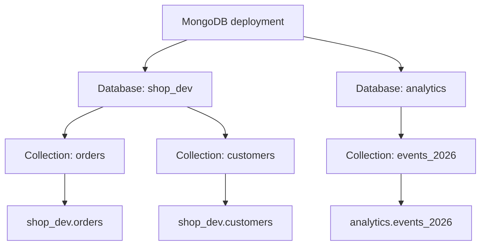

# Quy tắc đặt tên, namespace và phân biệt chữ hoa chữ thường trong MongoDB

> **Module:** Database Engine Document MongoDB  
> **Chương:** Database và collection

## 1. Vì sao tên database và collection ảnh hưởng tới thiết kế?

MongoDB tổ chức dữ liệu theo tầng **deployment → database → collection → document**. Mỗi database chứa nhiều collection; một collection lưu các document BSON có cấu trúc linh hoạt. Tên database và collection không chỉ giúp người đọc dễ hiểu mà còn được đưa trực tiếp vào lệnh truy vấn, chuỗi kết nối, phân quyền, script migration, sao lưu và các hệ thống giám sát.

Một lỗi như dùng `Orders` thay vì `orders` có thể khiến ứng dụng đọc nhầm collection hoặc tự tạo collection mới khi ghi dữ liệu. Một tên quá dài hoặc chứa ký tự bị cấm có thể bị server từ chối ngay khi tạo. Đặc biệt, **quy tắc đặt tên (naming)**, **namespace** và **quy tắc so sánh chuỗi dữ liệu (collation)** là ba khái niệm liên quan nhưng không đồng nhất.

Sau bài học, bạn có thể:

- Viết đúng namespace dạng `<database>.<collection>` và phân biệt nó với tên database hoặc collection độc lập.
- Nhận biết ký tự không hợp lệ, các tiền tố dành riêng và giới hạn độ dài **theo byte UTF-8**.
- Hiểu cách MongoDB xử lý chữ hoa/chữ thường ở tên database, collection, field và ở **giá trị chuỗi** khi truy vấn.
- Chọn quy ước đặt tên ổn định cho ứng dụng Java/MongoDB.
- Dùng `mongosh` để tạo, liệt kê, truy cập collection đúng tên và xử lý các trường hợp tên chứa ký tự đặc biệt.
- Nhận diện rủi ro khi đổi tên sau khi đã có mã nguồn, index, quyền truy cập và dữ liệu.

## 2. Namespace là gì?

**Namespace** là tên định danh đầy đủ của một collection hoặc view trong một deployment MongoDB:

```text
<database-name>.<collection-name>
        │               │
        │               └── Tên collection/view thuộc database
        └── Tên database
```

Ví dụ:

| Database | Collection | Namespace |
|---|---|---|
| `shop_dev` | `orders` | `shop_dev.orders` |
| `shop_dev` | `customers` | `shop_dev.customers` |
| `shop_prod` | `orders` | `shop_prod.orders` |
| `analytics` | `events_2026` | `analytics.events_2026` |

Hai collection cùng tên ở **hai database khác nhau** là hai namespace khác nhau. Trong cùng database, một namespace tương ứng một collection hoặc view với tên đó; collection và view không thể dùng trùng một tên trong cùng database.



Dấu chấm ngăn giữa hai phần của namespace **không có nghĩa MongoDB tạo cấu trúc thư mục lồng nhau**. Ví dụ tên collection `audit.events` (dấu chấm là một phần tên collection) nằm trong database `shop_dev` có namespace `shop_dev.audit.events`; điều đó không tạo database con hay collection con.

### 2.1. Một số tên trông giống nhau nhưng khác ý nghĩa

| Chuỗi | Ý nghĩa |
|---|---|
| `shop_dev` | Chỉ tên database |
| `orders` | Chỉ tên collection (khi đã biết database) |
| `shop_dev.orders` | Namespace đầy đủ |
| `orders.customerId` | Thường là cách biểu diễn đường dẫn field trong mã/truy vấn; không tự động là namespace |
| `db.orders.find()` | Cú pháp shell: đối tượng database hiện tại + collection `orders` + lệnh tìm kiếm |
| `mongodb://127.0.0.1:27017/shop_dev` | URI kết nối chứa tên database trong phần đường dẫn; không phải namespace của một collection |

**Lưu ý:** Lệnh `use shop_dev` trong `mongosh` chỉ chuyển database hiện tại. Database thường chưa xuất hiện trong danh sách cho đến khi có dữ liệu/collection thực sự được tạo.

## 3. Quy tắc đặt tên database

MongoDB đặt các giới hạn riêng cho tên database, khác với tên collection.

### 3.1. Tên không rỗng và phải ngắn hơn 64 byte

Tên database:

- Không được là chuỗi rỗng.
- Có độ dài **nhỏ hơn 64 byte**, tức tối đa **63 byte** khi tính bằng UTF-8.
- Không được chứa ký tự null (`\0`).
- Có các ký tự bị cấm phụ thuộc hệ điều hành đang chạy **server MongoDB**, không phải hệ điều hành của máy chạy shell.

Phân biệt **byte** với **số ký tự hiển thị**: tên ASCII như `shop_dev` có 8 ký tự và 8 byte; chữ tiếng Việt có dấu hoặc emoji thường chiếm nhiều byte UTF-8. Vì vậy, kiểm tra số ký tự bằng `name.length` không đủ để biết tên có vượt giới hạn byte hay không.

### 3.2. Ký tự bị cấm theo hệ điều hành server

Theo giới hạn đặt tên trong MongoDB Database Manual:

| MongoDB Server chạy trên | Ký tự bị cấm trong tên database |
|---|---|
| **Windows** | `/`, `\`, `.`, dấu cách, `"`, `$`, `*`, `<`, `>`, `:`, `|`, `?` |
| **Unix/Linux** | `/`, `\`, `.`, dấu cách, `"`, `$` |

Ngoài danh sách trên, ký tự null bị cấm trên mọi nền tảng. Viết dưới dạng dễ nhớ:

```text
Windows:    / \ . <space> " $ * < > : | ?
Unix/Linux: / \ . <space> " $
All:        NUL (\0), empty name, >= 64 bytes
```

**Ví dụ:**

| Tên database | Đánh giá | Lý do |
|---|---|---|
| `shop_dev` | Hợp lệ | Chữ thường và gạch dưới |
| `customer360` | Hợp lệ | Chữ và số |
| `shop-prod` | Thường hợp lệ | Dấu gạch ngang không nằm trong danh sách ký tự cấm; nhóm dự án có thể tự tránh để thống nhất |
| `customer.data` | Không hợp lệ | Dấu chấm trong **tên database** |
| `shop dev` | Không hợp lệ | Chứa dấu cách |
| `sales/2026` | Không hợp lệ | Dấu gạch chéo |
| `shop$dev` | Không hợp lệ | Chứa ký tự dollar |
| `shop:dev` | Không hợp lệ trên Windows | Ký tự hai chấm bị cấm với server Windows; không khuyến nghị dùng dù môi trường khác có thể cho phép |

**Quy tắc thực tế nên áp dụng cho toàn bộ dự án:** Chỉ dùng chữ thường ASCII `a-z`, chữ số `0-9` và dấu gạch dưới `_` cho tên database; đặt tên ngắn gọn, có ý nghĩa. Đây là **quy ước tự chọn an toàn xuyên nền tảng**, không phải danh sách duy nhất mà MongoDB cho phép.

### 3.3. Không dựa vào chữ hoa/chữ thường để phân biệt hai database

MongoDB khuyến cáo **không tạo hoặc dựa vào hai database chỉ khác nhau ở cách viết hoa**:

```text
salesData
SalesData
salesdata
```

Những biến thể này **không được xem là ba tên database độc lập hợp lệ để vận hành song song**. Sau khi tạo database với một cách viết, hãy giữ **đúng cách viết hoa đó** trong application code, script, connection string và tài liệu. Điều này tránh xung đột với file system, công cụ quản trị, các cơ chế định danh và quá trình di chuyển giữa môi trường.

Quy ước đơn giản nhất là dùng chữ thường từ đầu:

```text
Đề xuất: billing_prod, billing_dev, catalog_service
Tránh:   BillingProd, billingprod, BILLINGPROD cùng tồn tại
```

Không nên thử tạo database chỉ khác chữ hoa/chữ thường trong môi trường chứa dữ liệu quan trọng.

## 4. Quy tắc đặt tên collection

Quy tắc cho collection **khác** database. MongoDB cho phép nhiều dạng tên collection nhưng có một số điều kiện bắt buộc.

### 4.1. Các điều kiện bắt buộc

Tên collection:

1. **Không được rỗng.**
2. **Không được chứa ký tự null `\0`.**
3. **Không được chứa dấu dollar `$`.**
4. **Không được bắt đầu bằng `system.`** vì namespace hệ thống được dành riêng.
5. **Không được chứa `.system.`** ở giữa tên.
6. Phải không làm namespace vượt giới hạn byte quy định cho collection hoặc view.

MongoDB **khuyến nghị** tên collection bắt đầu bằng **chữ cái hoặc dấu gạch dưới**. Đây là khuyến nghị để tên dễ truy cập trong code/shell, không có nghĩa mọi tên bắt đầu bằng số đều bị từ chối.

Một số ký tự như dấu chấm có thể xuất hiện trong tên collection nhưng dễ gây hiểu lầm khi phân tích namespace hoặc sử dụng công cụ bên ngoài.

| Tên collection | Hợp lệ về quy tắc cơ bản? | Cách dùng thực tế |
|---|---|---|
| `orders` | Có | Đề xuất |
| `order_items` | Có | Đề xuất |
| `audit_logs_2026` | Có | Đề xuất nếu thực sự cần phân chia theo thời gian |
| `Orders` | Có | Nên thống nhất casing với code |
| `2026_orders` | Có thể hợp lệ | Sử dụng `db.getCollection("2026_orders")` |
| `order-items` | Có thể hợp lệ | Cần truy cập bằng chuỗi, không dùng cú pháp chấm trong JavaScript |
| `audit.events` | Có thể hợp lệ | Dễ gây nhầm với cấu trúc lồng; ưu tiên `audit_events` |
| `order details` | Có thể hợp lệ | Không khuyến nghị vì khó thao tác |
| `$orders` | Không | Có dấu `$` |
| `system.orders` | Không | Dùng tiền tố dành riêng `system.` |
| `audit.system.logs` | Không | Chứa chuỗi `.system.` |
| `""` | Không | Chuỗi rỗng |

Các ký tự mà một deployment có thể chấp nhận không đồng nghĩa tên đó sẽ vận hành thuận lợi trong mọi driver, công cụ backup, logging hoặc naming convention của tổ chức. Vì vậy, tên collection nên đơn giản và nhất quán.

### 4.2. Namespace `system.*` là vùng nội bộ

MongoDB dùng các collection nội bộ như `admin.system.users` và các namespace dành riêng để quản lý người dùng, vai trò, view hay trạng thái vận hành. Không tự đặt tên collection ứng dụng với tiền tố `system.` và không sửa các collection hệ thống bằng thao tác CRUD thông thường.

Ngoài ra, một số dịch vụ được MongoDB quản lý còn có database/namespace nội bộ riêng. Mã ứng dụng chỉ nên thao tác trong database đã được cấp và sử dụng quyền tối thiểu.

### 4.3. Tên collection có dấu chấm không tạo ra cấp thư mục

Ví dụ giả định một collection tên `audit.events` trong database `shop_dev`:

```javascript
const appDb = db.getSiblingDB("shop_dev");
appDb.createCollection("audit.events");

printjson(appDb.getCollectionNames());
// Có thể thấy phần tử "audit.events"

printjson(appDb.getCollection("audit.events").findOne());
```

Namespace sẽ là:

```text
shop_dev.audit.events
\_______/ \__________/
 database  collection name
```

MongoDB chỉ có **một database** `shop_dev` và **một collection** tên `audit.events`. Đừng suy ra có collection `events` nằm trong collection `audit`.

Vì cách hiểu dễ gây nhầm, nhiều đội dự án chọn tên `audit_events` hoặc tách collection theo domain rõ ràng.

## 5. Độ dài namespace và cách tính theo UTF-8

### 5.1. Các giới hạn

MongoDB giới hạn tổng độ dài namespace của **collection và view**:

| Loại namespace | Giới hạn tối đa |
|---|---:|
| Collection/view không shard (unsharded) | **255 byte** |
| Collection có sharding | **235 byte** |

Giới hạn trên tính cho toàn bộ:

```text
UTF8_BYTES(database_name) + 1 + UTF8_BYTES(collection_name)
                             ^
                     dấu chấm phân cách
```

Ví dụ `shop_dev.orders`: `shop_dev` có 8 byte, dấu chấm có 1 byte, `orders` có 6 byte, tổng **15 byte**. Cùng một tên collection nhưng database dài hơn sẽ làm namespace dài hơn.

Khi dự án có khả năng chuyển sang sharding, nên thiết kế namespace ngay từ đầu nằm **dưới hoặc bằng 235 byte** để không gặp trở ngại về độ dài khi mở rộng.

### 5.2. Ký tự tiếng Việt và emoji ảnh hưởng như thế nào?

UTF-8 mã hóa không đồng nhất theo số ký tự:

- Ký tự ASCII thông dụng: 1 byte.
- Nhiều ký tự tiếng Việt có dấu: 2 hoặc 3 byte; một chữ hiển thị cũng có thể được biểu diễn bằng nhiều code point Unicode.
- Nhiều emoji phổ biến: 4 byte hoặc hơn nếu là chuỗi ghép.

Ví dụ hai tên dài 40 ký tự hiển thị chưa chắc chiếm số byte giống nhau. Trước khi tạo namespace động, **tính theo UTF-8 thực tế**, không chỉ dựa vào độ dài chuỗi JavaScript.

Trong môi trường JavaScript có `TextEncoder`:

```javascript
const dbName = "shop_dev";
const collectionName = "orders";
const namespace = dbName + "." + collectionName;

const bytes = new TextEncoder().encode(namespace).length;
print(namespace, "=", bytes, "UTF-8 bytes"); // 15
```

Hoặc trong Java:

```java
import java.nio.charset.StandardCharsets;

String databaseName = "shop_dev";
String collectionName = "orders";
String namespace = databaseName + "." + collectionName;

int lengthInBytes = namespace
        .getBytes(StandardCharsets.UTF_8)
        .length;

System.out.println(namespace + " -> " + lengthInBytes + " bytes");
```

**Điểm cần nhớ:** tên database vẫn có giới hạn riêng **dưới 64 byte** ngay cả khi tổng namespace chưa chạm giới hạn. Không nên tự tạo tên collection bằng cách nối hàng loạt ID, UUID hoặc dữ liệu người dùng không kiểm soát.

## 6. Chữ hoa/chữ thường: database, collection, field và giá trị

Trong MongoDB, một từ “case-sensitive” có thể đang nói tới **tên đối tượng** hoặc **giá trị chuỗi lưu trong document**. Cần tách chúng ra.

| Ngữ cảnh | Cách hiểu cần áp dụng |
|---|---|
| **Tên database** | Không dựa vào tên chỉ khác casing để tạo hai database khác nhau; đã tạo với cách viết nào thì dùng nhất quán cách viết đó |
| **Tên collection** | Phân biệt casing trong định danh; `orders` và `Orders` là hai tên khác nhau, có thể dẫn đến làm việc với collection khác |
| **Tên field** | Phân biệt casing; `customerId` và `customerID` là hai field khác nhau |
| **Giá trị string** | So sánh mặc định theo binary với collation `simple`, thường phân biệt hoa/thường |
| **So sánh có collation** | Có thể chủ động cấu hình không phân biệt hoa/thường với `strength: 1` hoặc `strength: 2` tùy yêu cầu ngôn ngữ |

### 6.1. Tên collection khác casing có thể dẫn đến dữ liệu tách biệt

Hãy hình dung chương trình Java ghi vào `orders` nhưng API báo cáo lại đọc từ `Orders`:

```javascript
const lab = db.getSiblingDB("naming_lab");
lab.getCollection("orders").insertOne({ orderNo: "A001", total: 100 });

print("orders =", lab.getCollection("orders").countDocuments({}));
print("Orders =", lab.getCollection("Orders").countDocuments({}));
printjson(lab.getCollectionNames());
```

Nếu trước đó không có `Orders`, thao tác đọc ở collection này sẽ không tìm thấy document vừa ghi vào `orders`. Lỗi thường thấy ở ứng dụng là một luồng ghi dữ liệu hoạt động nhưng một luồng khác trả kết quả rỗng do khác casing.

**Không dùng ví dụ này để chứng minh tên database có thể chỉ khác chữ hoa/chữ thường.** Đó là quy tắc khác với tên collection.

### 6.2. Tên field cũng phải nhất quán casing

```javascript
const lab = db.getSiblingDB("naming_lab");
lab.getCollection("profiles").insertOne({
  customerId: 101,
  customerID: 202,
  fullName: "Lan",
  fullname: "Khác trường"
});

printjson(lab.getCollection("profiles").findOne(
  { customerId: 101 },
  { _id: 0, customerId: 1, customerID: 1, fullName: 1, fullname: 1 }
));
```

Các field `customerId`, `customerID`, `fullName` và `fullname` có tên khác nhau. Một câu truy vấn:

```javascript
lab.getCollection("profiles").find({ customerID: 101 })
```

không có nghĩa là tìm `customerId: 101`.

Nếu hệ thống dùng Java record/POJO để map BSON, cần định nghĩa tên field một cách nhất quán hoặc dùng cấu hình mapping phù hợp. Đừng sửa casing theo cảm giác bởi việc này có thể thay đổi schema thực tế của dữ liệu.

### 6.3. Phân biệt chữ hoa trong **giá trị** khác với tên collection

Tạo một collection đơn giản:

```javascript
const lab = db.getSiblingDB("naming_lab");

lab.getCollection("contacts").insertMany([
  { _id: 1, email: "Minh@example.com" },
  { _id: 2, email: "minh@example.com" },
  { _id: 3, email: "MINH@example.com" }
]);
```

Với collection chưa cấu hình collation khác và phép so sánh mặc định:

```javascript
lab.getCollection("contacts").find(
  { email: "minh@example.com" },
  { _id: 1, email: 1 }
);
```

Câu lệnh chỉ khớp theo chuỗi tương ứng trong so sánh binary thông thường. Nếu yêu cầu tìm không phân biệt hoa/thường theo locale:

```javascript
lab.getCollection("contacts").find(
  { email: "minh@example.com" }
).collation({ locale: "en", strength: 2 });
```

Khi đó kết quả có thể bao gồm cả ba biến thể khác casing. Collation tác động tới **phép so sánh string trong dữ liệu**, **không đổi** tên namespace `naming_lab.contacts` thành một tên khác và không làm `customerId` tương đương `customerID`.

**Phân biệt thêm:** `strength: 1` bỏ qua nhiều khác biệt dấu và casing ở cấp so sánh cơ bản; `strength: 2` vẫn xét khác biệt dấu (accent) nhưng thường bỏ qua casing. Kết quả phụ thuộc locale và quy tắc Unicode. Đối với trường như email/username, cần thiết kế chính sách chuẩn hóa/unique index phù hợp; không mặc định mọi quy tắc nghiệp vụ đều là so sánh không phân biệt hoa/thường.

### 6.4. Index và collation phải đi cùng nhau

Nếu ứng dụng thường xuyên truy vấn `email` không phân biệt casing, một index có collation tương ứng có thể hỗ trợ truy vấn:

```javascript
lab.getCollection("contacts").createIndex(
  { email: 1 },
  { name: "email_ci_idx", collation: { locale: "en", strength: 2 } }
);

lab.getCollection("contacts").find(
  { email: "minh@example.com" }
).collation({ locale: "en", strength: 2 });
```

Lưu ý:

- Truy vấn muốn sử dụng index so sánh chuỗi với collation phải tương thích collation của index.
- Với dữ liệu thử nghiệm chứa cùng giá trị email sau khi bỏ qua casing, **không** đặt `unique: true` lên index ví dụ này vì các document đang trùng nhau theo collation đó.
- Collation trên field value không làm tên field hoặc collection trở nên case-insensitive.
- Index cho `$regex` không tự được tăng tốc chỉ nhờ sử dụng collation của index case-insensitive; cần kiểm tra kế hoạch thực thi khi tối ưu truy vấn.

## 7. Truy cập collection có tên đặc biệt trong `mongosh`

Với tên collection đơn giản là identifier hợp lệ trong JavaScript, có thể viết:

```javascript
use naming_lab

db.orders.findOne()
```

Nhưng không phải tên collection nào cũng dùng được bằng cú pháp dấu chấm. Ví dụ:

```javascript
// Truy cập chính xác collection có dấu gạch nối:
db.getCollection("order-items").findOne();

// Truy cập chính xác collection có dấu chấm:
db.getCollection("audit.events").findOne();

// Truy cập chính xác collection bắt đầu bằng chữ số:
db.getCollection("2026_orders").findOne();
```

Không viết `db.order-items` vì JavaScript có thể diễn giải thành phép trừ; không viết `db.audit.events` nếu ý định là gọi collection có **toàn bộ tên** `audit.events`.

Các phương thức hữu ích:

| Lệnh | Ý nghĩa |
|---|---|
| `show dbs` | Liệt kê database người dùng có quyền thấy và đã tồn tại trong server |
| `use naming_lab` | Chọn database hiện tại trong `mongosh` |
| `db.getName()` | Xem tên database đang được chọn |
| `show collections` | Xem collection/view hiện có trong database |
| `db.getCollectionNames()` | Trả về mảng tên collection/view có thể liệt kê |
| `db.getCollection("orders")` | Trả về đối tượng collection có tên chính xác |
| `db.getSiblingDB("naming_lab")` | Truy cập database khác bằng tên mà không cần chuyển prompt hiện tại |

Muốn kiểm tra **tên thực sự đã được tạo**, hãy liệt kê:

```javascript
const lab = db.getSiblingDB("naming_lab");

print("Database:", lab.getName());
printjson(lab.getCollectionNames().sort());
printjson(lab.getCollectionInfos({ name: "orders" }));
```

Các lệnh liệt kê chịu ảnh hưởng của quyền truy cập: tài khoản thiếu đặc quyền có thể chỉ nhìn thấy một phần namespace mà nó được cấp phép.

## 8. Quy ước đặt tên cho dự án thực tế

MongoDB cho phép nhiều kiểu tên, nhưng ứng dụng cần **một quy ước thống nhất** để giảm lỗi cấu hình và thuận tiện cho việc vận hành.

### 8.1. Quy ước đề xuất

| Đối tượng | Quy ước khuyến nghị | Ví dụ |
|---|---|---|
| Database | Chữ thường ASCII, `snake_case`, tên ứng dụng hoặc domain; thêm hậu tố môi trường khi cần | `commerce_dev`, `commerce_prod` |
| Collection | Chữ thường ASCII, `snake_case`, tên danh từ phản ánh loại document | `orders`, `order_items`, `payment_attempts` |
| Tên field BSON | Chọn nhất quán `camelCase` hoặc `snake_case` theo framework; thống nhất trên toàn schema | `customerId`, `createdAt` |
| Index | Tên ngắn, biểu đạt các field và mục đích | `customer_id_created_at_idx` |
| Biến trong Java | Tách hằng database/collection hoặc cấu hình tập trung | `DATABASE_NAME`, `ORDERS_COLLECTION` |
| Tên/ID nghiệp vụ | Dùng field trong document, không nhồi mọi giá trị động vào tên collection | Field `tenantId` thay vì hàng nghìn collection tên theo tenant |

Những quy ước này là **khuyến nghị thiết kế**, không phải điều kiện MongoDB bắt buộc. Nếu hệ thống đang dùng quy ước khác, điều quan trọng là áp dụng nhất quán và xác định cách migration rõ ràng.

### 8.2. Chọn cách phân tách môi trường

Có thể tổ chức nhiều database trên một deployment:

```text
commerce_dev.orders
commerce_test.orders
commerce_prod.orders
```

Nhưng môi trường production thực tế còn cần cách ly tài nguyên, mạng và quyền truy cập tương ứng. Chỉ thêm hậu tố `_prod` vào database không tự tạo cách ly bảo mật.

Trong chương trình Java, đặt tên ở một nguồn duy nhất sẽ giảm lỗi chính tả:

```java
import com.mongodb.client.MongoClient;
import com.mongodb.client.MongoDatabase;
import com.mongodb.client.MongoCollection;
import org.bson.Document;

public final class Collections {
    public static final String DATABASE = "commerce_dev";
    public static final String ORDERS = "orders";

    private Collections() {}

    public static MongoCollection<Document> orders(MongoClient client) {
        MongoDatabase database = client.getDatabase(DATABASE);
        return database.getCollection(ORDERS);
    }
}
```

Ví dụ trên chỉ lấy tham chiếu collection; việc gọi `getDatabase()` / `getCollection()` không có nghĩa MongoDB đã tạo dữ liệu vật lý. Trong ứng dụng thật, tên database nên đến từ cấu hình deployment đáng tin cậy, còn tên collection cố định theo domain/cấu trúc mã.

### 8.3. Không dùng tên do người dùng nhập một cách trực tiếp

Tên database/collection thường là phần của kiến trúc, không phải dữ liệu nghiệp vụ. Tránh các đoạn mã kiểu:

```javascript
// Không khuyến nghị nếu collectionName đến thẳng từ HTTP request:
const coll = db.getCollection(collectionName);
coll.insertOne(payload);
```

Rủi ro gồm tạo namespace không kiểm soát, vượt giới hạn byte, sai quyền, tấn công phá vỡ quy ước và khó vận hành. Nếu thật sự cần đa tenant hoặc collection động, hãy chuẩn hóa/kiểm tra tên theo allowlist/pattern và áp dụng phân quyền phù hợp. Với nhiều hệ thống, giữ `tenantId` như một field thường dễ quản trị hơn so với collection riêng cho từng tenant.

## 9. Đổi tên collection: hậu quả lên namespace

Đổi tên collection là thay đổi **namespace**. Ví dụ chuyển `commerce_dev.order` thành `commerce_dev.orders` sẽ ảnh hưởng tới:

- Code truy vấn và ghi dữ liệu đang dùng chuỗi `order`.
- Migration, import/export, ETL, scheduled jobs và aggregation tham chiếu tên cũ.
- Các script vận hành, dashboards và hệ thống monitoring.
- Các quyền áp dụng cho namespace, tùy cách định nghĩa role và deployment.
- Các view, đối tượng liên quan hoặc tích hợp bên ngoài dựa vào namespace cũ.

Với collection thường trong **cùng một database**, `renameCollection` có thể giữ dữ liệu và index; tuy nhiên hoạt động rename có thể cần lock và phát sinh gián đoạn ngắn đối với thao tác liên quan. Với sharded collection hoặc đổi tên giữa database, khả năng hỗ trợ và hành vi phụ thuộc phiên bản/server topology; phải đọc tài liệu tương ứng trước khi triển khai.

Trong lab, cú pháp tham khảo:

```javascript
const lab = db.getSiblingDB("naming_lab");
lab.createCollection("legacy_orders");

// Chỉ đổi trong database lab; không ghi đè collection đích:
lab.getCollection("legacy_orders").renameCollection("orders_archive");
```

Nếu collection đích đã tồn tại, rename sẽ không tự ghi đè trừ khi sử dụng tùy chọn liên quan. Không dùng tùy chọn xóa đích trong môi trường thật nếu chưa kiểm soát đầy đủ dữ liệu. Đối với **database**, MongoDB không có lệnh đổi tên database đơn giản tương tự; thường cần thiết kế quy trình chuyển dữ liệu và điều chỉnh ứng dụng.

Điều nên làm trước khi đổi namespace là thống kê nơi sử dụng tên hiện tại, chuẩn bị bản sao lưu, chạy migration có thể quan sát/rollback và triển khai đồng bộ các tiến trình ứng dụng. Tác vụ này không nên làm như một thao tác chỉnh chuỗi thông thường.

## 10. Thực hành tổng hợp trên database riêng

> **Điều kiện:** Kết nối tới MongoDB bằng `mongosh`, có quyền tạo collection trong database thực hành. Các lệnh dưới đây chỉ tạo dữ liệu trong database `naming_lab`. Không chạy trên database production nếu chưa có quyền.

### Bước 1 — Xác định database và tạo hai collection

```javascript
const lab = db.getSiblingDB("naming_lab");

lab.createCollection("orders");
lab.createCollection("order_items");

print("Current database:", lab.getName());
printjson(lab.getCollectionNames().sort());
```

Kết quả danh sách sẽ chứa các tên `orders` và `order_items` khi tạo thành công. Namespace của chúng lần lượt là `naming_lab.orders` và `naming_lab.order_items`.

### Bước 2 — Ghi và đọc một document

```javascript
lab.getCollection("orders").updateOne(
  { _id: "naming-lesson-order-001" },
  {
    $set: {
      customerId: "C001",
      status: "Created",
      createdAt: new Date()
    }
  },
  { upsert: true }
);

printjson(lab.getCollection("orders").findOne({
  _id: "naming-lesson-order-001"
}));
```

Ở đây `status` là tên field, còn `"Created"` là giá trị string. Nếu truy vấn theo `status: "created"`, kết quả phụ thuộc collation và có thể không khớp vì khác casing.

### Bước 3 — Chứng minh truy vấn string có phân biệt casing

```javascript
print("Default comparison:");
printjson(lab.getCollection("orders").find(
  { status: "created" }
).toArray());

print("Case-insensitive collation:");
printjson(lab.getCollection("orders").find(
  { status: "created" }
).collation({ locale: "en", strength: 2 }).toArray());
```

Với document `status: "Created"` vừa tạo và collection dùng collation mặc định, phép so sánh binary không khớp `"created"`. Query có collation cho phép so sánh giá trị string không phân biệt casing trong ví dụ này. Tên field vẫn phải là `status`, không phải `Status`.

### Bước 4 — Kiểm tra namespace và tên thực tế

```javascript
print("Database:", lab.getName());

const names = lab.getCollectionNames();
for (const name of names) {
  print(lab.getName() + "." + name);
}

printjson(lab.getCollectionInfos({ name: "orders" }));
```

Khi chạy mã ứng dụng Java, namespace được xác định bằng cách nối tên `MongoDatabase` với tên `MongoCollection` chính xác đã cấu hình.

### Bước 5 — Tự tính độ dài tên theo byte

Trong môi trường JavaScript hỗ trợ `TextEncoder`:

```javascript
const candidateDb = "naming_lab";
const candidateCollection = "order_items";
const candidateNamespace = candidateDb + "." + candidateCollection;

const dbBytes = new TextEncoder().encode(candidateDb).length;
const nsBytes = new TextEncoder().encode(candidateNamespace).length;

printjson({
  database: candidateDb,
  dbBytes,
  namespace: candidateNamespace,
  namespaceBytes: nsBytes,
  dbAllowed: dbBytes > 0 && dbBytes < 64,
  unshardedLengthAllowed: nsBytes <= 255,
  shardedLengthAllowed: nsBytes <= 235
});
```

Đây chỉ là **kiểm tra độ dài**, chưa kiểm tra toàn bộ ký tự bị cấm, tiền tố nội bộ hay điều kiện của deployment. Không coi một kết quả Boolean `true` duy nhất là đủ để khẳng định MongoDB sẽ chấp nhận namespace.

### Bước 6 — Dọn duy nhất document thử nghiệm

```javascript
lab.getCollection("orders").deleteOne({
  _id: "naming-lesson-order-001"
});
```

Giữ lại collection nếu muốn học tiếp. Nếu cần dọn toàn bộ database `naming_lab`, trước tiên xác nhận nó chỉ chứa dữ liệu lab của bạn; thao tác `dropDatabase()` xóa dữ liệu nên không đưa vào chuỗi lệnh chạy tự động của bài học.

## 11. Những lỗi rất dễ gặp

| Hiện tượng | Nguyên nhân phổ biến | Cách xử lý |
|---|---|---|
| Lỗi tạo database `shop.dev` | Dấu chấm không hợp lệ trong **tên database** | Dùng `shop_dev` |
| Database không xuất hiện sau `use new_db` | `use` chỉ chọn context, chưa tạo dữ liệu/collection | Tạo collection hoặc ghi document hợp lệ rồi liệt kê lại |
| Đọc `Orders` ra kết quả rỗng nhưng `orders` có dữ liệu | Sai casing ở tên collection | Liệt kê bằng `getCollectionNames()`, sửa tên tại cấu hình nguồn |
| Query `customerID` không tìm thấy field `customerId` | Sai casing ở tên field BSON | Dùng đúng tên field, thống nhất mapping |
| Tạo collection `system.logs` bị từ chối | Namespace dùng tiền tố `system.` dành riêng | Đổi thành `application_logs` hoặc `audit_logs` |
| Tạo `audit.system.events` thất bại | Tên collection chứa `.system.` | Dùng `audit_events` |
| Báo namespace quá dài | Tổng byte UTF-8 database + dấu chấm + collection vượt giới hạn | Rút ngắn tên database/collection; dự trù tối đa 235 byte nếu sẽ shard |
| `db.order-items.find()` lỗi | JavaScript hiểu dấu gạch ngang như phép trừ | Dùng `db.getCollection("order-items")` |
| Query `"Created"` không khớp `"created"` | So sánh string mặc định phân biệt casing | Chọn collation phù hợp hoặc chuẩn hóa giá trị từ lúc ghi |
| Thêm collation nhưng query vẫn chậm | Index có collation khác hoặc không phù hợp điều kiện truy vấn | Kiểm tra index thực tế và kế hoạch truy vấn bằng `explain()` |
| Chạy được trên Linux nhưng lỗi trên Windows | Tên database dùng ký tự được Linux chấp nhận nhưng Windows cấm | Theo quy ước portable: chữ thường ASCII, số, gạch dưới |

## 12. Nguyên tắc cần ghi nhớ

1. **Namespace = database + "." + collection**; dấu chấm trong tên collection không tạo cấp lồng nhau.
2. Database phải có tên không rỗng, **dưới 64 byte UTF-8**, không chứa ký tự cấm theo hệ điều hành server.
3. Collection không được rỗng, có ký tự null hoặc dollar, và không được dùng tiền tố `system.` hay chuỗi `.system.`.
4. Namespace collection/view dài tối đa **255 byte nếu không shard** và **235 byte nếu shard**.
5. Không tạo hai database chỉ khác chữ hoa/chữ thường; luôn dùng đúng cách viết tên database đã chọn.
6. Tên collection và field cần đúng casing. **Collation điều chỉnh cách so sánh giá trị string, không đổi tên collection/field.**
7. Ưu tiên đặt tên dễ đọc, nhất quán, ngắn và portable để tránh lỗi khi chuyển môi trường, dùng driver hoặc cấu hình migration.

## 13. Tài liệu chính thức

- [MongoDB Manual – Limits and Thresholds (Naming Restrictions và Namespaces)](https://www.mongodb.com/docs/manual/reference/limits/)
- [MongoDB Manual – Databases and Collections](https://www.mongodb.com/docs/manual/core/databases-and-collections/)
- [MongoDB Manual – System Collections](https://www.mongodb.com/docs/manual/reference/system-collections/)
- [MongoDB Manual – Collation](https://www.mongodb.com/docs/manual/reference/collation/)
- [MongoDB Manual – Case-Insensitive Indexes](https://www.mongodb.com/docs/manual/core/index-case-insensitive/)
- [MongoDB Manual – db.getCollectionNames()](https://www.mongodb.com/docs/manual/reference/method/db.getCollectionNames/)
- [MongoDB Manual – renameCollection](https://www.mongodb.com/docs/manual/reference/command/renamecollection/)

Khi làm việc với MongoDB Server phiên bản cụ thể, hãy kiểm tra trang tài liệu tương ứng với phiên bản server đang sử dụng, đặc biệt trước các thay đổi tên collection hoặc chuyển sang sharding.
