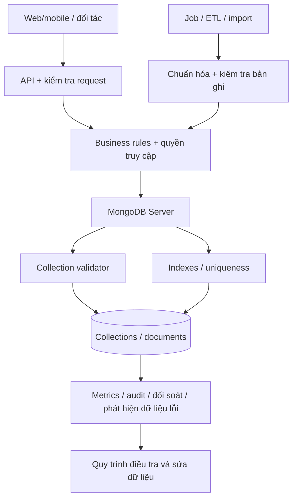
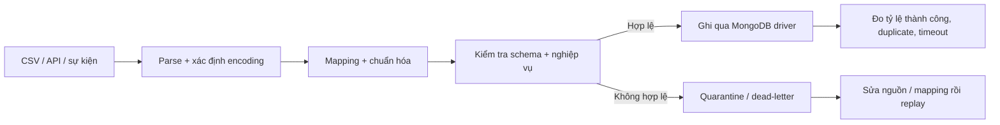

# Schema linh hoạt và trách nhiệm kiểm soát chất lượng dữ liệu trong MongoDB

> **Module:** Database Engine Document MongoDB  
> **Chương:** Schema validation

## 1. Vì sao “schema linh hoạt” không đồng nghĩa với “không cần schema”?

MongoDB lưu dữ liệu dưới dạng **document BSON** trong collection. Khác với bảng quan hệ thường khai báo bộ cột và kiểu dữ liệu ngay từ đầu, hai document trong cùng một collection MongoDB có thể có các field khác nhau, và cùng tên field có thể mang kiểu BSON khác nhau nếu ứng dụng không kiểm soát.

Ví dụ, ba document đều thuộc collection `customers`:

```javascript
[
  { _id: 1, fullName: "Lan", loyaltyPoints: 20 },
  { _id: 2, fullName: "Minh", loyaltyPoints: 35, phone: "0900000000" },
  { _id: 3, name: "Hà", loyaltyPoints: "40" }
]
```

MongoDB có thể lưu các document này nếu không có quy tắc validation ngăn cản. Nhưng ứng dụng gặp vấn đề:

- Có document dùng `fullName`, có document dùng `name`; API hiển thị tên có thể thiếu dữ liệu.
- `loyaltyPoints` lúc là số, lúc là chuỗi; phép cộng, sắp xếp, thống kê và ánh xạ sang Java có thể cho kết quả không mong muốn hoặc lỗi.
- `phone` có ở một số document; code cần biết field này có bắt buộc hay chỉ là tùy chọn.
- Không thể suy ra thông tin nào chính xác về mặt nghiệp vụ chỉ vì document được ghi thành công.

**Schema linh hoạt (flexible schema)** có nghĩa hệ quản trị cho phép thay đổi hình dạng document theo nhu cầu và không bắt buộc mọi document có cấu trúc giống hệt nhau. Nó **không loại bỏ** yêu cầu định nghĩa hợp đồng dữ liệu, kiểm tra đầu vào, kiểm soát nghiệp vụ và xử lý dữ liệu lịch sử.

Bài học này phân biệt:

1. **Khả năng lưu trữ:** MongoDB có chấp nhận document về mặt cấu trúc, kiểu BSON và giới hạn hệ thống hay không?
2. **Hợp đồng dữ liệu:** Ứng dụng kỳ vọng các field, kiểu, giá trị, đơn vị, quan hệ và phiên bản schema nào?
3. **Chất lượng dữ liệu:** Dữ liệu có đúng, đầy đủ, hợp lệ, nhất quán, kịp thời và đủ tin cậy cho mục đích sử dụng không?
4. **Trách nhiệm thực thi:** Quy tắc nào nên đặt ở API/ứng dụng, MongoDB validator/index, pipeline nhập dữ liệu và hệ thống giám sát?

## 2. Schema document là gì?

Trong MongoDB, schema là mô tả cấu trúc và quy tắc của document. Schema có thể là quy ước của đội phát triển, định nghĩa trong ứng dụng hoặc **collection validator** được cấu hình trên MongoDB Server.

Một hợp đồng dữ liệu của collection `orders` có thể được mô tả như sau:

| Field | Kiểu BSON mong muốn | Bắt buộc? | Quy tắc |
|---|---|---|---|
| `orderId` | String | Có | Không rỗng; duy nhất trong tập đơn hàng |
| `customerId` | String | Có | Không rỗng; tham chiếu đến khách hàng hợp lệ theo nghiệp vụ |
| `status` | String | Có | Một trong `NEW`, `PAID`, `CANCELLED` |
| `total` | Decimal128 | Có | Không âm; khớp tổng giá trị các dòng đơn hàng |
| `items` | Array of objects | Có | Ít nhất một dòng; mỗi dòng có SKU, số lượng, đơn giá |
| `createdAt` | BSON Date | Có | Thời điểm tạo theo chính sách hệ thống |
| `note` | String | Không | Có thể vắng mặt; giới hạn nội dung theo API |
| `schemaVersion` | Int32 | Tùy chính sách | Phiên bản hình dạng document để hỗ trợ migration |

Lưu ý bảng này gồm **cả quy tắc cấu trúc lẫn quy tắc nghiệp vụ**. Không phải quy tắc nào cũng nên hoặc có thể biểu diễn đầy đủ bằng `$jsonSchema`. Ví dụ, validator có thể xác nhận `total` là Decimal128 không âm, nhưng việc tổng tiền khớp chính sách khuyến mãi, thuế và từng dòng hàng thường cần xử lý tại tầng nghiệp vụ.

### 2.1. Document model và BSON

MongoDB dùng BSON, vì vậy kiểu dữ liệu không chỉ là các kiểu trong JSON văn bản. Những kiểu thường gặp:

- `string`, `bool`, `object`, `array`.
- `int` (số nguyên 32-bit), `long` (số nguyên 64-bit), `double`, `decimal` (Decimal128).
- `date` (giá trị thời gian BSON), `objectId`, `null`.
- Một số kiểu khác dành cho nhu cầu chuyên biệt.

Ví dụ dưới đây nhìn giống nhau về ý nghĩa tiền, nhưng khác kiểu BSON:

```javascript
{ total: "199.00" }                // string
{ total: 199.00 }                  // thường là double khi tạo từ JavaScript
{ total: NumberDecimal("199.00") } // Decimal128
```

Với số tiền cần độ chính xác thập phân, ứng dụng có thể chọn Decimal128 hoặc lưu số đơn vị nhỏ nhất bằng integer theo thiết kế được thống nhất. Quan trọng là **không lẫn kiểu và đơn vị đo giữa các document**.

### 2.2. Khi nào nên tận dụng schema linh hoạt?

Linh hoạt có lợi khi:

- Sản phẩm thêm trường tùy chọn mà không cần chuyển đổi tất cả document ngay.
- Các subtype chia sẻ vài field chung nhưng có dữ liệu chuyên biệt, ví dụ nhiều phương thức thanh toán có metadata khác nhau.
- Hệ thống tiếp nhận dữ liệu với cấu trúc thay đổi theo nguồn, rồi chuẩn hóa từng bước.
- Một migration cần giai đoạn chấp nhận đồng thời document phiên bản cũ và mới.

Nhưng linh hoạt **không phải lý do** để để tên field tùy ý, ép mọi giá trị thành string hoặc bỏ qua quy tắc ổn định của API. Một document model tốt vẫn thể hiện rõ dữ liệu bắt buộc và dữ liệu có thể thay đổi.

## 3. Các chiều chất lượng dữ liệu phải kiểm soát

**Dữ liệu hợp lệ về schema** là một phần của **dữ liệu chất lượng**. Một document có thể vượt qua mọi kiểm tra kiểu nhưng vẫn sai số tiền hoặc tham chiếu tới khách hàng không tồn tại.

| Chiều chất lượng | Câu hỏi | Ví dụ lỗi | Cách kiểm soát phù hợp |
|---|---|---|---|
| **Completeness – Đầy đủ** | Các thông tin cần thiết có mặt không? | Đơn hàng thiếu `customerId` | `required` ở validator; kiểm tra request DTO |
| **Validity – Hợp lệ** | Kiểu và miền giá trị có đúng không? | `status: "WAIT"` khi chỉ cho phép `NEW/PAID/CANCELLED` | `bsonType`, `enum`, validation ứng dụng |
| **Accuracy – Chính xác** | Giá trị phản ánh sự thật/nghiệp vụ không? | Tổng tiền thấp hơn giá trị hàng hóa thực tế | Tính toán tại service, đối soát nguồn |
| **Consistency – Nhất quán** | Các field/hệ thống có mâu thuẫn không? | `status: "PAID"` nhưng payment thất bại | Quy trình chuyển trạng thái, transaction khi cần |
| **Uniqueness – Duy nhất** | Có bản ghi trùng định danh không? | Hai đơn hàng cùng `orderId` | Unique index; idempotency key |
| **Timeliness – Kịp thời** | Dữ liệu có đủ mới cho mục đích sử dụng? | Trạng thái tồn kho chậm đồng bộ nhiều giờ | Event processing, độ trễ và cảnh báo |
| **Traceability – Truy vết** | Có biết dữ liệu đến từ đâu và được sửa khi nào? | Document nhập sai nhưng không rõ nguồn | `source`, `updatedAt`, audit/event log |
| **Conformance – Tuân thủ hợp đồng** | Dữ liệu có đúng với phiên bản schema đã công bố? | Consumer mong `amount` nhưng producer đổi thành `total` | Versioned contract, contract tests, migration |

Các chiều này đôi khi giao nhau. Ví dụ unique index ngăn ghi hai document trùng `orderId`, nhưng **không chứng minh** đơn hàng tương ứng với giao dịch kinh doanh thật hay chưa bị ghi thiếu.

## 4. Trách nhiệm được phân bổ theo từng tầng

Một hệ thống MongoDB có thể có các luồng ghi từ HTTP API, background job, script vận hành, tích hợp dữ liệu và công cụ quản trị. Chỉ kiểm tra tại giao diện người dùng hoặc một endpoint API là chưa đủ, vì các luồng khác có thể đi thẳng vào database.



### 4.1. Người thiết kế dữ liệu / chủ sở hữu domain

Chịu trách nhiệm nêu rõ:

- Field nào là bắt buộc, field nào là tùy chọn, field nào có thể `null`.
- Các kiểu BSON, đơn vị đo, timezone, miền giá trị và quy tắc chuyển trạng thái.
- Trường hợp nào lưu nhúng (embedded document), trường hợp nào dùng reference.
- Quy tắc duy nhất, vòng đời dữ liệu, dữ liệu nhạy cảm và chính sách lưu trữ.
- Mức độ tương thích cần giữ khi consumer đang dùng schema cũ.

### 4.2. Tầng API và ứng dụng

Kiểm tra request ngay tại biên:

- Trả lỗi dễ hiểu, chỉ rõ field nào sai.
- Chuẩn hóa dữ liệu đầu vào khi nghiệp vụ cho phép, ví dụ trim khoảng trắng của mã nghiệp vụ.
- Kiểm tra quyền và quan hệ giữa đối tượng (ví dụ người mua có quyền tạo đơn không).
- Tính giá trị dẫn xuất trên server, ví dụ `total` được tính từ items thay vì tin tuyệt đối giá trị client gửi.
- Kiểm soát transaction, race condition, idempotency và thay đổi trạng thái.

### 4.3. MongoDB Server

Cung cấp hàng rào cuối cùng cho các luồng ghi:

- **Collection validation:** kiểm tra hình dạng document và một số điều kiện hợp lệ.
- **Index:** enforce các điều kiện duy nhất ở mức field/index; hỗ trợ truy vấn.
- **Role/privilege:** giới hạn ai được đọc/ghi/sửa schema và cấu hình.
- **Transaction/atomic operation:** bảo vệ tính nhất quán của thay đổi trong phạm vi cơ chế giao dịch được hỗ trợ.

MongoDB không tự hiểu toàn bộ ý nghĩa nghiệp vụ. Việc một document vượt qua validator chỉ nói rằng nó thỏa **các điều kiện đã khai báo**.

### 4.4. Pipeline dữ liệu và vận hành

Các job nhập dữ liệu phải có quy tắc mapping, loại bỏ/đánh dấu dữ liệu lỗi, retry/idempotency và khả năng phát hiện bản ghi bất thường. Đội vận hành cần đo tỷ lệ lỗi schema, số bản ghi không hợp lệ trong dữ liệu cũ, độ trễ đồng bộ, sự chênh lệch đối soát và lưu vết thay đổi.

**Nguyên tắc:** quy tắc nghiệp vụ được định nghĩa một lần ở cấp hợp đồng và được **thực thi ở nhiều vị trí thích hợp**, tránh các luồng ghi có hành vi khác nhau.

## 5. MongoDB cho phép gì nếu chưa bật validator?

Trong một collection không có schema validator tùy chỉnh, MongoDB không buộc mọi document phải có cùng các field. Ví dụ trong database thực hành:

```javascript
const lab = db.getSiblingDB("schema_quality_lab");

lab.getCollection("raw_events").insertMany([
  { _id: "e1", eventType: "LOGIN", occurredAt: new Date() },
  { _id: "e2", eventType: "LOGIN", occurredAt: "2026-11-14T03:00:00Z" },
  { _id: "e3", eventType: 42, extra: { source: "legacy" } }
]);

printjson(lab.getCollection("raw_events").find().toArray());
```

Dù cả ba document có thể được lưu, vấn đề xảy ra khi một consumer cố gắng sắp xếp theo `occurredAt` hoặc ánh xạ nó vào `Instant`/`Date` của Java: field khi là BSON Date, khi là string, và khi không tồn tại. Truy vấn so sánh BSON theo kiểu còn có những quy tắc riêng, vì vậy kết quả khó dự đoán nếu nghiệp vụ kỳ vọng một kiểu duy nhất.

### 5.1. Phân biệt field thiếu, field `null` và field sai kiểu

Giả sử có ba document:

```javascript
[
  { _id: 1, phone: null },
  { _id: 2 },
  { _id: 3, phone: "0900000000" }
]
```

Có ba trạng thái khác nhau:

- **Missing:** không có khóa `phone`.
- **Explicit null:** khóa `phone` có giá trị BSON null.
- **Present with value:** khóa `phone` có một chuỗi.

Trong MongoDB, truy vấn equality `{ phone: null }` khớp cả document thiếu field và document có field với giá trị null. Nếu cần phân biệt, có thể dùng:

```javascript
const c = lab.getCollection("raw_contacts");

c.find({ phone: { $exists: false } });   // Thiếu field
c.find({ phone: { $type: "null" } });     // Có field mang BSON null
c.find({ phone: { $type: "string" } });   // Có field là string
```

Phần code trên mô tả điều kiện truy vấn; nó không tự tạo collection `raw_contacts`. Trong thiết kế validator, `required` yêu cầu tên field có mặt; nó **không đủ** để cấm null nếu kiểu của field vẫn cho phép null. Cần kết hợp với `bsonType` mong muốn.

### 5.2. Trùng tên field theo casing

Các khóa `customerId` và `customerID` là những field khác nhau trong BSON. Một số luồng producer có thể ghi `created_at` trong khi consumer chỉ đọc `createdAt`. Schema linh hoạt khiến lỗi này dễ tồn tại lâu nếu không có validator hoặc contract tests.

Ngoài cấu trúc, việc chuẩn hóa đơn vị rất quan trọng: `weight` là kilogram hay gram? `price` là đơn vị tiền chính hay đơn vị nhỏ nhất? `createdAt` là thời điểm UTC hay chuỗi địa phương? Những quy tắc này phải có trong hợp đồng dù validator không thể biểu diễn hết.

## 6. Collection validator và `$jsonSchema`

MongoDB cho phép khai báo **validation rules** cho collection. Một cách thông dụng là dùng operator `$jsonSchema` với cú pháp JSON Schema mà MongoDB hỗ trợ, bao gồm phần mở rộng **`bsonType`** cho các kiểu BSON.

Các thuộc tính hữu ích:

| Thuộc tính | Mục đích | Ví dụ |
|---|---|---|
| `bsonType` | Ràng buộc kiểu BSON | `"string"`, `"date"`, `"decimal"`, `"object"` |
| `required` | Field phải có mặt | `["orderId", "status"]` |
| `properties` | Quy tắc của từng field object | `status: { bsonType: "string" }` |
| `enum` | Giới hạn tập giá trị | `["NEW", "PAID", "CANCELLED"]` |
| `minimum` / `maximum` | Giới hạn số | `{ minimum: 0 }` |
| `minLength` / `maxLength` | Giới hạn độ dài chuỗi | `{ minLength: 1 }` |
| `pattern` | Điều kiện regex của string | Mẫu mã đơn hàng |
| `items` | Quy tắc phần tử array | Mỗi item phải là object |
| `minItems` | Số phần tử array tối thiểu | `{ minItems: 1 }` |
| `additionalProperties` | Cho phép hay từ chối field không khai báo | `false` khi hợp đồng yêu cầu đóng |

**Chú ý:** `$jsonSchema` trong MongoDB là một tập con/biến thể dành cho BSON, không đồng nghĩa mọi tính năng hoặc phiên bản của chuẩn JSON Schema đều được hỗ trợ. Khi dùng keyword mới, tham khảo documentation của đúng phiên bản MongoDB Server.

### 6.1. Tạo collection có validator ngay từ đầu

Ví dụ một collection `orders` phục vụ thực hành. Mở `mongosh` và chạy:

```javascript
const lab = db.getSiblingDB("schema_quality_lab");

const orderValidator = {
  $jsonSchema: {
    bsonType: "object",
    required: ["orderId", "customerId", "status", "total", "items", "createdAt"],
    properties: {
      orderId: {
        bsonType: "string",
        minLength: 1,
        description: "Mã đơn hàng phải là chuỗi không rỗng"
      },
      customerId: {
        bsonType: "string",
        minLength: 1
      },
      status: {
        enum: ["NEW", "PAID", "CANCELLED"]
      },
      total: {
        bsonType: "decimal",
        minimum: 0
      },
      items: {
        bsonType: "array",
        minItems: 1,
        items: {
          bsonType: "object",
          required: ["sku", "quantity", "unitPrice"],
          properties: {
            sku: { bsonType: "string", minLength: 1 },
            quantity: { bsonType: "int", minimum: 1 },
            unitPrice: { bsonType: "decimal", minimum: 0 }
          }
        }
      },
      createdAt: { bsonType: "date" },
      note: { bsonType: "string" }
    }
  }
};

lab.createCollection("orders", {
  validator: orderValidator,
  validationLevel: "strict",
  validationAction: "error"
});
```

Điều kiện của ví dụ:

- `status` chỉ nhận ba giá trị enum đã định nghĩa.
- `total` và `unitPrice` phải là BSON Decimal128.
- `quantity` phải là BSON Int32 và tối thiểu bằng 1.
- `createdAt` phải là BSON Date, không phải chuỗi ISO 8601.
- `note` là tùy chọn, nhưng nếu có thì phải là string.
- `items` không được rỗng, và mỗi item phải có ít nhất ba field nêu trong `required`.
- Ví dụ chưa đặt `additionalProperties: false`; các field không mô tả vẫn có thể xuất hiện. Điều này là lựa chọn để tập trung vào dữ liệu cốt lõi, **không phải MongoDB mặc định từ chối field lạ**.

Tạo collection một lần; lần sau nếu đã tồn tại, lệnh `createCollection("orders", ...)` sẽ báo lỗi namespace. Trong một môi trường đang có dữ liệu, cần kiểm tra collection và quy tắc hiện tại trước khi thay đổi.

### 6.2. Ghi document hợp lệ

```javascript
lab.getCollection("orders").insertOne({
  _id: "order-lab-001",
  orderId: "ORD-001",
  customerId: "CUST-001",
  status: "NEW",
  total: NumberDecimal("199.00"),
  items: [
    {
      sku: "SKU-01",
      quantity: NumberInt(2),
      unitPrice: NumberDecimal("99.50")
    }
  ],
  createdAt: new Date(),
  note: "Đơn hàng kiểm tra validator"
});
```

Ở đây dùng `NumberDecimal(...)` và `NumberInt(...)` để tạo kiểu BSON mong muốn từ `mongosh`. Trường `_id` được MongoDB sử dụng làm khóa định danh document; ví dụ sử dụng string tùy chỉnh và validator không hạn chế riêng kiểu `_id`.

Để xem document:

```javascript
printjson(lab.getCollection("orders").findOne({ orderId: "ORD-001" }));
```

### 6.3. Thử gửi document không hợp lệ

```javascript
try {
  lab.getCollection("orders").insertOne({
    _id: "order-lab-invalid",
    orderId: "ORD-BAD",
    customerId: "",
    status: "DONE",
    total: "199.00",
    items: [],
    createdAt: "2026-11-14"
  });
} catch (error) {
  print("Ghi dữ liệu bị từ chối: " + error.message);
}
```

Document này có nhiều vấn đề: `customerId` rỗng, `status` ngoài enum, `total` sai kiểu, `items` không có phần tử và `createdAt` là string. Với cấu hình `validationAction: "error"`, server sẽ từ chối thao tác vi phạm validator; client thường nhận lỗi liên quan **DocumentValidationFailure** (mã 121).

Phản hồi lỗi có thể chứa chi tiết vì sao document không đạt schema, nhưng cấu trúc chi tiết phụ thuộc version/server/driver và quyền của người gọi. Trong API production, chỉ trả thông báo an toàn, dễ hiểu; không phát tán dữ liệu nhạy cảm hoặc toàn bộ payload vào log.

### 6.4. Kiểm tra validator đang được gắn với collection

```javascript
printjson(lab.getCollectionInfos({ name: "orders" }));
```

Thông tin collection có thể bao gồm `options.validator`, `validationLevel` và `validationAction`. Nên kiểm tra cấu hình thực tế thay vì mặc định tin rằng một file migration đã chạy thành công.

## 7. `validationLevel` và `validationAction`

Hai tùy chọn này giải quyết hai câu hỏi khác nhau: **khi nào kiểm tra** và **làm gì khi vi phạm**.

### 7.1. `validationLevel`

| Giá trị | Ý nghĩa |
|---|---|
| `strict` | Kiểm tra insert và update theo validator; đây là lựa chọn mặc định thông thường |
| `moderate` | Kiểm tra insert mới và update đối với document hiện đang đạt validator; có thể không áp quy tắc lên update của document vốn đã không hợp lệ |

`moderate` có thể hữu ích trong giai đoạn nâng schema khi collection vẫn còn dữ liệu lịch sử chưa phù hợp. Nhưng nó không biến dữ liệu cũ thành hợp lệ và cũng không nên bị dùng như một cấu hình vĩnh viễn chỉ để né công việc dọn dữ liệu.

### 7.2. `validationAction`

| Giá trị | Ý nghĩa | Khi nào cân nhắc? |
|---|---|---|
| `error` | Từ chối thao tác ghi vi phạm validation | Mặc định tốt cho schema cốt lõi |
| `warn` | Cho phép thao tác ghi nhưng ghi cảnh báo vào log MongoDB | Giai đoạn quan sát ảnh hưởng của validator trước khi enforce |

Các phiên bản MongoDB mới còn có thêm lựa chọn liên quan đến ghi log cho hành vi lỗi; chỉ sử dụng nếu được phiên bản server của bạn hỗ trợ. Dùng `warn` phải đi kèm việc thu thập và xem xét log, nếu không vi phạm sẽ tiếp tục đi vào database mà không được xử lý.

### 7.3. Thay đổi validator trên collection đã tồn tại

MongoDB hỗ trợ lệnh `collMod`:

```javascript
lab.runCommand({
  collMod: "orders",
  validator: orderValidator,
  validationLevel: "strict",
  validationAction: "error"
});
```

Cần chạy trong phiên `mongosh` mà biến `orderValidator` đã được khai báo, và tài khoản cần có quyền tương ứng.

**Điểm rất quan trọng:** thay validator không tự sửa hoặc xóa document hiện có. Với `strict`, các lần cập nhật document không hợp lệ có thể bị từ chối cho đến khi dữ liệu được đưa về dạng hợp lệ. Vì vậy, trước khi siết chặt validation, hãy khảo sát dữ liệu hiện hữu, lập kế hoạch migrate và thông báo cho các luồng producer.

Các thao tác có quyền đặc biệt có thể bỏ qua document validation trong những trường hợp được MongoDB cho phép; vì vậy không thay thế phân quyền và giám sát chỉ bằng validator.

## 8. Khi nào cần unique index và những quy tắc ngoài validator?

**Schema validation không thay thế unique index.** Ví dụ `orderId` phải là string không rỗng, đồng thời hai đơn hàng không được dùng chung một `orderId`.

Tạo index duy nhất:

```javascript
lab.getCollection("orders").createIndex(
  { orderId: 1 },
  { name: "ux_orders_order_id", unique: true }
);
```

Nếu collection đã có các giá trị `orderId` trùng nhau, việc xây index unique sẽ lỗi; cần xử lý duplicate trước. Khi index đã tồn tại, MongoDB áp quy tắc unique ngay cả nếu hai request ghi đồng thời, giúp tránh race condition của cách “query trước xem có mã này chưa, rồi mới insert”.

Phân biệt các trường hợp:

| Quy tắc | Công cụ chính |
|---|---|
| Field phải tồn tại và có kiểu đúng | Collection validator |
| Mã đơn phải là một trong các trạng thái xác định | Validator `enum` và state machine tại service |
| `orderId` không trùng trong collection | Unique index |
| `total` bằng tổng các dòng sau thuế/giảm giá | Tính toán và kiểm tra nghiệp vụ tại service |
| `customerId` trỏ tới khách hàng thật và được phép mua | Business service, quy trình nhất quán dữ liệu |
| Hai collection phải cập nhật nhất quán khi thanh toán | Thiết kế atomic/transaction phù hợp |
| Dữ liệu stale từ nguồn ngoài cần được đối soát | Job đối soát và giám sát |
| Một bản ghi lỗi cần được sửa và truy ra nguồn | Logging/audit + data remediation |

MongoDB không tự cung cấp foreign key như một RDBMS chỉ nhờ khai báo một field `customerId`. Tham chiếu giữa collection thường được ứng dụng kiểm soát, hoặc được thiết kế lại bằng embedding khi phù hợp.

### 8.1. Optional field và unique index

Nếu cần unique một field tùy chọn như `externalRef`, phải đặc biệt chú ý semantics của missing/null. Unique single-field index có hành vi đặc thù đối với document thiếu field hoặc mang null; tạo index như vậy trên collection hiện hữu có thể lỗi hoặc giới hạn dữ liệu ngoài dự kiến.

Một lựa chọn có chủ đích là **partial unique index** chỉ áp dụng cho document có giá trị string:

```javascript
lab.getCollection("orders").createIndex(
  { externalRef: 1 },
  {
    name: "ux_orders_external_ref_when_string",
    unique: true,
    partialFilterExpression: {
      externalRef: { $type: "string" }
    }
  }
);
```

Giải pháp này chỉ kiểm soát uniqueness ở tập document khớp filter. Nó **không tự yêu cầu** mọi document có `externalRef` hoặc bảo đảm chuỗi không rỗng; những điều đó cần được quy định riêng nếu nghiệp vụ yêu cầu.

## 9. Kiểm soát ở ứng dụng Java và API

Ví dụ MongoDB Java Driver có thể lưu các kiểu BSON chính xác, nhưng việc nhận request HTTP thường bắt đầu bằng JSON. Nếu ứng dụng map JSON trực tiếp thành `Document` rồi ghi ngay, nó dễ bỏ qua nhiều ràng buộc quan trọng.

Một thiết kế phổ biến:

1. Tách **request DTO** khỏi document được lưu.
2. Kiểm tra trường bắt buộc, miền giá trị và định dạng ở biên HTTP.
3. Kiểm tra các quy tắc nghiệp vụ và quyền của người dùng.
4. Chuẩn hóa dữ liệu theo chính sách; tự tính trường dẫn xuất như `total`.
5. Chuyển sang kiểu BSON đích và ghi qua driver.
6. Chuyển lỗi từ unique index/validator thành phản hồi phù hợp; không bỏ qua lỗi từ MongoDB.

### 9.1. Ví dụ DTO Java với Jakarta Bean Validation

```java
import jakarta.validation.Valid;
import jakarta.validation.constraints.DecimalMin;
import jakarta.validation.constraints.NotBlank;
import jakarta.validation.constraints.NotEmpty;
import jakarta.validation.constraints.NotNull;
import jakarta.validation.constraints.Positive;

import java.math.BigDecimal;
import java.util.List;

public record OrderItemInput(
        @NotBlank String sku,
        @Positive int quantity,
        @NotNull @DecimalMin("0.00") BigDecimal unitPrice
) {}

public record CreateOrderRequest(
        @NotBlank String customerId,
        @NotEmpty List<@Valid OrderItemInput> items
) {}
```

Với Spring MVC, cần kích hoạt validation trên request, ví dụ dùng `@Valid @RequestBody` trong controller và có provider Bean Validation trong ứng dụng. Chỉ viết annotation trên record **không tự đảm bảo** mọi đường gọi Java đều được validate; các job và luồng nội bộ cũng phải gọi logic kiểm tra phù hợp.

### 9.2. Tạo BSON với kiểu phù hợp

Sau khi request được xác thực, service có thể tính tổng tiền và chuyển BigDecimal sang Decimal128:

```java
import org.bson.Document;
import org.bson.types.Decimal128;

import java.math.BigDecimal;
import java.util.Date;
import java.util.List;

public class OrderMapper {
    public static Document toDocument(
            String orderId,
            CreateOrderRequest request
    ) {
        List<Document> items = request.items().stream()
                .map(item -> new Document("sku", item.sku())
                        .append("quantity", item.quantity())
                        .append("unitPrice", new Decimal128(item.unitPrice())))
                .toList();

        BigDecimal total = request.items().stream()
                .map(item -> item.unitPrice()
                        .multiply(BigDecimal.valueOf(item.quantity())))
                .reduce(BigDecimal.ZERO, BigDecimal::add);

        return new Document("orderId", orderId)
                .append("customerId", request.customerId())
                .append("status", "NEW")
                .append("total", new Decimal128(total))
                .append("items", items)
                .append("createdAt", new Date());
    }
}
```

Ví dụ chỉ minh họa mapping các field cốt lõi; hệ thống thật cần kiểm tra giới hạn Decimal128, đồng tiền, rounding, thuế, khuyến mãi, quyền truy cập, sinh ID và quy tắc chuyển trạng thái. Dù request đã được validate, server validator và unique index vẫn cần hoạt động như hàng rào cuối cùng khi nhiều producer ghi dữ liệu.

### 9.3. Không lấy giá trị do client tự tính làm nguồn sự thật

Giả sử client gửi:

```json
{
  "customerId": "CUST-001",
  "items": [
    { "sku": "SKU-01", "quantity": 2, "unitPrice": 99.5 }
  ],
  "total": 1
}
```

Nếu API chỉ xác nhận `total` là số dương rồi lưu, tài liệu có thể qua được kiểm tra kiểu nhưng sai nghiệp vụ. Service cần quyết định nguồn giá: thông tin sản phẩm được tin cậy ở server hay giá tại thời điểm chốt đơn, và tính lại tổng đúng chính sách.

## 10. Schema evolution: thêm, đổi, loại bỏ field mà không phá ứng dụng

Schema linh hoạt đặc biệt hữu ích khi cần phát triển cấu trúc theo thời gian. Tuy nhiên, có thể có nhiều phiên bản ứng dụng cùng đọc/ghi trong giai đoạn triển khai.

Ví dụ hợp đồng cũ:

```javascript
{
  orderId: "ORD-001",
  customerName: "Lan",
  total: NumberDecimal("199.00")
}
```

Hợp đồng mới:

```javascript
{
  orderId: "ORD-001",
  customer: { id: "CUST-001", displayName: "Lan" },
  total: NumberDecimal("199.00"),
  currency: "VND",
  schemaVersion: 2
}
```

Đổi `customerName` thành `customer.displayName` hoặc chuyển từ string sang nested object là thay đổi có tác động đến consumer. Không nên đổi tất cả luồng đọc/ghi cùng lúc chỉ vì MongoDB cho phép.

### 10.1. Quy trình expand → migrate → contract

| Giai đoạn | Việc cần làm | Rủi ro cần kiểm soát |
|---|---|---|
| **1. Expand** | Cho phép dữ liệu cũ và mới cùng tồn tại trong giai đoạn chuyển tiếp; cập nhật consumer để đọc được cả hai | Consumer cũ không hiểu field mới |
| **2. Deploy writer mới** | Producer ghi cấu trúc mới theo hợp đồng, có log/metric theo version | Nhiều writer có thể tạo dữ liệu không nhất quán |
| **3. Backfill/migrate** | Chuyển document cũ bằng script có kiểm soát, theo batch và có checkpoint | Mất dữ liệu, ghi đè cập nhật mới, quá tải |
| **4. Verify** | Thống kê số document còn ở dạng cũ, kiểm tra mẫu dữ liệu và luồng ứng dụng | Chưa xử lý hết dữ liệu cũ |
| **5. Contract** | Siết validator, bỏ nhánh đọc cũ khi các consumer đã tương thích | Siết quá sớm làm update document cũ thất bại |

Schema phiên bản cũ và mới có thể được phân biệt bằng field `schemaVersion` **nếu có lý do rõ ràng**. Không bắt buộc mọi collection phải có field này; với những thay đổi nhỏ có thể chỉ cần hợp đồng dữ liệu và migration được quản lý.

### 10.2. Backfill phải có tính an toàn và khả năng chạy lại

Một cập nhật theo điều kiện là cách minh họa cho migration nhỏ:

```javascript
const lab = db.getSiblingDB("schema_quality_lab");

// Ví dụ áp dụng trên dữ liệu thực sự có các field này:
lab.getCollection("legacy_customers").updateMany(
  { phone: { $exists: false } },
  { $set: { phone: null } }
);
```

Lệnh minh họa **thay đổi ý nghĩa dữ liệu**: từ thiếu field sang hiện diện với null. Chỉ dùng nếu hợp đồng mới thực sự quy định cả hai trạng thái được chuẩn hóa như vậy. Nếu cần phân biệt “chưa thu thập” với “không có số điện thoại”, không được áp dụng migration này một cách máy móc.

Với dữ liệu lớn, chia batch, theo dõi số document đã xử lý và cho phép chạy lại mà không nhân đôi kết quả. Cần xem xét đồng thời các bản cập nhật mới từ ứng dụng để tránh ghi đè dữ liệu vừa thay đổi.

### 10.3. Bổ sung validator cho dữ liệu cũ

Khi đổi từ collection chưa có validator sang validator chặt:

- Lấy mẫu/đo thực tế các kiểu và field hiện tại.
- Xác định document nào không đáp ứng hợp đồng mới.
- Thử validator trên dữ liệu tương tự ở môi trường staging.
- Chọn giai đoạn quan sát bằng `warn` hoặc chuyển đổi có kiểm soát nếu cần.
- Backfill, xử lý lỗi và chuyển sang `validationAction: "error"` khi đủ điều kiện.

Việc bật `error` trước khi hiểu dữ liệu cũ có thể làm hỏng luồng cập nhật bình thường. Việc giữ `warn` vô thời hạn lại khiến quy tắc chất lượng không có tác dụng ngăn lỗi.

## 11. Kiểm tra và phát hiện chất lượng dữ liệu đã tồn tại

**Collection validator chủ yếu bảo vệ thao tác ghi**, không có nghĩa nó tự duyệt và sửa toàn bộ document lịch sử. Vì vậy đội vận hành cần dùng các truy vấn để đánh giá hiện trạng.

### 11.1. Thống kê document thiếu field bắt buộc

```javascript
const lab = db.getSiblingDB("schema_quality_lab");

const orders = lab.getCollection("orders");

print("Missing customerId:",
  orders.countDocuments({ customerId: { $exists: false } }));

print("Explicit null customerId:",
  orders.countDocuments({ customerId: { $type: "null" } }));

print("Missing createdAt:",
  orders.countDocuments({ createdAt: { $exists: false } }));
```

Ví dụ truy vấn các trường hợp cần kiểm tra; một số document có thể không tồn tại vì validator đang chặn ghi lỗi. Đối với collection cũ chưa có validation, các phép đếm có thể phát hiện tồn đọng.

### 11.2. Kiểm tra kiểu BSON thật trong collection

```javascript
orders.aggregate([
  {
    $group: {
      _id: { $type: "$total" },
      count: { $sum: 1 }
    }
  },
  { $sort: { count: -1 } }
]);
```

Kết quả cho biết có bao nhiêu document có `total` ở từng nhóm kiểu, chẳng hạn `decimal`, `double`, `string` hoặc `missing`. Với collection lớn, pipeline có thể tiêu tốn tài nguyên; cân nhắc chạy trên dữ liệu mẫu, secondary phù hợp hoặc cửa sổ vận hành đã được duyệt.

### 11.3. Phát hiện trạng thái ngoài tập hợp cho phép

```javascript
orders.find({
  status: { $nin: ["NEW", "PAID", "CANCELLED"] }
});
```

Truy vấn này hỗ trợ rà soát bản ghi có status không nằm trong tập đã công bố. Nếu collection có nhiều giá trị cũ được phép theo các schemaVersion khác nhau, cần phân nhóm theo phiên bản để không đánh giá nhầm.

### 11.4. Phân biệt lỗi kỹ thuật với lỗi nghiệp vụ

Một đơn hàng có `status: "PAID"` và `total: NumberDecimal("199.00")` vẫn có thể sai nếu payment provider chưa xác nhận thanh toán. Loại lỗi này thường không hiện ra trong báo cáo `$type` hay `$jsonSchema`; cần đối soát với sự kiện thanh toán, trạng thái transaction và nguồn nghiệp vụ có thẩm quyền.

Không sửa dữ liệu bằng cách chỉ “ép cho qua validator”. Việc thay `total: "199.00"` thành Decimal128 có thể hợp lý nếu đơn vị tiền đúng, nhưng nếu nguồn dùng cents thay vì đơn vị tiền chính, thay kiểu mà không đối chiếu sẽ giữ nguyên sai lệch về ý nghĩa.

## 12. Thiết kế pipeline nhập dữ liệu có kiểm soát

Nguồn dữ liệu bên ngoài thường khác schema nội bộ: ngày ở dạng string, mã quốc gia viết không thống nhất, số thập phân qua dấu phẩy và có record thiếu field.

Một pipeline vững nên đi theo các bước:



Các điểm cần có:

- **Phân biệt parse error và validation error:** CSV không đọc được khác với field `total` sai kiểu.
- **Không âm thầm bỏ record:** lưu số lượng và nguyên nhân bị từ chối.
- **Không log bí mật:** che email, token, dữ liệu cá nhân và trường nhạy cảm trong nhật ký.
- **Quy tắc retry:** retry lỗi tạm thời; không lặp vô hạn cùng một document sai schema.
- **Idempotency:** cùng event được xử lý lại không tạo duplicate ngoài mong muốn.
- **Chính sách xử lý dữ liệu lỗi:** có chủ sở hữu nghiệp vụ quyết định sửa, bỏ, cách ly hoặc yêu cầu gửi lại.
- **Quan sát theo phiên bản:** producer, schemaVersion, nguồn và thời điểm giúp nhận diện thay đổi bất thường.

Chỉ có một rule trên server không thể tự giải quyết toàn bộ luồng dữ liệu đến từ các hệ thống không đồng nhất.

## 13. Quyết định schema linh hoạt hay validator chặt đến đâu?

Không có một mức chặt phù hợp cho mọi collection. Chọn theo tính ổn định của domain và tác động khi dữ liệu sai.

| Loại dữ liệu | Thiết kế thường phù hợp | Lý do |
|---|---|---|
| Đơn hàng, giao dịch tiền | Validator chặt cho field lõi + unique index + business rules | Sai số tiền/trạng thái gây hậu quả lớn |
| Hồ sơ người dùng | Field lõi ổn định; các field bổ sung có thể tùy chọn | Cần hỗ trợ tiến hóa profile |
| Sự kiện analytics | Quy định eventName, timestamp, source; payload tùy loại event có version | Nhiều dạng event cùng pipeline |
| Dữ liệu staging/import thô | Giữ payload gốc + nguồn + trạng thái xử lý; kiểm tra trước khi vào collection chuẩn | Không làm mất thông tin nguồn |
| Feature flags/cấu hình | Giới hạn key/value theo loại cấu hình; kiểm soát người sửa | Một giá trị sai có thể ảnh hưởng toàn hệ thống |

**Các nguyên tắc thiết kế:**

1. **Chặt với dữ liệu cốt lõi:** định danh, kiểu số tiền, thời gian, trạng thái nghiệp vụ.
2. **Linh hoạt có chủ đích:** field tùy chọn hoặc cấu trúc phụ có thể mở rộng, nhưng phải có contract.
3. **Không cần cấm mọi field lạ trong mọi trường hợp:** `additionalProperties: false` có ích cho schema đóng, nhưng có thể cản trở bổ sung field trong migration. Nếu dùng, nhớ khai báo cả `_id` khi validator áp dụng cho document cấp cao nhất.
4. **Không biến một collection thành “thùng rác” cho mọi loại document:** khi subtype rất khác nhau về vòng đời, index và truy vấn, cân nhắc collection riêng.
5. **Tối ưu cho cách truy vấn:** embedding/reference, index và pattern đọc/ghi phải thống nhất với schema và quy tắc nghiệp vụ.
6. **Viết quy tắc vào tài liệu có kiểm soát phiên bản:** đội phát triển và vận hành cần biết cấu trúc nào được hỗ trợ.

## 14. Bài thực hành tổng hợp

Thực hiện trong MongoDB Shell trên môi trường lab, với database `schema_quality_lab` và quyền tạo collection/index. Các lệnh tạo validator ở mục 6 nên được chạy trước.

### Bài A — Kiểm tra document đạt và không đạt validator

1. Chạy lệnh tạo `orders` có `$jsonSchema` như mục 6.1.
2. Chèn document hợp lệ ở mục 6.2; đọc lại document.
3. Thử document sai schema ở mục 6.3; quan sát lỗi.
4. Gõ:

   ```javascript
   printjson(lab.getCollectionInfos({ name: "orders" }));
   ```

   rồi xác nhận collection có validator và hai chế độ `strict` / `error`.

### Bài B — Ngăn trùng mã đơn

Tạo unique index `orderId` (mục 8), rồi thử chèn một document hợp lệ khác nhưng dùng cùng `orderId: "ORD-001"`. MongoDB sẽ từ chối do duplicate key, dù kiểu dữ liệu của document vẫn hợp lệ với validator.

Cần nhớ lỗi **duplicate key** và lỗi **document validation** có nguyên nhân, cách xử lý khác nhau: client không nên trả cùng một thông điệp chung cho hai lỗi.

### Bài C — Điều tra schema drift

Trên collection `raw_events` từ mục 5:

```javascript
lab.getCollection("raw_events").aggregate([
  {
    $project: {
      _id: 1,
      eventTypeBsonType: { $type: "$eventType" },
      occurredAtBsonType: { $type: "$occurredAt" }
    }
  }
]);
```

Xác định document nào thiếu `occurredAt`, document nào lưu nó dưới dạng string, và document nào có `eventType` không phải string. Đề xuất quy tắc chuẩn hóa trước khi chuyển sự kiện thô vào collection phục vụ báo cáo.

### Bài D — Viết hợp đồng dữ liệu

Chọn một collection cho hệ thống quản lý kho hoặc thương mại điện tử, rồi mô tả:

- Tên collection và mục đích.
- Các field bắt buộc/tùy chọn, kiểu BSON, giá trị được phép.
- Các quy tắc nghiệp vụ không biểu diễn được chỉ bằng kiểu dữ liệu.
- Field cần unique index; field cần index phục vụ truy vấn.
- Chiến lược cho document lịch sử khi thêm một field bắt buộc.
- Ai chịu trách nhiệm theo dõi và xử lý bản ghi lỗi.

Kết quả mong đợi là **một data contract có thể chuyển thành validator, code validation, migration và kiểm thử tích hợp**, chứ không chỉ một JSON mẫu.

## 15. Những hiểu lầm cần tránh

| Hiểu lầm | Diễn giải đúng |
|---|---|
| “MongoDB schemaless nên không có schema” | MongoDB cho phép schema linh hoạt; schema tồn tại trong dữ liệu, code, hợp đồng hoặc server validator |
| “Document insert được thì dữ liệu đã đúng” | Insert thành công không chứng minh sự chính xác nghiệp vụ |
| “`required` nghĩa là field không được null” | `required` chỉ yêu cầu field có mặt; cần thêm ràng buộc kiểu để loại null |
| “`$jsonSchema` tự đảm bảo uniqueness” | Dùng unique index cho ràng buộc duy nhất |
| “Bật validator là dữ liệu cũ được làm sạch” | Validator không tự sửa document lịch sử |
| “Chỉ cần validate ở frontend” | Job, API khác và truy cập trực tiếp vẫn có thể ghi sai |
| “Dùng `validationAction: "warn"` là đã chặn dữ liệu lỗi” | `warn` ghi cảnh báo nhưng không từ chối thao tác |
| “Java DTO đủ để đảm bảo mọi document đúng” | DTO chỉ bảo vệ những luồng thật sự đi qua validation đó |
| “Đổi tên field không cần migration” | Consumer, index, query và dữ liệu lịch sử có thể vẫn dùng tên cũ |
| “Chuyển số từ string sang Decimal128 luôn an toàn” | Cần biết đơn vị, rounding và ngữ nghĩa nguồn trước khi chuyển |

## 16. Tài liệu tham khảo chính thức

- [MongoDB Manual – Schema Validation](https://www.mongodb.com/docs/manual/core/schema-validation/)
- [MongoDB Manual – Specify JSON Schema Validation](https://www.mongodb.com/docs/manual/core/schema-validation/specify-json-schema/)
- [MongoDB Manual – JSON Schema (`$jsonSchema`)](https://www.mongodb.com/docs/manual/reference/operator/query/jsonSchema/)
- [MongoDB Manual – Validation Level and Action](https://www.mongodb.com/docs/manual/core/schema-validation/specify-validation-level/)
- [MongoDB Manual – Change Schema Validation](https://www.mongodb.com/docs/manual/core/schema-validation/update-schema-validation/)
- [MongoDB Manual – Unique Indexes](https://www.mongodb.com/docs/manual/core/index-unique/)
- [MongoDB Manual – Partial Indexes](https://www.mongodb.com/docs/manual/core/index-partial/)
- [MongoDB Manual – BSON Types](https://www.mongodb.com/docs/manual/reference/bson-types/)
- [MongoDB Manual – Data Modeling](https://www.mongodb.com/docs/manual/data-modeling/)
- [MongoDB Java Sync Driver](https://www.mongodb.com/docs/drivers/java/sync/current/)

**Kết luận:** MongoDB giúp cấu trúc document phát triển thuận lợi, nhưng **chất lượng dữ liệu vẫn là một trách nhiệm thiết kế và vận hành chủ động**. Hợp đồng dữ liệu rõ ràng, kiểm tra tại ứng dụng, validator/index ở server, migration có kiểm soát và quan sát dữ liệu thực tế là những thành phần bổ sung cho nhau.
