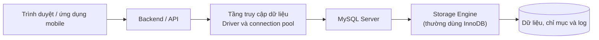

# MySQL là gì và vai trò trong hệ thống ứng dụng

MySQL là hệ quản trị cơ sở dữ liệu quan hệ (Relational Database Management System – RDBMS) dùng để lưu trữ, tổ chức, truy vấn và bảo vệ dữ liệu có cấu trúc. Trong một hệ thống ứng dụng, MySQL thường là nơi lưu giữ dữ liệu nghiệp vụ lâu dài như tài khoản, sản phẩm, đơn hàng, thanh toán và lịch sử giao dịch. Ứng dụng gửi yêu cầu đến MySQL thông qua câu lệnh SQL; MySQL kiểm tra quyền truy cập, thực thi yêu cầu và trả kết quả.

Bài học này giới thiệu MySQL, cách nó tham gia vào kiến trúc ứng dụng và những trách nhiệm quan trọng của nó. Đây là nền tảng để học tiếp cách thiết kế bảng, chọn kiểu dữ liệu, viết truy vấn, sử dụng chỉ mục, quản lý giao dịch và vận hành cơ sở dữ liệu.

## 1. MySQL là gì?

MySQL là một hệ quản trị cơ sở dữ liệu quan hệ. Dữ liệu được tổ chức thành **cơ sở dữ liệu**, **bảng**, **hàng** và **cột**:

- Cơ sở dữ liệu tập hợp các đối tượng dữ liệu của một ứng dụng hoặc một miền nghiệp vụ.
- Bảng mô tả một loại đối tượng, chẳng hạn `customers` lưu thông tin khách hàng.
- Hàng là một bản ghi cụ thể trong bảng.
- Cột mô tả một thuộc tính của bản ghi, chẳng hạn `email`, `created_at` hoặc `status`.

Các bảng có thể liên kết với nhau bằng khóa. Ví dụ, một đơn hàng thuộc về một khách hàng; cột `customer_id` trong bảng `orders` có thể tham chiếu đến khóa chính `id` của bảng `customers`. Cấu trúc quan hệ giúp dữ liệu có tổ chức, hạn chế trùng lặp và thể hiện được các quy tắc nghiệp vụ.

MySQL sử dụng **SQL (Structured Query Language)** để định nghĩa cấu trúc, đọc và thay đổi dữ liệu. Cần phân biệt hai khái niệm:

- **SQL** là ngôn ngữ dùng để làm việc với dữ liệu quan hệ.
- **MySQL** là phần mềm quản trị cơ sở dữ liệu hiểu SQL và chịu trách nhiệm lưu trữ, thực thi, kiểm soát truy cập cũng như bảo vệ dữ liệu.

MySQL có mô hình client–server. MySQL Server chạy như một dịch vụ; các ứng dụng, công cụ dòng lệnh hoặc công cụ quản trị kết nối đến dịch vụ này bằng giao thức MySQL. Một máy chủ có thể phục vụ nhiều kết nối và nhiều ứng dụng, tùy cách triển khai và cấu hình.

## 2. MySQL nằm ở đâu trong kiến trúc ứng dụng?

Trong ứng dụng web hoặc mobile thông thường, người dùng không kết nối trực tiếp đến MySQL. Yêu cầu đi qua tầng backend để ứng dụng có thể xác thực người dùng, áp dụng quy tắc nghiệp vụ và kiểm soát câu lệnh được phép thực thi.



Vai trò của từng phần:

1. **Client** gửi yêu cầu, ví dụ xem danh sách đơn hàng hoặc tạo tài khoản.
2. **Backend/API** xác thực và phân quyền người dùng ở cấp ứng dụng, kiểm tra dữ liệu đầu vào, thực hiện quy tắc nghiệp vụ.
3. **Tầng truy cập dữ liệu** dùng driver/connector để gửi câu lệnh SQL đến MySQL. Connection pool tái sử dụng một nhóm kết nối nhằm giảm chi phí tạo kết nối liên tục.
4. **MySQL Server** tiếp nhận kết nối, xác thực tài khoản cơ sở dữ liệu, phân tích câu lệnh, chọn kế hoạch thực thi và điều phối thao tác với storage engine.
5. **Storage engine** thực hiện việc đọc, ghi và quản lý dữ liệu trên thiết bị lưu trữ. InnoDB là lựa chọn phổ biến cho ứng dụng giao dịch vì hỗ trợ transaction, khóa ở mức hàng, khóa ngoại và phục hồi sau sự cố.

Ví dụ, khi người dùng mở trang lịch sử mua hàng, backend có thể gửi một truy vấn `SELECT` để lấy các đơn hàng của người dùng hiện tại. Khi người dùng đặt hàng, backend kiểm tra giỏ hàng và tồn kho, sau đó gửi các lệnh `INSERT` hoặc `UPDATE` cần thiết trong một transaction. MySQL lưu thay đổi và trả kết quả để backend phản hồi cho client.

## 3. Những trách nhiệm chính của MySQL

### 3.1. Lưu trữ dữ liệu có cấu trúc

MySQL lưu dữ liệu qua các bảng có cấu trúc được định nghĩa trước. Kiểu dữ liệu của cột giúp xác định loại giá trị được lưu, ví dụ số nguyên, chuỗi, ngày giờ hoặc số thập phân. Chọn kiểu dữ liệu phù hợp giúp dữ liệu nhất quán và tránh lãng phí dung lượng.

MySQL cũng lưu các đối tượng hỗ trợ truy cập dữ liệu như chỉ mục và các thông tin cần thiết để quản lý transaction. Dữ liệu được ghi xuống bộ nhớ lưu trữ bền vững theo cơ chế của storage engine và cấu hình máy chủ.

### 3.2. Truy vấn và biến đổi dữ liệu

SQL cho phép ứng dụng đọc, thêm, sửa và xóa dữ liệu. Các nhóm lệnh thường gặp gồm:

| Nhóm lệnh | Mục đích | Ví dụ |
| --- | --- | --- |
| `SELECT` | Đọc dữ liệu | Lấy danh sách đơn hàng |
| `INSERT` | Thêm bản ghi | Tạo đơn hàng mới |
| `UPDATE` | Cập nhật bản ghi | Thay đổi trạng thái đơn hàng |
| `DELETE` | Xóa bản ghi | Xóa một bản ghi theo quy tắc nghiệp vụ |
| `CREATE`, `ALTER`, `DROP` | Định nghĩa hoặc thay đổi cấu trúc | Tạo bảng, thêm cột |

Một truy vấn có thể lọc, sắp xếp, nhóm và kết hợp dữ liệu từ nhiều bảng. Vì vậy, backend không cần tự tải toàn bộ dữ liệu về rồi xử lý mọi phép lọc hoặc nối dữ liệu trong bộ nhớ ứng dụng.

### 3.3. Duy trì tính toàn vẹn dữ liệu

MySQL cung cấp các ràng buộc để ngăn dữ liệu không hợp lệ đi vào cơ sở dữ liệu:

- `PRIMARY KEY` định danh duy nhất mỗi hàng.
- `FOREIGN KEY` thể hiện quan hệ tham chiếu giữa các bảng và giúp ngăn tham chiếu đến bản ghi không tồn tại.
- `UNIQUE` ngăn các giá trị bị trùng trong phạm vi được ràng buộc.
- `NOT NULL` yêu cầu cột phải có giá trị.
- `CHECK` có thể biểu diễn điều kiện hợp lệ cho giá trị cột trên các phiên bản MySQL hỗ trợ thực thi ràng buộc này.

Ví dụ, email của khách hàng thường cần duy nhất; một đơn hàng phải tham chiếu đến khách hàng tồn tại. Đặt các quy tắc quan trọng ở cấp cơ sở dữ liệu giúp bảo vệ tính nhất quán ngay cả khi có nhiều luồng ứng dụng cùng ghi dữ liệu.

### 3.4. Quản lý transaction và truy cập đồng thời

Một thao tác nghiệp vụ có thể cần nhiều câu lệnh SQL. Chẳng hạn, tạo đơn hàng gồm ghi thông tin đơn hàng và các dòng sản phẩm. Nếu chỉ ghi thành công một phần, dữ liệu có thể rơi vào trạng thái không nhất quán. Transaction gom các thao tác liên quan thành một đơn vị: hoặc tất cả được xác nhận, hoặc các thay đổi chưa xác nhận được hoàn tác.

Với InnoDB, transaction tuân theo các thuộc tính ACID:

- **Atomicity (Tính nguyên tử):** các thay đổi trong transaction được xử lý như một đơn vị.
- **Consistency (Tính nhất quán):** transaction hợp lệ phải đưa dữ liệu từ một trạng thái hợp lệ sang trạng thái hợp lệ khác, theo các ràng buộc và quy tắc được áp dụng.
- **Isolation (Tính cô lập):** các transaction đồng thời được kiểm soát để hạn chế ảnh hưởng không mong muốn lẫn nhau.
- **Durability (Tính bền vững):** thay đổi đã commit được bảo vệ theo cơ chế ghi và phục hồi của hệ thống.

Khi nhiều người dùng cùng đọc hoặc cập nhật dữ liệu, MySQL phối hợp transaction, khóa và cơ chế kiểm soát đồng thời để quản lý xung đột. Ứng dụng vẫn cần thiết kế transaction hợp lý, xử lý lỗi và thử lại khi gặp các tình huống như deadlock.

### 3.5. Hỗ trợ hiệu năng truy vấn

MySQL có thể sử dụng **index (chỉ mục)** để tìm hàng nhanh hơn mà không phải quét toàn bộ bảng trong nhiều trường hợp. Chỉ mục phù hợp với điều kiện lọc, cột nối bảng hoặc thứ tự sắp xếp thường dùng có thể cải thiện thời gian truy vấn.

Chỉ mục cũng chiếm dung lượng và làm tăng chi phí khi thêm, sửa hoặc xóa dữ liệu. Vì vậy, không nên tạo chỉ mục theo cảm tính. Người phát triển cần xem truy vấn thực tế, kiểm tra kế hoạch thực thi bằng `EXPLAIN`, đo hiệu năng và điều chỉnh dựa trên dữ liệu quan sát được.

### 3.6. Kiểm soát truy cập và hỗ trợ vận hành

MySQL quản lý tài khoản, vai trò và quyền ở cấp cơ sở dữ liệu. Có thể giới hạn tài khoản ứng dụng chỉ được đọc hoặc ghi những schema, bảng hay thao tác cần thiết. Việc phân quyền tối thiểu giúp giảm thiệt hại khi thông tin kết nối bị lộ hoặc ứng dụng có lỗi.

MySQL cũng cung cấp các cơ chế hỗ trợ sao lưu, phục hồi, ghi log và replication. Replication có thể giúp tạo bản sao phục vụ đọc hoặc tăng khả năng sẵn sàng, nhưng bản sao đồng bộ không thay thế cho bản backup độc lập. Một quy trình vận hành cần có lịch sao lưu, chính sách lưu giữ và kiểm tra khả năng phục hồi thực tế.

## 4. Ví dụ: MySQL lưu dữ liệu cho chức năng đặt hàng

Giả sử một cửa hàng trực tuyến cần lưu khách hàng, đơn hàng và các dòng sản phẩm trong đơn hàng. Có thể mô hình hóa dữ liệu ban đầu như sau:

```sql
CREATE TABLE customers (
    id BIGINT UNSIGNED NOT NULL AUTO_INCREMENT,
    email VARCHAR(254) NOT NULL,
    full_name VARCHAR(150) NOT NULL,
    created_at DATETIME NOT NULL DEFAULT CURRENT_TIMESTAMP,
    PRIMARY KEY (id),
    UNIQUE KEY uq_customers_email (email)
) ENGINE=InnoDB DEFAULT CHARSET=utf8mb4;

CREATE TABLE orders (
    id BIGINT UNSIGNED NOT NULL AUTO_INCREMENT,
    customer_id BIGINT UNSIGNED NOT NULL,
    status VARCHAR(20) NOT NULL DEFAULT 'pending',
    created_at DATETIME NOT NULL DEFAULT CURRENT_TIMESTAMP,
    PRIMARY KEY (id),
    KEY idx_orders_customer_created (customer_id, created_at),
    CONSTRAINT fk_orders_customer
        FOREIGN KEY (customer_id) REFERENCES customers (id)
) ENGINE=InnoDB DEFAULT CHARSET=utf8mb4;

CREATE TABLE order_items (
    order_id BIGINT UNSIGNED NOT NULL,
    line_no SMALLINT UNSIGNED NOT NULL,
    product_name VARCHAR(200) NOT NULL,
    quantity INT UNSIGNED NOT NULL,
    unit_price DECIMAL(13, 2) NOT NULL,
    PRIMARY KEY (order_id, line_no),
    CONSTRAINT fk_order_items_order
        FOREIGN KEY (order_id) REFERENCES orders (id)
) ENGINE=InnoDB DEFAULT CHARSET=utf8mb4;
```

Trong ví dụ này:

- `customers.id`, `orders.id` là khóa chính định danh bản ghi.
- `orders.customer_id` liên kết đơn hàng với khách hàng bằng khóa ngoại.
- `order_items.order_id` liên kết từng dòng hàng với đơn hàng tương ứng.
- `uq_customers_email` ngăn hai khách hàng có cùng email.
- `idx_orders_customer_created` hỗ trợ các truy vấn thường lọc đơn hàng theo khách hàng và sắp xếp theo thời gian.
- `DECIMAL(13, 2)` phù hợp để lưu số tiền cần độ chính xác thập phân; không nên dùng kiểu số thực gần đúng cho tiền tệ.
- `utf8mb4` hỗ trợ lưu trữ đầy đủ ký tự Unicode, bao gồm tiếng Việt và nhiều nhóm ký tự khác.

Khi tạo một đơn hàng, backend có thể thực hiện nhiều thao tác trong cùng transaction:

```sql
START TRANSACTION;

INSERT INTO orders (customer_id, status)
VALUES (42, 'pending');

SET @new_order_id = LAST_INSERT_ID();

INSERT INTO order_items (
    order_id, line_no, product_name, quantity, unit_price
)
VALUES (
    @new_order_id, 1, 'Bàn phím', 1, 1250000.00
);

COMMIT;
```

Nếu một thao tác gặp lỗi trước khi commit, ứng dụng cần rollback transaction để tránh lưu một đơn hàng thiếu dữ liệu chi tiết. `LAST_INSERT_ID()` trả về mã tự tăng vừa tạo trong chính kết nối hiện tại; các lệnh của ví dụ phải chạy trên cùng một kết nối cơ sở dữ liệu. Trong mã ứng dụng thực tế, nên dùng transaction API của driver và câu lệnh tham số hóa thay vì ghép dữ liệu người dùng trực tiếp vào chuỗi SQL.

Để đọc đơn hàng cùng thông tin khách hàng và tổng tiền, ứng dụng có thể dùng phép nối bảng và phép tổng hợp:

```sql
SELECT
    o.id,
    o.created_at,
    o.status,
    c.full_name,
    SUM(oi.quantity * oi.unit_price) AS total_amount
FROM orders AS o
JOIN customers AS c ON c.id = o.customer_id
JOIN order_items AS oi ON oi.order_id = o.id
WHERE o.customer_id = ?
GROUP BY o.id, o.created_at, o.status, c.full_name
ORDER BY o.created_at DESC;
```

Dấu `?` là placeholder thường được driver hỗ trợ trong prepared statement. Backend truyền giá trị `customer_id` riêng qua API tham số hóa. Cách này giúp xử lý giá trị đúng kiểu và tránh tạo truy vấn bằng cách nối trực tiếp dữ liệu đầu vào vào SQL.

Ví dụ cho thấy MySQL vừa lưu dữ liệu lâu dài, vừa bảo vệ quan hệ giữa các bảng, thực thi transaction và cung cấp khả năng truy vấn phục vụ chức năng của ứng dụng.

## 5. Ranh giới trách nhiệm giữa ứng dụng và MySQL

MySQL rất quan trọng, nhưng không thay thế toàn bộ backend. Phân chia trách nhiệm rõ ràng giúp hệ thống dễ bảo trì:

| Backend / ứng dụng | MySQL |
| --- | --- |
| Xác thực người dùng cuối và áp dụng quy tắc nghiệp vụ | Xác thực tài khoản kết nối và kiểm tra quyền database |
| Quyết định một yêu cầu nghiệp vụ có được phép thực hiện hay không | Thực thi câu lệnh SQL trong phạm vi quyền được cấp |
| Điều phối API, gửi thông báo, gọi dịch vụ bên ngoài | Lưu dữ liệu quan hệ và duy trì ràng buộc dữ liệu |
| Kiểm tra dữ liệu đầu vào ở cấp giao diện/nghiệp vụ | Áp dụng kiểu dữ liệu, khóa và constraint ở cấp lưu trữ |
| Quản lý luồng xử lý và phản hồi cho client | Quản lý transaction, khóa, truy vấn và lưu trữ bền vững |

Không nên đưa mật khẩu tài khoản database vào mã nguồn hoặc ứng dụng chạy trên thiết bị người dùng. Thông tin kết nối nên được backend quản lý qua cấu hình bí mật phù hợp; tài khoản ứng dụng cần quyền tối thiểu và kết nối cần được bảo vệ theo yêu cầu triển khai.

MySQL cũng không phải công cụ tối ưu cho mọi loại dữ liệu và mọi kiểu tải. Cache có thể giảm các lần đọc lặp lại; hệ thống tìm kiếm chuyên dụng có thể phù hợp hơn cho tìm kiếm toàn văn phức tạp; object storage phù hợp để lưu tệp lớn. Những hệ thống này có thể phối hợp với MySQL, trong đó MySQL vẫn giữ dữ liệu nghiệp vụ có cấu trúc và các quan hệ cần bảo đảm.

## 6. Các mô hình triển khai thường gặp

- **Một máy chủ MySQL:** phù hợp với ứng dụng nhỏ hoặc giai đoạn đầu, khi tải và yêu cầu sẵn sàng còn đơn giản.
- **MySQL được quản lý (managed database):** nhà cung cấp dịch vụ hỗ trợ một phần công việc như cấp phát máy chủ, vá lỗi, backup và giám sát; đội ngũ vẫn phải thiết kế schema, quyền truy cập và chính sách phục hồi.
- **Replication:** dữ liệu từ máy chủ nguồn được sao chép sang một hoặc nhiều máy chủ khác. Kiến trúc này có thể hỗ trợ mở rộng tải đọc hoặc phương án sẵn sàng, nhưng cần hiểu độ trễ sao chép và cách xử lý chuyển đổi khi có sự cố.
- **Connection pooling:** backend duy trì nhóm kết nối có giới hạn để tránh tạo quá nhiều kết nối đồng thời và kiểm soát tài nguyên MySQL.

Khi chọn mô hình, cần cân nhắc lưu lượng đọc/ghi, kích thước dữ liệu, độ trễ chấp nhận được, yêu cầu khôi phục, ngân sách và năng lực vận hành. Replication không tự động bảo đảm khả năng khôi phục dữ liệu đã bị xóa hoặc ghi sai; backup và thử nghiệm restore vẫn cần thiết.

## 7. Những nguyên tắc nên hình thành từ đầu

1. Thiết kế bảng theo thực thể và quan hệ nghiệp vụ; chọn kiểu dữ liệu phù hợp với miền giá trị.
2. Xác định khóa chính, khóa ngoại và constraint để bảo vệ tính toàn vẹn.
3. Dùng InnoDB cho phần lớn dữ liệu giao dịch của ứng dụng và ưu tiên `utf8mb4` cho dữ liệu văn bản.
4. Dùng prepared statement hoặc API truy vấn tham số hóa; không ghép chuỗi SQL từ dữ liệu đầu vào không tin cậy.
5. Đặt các thao tác cần thành công cùng nhau trong một transaction; giữ transaction ngắn và xử lý lỗi rõ ràng.
6. Tạo index dựa trên truy vấn thực tế; dùng `EXPLAIN` và số liệu đo để đánh giá tác động.
7. Cấp quyền database theo nguyên tắc tối thiểu, quản lý bí mật kết nối an toàn.
8. Sao lưu định kỳ, xác định thời gian lưu giữ và kiểm tra quy trình phục hồi.

## 8. Lộ trình học MySQL trong module

Để làm chủ MySQL trong một hệ thống ứng dụng, nên học theo các nhóm kiến thức có liên hệ với nhau:

1. **Tổng quan:** hiểu mô hình quan hệ, vai trò của MySQL và cách ứng dụng kết nối đến server.
2. **Thiết kế bảng:** chọn kiểu dữ liệu, khóa chính, khóa ngoại và constraint.
3. **SQL:** thực hành `SELECT`, `INSERT`, `UPDATE`, `DELETE`, phép nối bảng và truy vấn tổng hợp.
4. **Index và hiệu năng:** đọc `EXPLAIN`, nhận diện truy vấn tốn kém và chọn chỉ mục phù hợp.
5. **Transaction và đồng thời:** hiểu ACID, isolation level, khóa, deadlock và cách xử lý xung đột.
6. **Bảo mật và vận hành:** quản lý tài khoản/quyền, backup/restore, replication, giám sát và xử lý sự cố.

Các phần này gắn kết với nhau: thiết kế dữ liệu ảnh hưởng đến cách viết truy vấn; truy vấn quyết định nhu cầu index; transaction và khóa ảnh hưởng đến tính đúng đắn khi nhiều yêu cầu chạy đồng thời; bảo mật và backup bảo vệ dữ liệu khi ứng dụng hoạt động thực tế.

## 9. Ghi nhớ

MySQL là hệ quản trị cơ sở dữ liệu quan hệ theo mô hình client–server, dùng SQL để quản lý dữ liệu có cấu trúc. Trong kiến trúc ứng dụng, backend gửi yêu cầu đến MySQL để lưu, đọc và cập nhật dữ liệu nghiệp vụ. MySQL đảm nhiệm việc thực thi truy vấn, duy trì ràng buộc, quản lý transaction và truy cập đồng thời, hỗ trợ hiệu năng bằng index, đồng thời cung cấp cơ chế phân quyền và vận hành dữ liệu.

Hiểu đúng vai trò của MySQL giúp người phát triển thiết kế dữ liệu tốt hơn, viết truy vấn an toàn, giữ tính nhất quán khi có nhiều thao tác đồng thời và chuẩn bị được quy trình bảo vệ, sao lưu, phục hồi dữ liệu cho ứng dụng.
