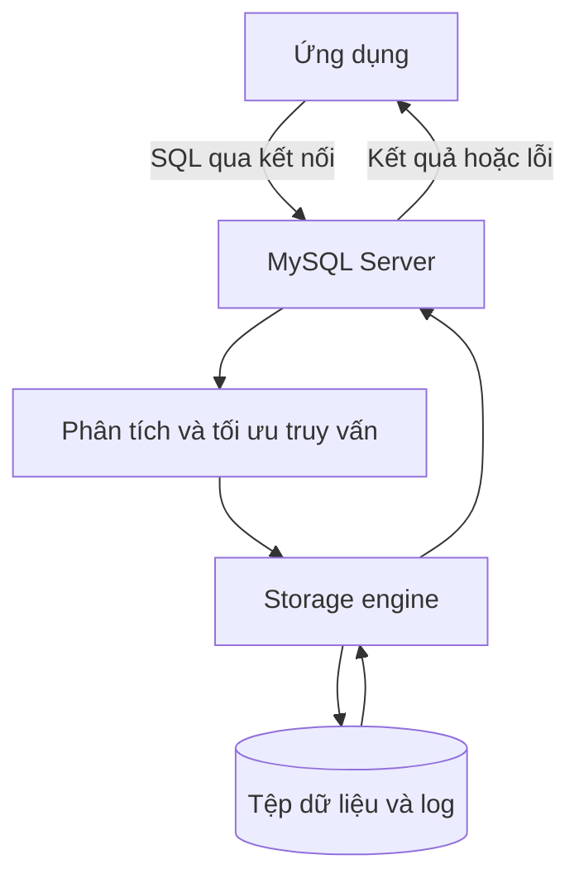
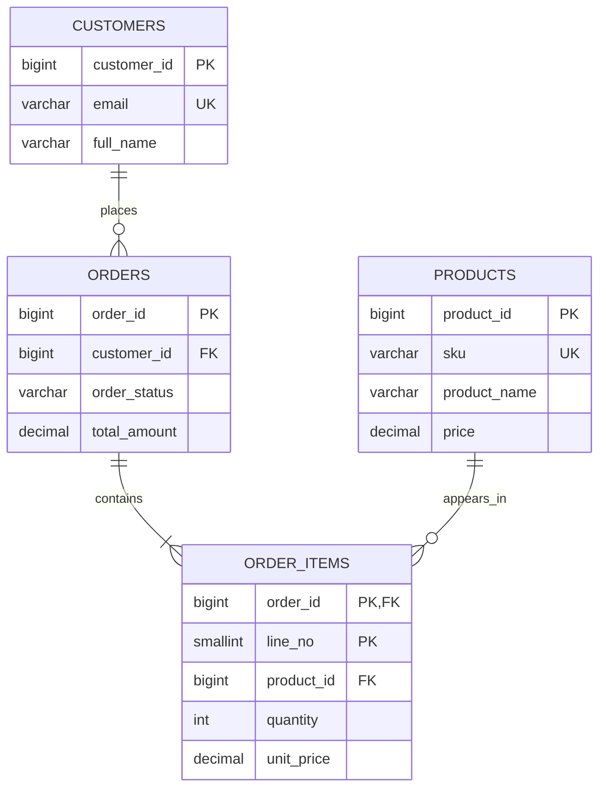
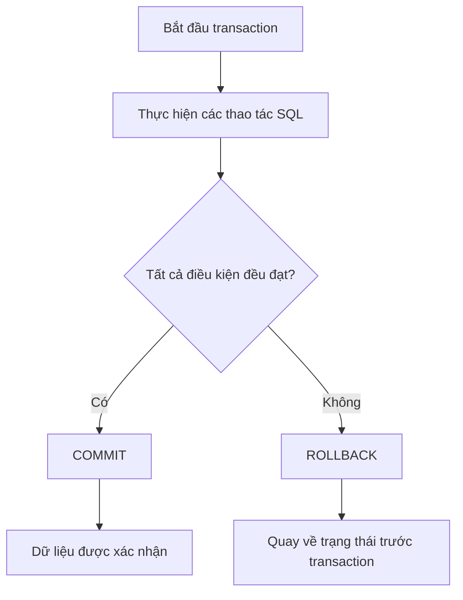
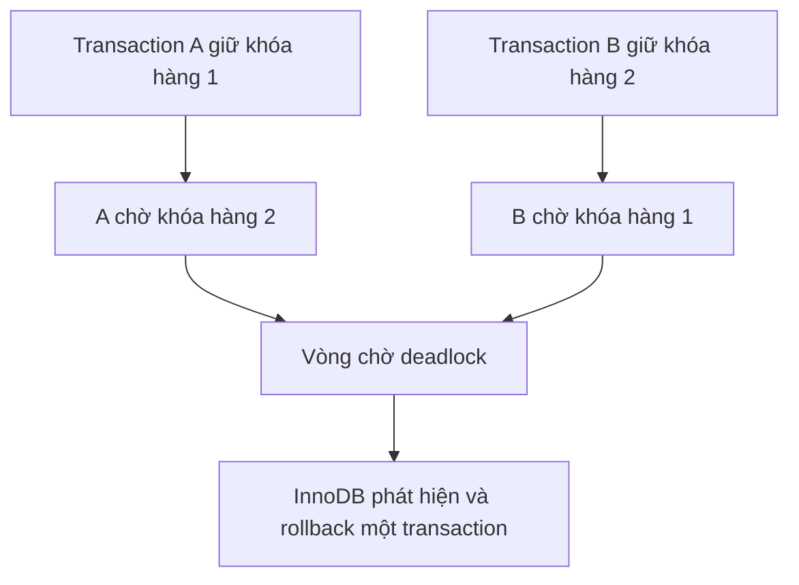

# Bài toán lưu trữ quan hệ, toàn vẹn dữ liệu và xử lý giao dịch

MySQL giải quyết một nhóm vấn đề cốt lõi của ứng dụng: lưu dữ liệu có cấu trúc, biểu diễn mối quan hệ giữa các đối tượng, bảo vệ dữ liệu khỏi những trạng thái không hợp lệ và xử lý nhiều thao tác đồng thời mà vẫn giữ kết quả nhất quán. Hiểu các vấn đề này giúp ta biết vì sao cần thiết kế bảng, khóa và ràng buộc cẩn thận trước khi viết truy vấn SQL.

Bài học thuộc module **DATABASE_MYSQL**. Module hướng tới việc làm chủ MySQL từ thiết kế bảng, kiểu dữ liệu, khóa và truy vấn SQL đến index, transaction và kiểm soát đồng thời; đồng thời thực hành đọc kế hoạch thực thi, tối ưu truy vấn, phân quyền, sao lưu và xử lý vấn đề vận hành cơ sở dữ liệu quan hệ. Trong bài này, trọng tâm là nền tảng của mô hình quan hệ, tính toàn vẹn và giao dịch — những cơ chế mà các kỹ thuật ở các bài tiếp theo dựa vào.

## 1. Vì sao ứng dụng cần một cơ sở dữ liệu quan hệ?

Hãy hình dung một cửa hàng trực tuyến. Ứng dụng cần lưu khách hàng, sản phẩm, đơn hàng và từng dòng sản phẩm trong đơn hàng. Dữ liệu phải tồn tại sau khi ứng dụng khởi động lại, nhiều người có thể đặt hàng cùng lúc, và một đơn hàng không được tham chiếu đến khách hàng không tồn tại.

Nếu chỉ lưu dữ liệu trong biến của chương trình, dữ liệu có thể mất khi tiến trình dừng. Nếu ghi trực tiếp vào các tệp riêng lẻ, ứng dụng phải tự giải quyết việc tìm kiếm, cập nhật đồng thời, khôi phục khi ghi dở và giữ cho các tệp liên quan không mâu thuẫn. Khi số lượng dữ liệu và số luồng truy cập tăng lên, phần mã xử lý lưu trữ sẽ nhanh chóng trở nên phức tạp.

Một hệ quản trị cơ sở dữ liệu (Database Management System — DBMS) nhận trách nhiệm quản lý dữ liệu và cung cấp các cơ chế dùng chung:

- **Lưu trữ bền vững:** dữ liệu được ghi xuống thiết bị lưu trữ và có thể phục hồi sau khi tiến trình hoặc máy chủ gặp sự cố, tùy theo cấu hình và cơ chế lưu trữ.
- **Truy cập có cấu trúc:** ứng dụng dùng SQL để thêm, đọc, sửa và xóa dữ liệu.
- **Biểu diễn quan hệ:** dữ liệu được chia thành các bảng và liên kết bằng khóa.
- **Bảo vệ tính hợp lệ:** ràng buộc dữ liệu được khai báo tại cơ sở dữ liệu để nhiều ứng dụng cùng tuân theo.
- **Điều phối truy cập đồng thời:** nhiều phiên kết nối có thể thao tác cùng lúc mà không tùy tiện ghi đè hoặc đọc trạng thái dở dang của nhau.
- **Giao dịch:** một nhóm thao tác liên quan có thể được xác nhận cùng nhau hoặc hủy cùng nhau.

MySQL là một hệ quản trị cơ sở dữ liệu quan hệ (Relational Database Management System — RDBMS). MySQL Server tiếp nhận câu lệnh SQL, kiểm tra quyền, phân tích và tối ưu truy vấn, sau đó phối hợp với storage engine để đọc hoặc ghi dữ liệu. Với phần lớn ứng dụng giao dịch, InnoDB là storage engine được sử dụng phổ biến và là lựa chọn mặc định trong các phiên bản MySQL hiện đại.



Phân biệt hai khái niệm: **MySQL** là hệ quản trị cơ sở dữ liệu; **InnoDB** là một storage engine bên trong MySQL, chịu trách nhiệm tổ chức lưu trữ và thực thi nhiều cơ chế như khóa, MVCC, transaction và phục hồi sau sự cố. Câu lệnh SQL mô tả ứng dụng muốn làm gì; engine thực hiện thao tác trên dữ liệu theo các quy tắc của nó.

## 2. Mô hình quan hệ tổ chức dữ liệu như thế nào?

Mô hình quan hệ biểu diễn dữ liệu bằng các quan hệ, thường được triển khai thành bảng. Một bảng có tên, các cột và nhiều hàng. Mỗi hàng mô tả một bản ghi; mỗi cột mô tả một thuộc tính với kiểu dữ liệu xác định.

Ví dụ, bảng `customers` có thể lưu thông tin khách hàng:

| customer_id | email | full_name |
|---:|---|---|
| 101 | an@example.com | Nguyễn An |
| 102 | binh@example.com | Trần Bình |

`customer_id` định danh từng khách hàng. `email` và `full_name` là thuộc tính của khách hàng. Một hàng trong bảng không nên đại diện cho nhiều khách hàng, và một cột không nên chứa một danh sách nhiều giá trị không có cấu trúc.

### 2.1. Khóa chính định danh một hàng

Khóa chính (Primary Key — PK) là một cột hoặc tổ hợp cột dùng để xác định duy nhất mỗi hàng trong bảng. Khóa chính phải duy nhất và không được `NULL`.

```sql
CREATE TABLE customers (
    customer_id BIGINT UNSIGNED NOT NULL AUTO_INCREMENT,
    email       VARCHAR(255) NOT NULL,
    full_name   VARCHAR(150) NOT NULL,
    created_at  TIMESTAMP NOT NULL DEFAULT CURRENT_TIMESTAMP,
    PRIMARY KEY (customer_id),
    UNIQUE KEY uk_customers_email (email)
) ENGINE = InnoDB
  DEFAULT CHARACTER SET = utf8mb4;
```

Trong ví dụ này, `customer_id` là khóa chính. `AUTO_INCREMENT` yêu cầu MySQL tự cấp giá trị tăng dần khi chèn hàng mới mà không truyền `customer_id`. Ràng buộc `UNIQUE` bảo đảm hai khách hàng không có cùng email theo quy tắc so sánh và collation của cột.

Khóa chính thường nên ổn định trong suốt vòng đời bản ghi. Nếu một thuộc tính nghiệp vụ có thể thay đổi — chẳng hạn email hoặc mã hiển thị — thì dùng nó làm khóa chính có thể khiến việc cập nhật quan hệ trở nên khó khăn. Một khóa định danh riêng thường giúp các bảng tham chiếu đơn giản hơn.

### 2.2. Khóa ngoại biểu diễn quan hệ

Khóa ngoại (Foreign Key — FK) là một cột hoặc nhóm cột tham chiếu đến khóa chính hoặc một khóa duy nhất ở bảng khác. Khóa ngoại diễn tả rằng giá trị tham chiếu phải tồn tại ở phía được tham chiếu, theo quy tắc của ràng buộc.

Ba kiểu quan hệ phổ biến:

- **Một-một (1:1):** một bản ghi ở bảng A liên kết tối đa với một bản ghi ở bảng B. Ví dụ, một tài khoản có một hồ sơ mở rộng riêng.
- **Một-nhiều (1:N):** một bản ghi ở bảng A có thể liên kết với nhiều bản ghi ở bảng B. Ví dụ, một khách hàng có nhiều đơn hàng.
- **Nhiều-nhiều (N:N):** nhiều bản ghi ở A liên kết với nhiều bản ghi ở B. Ví dụ, một đơn hàng có nhiều sản phẩm và một sản phẩm có thể xuất hiện trong nhiều đơn hàng. Quan hệ này thường được triển khai bằng bảng trung gian.

Với cửa hàng trực tuyến, có thể tổ chức dữ liệu thành bốn bảng:



`orders` lưu thông tin chung của đơn hàng. `order_items` lưu các dòng hàng thuộc đơn. Khóa chính ghép `(order_id, line_no)` giúp xác định từng dòng trong một đơn; `product_id` tham chiếu sản phẩm. Bảng `order_items` chính là bảng trung gian chuyển quan hệ nhiều-nhiều giữa đơn hàng và sản phẩm thành hai quan hệ một-nhiều.

Một thiết kế quan trọng là lưu `unit_price` tại `order_items`. Giá sản phẩm hiện tại có thể thay đổi, nhưng đơn hàng đã đặt cần giữ giá tại thời điểm mua. Vì vậy, `unit_price` là dữ liệu lịch sử của dòng đơn hàng, không đơn thuần là bản sao có thể luôn truy vấn lại từ `products.price`.

### 2.3. Tách dữ liệu để giảm bất thường cập nhật

Nếu lưu tất cả thông tin trong một bảng lớn, thông tin khách hàng có thể bị lặp lại trên mọi dòng đơn hàng. Khi khách hàng đổi email, ứng dụng phải sửa nhiều hàng; bỏ sót một hàng sẽ tạo ra các phiên bản thông tin mâu thuẫn. Xóa dòng cuối cùng của một đơn hàng cũng có thể vô tình làm mất thông tin khách hàng nếu hai loại dữ liệu bị trộn lẫn.

Chuẩn hóa (normalization) là cách tổ chức các bảng và phụ thuộc dữ liệu để hạn chế lặp và tránh những bất thường khi thêm, sửa, xóa. Ở mức thực hành ban đầu:

- Mỗi bảng nên mô tả một loại thực thể hoặc một quan hệ có ý nghĩa rõ ràng.
- Mỗi cột nên chứa một giá trị thuộc một miền dữ liệu xác định, thay vì nhồi nhiều giá trị không thể truy vấn độc lập vào một chuỗi.
- Thuộc tính nên được lưu ở nơi phù hợp với đối tượng mà nó mô tả.
- Quan hệ giữa các bảng nên được biểu diễn bằng khóa, không dựa vào việc ghép chuỗi hoặc vị trí của dữ liệu.

Chuẩn hóa không có nghĩa là tách bảng càng nhiều càng tốt. Thiết kế phải cân bằng tính toàn vẹn, cách truy vấn, chi phí join và yêu cầu nghiệp vụ. Khi cần lưu một giá trị tổng hợp để đọc nhanh, chẳng hạn `orders.total_amount`, hệ thống phải cập nhật giá trị đó trong cùng giao dịch với các dòng đơn hàng và có cách đối soát khi cần.

## 3. Tính toàn vẹn dữ liệu được bảo vệ ra sao?

Tính toàn vẹn dữ liệu (Data Integrity) là yêu cầu dữ liệu luôn tuân theo các quy tắc đã xác định. Một ứng dụng có thể kiểm tra đầu vào trước khi gửi SQL, nhưng kiểm tra ở tầng ứng dụng không đủ để bảo vệ dữ liệu khi có nhiều dịch vụ, tác vụ nền, câu lệnh quản trị hoặc phiên kết nối cùng ghi vào một cơ sở dữ liệu.

Ràng buộc được khai báo trong cơ sở dữ liệu tạo ra một hàng rào dùng chung. MySQL sẽ từ chối thao tác vi phạm ràng buộc được engine hỗ trợ, bất kể câu lệnh đến từ ứng dụng nào.

### 3.1. Các nhóm quy tắc toàn vẹn

| Nhóm quy tắc | Câu hỏi cần trả lời | Cơ chế thường dùng |
|---|---|---|
| Toàn vẹn thực thể | Bản ghi có được định danh duy nhất không? | `PRIMARY KEY`, `UNIQUE`, `NOT NULL` |
| Toàn vẹn tham chiếu | Bản ghi con có tham chiếu đến bản ghi cha tồn tại không? | `FOREIGN KEY` |
| Toàn vẹn miền giá trị | Giá trị có đúng kiểu, bắt buộc và nằm trong miền cho phép không? | Kiểu dữ liệu, `NOT NULL`, `CHECK`, `DEFAULT` |
| Toàn vẹn nghiệp vụ | Dữ liệu có thỏa quy tắc của hoạt động kinh doanh không? | Ràng buộc phù hợp, transaction và logic nghiệp vụ |

Ví dụ: số lượng của một dòng đơn hàng phải lớn hơn 0; giá không âm; email khách hàng không được trùng; một đơn hàng phải thuộc về một khách hàng tồn tại. Một số quy tắc có thể diễn đạt trực tiếp bằng constraint, trong khi quy tắc phụ thuộc nhiều hàng hoặc nhiều bảng thường cần được kiểm tra trong một transaction.

### 3.2. Những constraint thường gặp trong MySQL

- `NOT NULL`: cột bắt buộc phải có giá trị. `NULL` có nghĩa là chưa biết hoặc không có giá trị, không đồng nghĩa với chuỗi rỗng hay số 0.
- `PRIMARY KEY`: định danh duy nhất cho từng hàng; một bảng chỉ có một khai báo khóa chính, nhưng khóa có thể gồm nhiều cột.
- `UNIQUE`: ngăn giá trị khóa bị trùng. Với unique index nhiều cột, tính duy nhất áp dụng cho tổ hợp giá trị. Cần hiểu cách MySQL xử lý `NULL`: unique index có thể chứa nhiều hàng có `NULL` ở cột khóa.
- `FOREIGN KEY`: kiểm tra quan hệ tham chiếu. Với InnoDB, cột được tham chiếu phải có index phù hợp và cột khóa ngoại cũng cần được lập chỉ mục; MySQL có thể tự tạo index cho khóa ngoại nếu chưa có index phù hợp.
- `CHECK`: kiểm tra biểu thức điều kiện của hàng. MySQL thực thi `CHECK` từ phiên bản 8.0.16; nếu phải hỗ trợ phiên bản cũ hơn, cần xác minh hành vi của phiên bản đó thay vì giả định constraint đang được thực thi.
- `DEFAULT`: cung cấp giá trị mặc định khi câu lệnh không chỉ định cột. Giá trị mặc định không thay thế cho việc xác định rõ cột nào bắt buộc.

Ví dụ khai báo sản phẩm và đơn hàng:

```sql
CREATE TABLE products (
    product_id   BIGINT UNSIGNED NOT NULL AUTO_INCREMENT,
    sku          VARCHAR(64) NOT NULL,
    product_name VARCHAR(200) NOT NULL,
    price        DECIMAL(12, 2) NOT NULL,
    is_active    BOOLEAN NOT NULL DEFAULT TRUE,
    PRIMARY KEY (product_id),
    UNIQUE KEY uk_products_sku (sku),
    CONSTRAINT chk_products_price CHECK (price >= 0)
) ENGINE = InnoDB;

CREATE TABLE orders (
    order_id     BIGINT UNSIGNED NOT NULL AUTO_INCREMENT,
    customer_id  BIGINT UNSIGNED NOT NULL,
    order_status VARCHAR(20) NOT NULL DEFAULT 'PENDING',
    total_amount DECIMAL(14, 2) NOT NULL DEFAULT 0,
    created_at   TIMESTAMP NOT NULL DEFAULT CURRENT_TIMESTAMP,
    PRIMARY KEY (order_id),
    KEY idx_orders_customer_created (customer_id, created_at),
    CONSTRAINT fk_orders_customer
        FOREIGN KEY (customer_id)
        REFERENCES customers (customer_id)
        ON UPDATE RESTRICT
        ON DELETE RESTRICT,
    CONSTRAINT chk_orders_total CHECK (total_amount >= 0)
) ENGINE = InnoDB;

CREATE TABLE order_items (
    order_id   BIGINT UNSIGNED NOT NULL,
    line_no    SMALLINT UNSIGNED NOT NULL,
    product_id BIGINT UNSIGNED NOT NULL,
    quantity   INT UNSIGNED NOT NULL,
    unit_price DECIMAL(12, 2) NOT NULL,
    PRIMARY KEY (order_id, line_no),
    KEY idx_order_items_product (product_id),
    CONSTRAINT fk_order_items_order
        FOREIGN KEY (order_id)
        REFERENCES orders (order_id)
        ON DELETE CASCADE,
    CONSTRAINT fk_order_items_product
        FOREIGN KEY (product_id)
        REFERENCES products (product_id)
        ON DELETE RESTRICT,
    CONSTRAINT chk_order_items_quantity CHECK (quantity > 0),
    CONSTRAINT chk_order_items_price CHECK (unit_price >= 0)
) ENGINE = InnoDB;
```

Trong mô hình này, xóa một đơn hàng sẽ xóa các dòng hàng phụ thuộc nhờ `ON DELETE CASCADE`. Sản phẩm đang được tham chiếu bởi dòng đơn hàng không thể bị xóa do `ON DELETE RESTRICT`. Chính sách thực tế còn phụ thuộc yêu cầu lưu lịch sử, kiểm toán và quy trình hủy đơn; nhiều hệ thống chọn đánh dấu sản phẩm ngừng kinh doanh thay vì xóa vật lý.

`CHECK` phù hợp với quy tắc trên từng hàng như `quantity > 0`. Nó không phải công cụ tổng quát để kiểm tra tổng tiền của nhiều dòng, số dư giữa hai tài khoản hoặc trạng thái phức tạp trải qua nhiều bảng. Những quy tắc đó cần được thực hiện bằng transaction và logic nghiệp vụ phù hợp.

### 3.3. Chọn kiểu dữ liệu cũng là bảo vệ tính toàn vẹn

Kiểu dữ liệu giới hạn hình dạng của giá trị và ảnh hưởng đến cách MySQL so sánh, lưu trữ, lập chỉ mục:

- Dùng `INT` hoặc `BIGINT` cho số nguyên; chọn `UNSIGNED` khi miền giá trị không cần số âm và quy ước đó phù hợp với hệ thống.
- Dùng `DECIMAL(p, s)` cho tiền và đại lượng cần độ chính xác thập phân. Tránh dùng `FLOAT` hoặc `DOUBLE` để biểu diễn số tiền cần đối chiếu chính xác vì đây là kiểu dấu phẩy động gần đúng.
- Dùng `VARCHAR(n)` cho chuỗi có độ dài thay đổi và `CHAR(n)` khi dữ liệu có độ dài cố định phù hợp. Chọn charset như `utf8mb4` để hỗ trợ đầy đủ Unicode.
- Chọn `DATE`, `DATETIME` hoặc `TIMESTAMP` theo ý nghĩa thời gian và quy ước múi giờ của ứng dụng. Hệ thống nên thống nhất cách lưu và hiển thị thời gian, thường lưu thời điểm theo UTC ở tầng ứng dụng hoặc theo quy ước đã tài liệu hóa.
- Chỉ cho phép `NULL` khi trạng thái “không có/chưa biết” thực sự có ý nghĩa. Không dùng `NULL` thay cho giá trị mặc định mà nghiệp vụ đã xác định.

Ví dụ, `price DECIMAL(12, 2) NOT NULL` diễn đạt rõ hơn việc lưu giá bằng chuỗi hoặc kiểu số thực nhị phân. Kiểu dữ liệu tốt giúp giảm dữ liệu sai ngay tại biên lưu trữ.

## 4. Giao dịch bảo vệ một nghiệp vụ gồm nhiều thao tác

Một nghiệp vụ thường gồm nhiều câu SQL nhưng cần được xem như một đơn vị. Khi khách hàng đặt hàng, hệ thống có thể phải tạo đơn, thêm các dòng hàng, trừ tồn kho và ghi nhận thanh toán. Nếu tạo đơn thành công nhưng trừ tồn kho thất bại, dữ liệu sẽ phản ánh một đơn hàng không thể thực hiện.

Transaction (giao dịch) gom các thao tác liên quan thành một đơn vị xử lý. Ứng dụng bắt đầu transaction, thực hiện các câu lệnh, rồi xác nhận bằng `COMMIT` hoặc hủy bằng `ROLLBACK`.



### 4.1. Bốn thuộc tính ACID

ACID mô tả các thuộc tính quan trọng của transaction:

| Thuộc tính | Ý nghĩa | Ví dụ trong nghiệp vụ chuyển tiền |
|---|---|---|
| Atomicity — Tính nguyên tử | Các thay đổi trong transaction được áp dụng như một đơn vị hoặc bị hủy như một đơn vị. | Trừ tiền tài khoản A và cộng tiền tài khoản B phải cùng thành công. |
| Consistency — Tính nhất quán | Transaction đưa cơ sở dữ liệu từ một trạng thái hợp lệ sang trạng thái hợp lệ khác, theo các constraint và quy tắc nghiệp vụ. | Số dư không được âm nếu nghiệp vụ cấm số dư âm. |
| Isolation — Tính cô lập | Các transaction đồng thời không được quan sát hoặc làm hỏng trạng thái trung gian của nhau theo mức cô lập đang dùng. | Hai yêu cầu rút tiền đồng thời không được cùng tiêu một khoản tiền duy nhất. |
| Durability — Tính bền vững | Sau khi commit thành công, thay đổi được bảo toàn theo cam kết phục hồi của hệ thống. | Sau khi chuyển tiền được xác nhận, việc MySQL khởi động lại không được làm giao dịch biến mất trong cấu hình bền vững phù hợp. |

ACID không có nghĩa mọi lỗi đều tự được giải quyết. Ứng dụng vẫn phải kiểm tra kết quả câu lệnh, xử lý lỗi kết nối, quyết định retry khi phù hợp và cấu hình MySQL để đạt mức bền vững mong muốn. Consistency cũng phụ thuộc vào việc thiết kế đúng constraint và logic nghiệp vụ.

### 4.2. Ví dụ chuyển tiền bằng transaction

Giả sử bảng `accounts` có `account_id` là khóa chính và `balance DECIMAL(14, 2)` là số dư. Chuyển 500.000 đồng từ tài khoản 101 sang tài khoản 202 cần thỏa mãn: cả hai tài khoản tồn tại, tài khoản nguồn đủ tiền và hai thay đổi được xác nhận cùng nhau.

```sql
START TRANSACTION;

-- Khóa hai bản ghi theo cùng một thứ tự ở mọi luồng xử lý.
SELECT account_id, balance
FROM accounts
WHERE account_id = 101
FOR UPDATE;

SELECT account_id, balance
FROM accounts
WHERE account_id = 202
FOR UPDATE;

-- Ứng dụng kiểm tra cả hai tài khoản tồn tại và tài khoản nguồn đủ tiền.
-- Nếu không đạt, ứng dụng thực hiện ROLLBACK.

UPDATE accounts
SET balance = balance - 500000
WHERE account_id = 101
  AND balance >= 500000;

-- Ứng dụng phải kiểm tra câu UPDATE trên tác động đúng một hàng.
-- Nếu không đúng, thực hiện ROLLBACK.

UPDATE accounts
SET balance = balance + 500000
WHERE account_id = 202;

-- Chỉ COMMIT khi câu cập nhật thứ hai cũng thành công đúng một hàng.
COMMIT;
```

Đây là khung minh họa; phần kiểm tra số hàng bị tác động và nhánh `ROLLBACK` phải được triển khai trong mã ứng dụng hoặc stored program. Không được luôn chạy `COMMIT` bất kể câu lệnh trước đó thành công hay thất bại. Trong hệ thống thật, cần xác định rõ cách xử lý tài khoản không tồn tại, giới hạn số tiền, phí giao dịch, ghi sổ kế toán và mã giao dịch chống xử lý lặp.

`SELECT ... FOR UPDATE` là locking read: nó yêu cầu khóa các hàng được đọc để transaction khác không thể đồng thời sửa chúng theo cách xung đột trước khi transaction hiện tại kết thúc. Các khóa được giữ đến `COMMIT` hoặc `ROLLBACK`. Mọi luồng chuyển tiền nên khóa tài khoản theo một thứ tự nhất quán để giảm nguy cơ deadlock.

### 4.3. Transaction phải có ranh giới rõ ràng

Một transaction nên chứa đúng các thay đổi cần thành công hoặc thất bại cùng nhau. Ví dụ, tạo đơn hàng và trừ tồn kho thường cần nằm trong cùng transaction nếu hai thay đổi thuộc cùng một cơ sở dữ liệu và nghiệp vụ yêu cầu tính nguyên tử.

Không nên giữ transaction mở trong lúc chờ người dùng xác nhận, gọi dịch vụ mạng chậm hoặc thực hiện công việc không liên quan. Transaction dài giữ khóa lâu hơn, làm tăng khả năng chờ khóa, deadlock và giảm khả năng phục vụ các yêu cầu khác.

Với ứng dụng dùng connection pool, cần bảo đảm transaction được kết thúc trước khi trả kết nối về pool. Nếu một nhánh xử lý quên `COMMIT` hoặc `ROLLBACK`, kết nối có thể giữ transaction và khóa lâu hơn dự kiến.

## 5. Nhiều transaction đồng thời được điều phối thế nào?

Trong môi trường thực tế, nhiều phiên kết nối có thể cùng đọc hoặc sửa một hàng. Chỉ dùng transaction là chưa đủ; hệ thống cần quy tắc cô lập và cơ chế khóa để quyết định transaction nào được nhìn thấy dữ liệu nào.

### 5.1. Các vấn đề đọc và ghi đồng thời

Một số hiện tượng thường được dùng để mô tả lỗi do truy cập đồng thời:

- **Dirty read:** transaction đọc một thay đổi chưa được transaction khác commit. Nếu transaction ghi sau đó rollback, dữ liệu đã đọc chưa từng trở thành dữ liệu được xác nhận.
- **Non-repeatable read:** cùng một truy vấn đọc một hàng hai lần trong một transaction nhưng nhận giá trị khác nhau vì transaction khác đã commit cập nhật ở giữa.
- **Phantom read:** chạy lại một truy vấn theo điều kiện phạm vi nhưng tập hàng thỏa điều kiện thay đổi do transaction khác chèn hoặc xóa hàng phù hợp.
- **Lost update:** hai transaction cùng đọc một giá trị cũ, tính giá trị mới ở ứng dụng rồi ghi đè; cập nhật của transaction trước có thể bị mất nếu không có khóa hoặc câu lệnh cập nhật nguyên tử phù hợp.

Ví dụ lost update: số lượng tồn kho là 10. Hai yêu cầu cùng đọc 10, mỗi yêu cầu bán 1 sản phẩm và đều ghi lại 9. Kết quả cuối cùng là 9 dù đã bán 2 sản phẩm. Có thể tránh kiểu cập nhật này bằng câu lệnh nguyên tử như `UPDATE inventory SET quantity = quantity - 1 WHERE product_id = ? AND quantity >= 1` rồi kiểm tra số hàng bị tác động, hoặc bằng locking read trong transaction khi nghiệp vụ cần nhiều bước kiểm tra.

### 5.2. MVCC và khóa trong InnoDB

InnoDB kết hợp khóa (locking) và Multi-Version Concurrency Control (MVCC). MVCC duy trì các phiên bản dữ liệu cần thiết để một số truy vấn đọc có thể nhìn thấy snapshot nhất quán mà không phải chặn mọi thao tác ghi. Thông tin undo hỗ trợ tạo ra phiên bản cũ phục vụ các consistent read và rollback.

Có thể phân biệt hai kiểu đọc quan trọng:

- **Consistent nonlocking read:** truy vấn `SELECT` thông thường đọc dữ liệu theo snapshot mà transaction được phép nhìn thấy ở mức cô lập hiện tại. Nó thường không đặt khóa độc quyền lên hàng được đọc.
- **Locking read:** `SELECT ... FOR UPDATE` hoặc `SELECT ... FOR SHARE` yêu cầu khóa để bảo vệ dữ liệu trong một thao tác cần phối hợp với lần ghi tiếp theo. Khả năng dùng cú pháp và chi tiết khóa phụ thuộc phiên bản MySQL.

Khóa ghi giúp ngăn các thay đổi xung đột. InnoDB thường khóa ở mức hàng, nhưng truy vấn phạm vi và chỉ mục có thể khiến engine đặt thêm gap lock hoặc next-key lock tùy mức cô lập và loại truy vấn. Vì vậy, điều kiện `WHERE` và index có ảnh hưởng trực tiếp đến phạm vi khóa, không chỉ ảnh hưởng tốc độ truy vấn.

### 5.3. Các mức cô lập transaction

MySQL/InnoDB hỗ trợ bốn mức cô lập tiêu chuẩn:

| Isolation level | Dirty read | Non-repeatable read | Phantom read | Đặc điểm khái quát |
|---|---|---|---|---|
| `READ UNCOMMITTED` | Có thể | Có thể | Có thể | Mức yếu nhất; truy vấn có thể thấy thay đổi chưa commit. |
| `READ COMMITTED` | Không | Có thể | Có thể | Mỗi consistent read lấy snapshot mới tại thời điểm bắt đầu câu lệnh. |
| `REPEATABLE READ` | Không | Không đối với consistent read trong cùng transaction | Được InnoDB xử lý bằng snapshot và cơ chế khóa phù hợp; locking/range read có thể dùng next-key lock | Mức mặc định của InnoDB trong MySQL. |
| `SERIALIZABLE` | Không | Không | Không theo mô hình cô lập tuần tự | Mức nghiêm ngặt hơn, có thể làm tăng chờ khóa và giảm mức đồng thời. |

Không nên chỉ nhìn tên isolation level rồi suy ra mọi truy vấn đều có cùng hành vi. Ở `REPEATABLE READ`, consistent read thông thường dùng cùng snapshot trong transaction; locking read có quy tắc khóa riêng để bảo vệ phạm vi. Khi cần dự đoán chính xác, phải xét loại truy vấn, index, phiên bản MySQL và cách transaction được thực thi.

Có thể kiểm tra và thay đổi mức cô lập trong phiên:

```sql
SELECT @@transaction_isolation;

SET SESSION TRANSACTION ISOLATION LEVEL READ COMMITTED;
```

Lệnh `SET SESSION` chỉ thay đổi cho kết nối hiện tại. Thay đổi ở cấp hệ thống ảnh hưởng phạm vi rộng hơn và cần được cân nhắc khi vận hành. Không nên đổi isolation level chỉ để xử lý một lỗi chưa được tái hiện và hiểu rõ.

### 5.4. Deadlock là một tình huống cần xử lý

Deadlock xảy ra khi các transaction giữ những khóa mà transaction còn lại đang chờ, tạo thành một vòng chờ không thể tự tiến triển.



InnoDB phát hiện deadlock và chọn một transaction làm nạn nhân để rollback, nhờ đó transaction còn lại có thể tiếp tục. Ứng dụng phải coi lỗi deadlock là tình huống có thể xảy ra trong hệ thống đồng thời: bắt lỗi, rollback nếu cần theo trạng thái kết nối, rồi retry toàn bộ transaction với giới hạn và khoảng chờ phù hợp. Chỉ retry câu SQL cuối cùng thường không đúng vì các bước trước đó của transaction đã bị rollback.

Một số cách giảm deadlock:

1. Truy cập các hàng theo cùng một thứ tự giữa các luồng nghiệp vụ.
2. Giữ transaction ngắn và chỉ khóa dữ liệu cần thiết.
3. Tạo index phù hợp cho điều kiện tìm kiếm và cập nhật để tránh quét, khóa một phạm vi lớn không cần thiết.
4. Không chờ thao tác từ người dùng hoặc dịch vụ bên ngoài trong lúc đang giữ khóa.
5. Thiết kế retry có giới hạn, có log và có tính idempotent phù hợp với nghiệp vụ.

Deadlock không nhất thiết chứng minh schema sai. Nó là hệ quả có thể xuất hiện khi các transaction hợp lệ cạnh tranh tài nguyên; mục tiêu là giảm tần suất và xử lý an toàn khi xảy ra.

## 6. Vì sao InnoDB phù hợp với ứng dụng giao dịch?

Storage engine quyết định cách bảng được lưu trữ và nhiều hành vi khi đọc, ghi. MySQL có thể hỗ trợ nhiều engine; mỗi engine có đặc tính và giới hạn khác nhau. Với ứng dụng cần transaction, khóa ngoại và xử lý đồng thời, InnoDB thường là lựa chọn phù hợp.

Các đặc điểm quan trọng của InnoDB:

- Hỗ trợ transaction với `COMMIT` và `ROLLBACK`.
- Hỗ trợ khóa ở mức hàng và MVCC để điều phối truy cập đồng thời.
- Hỗ trợ khóa ngoại để thực thi toàn vẹn tham chiếu.
- Có cơ chế log và phục hồi sau sự cố; redo log hỗ trợ khôi phục thay đổi đã ghi nhận theo cấu hình bền vững.
- Tổ chức dữ liệu theo clustered index; với InnoDB, các hàng của bảng được tổ chức theo khóa chính. Nếu bảng không khai báo khóa chính, InnoDB chọn một unique index phù hợp hoặc tạo định danh nội bộ.

Khóa chính vì vậy không chỉ là quy tắc logic. Nó còn ảnh hưởng đến cách InnoDB tổ chức dữ liệu và cách các secondary index tham chiếu đến hàng. Chọn khóa chính nhỏ, ổn định và phù hợp thường giúp cấu trúc index gọn hơn.

Index cũng liên quan đến toàn vẹn và đồng thời. Unique index hỗ trợ kiểm tra tính duy nhất; index trên khóa ngoại hỗ trợ tìm bản ghi liên quan; index phù hợp giúp truy vấn cập nhật tìm đúng hàng nhanh hơn và giảm phạm vi khóa. Tuy nhiên, mỗi index làm tăng dung lượng lưu trữ và chi phí khi `INSERT`, `UPDATE`, `DELETE`. Cần tạo index dựa trên truy vấn và ràng buộc thực tế.

## 7. Những quyết định thiết kế gắn với nhau

Thiết kế quan hệ, constraint, transaction và index không phải các bước độc lập. Một quyết định ở phần này có thể ảnh hưởng đến phần khác.

| Quyết định | Lợi ích | Điều cần cân nhắc |
|---|---|---|
| Chọn khóa chính ổn định | Định danh bản ghi và hỗ trợ tổ chức dữ liệu trong InnoDB | Kích thước khóa ảnh hưởng các secondary index; tránh khóa có thể thay đổi thường xuyên. |
| Khai báo khóa ngoại | Bảo vệ toàn vẹn tham chiếu giữa các bảng | Cần xác định chính sách xóa/cập nhật và index phù hợp. |
| Dùng `DECIMAL` cho tiền | Tránh sai số dấu phẩy động trong phép tính tiền | Chọn precision và scale đủ cho nghiệp vụ; quy định cách làm tròn. |
| Gom nhiều thay đổi vào transaction | Giữ tính nguyên tử cho một nghiệp vụ | Transaction dài làm tăng thời gian giữ khóa và nguy cơ deadlock. |
| Chọn isolation level | Điều chỉnh cách transaction quan sát dữ liệu đồng thời | Mức cô lập cao hơn có thể làm tăng cạnh tranh và thời gian chờ. |
| Tạo index theo điều kiện truy vấn | Giảm chi phí tìm hàng và phạm vi khóa | Index tăng chi phí ghi và dung lượng; cần kiểm chứng bằng kế hoạch thực thi. |

Ví dụ, một câu lệnh cập nhật tồn kho có điều kiện:

```sql
UPDATE inventory
SET quantity = quantity - 1
WHERE product_id = 501
  AND quantity >= 1;
```

Nếu `product_id` là khóa chính, MySQL có thể tìm đúng hàng qua index và thực hiện kiểm tra `quantity >= 1` ngay trong thao tác cập nhật. Ứng dụng kiểm tra số hàng bị tác động: một hàng nghĩa là đã giữ được một sản phẩm; không có hàng nghĩa là sản phẩm không tồn tại hoặc không đủ tồn kho. Khi nghiệp vụ cần đồng thời tạo đơn và trừ tồn kho, câu lệnh này phải nằm trong cùng transaction với các thao tác tạo đơn tương ứng.

## 8. Khi nào nên chọn cơ sở dữ liệu quan hệ?

MySQL phù hợp khi dữ liệu có cấu trúc tương đối rõ, các thực thể liên kết với nhau, ứng dụng cần truy vấn kết hợp và cần các thay đổi nguyên tử. Các ví dụ thường gặp gồm hệ thống bán hàng, quản lý khách hàng, kế toán, quản lý kho, đặt chỗ và nghiệp vụ nội bộ.

Khi đánh giá, hãy đặt các câu hỏi:

- Dữ liệu có các thực thể và quan hệ rõ ràng không?
- Có cần bảo đảm khóa chính, khóa ngoại, tính duy nhất hoặc miền giá trị ở tầng lưu trữ không?
- Một nghiệp vụ có cần cập nhật nhiều bản ghi cùng lúc không?
- Nhiều người dùng có thể cùng sửa một tài nguyên không?
- Ứng dụng có cần join, lọc, sắp xếp và tổng hợp trên dữ liệu liên quan không?
- Yêu cầu về độ bền vững, phục hồi và vận hành có phù hợp với MySQL không?

Không phải mọi dữ liệu đều cần mô hình quan hệ. Dữ liệu tài liệu linh hoạt, dữ liệu chuỗi thời gian hoặc hệ thống phân tích quy mô lớn có thể cần công nghệ bổ sung hay một hệ quản trị khác. Việc chọn công nghệ nên xuất phát từ truy vấn, tính nhất quán, tải đọc/ghi, khả năng mở rộng và yêu cầu vận hành cụ thể.

## 9. Quy trình suy nghĩ khi thiết kế một nghiệp vụ

Khi nhận một yêu cầu như “khách hàng đặt một đơn gồm nhiều sản phẩm”, có thể triển khai theo trình tự:

1. **Xác định thực thể:** khách hàng, sản phẩm, đơn hàng và dòng đơn hàng.
2. **Xác định quan hệ:** khách hàng có nhiều đơn; đơn có nhiều dòng; mỗi dòng tham chiếu một sản phẩm.
3. **Chọn khóa:** định danh ổn định cho từng thực thể; khóa ghép phù hợp cho dòng đơn.
4. **Xác định quy tắc hợp lệ:** email duy nhất, giá không âm, số lượng dương, đơn hàng phải có khách hàng.
5. **Chọn kiểu dữ liệu:** số nguyên cho định danh và số lượng, `DECIMAL` cho tiền, kiểu thời gian phù hợp cho thời điểm tạo đơn.
6. **Xác định ranh giới transaction:** tạo đơn, tạo các dòng và trừ tồn kho cần thành công hoặc thất bại cùng nhau theo quy tắc nghiệp vụ.
7. **Xem xét đồng thời:** hai yêu cầu mua sản phẩm cuối cùng phải được điều phối để không bán vượt tồn kho.
8. **Xác định index:** khóa chính, unique key và index phục vụ khóa ngoại, truy vấn đơn hàng theo khách hàng hoặc cập nhật tồn kho.
9. **Kiểm thử tình huống lỗi:** dữ liệu không hợp lệ, bản ghi tham chiếu không tồn tại, thiếu tồn kho, lỗi giữa transaction, deadlock và retry.

Quy trình này giúp biến một yêu cầu nghiệp vụ thành mô hình dữ liệu và hành vi SQL có thể kiểm chứng. Câu hỏi quan trọng không chỉ là “cần tạo những bảng nào?” mà còn là “trạng thái nào được phép tồn tại, và điều gì xảy ra khi nhiều thao tác diễn ra cùng lúc?”.

## 10. Thực hành và tự kiểm tra

### Bài tập 1: Nhận diện quan hệ

Một trường học quản lý học viên, khóa học và lần đăng ký học. Một học viên có thể đăng ký nhiều khóa học; mỗi khóa học có nhiều học viên. Hãy xác định các bảng cần có, khóa chính, khóa ngoại và bảng trung gian. Nếu một học viên chỉ được đăng ký một khóa học một lần, hãy xác định constraint có thể bảo vệ quy tắc đó.

**Gợi ý:** dùng `students`, `courses` và `enrollments`; đặt unique key trên cặp `(student_id, course_id)` ở bảng trung gian.

### Bài tập 2: Chọn kiểu dữ liệu và constraint

Một bảng sản phẩm có mã SKU, tên, giá và trạng thái kinh doanh. Hãy chọn kiểu dữ liệu, xác định cột bắt buộc, khóa chính, unique key và điều kiện giá hợp lệ.

**Gợi ý:** dùng `DECIMAL` cho giá, `NOT NULL` cho các thuộc tính bắt buộc, `UNIQUE` cho SKU và `CHECK (price >= 0)` trên phiên bản MySQL có thực thi CHECK.

### Bài tập 3: Xác định ranh giới transaction

Một thao tác đặt vé cần tạo đơn đặt chỗ và giảm số ghế còn trống. Nếu giảm ghế thất bại vì đã hết chỗ, đơn đặt chỗ không được tồn tại ở trạng thái đã xác nhận. Hãy chỉ ra các câu lệnh cần nằm trong cùng transaction và cách kiểm tra số hàng bị cập nhật.

**Gợi ý:** cập nhật có điều kiện `available_seats > 0`, kiểm tra số hàng bị tác động, sau đó mới tạo hoặc xác nhận đơn; rollback khi không giữ được ghế. Nếu cần chống gửi yêu cầu lặp, thiết kế thêm mã yêu cầu duy nhất.

### Bài tập 4: Phân tích truy cập đồng thời

Hai transaction cùng đọc số lượng tồn kho là 1. Mỗi transaction muốn bán một sản phẩm. Hãy giải thích vì sao mô hình “đọc số lượng ở ứng dụng rồi ghi số lượng mới” có thể gây lost update và đề xuất một câu lệnh cập nhật nguyên tử.

**Gợi ý:** dùng `UPDATE ... SET quantity = quantity - 1 WHERE product_id = ? AND quantity >= 1`, rồi kiểm tra affected rows.

### Câu hỏi tự kiểm tra

1. Vì sao một bảng đơn hàng cần khóa ngoại tham chiếu khách hàng?
2. Khóa chính và unique key khác nhau ở mục đích sử dụng nào?
3. Vì sao không nên lưu tiền bằng `FLOAT` hoặc `DOUBLE`?
4. Khi nào cần `COMMIT`, và khi nào cần `ROLLBACK`?
5. Bốn thuộc tính ACID giải quyết những nhóm vấn đề nào?
6. Dirty read khác non-repeatable read như thế nào?
7. MVCC hỗ trợ consistent read ra sao?
8. Vì sao index có thể ảnh hưởng đến phạm vi khóa của một câu lệnh cập nhật?
9. Deadlock là gì, và vì sao ứng dụng cần có chiến lược retry transaction?
10. Vì sao giá bán tại thời điểm đặt hàng có thể cần được lưu trong `order_items` thay vì luôn đọc từ bảng `products`?

## 11. Ghi nhớ

MySQL cung cấp nền tảng để ứng dụng lưu dữ liệu quan hệ và chia sẻ dữ liệu giữa nhiều phiên truy cập. Bảng và khóa mô tả cấu trúc cùng quan hệ; kiểu dữ liệu và constraint bảo vệ những trạng thái hợp lệ; transaction gom các thay đổi cần nguyên tử; còn MVCC, khóa và isolation level điều phối các thao tác đồng thời. InnoDB kết hợp những cơ chế này để hỗ trợ ứng dụng giao dịch.

Khi thiết kế, hãy bắt đầu từ quy tắc nghiệp vụ và trạng thái dữ liệu được phép tồn tại. Từ đó chọn mô hình bảng, khóa, constraint, ranh giới transaction và index phù hợp. Cách tiếp cận này tạo nền tảng vững chắc cho việc viết SQL, đọc kế hoạch thực thi, tối ưu truy vấn và vận hành MySQL an toàn.
