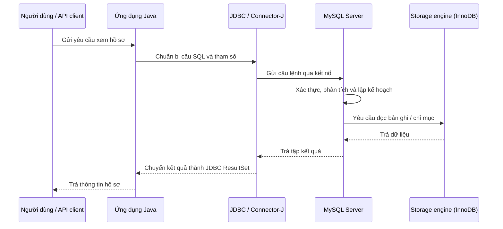

# Phân biệt MySQL Server, SQL, storage engine và ứng dụng Java

Khi một ứng dụng Java lưu hoặc đọc dữ liệu từ MySQL, nhiều thành phần cùng tham gia vào một yêu cầu. MySQL Server tiếp nhận kết nối và điều phối câu lệnh; SQL mô tả thao tác với dữ liệu; storage engine quản lý cách dữ liệu được lưu trữ và truy cập; còn ứng dụng Java thực hiện nghiệp vụ và gửi yêu cầu đến cơ sở dữ liệu. Hiểu đúng vai trò của từng thành phần giúp ta thiết kế hệ thống, xử lý lỗi và tối ưu truy vấn đúng chỗ.

Trong phạm vi **DATABASE_MYSQL**, bài học này đặt MySQL vào kiến trúc của một ứng dụng Java: từ lúc ứng dụng gửi câu lệnh đến lúc máy chủ đọc hoặc ghi dữ liệu và trả kết quả.

## 1. Bốn thành phần, bốn vai trò

| Thành phần | Bản chất | Vai trò chính |
|---|---|---|
| **MySQL Server** | Phần mềm máy chủ quản trị cơ sở dữ liệu; tiến trình máy chủ thường được gọi là `mysqld` | Nhận kết nối, xác thực tài khoản, tiếp nhận và xử lý SQL, lập kế hoạch thực thi, phối hợp với storage engine và trả kết quả |
| **SQL** | Ngôn ngữ dùng để định nghĩa, truy vấn và thay đổi dữ liệu | Mô tả *muốn* đọc hoặc thay đổi dữ liệu nào; không phải một máy chủ hay một chương trình cơ sở dữ liệu |
| **Storage engine** | Thành phần của MySQL quản lý việc lưu trữ và truy cập dữ liệu cho bảng | Tổ chức bản ghi và chỉ mục, đọc/ghi dữ liệu, đồng thời cung cấp các cơ chế như giao dịch và khóa tùy engine |
| **Ứng dụng Java** | Chương trình phía ứng dụng sử dụng cơ sở dữ liệu | Xử lý nghiệp vụ, nhận dữ liệu từ người dùng hoặc API, gửi SQL qua JDBC, đọc kết quả và quyết định bước nghiệp vụ tiếp theo |

### MySQL Server: nơi tiếp nhận và điều phối yêu cầu

MySQL Server là hệ quản trị cơ sở dữ liệu đang chạy và phục vụ các kết nối từ ứng dụng hoặc công cụ quản trị. Khi một client kết nối, máy chủ kiểm tra thông tin xác thực và quyền truy cập. Sau đó, máy chủ tiếp nhận câu lệnh SQL, phân tích cú pháp, kiểm tra ngữ nghĩa, chọn kế hoạch thực thi và phối hợp với storage engine để truy cập dữ liệu.

Máy chủ còn quản lý các chức năng ở tầng server như kết nối, phiên làm việc, metadata, quyền truy cập và một phần xử lý truy vấn. Vì vậy, MySQL Server không chỉ là nơi chứa các tệp dữ liệu trên đĩa. Nó là thành phần điều phối toàn bộ phiên làm việc với cơ sở dữ liệu.

Một máy chủ có thể quản lý nhiều database (schema), và mỗi database có nhiều bảng. Một ứng dụng Java thường kết nối đến một địa chỉ máy chủ, một cổng, một database cùng một tài khoản có quyền phù hợp.

### SQL: ngôn ngữ mô tả thao tác dữ liệu

SQL (Structured Query Language) là ngôn ngữ để làm việc với cơ sở dữ liệu quan hệ. MySQL hỗ trợ SQL cùng các phần mở rộng và khác biệt cú pháp riêng. SQL không tự lưu dữ liệu và cũng không phải tiến trình chạy trên máy chủ.

Các nhóm câu lệnh thường gặp gồm:

| Nhóm | Mục đích | Ví dụ |
|---|---|---|
| DDL | Định nghĩa cấu trúc database và bảng | `CREATE TABLE`, `ALTER TABLE`, `DROP TABLE` |
| DML | Thêm, sửa hoặc xóa bản ghi | `INSERT`, `UPDATE`, `DELETE` |
| Truy vấn dữ liệu | Đọc và kết hợp dữ liệu | `SELECT`, `JOIN`, `GROUP BY` |
| DCL | Quản lý quyền truy cập | `GRANT`, `REVOKE` |
| TCL | Điều khiển giao dịch | `START TRANSACTION`, `COMMIT`, `ROLLBACK` |

Ví dụ, câu lệnh sau yêu cầu máy chủ tìm khách hàng theo email:

```sql
SELECT id, full_name
FROM customers
WHERE email = 'an@example.com';
```

Câu SQL cho biết kết quả mong muốn. MySQL Server quyết định cách thực hiện câu lệnh đó, còn storage engine tham gia đọc các bản ghi và chỉ mục cần thiết.

### Storage engine: cách một bảng được lưu và truy cập

Storage engine là thành phần bên dưới tầng xử lý SQL, chịu trách nhiệm quản lý dữ liệu của bảng. MySQL hỗ trợ kiến trúc nhiều storage engine; engine được chọn cho từng bảng. Các engine có thể khác nhau về giao dịch, khóa, khóa ngoại, khả năng phục hồi và cách tổ chức dữ liệu.

Hai engine thường được nhắc đến là:

- **InnoDB**: engine mặc định trong các phiên bản MySQL hiện đại. InnoDB hỗ trợ giao dịch theo mô hình ACID, khóa ở mức bản ghi, khóa ngoại, MVCC và cơ chế phục hồi sau sự cố. Đây thường là lựa chọn phù hợp cho ứng dụng nghiệp vụ cần cập nhật dữ liệu an toàn và có quan hệ giữa các bảng.
- **MyISAM**: engine cũ, không hỗ trợ giao dịch và khóa ngoại như InnoDB; cơ chế khóa chủ yếu ở mức bảng. Có thể gặp trong hệ thống cũ, vì vậy cần hiểu đặc tính của nó khi bảo trì hoặc di chuyển dữ liệu.

Storage engine không thay thế MySQL Server. Server tiếp nhận và xử lý câu SQL ở tầng chung, sau đó gọi các thao tác phù hợp qua giao diện engine. Engine thực hiện phần việc gắn với lưu trữ và truy cập dữ liệu. Do mỗi engine có khả năng khác nhau, lựa chọn engine ảnh hưởng trực tiếp đến tính nhất quán, khóa và hiệu năng của bảng.

Có thể kiểm tra engine đang dùng bằng SQL:

```sql
-- Xem các storage engine mà máy chủ hỗ trợ
SHOW ENGINES;

-- Xem định nghĩa bảng, bao gồm storage engine
SHOW CREATE TABLE customers;
```

Trong kết quả `SHOW CREATE TABLE`, hãy chú ý phần `ENGINE=...`, chẳng hạn `ENGINE=InnoDB`.

### Ứng dụng Java: nơi thực hiện nghiệp vụ

Ứng dụng Java thường chạy ở một tiến trình riêng với MySQL Server. Ứng dụng có thể cung cấp REST API, giao diện web hoặc xử lý tác vụ nền. Nó chịu trách nhiệm cho các quy tắc nghiệp vụ như kiểm tra yêu cầu, xác định người dùng được phép thực hiện hành động nào và phối hợp nhiều thao tác để hoàn thành một chức năng.

Để làm việc với MySQL, Java thường sử dụng **JDBC** (Java Database Connectivity), một API chuẩn của Java. Với MySQL, ứng dụng dùng driver **MySQL Connector/J** để triển khai việc giao tiếp JDBC với máy chủ. JDBC là API; Connector/J là driver cụ thể; cả hai đều không phải storage engine.

Ứng dụng Java không kết nối trực tiếp vào InnoDB để đọc tệp dữ liệu. Nó mở kết nối đến MySQL Server qua driver, gửi câu lệnh và nhận kết quả theo giao thức của MySQL.

## 2. Một truy vấn đi qua hệ thống như thế nào?

Giả sử người dùng mở trang hồ sơ khách hàng. Ứng dụng Java cần đọc tên khách hàng từ bảng `customers`. Luồng xử lý khái quát như sau:



Các bước có thể hiểu cụ thể như sau:

1. Người dùng gửi yêu cầu đến API hoặc giao diện do ứng dụng Java cung cấp.
2. Java kiểm tra đầu vào và chuẩn bị câu SQL. Driver JDBC quản lý việc gửi câu lệnh qua kết nối đến MySQL Server.
3. MySQL Server xác thực phiên kết nối, kiểm tra quyền và xử lý câu lệnh. Bộ tối ưu truy vấn có thể chọn cách quét bảng hoặc sử dụng chỉ mục dựa trên cấu trúc dữ liệu và thống kê hiện có.
4. Server gọi storage engine để đọc dữ liệu cần thiết. Nếu bảng dùng InnoDB, InnoDB thực hiện truy cập bản ghi và chỉ mục theo cơ chế của nó.
5. Kết quả được chuyển ngược qua MySQL Server và JDBC driver về ứng dụng Java. Java chuyển kết quả thành phản hồi phù hợp với nghiệp vụ.

Sơ đồ là luồng khái quát. Một truy vấn phức tạp có thể cần nhiều lần truy cập engine, kết hợp dữ liệu, sắp xếp hoặc tổng hợp ở tầng server trước khi trả kết quả.

## 3. Java gửi SQL bằng JDBC

Ví dụ sau minh họa ứng dụng Java truy vấn một khách hàng theo email. Giả sử `dataSource` đã được cấu hình với JDBC URL, tài khoản và MySQL Connector/J; `email` là giá trị đầu vào của chức năng.

```java
String sql = "SELECT id, full_name FROM customers WHERE email = ?";

try (Connection connection = dataSource.getConnection();
     PreparedStatement statement = connection.prepareStatement(sql)) {

    statement.setString(1, email);

    try (ResultSet resultSet = statement.executeQuery()) {
        if (resultSet.next()) {
            long id = resultSet.getLong("id");
            String fullName = resultSet.getString("full_name");

            // Chuyển dữ liệu thành đối tượng hoặc phản hồi của ứng dụng.
        }
    }
}
```

Trong ví dụ này:

- Chuỗi `sql` là câu lệnh SQL mà ứng dụng yêu cầu MySQL thực hiện.
- `Connection`, `PreparedStatement` và `ResultSet` là các kiểu API JDBC.
- `dataSource` cung cấp kết nối; driver Connector/J thực hiện giao tiếp với MySQL Server.
- `?` là vị trí tham số. `setString` truyền giá trị email riêng với cấu trúc câu lệnh, giúp tránh ghép dữ liệu đầu vào trực tiếp vào SQL và giảm nguy cơ SQL injection.
- Khi gọi `executeQuery()`, câu lệnh được gửi đến máy chủ và kết quả được đọc qua `ResultSet`.

Đoạn Java không tự đọc tệp của InnoDB và cũng không tự thực thi SQL trên máy của ứng dụng. Việc xử lý câu lệnh diễn ra ở MySQL Server; storage engine tham gia khi cần đọc hoặc ghi dữ liệu.

Với thao tác cập nhật nhiều bản ghi cần bảo đảm cùng thành công hoặc cùng thất bại, ứng dụng có thể dùng JDBC transaction: tắt auto-commit, thực hiện các câu SQL, gọi `commit()` khi hoàn tất hoặc `rollback()` khi có lỗi. MySQL Server điều phối giao dịch và storage engine như InnoDB cung cấp các cơ chế giao dịch ở tầng lưu trữ.

## 4. Phân chia trách nhiệm khi thiết kế và xử lý lỗi

Hiểu ranh giới giữa các thành phần giúp xác định nơi cần kiểm tra khi một chức năng gặp vấn đề.

| Công việc hoặc vấn đề | Thành phần liên quan chính | Điều cần kiểm tra |
|---|---|---|
| API trả dữ liệu sai do áp dụng quy tắc nghiệp vụ sai | Ứng dụng Java | Logic nghiệp vụ, ánh xạ dữ liệu, điều kiện đầu vào |
| Không kết nối được database | Java, JDBC driver và MySQL Server | JDBC URL, mạng và cổng, trạng thái server, tài khoản và quyền |
| Câu SQL sai cú pháp hoặc không có quyền thực thi | SQL và MySQL Server | Cú pháp, schema, tài khoản, quyền được cấp |
| Truy vấn chậm | SQL, bộ tối ưu của MySQL Server và storage engine | Điều kiện lọc, phép JOIN, chỉ mục, kế hoạch thực thi, lượng dữ liệu phải đọc |
| Giao dịch cập nhật không nhất quán hoặc bị chặn | Ứng dụng Java, MySQL Server và storage engine | Ranh giới transaction, commit/rollback, khóa và mức cô lập |
| Bảng không có hành vi giao dịch hoặc khóa ngoại như mong đợi | Storage engine | Engine thực tế của bảng và khả năng engine hỗ trợ |

Ví dụ, nếu một truy vấn chậm, không nên mặc định lỗi nằm ở Java. Hãy xem câu SQL có lọc đúng dữ liệu không, MySQL Server chọn kế hoạch thực thi nào và storage engine phải đọc bao nhiêu bản ghi. Ngược lại, nếu kết quả SQL đúng nhưng API trả sai định dạng hoặc áp dụng sai quy tắc, cần xem lại phần Java.

## 5. Những nhầm lẫn thường gặp

**“MySQL và SQL là một.”** MySQL là hệ quản trị cơ sở dữ liệu; SQL là ngôn ngữ mà MySQL hỗ trợ để thao tác với dữ liệu. Một ngôn ngữ SQL cũng được nhiều hệ quản trị khác hỗ trợ, dù mỗi hệ có khác biệt về cú pháp và tính năng.

**“InnoDB chính là MySQL Server.”** InnoDB là một storage engine mà MySQL Server sử dụng cho các bảng. Server còn đảm nhiệm kết nối, xác thực, phân tích và điều phối câu lệnh.

**“Java kết nối thẳng đến database engine.”** Java thường kết nối đến MySQL Server bằng JDBC driver. Server xử lý yêu cầu rồi phối hợp với engine tương ứng.

**“JDBC là MySQL Connector/J.”** JDBC là bộ API chuẩn; Connector/J là driver MySQL triển khai API đó. Đổi driver hoặc cấu hình kết nối không đồng nghĩa thay storage engine của bảng.

**“Đổi storage engine chỉ là đổi cách lưu tệp.”** Engine còn quyết định các khả năng và hành vi quan trọng như transaction, khóa, khóa ngoại và phục hồi. Vì thế, cần đánh giá đặc tính dữ liệu và nghiệp vụ trước khi đổi engine.

## 6. Tự kiểm tra trên một database MySQL

Khi có quyền truy cập một môi trường MySQL thử nghiệm, hãy chạy các lệnh sau để liên hệ khái niệm với hệ thống thực tế:

```sql
-- Phiên bản máy chủ đang kết nối
SELECT VERSION();

-- Các engine máy chủ hỗ trợ và trạng thái của chúng
SHOW ENGINES;

-- Cấu trúc một bảng và engine được khai báo
SHOW CREATE TABLE customers;
```

Sau khi xem kết quả, hãy tự trả lời:

1. Lệnh `SELECT VERSION()` đang hỏi thành phần nào cung cấp thông tin?
2. `SHOW CREATE TABLE` cho biết engine của bảng ở phần nào?
3. Khi Java gọi `executeQuery()`, thành phần nào phân tích câu SQL và thành phần nào thực hiện truy cập dữ liệu của bảng?

Nếu trả lời được ba câu hỏi này, bạn đã nắm được ranh giới cơ bản giữa ứng dụng Java, SQL, MySQL Server và storage engine. Đây là nền tảng để học tiếp về thiết kế bảng, kiểu dữ liệu, khóa, chỉ mục, transaction, kiểm soát đồng thời và tối ưu truy vấn trong MySQL.
