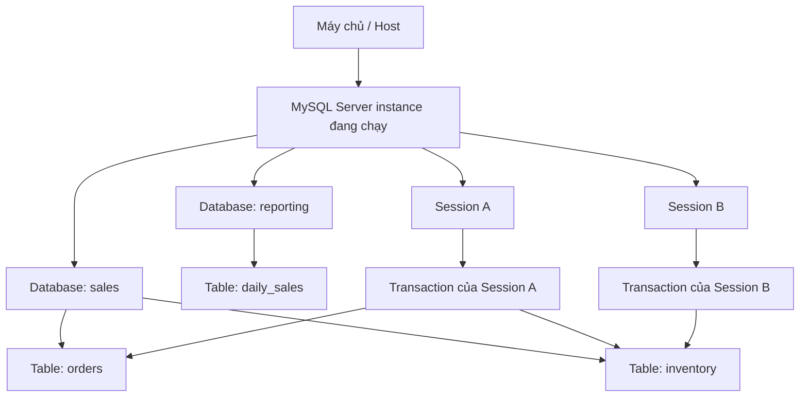

# Bản đồ thuật ngữ: server, instance, database, table, session và transaction

## Mục tiêu bài học

Sau bài này, bạn có thể:

- Phân biệt máy chủ (host), MySQL Server và một MySQL server instance.
- Giải thích database và table là các lớp tổ chức dữ liệu logic như thế nào.
- Mô tả session được tạo ra từ kết nối client và giữ trạng thái gì.
- Xác định transaction thuộc về session nào, bắt đầu và kết thúc ở đâu.
- Đọc một tình huống vận hành MySQL và lần theo đúng lớp đang được nhắc đến.

Các thuật ngữ này thường xuất hiện cùng nhau trong tài liệu, cấu hình và thông báo lỗi. Chúng có liên hệ chặt chẽ, nhưng đại diện cho những lớp khác nhau: phần mềm phục vụ truy vấn, một môi trường MySQL đang chạy, không gian dữ liệu logic, cấu trúc lưu dữ liệu, ngữ cảnh kết nối và đơn vị công việc cần bảo đảm tính nhất quán.

## 1. Nhìn toàn cảnh trước khi đi vào từng thuật ngữ

Hãy hình dung một ứng dụng bán hàng kết nối đến MySQL. Ứng dụng gửi câu lệnh SQL qua một kết nối. MySQL tiếp nhận kết nối, xác thực tài khoản, tạo ngữ cảnh làm việc cho kết nối đó. Ngữ cảnh này có thể chọn database mặc định, đọc hoặc ghi các table, rồi thực hiện một hay nhiều thao tác trong transaction.

Sơ đồ dưới đây thể hiện quan hệ khái niệm giữa các lớp:



Sơ đồ là bản đồ khái niệm, không phải sơ đồ cấp phát bộ nhớ hay sơ đồ tệp trên đĩa. Một instance có thể quản lý nhiều database và đồng thời phục vụ nhiều session. Một session có thể truy cập nhiều table, kể cả table thuộc database khác nếu tài khoản được cấp quyền. Transaction là phạm vi thao tác của một session tại một thời điểm; nó có thể đọc hoặc thay đổi nhiều table.

## 2. MySQL Server: phần mềm tiếp nhận và xử lý SQL

**MySQL Server** là phần mềm máy chủ cơ sở dữ liệu. Nó nhận kết nối từ ứng dụng hoặc công cụ client, xác thực người dùng, tiếp nhận câu lệnh SQL, phân tích cú pháp, tối ưu kế hoạch thực thi, phối hợp với storage engine để đọc hoặc ghi dữ liệu, đồng thời quản lý các hoạt động như phân quyền, khóa, nhật ký và phục hồi.

Trên hệ điều hành, tiến trình máy chủ MySQL thường chạy bằng chương trình `mysqld`. Khi nói “MySQL Server đang chạy”, người nói thường đề cập đến phần mềm dịch vụ này. Cần phân biệt nó với:

- **Máy chủ (host):** máy vật lý, máy ảo hoặc container cung cấp tài nguyên CPU, RAM, ổ đĩa và mạng.
- **MySQL Server:** phần mềm xử lý yêu cầu cơ sở dữ liệu.
- **MySQL client:** chương trình gửi yêu cầu đến server, chẳng hạn ứng dụng backend, MySQL Shell hoặc chương trình dòng lệnh `mysql`.

Client và server là hai vai trò giao tiếp. Ứng dụng không cần chạy cùng máy với MySQL Server; chúng có thể kết nối qua mạng nếu cấu hình mạng, xác thực và quyền truy cập cho phép.

Ví dụ, khi ứng dụng chạy câu lệnh:

```sql
SELECT order_id, total_amount
FROM sales.orders
WHERE order_id = 1001;
```

Client gửi câu lệnh đến MySQL Server. Server kiểm tra quyền, phân tích câu lệnh, chọn cách truy xuất dữ liệu và trả kết quả về client. Client không tự đọc trực tiếp các tệp dữ liệu của InnoDB.

## 3. MySQL server instance: một môi trường MySQL đang chạy

**Instance** (thường gọi đầy đủ là *MySQL server instance*) là một môi trường MySQL Server đang chạy, có trạng thái hoạt động và cấu hình riêng. Trong cách triển khai thông thường, một instance gắn với một tiến trình `mysqld`, một data directory, cấu hình cổng hoặc socket, cùng các tệp nhật ký và tài nguyên runtime của nó.

Một instance thường có các thành phần nhận diện như:

- Tiến trình `mysqld` và các tham số khởi động.
- Data directory, nơi MySQL quản lý dữ liệu và metadata.
- Cổng TCP hoặc Unix socket mà client dùng để kết nối.
- Cấu hình, tệp PID, error log và các nhật ký liên quan.
- Trạng thái đang chạy trong bộ nhớ, chẳng hạn buffer pool, cache và thông tin session.

Một máy host có thể chạy nhiều instance MySQL. Khi đó, mỗi instance cần được cấu hình tách biệt phù hợp, thường gồm data directory riêng, cổng hoặc socket riêng và các tệp runtime riêng. Không được cho nhiều tiến trình MySQL độc lập cùng mở và quản lý một data directory như thể mỗi tiến trình là chủ sở hữu riêng của nó.

Một instance có thể chứa nhiều database. Vì vậy, `sales` và `reporting` trong sơ đồ là hai database nằm trong cùng một instance, không nhất thiết là hai server riêng.

### Cách kiểm tra instance đang kết nối

Chạy các câu lệnh sau trên kết nối hiện tại:

```sql
SELECT VERSION() AS mysql_version,
       @@hostname AS server_host,
       @@port AS server_port,
       @@datadir AS data_directory;
```

Kết quả giúp nhận diện phiên bản server, host mà server tự báo cáo, cổng TCP và data directory. `@@port` cho biết giá trị cổng TCP cấu hình; kết nối hiện tại cũng có thể được thiết lập qua socket hoặc qua một lớp proxy. Khi có nhiều instance, hãy đối chiếu cả endpoint kết nối và các giá trị cấu hình thay vì chỉ dựa vào tên máy.

> Lưu ý về cách dùng từ: trong hội thoại, “server” đôi khi được dùng để chỉ host, phần mềm MySQL hoặc instance. Khi xử lý sự cố, hãy hỏi rõ đang nói đến máy host, dịch vụ MySQL hay instance cụ thể nào.

## 4. Database: không gian tên logic để nhóm các đối tượng

Trong MySQL, **database** là một không gian tên logic dùng để nhóm các đối tượng cơ sở dữ liệu. Các đối tượng thường gặp gồm table, view, stored procedure, function và event. Trigger được gắn với table. Trong MySQL, từ **schema** được dùng như từ đồng nghĩa với **database**; vì vậy `CREATE SCHEMA` và `CREATE DATABASE` là hai cách viết tương đương trong ngữ cảnh này.

Database giúp phân chia dữ liệu theo mục đích hoặc miền nghiệp vụ. Chẳng hạn:

- `sales` chứa đơn hàng và tồn kho.
- `accounting` chứa chứng từ và dữ liệu kế toán.
- `reporting` chứa các view hoặc bảng phục vụ báo cáo.

Tạo database và chọn database mặc định cho session:

```sql
CREATE DATABASE sales
  CHARACTER SET utf8mb4
  COLLATE utf8mb4_unicode_ci;

USE sales;

SELECT DATABASE() AS current_database;
```

`USE sales` thay đổi database mặc định của **session hiện tại**. Nó không chuyển dữ liệu sang database khác và cũng không làm thay đổi database mặc định của các kết nối khác. Nếu không muốn phụ thuộc vào database mặc định, hãy ghi tên đầy đủ theo dạng `database_name.table_name`:

```sql
SELECT order_id, total_amount
FROM sales.orders;
```

Một session có thể truy cập table ở nhiều database trong cùng instance nếu tài khoản có quyền tương ứng. Database mặc định chỉ giúp rút gọn tên đối tượng, không phải giới hạn duy nhất mà session được phép truy cập.

## 5. Table: cấu trúc logic lưu các hàng và cột

**Table** (bảng) là cấu trúc dữ liệu quan hệ gồm các cột và các hàng. Mỗi cột có tên và kiểu dữ liệu; mỗi hàng biểu diễn một bản ghi. Table thường có khóa chính để định danh hàng và có thể có khóa ngoại, unique constraint, index cùng các ràng buộc khác.

Ví dụ, database `sales` có thể chứa table `orders`:

```sql
CREATE TABLE sales.orders (
    order_id BIGINT UNSIGNED NOT NULL AUTO_INCREMENT,
    customer_id BIGINT UNSIGNED NOT NULL,
    order_status VARCHAR(30) NOT NULL,
    total_amount DECIMAL(12, 2) NOT NULL,
    created_at TIMESTAMP NOT NULL DEFAULT CURRENT_TIMESTAMP,
    PRIMARY KEY (order_id),
    KEY idx_orders_customer_created (customer_id, created_at)
) ENGINE = InnoDB;
```

Trong ví dụ này:

- `orders` là tên table; `sales.orders` là tên đầy đủ gồm database và table.
- `order_id`, `customer_id`, `order_status`, `total_amount` và `created_at` là các cột.
- `PRIMARY KEY` xác định duy nhất mỗi hàng.
- `idx_orders_customer_created` là index hỗ trợ truy vấn theo khách hàng và thời điểm tạo.
- `ENGINE = InnoDB` chọn storage engine quản lý cách lưu trữ và truy cập dữ liệu của table.

Table là khái niệm logic. Dữ liệu vật lý của table do storage engine quản lý; không nên mặc định rằng một table luôn tương ứng với đúng một tệp có tên giống table. Với InnoDB, dữ liệu và index được quản lý trong các tablespace; cách bố trí trên đĩa phụ thuộc cấu hình như chế độ file-per-table và cấu hình tablespace dùng chung.

Kiểm tra database và table:

```sql
SHOW DATABASES;
SHOW TABLES FROM sales;
SHOW CREATE TABLE sales.orders;
```

`SHOW CREATE TABLE` đặc biệt hữu ích khi cần xem lại định nghĩa thực tế của table, bao gồm kiểu dữ liệu, index, ràng buộc và storage engine.

## 6. Session: ngữ cảnh làm việc của một kết nối

**Session** là ngữ cảnh làm việc được MySQL duy trì cho một kết nối client. Trong giao thức kết nối thông thường, mỗi kết nối đến server tương ứng với một session. Một tài khoản có thể mở nhiều kết nối, do đó cùng một tài khoản có thể có nhiều session đồng thời.

Session bắt đầu khi server chấp nhận kết nối và kết thúc khi kết nối bị đóng hoặc bị ngắt. Trong suốt thời gian đó, session giữ nhiều trạng thái có ảnh hưởng đến câu lệnh tiếp theo, ví dụ:

- Tài khoản và ngữ cảnh quyền đã được xác thực.
- Database mặc định được chọn bằng `USE`.
- Các biến hệ thống ở phạm vi session, chẳng hạn `sql_mode` hoặc `time_zone` nếu được đặt riêng.
- Temporary table, prepared statement và một số trạng thái làm việc khác.
- Trạng thái transaction hiện tại, bao gồm các thay đổi chưa commit và các khóa liên quan.

Kiểm tra thông tin của session hiện tại:

```sql
SELECT CONNECTION_ID() AS connection_id,
       USER() AS login_identity,
       CURRENT_USER() AS privilege_identity,
       DATABASE() AS current_database,
       @@autocommit AS autocommit_mode;
```

`CONNECTION_ID()` giúp nhận diện kết nối hiện tại trên server. `DATABASE()` trả về database mặc định của session; kết quả là `NULL` nếu session chưa chọn database mặc định. `@@autocommit` cho biết chế độ tự động commit của session hiện tại.

### Những điểm dễ nhầm về session

**Session không phải database.** Database là nhóm đối tượng logic được instance quản lý; session là trạng thái của một kết nối đang làm việc với instance.

**Session không phải tài khoản.** Tài khoản là danh tính dùng để xác thực và cấp quyền. Một tài khoản có thể tạo nhiều session; các session đó có thể chọn database mặc định và đặt biến session khác nhau.

**Session không phải transaction.** Một session tồn tại qua nhiều câu lệnh và có thể thực hiện nhiều transaction nối tiếp nhau. Transaction có thể kết thúc bằng `COMMIT` hoặc `ROLLBACK` trong khi session vẫn tiếp tục mở.

Trong ứng dụng dùng connection pool, kết nối vật lý thường được tái sử dụng cho nhiều yêu cầu ứng dụng. Vì trạng thái session có thể còn tồn tại sau một yêu cầu, thư viện pool cần quản lý việc reset hoặc thiết lập lại trạng thái kết nối trước khi giao cho yêu cầu tiếp theo. Nếu không, database mặc định, biến session hoặc transaction chưa kết thúc có thể ảnh hưởng đến yêu cầu khác.

## 7. Transaction: một đơn vị công việc cần được xử lý nhất quán

**Transaction** (giao dịch) là một đơn vị công việc gồm một hoặc nhiều thao tác dữ liệu, được kết thúc bằng `COMMIT` hoặc `ROLLBACK`. Transaction giúp gom các thay đổi có liên quan thành một đơn vị để hệ quản trị cơ sở dữ liệu bảo đảm các thuộc tính ACID trong phạm vi mà storage engine hỗ trợ.

Với InnoDB, bốn thuộc tính ACID thường được hiểu như sau:

| Thuộc tính | Ý nghĩa thực tế |
|---|---|
| Atomicity (tính nguyên tử) | Các thay đổi của transaction được commit cùng nhau; nếu rollback, các thay đổi có thể rollback trong phạm vi transaction. |
| Consistency (tính nhất quán) | Transaction đưa dữ liệu từ một trạng thái hợp lệ sang trạng thái hợp lệ khác khi ứng dụng và các ràng buộc được thiết kế đúng. |
| Isolation (tính cô lập) | Các transaction đồng thời được điều phối theo mức cô lập để kiểm soát ảnh hưởng lẫn nhau. |
| Durability (tính bền vững) | Sau khi commit thành công, thay đổi được bảo vệ theo cơ chế ghi và phục hồi của InnoDB. |

Một transaction thuộc về session thực hiện nó. Các lệnh `COMMIT` và `ROLLBACK` trong session chỉ kết thúc transaction của session đó; chúng không commit thay cho các kết nối khác.

### Ví dụ: tạo đơn hàng và trừ tồn kho

Giả sử ứng dụng cần ghi một đơn hàng và giảm số lượng hàng trong kho. Hai thao tác có liên quan về nghiệp vụ nên cần nằm trong cùng transaction:

```sql
START TRANSACTION;

INSERT INTO sales.orders
    (customer_id, order_status, total_amount)
VALUES
    (501, 'PENDING', 1250000.00);

UPDATE sales.inventory
SET quantity = quantity - 1
WHERE product_id = 42
  AND quantity >= 1;

-- Ứng dụng phải kiểm tra số hàng được UPDATE.
-- Chỉ COMMIT khi đơn hàng và việc trừ kho đều hợp lệ.
COMMIT;
```

Đoạn SQL minh họa ranh giới transaction; trong ứng dụng thực tế, logic phải kiểm tra kết quả `UPDATE`. Nếu không có hàng tồn kho phù hợp, ứng dụng cần `ROLLBACK` và xử lý trường hợp hết hàng. Nếu commit, cả thao tác tạo đơn hàng và giảm tồn kho được xác nhận trong transaction đó. Nếu rollback trước khi commit, các thay đổi InnoDB của transaction được hoàn tác.

### Autocommit và ranh giới transaction

MySQL thường khởi tạo session với `autocommit = 1`. Ở chế độ này, mỗi câu lệnh thành công sử dụng transactional storage engine thường được commit như một transaction riêng nếu không có transaction tường minh đang mở. Khi cần nhiều câu lệnh cùng thuộc một đơn vị công việc, hãy mở transaction rõ ràng:

```sql
START TRANSACTION;
UPDATE sales.inventory
SET quantity = quantity - 1
WHERE product_id = 42;

-- Kiểm tra kết quả và thực hiện các thao tác liên quan.
COMMIT;
```

Nếu phát hiện điều kiện nghiệp vụ không đạt, dùng `ROLLBACK` thay cho `COMMIT`. Có thể dùng `SAVEPOINT` và `ROLLBACK TO SAVEPOINT` để quay lại một điểm trong transaction, nhưng savepoint không tạo ra transaction lồng nhau độc lập.

Một số câu lệnh DDL như `CREATE TABLE`, `ALTER TABLE` và `DROP TABLE` có thể gây implicit commit. Vì vậy, không nên giả định rằng mọi thay đổi cấu trúc đều có thể được hoàn tác bằng `ROLLBACK` như các thao tác DML thông thường. Ngoài ra, khả năng rollback và bảo đảm ACID phụ thuộc storage engine; InnoDB hỗ trợ transaction, trong khi các engine không hỗ trợ transaction như MyISAM không cung cấp cùng ngữ nghĩa rollback.

## 8. Theo dõi một yêu cầu từ client đến dữ liệu

Xét luồng xử lý khi một nhân viên xác nhận đơn hàng:

1. Ứng dụng backend đóng vai trò **client**, kết nối đến endpoint của MySQL.
2. **MySQL Server** trên host tiếp nhận kết nối và xác thực tài khoản.
3. Kết nối được phục vụ trong một **session**, có `CONNECTION_ID()` riêng và trạng thái riêng.
4. Session chọn **database** mặc định `sales`, hoặc tham chiếu trực tiếp `sales.orders`.
5. Các câu lệnh đọc và ghi dữ liệu trên những **table** như `orders` và `inventory`.
6. Những câu lệnh cần thành công cùng nhau được đặt trong một **transaction**; ứng dụng commit khi hợp lệ hoặc rollback khi có lỗi.

Khi điều tra lỗi, hãy xác định lớp liên quan trước:

| Triệu chứng hoặc câu hỏi | Thuật ngữ cần kiểm tra | Hướng kiểm tra ban đầu |
|---|---|---|
| Không kết nối được đến máy hoặc cổng MySQL | Host, MySQL Server, instance | Kiểm tra địa chỉ, cổng/socket, tiến trình dịch vụ và cấu hình mạng. |
| Kết nối nhầm môi trường hoặc nhầm cụm dữ liệu | Instance | Đối chiếu endpoint, `@@hostname`, `@@port` và `@@datadir`. |
| `Unknown database` | Database | Kiểm tra tên database, instance đang kết nối và quyền truy cập. |
| `Table doesn't exist` | Table | Kiểm tra database mặc định, tên đầy đủ `database.table` và chữ hoa/chữ thường theo hệ điều hành/cấu hình. |
| Một kết nối có database mặc định hoặc biến khác dự kiến | Session | Kiểm tra `DATABASE()`, `CONNECTION_ID()` và các biến ở phạm vi session. |
| Dữ liệu thay đổi chưa được lưu hoặc bị hoàn tác | Transaction | Kiểm tra `autocommit`, `START TRANSACTION`, `COMMIT`, `ROLLBACK` và lỗi trước khi commit. |
| Giao dịch chờ lâu hoặc bị deadlock | Transaction và session | Xác định các session tham gia, transaction đang mở, câu lệnh và khóa liên quan. |

Các thông báo lỗi chỉ là dấu hiệu ban đầu. Ví dụ, `Table doesn't exist` có thể xuất hiện khi table thực sự chưa được tạo, nhưng cũng có thể do session đang kết nối nhầm instance hoặc dùng sai database mặc định. Luôn kiểm tra ngữ cảnh kết nối trước khi kết luận dữ liệu đã mất.

## 9. Bảng phân biệt nhanh

| Thuật ngữ | Lớp khái niệm | Câu hỏi giúp nhận diện |
|---|---|---|
| Host | Hạ tầng | MySQL đang chạy trên máy hoặc môi trường nào? |
| MySQL Server | Phần mềm dịch vụ | Thành phần nào tiếp nhận và xử lý SQL? |
| Instance | Môi trường server đang chạy | Tiến trình, data directory và endpoint MySQL cụ thể nào đang được dùng? |
| Database (schema) | Không gian tên logic | Các đối tượng dữ liệu được nhóm trong phạm vi nào? |
| Table | Cấu trúc dữ liệu logic | Các hàng và cột nào đang lưu loại dữ liệu này? |
| Session | Ngữ cảnh kết nối | Kết nối hiện tại có danh tính và trạng thái làm việc nào? |
| Transaction | Đơn vị công việc | Những thay đổi nào cần commit hoặc rollback cùng nhau? |

Có thể ghi nhớ bằng chuỗi câu hỏi: **kết nối đến đâu (instance), làm việc trong ngữ cảnh nào (session), chọn không gian tên nào (database), thao tác trên cấu trúc nào (table), và xác nhận nhóm thay đổi nào (transaction)**. MySQL Server là phần mềm đứng sau việc tiếp nhận và điều phối toàn bộ các hoạt động đó.

## 10. Tự kiểm tra

1. Một máy host chạy hai tiến trình `mysqld` với hai cổng và hai data directory riêng. Có bao nhiêu instance? Có thể có nhiều database trong từng instance không?
2. Hai kết nối đăng nhập bằng cùng một tài khoản, nhưng mỗi kết nối chạy `USE` với một database khác nhau. Vì sao điều này không mâu thuẫn?
3. Một session chạy `START TRANSACTION`, cập nhật hai table rồi `COMMIT`. Điều gì xảy ra với session sau khi commit?
4. Ứng dụng chạy `UPDATE` khi `autocommit = 1` và không mở transaction tường minh. Thông thường thay đổi được xử lý như thế nào với InnoDB?
5. Vì sao không nên đồng nhất một table với một tệp vật lý duy nhất trên đĩa?

**Đáp án gợi ý:** (1) Có hai instance; mỗi instance có thể quản lý nhiều database. (2) Database mặc định là trạng thái của từng session, không phải trạng thái dùng chung của tài khoản. (3) Transaction kết thúc nhưng session vẫn mở và có thể tiếp tục câu lệnh hoặc bắt đầu transaction mới. (4) Câu lệnh thành công thường được commit như một transaction riêng. (5) Storage engine quản lý dữ liệu và index qua tablespace; cách bố trí vật lý phụ thuộc cấu hình.

