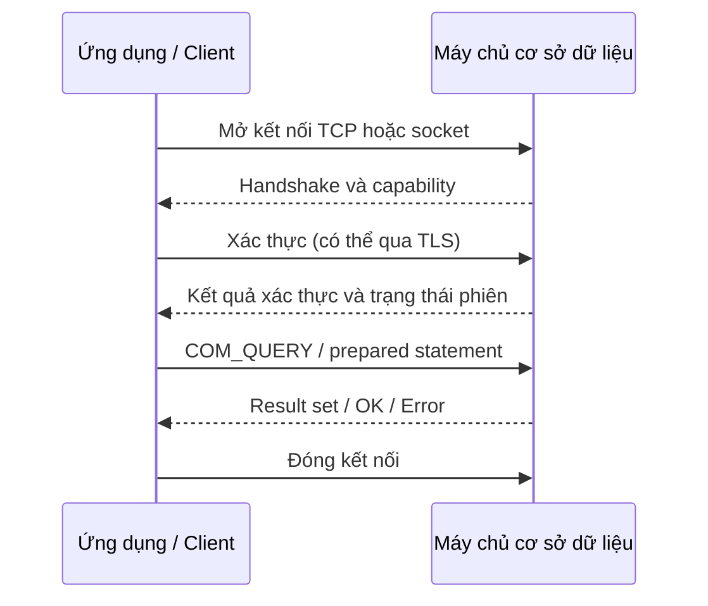

# Phân biệt MySQL với MariaDB và các hệ tương thích giao thức MySQL

## Mục tiêu

Sau bài này, bạn có thể:

- Giải thích vì sao MariaDB có nguồn gốc từ MySQL nhưng hiện là một hệ quản trị cơ sở dữ liệu độc lập.
- Phân biệt khả năng tương thích giao thức MySQL với khả năng tương thích SQL, hành vi và vận hành.
- Nhận diện các hệ thường được gọi là *MySQL-compatible* và hiểu chúng tương thích ở lớp nào.
- Chọn đúng client, driver và cách kiểm tra trước khi kết nối hoặc chuyển ứng dụng giữa các hệ.

## 1. MySQL và MariaDB có quan hệ gì?

**MySQL** là hệ quản trị cơ sở dữ liệu quan hệ (RDBMS) sử dụng SQL, có máy chủ, client, thư viện kết nối và nhiều công cụ quản trị. MySQL được phát triển ban đầu bởi MySQL AB, sau đó thuộc Sun Microsystems và hiện do Oracle phát triển. MySQL Community Server được phát hành theo giấy phép GPL; Oracle cũng cung cấp các sản phẩm và dịch vụ thương mại liên quan.

**MariaDB** bắt đầu như một nhánh phát triển (fork) của MySQL do những người từng tham gia phát triển MySQL khởi xướng. Mục tiêu ban đầu là duy trì một nhánh máy chủ tương thích với MySQL và được phát triển theo hướng cộng đồng. Qua nhiều năm, hai dự án phát triển độc lập, bổ sung tính năng và thay đổi nội bộ theo những hướng khác nhau. MariaDB Server cũng là một RDBMS quan hệ dùng SQL, nhưng không còn là một bản sao có thể thay thế vô điều kiện cho mọi phiên bản MySQL.

Có thể hình dung quan hệ của chúng như sau:

```text
                 MySQL (dòng sản phẩm riêng)
                /
Lịch sử MySQL --+
                \
                 MariaDB (fork ban đầu, phát triển độc lập)
```

Nguồn gốc chung giải thích vì sao hai hệ có nhiều điểm giống nhau: mô hình client/server, giao thức kết nối, cú pháp SQL phổ biến, kiểu dữ liệu quen thuộc và nhiều công cụ có thể làm việc với cả hai. Quá trình phát triển độc lập giải thích vì sao các khác biệt về cú pháp, kiểu dữ liệu, plugin xác thực, optimizer, replication và công cụ quản trị ngày càng quan trọng.

Vì vậy, khi nói “MariaDB tương thích MySQL”, cần hỏi rõ **tương thích ở phiên bản nào, tính năng nào và lớp nào**.

## 2. Giao thức MySQL là gì?

Giao thức MySQL (MySQL client/server protocol) là quy tắc trao đổi dữ liệu giữa chương trình client và máy chủ cơ sở dữ liệu. Client có thể là dòng lệnh, ứng dụng Java, PHP, Python, Go hoặc một proxy. Máy chủ nhận yêu cầu, thực thi lệnh và gửi kết quả hoặc lỗi trở lại.

Với kết nối TCP/IP, cổng mặc định thường là `3306`. Khi chạy trên cùng máy, client cũng có thể kết nối qua Unix socket hoặc named pipe tùy hệ điều hành và cấu hình. Cổng `3306` chỉ là giá trị mặc định, không phải bằng chứng cho biết máy chủ đang chạy MySQL hay MariaDB.

Một phiên kết nối thường có các bước chính:

1. **Handshake:** máy chủ gửi thông tin phiên bản và các khả năng giao thức mà nó hỗ trợ.
2. **Xác thực:** client gửi thông tin đăng nhập theo cơ chế xác thực được thương lượng hoặc cấu hình; TLS có thể được dùng để bảo vệ đường truyền.
3. **Thiết lập phiên:** hai phía thống nhất các tùy chọn như bộ ký tự, collation và những khả năng kết nối.
4. **Trao đổi lệnh:** client gửi lệnh như truy vấn SQL, chuẩn bị câu lệnh (prepared statement) hoặc thay đổi trạng thái phiên.
5. **Trả kết quả:** máy chủ gửi tập kết quả, số dòng bị ảnh hưởng, thông tin trạng thái hoặc mã lỗi.



Hai máy chủ cùng hiểu giao thức MySQL có thể trao đổi thông điệp theo cách mà một client tương thích sử dụng được. Điều này **không đảm bảo** hai máy chủ hiểu mọi câu SQL giống nhau hoặc tạo ra cùng kết quả.

## 3. Bốn lớp tương thích cần phân biệt

| Lớp | Ý nghĩa | Câu hỏi cần kiểm tra |
|---|---|---|
| Giao thức kết nối | Client và server hiểu được handshake, xác thực, gói lệnh và định dạng phản hồi | Driver có bắt tay và đăng nhập thành công không? |
| Cú pháp SQL | Server phân tích và chấp nhận câu lệnh, DDL, hàm và kiểu dữ liệu | Câu `CREATE TABLE`, truy vấn và hàm có được hỗ trợ không? |
| Ngữ nghĩa và hành vi | Câu lệnh chạy có cùng kết quả, quy tắc ép kiểu, transaction, collation và lỗi hay không | Dữ liệu và kết quả nghiệp vụ có giữ nguyên không? |
| Vận hành và hệ sinh thái | Công cụ backup, replication, cluster, giám sát, phân quyền và nâng cấp có tương thích không | Quy trình triển khai và khôi phục có hoạt động đúng không? |

Ví dụ: một ứng dụng có thể đăng nhập thành công vào MariaDB bằng một driver hiểu giao thức MySQL, nhưng sau đó vẫn gặp lỗi vì collation trong schema không tồn tại ở phiên bản MariaDB đang dùng. Kết nối thành công mới xác nhận được một phần của lớp giao thức, chưa xác nhận khả năng chạy ứng dụng.

## 4. Những khác biệt thường gặp giữa MySQL và MariaDB

Khác biệt cụ thể phụ thuộc phiên bản. Không nên lấy một đặc điểm của MySQL 5.7, MySQL 8.x hoặc một nhánh MariaDB làm quy tắc chung cho mọi phiên bản.

| Khía cạnh | MySQL | MariaDB | Tác động khi chuyển đổi |
|---|---|---|---|
| Phát triển và phát hành | Dòng sản phẩm do Oracle phát triển | Dự án và dòng sản phẩm phát triển độc lập | Theo dõi lịch phát hành, vòng đời hỗ trợ và chính sách bảo trì riêng |
| Phiên bản | Dùng hệ phiên bản của MySQL | Dùng hệ phiên bản MariaDB riêng | Số phiên bản tương tự không có nghĩa là cùng mức tính năng |
| Xác thực | Có các plugin xác thực riêng; cấu hình mặc định thay đổi theo phiên bản | Có tập plugin và cách cấu hình riêng | Kiểm tra plugin của tài khoản và khả năng của driver |
| Kiểu dữ liệu và hàm | Có các kiểu dữ liệu, hàm và cách biểu diễn riêng | Có các mở rộng và khác biệt riêng | Kiểm tra DDL, dữ liệu JSON, hàm ngày giờ và ép kiểu |
| Optimizer và index | Kế hoạch thực thi, thống kê và khả năng tối ưu theo MySQL | Cách tối ưu và một số tính năng index khác theo MariaDB | Đọc lại `EXPLAIN`, đo hiệu năng trên dữ liệu thực |
| Transaction và storage engine | InnoDB là engine giao dịch phổ biến mặc định | Hỗ trợ InnoDB cùng các engine và tùy chọn riêng | Kiểm tra engine, isolation level, khóa và hành vi transaction |
| Replication và HA | Có replication và các giải pháp như Group Replication / InnoDB Cluster | Có replication và có thể kết hợp các giải pháp như Galera Cluster | Không giả định topology, định dạng log hay công cụ failover có thể dùng thay thế |
| Quản trị | Có MySQL Shell, MySQL Router và các công cụ thuộc hệ sinh thái MySQL | Có client, công cụ và tiện ích riêng của MariaDB | Xác minh công cụ backup, restore, monitor và nâng cấp |

Một ví dụ đáng chú ý là kiểu `JSON`. MySQL có kiểu JSON riêng với cách lưu trữ và xử lý riêng. Trong nhiều phiên bản MariaDB, `JSON` được cung cấp như bí danh tương thích dựa trên `LONGTEXT` cùng kiểm tra JSON hợp lệ. Vì vậy, việc một schema có khai báo `JSON` không đủ để kết luận hai hệ có cùng cách lưu trữ, index hoặc hiệu năng truy vấn JSON.

Một ví dụ khác là xác thực. MySQL và MariaDB có thể hỗ trợ các plugin khác nhau hoặc khác nhau về phiên bản hỗ trợ. Nếu tài khoản ứng dụng đăng nhập được ở máy chủ cũ nhưng thất bại sau khi đổi server, hãy kiểm tra plugin xác thực của tài khoản, phiên bản driver, TLS và cấu hình server thay vì chỉ kiểm tra mật khẩu.

## 5. Những hệ thống thường được gọi là MySQL-compatible

“MySQL-compatible” là cách mô tả khả năng tương thích, không phải một chuẩn chứng nhận duy nhất. Các sản phẩm sau có mục đích và phạm vi khác nhau:

| Hệ thống | Bản chất | Phạm vi tương thích và lưu ý |
|---|---|---|
| Percona Server for MySQL | Bản phân phối máy chủ dựa trên MySQL, bổ sung các cải tiến về vận hành và hiệu năng | Hướng đến khả năng thay thế MySQL ở mức cao; vẫn cần đối chiếu phiên bản, plugin và công cụ đi kèm |
| Amazon Aurora MySQL-compatible | Dịch vụ cơ sở dữ liệu được quản lý, có kiến trúc lưu trữ và vận hành riêng | Cung cấp endpoint và khả năng tương thích với một số phiên bản MySQL; giới hạn tính năng và hành vi phụ thuộc phiên bản Aurora |
| TiDB | Cơ sở dữ liệu phân tán hỗ trợ giao thức và một phần cú pháp MySQL | Có thể dùng nhiều client MySQL, nhưng không phải MySQL server; cần kiểm tra khác biệt về SQL, transaction, DDL và optimizer |
| OceanBase ở MySQL mode | Cơ sở dữ liệu phân tán có chế độ tương thích MySQL | Hỗ trợ giao thức và nhiều cú pháp MySQL; cần đối chiếu các tính năng cụ thể với phiên bản và chế độ triển khai |
| Vitess | Lớp middleware điều phối, định tuyến và sharding cho hệ cơ sở dữ liệu MySQL | Cung cấp giao diện giao thức MySQL cho client trong kiến trúc Vitess; không phải một storage engine hoặc bản fork MySQL độc lập |

Ngoài ra, **ProxySQL** thường xuất hiện trong kiến trúc MySQL. Đây là proxy hiểu giao thức MySQL để định tuyến, quản lý kết nối hoặc áp dụng quy tắc truy vấn. ProxySQL không phải máy chủ RDBMS lưu trữ dữ liệu và không thể thay thế MySQL/MariaDB như một database server.

Khi đánh giá một hệ tương thích, hãy xác định vai trò của nó trước: máy chủ cơ sở dữ liệu, bản phân phối của MySQL, dịch vụ cloud, cơ sở dữ liệu phân tán hay middleware. Sau đó mới kiểm tra mức hỗ trợ giao thức và tính năng SQL.

## 6. Nhận diện máy chủ đang kết nối

Không nên suy luận loại máy chủ chỉ từ tên host, cổng, tên container hoặc tên biến môi trường. Hãy truy vấn trực tiếp server sau khi kết nối:

```sql
SELECT
    VERSION() AS server_version,
    @@version_comment AS distribution;

SHOW VARIABLES LIKE 'version%';
SHOW VARIABLES LIKE 'sql_mode';
SHOW VARIABLES LIKE 'character_set_server';
SHOW VARIABLES LIKE 'collation_server';
SHOW ENGINES;
```

`VERSION()` thường cho biết chuỗi phiên bản của máy chủ; `@@version_comment` cung cấp thông tin phân phối trong nhiều bản phát hành. Kết quả có thể được nhà cung cấp dịch vụ hoặc bản phân phối tùy biến, vì vậy hãy kết hợp với tài liệu của sản phẩm và thông tin phiên bản đầy đủ.

Ở terminal, có thể kiểm tra client đang cài:

```bash
mysql --version
mariadb --version
```

Lưu ý: hai lệnh trên hiển thị phiên bản **client** được chạy, không chứng minh phiên bản hay loại server ở đầu bên kia. Muốn biết server, hãy kết nối và chạy truy vấn SQL.

Ví dụ kết nối bằng client:

```bash
# Client MySQL
mysql -h 127.0.0.1 -P 3306 -u app_user -p app_db

# Client MariaDB (nếu đã cài)
mariadb -h 127.0.0.1 -P 3306 -u app_user -p app_db
```

Tùy bản phân phối, client có thể dùng tên lệnh hoặc alias khác nhau. Tùy chọn `-p` để client hỏi mật khẩu tương tác; tránh ghi mật khẩu trực tiếp trong command line vì có thể làm lộ thông tin qua lịch sử lệnh hoặc danh sách tiến trình.

## 7. Chọn driver cho ứng dụng

Driver phải hỗ trợ giao thức, phương thức xác thực và phiên bản server thực tế. Một ứng dụng Java có thể dùng các URL JDBC điển hình sau:

```properties
# MySQL Connector/J
jdbc:mysql://db.example:3306/app_db

# MariaDB Connector/J
jdbc:mariadb://db.example:3306/app_db
```

Hai URL này là ví dụ lựa chọn driver tương ứng, không phải cam kết rằng mọi driver đều hoạt động với mọi server tương thích MySQL. Hãy kiểm tra tài liệu của phiên bản connector đang dùng, dependency thực tế trong ứng dụng và các tùy chọn TLS, timeout, connection pool.

Trước khi đưa vào môi trường thật, cần kiểm tra ít nhất:

- Driver có hoàn tất handshake và xác thực với plugin tài khoản hiện tại không?
- Kết nối có mã hóa TLS và xác minh chứng thư theo chính sách của môi trường không?
- Charset và collation của kết nối có phù hợp với schema và dữ liệu không?
- Prepared statement, batch update, generated keys, stored procedure và transaction có hoạt động như ứng dụng mong đợi không?
- Connection pool có xử lý đúng reconnect, timeout và lỗi failover không?

Không nên chỉ đổi chuỗi JDBC rồi kết luận ứng dụng đã tương thích. Hãy chạy integration test với đúng server và driver sẽ triển khai.

## 8. Quy trình đánh giá trước khi thay MySQL bằng MariaDB hoặc hệ tương thích

Một lần chuyển đổi cần được kiểm tra theo từng lớp để tránh nhầm lẫn giữa “kết nối được” và “ứng dụng chạy đúng”.

1. **Ghi nhận nguồn hiện tại:** phiên bản server, edition/phân phối, storage engine, plugin xác thực, SQL mode, charset, collation và driver.
2. **Kiểm tra schema:** rà soát kiểu dữ liệu, index, generated column, constraint, partition, trigger, event, view và stored procedure.
3. **Kiểm tra truy vấn:** chạy các truy vấn nghiệp vụ, hàm SQL, phép ép kiểu, thao tác JSON, xử lý ngày giờ và truy vấn có phụ thuộc collation.
4. **Kiểm tra transaction:** xác minh isolation level, rollback, khóa dòng, deadlock và thứ tự cập nhật khi có nhiều kết nối đồng thời.
5. **Kiểm tra xác thực và bảo mật:** thử tài khoản ứng dụng, plugin, phân quyền, TLS và chính sách mạng.
6. **Kiểm tra vận hành:** thử backup/restore, replication hoặc cluster, giám sát, nâng cấp, khôi phục sau lỗi và quy trình failover.
7. **Đo hiệu năng:** dùng dữ liệu và tải gần thực tế; so sánh `EXPLAIN`, thời gian truy vấn, mức sử dụng CPU, bộ nhớ và I/O.
8. **Chuyển thử và đối soát:** chạy thử trên bản sao dữ liệu, đối chiếu số lượng và nội dung bản ghi, sau đó mới lập kế hoạch chuyển đổi có thể rollback.

Ví dụ, nếu hệ thống nguồn dùng MySQL 8 và hệ đích là MariaDB, hãy đặc biệt rà soát collation, plugin xác thực, cú pháp DDL, biểu thức JSON, các tính năng chỉ có ở MySQL và công cụ backup/replication đang sử dụng. Danh sách này là điểm khởi đầu; kết luận cuối cùng phải dựa trên phiên bản và workload cụ thể.

## 9. Đọc một số lỗi tương thích thường gặp

| Triệu chứng | Nguyên nhân có thể | Hướng kiểm tra |
|---|---|---|
| `Access denied` khi đăng nhập | Sai thông tin xác thực, host không được cấp quyền, plugin xác thực hoặc chính sách TLS không tương thích | Kiểm tra user/host, plugin tài khoản, log server và cấu hình TLS |
| `Unknown collation` | Server đích không có collation mà schema hoặc client yêu cầu | Kiểm tra collation nguồn/đích và lập ánh xạ có chủ đích trước khi chuyển dữ liệu |
| Lỗi cú pháp ở `CREATE TABLE` hoặc truy vấn | Tính năng SQL, kiểu dữ liệu hoặc cú pháp chỉ được hỗ trợ ở một hệ/phiên bản | Thu hẹp câu lệnh gây lỗi và đối chiếu tài liệu đúng phiên bản |
| Truy vấn chạy nhưng kết quả khác | Khác biệt về collation, kiểu dữ liệu, ép kiểu, SQL mode hoặc ngữ nghĩa hàm | Tạo bộ dữ liệu kiểm thử nhỏ và so sánh kết quả từng trường hợp biên |
| Ứng dụng kết nối được nhưng lỗi khi chạy prepared statement | Khác biệt driver, capability hoặc cách server hỗ trợ prepared statement | Kiểm tra phiên bản connector và tái hiện bằng test tối thiểu |
| Hiệu năng giảm sau chuyển đổi | Khác optimizer, thống kê, index, cấu hình hoặc storage engine | Chạy `EXPLAIN`, kiểm tra index và đo trên dữ liệu tương đương |

Thông báo lỗi chỉ là manh mối. Hãy lấy đầy đủ mã lỗi, câu lệnh, phiên bản server, phiên bản driver và cấu hình liên quan để xác định nguyên nhân.

## 10. Kết luận

MySQL và MariaDB có chung lịch sử và nhiều điểm tương đồng, nhưng hiện là hai hệ quản trị cơ sở dữ liệu phát triển độc lập. Nhiều sản phẩm khác cũng hỗ trợ giao thức MySQL để tận dụng client và driver sẵn có, song phạm vi tương thích của chúng khác nhau.

Hãy luôn tách bạch bốn câu hỏi: **kết nối có được không, SQL có chạy không, kết quả có đúng không, và hệ thống có vận hành được không**. Chỉ khi kiểm tra đủ cả bốn lớp trên phiên bản và workload cụ thể, bạn mới có cơ sở để chọn hoặc thay thế một hệ MySQL-compatible.
