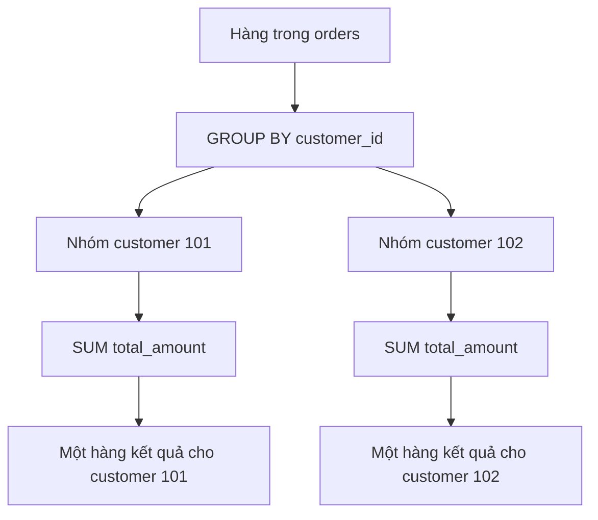

# ONLY_FULL_GROUP_BY và quy tắc xác định giá trị trong nhóm

Một truy vấn tổng hợp thường gom nhiều hàng thành một hàng kết quả cho mỗi nhóm. Khi đó, mỗi giá trị xuất hiện trong `SELECT`, `HAVING` hoặc `ORDER BY` phải có ý nghĩa rõ ràng đối với toàn bộ nhóm. Nếu một nhóm chứa nhiều trạng thái đơn hàng khác nhau nhưng truy vấn chỉ nhóm theo khách hàng, MySQL không thể tự biết cần hiển thị trạng thái nào. SQL mode `ONLY_FULL_GROUP_BY` giúp phát hiện những truy vấn mơ hồ như vậy.

Bài học thuộc module **DATABASE_MYSQL**. Module hướng tới việc làm chủ MySQL từ thiết kế bảng, kiểu dữ liệu, khóa và truy vấn SQL đến index, transaction và kiểm soát đồng thời; đồng thời thực hành đọc kế hoạch thực thi, tối ưu truy vấn, phân quyền, sao lưu và xử lý các vấn đề vận hành cơ sở dữ liệu quan hệ. Trong chương **SQL mode và ngữ nghĩa**, bài này tập trung vào `ONLY_FULL_GROUP_BY`, tính xác định của dữ liệu khi gom nhóm và cách viết truy vấn tổng hợp đúng ý nghĩa nghiệp vụ.

## 1. Vì sao truy vấn GROUP BY có thể mơ hồ?

Giả sử bảng `orders` có nhiều đơn hàng cho mỗi khách hàng:

| order_id | customer_id | order_status | total_amount |
|---:|---:|---|---:|
| 1001 | 101 | PAID | 250000 |
| 1002 | 101 | SHIPPED | 180000 |
| 1003 | 101 | CANCELLED | 90000 |
| 1004 | 102 | PAID | 420000 |

Ta muốn tính tổng tiền đơn hàng theo khách hàng. Truy vấn sau có ý nghĩa rõ ràng:

```sql
SELECT
    customer_id,
    SUM(total_amount) AS total_spent
FROM orders
GROUP BY customer_id;
```

Mỗi nhóm có một `customer_id`, và `SUM()` tạo ra một giá trị tổng hợp cho tất cả hàng trong nhóm.

Nhưng nếu thêm `order_status` mà không thay đổi cách nhóm:

```sql
SELECT
    customer_id,
    order_status,
    SUM(total_amount) AS total_spent
FROM orders
GROUP BY customer_id;
```

Nhóm của khách hàng 101 chứa ba trạng thái: `PAID`, `SHIPPED` và `CANCELLED`. Truy vấn chỉ tạo một hàng kết quả cho khách hàng 101 nhưng lại yêu cầu hiển thị một `order_status`. Không có quy tắc nào cho biết phải chọn trạng thái nào.

Đây là vấn đề về **ngữ nghĩa**, không chỉ là vấn đề cú pháp. MySQL cần biết mỗi biểu thức không tổng hợp có một giá trị xác định cho từng nhóm hay không.

## 2. GROUP BY tạo ra một hàng cho mỗi nhóm

`GROUP BY` chia các hàng đầu vào thành những nhóm dựa trên giá trị của một hoặc nhiều biểu thức. Các hàm tổng hợp tính kết quả từ những hàng thuộc từng nhóm.



Một truy vấn nhóm thường chứa hai loại biểu thức:

- **Biểu thức nhóm:** các cột hoặc biểu thức trong `GROUP BY`; chúng xác định nhóm.
- **Biểu thức tổng hợp:** hàm như `COUNT()`, `SUM()`, `AVG()`, `MIN()` hoặc `MAX()` tính từ các hàng trong nhóm.

Các biểu thức không nằm trong hàm tổng hợp cần được chứng minh là có một giá trị duy nhất trong mỗi nhóm. Có hai cách phổ biến:

1. Biểu thức đó nằm trong `GROUP BY`.
2. Biểu thức đó phụ thuộc hàm vào các cột nhóm (functional dependency), nên các cột nhóm xác định duy nhất giá trị của nó.

`ONLY_FULL_GROUP_BY` yêu cầu MySQL kiểm tra điều này trong các truy vấn tổng hợp. Điều kiện liên quan áp dụng cho biểu thức trong `SELECT`, `HAVING` và `ORDER BY`.

## 3. ONLY_FULL_GROUP_BY là gì?

`ONLY_FULL_GROUP_BY` là một SQL mode yêu cầu truy vấn nhóm chỉ tham chiếu đến các giá trị không tổng hợp có thể xác định từ khóa nhóm hoặc từ các phụ thuộc hàm mà MySQL nhận diện.

Mode này được bật mặc định trong các bản MySQL hiện đại, bao gồm MySQL 5.7.5 trở lên và MySQL 8.0. Tuy nhiên, cấu hình thực tế có thể bị thay đổi bởi file cấu hình, lệnh quản trị hoặc cấu hình kết nối; luôn kiểm tra session của kết nối đang chạy truy vấn.

```sql
SELECT
    VERSION() AS mysql_version,
    @@GLOBAL.sql_mode AS global_sql_mode,
    @@SESSION.sql_mode AS session_sql_mode;

SELECT FIND_IN_SET('ONLY_FULL_GROUP_BY', @@SESSION.sql_mode) AS mode_enabled;
```

Nếu `mode_enabled` lớn hơn 0, mode đang có trong danh sách SQL mode của session. Mỗi kết nối có `@@SESSION.sql_mode` riêng; vì vậy, hai client kết nối cùng một server vẫn có thể thực thi truy vấn với hành vi khác nhau nếu session mode khác nhau.

### 3.1. Lỗi thường gặp khi mode được bật

Với truy vấn mơ hồ ở phần đầu, MySQL thường trả lỗi dạng:

```text
ERROR 1055 (42000): Expression ... is not in GROUP BY clause
and contains nonaggregated column ... which is not functionally dependent
on columns in GROUP BY clause; this is incompatible with
sql_mode=only_full_group_by
```

Thông điệp cho biết biểu thức không tổng hợp không nằm trong `GROUP BY` và MySQL không chứng minh được nó phụ thuộc hàm vào các cột nhóm.

Khi truy vấn tổng hợp không có `GROUP BY`, toàn bộ tập hàng được xem là một nhóm. Một cột không tổng hợp không bị ràng buộc về một giá trị duy nhất cũng có thể gây lỗi, thường là lỗi 1140.

### 3.2. Mode không tự sửa truy vấn

`ONLY_FULL_GROUP_BY` không quyết định thay ứng dụng phải lấy giá trị nào. Nó buộc truy vấn phải diễn đạt rõ quy tắc nghiệp vụ. Nếu cần trạng thái của đơn mới nhất, hãy chọn đúng hàng mới nhất; nếu cần đếm đơn theo trạng thái, hãy thêm trạng thái vào khóa nhóm; nếu cần một giá trị đại diện không quan trọng, có thể dùng `ANY_VALUE()` với hiểu biết đầy đủ về tính không xác định.

## 4. Cách thứ nhất: đưa mọi chiều phân loại vào GROUP BY

Nếu mục tiêu là tính tổng tiền theo từng khách hàng **và** trạng thái, thì `order_status` chính là một chiều phân loại của kết quả. Hãy thêm nó vào `GROUP BY`:

```sql
SELECT
    customer_id,
    order_status,
    COUNT(*) AS order_count,
    SUM(total_amount) AS total_amount
FROM orders
GROUP BY customer_id, order_status
ORDER BY customer_id, order_status;
```

Kết quả có thể gồm:

| customer_id | order_status | order_count | total_amount |
|---:|---|---:|---:|
| 101 | CANCELLED | 1 | 90000 |
| 101 | PAID | 1 | 250000 |
| 101 | SHIPPED | 1 | 180000 |
| 102 | PAID | 1 | 420000 |

Mỗi tổ hợp `(customer_id, order_status)` tạo một nhóm. Không còn yêu cầu chọn một trạng thái tùy ý trong nhóm.

### 4.1. GROUP BY nhiều cột

Các cột trong `GROUP BY` xác định độ chi tiết (grain) của kết quả. Thêm một cột vào nhóm thường làm số nhóm tăng hoặc giữ nguyên, không làm kết quả tổng hợp còn ở cùng độ chi tiết như trước.

Ví dụ:

```sql
-- Một hàng cho mỗi khách hàng.
SELECT customer_id, SUM(total_amount) AS revenue
FROM orders
GROUP BY customer_id;

-- Một hàng cho mỗi khách hàng và tháng.
SELECT
    customer_id,
    DATE_FORMAT(created_at, '%Y-%m') AS order_month,
    SUM(total_amount) AS revenue
FROM orders
GROUP BY customer_id, DATE_FORMAT(created_at, '%Y-%m');
```

Trong truy vấn thứ hai, kết quả có độ chi tiết theo khách hàng và tháng. Cần bảo đảm biểu thức trong `SELECT` tương ứng với biểu thức nhóm. Để dễ bảo trì, có thể dùng CTE hoặc derived table tính `order_month` trước rồi nhóm theo alias của lớp truy vấn ngoài.

### 4.2. Dùng WHERE và HAVING đúng vị trí

`WHERE` lọc hàng trước khi nhóm; `HAVING` lọc các nhóm sau khi đã tính tổng hợp.

```sql
SELECT
    customer_id,
    COUNT(*) AS order_count,
    SUM(total_amount) AS revenue
FROM orders
WHERE created_at >= '2026-01-01'
  AND order_status <> 'CANCELLED'
GROUP BY customer_id
HAVING SUM(total_amount) >= 1000000
ORDER BY revenue DESC;
```

- `WHERE` giới hạn các đơn hàng được đưa vào phép nhóm.
- `GROUP BY` tạo một nhóm cho mỗi khách hàng.
- `HAVING` chỉ giữ nhóm có tổng tiền ít nhất một triệu.
- `ORDER BY` sắp xếp các hàng kết quả sau khi nhóm.

Không đưa điều kiện tổng hợp như `SUM(total_amount) >= ...` vào `WHERE`, vì tại giai đoạn đó chưa có giá trị tổng của nhóm. Ngược lại, điều kiện lọc hàng thông thường nên đặt trong `WHERE` để giảm số hàng phải tổng hợp.

## 5. Cách thứ hai: dùng phụ thuộc hàm (functional dependency)

Không phải lúc nào cũng cần đưa tất cả column vào `GROUP BY`. Nếu khóa nhóm xác định duy nhất một hàng hoặc một giá trị khác, MySQL có thể chứng minh cột đó phụ thuộc hàm vào khóa nhóm.

### 5.1. Functional dependency là gì?

Một tập cột X xác định tập cột Y (viết X → Y) nếu mọi hai hàng có cùng giá trị X cũng phải có cùng giá trị Y.

Ví dụ, bảng `customers` có:

```sql
CREATE TABLE customers (
    customer_id BIGINT UNSIGNED NOT NULL,
    email       VARCHAR(255) NOT NULL,
    full_name   VARCHAR(150) NOT NULL,
    city        VARCHAR(100),
    PRIMARY KEY (customer_id),
    UNIQUE KEY uq_customers_email (email)
) ENGINE = InnoDB;
```

Vì `customer_id` là khóa chính, mỗi `customer_id` chỉ xác định một hàng khách hàng. Do đó:

```text
customer_id -> email, full_name, city
```

Nếu nhóm theo `customer_id`, các cột `email`, `full_name` và `city` của cùng khách hàng có một giá trị duy nhất. MySQL nhận diện phụ thuộc hàm này và cho phép truy vấn:

```sql
SELECT
    c.customer_id,
    c.full_name,
    c.email,
    COUNT(o.order_id) AS order_count,
    COALESCE(SUM(o.total_amount), 0) AS total_spent
FROM customers AS c
LEFT JOIN orders AS o
    ON o.customer_id = c.customer_id
GROUP BY c.customer_id;
```

Ở đây, `c.customer_id` là khóa chính của bảng `customers`. Các thuộc tính còn lại của khách hàng phụ thuộc hàm vào khóa đó. `COUNT(o.order_id)` đếm số đơn; với khách hàng chưa có đơn, `LEFT JOIN` tạo hàng mở rộng có `o.order_id = NULL`, nên `COUNT(o.order_id)` bằng 0. `SUM()` trên các giá trị không có sẽ là `NULL`, vì vậy `COALESCE()` chuyển thành 0 theo mục đích báo cáo.

### 5.2. Unique key chỉ bảo đảm phụ thuộc hàm khi không cho phép NULL

Một unique index trên cột `email` cũng có thể xác định duy nhất hàng nếu `email` là `NOT NULL`:

```sql
email VARCHAR(255) NOT NULL,
UNIQUE KEY uq_customers_email (email)
```

Nếu cột unique cho phép `NULL`, MySQL cho phép nhiều hàng có `NULL` trong unique index. Vì vậy, chỉ nhìn thấy `UNIQUE` chưa đủ để kết luận giá trị luôn xác định duy nhất; cần xét cả `NOT NULL`.

Với unique key ghép `(tenant_id, external_code)`, cả hai cột khóa phải được xác định trong nhóm để xác định duy nhất một hàng theo khóa đó. Nếu thiếu một phần của unique key, phụ thuộc hàm có thể không còn đúng.

### 5.3. Functional dependency không phải suy đoán từ dữ liệu hiện tại

Giả sử hôm nay mọi đơn của một khách hàng đều có cùng `sales_region`. Điều đó chưa chứng minh `customer_id -> sales_region` nếu schema và constraint không bảo đảm quy tắc ấy. Một truy vấn có thể chạy với dữ liệu hiện tại nhưng trở nên sai khi một hàng mới được thêm.

Muốn dựa vào functional dependency, hãy sử dụng khóa hoặc ràng buộc thực sự bảo đảm quan hệ đó. Nếu quy tắc nghiệp vụ không được thể hiện bằng khóa/constraint, hãy đưa biểu thức vào `GROUP BY` hoặc tính toán nó bằng một cách rõ ràng.

## 6. Điều kiện WHERE có thể làm giá trị không tổng hợp trở nên xác định

MySQL cũng có thể chấp nhận cột không tổng hợp khi điều kiện `WHERE` giới hạn cột đó về đúng một giá trị trong mọi hàng được đưa vào nhóm.

Ví dụ:

```sql
SELECT
    order_status,
    SUM(total_amount) AS total_amount
FROM orders
WHERE order_status = 'PAID';
```

Mọi hàng đầu vào đều có `order_status = 'PAID'`, nên biểu thức này có cùng một giá trị trong kết quả. Truy vấn không cần `GROUP BY` vì toàn bộ tập đầu vào được tổng hợp thành một hàng.

Có thể giới hạn nhiều cột bằng các điều kiện equality kết hợp `AND`:

```sql
SELECT
    order_status,
    currency_code,
    SUM(total_amount) AS total_amount
FROM orders
WHERE order_status = 'PAID'
  AND currency_code = 'VND';
```

Các cột được chọn đều có một giá trị cố định trong tập hàng đầu vào. MySQL có thể nhận diện trường hợp giới hạn một giá trị này. Không nên suy rộng sang điều kiện `OR`, điều kiện phạm vi hoặc một biểu thức phức tạp mà không kiểm tra trên phiên bản thực tế.

Nếu truy vấn có `GROUP BY`, điều kiện lọc vẫn phải phù hợp với ý nghĩa từng nhóm. Dùng `WHERE` để giới hạn hàng đầu vào; không dùng điều kiện này như một cách che giấu cột đang thay đổi trong mỗi nhóm.

## 7. Dùng hàm tổng hợp khi thật sự cần một giá trị tổng hợp

Nếu mục tiêu là lấy giá trị nhỏ nhất, lớn nhất, trung bình hoặc số lượng, hãy biểu diễn trực tiếp bằng hàm tổng hợp.

```sql
SELECT
    customer_id,
    COUNT(*) AS order_count,
    SUM(total_amount) AS total_amount,
    AVG(total_amount) AS average_order_amount,
    MIN(created_at) AS first_order_at,
    MAX(created_at) AS last_order_at
FROM orders
GROUP BY customer_id;
```

Các hàm có ý nghĩa khác nhau:

| Hàm | Ý nghĩa |
|---|---|
| `COUNT(*)` | Đếm tất cả hàng trong nhóm. |
| `COUNT(column)` | Đếm hàng có giá trị column khác `NULL`. |
| `COUNT(DISTINCT column)` | Đếm số giá trị khác nhau, bỏ qua `NULL`. |
| `SUM(column)` | Tính tổng các giá trị khác `NULL`. |
| `AVG(column)` | Trung bình các giá trị khác `NULL`. |
| `MIN(column)` | Giá trị nhỏ nhất theo quy tắc so sánh của kiểu dữ liệu. |
| `MAX(column)` | Giá trị lớn nhất theo quy tắc so sánh của kiểu dữ liệu. |

Nếu tất cả giá trị đầu vào của `SUM()` đều là `NULL` hoặc không có hàng phù hợp, kết quả có thể là `NULL`. Dùng `COALESCE(SUM(...), 0)` khi nghiệp vụ muốn thể hiện tổng bằng 0.

### 7.1. MIN/MAX không tự chọn các cột khác từ cùng một hàng

Một lỗi tư duy phổ biến là:

```sql
SELECT
    customer_id,
    MAX(created_at) AS latest_order_at,
    MAX(order_status) AS order_status
FROM orders
GROUP BY customer_id;
```

`MAX(created_at)` và `MAX(order_status)` được tính độc lập. `order_status` có giá trị lớn nhất theo thứ tự so sánh, không nhất thiết là trạng thái của đơn hàng có `created_at` lớn nhất. Hai giá trị tổng hợp không tự động đến từ cùng một hàng nguồn.

Nếu cần trạng thái của đơn mới nhất, phải xác định hàng mới nhất trước rồi lấy trạng thái của hàng đó. Xem phần 10.

## 8. ANY_VALUE(): chấp nhận một giá trị không xác định

MySQL cung cấp `ANY_VALUE(expr)` để thông báo rằng truy vấn chấp nhận một giá trị bất kỳ của biểu thức trong nhóm và không yêu cầu kiểm tra biểu thức đó theo `ONLY_FULL_GROUP_BY`.

```sql
SELECT
    customer_id,
    ANY_VALUE(order_status) AS sample_status,
    SUM(total_amount) AS total_amount
FROM orders
GROUP BY customer_id;
```

`ANY_VALUE()` không phải hàm tổng hợp kiểu `MIN()` hoặc `MAX()`. Nó không có nghĩa là lấy hàng đầu tiên, hàng cuối cùng, đơn mới nhất hoặc giá trị được sắp xếp theo `ORDER BY`. Nó chỉ cho phép truy vấn sử dụng một giá trị mà ứng dụng chấp nhận là không xác định trong nhóm.

Chỉ dùng `ANY_VALUE()` khi:

- Giá trị đó thực sự không quan trọng đối với kết quả; hoặc
- Quy tắc nghiệp vụ bảo đảm mọi hàng trong nhóm có cùng giá trị, nhưng MySQL không nhận diện được phụ thuộc hàm đó; và
- Có cách khác bảo vệ quy tắc dữ liệu để nó không bị vi phạm trong tương lai.

Không dùng `ANY_VALUE()` để che lỗi khi báo cáo cần một giá trị có ý nghĩa, ví dụ trạng thái mới nhất hoặc địa chỉ hiện hành. Trong các trường hợp đó, hãy mô tả rõ tiêu chí chọn hàng.

## 9. ORDER BY không quyết định hàng nào được chọn trong nhóm

Một hiểu nhầm khác là thêm `ORDER BY` để buộc MySQL chọn giá trị mong muốn:

```sql
SELECT
    customer_id,
    order_status,
    MAX(created_at) AS latest_order_at
FROM orders
GROUP BY customer_id
ORDER BY latest_order_at DESC;
```

`ORDER BY` sắp xếp các hàng kết quả sau khi nhóm đã được hình thành. Nó không nói cho MySQL biết phải lấy `order_status` từ hàng nguồn nào. Nếu `order_status` không xác định trong nhóm, truy vấn vẫn không hợp lệ khi `ONLY_FULL_GROUP_BY` bật.

Tương tự, `ORDER BY created_at DESC` không biến một cột không tổng hợp thành “giá trị thuộc hàng mới nhất”. Muốn chọn hàng mới nhất, cần xếp hạng hoặc loại bỏ các hàng có hàng mới hơn.

## 10. Chọn một hàng đại diện có quy tắc xác định

Giả sử yêu cầu là lấy đơn hàng mới nhất của mỗi khách hàng, gồm `order_id`, `created_at` và `order_status`. Ta cần quy tắc xử lý khi hai đơn có cùng thời điểm.

Một quy tắc xác định là:

1. Chọn `created_at` lớn nhất trong mỗi khách hàng.
2. Nếu nhiều đơn có cùng `created_at`, chọn `order_id` lớn nhất làm tie-breaker.

Điều kiện `order_id` là khóa chính bảo đảm thứ tự phụ này là duy nhất.

### 10.1. Dùng ROW_NUMBER() trong MySQL 8.0+

```sql
WITH ranked_orders AS (
    SELECT
        order_id,
        customer_id,
        created_at,
        order_status,
        ROW_NUMBER() OVER (
            PARTITION BY customer_id
            ORDER BY created_at DESC, order_id DESC
        ) AS row_num
    FROM orders
)
SELECT
    order_id,
    customer_id,
    created_at,
    order_status
FROM ranked_orders
WHERE row_num = 1;
```

`ROW_NUMBER()` đánh số các hàng trong từng nhóm khách hàng theo thứ tự đã khai báo. `row_num = 1` giữ đúng một hàng cho mỗi khách hàng. `order_id DESC` giúp kết quả xác định ngay cả khi thời gian tạo trùng nhau.

Nếu chỉ dùng `ORDER BY created_at DESC` mà nhiều hàng có cùng thời điểm, thứ tự giữa các hàng đồng hạng không được bảo đảm. Thêm một khóa duy nhất làm tie-breaker là cách tạo kết quả lặp lại được.

### 10.2. Dùng NOT EXISTS khi không dùng window function

Với phiên bản MySQL cũ hơn chưa hỗ trợ window function, có thể chọn hàng không có hàng nào mới hơn theo quy tắc đã xác định:

```sql
SELECT
    o.order_id,
    o.customer_id,
    o.created_at,
    o.order_status
FROM orders AS o
WHERE NOT EXISTS (
    SELECT 1
    FROM orders AS newer
    WHERE newer.customer_id = o.customer_id
      AND (
          newer.created_at > o.created_at
          OR (
              newer.created_at = o.created_at
              AND newer.order_id > o.order_id
          )
      )
);
```

Truy vấn này giả định `created_at` không `NULL`. Nếu cột có thể `NULL`, phải định nghĩa rõ vị trí của giá trị `NULL` trong thứ tự nghiệp vụ và bổ sung điều kiện tương ứng. Cũng có thể dùng truy vấn con để tìm `MAX(created_at)` rồi tiếp tục xử lý trường hợp đồng hạng, nhưng cần có tie-breaker để kết quả chỉ còn một hàng.

Một index như `(customer_id, created_at, order_id)` có thể hỗ trợ truy vấn theo khách hàng và thứ tự thời gian. Hãy kiểm tra bằng `EXPLAIN` trên dữ liệu thực tế.

### 10.3. ROW_NUMBER, RANK và DENSE_RANK

Ba hàm xếp hạng khác nhau:

| Hàm | Khi có giá trị đồng hạng | Dùng khi |
|---|---|---|
| `ROW_NUMBER()` | Mỗi hàng nhận số thứ tự khác nhau | Cần đúng một hàng, có tie-breaker rõ ràng. |
| `RANK()` | Hàng đồng hạng cùng rank, các rank sau bị nhảy | Muốn giữ tất cả hàng đồng hạng ở vị trí xếp hạng. |
| `DENSE_RANK()` | Hàng đồng hạng cùng rank, rank tiếp theo không bị nhảy | Muốn xếp hạng các mức giá trị khác nhau liên tiếp. |

Nếu nghiệp vụ cần tất cả đơn hàng cùng thời điểm mới nhất, dùng `RANK()` theo `created_at DESC` và lọc rank bằng 1. Nếu cần đúng một đơn, dùng `ROW_NUMBER()` với khóa tie-breaker.

## 11. GROUP_CONCAT và thứ tự bên trong nhóm

Khi cần gom nhiều giá trị thành một chuỗi, MySQL có `GROUP_CONCAT()`:

```sql
SELECT
    customer_id,
    GROUP_CONCAT(
        order_status
        ORDER BY created_at DESC, order_id DESC
        SEPARATOR ', '
    ) AS statuses
FROM orders
GROUP BY customer_id;
```

`ORDER BY` nằm bên trong `GROUP_CONCAT()` quy định thứ tự các giá trị được nối. Nếu cần thứ tự ổn định, hãy chỉ định tiêu chí sắp xếp và tie-breaker. `ORDER BY` ngoài cùng chỉ sắp xếp các nhóm kết quả, không quy định thứ tự phần tử trong chuỗi tổng hợp.

Độ dài kết quả `GROUP_CONCAT()` chịu ảnh hưởng bởi `group_concat_max_len`. Nếu kết quả bị cắt, hãy kiểm tra biến này và warning của câu lệnh; không mặc định rằng chuỗi trả về luôn chứa tất cả phần tử.

## 12. GROUP BY và collation của chuỗi

Khi nhóm theo cột chuỗi, quy tắc collation ảnh hưởng việc các giá trị được xem là tương đương. Với collation không phân biệt hoa/thường, các giá trị như `MySQL` và `mysql` có thể nằm trong cùng một nhóm. Với collation không phân biệt dấu, các chuỗi khác dấu có thể được so sánh tương đương tùy collation cụ thể.

Kiểm tra collation của cột:

```sql
SHOW FULL COLUMNS FROM customers;
```

Hoặc:

```sql
SELECT
    COLUMN_NAME,
    CHARACTER_SET_NAME,
    COLLATION_NAME
FROM INFORMATION_SCHEMA.COLUMNS
WHERE TABLE_SCHEMA = DATABASE()
  AND TABLE_NAME = 'customers'
  AND COLUMN_NAME = 'city';
```

Nếu nghiệp vụ cần phân biệt chuỗi theo quy tắc nhị phân hoặc collation khác, hãy chỉ định collation phù hợp một cách có chủ đích. Không đổi collation chỉ để tăng số nhóm; hãy xác định ý nghĩa so sánh cần bảo đảm.

Ngoài ra, các hàng có `NULL` trong cột nhóm được xếp vào cùng một nhóm `NULL`. Nếu cần coi các giá trị thiếu là các trạng thái khác nhau, phải biểu diễn trạng thái đó bằng cột riêng hoặc quy tắc dữ liệu rõ ràng.

## 13. JOIN trước khi GROUP BY: kiểm soát grain và tránh nhân bản tổng

Khi join nhiều bảng một-nhiều trước khi tổng hợp, số hàng có thể bị nhân lên. Đây là lỗi phổ biến khiến `SUM()` hoặc `COUNT()` lớn hơn thực tế, dù truy vấn đã vượt qua `ONLY_FULL_GROUP_BY`.

Ví dụ, một đơn hàng có nhiều dòng hàng và nhiều lần thanh toán. Nếu join cả `order_items` và `payments` trực tiếp theo `order_id`, mỗi dòng hàng có thể kết hợp với mỗi lần thanh toán. Tổng tiền đơn hoặc tổng tiền thanh toán sẽ bị nhân bản.

Một cách xử lý là tổng hợp từng bảng con về đúng grain trước rồi mới join:

Ví dụ dưới đây dùng CTE (`WITH`), được hỗ trợ từ MySQL 8.0. Với MySQL 5.7, có thể thay từng CTE bằng derived table trong mệnh đề `FROM`.

```sql
WITH item_totals AS (
    SELECT
        order_id,
        SUM(quantity * unit_price) AS item_total
    FROM order_items
    GROUP BY order_id
),
payment_totals AS (
    SELECT
        order_id,
        SUM(paid_amount) AS paid_total
    FROM payments
    GROUP BY order_id
)
SELECT
    o.order_id,
    COALESCE(i.item_total, 0) AS item_total,
    COALESCE(p.paid_total, 0) AS paid_total
FROM orders AS o
LEFT JOIN item_totals AS i
    ON i.order_id = o.order_id
LEFT JOIN payment_totals AS p
    ON p.order_id = o.order_id;
```

Mỗi CTE trả về tối đa một hàng cho mỗi `order_id`, nên join không tạo tích Descartes giữa các dòng hàng và lần thanh toán. Hãy xác định grain của từng bảng và từng bước tổng hợp trước khi viết truy vấn báo cáo.

`ONLY_FULL_GROUP_BY` kiểm tra tính hợp lệ của biểu thức theo nhóm; nó không bảo đảm các phép join không nhân bản dữ liệu. Hai vấn đề cần được kiểm tra riêng.

## 14. Truy vấn không có GROUP BY và truy vấn DISTINCT

Một câu truy vấn có hàm tổng hợp nhưng không có `GROUP BY` coi toàn bộ hàng phù hợp là một nhóm:

```sql
SELECT
    COUNT(*) AS order_count,
    SUM(total_amount) AS revenue
FROM orders
WHERE order_status = 'PAID';
```

Kết quả là một hàng. Nếu thêm một column không tổng hợp như `customer_id`, truy vấn không có quy tắc để chọn khách hàng nào trong toàn bộ tập đơn hàng:

```sql
-- Mơ hồ: một nhóm có thể chứa nhiều customer_id.
SELECT customer_id, SUM(total_amount)
FROM orders;
```

Nếu muốn một hàng cho mỗi khách hàng, thêm `GROUP BY customer_id`. Nếu muốn một danh sách khách hàng duy nhất mà không tính tổng, dùng `SELECT DISTINCT customer_id` thay vì tạo một truy vấn tổng hợp không cần thiết.

`DISTINCT` loại bỏ hàng trùng trong tập kết quả; `GROUP BY` tạo nhóm để áp dụng hàm tổng hợp hoặc biểu diễn độ chi tiết của kết quả. Hai cú pháp có thể cho kết quả tương tự trong một số truy vấn đơn giản nhưng ý nghĩa và khả năng mở rộng khác nhau.

## 15. Cấu hình và kiểm tra ONLY_FULL_GROUP_BY

### 15.1. Kiểm tra session hiện tại

```sql
SELECT @@SESSION.sql_mode;

SELECT
    FIND_IN_SET('ONLY_FULL_GROUP_BY', @@SESSION.sql_mode) > 0
    AS only_full_group_by_enabled;
```

Hãy kiểm tra từ đúng connection ứng dụng hoặc connection pool đang chạy truy vấn. Kết quả từ một cửa sổ quản trị khác không chứng minh session ứng dụng có cùng SQL mode.

### 15.2. Bật mode cho session

Trong MySQL có schema `sys`, có thể thêm mode mà vẫn giữ các mode hiện tại:

```sql
SET SESSION sql_mode =
    sys.list_add(@@SESSION.sql_mode, 'ONLY_FULL_GROUP_BY');
```

Lệnh này chỉ tác động đến session hiện tại. Khi đóng kết nối, thiết lập session mất đi. Với các kết nối trong pool, cần cấu hình ở nơi tạo connection hoặc đặt baseline tại server để các kết nối mới nhận cùng giá trị.

### 15.3. Thay đổi global và cấu hình lâu dài

Quản trị viên có thể thay đổi giá trị global cho các kết nối mới:

```sql
SET GLOBAL sql_mode =
    sys.list_add(@@GLOBAL.sql_mode, 'ONLY_FULL_GROUP_BY');
```

Các session đã mở không tự nhận giá trị global mới. Để giữ cấu hình sau khi restart, hãy khai báo trong file cấu hình MySQL hoặc dùng cơ chế persistent được phiên bản hỗ trợ. Không cấp quyền thay đổi global SQL mode cho tài khoản ứng dụng thông thường.

### 15.4. Vì sao không nên tắt mode chỉ để truy vấn chạy được?

Có thể loại mode khỏi session bằng `sys.list_drop()` nếu môi trường thử nghiệm cần quan sát hành vi:

```sql
SET SESSION sql_mode =
    sys.list_drop(@@SESSION.sql_mode, 'ONLY_FULL_GROUP_BY');
```

Khi mode bị tắt, MySQL có thể chấp nhận truy vấn chứa cột không tổng hợp và chọn một giá trị bất kỳ trong nhóm. Kết quả có thể thay đổi theo kế hoạch thực thi, index, dữ liệu hoặc phiên bản. Việc tắt mode che giấu câu hỏi nghiệp vụ chưa được giải quyết.

Nếu cần so sánh để chẩn đoán, chỉ thực hiện trong session thử nghiệm và bật lại sau đó. Cách sửa bền vững là làm rõ grain, đưa cột vào `GROUP BY`, dùng aggregate phù hợp, chứng minh functional dependency hoặc chọn hàng theo quy tắc xác định.

## 16. Quy trình thiết kế truy vấn tổng hợp

Trước khi viết `SELECT`, hãy trả lời lần lượt:

1. **Một hàng kết quả đại diện cho điều gì?** Một khách hàng, một khách hàng mỗi tháng, hay một khách hàng mỗi trạng thái?
2. **Khóa nhóm là gì?** Liệt kê chính xác các cột/biểu thức xác định một nhóm.
3. **Các số liệu cần tính là gì?** Chọn `COUNT`, `SUM`, `AVG`, `MIN`, `MAX` hoặc hàm phù hợp.
4. **Có cột không tổng hợp nào khác không?** Kiểm tra nó có nằm trong nhóm hoặc phụ thuộc hàm vào khóa nhóm không.
5. **Nếu cần một hàng đại diện, quy tắc chọn hàng là gì?** Xác định tiêu chí chính và tie-breaker duy nhất.
6. **Join có làm nhân bản hàng không?** Kiểm tra grain trước và sau mỗi join; tổng hợp bảng con trước nếu cần.
7. **Điều kiện thuộc WHERE hay HAVING?** Lọc hàng trước nhóm bằng `WHERE`; lọc kết quả nhóm bằng `HAVING`.
8. **Thứ tự kết quả có được quy định không?** Thêm `ORDER BY` ở ngoài; nếu hàm tổng hợp nối danh sách, sắp xếp bên trong hàm.
9. **Collation có ảnh hưởng cách nhóm chuỗi không?** Xác nhận quy tắc so sánh phù hợp nghiệp vụ.
10. **Truy vấn có chạy trong SQL mode thật của ứng dụng không?** Kiểm tra `@@SESSION.sql_mode` và thử bằng đúng phiên bản MySQL mục tiêu.

## 17. Ví dụ tổng hợp hoàn chỉnh

Yêu cầu: báo cáo doanh thu đã thanh toán theo khách hàng trong năm 2026, chỉ lấy khách hàng có tổng doanh thu từ một triệu đồng, hiển thị tên và email khách hàng.

```sql
SELECT
    c.customer_id,
    c.full_name,
    c.email,
    COUNT(o.order_id) AS paid_order_count,
    SUM(o.total_amount) AS paid_revenue
FROM customers AS c
JOIN orders AS o
    ON o.customer_id = c.customer_id
WHERE o.order_status = 'PAID'
  AND o.created_at >= '2026-01-01 00:00:00'
  AND o.created_at <  '2027-01-01 00:00:00'
GROUP BY c.customer_id
HAVING SUM(o.total_amount) >= 1000000
ORDER BY paid_revenue DESC, c.customer_id;
```

Truy vấn nhóm theo `c.customer_id`. Vì đây là khóa chính của `customers`, `full_name` và `email` phụ thuộc hàm vào nó. `COUNT()` và `SUM()` tính từ các đơn đã lọc. `WHERE` giới hạn trạng thái và khoảng thời gian trước khi nhóm; `HAVING` lọc khách hàng theo doanh thu; `ORDER BY` sắp xếp các nhóm kết quả.

Nếu yêu cầu đổi thành doanh thu theo khách hàng **và trạng thái**, cần thêm `o.order_status` vào `SELECT` và `GROUP BY`. Nếu yêu cầu hiển thị trạng thái của đơn mới nhất, phải dùng truy vấn xếp hạng như phần 10 thay vì thêm `ANY_VALUE()`.

## 18. Lỗi thường gặp và cách xử lý

| Hiện tượng | Nguyên nhân | Cách xử lý |
|---|---|---|
| Lỗi 1055 khi SELECT thêm một cột | Cột không nằm trong GROUP BY và không phụ thuộc hàm vào cột nhóm | Xác định cột có phải chiều phân loại hay cần aggregate/chọn hàng riêng. |
| Tắt mode thì truy vấn chạy nhưng kết quả thay đổi | MySQL chọn giá trị không tổng hợp không xác định | Viết lại truy vấn theo quy tắc nghiệp vụ rõ ràng. |
| `MAX(created_at)` nhưng trạng thái không thuộc đơn mới nhất | Các hàm tổng hợp được tính độc lập | Dùng `ROW_NUMBER()` hoặc anti-join với tie-breaker. |
| Đã thêm cột vào GROUP BY nhưng tổng bị chia nhỏ | Grain kết quả thay đổi | Xác nhận yêu cầu báo cáo và khóa nhóm mong muốn. |
| Tổng tiền tăng sau khi JOIN thêm bảng con | Join một-nhiều làm nhân bản hàng | Tổng hợp từng bảng con về đúng grain trước khi join. |
| GROUP_CONCAT có thứ tự khác nhau | Không khai báo ORDER BY bên trong hàm | Đặt ORDER BY và tie-breaker trong `GROUP_CONCAT()`. |
| MySQL Workbench chạy nhưng ứng dụng lỗi 1055 | SQL mode session khác nhau | Kiểm tra `@@SESSION.sql_mode` qua connection ứng dụng. |
| Cột có unique index nhưng không được nhận diện là duy nhất | Unique key cho phép NULL hoặc thiếu một phần khóa ghép | Kiểm tra `NOT NULL` và toàn bộ các cột của unique key. |

## 19. Bài tập thực hành

### Bài tập 1: Nhận diện biểu thức không xác định

Với bảng `orders`, chạy truy vấn:

```sql
SELECT customer_id, order_status, SUM(total_amount)
FROM orders
GROUP BY customer_id;
```

**Yêu cầu:** giải thích vì sao `order_status` không có một giá trị xác định cho mỗi khách hàng. Viết lại truy vấn để tính doanh thu theo khách hàng và trạng thái.

### Bài tập 2: Functional dependency qua khóa chính

Tạo bảng `customers` có `customer_id` là primary key, sau đó join với `orders`. Viết truy vấn lấy `customer_id`, `full_name`, `email` và số đơn.

**Yêu cầu:** nhóm theo `customer_id`, giải thích vì sao các cột thông tin khách hàng có thể xuất hiện ngoài hàm tổng hợp.

### Bài tập 3: Unique nullable và functional dependency

Tạo một unique key trên `external_code` cho phép `NULL`, chèn nhiều hàng có `NULL`.

**Yêu cầu:** giải thích vì sao unique key nullable không bảo đảm một giá trị duy nhất cho mọi hàng và vì sao không nên suy luận functional dependency chỉ từ chữ `UNIQUE`.

### Bài tập 4: ANY_VALUE có phù hợp không?

Viết truy vấn dùng `ANY_VALUE(order_status)` cùng `SUM(total_amount)` theo khách hàng.

**Yêu cầu:** mô tả kết quả có thể và không thể cam kết. Giải thích vì sao `ANY_VALUE()` không có nghĩa là lấy trạng thái mới nhất.

### Bài tập 5: Chọn đơn mới nhất mỗi khách hàng

Viết truy vấn dùng `ROW_NUMBER()` để lấy một đơn mới nhất cho mỗi khách hàng. Thêm `order_id DESC` làm tie-breaker.

**Yêu cầu:** tạo dữ liệu có hai đơn cùng `created_at` và kiểm tra kết quả có ổn định không.

### Bài tập 6: Tránh nhân bản khi JOIN

Tạo một đơn có nhiều `order_items` và nhiều `payments`. Tính tổng tiền hàng và tổng tiền đã thanh toán.

**Yêu cầu:** so sánh cách join trực tiếp với cách tổng hợp từng bảng con trước khi join. Giải thích sự khác nhau về grain.

### Bài tập 7: Kiểm tra SQL mode theo session

Chạy `SELECT @@SESSION.sql_mode` từ mysql client và từ ứng dụng Java. Nếu kết quả khác nhau, xác định cấu hình nào đã tạo ra khác biệt.

**Yêu cầu:** bật `ONLY_FULL_GROUP_BY` cho session thử nghiệm, chạy truy vấn mơ hồ và giải thích lỗi nhận được.

## 20. Checklist review truy vấn GROUP BY

- [ ] Đã xác định một hàng kết quả đại diện cho điều gì.
- [ ] Các cột nhóm phản ánh đúng grain nghiệp vụ.
- [ ] Mọi biểu thức không tổng hợp đều nằm trong GROUP BY hoặc phụ thuộc hàm được bảo đảm.
- [ ] Không dùng `ANY_VALUE()` để giả vờ chọn hàng đầu tiên/mới nhất.
- [ ] Nếu chọn hàng đại diện, đã có tiêu chí sắp xếp và tie-breaker duy nhất.
- [ ] `MIN()`/`MAX()` được dùng đúng nghĩa, không giả định các cột lấy từ cùng một hàng.
- [ ] Điều kiện lọc hàng nằm ở WHERE; điều kiện lọc nhóm nằm ở HAVING.
- [ ] Join không nhân bản số liệu trước khi tổng hợp.
- [ ] Thứ tự phần tử trong hàm tổng hợp như GROUP_CONCAT được khai báo riêng.
- [ ] Collation của cột chuỗi phù hợp với cách nhóm.
- [ ] SQL mode của session ứng dụng đã được kiểm tra.
- [ ] Truy vấn được chạy thử trên phiên bản MySQL mục tiêu.

## 21. Ghi nhớ

`ONLY_FULL_GROUP_BY` yêu cầu truy vấn tổng hợp chỉ sử dụng các giá trị không tổng hợp có thể xác định trong từng nhóm. Một cột có thể xuất hiện ngoài hàm tổng hợp khi nó nằm trong `GROUP BY`, phụ thuộc hàm vào khóa nhóm hoặc được giới hạn về một giá trị trong tập đầu vào theo điều kiện MySQL nhận diện.

Khi cần nhiều chiều phân loại, thêm chúng vào `GROUP BY`. Khi cần một giá trị tổng hợp, dùng hàm tổng hợp đúng ý nghĩa. Khi cần một hàng đại diện, chọn hàng bằng quy tắc rõ ràng như `ROW_NUMBER()` cùng tie-breaker. `ANY_VALUE()` chỉ chấp nhận một giá trị không xác định; `ORDER BY` ngoài cùng không quyết định hàng nguồn được chọn. Viết truy vấn theo đúng grain và quy tắc nghiệp vụ giúp kết quả ổn định, dễ kiểm tra và an toàn khi dữ liệu phát triển.
