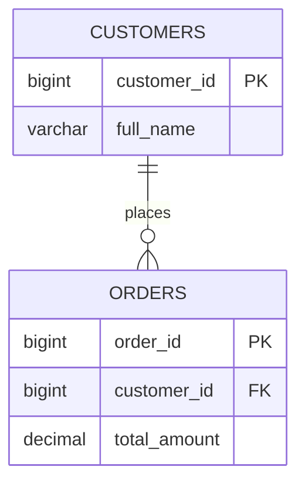

# FOREIGN KEY, điều kiện kiểu dữ liệu/chỉ mục và engine hỗ trợ

Một đơn hàng có `customer_id` trỏ đến khách hàng đã đặt nó. Nếu ứng dụng vô tình ghi một `customer_id` không tồn tại, dữ liệu đơn hàng sẽ mất liên kết với khách hàng. `FOREIGN KEY` (khóa ngoại) giúp MySQL kiểm tra mối quan hệ này ngay tại database, kể cả khi dữ liệu được ghi từ nhiều ứng dụng hoặc câu SQL khác nhau.

Để tạo được khóa ngoại trong MySQL, hai cột liên quan phải tương thích về kiểu dữ liệu, các cột cần có chỉ mục phù hợp và hai bảng phải dùng storage engine hỗ trợ kiểm tra khóa ngoại. Với ứng dụng quan hệ thông thường, lựa chọn phổ biến là InnoDB. Bài học này thuộc module **DATABASE_MYSQL**, tập trung vào các điều kiện đó, cách khai báo và cách chẩn đoán lỗi.

## 1. Khóa ngoại bảo vệ điều gì?

Khóa ngoại ràng buộc giá trị ở bảng con phải tham chiếu đến một hàng hợp lệ ở bảng cha. Ví dụ:

- `customers` là bảng cha, mỗi khách hàng có một `customer_id`.
- `orders` là bảng con, mỗi đơn hàng lưu `customer_id` của khách hàng sở hữu đơn.
- Một giá trị `orders.customer_id` khác `NULL` phải tìm được giá trị tương ứng trong `customers.customer_id`.



Khóa ngoại bảo đảm tính toàn vẹn tham chiếu (referential integrity). Nó không tự động tạo dữ liệu cha, không kiểm tra mọi quy tắc nghiệp vụ và không thay thế việc xác thực ở ứng dụng. Ví dụ, khóa ngoại bảo đảm khách hàng tồn tại nhưng không quyết định khách hàng đó có được phép mua sản phẩm hay không.

## 2. Điều kiện về kiểu dữ liệu

Hai cột trong quan hệ khóa ngoại phải có kiểu tương thích. MySQL InnoDB áp dụng các quy tắc cụ thể:

| Nhóm kiểu | Điều kiện quan trọng |
|---|---|
| Số nguyên | Phải cùng kiểu số nguyên tương ứng và cùng signedness; ví dụ `BIGINT UNSIGNED` tham chiếu `BIGINT UNSIGNED`, không ghép với `BIGINT` signed hoặc `INT UNSIGNED` |
| Kiểu số chính xác như `DECIMAL` | Precision và scale phải tương thích; cách an toàn là khai báo cùng kiểu và cùng thông số ở hai phía |
| Chuỗi ký tự không nhị phân | Phải cùng character set và collation; độ dài chuỗi không nhất thiết phải giống nhau, nhưng nên thống nhất định nghĩa nếu không có lý do khác |
| Chuỗi nhị phân | Kích thước phải tương ứng; nên dùng cùng kiểu và cùng độ dài ở hai phía |

Không nên dựa vào việc hai giá trị “trông giống nhau” để kết luận kiểu tương thích. `INT` và `BIGINT` có miền lưu trữ khác nhau; `INT` signed và `INT UNSIGNED` có miền giá trị khác nhau; `VARCHAR` cùng charset nhưng khác collation cũng không đáp ứng điều kiện cho cột chuỗi không nhị phân.

### Ví dụ kiểu số nguyên phải khớp

Khai báo bảng cha:

```sql
CREATE TABLE customers (
    customer_id BIGINT UNSIGNED NOT NULL AUTO_INCREMENT,
    full_name VARCHAR(150) NOT NULL,
    PRIMARY KEY (customer_id)
) ENGINE=InnoDB;
```

Bảng con phải dùng kiểu tương ứng cho `customer_id`:

```sql
CREATE TABLE orders (
    order_id BIGINT UNSIGNED NOT NULL AUTO_INCREMENT,
    customer_id BIGINT UNSIGNED NOT NULL,
    total_amount DECIMAL(15,2) NOT NULL,
    PRIMARY KEY (order_id),
    KEY idx_orders_customer_id (customer_id),
    CONSTRAINT fk_orders_customer
        FOREIGN KEY (customer_id)
        REFERENCES customers (customer_id)
) ENGINE=InnoDB;
```

Nếu `orders.customer_id` được khai báo là `BIGINT` signed trong khi cột cha là `BIGINT UNSIGNED`, InnoDB có thể từ chối tạo khóa ngoại do signedness không khớp. Hãy sửa định nghĩa cột cho tương thích thay vì cố ép bằng `CAST()` trong câu truy vấn.

### Ví dụ cột chuỗi phải cùng charset và collation

Nếu dùng mã bên ngoài làm khóa tham chiếu, hãy thống nhất character set và collation:

```sql
CREATE TABLE product_catalog (
    product_code VARCHAR(30)
        CHARACTER SET utf8mb4
        COLLATE utf8mb4_0900_as_cs NOT NULL,
    product_name VARCHAR(150) NOT NULL,
    PRIMARY KEY (product_code)
) ENGINE=InnoDB;

CREATE TABLE order_items (
    order_item_id BIGINT UNSIGNED NOT NULL AUTO_INCREMENT,
    product_code VARCHAR(30)
        CHARACTER SET utf8mb4
        COLLATE utf8mb4_0900_as_cs NOT NULL,
    quantity INT UNSIGNED NOT NULL,
    PRIMARY KEY (order_item_id),
    KEY idx_order_items_product_code (product_code),
    CONSTRAINT fk_order_items_product
        FOREIGN KEY (product_code)
        REFERENCES product_catalog (product_code)
) ENGINE=InnoDB;
```

Nếu hai cột chuỗi khác collation, chẳng hạn một bên `utf8mb4_0900_as_cs` và bên kia `utf8mb4_0900_ai_ci`, việc tạo khóa ngoại có thể thất bại. Hãy kiểm tra `SHOW CREATE TABLE` của cả hai bảng để xác định chính xác charset và collation thực tế.

## 3. Điều kiện về chỉ mục ở bảng cha và bảng con

InnoDB cần chỉ mục để kiểm tra nhanh quan hệ khi thêm/sửa hàng ở bảng con hoặc xóa/sửa khóa ở bảng cha.

**Ở bảng cha (referenced table):** các cột được tham chiếu phải có chỉ mục phù hợp. Thiết kế chuẩn và dễ hiểu nhất là tham chiếu `PRIMARY KEY` hoặc một khóa `UNIQUE NOT NULL`. Nếu tham chiếu nhiều cột, thứ tự cột phải khớp với thứ tự của phần đầu chỉ mục tương ứng.

**Ở bảng con (referencing table):** các cột khóa ngoại phải là phần đầu của một chỉ mục theo đúng thứ tự. Nếu chưa có chỉ mục phù hợp, InnoDB thường tự tạo chỉ mục cho khóa ngoại. Tuy nhiên, nên khai báo chỉ mục tường minh để kiểm soát tên và có thể thiết kế nó phục vụ cả truy vấn nghiệp vụ.

Ví dụ, chỉ mục sau phù hợp với khóa ngoại đơn:

```sql
KEY idx_orders_customer_id (customer_id)
```

Với khóa ngoại ghép `(tenant_id, customer_id)`, chỉ mục bắt đầu bằng đúng hai cột theo thứ tự đó là phù hợp:

```sql
KEY idx_orders_tenant_customer (tenant_id, customer_id)
```

Chỉ mục `(customer_id, tenant_id)` không có cùng thứ tự tiền tố, nên không thay thế trực tiếp cho chỉ mục trên đối với khóa ngoại ghép theo `(tenant_id, customer_id)`.

### Vì sao nên tham chiếu khóa chính hoặc UNIQUE?

SQL chuẩn mô hình hóa quan hệ tham chiếu đến khóa duy nhất của bảng cha. InnoDB trong một số phiên bản MySQL đã cho phép tham chiếu đến chỉ mục không unique như một phần mở rộng không chuẩn. Hành vi này phụ thuộc phiên bản và đang bị hạn chế/deprecated trong các bản MySQL mới hơn. Không thiết kế schema mới dựa vào chỉ mục cha không unique; hãy tham chiếu `PRIMARY KEY` hoặc `UNIQUE NOT NULL` để có quan hệ một-một rõ ràng ở phía được tham chiếu và khả năng tương thích tốt hơn.

Các kiểu cột `TEXT`/`BLOB` thường chỉ có thể được lập chỉ mục theo prefix, trong khi khóa ngoại cần chỉ mục đầy đủ trên các cột tham chiếu. Vì vậy, chúng không phải lựa chọn phù hợp cho khóa ngoại. Dùng mã có độ dài giới hạn như `VARCHAR` hoặc khóa số nguyên.

## 4. Storage engine phải hỗ trợ FOREIGN KEY

Khóa ngoại được MySQL thực thi bởi storage engine, không chỉ bởi cú pháp SQL ở tầng server. Với MySQL, InnoDB là lựa chọn thông dụng hỗ trợ kiểm tra khóa ngoại và transaction.

| Engine / loại bảng | Khả năng dùng FOREIGN KEY |
|---|---|
| InnoDB | Có hỗ trợ và thực thi ràng buộc khóa ngoại |
| MyISAM | Không thực thi khóa ngoại; khai báo FK không mang lại bảo vệ toàn vẹn tham chiếu |
| Bảng `TEMPORARY` | Không hỗ trợ khai báo khóa ngoại theo cách dùng cho bảng lâu dài |
| Bảng InnoDB được partition theo cơ chế partitioning của MySQL | Không hỗ trợ khóa ngoại trên các bảng partitioned InnoDB trong MySQL 8.0 |

Hai bảng tham gia quan hệ phải dùng cùng storage engine hỗ trợ khóa ngoại. Ví dụ bảng cha là InnoDB nhưng bảng con là MyISAM thì không thể dựa vào FK để bảo vệ quan hệ.

Kiểm tra engine của bảng:

```sql
SHOW TABLE STATUS LIKE 'customers';
SHOW TABLE STATUS LIKE 'orders';

SHOW CREATE TABLE customers;
SHOW CREATE TABLE orders;
```

Trong `SHOW CREATE TABLE`, kiểm tra phần cuối có `ENGINE=InnoDB` hay không. Có thể xem engine hỗ trợ trên server bằng:

```sql
SHOW ENGINES;
```

Nếu đang bảo trì một hệ thống dùng MyISAM, cần lập kế hoạch chuyển cả bảng cha và bảng con sang InnoDB, kiểm tra dữ liệu và chỉ mục trước khi thêm khóa ngoại. Chỉ thêm câu `FOREIGN KEY` vào DDL mà không chuyển engine không tạo ra tính toàn vẹn tham chiếu.

## 5. Khai báo FOREIGN KEY và hành vi khi dữ liệu cha thay đổi

Có thể khai báo khóa ngoại ngay khi tạo bảng:

```sql
CREATE TABLE departments (
    department_id BIGINT UNSIGNED NOT NULL AUTO_INCREMENT,
    department_name VARCHAR(120) NOT NULL,
    PRIMARY KEY (department_id)
) ENGINE=InnoDB;

CREATE TABLE employees (
    employee_id BIGINT UNSIGNED NOT NULL AUTO_INCREMENT,
    department_id BIGINT UNSIGNED NOT NULL,
    full_name VARCHAR(150) NOT NULL,
    PRIMARY KEY (employee_id),
    KEY idx_employees_department_id (department_id),
    CONSTRAINT fk_employees_department
        FOREIGN KEY (department_id)
        REFERENCES departments (department_id)
        ON UPDATE CASCADE
        ON DELETE RESTRICT
) ENGINE=InnoDB;
```

Hai hành động tham chiếu quan trọng là `ON DELETE` và `ON UPDATE`:

| Hành động | Khi nào xảy ra | Ý nghĩa |
|---|---|---|
| `RESTRICT` | Xóa/sửa khóa ở bảng cha khi còn dòng con tham chiếu | Từ chối thao tác cha |
| `NO ACTION` | Khi xóa/sửa khóa cha | Với InnoDB, tương đương `RESTRICT` và được kiểm tra ngay, không phải deferred constraint |
| `CASCADE` | Xóa/sửa khóa ở bảng cha | Tự động xóa hoặc cập nhật các dòng con tương ứng |
| `SET NULL` | Xóa/sửa khóa ở bảng cha | Đặt cột FK của dòng con thành `NULL`; các cột FK đó phải cho phép `NULL` |

Nếu bỏ qua `ON DELETE`/`ON UPDATE`, hành vi mặc định là từ chối thao tác làm vi phạm quan hệ. `SET DEFAULT` không được InnoDB hỗ trợ như một hành động khóa ngoại có hiệu lực; không dùng nó trong thiết kế.

Chọn hành động theo ý nghĩa nghiệp vụ:

- Dùng `RESTRICT` khi không được xóa khách hàng/phòng ban nếu còn dữ liệu phụ thuộc.
- Dùng `CASCADE` khi dòng con chỉ có ý nghĩa tồn tại cùng dòng cha, ví dụ dòng chi tiết của một giỏ hàng nháp có thể xóa cùng giỏ.
- Dùng `SET NULL` khi dòng con vẫn hợp lệ sau khi bỏ liên kết, và cột FK được phép rỗng.

Không dùng `CASCADE` theo thói quen. Một thao tác xóa ở bảng cha có thể lan qua nhiều cấp quan hệ; cần hiểu toàn bộ ảnh hưởng trước khi áp dụng.

## 6. NULL và khóa ngoại ghép

Một cột FK cho phép `NULL` có nghĩa dòng con có thể chưa gắn với một dòng cha. Với FK đơn, `NULL` không yêu cầu phải tìm một dòng cha tương ứng. Nếu quan hệ là bắt buộc, khai báo cột FK `NOT NULL`.

Ví dụ quan hệ nhân viên có thể chưa được phân phòng ban:

```sql
CREATE TABLE employees_optional_department (
    employee_id BIGINT UNSIGNED NOT NULL,
    department_id BIGINT UNSIGNED NULL,
    PRIMARY KEY (employee_id),
    KEY idx_employee_department (department_id),
    CONSTRAINT fk_employee_optional_department
        FOREIGN KEY (department_id)
        REFERENCES departments (department_id)
        ON DELETE SET NULL
) ENGINE=InnoDB;
```

Với khóa ngoại ghép, nếu một hoặc nhiều thành phần của khóa con là `NULL`, MySQL áp dụng hành vi tương đương `MATCH SIMPLE`: không yêu cầu tìm dòng cha cho tổ hợp đó. MySQL không triển khai các biến thể `MATCH FULL`/`MATCH PARTIAL` theo chuẩn SQL; không thêm mệnh đề `MATCH` với kỳ vọng thay đổi hành vi kiểm tra.

Nếu nghiệp vụ yêu cầu hoặc tất cả thành phần phải có giá trị, hoặc tất cả cùng rỗng, cần thiết kế constraint/logic bổ sung. Đừng giả định khóa ngoại ghép tự động buộc tất cả cột phải cùng `NULL` hoặc cùng khác `NULL`.

## 7. Khóa ngoại ghép và tự tham chiếu

### Khóa ngoại ghép

Một quan hệ có thể dựa trên nhiều cột, thường dùng khi dữ liệu được phân vùng theo tenant hoặc khi khóa nghiệp vụ là tổ hợp:

```sql
CREATE TABLE tenant_users (
    tenant_id BIGINT UNSIGNED NOT NULL,
    user_id BIGINT UNSIGNED NOT NULL,
    display_name VARCHAR(120) NOT NULL,
    PRIMARY KEY (tenant_id, user_id)
) ENGINE=InnoDB;

CREATE TABLE tenant_orders (
    order_id BIGINT UNSIGNED NOT NULL AUTO_INCREMENT,
    tenant_id BIGINT UNSIGNED NOT NULL,
    user_id BIGINT UNSIGNED NOT NULL,
    PRIMARY KEY (order_id),
    KEY idx_tenant_orders_user (tenant_id, user_id),
    CONSTRAINT fk_tenant_orders_user
        FOREIGN KEY (tenant_id, user_id)
        REFERENCES tenant_users (tenant_id, user_id)
) ENGINE=InnoDB;
```

Thứ tự trong danh sách cột của `FOREIGN KEY` phải khớp với thứ tự các cột được tham chiếu. Chỉ mục bảng con cũng phải bắt đầu bằng `(tenant_id, user_id)` theo cùng thứ tự. Cách này bảo đảm một đơn hàng trỏ đến người dùng trong đúng tenant.

### Khóa ngoại tự tham chiếu

Một bảng có thể tham chiếu chính nó, ví dụ cấu trúc nhân viên và người quản lý:

```sql
CREATE TABLE staff (
    staff_id BIGINT UNSIGNED NOT NULL AUTO_INCREMENT,
    manager_id BIGINT UNSIGNED NULL,
    full_name VARCHAR(150) NOT NULL,
    PRIMARY KEY (staff_id),
    KEY idx_staff_manager (manager_id),
    CONSTRAINT fk_staff_manager
        FOREIGN KEY (manager_id)
        REFERENCES staff (staff_id)
        ON DELETE SET NULL
) ENGINE=InnoDB;
```

Quản lý cũng là một nhân viên trong cùng bảng. `manager_id` cho phép `NULL` để biểu diễn nhân viên không có quản lý trực tiếp. Dù khóa ngoại bảo đảm manager tồn tại, nó không tự ngăn một nhân viên quản lý chính mình hoặc tạo chu trình quản lý nhiều cấp; các quy tắc đó cần kiểm tra nghiệp vụ riêng.

## 8. Thêm FOREIGN KEY vào bảng đã có dữ liệu

Khi thêm khóa ngoại vào bảng đang tồn tại, MySQL phải kiểm tra các dòng con hiện có. Nếu có giá trị không tìm thấy ở bảng cha, thao tác `ALTER TABLE` sẽ thất bại.

Trước khi thêm khóa, hãy tìm dòng mồ côi (orphan rows):

```sql
SELECT o.order_id, o.customer_id
FROM orders AS o
LEFT JOIN customers AS c
    ON c.customer_id = o.customer_id
WHERE o.customer_id IS NOT NULL
  AND c.customer_id IS NULL;
```

Nếu truy vấn trả dòng, cần xác định cách xử lý theo nghiệp vụ: tạo lại dữ liệu cha hợp lệ, sửa khóa con về đúng khách hàng, chuyển sang `NULL` nếu quan hệ tùy chọn, hoặc loại bỏ dữ liệu sai sau khi có phê duyệt. Không xóa dữ liệu mồ côi một cách tự động chỉ để DDL chạy thành công.

Sau khi làm sạch dữ liệu và xác nhận kiểu/index/engine, thêm khóa:

```sql
ALTER TABLE orders
    ADD CONSTRAINT fk_orders_customer
    FOREIGN KEY (customer_id)
    REFERENCES customers (customer_id)
    ON UPDATE CASCADE
    ON DELETE RESTRICT;
```

Thao tác này có thể cần metadata lock và kiểm tra dữ liệu trên toàn bảng; thời gian phụ thuộc kích thước, tải, phiên bản và thuật toán DDL. Trên production, hãy thử trước với bản sao dữ liệu và lên kế hoạch thời gian triển khai.

## 9. Kiểm tra khóa ngoại sau khi tạo

`SHOW CREATE TABLE` là cách nhanh để xem khai báo constraint và engine:

```sql
SHOW CREATE TABLE orders;
```

Để xem quan hệ qua metadata:

```sql
SELECT
    TABLE_SCHEMA,
    TABLE_NAME,
    CONSTRAINT_NAME,
    COLUMN_NAME,
    REFERENCED_TABLE_SCHEMA,
    REFERENCED_TABLE_NAME,
    REFERENCED_COLUMN_NAME,
    ORDINAL_POSITION
FROM INFORMATION_SCHEMA.KEY_COLUMN_USAGE
WHERE TABLE_SCHEMA = DATABASE()
  AND REFERENCED_TABLE_NAME IS NOT NULL
ORDER BY TABLE_NAME, CONSTRAINT_NAME, ORDINAL_POSITION;
```

Để xem hành động khi xóa và cập nhật:

```sql
SELECT
    CONSTRAINT_SCHEMA,
    TABLE_NAME,
    CONSTRAINT_NAME,
    REFERENCED_TABLE_NAME,
    UPDATE_RULE,
    DELETE_RULE
FROM INFORMATION_SCHEMA.REFERENTIAL_CONSTRAINTS
WHERE CONSTRAINT_SCHEMA = DATABASE();
```

Để xem chỉ mục ở hai bảng:

```sql
SHOW INDEX FROM orders;
SHOW INDEX FROM customers;
```

Đối chiếu thứ tự cột, uniqueness và kiểu dữ liệu thực tế; không chỉ kiểm tra xem có một index mang tên giống tên FK hay không.

## 10. Gỡ và thay đổi khóa ngoại

Nếu cần thay đổi hành động `ON DELETE` hoặc danh sách cột tham chiếu, thông thường phải xóa constraint cũ rồi tạo lại:

```sql
ALTER TABLE orders
    DROP FOREIGN KEY fk_orders_customer;

ALTER TABLE orders
    ADD CONSTRAINT fk_orders_customer
    FOREIGN KEY (customer_id)
    REFERENCES customers (customer_id)
    ON DELETE CASCADE
    ON UPDATE CASCADE;
```

`DROP FOREIGN KEY` xóa constraint. Chỉ mục hỗ trợ có thể vẫn còn vì nó cũng có thể được dùng cho truy vấn khác; hãy kiểm tra `SHOW INDEX` trước khi xóa index. Không xóa chỉ mục nếu nó còn phục vụ truy vấn hoặc constraint khác.

Không nên dùng `SET foreign_key_checks = 0` như cách sửa lỗi tạo FK thông thường. Khi tắt kiểm tra, MySQL có thể cho phép dữ liệu không nhất quán; bật lại biến này không tự quét và xác minh toàn bộ dữ liệu đã ghi trong thời gian tắt kiểm tra. Nếu dùng trong quy trình import/restore có kiểm soát, cần tự xác minh orphan rows trước khi ứng dụng tiếp tục ghi dữ liệu.

## 11. Các lỗi FOREIGN KEY thường gặp

| Lỗi / hiện tượng | Nguyên nhân thường gặp | Cách kiểm tra |
|---|---|---|
| `Cannot add foreign key constraint` hoặc lỗi 1215 | Sai kiểu, signedness, charset/collation, index, engine hoặc dữ liệu hiện có | `SHOW CREATE TABLE` cả hai bảng, `SHOW INDEX`, `SHOW ENGINE INNODB STATUS` |
| `Referencing column ... and referenced column ... are incompatible` (thường gặp mã 3780) | Kiểu số, signedness hoặc thuộc tính chuỗi không tương thích | So sánh `COLUMN_TYPE`, charset và collation của hai cột |
| Không có index phù hợp ở bảng được tham chiếu | Cột cha không có chỉ mục phù hợp hoặc thứ tự cột ghép không đúng | `SHOW INDEX FROM parent_table` |
| Lỗi khi thêm FK vào bảng đã có dữ liệu | Có orphan row trong bảng con | Chạy truy vấn `LEFT JOIN` tìm dòng con không có cha |
| `Cannot delete or update a parent row` (thường gặp mã 1451) | Có dòng con đang tham chiếu và hành động là `RESTRICT`/`NO ACTION` | Tìm dòng con, xác định chính sách xóa/cập nhật phù hợp |
| `Cannot add or update a child row` (thường gặp mã 1452) | Giá trị FK mới không tồn tại ở bảng cha | Kiểm tra giá trị gửi vào và dòng cha tương ứng |
| Tạo FK giữa hai bảng thất bại dù cột giống nhau | Hai bảng dùng engine khác nhau hoặc engine không hỗ trợ FK | Kiểm tra `ENGINE` trong `SHOW CREATE TABLE` |

Khi lỗi tạo FK không nói rõ nguyên nhân, InnoDB có thể cung cấp chi tiết trong trạng thái engine:

```sql
SHOW ENGINE INNODB STATUS;
```

Tìm phần `LATEST FOREIGN KEY ERROR`. Nội dung thường chỉ ra tên bảng/cột hoặc điều kiện chưa đáp ứng. Đầu ra này có thể chứa thông tin hoạt động khác của máy chủ; chỉ chia sẻ phần cần thiết khi nhờ hỗ trợ.

## 12. Checklist trước khi tạo FOREIGN KEY

Trước khi chạy DDL, xác minh lần lượt:

1. Bảng cha có khóa chính hoặc unique key phù hợp để tham chiếu.
2. Cột con và cột cha có kiểu tương thích; kiểu số nguyên khớp kích thước và signedness.
3. Với chuỗi không nhị phân, character set và collation của hai cột giống nhau.
4. Các cột ghép có cùng thứ tự ở FK và index; chỉ mục con bắt đầu bằng toàn bộ cột FK.
5. Hai bảng dùng cùng engine hỗ trợ FK, thông thường là InnoDB; không dùng bảng `TEMPORARY` hoặc bảng partitioned không hỗ trợ FK.
6. Dữ liệu con hiện tại không có orphan row.
7. `ON DELETE`/`ON UPDATE` phản ánh đúng nghiệp vụ; `SET NULL` chỉ dùng khi cột cho phép `NULL`.
8. Đã đánh giá tác động DDL, khóa và thời gian kiểm tra trên môi trường thử nghiệm.

## 13. Bài tập thực hành

1. Tạo bảng `customers` với khóa chính `BIGINT UNSIGNED`, sau đó tạo `orders` có FK cùng kiểu và engine InnoDB.
2. Thử thay cột con thành `BIGINT` signed hoặc `INT UNSIGNED`; quan sát lỗi và giải thích sự khác biệt.
3. Tạo hai cột mã chuỗi có charset/collation khác nhau, thử tạo FK rồi sửa để chúng tương thích.
4. Bỏ chỉ mục con trước khi thêm FK và quan sát chỉ mục InnoDB tạo; sau đó thiết kế lại chỉ mục tường minh có thứ tự phù hợp.
5. Thử xóa một khách hàng đang có đơn hàng với `RESTRICT`, sau đó thử `CASCADE` trên schema thử nghiệm và giải thích số dòng bị ảnh hưởng.
6. Thêm FK vào bảng con có dữ liệu mồ côi; dùng truy vấn `LEFT JOIN` tìm và xử lý dữ liệu trước khi thử lại.
7. Dùng `INFORMATION_SCHEMA.KEY_COLUMN_USAGE` và `REFERENTIAL_CONSTRAINTS` để liệt kê quan hệ và hành động của FK.

Bạn hoàn thành bài khi có thể giải thích vì sao khóa ngoại cần kiểu dữ liệu tương thích, chỉ mục phù hợp ở hai phía và storage engine hỗ trợ; đồng thời tự tạo, kiểm tra, thay đổi và chẩn đoán FK trong một schema thử nghiệm. Hãy xem FK là một phần của thiết kế dữ liệu và hợp đồng giữa các bảng, không chỉ là một dòng cú pháp trong `CREATE TABLE`.
